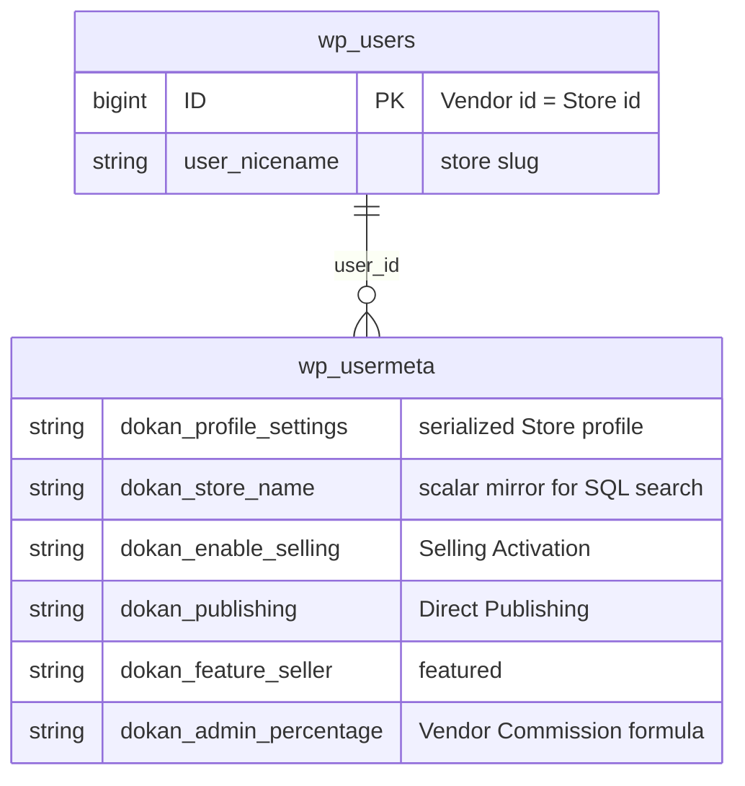

# A Vendor is a WordPress user with the `seller` role; the Store lives in user meta

Status: Accepted (retroactive — documents existing code)

## Context

A marketplace needs an identity for each Vendor and a record for each Store: a name, a URL, an address, payment details, and the Operating Terms the marketplace imposes (Selling Activation, Direct Publishing, Commission, featured status). Dokan could have modelled the Store as its own entity, for example a custom post type or a custom table keyed by a store id, and linked users to it. It did not. There is no Store entity anywhere in Lite: `includes/` contains no `register_post_type`, no `register_taxonomy` and no store table (see [ADR-0013](./0013-marketplace-money-lives-in-custom-tables-not-post-types.md)).

## Decision

**[Lite]** A Vendor is a row in `wp_users`. Being a Vendor is expressed through WordPress roles and capabilities, and the Store is a facet of that user, stored in user meta. One user, one Store, keyed by the user id.

- **Role and capability.** `Installer::user_roles()` (`lite:includes/Install/Installer.php:167`) creates the `seller` role (labelled "Vendor") with WordPress post and WooCommerce product capabilities plus the `dokandar` marker capability (`add_role()` at `lite:includes/Install/Installer.php:174`, `dokandar` at `:200`). It then grants `dokandar` to `administrator` and `shop_manager`, and grants every capability from `dokan_get_all_caps()` to `seller`, `administrator` and `shop_manager` (`lite:includes/Install/Installer.php:211-217`).
- **"Is this user a Vendor?" is a capability test, not a role test.** `dokan_is_user_seller()` (`lite:includes/functions.php:77`) returns `user_can( $user_id, 'dokandar' )`, with an optional exclusion for `vendor_staff`. Because `administrator` and `shop_manager` hold `dokandar`, they count as Vendors by default. `Installer::add_store_name_meta_key_for_admin_users()` (`lite:includes/Install/Installer.php:66`) writes `dokan_store_name` for those users, and its docblock says this exists because several SQL queries rely on that meta key.
- **Store profile.** The Store is the serialized `dokan_profile_settings` user meta. `Vendor::popluate_store_data()` (`lite:includes/Vendor/Vendor.php:233`, meta read at `:259`) lazily merges it over defaults and passes it through `dokan_vendor_shop_data`. `Vendor::apply_changes()` (`lite:includes/Vendor/Vendor.php:1627`) writes the whole array back (`:1629`) and mirrors the store name into the scalar `dokan_store_name` meta via `Vendor::update_meta_data()` (`lite:includes/Vendor/Vendor.php:1479`), so that store search can use SQL `LIKE` on a plain column.
- **Store URL.** The store slug is the user's `user_nicename`. `dokan_get_store_url()` (`lite:includes/functions.php:1202`) builds `/{custom_store_url}/{user_nicename}/`. Registration sets `user_nicename` from the submitted `shopurl` through `Registration::set_new_vendor_names()` on WooCommerce's `woocommerce_new_customer_data` filter (applied at `wc:includes/wc-user-functions.php:163`).
- **Operating Terms are scalar user meta.** Selling Activation is `dokan_enable_selling` (`yes` / `no`), Direct Publishing is `dokan_publishing`, featured status is `dokan_feature_seller`, and the Vendor-level Commission formula is `dokan_admin_percentage`, `dokan_admin_percentage_type`, `dokan_admin_additional_fee` and `admin_category_commission`. `dokan_is_seller_enabled()` (`lite:includes/functions.php:1172`) treats anything other than `yes`, including an absent row, as Pending.
- **Vendor Staff resolve to their Vendor.** `dokan_get_current_user_id()` (`lite:includes/functions.php:52`) returns the `_vendor_id` user meta for a user holding `vendor_staff`, so data scoping follows the Vendor's user id. The role that grants `vendor_staff` is consumed by Dokan Pro.
- **Queries.** `Vendor\Manager::get_vendors()` (`lite:includes/Vendor/Manager.php:57`) wraps `WP_User_Query` with `role__in = [ 'seller', 'administrator' ]` and filters Approved Vendors with a `dokan_enable_selling = yes` meta query.

## Consequences

- Vendors get WordPress authentication, password reset and user profile screens without Dokan reimplementing them. Becoming a Vendor is a role change (`dokan_user_update_to_seller()`, `lite:includes/functions.php:4414`), not a data migration.
- Every Vendor-owned record can point at a Vendor with a plain user id: `wp_posts.post_author` for products ([ADR-0010](./0010-product-ownership-is-post-author.md)), `_dokan_vendor_id` on Vendor orders, and `seller_id` / `vendor_id` columns in Dokan's tables.
- Because Vendor status is the `dokandar` capability, a Store Admin is also a Vendor. The admin can sell their own products, and admin-owned products produce Vendor orders like any other Vendor's products.
- The Store profile is one serialized blob. Individual fields inside it cannot be indexed or queried in SQL, which is why `dokan_store_name` is duplicated into its own meta row. Any other field that needs to be searchable must be mirrored the same way.
- The store URL changes when `user_nicename` changes. The store base slug (`custom_store_url`) is a rewrite-rule concern; changing it re-registers and flushes rules (`Admin\Settings::flush_store_url_rewrites`).

## Risks

- **Two definitions of "Vendor" in queries.** `dokan_is_user_seller()` accepts any `dokandar` holder, including `shop_manager`, while `Vendor\Manager::get_vendors()` defaults to `role__in = [ 'seller', 'administrator' ]`. A shop manager therefore passes Vendor checks but does not appear in default Vendor listings. This asymmetry is observable in code; this ADR records it without resolving it.
- **Mirrored meta can drift.** `dokan_store_name` is kept in step by `Vendor::apply_changes()`, registration and the installer. Code that writes `dokan_profile_settings` directly with `update_user_meta()` bypasses the mirror.
- **Absent means Pending.** Under the `manually` approval setting, a new Vendor commonly has no `dokan_enable_selling` row at all. Queries that look for `dokan_enable_selling = no` miss Pending Vendors; `Manager::exclude_approved_vendors()` uses a `NOT EXISTS` subquery for this reason.

## Recommendations

- Treat `dokan_is_user_seller()` and `dokan_get_current_user_id()` as the only supported way to answer "is this a Vendor" and "which Vendor is acting". Avoid new direct role checks against `seller`.
- If a new Store field must be filterable or sortable in SQL, add a dedicated scalar meta key written in `Vendor::apply_changes()` rather than querying inside the serialized blob.
- Consider aligning the default `role__in` of `Vendor\Manager::get_vendors()` with the capability-based definition, or document the difference where listings are built. Doing so changes which users appear in store listings, so it is a behavioural change that needs its own review.

## Known gaps

- Whether any third-party code relies on `shop_manager` being excluded from default Vendor listings was not investigated.
- The full list of SQL queries that depend on `dokan_store_name` existing for admin users (the reason given in the installer docblock) was not enumerated.

_Verified against Lite @e1ce7fc81 / Pro @65975a952 / WooCommerce 11.2.1 — 2026-10-22._
