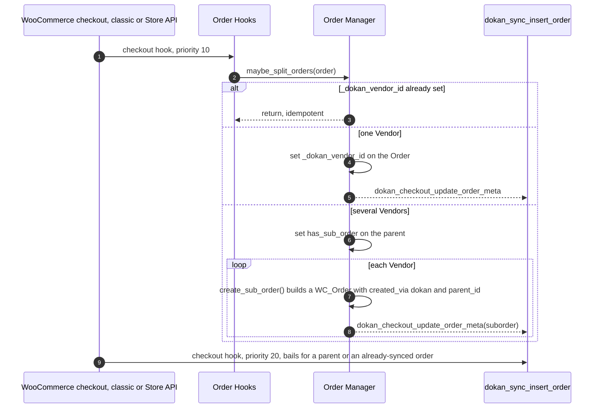

# Suborders are created synchronously on the checkout hooks, grouped by product author

Status: Accepted (retroactive — documents existing code)

## Context

[ADR-0004](./0004-vendor-order-is-authoritative-parent-is-mirror.md) records *what* a Suborder is for: the Vendor order is authoritative, and the parent Order is a customer-facing mirror. It does not record *how and when* a multi-vendor Order becomes Suborders. That mechanism is load-bearing in its own right. It determines which WooCommerce hooks Dokan depends on, how Dokan avoids splitting the same Order twice, what happens to orders created outside checkout, and how much work runs inside the customer's checkout request.

This ADR documents the mechanism only. It does not restate or re-argue ADR-0004.

## Decision

**[Lite]** Dokan splits an Order during the checkout request itself, immediately after WooCommerce has created it, by creating one real `WC_Order` per Vendor through WooCommerce CRUD.

**Trigger.** `Order\Hooks::__construct` registers `Hooks::split_vendor_orders` at priority 10 on both checkout implementations (`lite:includes/Order/Hooks.php:41-42`):

- `woocommerce_checkout_update_order_meta`, fired by the classic checkout at `wc:includes/class-wc-checkout.php:514`;
- `woocommerce_store_api_checkout_order_processed`, fired by the Store API (Checkout Block) at `wc:src/StoreApi/Routes/V1/Checkout.php:695` and `wc:src/StoreApi/Routes/V1/CheckoutOrder.php:160`.

`dokan_sync_insert_order` is registered on the same two hooks at priority 20 (`lite:includes/Order/Hooks.php:45-46`) so that a single-vendor Order is synced into Dokan's tables after the split has tagged it.

**Split.** `Order\Manager::maybe_split_orders()` (`lite:includes/Order/Manager.php:896`):

1. Returns at once if the Order already carries `_dokan_vendor_id` (`:910`). That meta is both "this is a Vendor order" and the idempotency marker that makes repeated calls harmless.
2. Deletes existing child orders first when called with `$force_create` or when `has_sub_order` is already set.
3. Groups line items by Vendor with `dokan_get_sellers_by()`, which reads each product's `post_author` ([ADR-0010](./0010-product-ownership-is-post-author.md)).
4. **One Vendor:** fires `dokan_create_parent_order`, writes `_dokan_vendor_id` on the Order itself (`:940`), saves, and fires `dokan_checkout_update_order_meta`. No Suborder is created.
5. **Several Vendors:** writes `has_sub_order = true` on the parent, saves, then calls `create_sub_order()` once per Vendor.

**Suborder construction.** `Order\Manager::create_sub_order()` (`lite:includes/Order/Manager.php:582`) builds a new `WC_Order` with `created_via = dokan` (`:612`) and `_dokan_vendor_id` (`:622`), copies customer, addresses, currency and payment method, clones the Vendor's line items (adding `_dokan_parent_order_item_id`), copies shipping lines whose `seller_id` item meta matches, rebuilds tax and coupon lines, fires `dokan_create_sub_order_before_calculate_totals`, runs `calculate_totals()`, copies the parent's status, links the parent with `set_parent_id()` (`:653`), saves, updates total sales, and fires `dokan_checkout_update_order_meta( $suborder_id, $seller_id )`. Any `Throwable` is logged and returned as `WP_Error( 'dokan-suborder-error' )`.

**Orders created outside checkout.** Orders created in WP-admin are split lazily: `Hooks::on_order_status_change` calls `maybe_split_orders()` when an order with no parent and no `has_sub_order` changes status in admin (`lite:includes/Order/Hooks.php:100-109`), and `dokan_sync_insert_order` also runs on `woocommerce_process_shop_order_meta` priority 60 in admin (`lite:includes/Order/Hooks.php:54-56`; WooCommerce fires it at `wc:includes/admin/class-wc-admin-meta-boxes.php:262` and `wc:src/Internal/Admin/Orders/Edit.php:318`). The status listener runs on `woocommerce_order_status_changed`, fired at `wc:includes/class-wc-order.php:478`.

## Consequences

- Suborders exist as soon as checkout returns. Payment, status cascade, emails, Commission and the Vendor's dashboard all see real orders from the first status change onward, with no background job to wait for.
- Because Suborders are created through WooCommerce CRUD, they are stored wherever WooCommerce stores orders and work under both HPOS and posts storage ([ADR-0017](./0017-orders-are-storage-agnostic-through-woocommerce-crud.md)).
- `created_via = dokan` and the `parent_id` link use WooCommerce's own fields, so WooCommerce's own order queries (for example the `parent` and `created_via` query arguments, `wc:includes/abstracts/abstract-wc-object-query.php:80` and `wc:includes/class-wc-order-query.php:72`) can tell Suborders apart without Dokan meta.
- `dokan_checkout_update_order_meta` is the single seam that announces "a Vendor order is ready". Lite's own sync uses it, and it is consumed by Dokan Pro.
- Split work scales with the number of Vendors in the cart and runs inside the customer's checkout request: one order insert, item clone and totals calculation per Vendor.
- Supporting a new way of creating orders (for example a new checkout implementation) requires that it fire one of the two checkout hooks, or that Dokan add a listener for it.

## Risks

- **Partial split.** `create_sub_order()` returns a `WP_Error` on failure, but `maybe_split_orders()` does not inspect the return value. If one Vendor's Suborder fails, the parent still carries `has_sub_order` and the other Suborders exist; the failure is visible only in the Dokan log.
- **Attribution is read at split time.** Grouping uses each product's `post_author` when the split runs. A product with no author, or one filtered to an empty Vendor through `dokan_get_sellers_by`, is left out of every Suborder.
- **Re-split deletes Suborders.** `$force_create`, or a call on an Order that already has `has_sub_order` but no `_dokan_vendor_id`, permanently deletes the existing child orders before recreating them.
- **Hook coverage.** The split depends on WooCommerce continuing to fire `woocommerce_checkout_update_order_meta` and `woocommerce_store_api_checkout_order_processed`. Orders created by code paths that fire neither (for example programmatic `wc_create_order()` outside admin) are not split until something calls `maybe_split_orders()`.

## Recommendations

- Have `maybe_split_orders()` collect `WP_Error` results from `create_sub_order()` and surface them (an order note on the parent, or an action) so that a partial split is visible to the Store Admin.
- Document `dokan()->order->maybe_split_orders( $order_id )` as the supported call for integrations that create orders outside checkout.

## Known gaps

- Behaviour when a Suborder is created already in a final status, and whether a status transition then follows for the ledger row, is listed as a gap in `docs/adr/reference/orders-commission-fees.md`.
- Whether any supported payment gateway creates orders through a path that fires neither checkout hook was not surveyed.

_Verified against Lite @63ad89353 / Pro @a8a98c732 / WooCommerce 11.2.1 — 2026-10-14._
