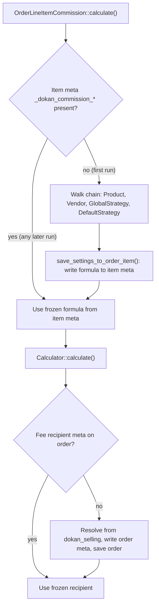

# Commission formula and Fee recipients are frozen onto the order at first calculation

Status: Accepted (retroactive — documents existing code)

## Context

A Commission formula can be set at four levels: the product (`_per_product_admin_*` post meta), the Vendor (`dokan_admin_percentage*` user meta), the global `dokan_selling` settings, and a built-in default. Fee recipients (who receives shipping, tax and shipping tax) are global `dokan_selling` settings. All of these are Operating Terms that a Store Admin can change at any time.

Orders, however, are recalculated long after checkout: on order edits (`VendorBalanceUpdateHandler`), on refunds (`OrderRefundCommission`), when gateway fees arrive (`Fees::calculate_gateway_fee`), and when Analytics regenerates `dokan_order_stats`. If each recalculation read the *current* settings, changing a rate today would silently rewrite the Earning of every historical order.

## Decision

**[Lite]** The terms in force at the first calculation are written onto the order itself and reused by every later calculation.

**Commission formula, per line item.** `OrderLineItemCommission::calculate()` (`lite:includes/Commission/OrderLineItemCommission.php:108`) builds a chain of responsibility whose default head is `Strategies\OrderItem`, passed through the `dokan_order_line_item_commission_strategies` filter (`:122-125`). The chain is `OrderItem` → `Product` → `Vendor` → `GlobalStrategy` → `DefaultStrategy`. `AbstractStrategy::get_eligible_strategy()` (`lite:includes/Commission/Strategies/AbstractStrategy.php:55`) returns the first strategy whose setting is applicable. `AbstractStrategy::save_settings_to_order_item()` (`lite:includes/Commission/Strategies/AbstractStrategy.php:100`) then writes the resolved setting to the line item, but only when the head is an `OrderItem` strategy. `Settings\OrderItem::save()` (`lite:includes/Commission/Settings/OrderItem.php:79`) stores `_dokan_commission_source`, `_dokan_commission_rate`, `_dokan_commission_type`, `_dokan_additional_fee` and `_dokan_commission_meta` (`:88-92`), with the `dokan_order_line_item_commission_settings_before_save` filter and `_after_save` action around it.

On every later calculation the `OrderItem` strategy finds that item meta applicable and stops there, so the rest of the chain, and therefore the current product, Vendor and global settings, is never consulted. The class comment on `Strategies\OrderItem` (`lite:includes/Commission/Strategies/OrderItem.php:5-8`) states the intent: a previously purchased order is calculated with the previously stated rate, because the admin may change rates before the order table is regenerated.

**Fee recipients, per order.** `Fees::get_shipping_fee_recipient()` (`lite:includes/Fees.php:155`), `get_tax_fee_recipient()` and `get_shipping_tax_fee_recipient()` read order meta first (`shipping_fee_recipient`, `tax_fee_recipient`, `shipping_tax_fee_recipient`). When the meta is empty they resolve the value from settings, apply `dokan_shipping_fee_recipient` / `dokan_tax_fee_recipient` / `dokan_shipping_tax_fee_recipient`, write the result to order meta and save the order. The recipient is fixed at its first read.

**Legacy precedence.** `Commission::get_earning_by_order()` (`lite:includes/Commission.php:204`) returns the legacy `_dokan_admin_fee`-based figure when that meta exists (`:217-225`), so orders calculated before the strategy system keep their original split.

## Consequences

- Changing a product, Vendor, category or global Commission formula affects only orders whose items have not been calculated yet. Historical Earnings, refunds and Analytics regenerations stay consistent with what the Vendor saw at the time.
- The order carries its own explanation: the Commission meta box and REST consumers can show the formula that produced a figure without reconstructing past settings.
- `Fees::hide_extra_data` hides `_dokan_commission_rate`, `_dokan_commission_type` and `_dokan_additional_fee` from formatted item meta, so the snapshot does not leak into customer-facing order displays.
- The filters on Fee recipients and on the strategy chain are effective only before the first resolution. After that, the frozen meta wins.
- Extensions that replace the chain head through `dokan_order_line_item_commission_strategies` opt out of the snapshot unless their head is an `OrderItem` strategy.

## Risks

- **Write-on-read side effects.** The Fee recipient getters call `$order->save()` the first time they run, wherever that is. A read in an unexpected context (a report, a REST response) persists a recipient and triggers WooCommerce's order-save hooks.
- **First calculation timing defines the terms.** The snapshot is taken at the first calculation, not strictly at payment. For checkout orders that is `dokan_sync_insert_order()`; for admin-created orders it is whenever an order is first synced or calculated.
- **Correcting a mistaken rate requires editing item meta.** Because the frozen formula always wins, fixing a wrong Commission on an existing order means changing or deleting the `_dokan_commission_*` item meta. `Commission\RecalculateCommissions` exists but is dormant: its constructor returns before registering any hook.

## Recommendations

- Treat the `_dokan_commission_*` item meta and the `*_fee_recipient` order meta as part of the order's financial record. Migrations and tools should preserve them.
- If a supported "recalculate with current rates" tool is ever wanted, implement it as an explicit action that clears the snapshot and records who did it, rather than as a change to the strategy chain.
- Prefer moving Fee recipient resolution to an explicit point (for example inside `dokan_sync_insert_order()`) over write-on-read in getters, so that saving the order is not a hidden side effect of reading it.

## Known gaps

- Whether any caller fires `dokan_recalculate_order_commission_and_adjust_vendor_balance` expecting `RecalculateCommissions` to run was not searched outside Lite.
- The Formula classes under `includes/Commission/Formula/` are referenced by the `V_3_14_0` upgrader and, for the `Fixed::SOURCE` constant, by `Settings\DefaultSetting`, but `Calculator` does not instantiate them; their long-term status is not recorded in code.

_Verified against Lite @63ad89353 / Pro @a8a98c732 / WooCommerce 11.2.1 — 2026-10-14._
