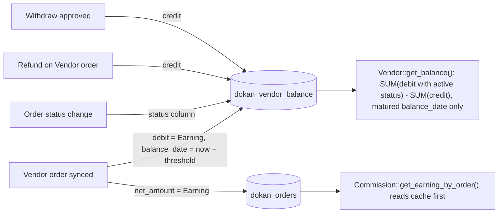

# Marketplace money lives in custom tables; domain entities reuse WordPress and WooCommerce types

Status: Accepted (retroactive — documents existing code)

## Context

Dokan stores two kinds of data. The first kind is entities that WordPress and WooCommerce already model: users, products, orders, refunds, pages. The second kind is marketplace accounting that neither of them models: the Vendor's Earning per Vendor order, a running Balance, Withdraw requests, the Reverse withdrawal receivable and per-order Analytics splits between admin and Vendor.

For the second kind, the WordPress-native option would have been custom post types with post meta. Dokan chose dedicated tables instead, while deliberately registering no post types of its own.

## Decision

**[Lite]** Dokan reuses WordPress and WooCommerce types for entities and keeps marketplace money in seven custom tables.

**No custom post types, statuses or taxonomies.** `includes/` contains no `register_post_type`, `register_post_status` or `register_taxonomy` call. Vendors are users ([ADR-0009](./0009-vendor-is-a-wordpress-user-with-the-seller-role.md)), products are WooCommerce `product` posts owned through `post_author` ([ADR-0010](./0010-product-ownership-is-post-author.md)), Suborders are WooCommerce orders ([ADR-0011](./0011-suborders-are-created-synchronously-at-checkout.md)), and refunds are `WC_Order_Refund`.

**Seven tables.** `Installer::create_tables()` (`lite:includes/Install/Installer.php:331`) creates `dokan_withdraw`, `dokan_announcement`, `dokan_orders`, `dokan_refund`, `dokan_vendor_balance`, `dokan_reverse_withdrawal` and `dokan_order_stats`, each with `CREATE TABLE IF NOT EXISTS` through `dbDelta()`. `WeDevs_Dokan::wpdb_table_shortcuts()` (`lite:dokan-class.php:346`) exposes five of them as `$wpdb->dokan_*` aliases on `init` priority 1. No table declares a foreign key; every relationship to `wp_users`, `wc_orders` / `wp_posts` or another Dokan table is enforced in PHP. Money columns are `decimal(19,4)` in the ledgers (since the `V_3_0_4` upgrader) and `double` in `dokan_order_stats`.

The three tables that carry the Vendor money flow:

- **`dokan_orders` — one row per Vendor order, caching its Earning.** Created by `Installer::create_sync_table()` (`lite:includes/Install/Installer.php:372`) and written by `dokan_sync_insert_order()` (`lite:includes/Order/functions.php:217`), which skips parents that have Suborders. Its `net_amount` is the Vendor's Earning. `Commission::get_earning_by_order()` (`lite:includes/Commission.php:204`) reads this table (`:228`) before it runs the calculator, so the stored figure is the answer for any order already synced; the admin figure is derived as `order_total - net_amount`.
- **`dokan_vendor_balance` — the Balance ledger.** Created by `Installer::create_vendor_balance_table()` (`lite:includes/Install/Installer.php:445`). Each row is one transaction typed by `trn_type` (`VendorBalance::TRN_TYPE_DOKAN_ORDERS`, `TRN_TYPE_DOKAN_WITHDRAW`, `TRN_TYPE_DOKAN_REFUND`, `lite:includes/Models/VendorBalance.php:9-11`). Earnings are `debit` rows written at sync time with `balance_date = now + withdraw threshold days` (`lite:includes/Order/functions.php:273-282`); Withdraws are `credit` rows written on approval by `Withdraw\Hooks::update_vendor_balance()` (`lite:includes/Withdraw/Hooks.php:110`); Refunds are `credit` rows written by `RefundHandler::insert_into_balance_table()` (`lite:includes/Order/RefundHandler.php:191`). Order rows carry the WooCommerce status, kept in step by `Order\Hooks::on_order_status_change`.
- **`dokan_order_stats` — Analytics companion to `wc_order_stats`.** Created by `Installer::create_dokan_order_stats_table()` (`lite:includes/Install/Installer.php:551`) and upserted by `Analytics\Reports\Orders\Stats\DataStore::update()` (`lite:includes/Analytics/Reports/Orders/Stats/DataStore.php:99`) with the full admin/Vendor split from `OrderCommission`, so WooCommerce Analytics reports can join it on `order_id`.

**Balance is computed, not stored.** `Vendor::get_balance()` (`lite:includes/Vendor/Vendor.php:873`) returns `SUM(debit)` of rows whose `status` is an active order status minus `SUM(credit)` of all rows, both restricted to a matured `balance_date`. `VendorBalanceStore::get_total_earning_by_vendor()` (`lite:includes/Models/DataStore/VendorBalanceStore.php:59`) uses the same shape with filterable `trn_type` and status lists. Results are cached per Vendor.

## Consequences

- Money queries are single-table aggregates on typed `decimal` columns (`SUM(debit) - SUM(credit)`), not meta joins over `longtext`. Vendor dashboards, Withdraw validation and the store listing's "total orders" sort (which joins `dokan_orders`) stay cheap.
- The ledger is append-oriented: a refund adds a credit rather than reducing the order's debit (`VendorBalanceUpdateHandler::handle_order_edit` keeps refunds as separate rows). The history of a Vendor's money is visible row by row.
- The withdraw threshold is applied once, at insert, through `balance_date`. Earnings mature into the withdrawable Balance without a cron job.
- Order statuses and Earnings are duplicated from WooCommerce into Dokan's tables, so every WooCommerce event that changes them needs a listener: status changes, trash and untrash (`OrderEventListener`), order edits (`VendorBalanceUpdateHandler`), deletion (`Order\Manager::delete_seller_order`) and refunds.
- Because none of the data is in posts, WordPress export/import, revisions and the post-meta UI do not cover it. Uninstall removal is handled explicitly by `uninstall.php`, which drops the tables named in its `get_tables()` list only when the `data_clear_on_uninstall` setting in `dokan_general` is `on`. That list includes six of the seven Lite tables above but not `dokan_order_stats`.
- Lite creates `dokan_refund` and `dokan_announcement` but never inserts into them; both are consumed by Dokan Pro.

## Risks

- **No referential integrity.** Without foreign keys, rows can outlive their source. Deleting a WooCommerce order outside the paths Dokan listens to leaves orphaned `dokan_orders`, ledger and `dokan_order_stats` rows.
- **Cache and source can diverge.** `dokan_orders.net_amount` is the cached Earning and wins over recalculation in `get_earning_by_order()`. Any change to an order that no listener catches leaves the cache stale until the order is re-synced.
- **Empty status at insert.** `dokan_sync_insert_order()` does not set the ledger row's `status`, and Balance queries count only rows with an active status. A row that never receives a status transition never counts (recorded as a Known gap in `docs/adr/reference/orders-commission-fees.md`).
- **Approval is one-way in Lite.** The Withdraw credit is written on approval; Lite has no listener that reverses it if an approved Withdraw is later cancelled or deleted (recorded in `docs/adr/reference/withdraw-and-reverse-withdrawal.md`).

## Recommendations

- Keep new marketplace money data in typed tables following this pattern, and add a matching cleanup step to `Order\Manager::delete_seller_order()` for any new table keyed by order id.
- When adding a WooCommerce event that changes order totals or status, add the corresponding listener that updates `dokan_orders` and the ledger, or document why the change does not affect Earning.
- Consider writing the order status at ledger insert time so that a row's Balance eligibility does not depend on a later transition.

## Known gaps

- Whether the omission of `dokan_order_stats` from `uninstall.php`'s table list is intentional is not recorded in code.
- Whether every WooCommerce order deletion path (bulk delete, REST delete, HPOS sync deletion) reaches `delete_seller_order()` was not exhaustively traced.

_Verified against Lite @e1ce7fc81 / Pro @65975a952 / WooCommerce 11.2.1 — 2026-10-22._
