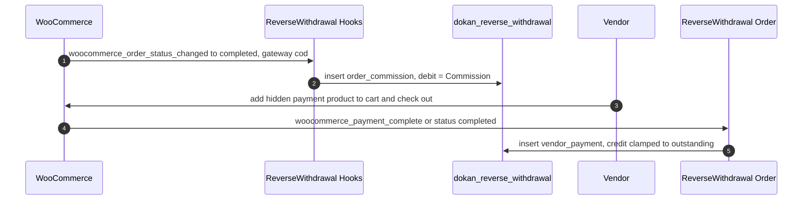

# Reverse withdrawal is a separate receivable ledger, settled by buying a hidden product

Status: Accepted (retroactive — documents existing code)

## Context

When a customer pays a Vendor directly, through a gateway that bypasses the marketplace (by default cash on delivery), the whole order total sits with the Vendor and the admin's Commission is owed back to the marketplace. Dokan needed somewhere to record that debt and a way for the Vendor to pay it.

The tempting shortcut is to treat it as a negative Withdraw: subtract the Commission from the Vendor's Balance. `CONTEXT.md` rules that out in vocabulary ("never a negative Withdraw — a Reverse withdrawal is a receivable, not a Balance entry; the two concepts never mix"), and the code implements that rule structurally. No existing ADR records the structural choice.

## Decision

**[Lite]** Reverse withdrawal has its own table, its own closed set of transaction types, its own balance computation, and a payment path that runs through an ordinary WooCommerce checkout.

- **Separate table.** `dokan_reverse_withdrawal` is created by `InstallerHelper::create_reverse_withdrawal_table()` (`lite:includes/ReverseWithdrawal/InstallerHelper.php:23`), called from `Installer::create_tables()` and the `V_3_5_1` upgrader. It is distinct from `dokan_vendor_balance` ([ADR-0013](./0013-marketplace-money-lives-in-custom-tables-not-post-types.md)), and nothing in the Balance queries reads it. Its `trn_date` is a Unix timestamp (`int(11)`), unlike the `timestamp` columns of the Balance ledger, and it carries composite indexes on `vendor_id`, `trn_date` and `trn_type`.
- **Closed transaction types.** `Helper::get_transaction_types()` (`lite:includes/ReverseWithdrawal/Helper.php:57`) returns a fixed map (`opening_balance`, `order_commission`, `failed_transfer_reversal`, `product_advertisement`, `manual_order_commission`, `vendor_payment`, `order_refund`, `manual_product`, `manual_order`, `other`). Its code comment forbids changing the keys or adding a filter, because queries depend on them. `ReverseWithdrawal\Manager::insert()` (`lite:includes/ReverseWithdrawal/Manager.php:512`) rejects any other `trn_type`.
- **Debt accrual.** `ReverseWithdrawal\Hooks::process_order_status_changed()` (`lite:includes/ReverseWithdrawal/Hooks.php:187`) on `woocommerce_order_status_changed` (fired at `wc:includes/class-wc-order.php:478`) inserts an `order_commission` debit equal to `dokan()->commission->get_earning_by_order( $order_id, 'admin' )` when a Vendor order (not a parent with Suborders, consistent with [ADR-0004](./0004-vendor-order-is-authoritative-parent-is-mirror.md)) moves to `completed` with a payment method enabled for reverse withdrawal. The gateway list comes from `SettingsHelper::get_enabled_payment_gateways()`: it is empty while the feature is disabled, and otherwise every key of the `dokan_reverse_withdrawal_payment_gateways` filter (default `cod` only). A second insert for the same order is prevented by `Manager::is_reverse_withdrawal_added()`.
- **Outstanding amount.** `Manager::get_store_balance()` (`lite:includes/ReverseWithdrawal/Manager.php:367`) returns `debit - credit` over the Vendor's rows.
- **Payment through WooCommerce.** The installer creates a hidden, virtual product (`InstallerHelper::create_reverse_withdrawal_base_product()`, `lite:includes/ReverseWithdrawal/InstallerHelper.php:55`, catalog visibility `hidden` at `:93`) and stores its id in the `dokan_reverse_withdrawal_product_id` option. `Helper::add_payment_to_cart()` (`lite:includes/ReverseWithdrawal/Helper.php:895`) empties the cart and adds that product with the amount as cart item data; `Cart` sets the price and blocks mixing it with other products. When the payment order completes (on `woocommerce_payment_complete`, fired at `wc:includes/class-wc-order.php:186`, or on `woocommerce_order_status_changed` to `completed`), `ReverseWithdrawal\Order::insert_payment()` (`lite:includes/ReverseWithdrawal/Order.php:98`) writes a `vendor_payment` credit, clamped to the outstanding amount, and marks fully resolved orders with `_dokan_reverse_withdrawal_payment_settled` (`lite:includes/ReverseWithdrawal/Order.php:24`).
- **Enforcement.** Overdue debt triggers configurable "failed actions" (`FailedActions`; options from `SettingsHelper::get_failed_payment_actions()`). They are evaluated for all Vendors by the daily `dokan_reverse_withdrawal_midnight_cron` Action Scheduler job (`CronActions::maybe_take_action`; a separate monthly job sends billing invoice emails), and on every insert through `dokan_reverse_withdrawal_created`, where `Hooks::after_reverse_withdrawal_inserted` applies actions after a debit-type row and reverts them after `vendor_payment` or `order_refund`.

## Consequences

- A Vendor's Balance (money the marketplace owes them) and their Reverse withdrawal balance (money they owe the marketplace) are never netted against each other implicitly. Each has its own screens, REST routes (`dokan/v1/reverse-withdrawal/*`) and history.
- Paying the debt reuses every WooCommerce payment gateway, receipt, order note and email, at the cost of a hidden product that must exist and stay published.
- The closed transaction-type list makes the ledger's meaning stable for queries, but adding a new kind of debt or credit requires a code change in `Helper::get_transaction_types()`, not a filter. Several types (for example `product_advertisement` and `manual_order_commission`) are written outside Lite.
- Deleting a Vendor order removes its `order_commission`, `manual_order_commission` and `order_refund` rows (`Order\Manager::delete_seller_order`).

## Risks

- **Hidden product dependency.** If the base product is trashed or deleted, the payment path cannot add it to the cart. `Admin\Hooks` clears the option on trash, and the product is recreated on settings save, but the payment flow is unavailable in between.
- **Cart takeover.** Starting a payment empties the Vendor's cart, which affects a Vendor who is also shopping as a Customer.
- **Different time representation.** `trn_date` is an integer timestamp here and a `timestamp` column in the Balance ledger. Reports that combine the two ledgers must convert one of them.

## Recommendations

- Keep the two ledgers separate. A feature that wants to settle a Reverse withdrawal from a Balance should write explicit rows in both ledgers rather than reading one from the other.
- If new transaction types become frequent, consider a registration API that still yields a closed, validated list, rather than editing the constant map each time.

## Known gaps

- Producers of the transaction types that Lite never writes (everything except `order_commission` and `vendor_payment`) are outside this repository and were not examined.
- How the payment path behaves when the base product is unpublished mid-checkout was not traced.

_Verified against Lite @63ad89353 / Pro @a8a98c732 / WooCommerce 11.2.1 — 2026-10-14._
