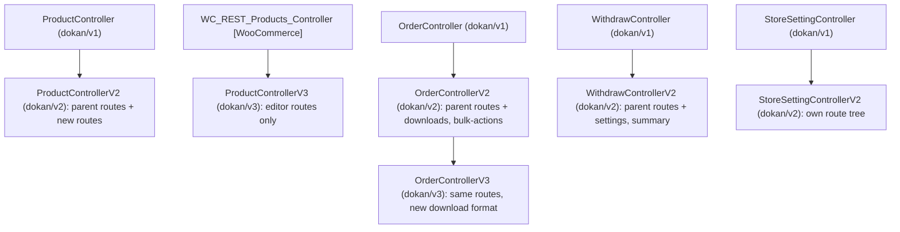

# REST versions are additive, per-resource controller subclasses registered side by side

Status: Accepted (retroactive — documents existing code)

## Context

Dokan's REST API is consumed by its own React and Vue dashboards, by mobile and third-party clients, and by Dokan Pro. Resources such as products, orders, withdraws and store settings have needed contract changes over time: new list filters, new response shapes, new sub-routes. Breaking `dokan/v1` would break every existing client at once, while a whole-API version bump would force every resource to be re-implemented together.

## Decision

**[Lite]** Each resource is versioned independently. A new version of a resource is a subclass of the previous version's controller with a new `$namespace`, and all versions stay registered at the same time from one class map.

- **One class map, all versions.** `REST\Manager::get_rest_api_class_map()` (`lite:includes/REST/Manager.php:221`) returns a `file => class` map, filterable through `dokan_rest_api_class_map`, that lists v1, v2 and v3 controllers together. `REST\Manager::register_rest_routes()` (`lite:includes/REST/Manager.php:48`), on `rest_api_init`, requires each file, skips missing files and non-`WP_REST_Controller` classes, instantiates the controller and calls `register_routes()`.
- **Versions extend their predecessor.** `ProductControllerV2` (`lite:includes/REST/ProductControllerV2.php:18`) extends `ProductController` with `$namespace = 'dokan/v2'` and calls `parent::register_routes()` (`:48`), so every `dokan/v1/products*` route is re-registered under `dokan/v2` before the new routes are added. `OrderControllerV2` (`lite:includes/REST/OrderControllerV2.php:19`, `parent::register_routes()` at `:39`) and `WithdrawControllerV2` (`lite:includes/REST/WithdrawControllerV2.php:10`, `:27`) follow the same pattern. `OrderControllerV3` (`lite:includes/REST/OrderControllerV3.php:12`) extends `OrderControllerV2`, changes only the namespace to `dokan/v3` and overrides `format_downloads_data()`, inheriting every route.
- **Replacements are allowed where the contract is new.** `StoreSettingControllerV2` (`lite:includes/REST/StoreSettingControllerV2.php:19`) extends `StoreSettingController` but defines its own `register_routes()` without calling the parent, so `dokan/v2/settings` is a different route tree. `ProductControllerV3` (`lite:includes/REST/ProductControllerV3.php:19`) does not extend Dokan's v2 controller at all: it extends WooCommerce's `WC_REST_Products_Controller` and registers only `dokan/v3/products` create, update, batch and the field-schema routes used by the React product editor.
- **New resources start in `dokan/v1`.** Controllers added later for new resources, such as `VendorStoreSettingsController` (`dokan/v1/vendor-settings/store`) and `AdminSettingsController` (`dokan/v1/admin/settings`, through `DokanBaseAdminController`'s `dokan/v1/admin` namespace), are registered under v1. A version number is bumped only when an existing resource's contract changes.

## Consequences

- Old clients keep working: `dokan/v1` routes are never removed when a v2 appears, and v2 routes keep working when v3 appears.
- Permission callbacks, schemas and Ownership checks are inherited along with the routes, so a fix in a v1 permission method also applies to every subclass that inherits it.
- The same handler is reachable under several namespaces (for example `dokan/v1/orders/{id}`, `dokan/v2/orders/{id}` and `dokan/v3/orders/{id}`). Route counts and the REST index grow with each version.
- Version numbers are per resource, so `dokan/v3` does not mean "the v3 API". A client needs `dokan/v1/stores`, `dokan/v2/withdraw/summary` and `dokan/v3/products` side by side.
- Extensions add, replace or remove controllers through `dokan_rest_api_class_map`; this seam is consumed by Dokan Pro.

## Risks

- **Inherited changes leak backwards and forwards.** Because v2 and v3 inherit v1 behaviour, changing a shared method in the base controller changes every version's contract at once. The isolation between versions exists only for methods a subclass overrides.
- **Not every v-next is a superset.** `ProductControllerV3` and `StoreSettingControllerV2` do not inherit their predecessors' routes. A client that assumes "v3 contains everything in v2" will find routes missing (for example, no `dokan/v3` product delete route is registered).
- **Duplicate class-map entries.** The array literal in `get_rest_api_class_map()` lists most controllers twice with identical keys. PHP keeps the last value for a repeated key, so registration is unaffected today, but the duplication makes the map harder to audit.

## Recommendations

- Keep bumping versions per resource, and keep the "extend and call `parent::register_routes()`" pattern as the default so that v-next is a superset unless there is a stated reason.
- When a v-next intentionally drops routes (as `ProductControllerV3` does), say so in the controller docblock.
- Remove the duplicated entries in the class-map literal in a separate, behaviour-neutral change.

## Known gaps

- Which external clients depend on which namespace was not determinable from source.
- No deprecation or sunset mechanism for old namespaces exists in Lite; whether one is planned is not recorded in code.

_Verified against Lite @e1ce7fc81 / Pro @65975a952 / WooCommerce 11.2.1 — 2026-10-22._
