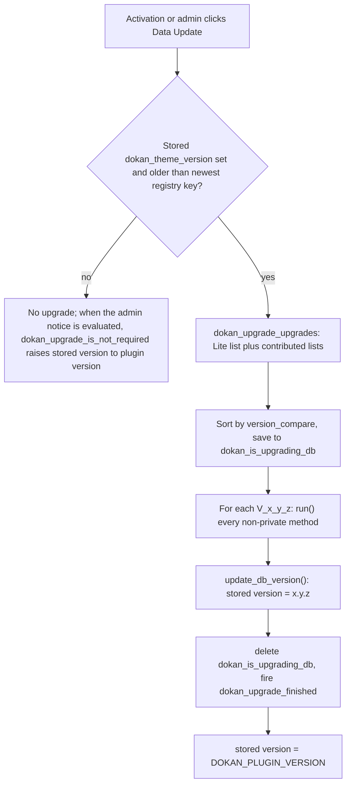

# Schema and data migrations are version-named upgrader classes, run once from a stored DB version

Status: Accepted (retroactive — documents existing code)

## Context

Dokan's custom tables ([ADR-0013](./0013-marketplace-money-lives-in-custom-tables-not-post-types.md)), its options and its meta keys have changed shape many times since version 1.2: columns added, money columns converted to `DECIMAL(19,4)`, new tables, Commission settings rewritten. A WordPress plugin update replaces files but does not run the activation hook, so Dokan needs its own mechanism to detect that stored data is older than the code and to bring it forward exactly once. Dokan Pro has the same need and shares the mechanism.

## Decision

**[Lite]** Each migration step is a class named after the version that introduced it, listed in a static registry, and run in version order against a stored DB version.

- **Stored version.** The option `dokan_theme_version` (`WeDevs_Dokan::get_db_version_key()`, `lite:dokan-class.php:487`) holds the Lite data version. `Installer::do_install()` (`lite:includes/Install/Installer.php:16`) sets it to `DOKAN_PLUGIN_VERSION` on a fresh install (`:45-49`).
- **Registry.** `Upgrade\Upgrades::$upgrades` (`lite:includes/Upgrade/Upgrades.php:14`) maps a version string to an upgrader class, from `'1.2' => V_1_2` to `'5.0.0' => V_5_0_0` at this revision. `Upgrades::is_upgrade_required()` (`lite:includes/Upgrade/Upgrades.php:71`) returns true only when the stored version is set **and** lower than the newest registry key, so a fresh install never runs upgraders. `Upgrades::get_upgrades()` (`:106`) returns every registry entry newer than the stored version.
- **Extensible list.** `Upgrade\Hooks` (`lite:includes/Upgrade/Hooks.php:20`) contributes Lite's list to the `dokan_upgrade_upgrades` filter at priority 1 and answers `dokan_upgrade_is_upgrade_required`. Other plugins add their own upgraders to the same filter, optionally as `[ 'upgrader' => Class, 'require' => lite_version ]` so that they wait for a minimum Lite data version; this seam is consumed by Dokan Pro.
- **Runner.** `Upgrade\Manager::do_upgrade()` (`lite:includes/Upgrade/Manager.php:85`) takes the list from the `dokan_is_upgrading_db` option if one is in progress, otherwise from the filter, sorts it with `version_compare`, and saves it to that option. For each upgrader it calls `run()` and then `update_db_version()`, deletes the option, and fires `dokan_upgrade_finished`, on which `Upgrades::update_db_dokan_version()` raises the stored version to `DOKAN_PLUGIN_VERSION`.
- **Upgrader classes.** `Abstracts\DokanUpgrader::run()` (`lite:includes/Abstracts/DokanUpgrader.php:22`) first returns early if a `require` version was given and the stored Lite version is lower, then calls statically every method that `get_class_methods( static::class )` returns except `run` and `update_db_version`, so each method is one migration step. Because the call is made from `DokanUpgrader`'s own scope, that list contains the subclass's public and protected methods (and the inherited `get_db_version_key()`), not its private ones. `DokanUpgrader::update_db_version()` derives the version from the class's short name (`V_3_14_0` becomes `3.14.0`) and stores it, so progress is recorded per upgrader.
- **Triggers.** Upgrades run from `Installer::do_install()` on activation when required (`lite:includes/Install/Installer.php:29-31`), or from the "Dokan Data Update Required" admin notice, whose AJAX handler `AdminNotice::do_upgrade()` (`wp_ajax_dokan_do_upgrade`) verifies the `dokan_admin` nonce and the `update_plugins` capability and refuses to start while another upgrade is in progress.
- **Long-running steps.** Upgraders that touch many rows hand the work to background processes. Those processes record themselves in the `dokan_background_processes` option, and `WeDevs_Dokan::after_plugins_loaded()` (`lite:dokan-class.php:365`) re-instantiates them on every request until they finish. The Commission meta migrations from `V_3_14_0` run as Action Scheduler batches: `V_3_14_0::update_commission()` queues them through `WC()->queue()`, and `Upgrade\Hooks` registers the batch handlers (`init_hooks()` on the three `Commission\Upugrader` schedulers) on every request.

## Consequences

- A migration is added by writing one class and one registry line; its version comes from its name, so there is no separate bookkeeping.
- Upgrades on plugin update are opt-in and visible: an administrator with `update_plugins` sees a notice and starts them, with a prompt to back up first.
- The stored version advances after each upgrader, and the pending list is persisted in `dokan_is_upgrading_db`. If a run is interrupted, the next `do_upgrade()` call takes that saved list as it is and runs it from its first entry again, so upgraders that had already completed run a second time.
- Fresh installs reach the current schema directly through the installer's `CREATE TABLE` statements, so the installer DDL and the upgraders must describe the same end state. The one recorded divergence is the nullability history of `dokan_withdraw.details` (see `docs/adr/reference/database.md`).
- `dokan_theme_version` is also the gate for contributed upgraders that declare a minimum Lite version.

## Risks

- **Every non-private method runs.** `DokanUpgrader::run()` iterates `get_class_methods()` from the parent class's scope, which includes public and protected methods. A helper declared `public` or `protected` in an upgrader class is executed as a migration step; only `private` helpers are skipped.
- **Name-derived versions.** A misnamed class (for example `V_3_14` for `3.14.0`) stores a different version from its registry key, which affects later comparisons.
- **Data updates wait for a click.** Between a plugin update and the administrator running the upgrade, new code runs against old data. Code paths that depend on a new column or table must tolerate its absence until then.
- **An interrupted run hides the notice.** While `dokan_is_upgrading_db` exists, `AdminNotice::show_notice()` shows no notice and `AdminNotice::do_upgrade()` refuses to start (`has_ongoing_process()`). After an interrupted run, the remaining path in Lite is the activation-time call in `Installer::do_install()`, which does not check for an ongoing process.
- **Background processes are restored from file paths.** `after_plugins_loaded()` includes the file stored in `dokan_background_processes`; entries whose file no longer exists are pruned, which silently abandons an unfinished migration after a file move.

## Recommendations

- Keep upgrader methods idempotent, since a resumed or repeated run may call them again, and keep helpers `private` (a `protected` helper is still called by `run()`).
- When adding a column or table, change the installer DDL and add an upgrader in the same change, and note any intended difference between the two.
- Consider trimming completed entries from `dokan_is_upgrading_db` as each upgrader finishes, and offering a visible way to resume an interrupted run from the admin notice.
- Code that reads a newly added column should check for it, or be guarded by the stored DB version, until the upgrade has run.

## Known gaps

- The individual effect of every upgrader is summarised in `docs/adr/reference/database.md` only for schema-relevant steps; data-only upgraders were not audited.
- How contributed (non-Lite) upgraders interleave with Lite's when both are pending was not traced beyond the shared `version_compare` sort.

_Verified against Lite @e1ce7fc81 / Pro @65975a952 / WooCommerce 11.2.1 — 2026-10-22._
