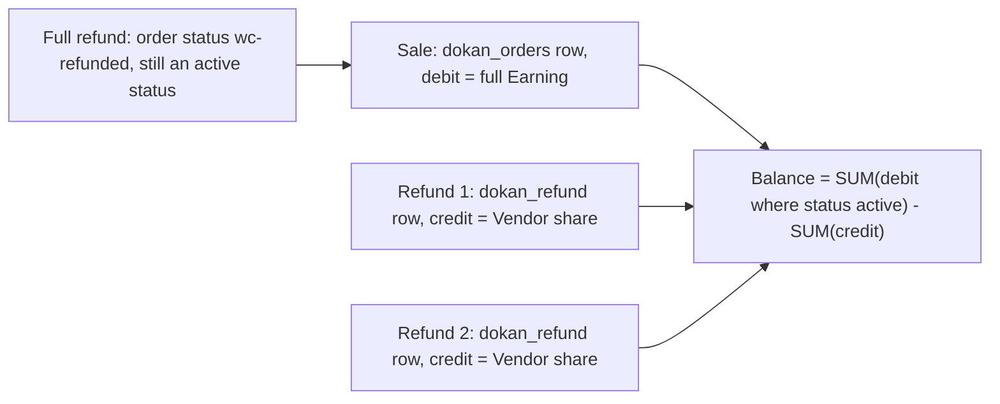

# Each refund is booked as a separate dokan_refund credit on the Vendor's Balance

Status: Accepted (retroactive — documents existing code)

## Context

Once the Vendor's share of a refund is known (see [ADR-0046](./0046-a-refund-reverses-commission-and-vendor-earning-pro-rata-to-the-refunded-share-of-each-line-item.md) and [ADR-0050](./0050-refunded-shipping-and-tax-go-back-from-whichever-party-received-them-and-the-gateway-fee-stays-where-it-was.md)), it has to come off the Vendor's Balance. There are two possible designs: reduce the order's Earning row in place, or add a new row. Teammates ask "where do refunds show up in the Vendor's statement?", "why does a fully refunded order still show its Earning?" and "can a refund make the Balance negative?". The ledger table itself is described in Lite ADR 0013 (`docs/adr/0013-marketplace-money-lives-in-custom-tables-not-post-types.md`); this ADR records how refunds use it.

## Rule

1. **One new row per refund.** `RefundHandler::insert_into_balance_table()` (`lite:includes/Order/RefundHandler.php:191`), attached to `dokan_refund_adjust_vendor_balance` (`:21`), inserts into `dokan_vendor_balance` (`:224-238`):
   - `vendor_id` = the Vendor of the Vendor order (`dokan_get_seller_id_by_order()`, `:196`);
   - `trn_id` = the Vendor order id (not the refund id);
   - `trn_type` = `dokan_refund`;
   - `debit` = 0, `credit` = the Vendor's share of the refund;
   - `status` = `approved`;
   - `trn_date` and `balance_date` = now, so the refund reduces the Balance immediately, with no withdraw threshold delay.
2. **Only positive amounts are booked.** The row is written only when `dokan_refund_should_insert_into_vendor_balance` returns true; its default is "amount greater than 0" (`:214`). A refund whose Vendor share is 0 (for example an amount-only refund) leaves no row.
3. **The order's Earning row is not reduced by refunds.** When the refunded order is saved, `VendorBalanceUpdateHandler::handle_order_edit()` (`lite:includes/Order/VendorBalanceUpdateHandler.php:43`, hooked at priority 99 on `woocommerce_update_order`) recalculates the Earning with refund adjustment switched off (`:51`) and writes it to the order's `dokan_orders` ledger row only when it differs. A refund therefore leaves the `dokan_orders` debit at the full, unrefunded Earning; order edits (not refunds) still change it.
4. **A fully refunded order keeps counting its Earning.** `dokan_withdraw_get_active_order_status()` **always adds `wc-refunded`** to the admin's chosen statuses (`lite:includes/Withdraw/functions.php:354-365`), so when a full refund moves the order to *Refunded* its debit still counts and the refund credits cancel it. The Balance formula and the reason for the always-included status are recorded in [ADR-0063](./0063-the-withdrawable-balance-is-matured-earnings-in-a-withdraw-order-status-minus-every-matured-withdraw-and-refund.md).
5. **The per-order sales record is updated separately.** `VendorBalanceUpdateHandler::update_dokan_order_table()` (priority 80, `lite:includes/Order/VendorBalanceUpdateHandler.php:147`) runs when WooCommerce saves the order at the end of every refund, partial or full (`wc:includes/wc-order-functions.php:749`), and stores the refund-adjusted Earning in `dokan_orders.net_amount` and `order total − total refunded` in `dokan_orders.order_total` (`:183`, `:192-201`). This is the figure reports and the Commission meta box show; it is not the ledger.

## Settings that change it

| Setting | Default | Behaviour |
|---|---|---|
| `dokan_withdraw[withdraw_order_status]` | `['wc-completed']` (`lite:includes/Withdraw/functions.php:355`) | Decides which order statuses make a `dokan_orders` debit count toward the Balance. `wc-refunded` is always added regardless of this setting, so a refunded order's debit always counts. If a status the order was in before the refund is not selected (for example `wc-processing` with the default), the debit does not count until the order reaches a selected status, but the refund credit counts at once, so the Balance can dip below what the Vendor has actually earned so far. |
| `dokan_withdraw[exclude_cod_payment]` | `off` | `on` suppresses the refund row for cash-on-delivery orders; see [ADR-0051](./0051-refunds-of-excluded-cash-on-delivery-orders-never-touch-the-vendor-balance.md). |

Filters: `dokan_vendor_refund_amount_before_insert` (change the amount, `:212`), `dokan_refund_should_insert_into_vendor_balance` (skip the row, `:214`), `dokan_withdraw_active_status` (change the active statuses).

## Worked example

Settings: global Commission `fixed`, `admin_percentage = 7.5`, `additional_fee = 0`; `withdraw_order_status = ['wc-completed']`; withdraw threshold 0 days; no shipping or tax. Vendor order: one line 33.33, completed; Earning 30.83.

| Event | Ledger row added | Balance |
|---|---|---|
| Sale, order completed | `dokan_orders`, debit 30.83, status `wc-completed` | 30.83 |
| Refund #1 of 10.00 on the line | `dokan_refund`, credit 9.25, `approved` | 30.83 − 9.25 = 21.58 |
| Refund #2 of 23.33 on the line (order becomes fully refunded, status `wc-refunded`) | `dokan_refund`, credit 21.58, `approved`; the order row's status becomes `wc-refunded` | 30.83 − 9.25 − 21.58 = 0.00 |

The `dokan_orders` row keeps debit 30.83 throughout; `dokan_orders.net_amount` goes 30.83 → 21.58 → 0.00.

If the Vendor had already withdrawn 30.83 before the refunds, the Balance after refund #2 would be −30.83: the refund credits are booked even when they push the Balance below zero.

## Edge cases

- **Negative Balance is allowed.** Nothing caps the credit at the current Balance.
- **The reason text.** The row's `perticulars` column is meant to carry the refund reason. As written, the code replaces any non-empty reason with "Refunded by Dokan" and leaves it empty when there is no reason (`lite:includes/Order/RefundHandler.php:218-222`), so the original reason never reaches the ledger.
- **Deleting a Vendor order** removes its `dokan_refund` rows together with its `dokan_orders` row (`lite:includes/Order/Manager.php:525-531`).
- **Deleting a WooCommerce refund does not remove its ledger row.** No listener reverses a `dokan_refund` credit when a `WC_Order_Refund` is deleted.

## Why

Keeping refunds as their own rows keeps the ledger append-oriented, so a Vendor's statement shows the sale and each refund separately (Lite ADR 0013, Consequences). The hard-coded `wc-refunded` status in `dokan_withdraw_get_active_order_status()` is what makes this design correct for full refunds.

## Consequences & risks

- Statements and reports that read the ledger see a refunded sale as two (or more) rows that net to the refunded result; reports that read `dokan_orders.net_amount` see one net figure. The two views agree only when every refund has been booked.
- Removing `wc-refunded` from the active statuses through `dokan_withdraw_active_status` would make every fully refunded order subtract its Earning twice.
- Because the credit is dated now while the sale debit is dated at the end of the withdraw threshold, a refund during the threshold period reduces the withdrawable Balance before the sale has been added to it.

## Recommendations

- Fix the inverted reason condition in `insert_into_balance_table()` so the ledger keeps the real refund reason.
- Consider reversing the `dokan_refund` row when a `WC_Order_Refund` is deleted, so an admin correcting a mistaken refund does not have to repair the ledger by hand.

_Verified against Lite @e1ce7fc81 / Pro @65975a952 / WooCommerce 11.2.1 — 2026-10-22._
