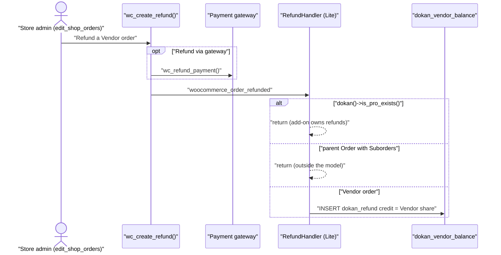

# In Dokan Lite the store admin issues refunds through WooCommerce, and they take effect immediately

Status: Accepted (retroactive — documents existing code)

## Context

Teammates regularly ask "can a Vendor refund a customer?", "is there an approval step?" and "what happens to the Vendor's money when the admin presses Refund?". Dokan Lite adds no refund screen, no refund request object and no approval workflow of its own. It lets WooCommerce create the refund and then books the Vendor's share of it. Add-ons may replace this whole path, through the switch described in rule 5; this ADR records the Lite answer only.

Related decisions: the Vendor order is the authoritative order and a refund on a parent Order is outside the model (Lite ADR 0004, `docs/adr/0004-vendor-order-is-authoritative-parent-is-mirror.md`); refunds are `WC_Order_Refund` objects, not a Dokan entity (Lite ADR 0013).

## Rule

1. **Who can refund.** In Lite only a user who can use WooCommerce's own refund tools can create a refund:
   - the WooCommerce order screen "Refund" button, which posts `woocommerce_refund_line_items` and requires the `edit_shop_orders` capability (`wc:includes/class-wc-ajax.php:2848`, check at `:2853`), then calls `wc_create_refund()` (`wc:includes/class-wc-ajax.php:2904`);
   - the WooCommerce REST refunds endpoint (`wc:includes/rest-api/Controllers/Version2/class-wc-rest-order-refunds-v2-controller.php:291`);
   - a payment gateway or other plugin calling `wc_create_refund()` directly.

   Dokan Lite gives Vendors and Vendor staff **no refund button and no refund endpoint**. Its Vendor order REST controller only lists existing refunds (`lite:includes/REST/OrderController.php:286-294`). The only refund-related action a Vendor has in Lite is changing the order status to *Refunded*; what that does is described in [ADR-0049](./0049-only-the-itemised-part-of-a-refund-is-charged-to-the-vendor.md).

2. **Which order.** The refund must be created on the **Vendor order**: the Suborder of a multi-vendor Order, or the Order itself when it was single-vendor. A refund on a parent Order that has Suborders is ignored by Vendor accounting (`RefundHandler::handle_refund` returns when `OrderType::get_type()` reports `DOKAN_PARENT_ORDER_REFUND`, `lite:includes/Order/RefundHandler.php:52-54`; `lite:includes/Analytics/Reports/OrderType.php:84`). In Lite a Suborder refund is **not** copied to the parent Order.

3. **No approval step; immediate effect.** When `wc_create_refund()` finishes it fires `woocommerce_order_refunded` (`wc:includes/wc-order-functions.php:752`). `RefundHandler::handle_refund` (`lite:includes/Order/RefundHandler.php:37`, registered at `:18`) runs right then: it computes the Vendor's share of the refund through the `dokan_vendor_earning_in_refund` filter (`:56`) and fires `dokan_refund_adjust_vendor_balance` (`:59`), which writes a `dokan_refund` credit to the Vendor's Balance (see [ADR-0047](./0047-each-refund-is-booked-as-a-separate-dokan-refund-credit-on-the-vendor-balance.md)). Nothing waits for anyone.

4. **The gateway is called by WooCommerce, not by Dokan.** Whether money actually goes back to the customer is decided by WooCommerce's `refund_payment` argument: the "Refund via <gateway>" button sets it, "Refund manually" does not (`wc:includes/class-wc-ajax.php:2864`, passed at `:2910`). WooCommerce then calls `wc_refund_payment()` for the order the refund is created on (`wc:includes/wc-order-functions.php:678`). Dokan Lite neither adds nor blocks that call. For a Suborder this means the gateway is asked to refund against the Suborder. A Suborder copies the parent's payment method and title (`lite:includes/Order/Manager.php:620-621`) but not its transaction id, so gateways that refund by transaction id cannot refund it; see Consequences.

5. **Add-ons take over through one switch.** `handle_refund` returns immediately when `dokan()->is_pro_exists()` is true (`lite:includes/Order/RefundHandler.php:39-41`). The Balance writer (`insert_into_balance_table`, `:191`) and the earning calculator (`get_vendor_earning_in_refund`, `:72`) stay attached to their Dokan hooks so an add-on can reuse them.

## Settings that change it

No Dokan setting enables or disables refunds in Lite, and none adds an approval step. Settings that change *how much* is booked are covered by the linked ADRs:

| Setting | Default | Effect on this rule |
|---|---|---|
| `dokan_selling[order_status_change]` | `on` | When `on`, a Vendor (with `dokan_manage_order`) can set the Vendor order's status to *Refunded* from the Vendor dashboard (`lite:includes/Ajax.php:366`, template `lite:templates/orders/details.php:219`). When `off`, Vendors cannot change status at all, so they have no refund-related action. See [ADR-0049](./0049-only-the-itemised-part-of-a-refund-is-charged-to-the-vendor.md) for what a status-only refund books. |
| `dokan_withdraw[exclude_cod_payment]` | `off` | When `on`, refunds of cash-on-delivery Vendor orders are not booked; see [ADR-0051](./0051-refunds-of-excluded-cash-on-delivery-orders-never-touch-the-vendor-balance.md). |
| WooCommerce "Restock refunded items" checkbox (per refund) | checked by WooCommerce when stock management is on | See [ADR-0052](./0052-stock-is-restored-only-when-the-refund-asks-for-it-on-the-order-the-refund-is-created-on.md). |

Filters: `dokan_vendor_earning_in_refund`, `dokan_refund_adjust_vendor_balance`, `dokan_refund_adjust_dokan_orders` (fired at `lite:includes/Order/RefundHandler.php:61`; Lite attaches no listener because the registration at `:23` is commented out).

## Worked example

Settings: no refund add-on active; global Commission `fixed` with `admin_percentage = 10`, `additional_fee = 0`; Fee recipients at their defaults (all `seller`); no coupons.

A customer buys one item for 100.00 from Vendor A and one item for 50.00 from Vendor B. Dokan creates Order #100 and Suborders #101 (Vendor A) and #102 (Vendor B). Vendor A's Earning on #101 is 90.00.

- The admin opens Suborder #101, enters refund quantity 1 on the line (total 100.00) and clicks "Refund manually". WooCommerce creates refund #103 on #101. `RefundHandler` books a `dokan_refund` credit of 90.00 for Vendor A immediately. Order #100 shows no refund. The customer gets no money from the gateway; the admin must return it outside WooCommerce.
- If the admin had instead refunded 100.00 on parent Order #100, WooCommerce would record the refund (and might call the gateway, since #100 holds the payment), but Vendor A's Balance would not change, because the refund is on a parent Order.

## Edge cases

- A refund created by a gateway webhook or by WP-CLI is booked exactly like an admin refund: `handle_refund` does not check who created it.
- A Vendor order whose Vendor cannot be resolved (`dokan_get_seller_id_by_order()` returns nothing) is logged and not booked (`lite:includes/Order/RefundHandler.php:196-209`).
- Lite also registers `Order\Hooks::manage_refunded_for_order` on `woocommerce_order_status_changed` (`lite:includes/Order/Hooks.php:37`, `:290`). It only acts on a POST that carries a `post_type` of `shop_order` and a `new_status` of `wc-refunded` with the prefix, which WooCommerce does not pass to that hook. It is effectively dormant; the `RefundHandler` path above is the one refunds reach.

## Why

The code comment on `handle_refund` ("Refund will be handle by the pro if exists", `lite:includes/Order/RefundHandler.php:38`) shows the intent: Lite provides the minimum bookkeeping so that a refund made in WooCommerce never leaves the Vendor's Balance overstated, and leaves workflow (requests, approvals, gateway routing) to an add-on.

## Consequences & risks

- Vendors in Lite depend on the admin for every customer refund. Marketplaces that want Vendors to initiate refunds need an add-on.
- Because Lite does not mirror a Suborder refund to the parent Order and does not route the gateway call to the parent, a "Refund via gateway" click on a Suborder fails or is not offered for gateways that need the transaction id, while a gateway refund on the parent is invisible to Vendor accounting. In practice an admin refunds the Suborder manually for accounting and the parent Order through the gateway for the customer's money, which records the refund twice in WooCommerce totals.
- The Balance is changed at the moment the refund is created. There is no review step in which a mistaken refund can be caught before it reaches the Vendor's Balance.

## Recommendations

- Document for Lite store admins that the refund must be entered on the Suborder (for Vendor accounting) and that the customer's money is returned from the parent Order's payment.
- Either remove `manage_refunded_for_order` or fix its conditions; a dormant second bookkeeping path makes the code harder to reason about.

_Verified against Lite @e1ce7fc81 / Pro @65975a952 / WooCommerce 11.2.1 — 2026-10-22._
