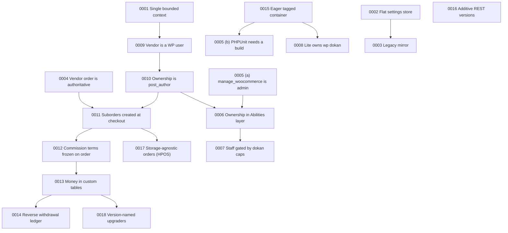

# Architecture decisions index (Dokan Lite)

This page lists every Architecture Decision Record in `docs/adr/` of the Dokan Lite repository, with a one-line summary of what each decision trades off and what can go wrong if it is ignored. It is a navigation aid: the ADR itself is the authority, and each ADR cites the code it describes.

ADRs 0001 to 0008 predate this index. ADRs 0009 to 0018 were added with it and are retroactive: they document load-bearing decisions that the code already embodies but that no ADR recorded, and each carries the status "Accepted (retroactive — documents existing code)". ADRs 0019 to 0111 are retroactive business-rule ADRs: each states one rule of marketplace money, order status, refunds, withdraws, Vendors, products, coupons, shipping or reports, with the settings that change it and a worked example. Where nothing in the repository shows that the behaviour was chosen deliberately, the status reads "Accepted (retroactive — no recorded decision; documents observed behaviour)". They are grouped by domain under [Business rules by domain](#business-rules-by-domain). Decisions that govern only Dokan Pro are recorded in the Pro repository and are not listed here ([ADR-0001](0001-single-bounded-context-across-lite-and-pro.md) explains where ADRs live).

Terminology follows `CONTEXT.md` (Vendor, Store, Suborder, Vendor order, Commission, Earning, Balance, Withdraw, Reverse withdrawal).

> **Numbering collision.** Two files share the number 0005: `0005-canonical-admin-capability.md` and `0005-phpunit-requires-a-webpack-build.md`. They are unrelated decisions, and both predate this index; adding ADRs 0009 to 0018 did not change either file. Neither has been renamed, because existing links and references point at both filenames. They are listed below as 0005 (a) and 0005 (b). The business-rule ADRs were numbered from 0019 to 0111 without gaps; the next free number is 0112.

## Index

| No. | Title | Status | Scope | Key trade-off | Risk if ignored | Link |
|---|---|---|---|---|---|---|
| 0001 | Single bounded context across dokan-lite and dokan-pro | Accepted (no status line in file) | Cross-repo: glossary, ADR placement | One shared language and glossary, at the cost of Pro being unable to redefine Lite terms | Terms drift between repos; ADRs filed in the wrong repo | [0001](0001-single-bounded-context-across-lite-and-pro.md) |
| 0002 | Flat `dokan_admin_settings` array as the canonical settings store | Accepted (no status line in file) | Admin settings storage | Globally unique, greppable ids and one schema, at the cost of a legacy bridge for old per-section rows | New code reading legacy rows directly bypasses the canonical store | [0002](0002-flat-dokan-admin-settings-as-canonical-store.md) |
| 0003 | Settings legacy mirror mode | Accepted (no status line in file) | Admin settings, downgrade safety | Downgrades find real data at rest, at the cost of dual writes | The two stores diverge if the mirror or reconcile pass is bypassed | [0003](0003-settings-legacy-mirror-mode.md) |
| 0004 | Vendor order is authoritative; the parent order is a mirror | Accepted (no status line in file) | Orders, stock, Commission, Balance, refunds | Each Vendor gets a real `WC_Order`, at the cost of directional sync rules | "Fixing" parent stock or parent refunds breaks Vendor accounting; filters on `parent_id != 0` drop single-vendor orders | [0004](0004-vendor-order-is-authoritative-parent-is-mirror.md) |
| 0005 (a) | `manage_woocommerce` is the canonical admin capability for vendor authorization | Accepted (no status line in file) | Authorization | One admin capability across layers, keeping Site Admin as a term without its own boundary | Mixing `manage_options` and `manage_woocommerce` creates inconsistent admin checks | [0005 (a)](0005-canonical-admin-capability.md) |
| 0005 (b) | PHPUnit requires a webpack build | Accepted (no status line in file) | Testing, CI, asset bootstrap | CI keeps a build step instead of guarding ~35 asset reads | Removing the CI build makes the suite fatal at bootstrap | [0005 (b)](0005-phpunit-requires-a-webpack-build.md) |
| 0006 | Ownership is enforced by the Abilities layer, not delegated to WooCommerce | Accepted (no status line in file); amended by 0007 | Abilities / MCP authorization | Dokan asserts Ownership itself, accepting redundant-looking product checks | Removing the "redundant" product check leaves no control if WooCommerce's mapping changes | [0006](0006-ownership-enforced-in-abilities-layer.md) |
| 0007 | Vendor Staff actions over MCP are gated by `dokan_*` capabilities | Accepted (no status line in file) | Abilities / MCP authorization | Parity with the dashboard for Vendor Staff, at the cost of no native-capability backstop below Store Admin | A defect in the ownership gate is not caught by a second layer | [0007](0007-staff-actions-gated-by-dokan-capabilities.md) |
| 0008 | Dokan Lite owns the `wp dokan` namespace; extensions contribute via a filter | Accepted (no status line in file) | WP-CLI | One owner and registry for the namespace, at the cost of extensions contributing before `init` 99 | Late contributors register nothing; moving the CLI grant into shared classes widens it to web requests | [0008](0008-lite-owns-the-wp-dokan-cli-namespace.md) |
| 0009 | A Vendor is a WordPress user with the `seller` role; the Store lives in user meta | Accepted (retroactive — documents existing code) | Vendor identity, Store profile, Operating Terms | Free WordPress user features and a plain user id everywhere, at the cost of a serialized, unqueryable Store profile | `dokandar` holders (including shop managers) pass Vendor checks but are absent from default listings; mirrored `dokan_store_name` can drift | [0009](0009-vendor-is-a-wordpress-user-with-the-seller-role.md) |
| 0010 | Product Ownership is the `wp_posts.post_author` column | Accepted (retroactive — documents existing code) | Products, Ownership, Suborder attribution | Ownership with no join and native author queries, at the cost of one Vendor per product | Creation paths that keep WooCommerce's default author assign products to the acting user | [0010](0010-product-ownership-is-post-author.md) |
| 0011 | Suborders are created synchronously on the checkout hooks, grouped by product author | Accepted (retroactive — documents existing code) | Checkout, Suborder creation | Real Suborders exist when checkout returns, at the cost of per-Vendor work inside the checkout request | A failed Suborder is only logged (partial split); order paths that fire neither checkout hook are not split | [0011](0011-suborders-are-created-synchronously-at-checkout.md) |
| 0012 | Commission formula and Fee recipients are frozen onto the order at first calculation | Accepted (retroactive — documents existing code) | Commission, fees, recalculation | Historical Earnings survive rate changes, at the cost of needing item-meta edits to correct a wrong rate | Filters on recipients and the strategy chain stop applying after first resolution; Fee recipient getters save the order on first read | [0012](0012-commission-terms-are-frozen-onto-the-order-at-first-calculation.md) |
| 0013 | Marketplace money lives in custom tables; domain entities reuse WordPress and WooCommerce types | Accepted (retroactive — documents existing code) | Database, Balance ledger, Earning cache, Analytics | Cheap typed aggregates and an append-style ledger, at the cost of duplicating order state that every WooCommerce event must keep in step | No foreign keys, so missed events leave orphaned or stale rows; ledger rows with an empty status never count | [0013](0013-marketplace-money-lives-in-custom-tables-not-post-types.md) |
| 0014 | Reverse withdrawal is a separate receivable ledger, settled by buying a hidden product | Accepted (retroactive — documents existing code) | Reverse withdrawal | Debts never net silently against Balance, and payment reuses WooCommerce checkout, at the cost of a hidden product and a closed type list | Trashing the base product disables payment; transaction types need a code change to extend | [0014](0014-reverse-withdrawal-is-a-separate-receivable-ledger.md) |
| 0015 | Services are resolved eagerly from a tagged, Mozart-prefixed League container at `init` 4 | Accepted (retroactive — documents existing code) | Bootstrap, dependency injection | One predictable hook-registration moment per context, at the cost of constructing every tagged service on every request | A failing constructor takes down every request; services in never-resolved tags without `Hookable` never load | [0015](0015-services-are-resolved-eagerly-from-a-tagged-container.md) |
| 0016 | REST versions are additive, per-resource controller subclasses registered side by side | Accepted (retroactive — documents existing code) | REST API | Old clients never break, at the cost of every version sharing inherited behaviour | Changing a base method changes every version's contract; not every v-next is a superset | [0016](0016-rest-versions-are-additive-controller-subclasses.md) |
| 0017 | Orders are storage-agnostic through WooCommerce CRUD; HPOS branches only where SQL or admin screens require it | Accepted (retroactive — documents existing code) | WooCommerce integration, HPOS | One build for both storage modes, at the cost of mode branches for raw SQL and admin hooks | Listeners on hooks that fire in only one data store silently do nothing in the other | [0017](0017-orders-are-storage-agnostic-through-woocommerce-crud.md) |
| 0018 | Schema and data migrations are version-named upgrader classes, run once from a stored DB version | Accepted (retroactive — documents existing code) | Install, upgrades, background migrations | One class per migration with name-derived versions, at the cost of `run()` calling every non-private method of the class | Non-idempotent steps break on re-run; an interrupted run hides the update notice | [0018](0018-schema-migrations-are-version-named-upgrader-classes.md) |
| 0019 | A commission of zero is a deliberate setting, and only an empty field falls through to the next level | Accepted (retroactive — documents existing code) | Commission | An explicit 0 is honoured, at the cost of an empty field silently inheriting the next level | Reports cannot tell "zero by choice" from "nothing applies" without the frozen source meta | [0019](0019-a-commission-of-zero-is-a-deliberate-setting-and-only-an-empty-field-falls-through-to-the-next-level.md) |
| 0020 | A variation is charged the commission of its parent product | Accepted (retroactive — no recorded decision; documents observed behaviour) | Commission | One rate per product, at the cost of no per-variation commission | Admins who need different rates per variation must split the product | [0020](0020-a-variation-is-charged-the-commission-of-its-parent-product.md) |
| 0021 | An admin-funded discount larger than the commission becomes an admin subsidy to the Vendor | Accepted (retroactive — documents existing code) | Commission | Admin-funded coupons keep the Vendor whole, at the cost of a negative admin share | Payout code that ignores the capped subtotal pays out more than the customer paid | [0021](0021-an-admin-funded-discount-larger-than-the-commission-becomes-an-admin-subsidy-to-the-vendor.md) |
| 0022 | Category-based commission uses the product's chosen category and falls back to the All Categories rate | Accepted (retroactive — documents existing code) | Commission | One deterministic category per product, at the cost of ignoring other and parent categories | Reordering a product's categories changes its commission | [0022](0022-category-based-commission-uses-the-products-chosen-category-and-falls-back-to-the-all-categories-rate.md) |
| 0023 | Commission is rounded and capped on the admin share, and the Vendor takes the exact remainder | Accepted (retroactive — documents existing code) | Commission | Admin share plus Vendor share always equals the line total, at the cost of per-line rounding drift | Reports that recompute Commission from order totals differ by cents | [0023](0023-commission-is-rounded-and-capped-on-the-admin-share-and-the-vendor-takes-the-exact-remainder.md) |
| 0024 | Coupon discounts reduce commission according to who funds the coupon | Accepted (retroactive — documents existing code) | Commission, coupons | The funding party bears the discount, at the cost of Commission that can go negative | Reports that assume Commission is never negative are wrong for subsidised lines | [0024](0024-coupon-discounts-reduce-commission-according-to-who-funds-the-coupon.md) |
| 0025 | Fixed commission is a percentage of the line total plus a flat fee charged per unit | Accepted (retroactive — no recorded decision; documents observed behaviour) | Commission | A simple per-unit flat fee, at the cost of fees that can exceed cheap lines | The Vendor earns nothing on cheap multi-unit lines once the cap applies | [0025](0025-fixed-commission-is-a-percentage-of-the-line-total-plus-a-flat-fee-charged-per-unit.md) |
| 0026 | Marketplace-owned order types give the whole line amount to the admin and nothing to the Vendor | Accepted (retroactive — documents existing code) | Commission | Marketplace revenue stays whole, at the cost of a separate admin-earning figure | Summing admin net Commission alone leaves out marketplace-owned revenue | [0026](0026-marketplace-owned-order-types-give-the-whole-line-amount-to-the-admin-and-nothing-to-the-vendor.md) |
| 0027 | Only the Store Admin sets commission, and a Vendor can never set their own | Accepted (retroactive — documents existing code) | Commission | Commission stays admin-controlled, at the cost of a capability check in every write path | A new write path that skips the check lets commission be set without authority | [0027](0027-only-the-store-admin-sets-commission-and-a-vendor-can-never-set-their-own.md) |
| 0028 | The commission formula is taken from the product, then the Vendor, then the global setting, then zero | Accepted (retroactive — documents existing code) | Commission | The most specific level wins, at the cost of one stray field overriding broader rates | A value typed on one product silently overrides a configured Vendor or category rate | [0028](0028-the-commission-formula-is-taken-from-the-product-then-the-vendor-then-the-global-setting-then-zero.md) |
| 0029 | The commission on a Vendor order is the sum of its line-item commissions | Accepted (retroactive — no recorded decision; documents observed behaviour) | Commission | Different rates can apply within one order, at the cost of per-line computation | A skipped line under-reports Commission with only a log entry as trace | [0029](0029-the-commission-on-a-vendor-order-is-the-sum-of-its-line-item-commissions.md) |
| 0030 | The product earning preview is an estimate for one unit at the current price without coupons | Accepted (retroactive — no recorded decision; documents observed behaviour) | Commission | An instant estimate, at the cost of ignoring quantity and coupons | Vendors see Earnings that differ from the preview | [0030](0030-the-product-earning-preview-is-an-estimate-for-one-unit-at-the-current-price-without-coupons.md) |
| 0031 | A PayPal processing fee is prorated across Vendor orders and deducted from the Vendor earning | Accepted (retroactive — documents existing code) | Fees, shipping and tax | The Vendor bears the gateway fee in proportion to their order, at the cost of rewriting ledger debits after payment | The fee deduction and order-edit recalculation both write the same debit | [0031](0031-a-paypal-processing-fee-is-prorated-across-vendor-orders-and-deducted-from-the-vendor-earning.md) |
| 0032 | Order fee lines go to the admin unless the Vendor created the order | Accepted (retroactive — no recorded decision; documents observed behaviour) | Fees, shipping and tax | Checkout fees default to the marketplace, at the cost of per-Vendor fees going to the admin | Per-Vendor handling fees land with the admin unless the filter is used | [0032](0032-order-fee-lines-go-to-the-admin-unless-the-vendor-created-the-order.md) |
| 0033 | Product tax goes to the tax fee recipient and excludes shipping tax | Accepted (retroactive — documents existing code) | Fees, shipping and tax | A configurable seller of record for product tax, at the cost of a separate shipping-tax rule | Whoever receives the tax must remit it; Dokan files nothing | [0033](0033-product-tax-goes-to-the-tax-fee-recipient-and-excludes-shipping-tax.md) |
| 0034 | Shipping fees go to the Vendor unless the shipping fee recipient is set to admin | Accepted (retroactive — documents existing code) | Fees, shipping and tax | The Vendor keeps shipping by default, at the cost of the recipient also bearing shipping refunds | Shipping refunds always reduce the recipient's figure | [0034](0034-shipping-fees-go-to-the-vendor-unless-the-shipping-fee-recipient-is-set-to-admin.md) |
| 0035 | Shipping, tax and fees are added to the Vendor earning or the admin commission outside the commission formula | Accepted (retroactive — documents existing code) | Fees, shipping and tax | The formula stays product-only, at the cost of order total minus net amount not being Commission | Commission derived from the order table is overstated | [0035](0035-shipping-tax-and-fees-are-added-to-the-vendor-earning-or-the-admin-commission-outside-the-commission-formula.md) |
| 0036 | Shipping tax goes to the shipping tax fee recipient and falls back to the product tax recipient | Accepted (retroactive — documents existing code) | Fees, shipping and tax | Backward-compatible default, at the cost of the displayed and effective defaults differing | Until the Fees page is saved, shipping tax follows product tax | [0036](0036-shipping-tax-goes-to-the-shipping-tax-fee-recipient-and-falls-back-to-the-product-tax-recipient.md) |
| 0037 | A parent Order is completed automatically only when every Suborder is completed | Accepted (retroactive — documents existing code) | Order status and earnings | The parent completes only when every Vendor is done, at the cost of one slow Vendor holding it open | Customers see "processing" while most items are delivered | [0037](0037-a-parent-order-is-completed-automatically-only-when-every-suborder-is-completed.md) |
| 0038 | A parent Order's status change is copied to its Suborders only along an allowed transition list | Accepted (retroactive — documents existing code) | Order status and earnings | Suborders are protected from invalid transitions, at the cost of parent and Suborder statuses diverging | Answers about Vendor money read from the parent status are wrong | [0038](0038-a-parent-order-status-change-is-copied-to-its-suborders-only-along-an-allowed-transition-list.md) |
| 0039 | A Vendor order's earning is written to the vendor balance ledger once, when the order is created, not when it is paid | Accepted (retroactive — no recorded decision; documents observed behaviour) | Order status and earnings | One ledger row per Vendor order from checkout, at the cost of rows for unpaid orders | Direct table reads without a status filter count unpaid, cancelled and failed orders | [0039](0039-a-vendor-order-earning-is-written-to-the-vendor-balance-ledger-once-when-the-order-is-created-not-when-it-is-paid.md) |
| 0040 | Cancelling or failing a Vendor order drops its earning from the balance without a reversal entry | Accepted (retroactive — no recorded decision; documents observed behaviour) | Order status and earnings | Exact and reversible exclusion, at the cost of no reversal entry | The ledger cannot show when an Earning stopped counting | [0040](0040-cancelling-or-failing-a-vendor-order-drops-its-earning-from-the-balance-without-a-reversal-entry.md) |
| 0041 | Editing a Vendor order recalculates its earning in the vendor balance ledger | Accepted (retroactive — documents existing code) | Order status and earnings | The Balance follows order edits automatically, at the cost of silent changes after payout | A downward edit can make a Balance negative without a debit row | [0041](0041-editing-a-vendor-order-recalculates-its-earning-in-the-vendor-balance-ledger.md) |
| 0042 | Paid digital-only Suborders are completed automatically, unless paid with a manual gateway | Accepted (retroactive — documents existing code) | Order status and earnings | Digital Earnings mature without Vendor action, except for manual gateways | Earnings reach the default withdraw status right after payment | [0042](0042-paid-digital-only-suborders-are-completed-automatically-unless-paid-with-a-manual-gateway.md) |
| 0043 | The vendor balance ledger copies the Vendor order's status on every status change | Accepted (retroactive — no recorded decision; documents observed behaviour) | Order status and earnings | Cheap, exact reversals driven by status, at the cost of status being the only gate | A row whose status is never written never counts | [0043](0043-the-vendor-balance-ledger-copies-the-vendor-order-status-on-every-status-change.md) |
| 0044 | Trashing an order parks its Vendor earning, and deleting it in WP-admin erases its ledger rows | Accepted (retroactive — documents existing code) | Order status and earnings | Trash is reversible and deletion is clean, at the cost of losing history on delete | Deleting a paid-out order lowers the Balance while its Withdraw remains | [0044](0044-trashing-an-order-parks-its-vendor-earning-and-deleting-it-in-wp-admin-erases-its-ledger-rows.md) |
| 0045 | Vendors change only their own Vendor order's status, when allowed, and cancelled or refunded orders are final | Accepted (retroactive — documents existing code) | Order status and earnings | Vendors manage fulfilment status, at the cost of controlling when their Earnings count | Marketplaces that need admin confirmation before Earnings count must change the setting | [0045](0045-vendors-change-only-their-own-vendor-order-status-when-allowed-and-cancelled-or-refunded-orders-are-final.md) |
| 0046 | A refund reverses Commission and Vendor Earning pro rata to the refunded share of each line item | Accepted (retroactive — documents existing code) | Refunds | Proportional reversal, at the cost of no non-refundable Commission | Commission cannot be kept on refunds through settings | [0046](0046-a-refund-reverses-commission-and-vendor-earning-pro-rata-to-the-refunded-share-of-each-line-item.md) |
| 0047 | Each refund is booked as a separate dokan_refund credit on the Vendor's Balance | Accepted (retroactive — documents existing code) | Refunds | An append-only refund trail, at the cost of two views of the same money | Ledger-based and net-amount-based reports disagree until every refund is booked | [0047](0047-each-refund-is-booked-as-a-separate-dokan-refund-credit-on-the-vendor-balance.md) |
| 0048 | In Dokan Lite the store admin issues refunds through WooCommerce, and they take effect immediately | Accepted (retroactive — documents existing code) | Refunds | Simple admin-only refunds, at the cost of Vendors depending on the admin | Vendors cannot initiate refunds without an add-on | [0048](0048-in-dokan-lite-the-store-admin-issues-refunds-through-woocommerce-and-they-take-effect-immediately.md) |
| 0049 | Only the itemised part of a refund is charged to the Vendor | Accepted (retroactive — no recorded decision; documents observed behaviour) | Refunds | Exact allocation from refund lines, at the cost of amount-only refunds charging nobody | Admins who refund by amount, or set the status to Refunded, bear the whole cost | [0049](0049-only-the-itemised-part-of-a-refund-is-charged-to-the-vendor.md) |
| 0050 | Refunded shipping and tax go back from whichever party received them, and the gateway fee stays where it was | Accepted (retroactive — documents existing code) | Refunds | Symmetric reversal of pass-through amounts, at the cost of the gateway fee not being returned | Vendors who bore a gateway fee lose it on refunded orders | [0050](0050-refunded-shipping-and-tax-go-back-from-whichever-party-received-them-and-the-gateway-fee-stays-where-it-was.md) |
| 0051 | Refunds of excluded cash-on-delivery orders never touch the Vendor's Balance | Accepted (retroactive — documents existing code) | Refunds | COD is settled outside the ledger, at the cost of no Balance trace | Statements show neither the COD sale nor its refund | [0051](0051-refunds-of-excluded-cash-on-delivery-orders-never-touch-the-vendor-balance.md) |
| 0052 | Stock is restored only when the refund asks for it, on the order the refund is created on | Accepted (retroactive — no recorded decision; documents observed behaviour) | Refunds | Stock follows an explicit choice, at the cost of being independent of who bears the money | Restocking on both the parent and the Suborder refund restores stock twice | [0052](0052-stock-is-restored-only-when-the-refund-asks-for-it-on-the-order-the-refund-is-created-on.md) |
| 0053 | A Vendor may have only one pending Withdraw request, and a pending request does not hold the Balance | Accepted (retroactive — no recorded decision; documents observed behaviour) | Withdraw | One open request per Vendor, at the cost of no reservation of funds | A stale pending request blocks the Vendor until it is cancelled | [0053](0053-a-vendor-may-have-only-one-pending-withdraw-request-and-a-pending-request-does-not-hold-the-balance.md) |
| 0054 | A Withdraw can use only a method the admin enabled and the Vendor has filled in | Accepted (retroactive — no recorded decision; documents observed behaviour) | Withdraw | Two independent gates, at the cost of two places to check | "My method is missing" needs both the admin toggle and the Vendor profile checked | [0054](0054-a-withdraw-can-use-only-a-method-the-admin-enabled-and-the-vendor-has-filled-in.md) |
| 0055 | A Withdraw moves money only when the admin approves it, and approval is final | Accepted (retroactive — no recorded decision; documents observed behaviour) | Withdraw | One debit point at approval, at the cost of no reversal path | Listeners on the approval action must be idempotent | [0055](0055-a-withdraw-moves-money-only-when-the-admin-approves-it-and-approval-is-final.md) |
| 0056 | A Withdraw must be at least the minimum withdraw limit and at most the Balance, and there is no maximum limit | Accepted (retroactive — documents existing code) | Withdraw | A simple floor and Balance ceiling, at the cost of no payout cap | Payout caps need a filter; a Vendor can withdraw the whole Balance at once | [0056](0056-a-withdraw-must-be-at-least-the-minimum-withdraw-limit-and-at-most-the-balance-and-there-is-no-maximum-limit.md) |
| 0057 | Cash-on-delivery Earnings stay out of the withdrawable balance only while "Exclude COD payments" is on | Accepted (retroactive — documents existing code) | Withdraw | The admin chooses whether COD cash passes through the Balance, at the cost of a setting independent of Reverse withdrawal | Enabling one without the other leaves the accounts unbalanced | [0057](0057-cash-on-delivery-earnings-stay-out-of-the-withdrawable-balance-only-while-exclude-cod-payments-is-on.md) |
| 0058 | Only a pending Withdraw can be cancelled, and cancelling never changes the Balance | Accepted (retroactive — no recorded decision; documents observed behaviour) | Withdraw | Cancellation is harmless, at the cost of approved requests being irreversible | Cancelled requests stay in history as an audit trail | [0058](0058-only-a-pending-withdraw-can-be-cancelled-and-cancelling-never-changes-the-balance.md) |
| 0059 | Overdue Reverse withdrawal debt can block Withdraws but is never deducted from the Balance | Accepted (retroactive — documents existing code) | Withdraw, Reverse withdrawal | Debt and Balance stay separate, at the cost of no automatic netting | An indebted Vendor can withdraw the whole Balance unless failure actions are configured | [0059](0059-overdue-reverse-withdrawal-debt-can-block-withdraws-but-is-never-deducted-from-the-balance.md) |
| 0060 | The withdraw charge is a fixed fee plus a percentage, deducted from the requested amount | Accepted (retroactive — no recorded decision; documents observed behaviour) | Withdraw | The Vendor pays the charge out of the payout, at the cost of the ledger showing gross amounts | Withdraw-charge income must be derived from request details, not ledger credits | [0060](0060-the-withdraw-charge-is-a-fixed-fee-plus-a-percentage-deducted-from-the-requested-amount.md) |
| 0061 | The Withdraw page and manual Withdraw requests are always on in Lite, and only add-ons switch them off | Accepted (retroactive — no recorded decision; documents observed behaviour) | Withdraw | No Lite switch, at the cost of add-ons hiding the page invisibly | Support must find which add-on hooks the filters | [0061](0061-the-withdraw-page-and-manual-withdraw-requests-are-always-on-in-lite-and-only-add-ons-switch-them-off.md) |
| 0062 | The withdraw threshold delays each Earning by a fixed number of days counted from checkout | Accepted (retroactive — no recorded decision; documents observed behaviour) | Withdraw | A fixed hold from checkout, at the cost of a shorter effective hold after completion | Help text that counts from completion does not match the code | [0062](0062-the-withdraw-threshold-delays-each-earning-by-a-fixed-number-of-days-counted-from-checkout.md) |
| 0063 | The withdrawable balance is matured Earnings in a withdraw order status minus every matured Withdraw and Refund | Accepted (retroactive — no recorded decision; documents observed behaviour) | Withdraw | One query defines the Balance, at the cost of status and maturity both gating it | "Missing balance" questions usually come down to status or maturity | [0063](0063-the-withdrawable-balance-is-matured-earnings-in-a-withdraw-order-status-minus-every-matured-withdraw-and-refund.md) |
| 0064 | A Customer becomes a Vendor through Become a Vendor and loses their previous roles | Accepted (retroactive — documents existing code) | Vendor lifecycle | A clean role swap, at the cost of dropping other roles | Membership, wholesale or LMS roles disappear when a user becomes a Vendor | [0064](0064-a-customer-becomes-a-vendor-through-become-a-vendor-and-loses-their-previous-roles.md) |
| 0065 | A new Vendor's selling is enabled automatically or left pending according to the Enable Selling setting | Accepted (retroactive — documents existing code) | Vendor lifecycle | One setting for every registration path, at the cost of two data shapes for "pending" | Code that looks for a "no" value misses Vendors with no value at all | [0065](0065-a-new-vendors-selling-is-enabled-automatically-or-left-pending-according-to-the-enable-selling-setting.md) |
| 0066 | A Vendor without selling enabled keeps the dashboard but cannot add products or request a withdraw | Accepted (retroactive — no recorded decision; documents observed behaviour) | Vendor lifecycle | Disabled Vendors keep access to their data, at the cost of per-feature checks | New Vendor-facing features that skip the check work for disabled Vendors | [0066](0066-a-vendor-without-selling-enabled-keeps-the-dashboard-but-cannot-add-products-or-request-a-withdraw.md) |
| 0067 | A visitor can register as a Vendor only through a form that offers the vendor role | Accepted (retroactive — documents existing code) | Vendor lifecycle | Several registration entry points, at the cost of no single "close registration" switch | Turning the setting off closes only the My Account path | [0067](0067-a-visitor-can-register-as-a-vendor-only-through-a-form-that-offers-the-vendor-role.md) |
| 0068 | Deleting a Vendor without reassigning their content permanently deletes their products | Accepted (retroactive — documents existing code) | Vendor lifecycle | WordPress user-deletion semantics, at the cost of irreversible product loss | "Delete all content" removes every product of the Vendor for good | [0068](0068-deleting-a-vendor-without-reassigning-their-content-permanently-deletes-their-products.md) |
| 0069 | Disabling a Vendor puts their published products into pending review, and re-enabling restores only those | Accepted (retroactive — documents existing code) | Vendor lifecycle, products | Reversible unpublishing, at the cost of mixing these products into the review queue | Approving such a product by hand makes it purchasable while the Vendor is disabled | [0069](0069-disabling-a-vendor-puts-their-published-products-into-pending-review-and-re-enabling-restores-only-those.md) |
| 0070 | Enabling a Vendor's selling can be vetoed by an add-on, but disabling cannot | Accepted (retroactive — documents existing code) | Vendor lifecycle | Add-ons can gate activation, at the cost of silent vetoes | The UI can report a Vendor as approved when activation was vetoed | [0070](0070-enabling-a-vendors-selling-can-be-vetoed-by-an-add-on-but-disabling-cannot.md) |
| 0071 | New Vendors are sent to the store setup wizard unless the welcome wizard is turned off | Accepted (retroactive — documents existing code) | Vendor lifecycle | Guided onboarding, at the cost of the wizard being skippable | A Vendor can be live with no address and no withdraw method | [0071](0071-new-vendors-are-sent-to-the-store-setup-wizard-unless-the-welcome-wizard-is-turned-off.md) |
| 0072 | Only Approved Vendors appear in public store listings | Accepted (retroactive — documents existing code) | Vendor lifecycle | Listings default to approved Vendors, at the cost of every caller choosing a status | A public surface that passes "all" exposes Pending Vendors | [0072](0072-only-approved-vendors-appear-in-public-store-listings.md) |
| 0073 | Only the Store Admin approves, disables, trusts or features a Vendor | Accepted (retroactive — documents existing code) | Vendor lifecycle | Admin-only lifecycle control, at the cost of a check in every handler | A new write path that skips the capability check bypasses the rule | [0073](0073-only-the-store-admin-approves-disables-trusts-or-features-a-vendor.md) |
| 0074 | Store opening hours are shown to customers but never block a purchase | Accepted (retroactive — no recorded decision; documents observed behaviour) | Vendor lifecycle | Informational hours, at the cost of "closed" stores still selling | Customers may expect a closed store not to accept orders | [0074](0074-store-opening-hours-are-shown-to-customers-but-never-block-a-purchase.md) |
| 0075 | Vendor registration requires store details and a unique store URL that becomes the store slug | Accepted (retroactive — documents existing code) | Vendor lifecycle | A stable store URL chosen at sign-up, at the cost of Vendors not editing it later | Only a Store Admin can change the store URL afterwards | [0075](0075-vendor-registration-requires-store-details-and-a-unique-store-url-that-becomes-the-store-slug.md) |
| 0076 | A new Vendor product is published immediately only when the Vendor has Direct Publishing; otherwise it waits as pending review | Accepted (retroactive — documents existing code) | Products | One filter controls the initial status everywhere, at the cost of add-ons changing every path at once | An add-on hooking the filter changes every editor's behaviour | [0076](0076-a-new-vendor-product-is-published-immediately-only-when-the-vendor-has-direct-publishing-otherwise-it-waits-as-pending-review.md) |
| 0077 | A pending Vendor product goes live only when a Store Admin publishes it, and each side is e-mailed once | Accepted (retroactive — no recorded decision; documents observed behaviour) | Products | Simple review flow, at the cost of no approval audit trail | Who approved a product is not recorded beyond post modification data | [0077](0077-a-pending-vendor-product-goes-live-only-when-a-store-admin-publishes-it-and-each-side-is-emailed-once.md) |
| 0078 | A Vendor can choose only the product statuses Direct Publishing allows, and editing a published product keeps it published | Accepted (retroactive — documents existing code) | Products | Review gates only the first publication, at the cost of unreviewed edits to live products | Marketplaces that need re-review on edit must add it | [0078](0078-a-vendor-can-choose-only-the-product-statuses-direct-publishing-allows-and-editing-a-published-product-keeps-it-published.md) |
| 0079 | A Vendor product needs a category, and single-category mode keeps only one | Accepted (retroactive — documents existing code) | Products | Every product is categorised, at the cost of inconsistent handling of extra categories | Extra categories are dropped silently in the dashboard but rejected by the v1 API | [0079](0079-a-vendor-product-needs-a-category-and-single-category-mode-keeps-only-one.md) |
| 0080 | Catalog mode can hide the product price only together with the Add to Cart button | Accepted (retroactive — documents existing code) | Products | Price hiding never leaves a buyable product without a price, at the cost of being display-only | Feeds, structured data and APIs still expose the price | [0080](0080-catalog-mode-can-hide-the-product-price-only-together-with-the-add-to-cart-button.md) |
| 0081 | Catalog mode hides Add to Cart only when the admin allows it and the Vendor turns it on for the Store or the product | Accepted (retroactive — documents existing code) | Products | Vendor opt-in under an admin switch, at the cost of the admin switch changing nothing by itself | Admins expect products to change immediately after enabling the setting | [0081](0081-catalog-mode-hides-add-to-cart-only-when-the-admin-allows-it-and-the-vendor-turns-it-on-for-the-store-or-the-product.md) |
| 0082 | Choosing a subcategory also assigns its parent categories, unless "Select any category" is on | Accepted (retroactive — documents existing code) | Products | Products appear in parent category archives, at the cost of assigned and chosen categories differing | Features must decide whether they mean the chosen or the assigned category | [0082](0082-choosing-a-subcategory-also-assigns-its-parent-categories-unless-any-category-selection-is-on.md) |
| 0083 | Dokan Lite lets Vendors create only simple products | Accepted (retroactive — no recorded decision; documents observed behaviour) | Products | One filter defines the type list, at the cost of add-on priorities interacting | Add-ons that widen or narrow the list can override each other | [0083](0083-dokan-lite-lets-vendors-create-only-simple-products.md) |
| 0084 | Vendors delete their own products permanently, without a trash step | Accepted (retroactive — no recorded decision; documents observed behaviour) | Products | Simple deletion, at the cost of no undo | A mistaken delete cannot be undone without a database backup | [0084](0084-vendors-delete-their-own-products-permanently-without-a-trash-step.md) |
| 0085 | A coupon added to or removed from a parent order is mirrored onto its Suborders | Accepted (retroactive — no recorded decision; documents observed behaviour) | Coupons | Vendor orders stay consistent with the customer's charge, at the cost of automatic changes to Suborders | Coupon edits on the parent change every affected Vendor order | [0085](0085-a-coupon-added-to-or-removed-from-a-parent-order-is-mirrored-onto-its-suborders.md) |
| 0086 | A coupon discount is split across Suborders exactly as WooCommerce allocated it to each line item | Accepted (retroactive — no recorded decision; documents observed behaviour) | Coupons | Suborders reconcile with the receipt, at the cost of depending on WooCommerce's allocation | — (Suborder discounts always sum to the parent's discount for allowed coupon types) | [0086](0086-a-coupon-discount-is-split-across-suborders-exactly-as-woocommerce-allocated-it-to-each-line-item.md) |
| 0087 | A coupon used on a multi-vendor order counts one use for the order and one for each Suborder | Accepted (retroactive — no recorded decision; documents observed behaviour) | Coupons | Suborders are real WooCommerce orders, at the cost of extra usage counts | Usage-limited promotions run out faster on multi-vendor checkouts | [0087](0087-a-coupon-used-on-a-multi-vendor-order-counts-one-use-for-the-order-and-one-for-each-suborder.md) |
| 0088 | A fixed cart coupon can be used only when every product in the cart comes from one Vendor | Accepted (retroactive — documents existing code) | Coupons | Every discount traces to line items, at the cost of rejecting fixed cart coupons on mixed carts | A Vendor's fixed cart coupon fails as soon as another Vendor's product is added | [0088](0088-a-fixed-cart-coupon-can-be-used-only-when-every-product-in-the-cart-comes-from-one-vendor.md) |
| 0089 | In Dokan Lite Vendors cannot create coupons and every coupon is a Store Admin WooCommerce coupon | Accepted (retroactive — documents existing code) | Coupons | One coupon owner, at the cost of no Vendor coupons | Store-specific coupons must be built and restricted by hand | [0089](0089-in-dokan-lite-vendors-cannot-create-coupons-and-every-coupon-is-a-store-admin-woocommerce-coupon.md) |
| 0090 | Each shipping line belongs to one Vendor and a Suborder receives only its own Vendor's shipping lines | Accepted (retroactive — documents existing code) | Shipping | Shipping is attributed by a line tag, at the cost of that tag being load-bearing | Shipping lines created without the tag vanish from Suborders | [0090](0090-each-shipping-line-belongs-to-one-vendor-and-a-suborder-receives-only-its-own-vendors-shipping-lines.md) |
| 0091 | In Dokan Lite every Vendor package is charged the store's own WooCommerce shipping rates separately | Accepted (retroactive — no recorded decision; documents observed behaviour) | Shipping | Reuses WooCommerce zones, at the cost of charging shipping once per Vendor | Admins who expect one shipping charge per order are surprised | [0091](0091-in-dokan-lite-every-vendor-package-is-charged-the-stores-own-woocommerce-shipping-rates-separately.md) |
| 0092 | Per-order shipping tax uses the tax class of the Vendor's own package items | Accepted (retroactive — documents existing code) | Shipping, tax | Shipping tax matches each Vendor's goods, at the cost of package-specific tax logic | — (Vendor order tax lines and refunds rely on it) | [0092](0092-per-order-shipping-tax-uses-the-tax-class-of-the-vendors-own-package-items.md) |
| 0093 | The cart is split into one shipping package per Vendor and virtual items get no package | Accepted (retroactive — documents existing code) | Shipping | Each Vendor order carries its own shipping, at the cost of one shipping choice per Vendor | Vendors shipping from one warehouse are still charged separately | [0093](0093-the-cart-is-split-into-one-shipping-package-per-vendor-and-virtual-items-get-no-package.md) |
| 0094 | A Vendor sees only their own Vendor orders in analytics, and only report managers can choose a Vendor | Accepted (retroactive — documents existing code) | Reports | Vendor scoping in one filter per report context, at the cost of new report types needing their own filter | A new WooCommerce report type is unscoped until Dokan filters it | [0094](0094-a-vendor-sees-only-their-own-vendor-orders-in-analytics-and-only-report-managers-can-choose-a-vendor.md) |
| 0095 | Advertisement and Vendor subscription orders are recorded in analytics without a Vendor and with only their fees as admin earning | Accepted (retroactive — no recorded decision; documents observed behaviour) | Reports | Marketplace-owned orders stay out of Vendor reports, at the cost of a different earning column | Revenue totals from these orders are understated by the line amount | [0095](0095-advertisement-and-vendor-subscription-orders-are-recorded-in-analytics-without-a-vendor-and-with-only-their-fees-as-admin-earning.md) |
| 0096 | An active Vendor on the admin dashboard is one with a positive Earning on an order created in the period | Accepted (retroactive — documents existing code) | Reports | A cheap count, at the cost of edge-of-period and parent-order miscounts | The count is off by one on multi-vendor checkouts and misses last-day orders | [0096](0096-an-active-vendor-on-the-admin-dashboard-is-one-with-a-positive-earning-on-an-order-created-in-the-period.md) |
| 0097 | Analytics count each sale once, at the Vendor order level, and never count parent Orders | Accepted (retroactive — documents existing code) | Reports | No double counting, at the cost of the admin never seeing parent totals | — (admin totals equal the sum of Vendor totals plus marketplace-owned orders) | [0097](0097-analytics-count-each-sale-once-at-the-vendor-order-level-and-never-count-parent-orders.md) |
| 0098 | Analytics date a sale by the WooCommerce date type, but Dokan dashboard statistics use the order creation date | Accepted (retroactive — no recorded decision; documents observed behaviour) | Reports | Analytics follow the WooCommerce setting, at the cost of the dashboard using another date | The dashboard and analytics disagree when payment and creation fall in different months | [0098](0098-analytics-date-a-sale-by-the-woocommerce-date-type-but-dokan-dashboard-statistics-use-the-order-creation-date.md) |
| 0099 | Commission and Earning in analytics are the Vendor order's figures after refunds, while refunds reduce sales as separate rows | Accepted (retroactive — documents existing code) | Reports | Nothing is subtracted twice, at the cost of earning and sales moving in different periods | Ranges that hold only the sale or only the refund do not reconcile | [0099](0099-commission-and-earning-in-analytics-are-the-vendor-orders-figures-after-refunds-while-refunds-reduce-sales-as-separate-rows.md) |
| 0100 | Reports leave out the order statuses excluded in WooCommerce Analytics settings | Accepted (retroactive — documents existing code) | Reports | One status setting for all reports, at the cost of Vendors not choosing their own | Changing the setting changes every Vendor's and the admin's totals | [0100](0100-reports-leave-out-the-order-statuses-excluded-in-woocommerce-analytics-settings.md) |
| 0101 | The admin dashboard sales chart adds parent Orders and Suborders together | Accepted (retroactive — no recorded decision; documents observed behaviour) | Reports | — (no recorded reason) | The chart overstates sales, Commission and order counts for multi-vendor checkouts | [0101](0101-the-admin-dashboard-sales-chart-adds-parent-orders-and-suborders-together.md) |
| 0102 | The admin dashboard "Total Orders" tile counts parent Orders and Suborders alike | Accepted (retroactive — no recorded decision; documents observed behaviour) | Reports | — (no recorded reason) | The tile matches neither checkouts nor Vendor orders | [0102](0102-the-admin-dashboard-total-orders-tile-counts-parent-orders-and-suborders-alike.md) |
| 0103 | The admin dashboard "Total Sales" and "Total Commissions" tiles cover only the last seven days | Accepted (retroactive — no recorded decision; documents observed behaviour) | Reports | A recent-activity view, at the cost of looking like lifetime totals | Admins read weekly figures as lifetime figures | [0103](0103-the-admin-dashboard-total-sales-and-total-commissions-tiles-cover-only-the-last-seven-days.md) |
| 0104 | The Commission figure in reports includes shipping, tax and fees routed to the admin, minus the admin's gateway fee | Accepted (retroactive — documents existing code) | Reports, fees | Reports show the admin's whole take, at the cost of differing from formula Commission | Report Commission exceeds order Commission whenever the admin receives shipping or tax | [0104](0104-the-commission-figure-in-reports-includes-shipping-tax-and-fees-routed-to-the-admin-minus-the-admins-gateway-fee.md) |
| 0105 | The legacy admin report counts processing, on-hold and completed Vendor orders and treats everything not paid to the Vendor as admin earning | Accepted (retroactive — documents existing code) | Reports | A simple derived figure, at the cost of including pass-through fees | The report's "earning" is not Commission as CONTEXT.md defines it | [0105](0105-the-legacy-admin-report-counts-processing-on-hold-and-completed-vendor-orders-and-treats-everything-not-paid-to-the-vendor-as-admin-earning.md) |
| 0106 | The legacy dashboard "Earning" counter is ledger earnings in withdraw statuses minus approved refunds | Accepted (retroactive — documents existing code) | Reports | The counter follows the Balance rules, at the cost of differing from analytics | Legacy "Earning" and analytics "Total Earning" can differ a lot | [0106](0106-the-legacy-dashboard-earning-counter-is-ledger-earnings-in-withdraw-statuses-minus-approved-refunds.md) |
| 0107 | The legacy dashboard "Net Sales" counter is the order total after refunds of processing, on-hold and completed Vendor orders | Accepted (retroactive — no recorded decision; documents observed behaviour) | Reports | — (no recorded reason) | Net Sales and Earning beside it are built from different tables, statuses and amounts | [0107](0107-the-legacy-dashboard-net-sales-counter-is-the-order-total-after-refunds-of-processing-on-hold-and-completed-vendor-orders.md) |
| 0108 | The legacy dashboard "Order" counter counts Vendor orders in withdraw statuses plus refunded ones | Accepted (retroactive — no recorded decision; documents observed behaviour) | Reports | — (no recorded reason) | Vendors see three different "orders" numbers | [0108](0108-the-legacy-dashboard-order-counter-counts-vendor-orders-in-withdraw-statuses-plus-refunded-ones.md) |
| 0109 | The legacy Vendor sales chart plots gross totals of processing, on-hold and completed Vendor orders by creation date | Accepted (retroactive — documents existing code) | Reports | A simple gross chart, at the cost of ignoring refunds | A month of the chart does not reconcile with Net Sales or analytics | [0109](0109-the-legacy-vendor-sales-chart-plots-gross-totals-of-processing-on-hold-and-completed-vendor-orders-by-creation-date.md) |
| 0110 | The Vendor dashboard shows WooCommerce Analytics when it is enabled, and legacy counters and charts otherwise | Accepted (retroactive — documents existing code) | Reports | Reuses WooCommerce Analytics when available, at the cost of two definitions of sales and earning | A WooCommerce setting silently switches which definitions Vendors see | [0110](0110-the-vendor-dashboard-shows-woocommerce-analytics-when-it-is-enabled-and-legacy-counters-and-charts-otherwise.md) |
| 0111 | Top-performing Vendors are ranked by Earning on orders created in the month, whatever their status | Accepted (retroactive — no recorded decision; documents observed behaviour) | Reports | — (no recorded reason) | The leaderboard can reward cancelled or failed orders | [0111](0111-top-performing-vendors-are-ranked-by-earning-on-orders-created-in-the-month-whatever-their-status.md) |

## Business rules by domain

This section answers "how does X work in Dokan?" by domain. Each row states one rule in a sentence and links the ADR that holds the settings, worked example and code citations. Pre-existing architectural ADRs that a business rule depends on are listed in the domain they govern. Rules that only Dokan Pro changes are recorded in the Pro repository.

### Commission

| ADR | Rule |
|---|---|
| [0012](0012-commission-terms-are-frozen-onto-the-order-at-first-calculation.md) | The commission terms that win for a line item are saved onto that item the first time it is calculated, so later rate changes affect only new line items. |
| [0028](0028-the-commission-formula-is-taken-from-the-product-then-the-vendor-then-the-global-setting-then-zero.md) | The commission formula is taken from the product, then the Vendor, then the global setting, then zero. |
| [0019](0019-a-commission-of-zero-is-a-deliberate-setting-and-only-an-empty-field-falls-through-to-the-next-level.md) | A commission of zero is a deliberate setting; only an empty field falls through to the next level. |
| [0025](0025-fixed-commission-is-a-percentage-of-the-line-total-plus-a-flat-fee-charged-per-unit.md) | Fixed commission is a percentage of the line total plus a flat fee charged per unit. |
| [0022](0022-category-based-commission-uses-the-products-chosen-category-and-falls-back-to-the-all-categories-rate.md) | Category-based commission uses the product's first chosen category and falls back to the All Categories rate. |
| [0020](0020-a-variation-is-charged-the-commission-of-its-parent-product.md) | A variation is charged the commission of its parent product. |
| [0023](0023-commission-is-rounded-and-capped-on-the-admin-share-and-the-vendor-takes-the-exact-remainder.md) | Commission is rounded and capped at the line total on the admin share, and the Vendor takes the exact remainder. |
| [0029](0029-the-commission-on-a-vendor-order-is-the-sum-of-its-line-item-commissions.md) | The commission on a Vendor order is the sum of its line-item commissions. |
| [0024](0024-coupon-discounts-reduce-commission-according-to-who-funds-the-coupon.md) | Coupon discounts reduce commission according to who funds the coupon. |
| [0021](0021-an-admin-funded-discount-larger-than-the-commission-becomes-an-admin-subsidy-to-the-vendor.md) | An admin-funded discount larger than the commission becomes an admin subsidy to the Vendor. |
| [0026](0026-marketplace-owned-order-types-give-the-whole-line-amount-to-the-admin-and-nothing-to-the-vendor.md) | Marketplace-owned order types give the whole line amount to the admin and nothing to the Vendor. |
| [0027](0027-only-the-store-admin-sets-commission-and-a-vendor-can-never-set-their-own.md) | Only the Store Admin sets commission; a Vendor can never set their own. |
| [0030](0030-the-product-earning-preview-is-an-estimate-for-one-unit-at-the-current-price-without-coupons.md) | The product earning preview is an estimate for one unit at the current price, without coupons. |

### Fees, shipping and tax attribution

| ADR | Rule |
|---|---|
| [0035](0035-shipping-tax-and-fees-are-added-to-the-vendor-earning-or-the-admin-commission-outside-the-commission-formula.md) | Shipping, tax and fees are added to the Vendor earning or the admin's total outside the commission formula. |
| [0034](0034-shipping-fees-go-to-the-vendor-unless-the-shipping-fee-recipient-is-set-to-admin.md) | Shipping fees go to the Vendor unless the shipping fee recipient is set to admin. |
| [0033](0033-product-tax-goes-to-the-tax-fee-recipient-and-excludes-shipping-tax.md) | Product tax goes to the tax fee recipient and excludes shipping tax. |
| [0036](0036-shipping-tax-goes-to-the-shipping-tax-fee-recipient-and-falls-back-to-the-product-tax-recipient.md) | Shipping tax goes to the shipping tax fee recipient and falls back to the product tax recipient. |
| [0032](0032-order-fee-lines-go-to-the-admin-unless-the-vendor-created-the-order.md) | Order fee lines go to the admin unless the Vendor created the order. |
| [0031](0031-a-paypal-processing-fee-is-prorated-across-vendor-orders-and-deducted-from-the-vendor-earning.md) | A PayPal processing fee is prorated across Vendor orders and deducted from the Vendor earning. |
| [0012](0012-commission-terms-are-frozen-onto-the-order-at-first-calculation.md) | Each fee recipient is saved onto the order the first time it is read, so later setting changes affect only new orders. |

### Order status and earnings

| ADR | Rule |
|---|---|
| [0004](0004-vendor-order-is-authoritative-parent-is-mirror.md) | The Vendor order is authoritative for money, stock and refunds; the parent order is a mirror. |
| [0011](0011-suborders-are-created-synchronously-at-checkout.md) | Suborders are created at checkout, one per Vendor, grouped by product author. |
| [0013](0013-marketplace-money-lives-in-custom-tables-not-post-types.md) | Vendor earnings, refunds and withdraws are rows in Dokan's own tables, not post types. |
| [0039](0039-a-vendor-order-earning-is-written-to-the-vendor-balance-ledger-once-when-the-order-is-created-not-when-it-is-paid.md) | A Vendor order's earning is written to the vendor balance ledger once, when the order is created, not when it is paid. |
| [0043](0043-the-vendor-balance-ledger-copies-the-vendor-order-status-on-every-status-change.md) | The vendor balance ledger copies the Vendor order's status on every status change. |
| [0040](0040-cancelling-or-failing-a-vendor-order-drops-its-earning-from-the-balance-without-a-reversal-entry.md) | Cancelling or failing a Vendor order drops its earning from the balance without a reversal entry. |
| [0041](0041-editing-a-vendor-order-recalculates-its-earning-in-the-vendor-balance-ledger.md) | Editing a Vendor order recalculates its earning in the vendor balance ledger. |
| [0044](0044-trashing-an-order-parks-its-vendor-earning-and-deleting-it-in-wp-admin-erases-its-ledger-rows.md) | Trashing an order parks its Vendor earning; deleting it in WP-admin erases its ledger rows. |
| [0038](0038-a-parent-order-status-change-is-copied-to-its-suborders-only-along-an-allowed-transition-list.md) | A parent order's status change is copied to its Suborders only along an allowed transition list. |
| [0037](0037-a-parent-order-is-completed-automatically-only-when-every-suborder-is-completed.md) | A parent order is completed automatically only when every Suborder is completed. |
| [0042](0042-paid-digital-only-suborders-are-completed-automatically-unless-paid-with-a-manual-gateway.md) | Paid digital-only Suborders are completed automatically, unless paid with a manual gateway. |
| [0045](0045-vendors-change-only-their-own-vendor-order-status-when-allowed-and-cancelled-or-refunded-orders-are-final.md) | Vendors change only their own Vendor order's status, when allowed, and cancelled or refunded orders are final. |

### Refunds

| ADR | Rule |
|---|---|
| [0004](0004-vendor-order-is-authoritative-parent-is-mirror.md) | Refunds on a parent order that has Suborders do not change any Vendor's money; refund the Suborder. |
| [0048](0048-in-dokan-lite-the-store-admin-issues-refunds-through-woocommerce-and-they-take-effect-immediately.md) | In Dokan Lite the store admin issues refunds through WooCommerce, and they take effect immediately. |
| [0046](0046-a-refund-reverses-commission-and-vendor-earning-pro-rata-to-the-refunded-share-of-each-line-item.md) | A refund reverses Commission and Vendor Earning pro rata to the refunded share of each line item. |
| [0049](0049-only-the-itemised-part-of-a-refund-is-charged-to-the-vendor.md) | Only the itemised part of a refund is charged to the Vendor. |
| [0050](0050-refunded-shipping-and-tax-go-back-from-whichever-party-received-them-and-the-gateway-fee-stays-where-it-was.md) | Refunded shipping and tax go back from whichever party received them, and the gateway fee stays where it was. |
| [0047](0047-each-refund-is-booked-as-a-separate-dokan-refund-credit-on-the-vendor-balance.md) | Each refund is booked as a separate `dokan_refund` credit on the Vendor's Balance. |
| [0051](0051-refunds-of-excluded-cash-on-delivery-orders-never-touch-the-vendor-balance.md) | Refunds of excluded cash-on-delivery orders never touch the Vendor's Balance. |
| [0052](0052-stock-is-restored-only-when-the-refund-asks-for-it-on-the-order-the-refund-is-created-on.md) | Stock is restored only when the refund asks for it, on the order the refund is created on. |

### Withdraw

| ADR | Rule |
|---|---|
| [0063](0063-the-withdrawable-balance-is-matured-earnings-in-a-withdraw-order-status-minus-every-matured-withdraw-and-refund.md) | The withdrawable balance is matured Earnings in a withdraw order status minus every matured Withdraw and refund. |
| [0062](0062-the-withdraw-threshold-delays-each-earning-by-a-fixed-number-of-days-counted-from-checkout.md) | The withdraw threshold delays each Earning by a fixed number of days counted from checkout. |
| [0057](0057-cash-on-delivery-earnings-stay-out-of-the-withdrawable-balance-only-while-exclude-cod-payments-is-on.md) | Cash-on-delivery Earnings stay out of the withdrawable balance only while "Exclude COD payments" is on. |
| [0056](0056-a-withdraw-must-be-at-least-the-minimum-withdraw-limit-and-at-most-the-balance-and-there-is-no-maximum-limit.md) | A Withdraw must be at least the minimum withdraw limit and at most the Balance; there is no maximum limit. |
| [0053](0053-a-vendor-may-have-only-one-pending-withdraw-request-and-a-pending-request-does-not-hold-the-balance.md) | A Vendor may have only one pending Withdraw request, and a pending request does not hold the Balance. |
| [0054](0054-a-withdraw-can-use-only-a-method-the-admin-enabled-and-the-vendor-has-filled-in.md) | A Withdraw can use only a method the admin enabled and the Vendor has filled in. |
| [0060](0060-the-withdraw-charge-is-a-fixed-fee-plus-a-percentage-deducted-from-the-requested-amount.md) | The withdraw charge is a fixed fee plus a percentage, deducted from the requested amount. |
| [0055](0055-a-withdraw-moves-money-only-when-the-admin-approves-it-and-approval-is-final.md) | A Withdraw moves money only when the admin approves it, and approval is final. |
| [0058](0058-only-a-pending-withdraw-can-be-cancelled-and-cancelling-never-changes-the-balance.md) | Only a pending Withdraw can be cancelled, and cancelling never changes the Balance. |
| [0061](0061-the-withdraw-page-and-manual-withdraw-requests-are-always-on-in-lite-and-only-add-ons-switch-them-off.md) | The Withdraw page and manual Withdraw requests are always on in Lite; only add-ons switch them off. |
| [0059](0059-overdue-reverse-withdrawal-debt-can-block-withdraws-but-is-never-deducted-from-the-balance.md) | Overdue Reverse withdrawal debt can block Withdraws but is never deducted from the Balance. |
| [0014](0014-reverse-withdrawal-is-a-separate-receivable-ledger.md) | Reverse withdrawal is a separate receivable ledger, settled by buying a hidden product. |
| [0013](0013-marketplace-money-lives-in-custom-tables-not-post-types.md) | The Balance is computed from the `dokan_vendor_balance` ledger table. |

### Vendor lifecycle

| ADR | Rule |
|---|---|
| [0009](0009-vendor-is-a-wordpress-user-with-the-seller-role.md) | A Vendor is a WordPress user with the `seller` role, and the Store lives in user meta. |
| [0067](0067-a-visitor-can-register-as-a-vendor-only-through-a-form-that-offers-the-vendor-role.md) | A visitor can register as a Vendor only through a form that offers the vendor role. |
| [0075](0075-vendor-registration-requires-store-details-and-a-unique-store-url-that-becomes-the-store-slug.md) | Vendor registration requires store details and a unique store URL that becomes the store slug. |
| [0064](0064-a-customer-becomes-a-vendor-through-become-a-vendor-and-loses-their-previous-roles.md) | A Customer becomes a Vendor through Become a Vendor and loses their previous roles. |
| [0065](0065-a-new-vendors-selling-is-enabled-automatically-or-left-pending-according-to-the-enable-selling-setting.md) | A new Vendor's selling is enabled automatically or left pending according to the Enable Selling setting. |
| [0070](0070-enabling-a-vendors-selling-can-be-vetoed-by-an-add-on-but-disabling-cannot.md) | Enabling a Vendor's selling can be vetoed by an add-on, but disabling cannot. |
| [0066](0066-a-vendor-without-selling-enabled-keeps-the-dashboard-but-cannot-add-products-or-request-a-withdraw.md) | A Vendor without selling enabled keeps the dashboard but cannot add products or request a withdraw. |
| [0069](0069-disabling-a-vendor-puts-their-published-products-into-pending-review-and-re-enabling-restores-only-those.md) | Disabling a Vendor puts their published products into pending review, and re-enabling restores only those. |
| [0073](0073-only-the-store-admin-approves-disables-trusts-or-features-a-vendor.md) | Only the Store Admin approves, disables, trusts or features a Vendor. |
| [0072](0072-only-approved-vendors-appear-in-public-store-listings.md) | Only Approved Vendors appear in public store listings. |
| [0071](0071-new-vendors-are-sent-to-the-store-setup-wizard-unless-the-welcome-wizard-is-turned-off.md) | New Vendors are sent to the store setup wizard unless the welcome wizard is turned off. |
| [0074](0074-store-opening-hours-are-shown-to-customers-but-never-block-a-purchase.md) | Store opening hours are shown to customers but never block a purchase. |
| [0068](0068-deleting-a-vendor-without-reassigning-their-content-permanently-deletes-their-products.md) | Deleting a Vendor without reassigning their content permanently deletes their products. |

### Products

| ADR | Rule |
|---|---|
| [0010](0010-product-ownership-is-post-author.md) | A product belongs to the Vendor in its `post_author` column. |
| [0083](0083-dokan-lite-lets-vendors-create-only-simple-products.md) | Dokan Lite lets Vendors create only simple products. |
| [0076](0076-a-new-vendor-product-is-published-immediately-only-when-the-vendor-has-direct-publishing-otherwise-it-waits-as-pending-review.md) | A new Vendor product is published immediately only when the Vendor has Direct Publishing; otherwise it waits as pending review. |
| [0077](0077-a-pending-vendor-product-goes-live-only-when-a-store-admin-publishes-it-and-each-side-is-emailed-once.md) | A pending Vendor product goes live only when a Store Admin publishes it, and each side is e-mailed once. |
| [0078](0078-a-vendor-can-choose-only-the-product-statuses-direct-publishing-allows-and-editing-a-published-product-keeps-it-published.md) | A Vendor can choose only the product statuses Direct Publishing allows, and editing a published product keeps it published. |
| [0079](0079-a-vendor-product-needs-a-category-and-single-category-mode-keeps-only-one.md) | A Vendor product needs a category, and single-category mode keeps only one. |
| [0082](0082-choosing-a-subcategory-also-assigns-its-parent-categories-unless-any-category-selection-is-on.md) | Choosing a subcategory also assigns its parent categories, unless "Select any category" is on. |
| [0081](0081-catalog-mode-hides-add-to-cart-only-when-the-admin-allows-it-and-the-vendor-turns-it-on-for-the-store-or-the-product.md) | Catalog mode hides Add to Cart only when the admin allows it and the Vendor turns it on for the Store or the product. |
| [0080](0080-catalog-mode-can-hide-the-product-price-only-together-with-the-add-to-cart-button.md) | Catalog mode can hide the product price only together with the Add to Cart button. |
| [0084](0084-vendors-delete-their-own-products-permanently-without-a-trash-step.md) | Vendors delete their own products permanently, without a trash step. |

### Coupons

| ADR | Rule |
|---|---|
| [0089](0089-in-dokan-lite-vendors-cannot-create-coupons-and-every-coupon-is-a-store-admin-woocommerce-coupon.md) | In Dokan Lite Vendors cannot create coupons, and every coupon is a Store Admin WooCommerce coupon. |
| [0088](0088-a-fixed-cart-coupon-can-be-used-only-when-every-product-in-the-cart-comes-from-one-vendor.md) | A fixed cart coupon can be used only when every product in the cart comes from one Vendor. |
| [0086](0086-a-coupon-discount-is-split-across-suborders-exactly-as-woocommerce-allocated-it-to-each-line-item.md) | A coupon discount is split across Suborders exactly as WooCommerce allocated it to each line item. |
| [0085](0085-a-coupon-added-to-or-removed-from-a-parent-order-is-mirrored-onto-its-suborders.md) | A coupon added to or removed from a parent order is mirrored onto its Suborders. |
| [0087](0087-a-coupon-used-on-a-multi-vendor-order-counts-one-use-for-the-order-and-one-for-each-suborder.md) | A coupon used on a multi-vendor order counts one use for the order and one for each Suborder. |
| [0024](0024-coupon-discounts-reduce-commission-according-to-who-funds-the-coupon.md) | Who bears a coupon discount in commission depends on who funds the coupon. |

### Shipping

| ADR | Rule |
|---|---|
| [0093](0093-the-cart-is-split-into-one-shipping-package-per-vendor-and-virtual-items-get-no-package.md) | The cart is split into one shipping package per Vendor, and virtual items get no package. |
| [0091](0091-in-dokan-lite-every-vendor-package-is-charged-the-stores-own-woocommerce-shipping-rates-separately.md) | In Dokan Lite every Vendor package is charged the store's own WooCommerce shipping rates separately. |
| [0090](0090-each-shipping-line-belongs-to-one-vendor-and-a-suborder-receives-only-its-own-vendors-shipping-lines.md) | Each shipping line belongs to one Vendor, and a Suborder receives only its own Vendor's shipping lines. |
| [0092](0092-per-order-shipping-tax-uses-the-tax-class-of-the-vendors-own-package-items.md) | Per-order shipping tax uses the tax class of the Vendor's own package items. |
| [0034](0034-shipping-fees-go-to-the-vendor-unless-the-shipping-fee-recipient-is-set-to-admin.md) | Who earns the shipping money is decided by the shipping fee recipient. |

### Reports

| ADR | Rule |
|---|---|
| [0110](0110-the-vendor-dashboard-shows-woocommerce-analytics-when-it-is-enabled-and-legacy-counters-and-charts-otherwise.md) | The Vendor dashboard shows WooCommerce Analytics when it is enabled, and legacy counters and charts otherwise. |
| [0097](0097-analytics-count-each-sale-once-at-the-vendor-order-level-and-never-count-parent-orders.md) | Analytics count each sale once, at the Vendor order level, and never count parent orders. |
| [0094](0094-a-vendor-sees-only-their-own-vendor-orders-in-analytics-and-only-report-managers-can-choose-a-vendor.md) | A Vendor sees only their own Vendor orders in analytics, and only report managers can choose a Vendor. |
| [0100](0100-reports-leave-out-the-order-statuses-excluded-in-woocommerce-analytics-settings.md) | Reports leave out the order statuses excluded in WooCommerce Analytics settings. |
| [0098](0098-analytics-date-a-sale-by-the-woocommerce-date-type-but-dokan-dashboard-statistics-use-the-order-creation-date.md) | Analytics date a sale by the WooCommerce date type, but Dokan dashboard statistics use the order creation date. |
| [0099](0099-commission-and-earning-in-analytics-are-the-vendor-orders-figures-after-refunds-while-refunds-reduce-sales-as-separate-rows.md) | Commission and Earning in analytics are the Vendor order's figures after refunds, while refunds reduce sales as separate rows. |
| [0104](0104-the-commission-figure-in-reports-includes-shipping-tax-and-fees-routed-to-the-admin-minus-the-admins-gateway-fee.md) | The Commission figure in reports includes shipping, tax and fees routed to the admin, minus the admin's gateway fee. |
| [0095](0095-advertisement-and-vendor-subscription-orders-are-recorded-in-analytics-without-a-vendor-and-with-only-their-fees-as-admin-earning.md) | Advertisement and Vendor subscription orders are recorded in analytics without a Vendor and with only their fees as admin earning. |
| [0103](0103-the-admin-dashboard-total-sales-and-total-commissions-tiles-cover-only-the-last-seven-days.md) | The admin dashboard "Total Sales" and "Total Commissions" tiles cover only the last seven days. |
| [0102](0102-the-admin-dashboard-total-orders-tile-counts-parent-orders-and-suborders-alike.md) | The admin dashboard "Total Orders" tile counts parent orders and Suborders alike. |
| [0101](0101-the-admin-dashboard-sales-chart-adds-parent-orders-and-suborders-together.md) | The admin dashboard sales chart adds parent orders and Suborders together. |
| [0096](0096-an-active-vendor-on-the-admin-dashboard-is-one-with-a-positive-earning-on-an-order-created-in-the-period.md) | An active Vendor on the admin dashboard is one with a positive Earning on an order created in the period. |
| [0111](0111-top-performing-vendors-are-ranked-by-earning-on-orders-created-in-the-month-whatever-their-status.md) | Top-performing Vendors are ranked by Earning on orders created in the month, whatever their status. |
| [0105](0105-the-legacy-admin-report-counts-processing-on-hold-and-completed-vendor-orders-and-treats-everything-not-paid-to-the-vendor-as-admin-earning.md) | The legacy admin report counts processing, on-hold and completed Vendor orders and treats everything not paid to the Vendor as admin earning. |
| [0106](0106-the-legacy-dashboard-earning-counter-is-ledger-earnings-in-withdraw-statuses-minus-approved-refunds.md) | The legacy dashboard "Earning" counter is ledger earnings in withdraw statuses minus approved refunds. |
| [0107](0107-the-legacy-dashboard-net-sales-counter-is-the-order-total-after-refunds-of-processing-on-hold-and-completed-vendor-orders.md) | The legacy dashboard "Net Sales" counter is the order total after refunds of processing, on-hold and completed Vendor orders. |
| [0108](0108-the-legacy-dashboard-order-counter-counts-vendor-orders-in-withdraw-statuses-plus-refunded-ones.md) | The legacy dashboard "Order" counter counts Vendor orders in withdraw statuses plus refunded ones. |
| [0109](0109-the-legacy-vendor-sales-chart-plots-gross-totals-of-processing-on-hold-and-completed-vendor-orders-by-creation-date.md) | The legacy Vendor sales chart plots gross totals of processing, on-hold and completed Vendor orders by creation date. |

## How the decisions relate

## Known gaps

- ADRs 0001 to 0008 carry no status line in their files. This index labels them "Accepted (no status line in file)" because each is written as an adopted decision and none is marked superseded; the only recorded amendment is 0007 amending 0006, stated inside 0006.
- The duplicate 0005 number is recorded here but not resolved. Whether the project wants a renumbering policy for collisions is not stated anywhere in the repository.
- Decisions recorded in the Dokan Pro repository's ADR directory are intentionally not indexed here, even where they are consumed through Lite seams.
- The "Risk if ignored" column summarises each ADR's own Risks or Consequences section; it is not an independent audit.
- For the business-rule ADRs (0019 to 0111), "Key trade-off" is a one-clause paraphrase of the ADR's Why and Consequences sections. Where an ADR records no reason, the column says so instead of guessing one.
- The questions in [`docs/adr/eval/business-questions.md`](eval/business-questions.md) are a regression test for the business-rule ADRs: an agent reading only `CONTEXT.md`, `docs/adr/` and `docs/adr/reference/` should answer each one correctly.

_Verified against Lite @e1ce7fc81 / Pro @65975a952 / WooCommerce 11.2.1 — 2026-10-22._
