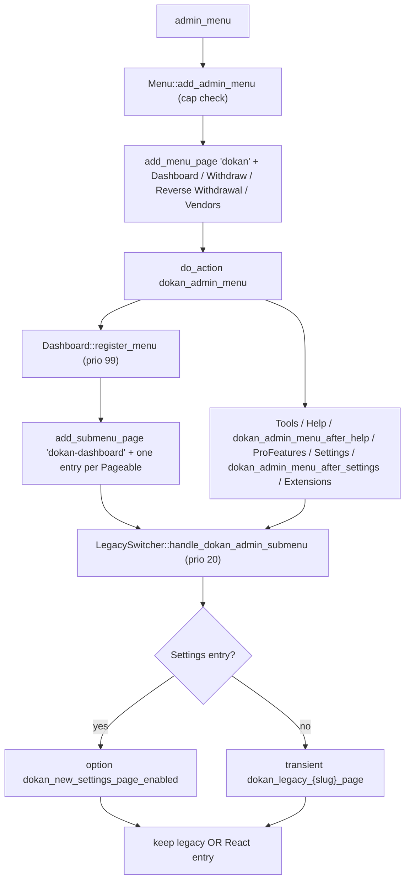
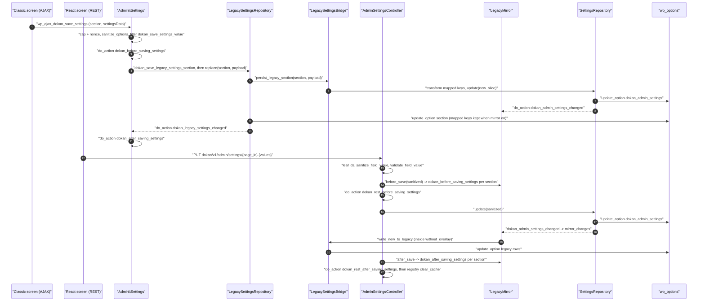
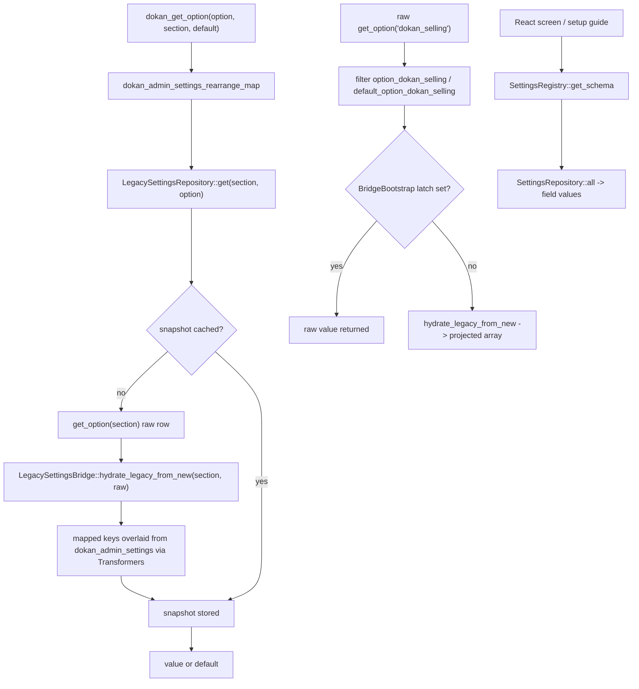
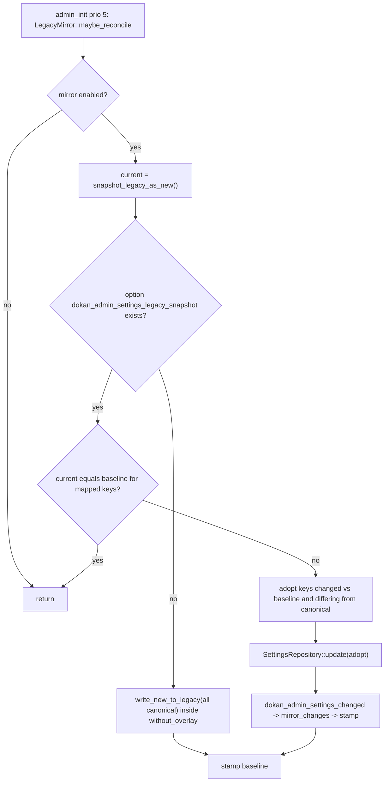
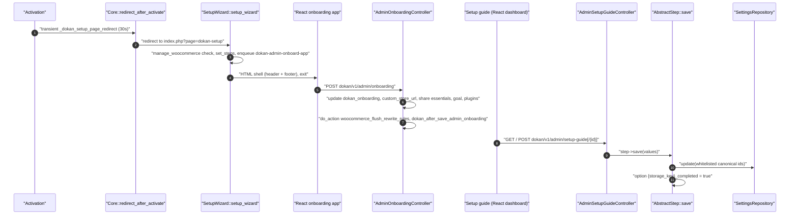
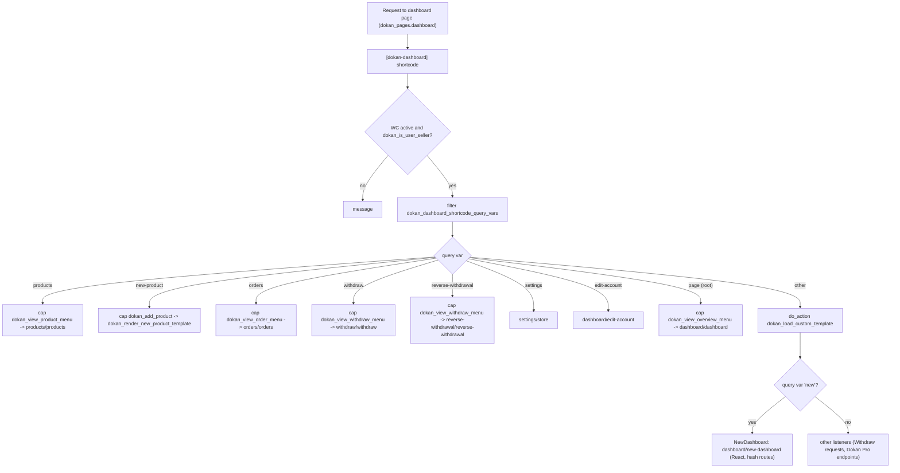
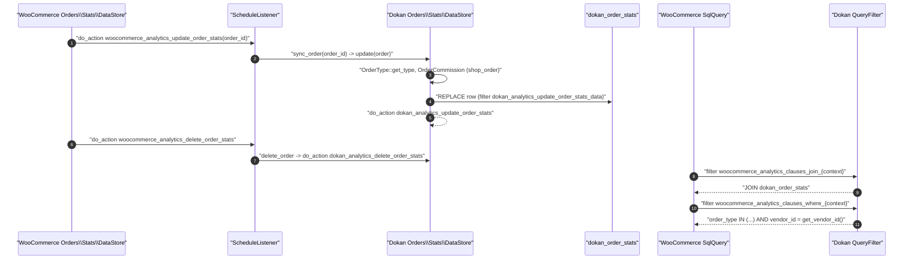
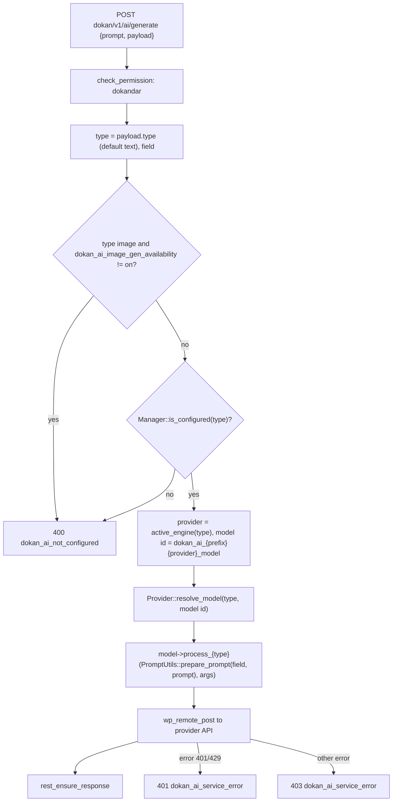
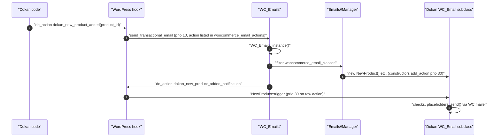

# Admin Area, Settings, Vendor Dashboard and Supporting Subsystems (Dokan Lite)

This document covers the parts of Dokan Lite that configure and present the marketplace rather than move money or products:

- the WordPress admin area (the `Dokan` menu, the React admin dashboard pages and the legacy/new switcher, admin notices, user profile and user list extensions, status and tools),
- the admin settings store (the flat `dokan_admin_settings` option, the Legacy bridge and the Legacy mirror),
- the legacy setup wizard, the React onboarding app and the admin setup guide,
- the vendor dashboard (routing, navigation, PHP templates and the React "new" dashboard),
- vendor analytics on top of WooCommerce Analytics, plus the legacy `reports.php` fallback,
- Dokan Intelligence (AI Assist),
- transactional emails,
- captcha providers,
- the dummy-data importer,
- the `Models` layer used by admin dashboard statistics and Vendor Balance.

Related reading:

- `CONTEXT.md` for canonical terms (**Vendor**, **Store Admin**, **Site Admin**, **Vendor Staff**, **Canonical setting**, **Legacy key**, **Legacy bridge**, **Legacy mirror**, **Transformer**, **Commission**, **Earning**, **Balance**, **Withdraw**).
- [ADR-0002](../0002-flat-dokan-admin-settings-as-canonical-store.md): the flat `dokan_admin_settings` array is the canonical settings store.
- [ADR-0003](../0003-settings-legacy-mirror-mode.md): Legacy mirror mode keeps legacy rows physically populated.
- [ADR-0005](../0005-canonical-admin-capability.md): `manage_woocommerce` is the canonical admin capability.
- [bootstrap-and-container.md](bootstrap-and-container.md) for the container and service-provider mechanics this document relies on.
- [withdraw-and-reverse-withdrawal.md](withdraw-and-reverse-withdrawal.md) and [orders-commission-fees.md](orders-commission-fees.md) for the money flows whose emails and statistics are described here.

**Related ADRs:** [ADR-0002](../0002-flat-dokan-admin-settings-as-canonical-store.md) (flat settings store), [ADR-0003](../0003-settings-legacy-mirror-mode.md) (Legacy mirror), [ADR-0005 (canonical admin capability)](../0005-canonical-admin-capability.md), [ADR-0007](../0007-staff-actions-gated-by-dokan-capabilities.md) (Vendor Staff gated by Dokan capabilities), [ADR-0013](../0013-marketplace-money-lives-in-custom-tables-not-post-types.md) (money in custom tables, read by the `Models` layer and vendor analytics).

---

## 1. Bootstrap map

Every subsystem in this document is wired through the Lite DI container. Two loading paths matter.

**Path A: the `Hookable` loop.** `WeDevs_Dokan::init_plugin()` (`lite:dokan-class.php:249`) runs on `woocommerce_loaded` and calls `init_hooks()` (`lite:dokan-class.php:261`). At `lite:dokan-class.php:276` it resolves every container entry tagged with the `Hookable` interface and calls `register_hooks()` on each. The tag is added automatically: `BaseServiceProvider::add_with_implements_tags()` (`lite:includes/DependencyManagement/BaseServiceProvider.php:65`) tags each registered class with every interface returned by `class_implements()`. So any class registered with `share_with_implements_tags()` that implements `WeDevs\Dokan\Contracts\Hookable` boots at `woocommerce_loaded`, on both admin and frontend requests.

**Path B: tagged groups in `init_classes()`.** `WeDevs_Dokan::init_classes()` (`lite:dokan-class.php:316`) runs on `init` priority 4. It resolves the `common-service` tag always, `admin-service` only when `is_admin()`, `frontend-service` otherwise, `container-service` always, and `ajax-service` during AJAX. Classes in those groups do their hook registration in their constructors.

**Lazy services.** Classes that are neither `Hookable` nor in a resolved tag group (for example `SettingsRegistry`, `Intelligence\Manager`, `AdminSetupGuide`, the Models) are constructed on first `dokan_get_container()->get()`.

| Provider | File | Registers | Load path |
|---|---|---|---|
| `ServiceProvider` | `lite:includes/DependencyManagement/Providers/ServiceProvider.php:16` | Named aliases including `email` (`Emails\Manager`, line 28), `dashboard` (`Dashboard\Manager`, line 37), `dummy_data_importer` (line 44), `admin_notices` (`Admin\Notices\Manager`, line 50); boots every provider below (lines 60-75) | `container-service` tag, Path B |
| `AdminServiceProvider` | `lite:includes/DependencyManagement/Providers/AdminServiceProvider.php:9` | `Admin\Hooks`, `Admin\Menu`, `Admin\AdminBar`, `Admin\Pointers`, `Admin\Settings`, `Admin\UserProfile`, `Admin\UserList`, `Admin\SetupWizard`, `Admin\Status\Status` | `admin-service` tag, Path B (admin requests only) |
| `AdminSettingsServiceProvider` | `lite:includes/DependencyManagement/Providers/AdminSettingsServiceProvider.php:16` | `SettingsRegistry`, `SchemaValidator`, `SettingsRepository`, `LegacySettingsBridge`, `LegacySettingsRepository`, `BridgeBootstrap`, `LegacyMirror`; passes the shared `SettingsRepository` (and, for `LegacySettingsRepository`, the shared `LegacySettingsBridge`) as explicit constructor arguments, because the container does not autowire (lines 39-55); binds the two repository interfaces to the shared concrete instances (lines 62-67) | `BridgeBootstrap` and `LegacyMirror` are `Hookable` (Path A); the rest are lazy |
| `AdminDashboardServiceProvider` | `lite:includes/DependencyManagement/Providers/AdminDashboardServiceProvider.php:24` | `Admin\Dashboard\Dashboard`, `LegacySwitcher`, and the page services (`Modules`, `Tools`, `Status`, `ProFeatures`, `Withdraw`, `Vendors`, `ReverseWithdrawal`, `Extensions`, `SetupGuide`, `Settings`) | All `Hookable`, Path A |
| `AdminSetupGuideServiceProvider` | `lite:includes/DependencyManagement/Providers/AdminSetupGuideServiceProvider.php:15` | `AdminSetupGuide` and the steps `BasicStep`, `CommissionStep`, `WithdrawStep`, `AppearanceStep` | Steps are `Hookable` (Path A); `AdminSetupGuide` is lazy |
| `CommonServiceProvider` | `lite:includes/DependencyManagement/Providers/CommonServiceProvider.php:23` | `VendorNavMenuChecker` (among others) | `common-service`, Path B |
| `AnalyticsServiceProvider` | `lite:includes/DependencyManagement/Providers/AnalyticsServiceProvider.php:11` | `ScheduleListener`, every `QueryFilter`, `DataStoreModifier`, `CacheKeyModifier`, `DataStoreCacheModifier`, `Analytics\Assets`, `VendorDashboardManager`, `Analytics\Settings` | All `Hookable`, Path A |
| `IntelligenceServiceProvider` | `lite:includes/DependencyManagement/Providers/IntelligenceServiceProvider.php:24` | `Intelligence\Assets`, `Intelligence\Manager`, `Intelligence\Admin\Settings`, providers `OpenAI` and `Gemini`, and twelve model classes | Assets, Settings, providers and models are `Hookable` (Path A); `Manager` is lazy |
| `CaptchaServiceProvider` | `lite:includes/DependencyManagement/Providers/CaptchaServiceProvider.php:15` | `Captcha\Manager`, `GoogleRecaptchaV3Provider`, `CloudflareTurnstileProvider` | All `Hookable`, Path A |
| `ModelServiceProvider` | `lite:includes/DependencyManagement/Providers/ModelServiceProvider.php:7` | `VendorBalance`, `VendorOrderStats`, `AdminDashboardStats` and their data stores | Registered with `add()` (not shared), so each `get()` returns a new instance. Its `TAG` constant reads `'ajax-service'`, but `register()` does not attach any tag. |

Procedural files: `includes/reports.php` is required only when `dokan_pro()` does not exist (`lite:dokan-class.php:290`); `includes/Admin/functions.php` is required only in admin (`lite:dokan-class.php:303`); `includes/functions-dashboard-navigation.php` is loaded through Composer's `autoload.files` (`lite:composer.json:47`).

---

## 2. Admin area

### 2.1 Purpose & ownership

[Lite] owns the top-level `Dokan` admin menu, the mount points for the Vue (legacy) and React admin apps, the switch between them, admin notices, Dokan fields on the WordPress user profile, the "pending vendors" view in the user list, the admin toolbar entries, the pointers tour, the status report and the tools actions. Additional submenu items and dashboard pages are consumed by Dokan Pro through the hooks listed in 2.5.

### 2.2 Entry points & bootstrap

| Entry point | Location | Trigger |
|---|---|---|
| `Admin\Menu::add_admin_menu()` | `lite:includes/Admin/Menu.php:30` | `admin_menu` (constructor, line 19) |
| `Admin\Dashboard\Dashboard::register_hooks()` | `lite:includes/Admin/Dashboard/Dashboard.php:52` | Path A |
| `Admin\Dashboard\Dashboard::register_menu()` | `lite:includes/Admin/Dashboard/Dashboard.php:98` | `dokan_admin_menu` priority 99 |
| `Admin\Dashboard\LegacySwitcher::register_hooks()` | `lite:includes/Admin/Dashboard/LegacySwitcher.php:46` | Path A |
| `Admin\Notices\Manager::__construct()` | `lite:includes/Admin/Notices/Manager.php:20` | `admin_notices` alias in `ServiceProvider` |
| `Admin\Hooks::__construct()` | `lite:includes/Admin/Hooks.php:27` | `admin-service` |
| `Admin\UserProfile::__construct()` | `lite:includes/Admin/UserProfile.php:14` | `admin-service` |
| `Admin\UserList::__construct()` | `lite:includes/Admin/UserList.php:18` | `admin-service` |
| `Admin\AdminBar::__construct()` | `lite:includes/Admin/AdminBar.php:24` | `admin-service` |
| `Admin\Pointers::__construct()` | `lite:includes/Admin/Pointers.php:33` | `admin-service` |
| `Admin\Status\Status::describe()` | `lite:includes/Admin/Status/Status.php:40` | Called by `AdminDashboardController` for `GET dokan/v1/admin/dashboard/status` |
| `Admin\Tools\ToolsActions` | `lite:includes/Admin/Tools/ToolsActions.php:62` | Instantiated on demand in `Ajax` (`lite:includes/Ajax.php:78`, `:95`, `:116`) and by `ToolsController` |

### 2.3 Key classes

| Class | File | Responsibility |
|---|---|---|
| `Admin\Menu` | `lite:includes/Admin/Menu.php:9` | Registers the `dokan` top-level page (renders `#dokan-admin-panel-header` and `#dokan-vue-admin`), appends hash-routed submenu entries (Dashboard, Withdraw, Reverse Withdrawal, Vendors, Tools, Help, Settings) and positions the `ProFeatures` and `Extensions` page services via `append_dashboard_page_submenu()` (line 149). |
| `Admin\Dashboard\Dashboard` | `lite:includes/Admin/Dashboard/Dashboard.php:14` | Registers the hidden-in-menu `dokan-dashboard` submenu (renders `#dokan-admin-dashboard`), collects `Pageable` services through `dokan_admin_dashboard_pages`, builds the localized `dokanAdminDashboardSettings` object, registers the React admin bundles. |
| `Admin\Dashboard\Pages\AbstractPage` | `lite:includes/Admin/Dashboard/Pages/AbstractPage.php:8` | Base for every React admin page; `register_hooks()` enlists the page on `dokan_admin_dashboard_pages`. Contract in `Pageable` (`lite:includes/Admin/Dashboard/Pageable.php:12`). |
| `Admin\Dashboard\LegacySwitcher` | `lite:includes/Admin/Dashboard/LegacySwitcher.php:14` | Chooses per page between the legacy Vue screen and the new React screen, filters the `dokan` submenu accordingly (`handle_dokan_admin_submenu()`, line 58) and handles the `switch_admin_panel` redirect (`handle_dashboard_redirect()`, line 118). Also decides vendor-side legacy preferences for the product editor and store settings (lines 270 and 303). |
| `Admin\Notices\Manager` | `lite:includes/Admin/Notices/Manager.php` | Instantiates `WhatsNew`, `PluginReview`, `LimitedTimePromotion`, `UpgradeToV4`, `NewSettingsNotice`; renders `#dokan-admin-notices`; adds permalink, logo-update, plugin-update and vendor-onboarding-page notices to `dokan_admin_notices`. |
| `Admin\Notices\Helper` | `lite:includes/Admin/Notices/Helper.php:21` | `dokan_get_admin_notices()` applies `dokan_admin_notices` and sorts by priority; `dokan_get_promo_notices()` (line 40) applies `dokan_admin_promo_notices`. Feeds `AdminNoticeController`. |
| `Admin\Hooks` | `lite:includes/Admin/Hooks.php:20` | Vendor meta box on the product edit screen, product-author override on save, vendor search AJAX for the author picker, per-product Commission bulk-edit field, page-setting cleanup on save, and the pending-to-publish notification bridge. |
| `Admin\UserProfile` | `lite:includes/Admin/UserProfile.php` | Renders and saves Dokan Store fields on the WordPress user profile for Store Admins. |
| `Admin\UserList` | `lite:includes/Admin/UserList.php` | Adds a "pending vendors" view and approve/disable bulk actions to `users.php`. |
| `Admin\Status\Status` and `Admin\Status\*` | `lite:includes/Admin/Status/Status.php` | Composite element tree (Page, Tab, Section, Table, ...) describing the status report; extended through `dokan_status_after_describing_elements`. |
| `Admin\Tools\ToolsActions` | `lite:includes/Admin/Tools/ToolsActions.php` | Create default Dokan pages, check their existence, clear Dokan caches (fires `dokan_caches_cleared`). |
| `Admin\WithdrawLogExporter` | `lite:includes/Admin/WithdrawLogExporter.php` | CSV exporter for Withdraw logs; used by `WithdrawController` (`lite:includes/REST/WithdrawController.php:376`) and `Withdraw\Hooks` (`lite:includes/Withdraw/Hooks.php:47`). |
| `Admin\RecommendedPlugins` | `lite:includes/Admin/RecommendedPlugins.php` | List of recommended plugins for the setup wizard and onboarding app. |

### 2.4 Execution flow

**Menu assembly.** `Menu::add_admin_menu()` returns early unless the user has `dokan_admin_menu_capability()` (`manage_woocommerce` by default, filterable through `dokan_menu_capability`, `lite:includes/functions.php:40`). It adds the `dokan` page and appends the Dashboard, Withdraw, Reverse Withdrawal and Vendors hash-routed entries, then fires `dokan_admin_menu`. After that action it appends Tools and Help, fires `dokan_admin_menu_after_help`, positions the `ProFeatures` page, appends Settings, fires `dokan_admin_menu_after_settings` and positions the `Extensions` page. `Dashboard::register_menu()` listens at priority 99, adds the `dokan-dashboard` submenu page and appends one `admin.php?page=dokan-dashboard#/{route}` entry per non-hidden `Pageable`. After the `admin_menu` callbacks, `LegacySwitcher::handle_dokan_admin_submenu()` (priority 20) deduplicates the menu by title: for each page it keeps either the legacy entry (`admin.php?page=dokan#/...`) or the React entry (`admin.php?page=dokan-dashboard#/...`).

**Legacy/new preference.** For the Settings page the preference is site-wide: `is_legacy_settings_page()` returns true unless the option `dokan_new_settings_page_enabled` equals `yes` (`LegacySwitcher.php:170`), so the classic settings screen is the default and the React settings screen is opt-in. For other pages the preference is a transient `dokan_legacy_{slug}_page`; `get_custom_transient_key()` (line 239) maps some page keys to shorter slugs through the `dokan_admin_legacy_url_map` filter. Switching is a GET to any admin URL with `dokan_action=switch_admin_panel`, `legacy_key`, optional `switch_to`, and a `dokan_admin_switching_nonce` parameter holding a nonce for the `dokan_switch_admin_panel` action (`LegacySwitcher::handle_dashboard_redirect`).

**Notices.** Notices are data, not HTML. Each notice class adds an array to `dokan_admin_notices`; the Vue app mounted in `#dokan-admin-notices` fetches them from `GET dokan/v1/admin/notices/admin` (and promotions from `.../notices/promo`). Dismiss/postpone actions are AJAX handlers that write options or transients (section 2.6).

**Product publish notification.** `Admin\Hooks::send_notification_on_product_publish()` listens on `pending_to_publish` and fires `dokan_pending_product_published_notification` with the post and Vendor; the `ProductPublished` email (section 8) listens on that action.

### 2.5 Hooks

Hooks fired by [Lite]:

| Hook | Type | Fired in | Purpose |
|---|---|---|---|
| `dokan_menu_capability` | filter | `dokan_admin_menu_capability()` (`lite:includes/functions.php:40`) | Capability for the Dokan admin menu (default `manage_woocommerce`). |
| `dokan_menu_position` | filter | `dokan_admin_menu_position()` (`lite:includes/functions.php:13`) | Menu position (default `55.4`). |
| `dokan_admin_menu` | action | `Menu::add_admin_menu` | Add submenu items; consumed by `Dashboard::register_menu` and by Dokan Pro. |
| `dokan_admin_menu_after_help` | action | `Menu::add_admin_menu` | Insert items between Help and Settings. |
| `dokan_admin_menu_after_settings` | action | `Menu::add_admin_menu` | Insert items after Settings. |
| `dokan_enqueue_admin_dashboard_script` | action | `Menu::dashboard_script` | Enqueue additional legacy admin assets. |
| `dokan_admin_dashboard_pages` | filter | `Dashboard::get_pages` | List of `Pageable` services; consumed by every `AbstractPage` and by Dokan Pro. |
| `dokan_admin_dashboard_page_settings` | filter | `Dashboard::settings` | Per-page localized settings. |
| `dokan_admin_dashboard_pages_settings` | filter | `Dashboard::settings` | Whole localized settings map. |
| `dokan_admin_setup_guides_header_info` | filter | `Dashboard::settings` | Header info for the setup guide banner. |
| `dokan_admin_notices` | filter | `Notices\Helper::dokan_get_admin_notices` | Collect admin notices. |
| `dokan_admin_promo_notices` | filter | `Notices\Helper::dokan_get_promo_notices` | Collect promotional notices. |
| `dokan_new_settings_notice_postponed_days` | filter | `NewSettingsNotice::postpone_notice` | Days to hide the "new settings" notice (default 20). |
| `dokan_ask_for_review_admin_notice_initial_delay_days`, `dokan_ask_for_review_admin_notice_postponed_days` | filter | `PluginReview` | Review-notice timing. |
| `dokan_pending_product_published_notification` | action | `Admin\Hooks::send_notification_on_product_publish` | Product moved from pending to publish. |
| `dokan_excluded_product_types_for_bulk_edit` | filter | `Admin\Hooks::save_custom_bulk_edit_field` | Product types skipped by the Commission bulk edit. |
| `dokan_user_profile_after_phone_number`, `dokan_seller_meta_fields` | action | `UserProfile::add_meta_fields` | Extra profile fields. |
| `dokan_process_seller_meta_fields` | action | `UserProfile::save_meta_fields` | After profile fields are saved. |
| `dokan_show_admin_bar_visit_dashboard` | filter | `AdminBar::__construct` | Toggle the "Visit Vendor Dashboard" toolbar link. |
| `dokan_render_admin_toolbar` | action | `AdminBar::dokan_admin_toolbar` | Extend the toolbar. |
| `dokan_after_pointer_setup`, `dokan_pointer_{screen_id}` | action / filter | `Pointers` | Pointer tour extension. |
| `dokan_status_after_describing_elements` | action | `Status::describe` | Add status sections; consumed by `VendorNavMenuChecker::add_status_section`. |
| `dokan_caches_cleared` | action | `ToolsActions::clear_dokan_caches` | After the Tools "clear caches" action. |
| `dokan_recommended_plugins_list`, `dokan_recommended_plugin_is_active`, `dokan_recommended_inactive_plugins` | filter | `RecommendedPlugins` | Recommended-plugin list. |

Hooks consumed by [Lite] (WordPress core unless noted):

| Hook | Callback | Notes |
|---|---|---|
| `admin_menu` | `Menu::add_admin_menu`, `LegacySwitcher::handle_dokan_admin_submenu` (20), `SetupWizard::admin_menus` | |
| `admin_init` | `LegacySwitcher::handle_dashboard_redirect` | |
| `admin_enqueue_scripts` | `Dashboard::enqueue_scripts`, `Notices\Manager::load_dokan_admin_notices_styles`, `Pointers::setup_pointers_for_screen` (20), `UserProfile::enqueue_scripts` | |
| `admin_notices` | `Dashboard::inject_before_notices` (-9999), `Dashboard::inject_after_notices` (`PHP_INT_MAX`), `Notices\Manager::render_missing_woocommerce_notice`, `render_global_admin_notices_html`, `LimitedTimePromotion::render_promo_notices_html`, `UserList::show_bulk_action_notices` | |
| `admin_footer_text`, `update_footer` | `Dashboard::add_switching_container`, `Dashboard::add_update_footer` | |
| `pending_to_publish` | `Admin\Hooks::send_notification_on_product_publish` | |
| `add_meta_boxes` | `Admin\Hooks::add_seller_meta_box` | |
| `woocommerce_process_product_meta` [WooCommerce] | `Admin\Hooks::override_product_author_by_admin` (12) | Fired as `woocommerce_process_{post_type}_meta` in `wc:includes/admin/class-wc-admin-meta-boxes.php:272`. |
| `woocommerce_product_bulk_edit_end` [WooCommerce] | `Admin\Hooks::add_product_commission_bulk_edit_field` | `wc:includes/admin/views/html-bulk-edit-product.php:380`. |
| `woocommerce_product_bulk_edit_save` [WooCommerce] | `Admin\Hooks::save_custom_bulk_edit_field` | `wc:includes/admin/class-wc-admin-post-types.php:692`. |
| `post_types_to_delete_with_user` | `Admin\Hooks::add_wc_post_types_to_delete_user` | |
| `dokan_save_settings_value` | `Admin\Hooks::update_pages` | Lite-fired filter, see section 3. |
| `show_user_profile`, `edit_user_profile`, `personal_options_update`, `edit_user_profile_update` | `UserProfile` | |
| `views_users`, `pre_get_users`, `bulk_actions-users`, `handle_bulk_actions-users` | `UserList` | |
| `wp_before_admin_bar_render`, `admin_bar_menu` (35) | `AdminBar` | |

### 2.6 Data storage

| Key | Type | Written by | Meaning |
|---|---|---|---|
| `dokan_new_settings_page_enabled` | option | `LegacySwitcher::switch_settings_page` | `yes` = React settings screen; absent = classic screen. |
| `dokan_legacy_{slug}_page` | transient | `LegacySwitcher::handle_dashboard_redirect` | Per-page legacy preference. |
| `dokan_legacy_dashboard_page` | option (legacy) | none; deleted by `handle_dashboard_redirect` | Superseded by the transients. `SetupWizard::register_admin_scripts` still reads it to pick the onboarding app's return URL. |
| `dismiss_dokan_admin_logo_update_notice` | option | `Notices\Manager::dismiss_dokan_admin_logo_update_notice` (through the private `dismiss_notice()` helper) | Logo-update notice dismissed. |
| `dokan_review_notice_hidden`, `dokan_review_notice_postponed`, `dokan_installed_time` | option | `PluginReview` (and installer for `dokan_installed_time`) | Review notice state. |
| `dokan_lite_whats_new_versions` | option | `WhatsNew::dismiss_new_notice` | Lite versions whose "what's new" notice was seen. `Notices\Helper` also reads `dokan_pro_whats_new_versions`, which Lite does not write. |
| `_dokan_limited_time_promo` | option | `LimitedTimePromotion::dismiss_limited_time_promo` | Dismissed promotion keys. |
| `promo_notices` | Dokan cache transient | `Notices\Helper::dokan_get_promo_notices` | Cached promotion feed, one day. |
| `dokan_new_settings_notice_postponed` (`NewSettingsNotice::POSTPONED_TRANSIENT`) | transient | `NewSettingsNotice::postpone_notice` | Postpones the "new settings" notice. |
| `dokan_pointer_{screen}` | option | `Pointers::dismiss_screen` | Pointer tour dismissed. |
| User meta `dokan_profile_settings`, `dokan_publishing`, `dokan_feature_seller`, `dokan_store_name` | user meta | `UserProfile::save_meta_fields` (`lite:includes/Admin/UserProfile.php:528`) | Store profile and Operating Terms edited from the WP profile screen. Selling activation goes through `dokan()->vendor->activate()` / `deactivate()` only when the posted value differs from the current one. The screen does not write the Vendor-level Commission meta (`dokan_admin_percentage`, `dokan_admin_percentage_type`), so saving it leaves the Vendor's Commission unchanged; that meta is written by `Vendor\Manager` and `Commission\Settings\Vendor::save` (see [database.md](database.md)). |

### 2.7 REST / AJAX endpoints

| Route / action | Method | Permission |
|---|---|---|
| `dokan/v1/admin/notices/admin` | GET | `check_permission` → `manage_woocommerce` (`DokanBaseAdminController`, `lite:includes/REST/DokanBaseAdminController.php:26`) |
| `dokan/v1/admin/notices/promo` | GET | same |
| `dokan/v1/admin/dashboard/feed`, `dokan/v1/admin/dashboard/status` | GET | same (`AdminDashboardController`) |
| `dokan/v1/admin/report/summary`, `dokan/v1/admin/report/overview` | GET | same (`AdminReportController`) |
| `dokan/v1/admin/help`, `dokan/v1/admin/option` | GET | same (`AdminMiscController`) |
| `dokan/v1/admin/dashboard/{todo,analytics,monthly-overview,sales-chart,all-time-stats,top-performing-vendors,most-reviewed-products,vendor-metrics}` | GET | same (`AdminDashboardStatsController`) |
| `dokan/v1/admin/tools/create-pages` (POST), `.../check-all-dokan-pages-exists` (GET), `.../clear-caches` (POST) | as listed | same (`ToolsController`) |
| `dokan/v1/admin/extensions/install` | POST | `AdminExtensionsController::check_install_permission` |
| `wp_ajax_dismiss_dokan_admin_logo_update_notice` | POST | nonce `dismiss_dokan_admin_logo_update_notice_nonce` + `manage_woocommerce` |
| `wp_ajax_dokan_ask_for_review_notice_action` | POST | nonce `dokan_admin_review_notice_nonce` + `manage_woocommerce` |
| `wp_ajax_dokan-whats-new-notice` | POST | nonce `dokan_admin` + `manage_options` |
| `wp_ajax_dokan_dismiss_limited_time_promotional_notice` | POST | nonce `dokan_promotional_notice` + `manage_woocommerce` |
| `wp_ajax_dokan_new_settings_notice_postpone` | POST | nonce `dokan_new_settings_notice_nonce` + `dokan_admin_menu_capability()` |
| `wp_ajax_dokan_product_search_author` | GET | nonce `dokan_admin_product` + `manage_woocommerce` |
| `wp_ajax_dokan-dismiss-wp-pointer` | POST | Logged-in users (`wp_ajax_` action); handled by `Pointers::dismiss_screen` |

### 2.8 Permissions & capabilities

The admin menu, every `dokan/v1/admin/*` controller derived from `DokanBaseAdminController`, the settings AJAX handlers and the profile fields all gate on `manage_woocommerce`, the canonical **Store Admin** capability ([ADR-0005](../0005-canonical-admin-capability.md)). `WhatsNew` gates on `manage_options` (**Site Admin**). The missing-WooCommerce notice requires `activate_plugins`. The notice, settings and author-search AJAX handlers each verify a per-action nonce and a capability (see 2.7).

### 2.9 WooCommerce touchpoints

Product meta save and bulk edit hooks (2.5). The Status page reads WooCommerce state through its element tree; the Tools page creates Dokan pages next to WooCommerce pages.

### 2.10 Dependencies

Internal: container, `Admin\Settings` (localized data), `Withdraw` (pending count in the menu via `dokan_get_withdraw_count()`), `Vendor` manager (`UserList` bulk actions). External: WordPress admin APIs, WooCommerce admin screens, the React admin bundle (`dokan-admin-dashboard`, `dokan-admin-panel-header`, `dokan-admin-switching` script handles registered in `Dashboard::register_scripts`).

### 2.11 Extension points

- Add a React admin page: subclass `Admin\Dashboard\Pages\AbstractPage`, implement `get_id()`, `menu()`, `settings()`, `scripts()`, `styles()`, `register()`, and register it as a shared `Hookable` service. Return `'hidden' => true` from `menu()` to place the submenu yourself.
- Add a legacy submenu: hook `dokan_admin_menu`, `dokan_admin_menu_after_help` or `dokan_admin_menu_after_settings`.
- Add a notice: return an array from a `dokan_admin_notices` filter callback (priority-sorted by `Helper`).
- Add a status section: hook `dokan_status_after_describing_elements` and use `StatusElementFactory`.

---

## 3. Admin settings store

### 3.1 Purpose & ownership

[Lite] owns the admin settings store for the whole Dokan bounded context. The flat `dokan_admin_settings` option is the canonical store: one entry per **Canonical setting**, keyed by a globally unique field id ([ADR-0002](../0002-flat-dokan-admin-settings-as-canonical-store.md)). The historical per-section rows (`dokan_general`, `dokan_selling`, `dokan_withdraw`, `dokan_reverse_withdrawal`, `dokan_pages`, `dokan_appearance`, `dokan_privacy`, `dokan_ai`, ...) are **Legacy keys**. The **Legacy bridge** maps canonical ids to Legacy keys at runtime; the **Legacy mirror** keeps the legacy rows physically populated so a downgrade finds real data ([ADR-0003](../0003-settings-legacy-mirror-mode.md)). Dokan Pro contributes schema fields and mappings through the filters in 3.5.

Two admin screens write settings:

- the classic Vue screen, via AJAX against legacy sections (`Admin\Settings`);
- the React screen (opt-in, see 2.4), via REST against the flat store (`AdminSettingsController`).

### 3.2 Entry points & bootstrap

| Entry point | Location |
|---|---|
| `dokan_get_option( $option, $section, $default )` (read accessor) | `lite:includes/functions.php:1083` |
| `dokan_save_legacy_settings_section( $option_name, $payload )` (legacy write accessor) | `lite:includes/functions.php:1131` |
| `dokan_admin_settings_rearrange_map()` | `lite:includes/functions.php:3471` |
| `Admin\Settings::get_settings_value()` / `save_settings_value()` (classic screen AJAX) | `lite:includes/Admin/Settings.php:117`, `:151` |
| `REST\AdminSettingsController::register_routes()` | `lite:includes/REST/AdminSettingsController.php:70` |
| `AdminSettingsController::update_item()` | `lite:includes/REST/AdminSettingsController.php:159` |
| `BridgeBootstrap::register_hooks()` | `lite:includes/Admin/Settings/Migration/BridgeBootstrap.php:131` |
| `LegacyMirror::register_hooks()` | `lite:includes/Admin/Settings/Migration/LegacyMirror.php:104` |

### 3.3 Key classes

| Class | File | Responsibility |
|---|---|---|
| `Settings\Schema\SettingsSchema` | `lite:includes/Admin/Settings/Schema/SettingsSchema.php:25` (`get_schema()`) | Static flat element list (pages, subpages, tabs, sections, field groups, fields). Pages: general, transaction, vendor, appearance, compliance, AI assist, moderation, product. Fields declare `legacy_key`, optional `legacy_transformer` and `legacy_merge`. Ends with `apply_filters( 'dokan_get_admin_settings_schema', $elements )` (line 78). |
| `Settings\Schema\SettingsRegistry` | `lite:includes/Admin/Settings/Schema/SettingsRegistry.php:58` (`get_schema()`) | Builds the processed schema: base schema → generated `hook_key`s → `hook_key` filters on structural nodes → defaults → values from the repository → lazy option lists → validation (debug mode). Cached per instance; `clear_cache()` after writes. |
| `Settings\Schema\SchemaValidator` | `lite:includes/Admin/Settings/Schema/SchemaValidator.php:224` (`validate()`) | Checks required properties, parent references, reachability, duplicate and unique field ids, variants. |
| `Settings\Repository\SettingsRepository` | `lite:includes/Admin/Settings/Repository/SettingsRepository.php` | The flat store. `OPTION_KEY = 'dokan_admin_settings'`. `all()`, `get()`, `update( $slice )` (line 59, merge), `replace( $payload )` (line 109, full write). Per-request snapshot flushed on `update_option_/add_option_/delete_option_dokan_admin_settings`. |
| `Settings\Repository\LegacySettingsRepository` | `lite:includes/Admin/Settings/Repository/LegacySettingsRepository.php:14` | Legacy-section facade. `all( $section )` returns the raw row overlaid with mapped canonical values; `update()` (line 75) and `replace()` (line 134) route through the bridge. Snapshots flushed on WordPress `added_option`/`updated_option`/`deleted_option`; a write to `dokan_admin_settings` flushes every section snapshot. |
| `Settings\Migration\LegacySettingsBridge` | `lite:includes/Admin/Settings/Migration/LegacySettingsBridge.php:23` | Bidirectional map between canonical ids and `LegacyAddress`es, harvested from the schema (`harvest_from_schema()`, line 775) and the `dokan_legacy_settings_key_mapping` filter (`build_map()`, line 719). Key methods: `hydrate_legacy_from_new()` (337), `persist_legacy_section()` (427), `write_new_to_legacy()` (487), `strip_mapped_keys()` (386), `is_legacy_mirror_enabled()` (142). |
| `Settings\Migration\LegacyAddress` | `lite:includes/Admin/Settings/Migration/LegacyAddress.php` | Value object for `option.field[.subfield]` addresses with `read_from()` / `write_to()`. |
| `Settings\Migration\Transformer\*` | `lite:includes/Admin/Settings/Migration/Transformer/` | **Transformers** between canonical and legacy shapes (pass-through, on/off inversion, multicheck arrays, withdraw charge, withdraw method toggle, double input, and so on). |
| `Settings\Migration\BridgeBootstrap` | `lite:includes/Admin/Settings/Migration/BridgeBootstrap.php:32` | Read overlay: attaches `option_{section}` and `default_option_{section}` filters for every known legacy section at `init` priority 999, so raw `get_option( 'dokan_selling' )` calls see canonical values. Static re-entry latch; `without_overlay( callable )` (line 80) suspends it. |
| `Settings\Migration\LegacyMirror` | `lite:includes/Admin/Settings/Migration/LegacyMirror.php:51` | Write-through of canonical changes to legacy rows, adoption of direct legacy writes, `admin_init` reconciliation, and the legacy `dokan_before_saving_settings` / `dokan_after_saving_settings` compatibility actions for REST saves (`before_save()` line 456, `after_save()` line 495). |
| `Admin\Settings` | `lite:includes/Admin/Settings.php` | Classic screen: section list (`get_settings_sections()`, line 331), field definitions (`get_settings_fields()`, line 407), AJAX read/save, sanitization. |
| `REST\AdminSettingsController` | `lite:includes/REST/AdminSettingsController.php:22` | React screen: returns the processed schema, validates/sanitizes per field, saves to the flat store. |

### 3.4 Execution flow

**Write paths.** Both screens end with the same physical state: canonical values in `dokan_admin_settings` and, with the mirror enabled (the default), the same values mapped into the legacy rows.

Notes on the REST write: request keys may be dot paths (`page.subpage.field_id`); only the leaf id is used. Unknown ids are ignored. A field that fails validation blocks the save unless it is hidden by its dependency rules (`is_field_hidden()`), in which case the stored value is kept. The response is the full processed schema, filtered through `dokan_rest_admin_settings_response`.

**Read paths.**

If the container is not yet available, `dokan_get_option()` falls back to a raw `get_option()` read without the overlay; `dokan_save_legacy_settings_section()` likewise falls back to a raw `update_option()`.

**Direct legacy writes and reconciliation.** `LegacyMirror::register_write_listeners()` (at `init` priority 1000) captures `pre_update_option_{section}` and the generic `update_option`/`add_option` actions so a plain `update_option( 'dokan_general', ... )` from CLI, cron or third-party code is adopted into `dokan_admin_settings`. On `admin_init` priority 5, `maybe_reconcile()` compares the mapped legacy values against the baseline stored in `dokan_admin_settings_legacy_snapshot` and adopts any key changed while the bridge was absent (for example on a downgraded plugin version); last write wins.

### 3.5 Hooks

Fired by [Lite]:

| Hook | Type | Fired in | Purpose |
|---|---|---|---|
| `dokan_get_admin_settings_schema` | filter | `SettingsSchema::get_schema` | Add or alter schema elements; consumed by Dokan Pro. |
| `{hook_key}` (generated per structural node) | filter | `SettingsRegistry::fire_hook_key_filters` | Alter the children of a page/subpage/section. |
| `dokan_admin_settings_schema_skip_validation`, `dokan_admin_settings_schema_validation_result`, `dokan_admin_settings_schema_required_properties`, `dokan_admin_settings_schema_parent_pointer_map`, `dokan_admin_settings_schema_types_requiring_parent`, `dokan_admin_settings_known_variants` | filter | `SchemaValidator` | Validator configuration. |
| `dokan_admin_settings_schema_before_validate`, `dokan_admin_settings_schema_after_validate` | action | `SchemaValidator::validate` | |
| `dokan_admin_settings_pre_save` | filter | `SettingsRepository::update` / `replace` | Normalize or block a canonical write. |
| `dokan_admin_settings_changed` | action | `SettingsRepository::update` / `replace` | After a canonical write (`$changed`, `$before`, `$after`); consumed by `LegacyMirror::mirror_changes`. |
| `dokan_legacy_settings_pre_save` | filter | `LegacySettingsRepository::update` / `replace` | Normalize or block a legacy-section write. |
| `dokan_legacy_settings_changed` | action | `LegacySettingsRepository::update` / `replace` | After a legacy-section write. |
| `dokan_legacy_settings_key_mapping` | filter | `LegacySettingsBridge::build_map` | Mappings the per-field `legacy_key` cannot express; consumed by Dokan Pro. |
| `dokan_admin_settings_legacy_mirror` | filter | `LegacySettingsBridge::is_legacy_mirror_enabled` | Return `false` to disable the mirror (strict mode). |
| `dokan_admin_settings_rearrange_map` | filter | `dokan_admin_settings_rearrange_map()` | Redirect `(option, section)` pairs that moved between legacy sections. |
| `dokan_rest_admin_settings_response` | filter | `AdminSettingsController::get_items` / `update_item` | REST response schema. |
| `dokan_rest_before_saving_settings`, `dokan_rest_after_saving_settings` | action | `AdminSettingsController::update_item` | Around the REST save. |
| `dokan_rest_admin_settings_validate_field`, `dokan_rest_admin_settings_sanitize_field` | filter | `AdminSettingsController` | Per-variant validation and sanitization. |
| `dokan_settings_sections`, `dokan_settings_fields` | filter | `Admin\Settings` | Classic screen sections and fields; consumed by `Intelligence\Admin\Settings` and `Captcha\Manager`. |
| `dokan_settings_general_site_options` and other per-group field filters | filter | `Admin\Settings::get_settings_fields` | Classic screen field groups. |
| `dokan_get_settings_values` | filter | `Admin\Settings::get_settings_value` / `save_settings_value` | Values returned to the classic screen. |
| `dokan_save_settings_value` | filter | `Admin\Settings::save_settings_value` | Normalize a classic save. |
| `dokan_before_saving_settings`, `dokan_after_saving_settings` | action | `Admin\Settings::save_settings_value`; `LegacyMirror::before_save` / `after_save` for REST saves | Legacy per-section save listeners (validation, rewrites, crons). |
| `dokan_settings_withdraw_methods_default` | filter | `Admin\Settings` | Default enabled withdraw methods (`paypal`). |

Consumed by [Lite] in this subsystem: `option_{section}` and `default_option_{section}` (`BridgeBootstrap`), `pre_update_option_{section}`, `update_option`, `add_option` (`LegacyMirror`), `added_option` / `updated_option` / `deleted_option` (`LegacySettingsRepository`), `update_option_dokan_admin_settings` / `add_option_...` / `delete_option_...` (`SettingsRepository`), `init` (999 / 1000), `admin_init` (5), and the AJAX actions in 3.7.

### 3.6 Data storage

| Key | Type | Notes |
|---|---|---|
| `dokan_admin_settings` | option (autoloaded) | Flat `canonical_id => value` map. Canonical store. |
| `dokan_general`, `dokan_selling`, `dokan_withdraw`, `dokan_reverse_withdrawal`, `dokan_pages`, `dokan_appearance`, `dokan_privacy`, `dokan_ai` (and module sections) | options | Legacy keys. With the mirror on they hold mapped values plus unmapped keys; with it off they hold unmapped keys only. |
| `dokan_admin_settings_legacy_snapshot` | option | Reconciliation baseline (canonical-id space). `LegacyMirror::SNAPSHOT_KEY`. |
| `dokan_new_settings_page_enabled` | option | Which admin settings screen is shown (2.6). |

### 3.7 REST / AJAX endpoints

| Route / action | Method | Permission |
|---|---|---|
| `dokan/v1/admin/settings` | GET | `manage_woocommerce` |
| `dokan/v1/admin/settings/{page_id}` (`page_id` matches `[a-z_-]+`; body `values` object) | PUT/PATCH/POST (`EDITABLE`) | `manage_woocommerce` |
| `wp_ajax_dokan_get_setting_values` | POST | `manage_woocommerce` + nonce `dokan_admin` |
| `wp_ajax_dokan_save_settings` | POST | `manage_woocommerce` + nonce `dokan_admin`; `section` must be one of `get_settings_sections()` ids |
| `wp_ajax_dokan_refresh_admin_settings_field_options` | POST | `check_ajax_referer( 'dokan_admin_settings' )` |

### 3.8 Permissions & capabilities

All writes require `manage_woocommerce` (**Store Admin**). The classic save restricts the target option name to the declared section ids, so the AJAX handler cannot write arbitrary options. The REST save writes only ids present on the requested page of the processed schema, after per-field sanitization and validation.

### 3.9 WooCommerce touchpoints

None at the storage level. Several schema option lists are built from WooCommerce data (order statuses, pages).

### 3.10 Dependencies

Internal: container (shared repository instances are required so snapshots do not drift, see the comment in `AdminSettingsServiceProvider::register`). External: WordPress options API.

### 3.11 Extension points

- New setting: add a `field` element through `dokan_get_admin_settings_schema` with a unique `id`; set `legacy_key` (and a Transformer if shapes differ) if older code reads it through `dokan_get_option()`.
- Read a setting in new code: `dokan_get_container()->get( SettingsRepository::class )->get( 'canonical_id' )`; in code still addressing legacy sections: `dokan_get_option( $key, $section )`.
- Write a setting: `SettingsRepository::update( [ 'id' => $value ] )`. Do not call `update_option()` on legacy rows next to `dokan_save_legacy_settings_section()`; the repository owns that write.
- React for the settings UI follows the `dokan-settings` skill conventions in this repository.

---

## 4. Setup wizard, onboarding and admin setup guide

### 4.1 Purpose & ownership

[Lite] ships three generations of first-run configuration:

1. **Legacy PHP setup wizard** (`Admin\SetupWizard`): the `dokan-setup` page. In the admin context it now renders only an HTML shell and enqueues the React onboarding app.
2. **React onboarding app** (`dokan-admin-onboard` bundle) backed by `dokan/v1/admin/onboarding`.
3. **Admin setup guide** (`AdminSetupGuide` + steps) shown inside the React admin dashboard, backed by `dokan/v1/admin/setup-guide`. Steps write directly to the canonical store.

`SetupWizardNoWC` handles the no-WooCommerce case; `SetupWizardWCAdmin` is reached only through `SetupWizardNoWC` when `WC_VERSION < 4.6.0` (guarded by the "temporary fix" condition in `SetupWizard::__construct`), so it is inert on WooCommerce 11.2.1.

### 4.2 Entry points & bootstrap

| Entry point | Location |
|---|---|
| Activation redirect transient `_dokan_setup_page_redirect` | Set in `lite:includes/Install/Installer.php:48`; consumed by `Core::redirect_after_activate()` (`lite:includes/Core.php:187`) and `WeDevs_Dokan::woocommerce_not_loaded()` |
| `dokan_redirect_to_admin_setup_wizard()` | `lite:includes/functions.php:3676`; redirects to `admin_url( 'index.php' )` with `page=dokan-setup` |
| `SetupWizard::__construct()` | `lite:includes/Admin/SetupWizard.php:43` |
| `SetupWizard::setup_wizard()` | `lite:includes/Admin/SetupWizard.php:335` (`admin_init` priority 99) |
| `SetupWizardNoWC` | `lite:dokan-class.php:477` (instantiated when WooCommerce is not loaded, admin only) |
| `REST\AdminOnboardingController::create_onboarding()` | `lite:includes/REST/AdminOnboardingController.php:146` |
| `AdminSetupGuide::get_steps()` | `lite:includes/Admin/OnboardingSetup/AdminSetupGuide.php:34` |
| `AbstractStep::save()` | `lite:includes/Admin/OnboardingSetup/Steps/AbstractStep.php:267` |

### 4.3 Key classes

| Class | File | Responsibility |
|---|---|---|
| `Admin\SetupWizard` | `lite:includes/Admin/SetupWizard.php` | Registers a hidden `dokan-setup` submenu (`admin_menus()`, line 253, parent `''`), defines steps through `dokan_admin_setup_wizard_steps` (`set_steps()`, line 264), dispatches step handlers on POST, registers the `dokan-admin-onboard-app` script with `onboardingData` (`register_admin_scripts()`, line 177). In admin, `set_setup_wizard_template()` prints only header and footer. |
| `Admin\SetupWizardNoWC` | `lite:includes/Admin/SetupWizardNoWC.php:8` | Wizard variant that offers WooCommerce installation. |
| `REST\AdminOnboardingController` | `lite:includes/REST/AdminOnboardingController.php:14` | Saves `dokan_onboarding`, the custom store URL (via `dokan_save_legacy_settings_section( 'dokan_general', ... )`), share-essentials, marketplace goal, and installs selected recommended plugins. |
| `Admin\OnboardingSetup\AdminSetupGuide` | `lite:includes/Admin/OnboardingSetup/AdminSetupGuide.php:7` | Collects steps through `dokan_admin_setup_guide_steps`, sorts by priority, tracks overall completion in `dokan_admin_setup_guide_steps_completed`. |
| `Steps\AbstractStep` | `lite:includes/Admin/OnboardingSetup/Steps/AbstractStep.php:24` | A step lists canonical field ids (`get_field_ids()`); `populate()` re-parents those schema fields under a wizard section; `save()` whitelists the ids and calls `SettingsRepository::update()`, then marks the step complete. |
| `BasicStep`, `CommissionStep`, `WithdrawStep`, `AppearanceStep` | `lite:includes/Admin/OnboardingSetup/Steps/` | Priorities 10/20/30/40. `BasicStep` (not skippable) covers Fee recipients, vendor order-status control and automatic Selling Activation; `CommissionStep` covers the Commission formula and values; `WithdrawStep` covers withdraw methods, minimum limit and order status; `AppearanceStep` covers store contact form, theme sidebar and vendor-info visibility. |

### 4.4 Execution flow

The legacy step handlers (`dokan_setup_store_save`, `dokan_setup_selling_save`, `dokan_setup_commission_save`, `dokan_setup_withdraw_save`) still exist and save through `dokan_save_legacy_settings_section()`, so they also land in the canonical store. `dokan_setup_recommended_save` writes WooCommerce registration options and installs plugins instead (4.9). They run only when a POST with `save_step` and a valid `dokan-setup` nonce reaches `setup_wizard()`.

### 4.5 Hooks

Fired by [Lite]: `dokan_admin_setup_wizard_steps` (filter), `dokan_setup_wizard_enqueue_scripts`, `dokan_setup_wizard_styles`, `dokan_admin_setup_wizard_save_step_store`, `dokan_admin_setup_wizard_save_step_setup_selling`, `dokan_admin_setup_wizard_save_step_setup_commission`, `dokan_setup_wizard_view_withdraw_methods`, `dokan_setup_wizard_save_withdraw_options` (filter), `dokan_share_essentials_updated`, `dokan_admin_onboarding_schema` (filter), `dokan_before_save_admin_onboarding`, `dokan_admin_onboarding_response` (filter), `dokan_after_save_admin_onboarding`, `dokan_admin_setup_guide_steps` (filter), `dokan_admin_setup_guide_steps_mapper` (filter), `dokan_admin_setup_guide_is_setup_complete` (filter), `{storage_key}_skippable` (filter, per step). `AdminOnboardingController::create_onboarding` also fires WooCommerce's `woocommerce_flush_rewrite_rules` action (WooCommerce fires the same action in `wc:includes/class-wc-install.php:683`).

Consumed by [Lite]: `user_has_cap` (`SetupWizard::set_user_cap`, only when WooCommerce is inactive), `admin_menu`, `init` (`register_admin_scripts`), `admin_init` (99). `SetupWizardWCAdmin.php` adds `woocommerce_enable_setup_wizard` → `__return_false` at file load (`lite:includes/Admin/SetupWizardWCAdmin.php:5`); WooCommerce reads it in `wc:src/Internal/Admin/Onboarding/OnboardingSetupWizard.php:97`.

### 4.6 Data storage

| Key | Type | Meaning |
|---|---|---|
| `_dokan_setup_page_redirect` | transient | One-shot activation redirect. |
| `dokan_setup_wizard_no_wc` | transient | Wizard started without WooCommerce. |
| `dokan_admin_setup_wizard_ready` | option | Legacy wizard reached the "Ready" step. |
| `dokan_onboarding` | option | Onboarding app state. |
| `dokan_share_essentials` | option | Usage-data consent from onboarding. |
| `dokan_marketplace_goal` | option | Marketplace goal from onboarding. |
| `dokan_admin_setup_guide_steps_completed` | option | Setup guide completed. |
| `dokan_admin_onboarding_setup_step_{basic,commission,withdraw,appearance}_completed` | option | Per-step completion flags. |
| `woocommerce_setup_background_installing_{plugin}` | option | Background plugin install marker (`SetupWizard::install_plugin`). |

Setting values themselves go to `dokan_admin_settings` (section 3).

### 4.7 REST / AJAX endpoints

| Route | Method | Permission |
|---|---|---|
| `dokan/v1/admin/onboarding` | GET, POST | `manage_woocommerce` |
| `dokan/v1/admin/setup-guide` | GET, `EDITABLE` | `manage_woocommerce` |
| `dokan/v1/admin/setup-guide/{id}` (`[\w-]+`) | GET, `EDITABLE` | `manage_woocommerce` |

### 4.8 Permissions & capabilities

`SetupWizard` registers its hooks only if `current_user_can( 'manage_woocommerce' )` and re-checks in `setup_wizard()`. When WooCommerce is not active, `set_user_cap()` grants `manage_woocommerce` to users who hold `manage_options`, so a Site Admin can reach the wizard before WooCommerce defines the capability. Legacy step handlers verify the `dokan-setup` nonce; step navigation verifies `dokan_admin_setup_wizard_nonce`. Plugin installation additionally requires `install_plugins` and `activate_plugins` (`user_can_install_plugin()`). Onboarding rejects reserved WordPress slugs as the store URL.

### 4.9 WooCommerce touchpoints

Disables WooCommerce's own setup wizard redirect while `SetupWizardWCAdmin.php` is loaded; the recommended step enables WooCommerce account registration options (`woocommerce_enable_myaccount_registration`, `woocommerce_registration_generate_username`, `woocommerce_registration_generate_password`) in `dokan_setup_recommended_save()`.

### 4.10 Dependencies

Internal: settings store (section 3), `RecommendedPlugins`, `SettingsRegistry` for step field definitions. External: `WC_Admin_Setup_Wizard` (only for `SetupWizardWCAdmin`), WordPress plugin installer.

### 4.11 Extension points

Add a setup-guide step by subclassing `Steps\AbstractStep`, declaring `$id`, `$priority`, `$storage_key` and `get_field_ids()`, and registering it as a `Hookable` service. Add a legacy wizard step through `dokan_admin_setup_wizard_steps`.

---

## 5. Vendor dashboard

### 5.1 Purpose & ownership

[Lite] owns the frontend vendor dashboard: the `[dokan-dashboard]` shortcode page, its rewrite endpoints, the PHP templates for overview, products, orders, Withdraw, Reverse withdrawal and settings, the navigation menu, and the React "new" dashboard mounted at the `new` endpoint. Additional menu items, endpoints and templates are consumed by Dokan Pro through the filters in 5.5.

### 5.2 Entry points & bootstrap

| Entry point | Location |
|---|---|
| `dokan()->dashboard` (`Dashboard\Manager`) | `lite:includes/Dashboard/Manager.php:19`; builds `Templates\Manager` |
| `Dashboard\Templates\Manager::__construct()` | `lite:includes/Dashboard/Templates/Manager.php:25`; instantiates `Main`, `Dashboard`, `Products`, `Orders`, `Settings`, `Withdraw`, `MultiStepCategories`, `ReverseWithdrawal`, `NewDashboard` |
| `Shortcodes\Dashboard::render_shortcode()` | `lite:includes/Shortcodes/Dashboard.php:23` |
| `Rewrites::register_rule()` | `lite:includes/Rewrites.php` (query vars via `dokan_query_var_filter`) |
| `dokan_get_dashboard_nav()` | `lite:includes/functions-dashboard-navigation.php:32` |
| `dokan_dashboard_nav()` | `lite:includes/functions-dashboard-navigation.php:198` |
| `dokan_get_navigation_url()` | `lite:includes/functions.php:2113` |
| `dokan_is_seller_dashboard()` | `lite:includes/functions.php:193` |
| `VendorNavMenuChecker::__construct()` | `lite:includes/VendorNavMenuChecker.php:54` |
| `NewDashboard::__construct()` | `lite:includes/Dashboard/Templates/NewDashboard.php:14` |

### 5.3 Key classes

| Class / function | File | Responsibility |
|---|---|---|
| `Shortcodes\Dashboard` | `lite:includes/Shortcodes/Dashboard.php:9` | Router: requires WooCommerce and `dokan_is_user_seller()`, filters query vars through `dokan_dashboard_shortcode_query_vars`, loads the template for the matched endpoint after a capability check, else fires `dokan_load_custom_template`. |
| `Templates\Main` | `lite:includes/Dashboard/Templates/Main.php` | Renders the side navigation on `dokan_dashboard_content_before`; adds notification counts to menu titles. |
| `Templates\Dashboard` | `lite:includes/Dashboard/Templates/Dashboard.php` | Overview widgets (big counters, orders, products, sales chart) when WooCommerce Analytics is disabled. |
| `Templates\Orders`, `Templates\Products`, `Templates\Settings`, `Templates\Withdraw`, `Templates\ReverseWithdrawal`, `Templates\MultiStepCategories` | `lite:includes/Dashboard/Templates/` | Screen-specific handlers and template parts (documented in the products, orders and Withdraw architecture docs). `Templates\Settings` saves Store profile settings and fires `dokan_store_profile_saved`. |
| `Templates\NewDashboard` | `lite:includes/Dashboard/Templates/NewDashboard.php:7` | Adds the `new` query var, renders `dashboard/new-dashboard` (React mount) for users with `dokan_view_overview_menu`, enqueues `dokan-react-frontend`. |
| `VendorNavMenuChecker` | `lite:includes/VendorNavMenuChecker.php` | For each menu item with a `react_route`, rewrites its URL to `{dashboard}/new/#{route}` unless the active theme overrides one of the PHP templates the legacy screen depends on; reports overrides as an admin notice and a Status section. |
| `LegacySwitcher::is_product_editor_legacy_preferred()` / `is_store_settings_legacy_preferred()` | `lite:includes/Admin/Dashboard/LegacySwitcher.php:270`, `:303` | Decide whether Products and Settings → Store link to legacy PHP screens or React routes. |

### 5.4 Execution flow

Every template calls `do_action( 'dokan_dashboard_content_before' )`, on which `Templates\Main::dashboard_side_navigation()` renders `global/dashboard-nav` with the active menu (filterable through `dokan_dashboard_nav_active`).

**Navigation build.** `dokan_get_dashboard_nav()` defines `dashboard`, `products`, `orders`, `withdraw`, `settings` (with `store` and `payment` submenus), applies `dokan_get_dashboard_settings_nav` and `dokan_get_dashboard_nav`, assigns default positions (190 for menus, 200 for submenus), applies `dokan_dashboard_nav_submenu` per menu, sorts by `pos`, and removes entries whose `permission` capability the user lacks (`dokan_check_menu_permission()`, line 176). A menu whose submenus are all filtered out is dropped. When WooCommerce Analytics is enabled, the Dashboard item links to `?path=%2Fanalytics%2FOverview`.

**React route rewriting.** `VendorNavMenuChecker::convert_to_react_menu()` runs on `dokan_get_dashboard_nav` at priority 999. For an item with `react_route`, it checks the template dependency list (for example `settings/store` depends on `settings/store-form`, `settings/store-time`, `settings/address-form`, `maps/dokan-maps-with-search`; `withdraw` depends on ten `withdraw/*` templates). If none of those templates is overridden by the theme or by a `dokan_get_template_part` filter, the URL becomes `dokan_get_navigation_url( 'new' ) . '#' . $route`. `maybe_rewrite_to_react_route()` applies the same mapping to `dokan_get_navigation_url( $name )` calls.

### 5.5 Hooks

Fired by [Lite]:

| Hook | Type | Fired in |
|---|---|---|
| `dokan_query_var_filter` | filter | `Rewrites::register_rule` (endpoint list) |
| `dokan_dashboard_shortcode_query_vars` | filter | `Shortcodes\Dashboard::render_shortcode` |
| `dokan_render_new_product_template` | action | `Shortcodes\Dashboard::render_shortcode` |
| `dokan_load_custom_template` | action | `Shortcodes\Dashboard::render_shortcode` |
| `dokan_dashboard_content_before`, `dokan_dashboard_content_inside_before`, `dokan_dashboard_before_widgets`, `dokan_dashboard_left_widgets`, `dokan_dashboard_right_widgets` | action | dashboard templates (`templates/dashboard/dashboard.php`) |
| `dokan_dashboard_widget_applicable` | filter | `Templates\Dashboard` widget methods |
| `dokan_get_dashboard_nav`, `dokan_get_dashboard_settings_nav`, `dokan_dashboard_nav_submenu` | filter | `dokan_get_dashboard_nav()` |
| `dokan_dashboard_nav_active` | filter | `Templates\Main::dashboard_side_navigation` |
| `dokan_load_hamburger_menu`, `dokan_dashboard_nav_menu_key`, `dokan_dashboard_nav_submenu_key`, `dokan_vendor_dashboard_menu_title`, `dokan_dashboard_nav_common_link` | filter | `dokan_dashboard_nav()` |
| `dokan_get_navigation_url` | filter | `dokan_get_navigation_url()` |
| `dokan_get_dashboard_page_id`, `dokan_get_current_page_id` | filter | `dokan_is_seller_dashboard()` |
| `dokan_get_dashboard_nav_template_dependency`, `dokan_get_dashboard_nav_template_dependency_resolutions`, `dokan_is_dashboard_nav_dependency_resolved`, `dokan_get_url_for_react_route` | filter | `VendorNavMenuChecker` |
| `dokan_store_profile_settings_args` (filter), `dokan_store_profile_saved` (action) | | `Templates\Settings::insert_settings_info` |

Consumed by [Lite]: `dokan_get_dashboard_nav` (999, `VendorNavMenuChecker`; `Templates\Orders::add_pending_order_count`), `dokan_get_navigation_url` (5), `dokan_admin_notices`, `dokan_status_after_describing_elements`, `dokan_query_var_filter` (`NewDashboard`), `dokan_load_custom_template` (`NewDashboard`, `Templates\Withdraw`), `wp_enqueue_scripts`, `template_redirect` (`Templates\Orders::handle_order_export`, `Templates\Withdraw`), `body_class`, `wp_footer` (`MultiStepCategories`).

### 5.6 Data storage

| Key | Type | Meaning |
|---|---|---|
| `dokan_pages` → `dashboard` | legacy setting | Page id hosting `[dokan-dashboard]`; read by `dokan_get_navigation_url()` and `dokan_is_seller_dashboard()`. |
| `dokan_appearance` → `vendor_product_editor`, `vendor_store_settings` | legacy setting | Read by `LegacySwitcher::is_product_editor_legacy_preferred()` / `is_store_settings_legacy_preferred()`; the value `latest` selects the React screen, anything else the legacy PHP screen. |
| `dokan_profile_settings` | user meta | Store profile written by `Templates\Settings`. |

### 5.7 REST / AJAX endpoints

| Route | Method | Permission |
|---|---|---|
| `dokan/v1/vendor-dashboard` | GET | `is_user_logged_in`; data scoped to `dokan_get_current_user_id()` |
| `dokan/v1/vendor-dashboard/profile`, `/sales`, `/products`, `/orders` | GET | same |
| `dokan/v1/vendor-dashboard/preferences` | GET | `__return_true` (site preferences for the React dashboard) |

### 5.8 Permissions & capabilities

The shortcode requires a Vendor (`dokan_is_user_seller()`). Each screen checks a Dokan capability from `dokan_get_all_caps()` (`lite:includes/functions.php:2835`): `dokan_view_overview_menu`, `dokan_view_product_menu`, `dokan_add_product`, `dokan_view_order_menu`, `dokan_view_withdraw_menu`, `dokan_view_store_settings_menu`, `dokan_view_store_payment_menu`. Menu items carry the same capability in `permission` and are hidden when it is missing. Vendor Staff act within their Vendor's scope because data access uses `dokan_get_current_user_id()` ([ADR-0007](../0007-staff-actions-gated-by-dokan-capabilities.md)).

### 5.9 WooCommerce touchpoints

The shortcode requires WooCommerce. Rewrite rules read `woocommerce_permalinks` for the product base. The React dashboard uses WooCommerce REST and analytics endpoints (section 6).

### 5.10 Dependencies

Internal: `Rewrites`, `LegacySwitcher`, `ReportUtil`, template loader `dokan_get_template_part()`. External: WordPress rewrite API, `dokan-react-frontend` bundle.

### 5.11 Extension points

- Add a dashboard menu item: filter `dokan_get_dashboard_nav` with `title`, `icon`, `url`, `pos`, `permission`, optional `react_route` and `submenu`.
- Add an endpoint: add it via `dokan_query_var_filter`, then render it on `dokan_load_custom_template`.
- Mark a React route as dependent on PHP templates: filter `dokan_get_dashboard_nav_template_dependency`.

---

## 6. Vendor analytics and legacy reports

### 6.1 Purpose & ownership

[Lite] scopes WooCommerce Analytics to a Vendor and adds a Dokan order-stats lookup table so analytics can separate parent orders, Suborders, refunds and admin-only orders. The table also feeds the admin dashboard statistics (section 10). When WooCommerce Analytics is disabled, the vendor overview uses the PHP widgets and `includes/reports.php`.

The switch is `ReportUtil::is_analytics_enabled()` (`lite:includes/Utilities/ReportUtil.php:22`): `yes` in WooCommerce's `woocommerce_analytics_enabled` option (`Analytics::TOGGLE_OPTION_NAME`, `wc:src/Internal/Admin/Analytics.php:23`), filterable through `dokan_is_analytics_enabled`.

### 6.2 Entry points & bootstrap

| Entry point | Location |
|---|---|
| `ScheduleListener::register_hooks()` | `lite:includes/Analytics/Reports/Orders/Stats/ScheduleListener.php:28` (also called from its constructor; WordPress deduplicates the identical callbacks) |
| `Orders\Stats\DataStore::update()` | `lite:includes/Analytics/Reports/Orders/Stats/DataStore.php:99` |
| `BaseQueryFilter::get_vendor_id()` | `lite:includes/Analytics/Reports/BaseQueryFilter.php:162` |
| `VendorDashboardManager::register_hooks()` | `lite:includes/Analytics/VendorDashboardManager.php:9` |
| `Analytics\Assets::register_hooks()` | `lite:includes/Analytics/Assets.php:10` (no-op unless analytics is enabled) |
| `dokan_get_order_report_data()` | `lite:includes/reports.php:20` |
| `dokan_dashboard_sales_overview()` | `lite:includes/reports.php:261` |

### 6.3 Key classes

| Class | File | Responsibility |
|---|---|---|
| `Reports\Orders\Stats\DataStore` | `lite:includes/Analytics/Reports/Orders/Stats/DataStore.php:20` | Writes one row per order or refund into `{prefix}dokan_order_stats` (Commission/Earning breakdown from `OrderCommission`), deletes rows on order deletion. |
| `Reports\Orders\Stats\ScheduleListener` | `lite:includes/Analytics/Reports/Orders/Stats/ScheduleListener.php:14` | Mirrors WooCommerce's analytics sync into the Dokan table. |
| `Reports\OrderType` | `lite:includes/Analytics/Reports/OrderType.php:14` | Classifies an order: parent (0), single-vendor (1), Suborder (2), parent refund (3), Suborder refund (4), single refund (5), advertisement order/refund (6/7), vendor subscription order/refund (8/9). Special types come from `dokan_get_order_type`. Provides admin vs Vendor type sets. |
| `Reports\BaseQueryFilter` and the per-report `QueryFilter` classes | `lite:includes/Analytics/Reports/` | Join `dokan_order_stats` into WooCommerce analytics SQL and filter by order type and Vendor. |
| `Reports\DataStoreModifier` | `lite:includes/Analytics/Reports/DataStoreModifier.php:12` | Swaps certain WooCommerce report data stores for Dokan subclasses (`woocommerce_data_stores`) and adds Dokan column types. |
| `Reports\CacheKeyModifier`, `Reports\DataStoreCacheModifier` | `lite:includes/Analytics/Reports/` | Add the Vendor id to `woocommerce_analytics_{entity}_query_args` so WooCommerce report caches are per Vendor. |
| `Analytics\VendorDashboardManager` | `lite:includes/Analytics/VendorDashboardManager.php:8` | Mounts `#dokan-analytics-app` on the vendor overview, grants Vendors read access to WooCommerce `reports`, `settings` and `product_cat` REST objects, scopes product queries, adjusts revenue-stats schema and performance indicators, adds preload endpoints. |
| `Analytics\Settings`, `Analytics\Assets` | `lite:includes/Analytics/` | Localized WooCommerce-admin-like settings for the frontend analytics bundle and its script registration. |

### 6.4 Execution flow

`BaseQueryFilter::get_vendor_id()` returns 0 for anonymous users, `dokan_get_current_user_id()` for users without `view_woocommerce_reports`, and the `sellers` query parameter for users with it (Store Admins filtering by Vendor).

**Legacy reports (`includes/reports.php`).** Loaded only without Dokan Pro. `dokan_get_order_report_data()` is a clone of `WC_Admin_Report::get_order_report_data()` that joins `{prefix}dokan_orders` and restricts to the current Vendor; results are cached with `Cache::set_transient()` in group `report_data_seller_{vendor_id}` for one hour (range ending today) or 24 hours. `dokan_dashboard_sales_overview()` renders the month-to-date chart used by `templates/dashboard/sales-chart-widget.php`. `VendorDashboardController::get_sales_reports` also calls `dokan_get_order_report_data()`.

### 6.5 Hooks

Fired by [Lite]: `dokan_analytics_update_order_stats_data` (filter), `dokan_analytics_update_order_stats`, `dokan_analytics_delete_order_stats`, `dokan_get_order_type` (filter), `dokan_is_analytics_enabled` (filter), `dokan_analytics_reports_settings` (filter), `dokan_reports_get_order_report_query` (filter), `dokan_reports_get_order_report_data` (filter), plus entity-list filters in `CacheKeyModifier::get_entities` and `DataStoreCacheModifier::get_entities`.

Consumed by [Lite] from [WooCommerce]:

| Hook | Callback | Fired in WooCommerce |
|---|---|---|
| `woocommerce_analytics_update_order_stats` | `ScheduleListener::sync_dokan_order` | `wc:src/Admin/API/Reports/Orders/Stats/DataStore.php:658` |
| `woocommerce_analytics_delete_order_stats` | `ScheduleListener::delete_order` | `wc:src/Admin/API/Reports/Orders/Stats/DataStore.php:691`, `:739` |
| `woocommerce_analytics_clauses_{join,where,select}_{context}` | `QueryFilter` classes | `wc:src/Admin/API/Reports/SqlQuery.php:121` |
| `woocommerce_analytics_order_excludes`, `woocommerce_analytics_order_includes` | `Orders\QueryFilter::exclude_order_ids` | `wc:src/Admin/API/Reports/DataStore.php:1670` |
| `woocommerce_admin_report_columns` | `Orders\QueryFilter::modify_admin_report_columns` | `wc:src/Admin/API/Reports/DataStore.php:212` |
| `woocommerce_analytics_{entity}_query_args` | `CacheKeyModifier::apply_seller_filter`, `DataStoreCacheModifier::add_query_param` | `wc:src/Admin/API/Reports/GenericQuery.php:77`, `wc:src/Admin/API/Reports/FilteredGetDataTrait.php:47` |
| `woocommerce_data_stores` | `DataStoreModifier::modify_wc_products_stats_datastore` | `wc:includes/class-wc-data-store.php:82` |
| `woocommerce_rest_reports_column_types` | `DataStoreModifier::add_dokan_column_types` | `wc:src/Admin/API/Reports/DataStore.php:802` |
| `woocommerce_rest_check_permissions` | `VendorDashboardManager::woocommerce_rest_check_permissions` (20) | `wc:includes/wc-rest-functions.php:249` and siblings |
| `woocommerce_rest_product_object_query` | `VendorDashboardManager::product_query_args` | `wc:includes/rest-api/Controllers/Version3/class-wc-rest-crud-controller.php:355` |
| `woocommerce_rest_report_revenue_stats_schema` | `VendorDashboardManager::revenue_stats_schema` | `wc:includes/rest-api/Controllers/Version3/class-wc-rest-controller.php:89` (`woocommerce_rest_{title}_schema`) |
| `woocommerce_rest_report_sort_performance_indicators` | `VendorDashboardManager::sort_performance_indicators` | `wc:src/Admin/API/Reports/PerformanceIndicators/Controller.php:338` |
| `woocommerce_component_settings_preload_endpoints` | `VendorDashboardManager::add_preload_endpoints` (20) | `wc:src/Internal/Admin/Settings.php:269` |

Also consumed: `dokan_dashboard_before_widgets` (20, analytics mount).

### 6.6 Data storage

Table `{prefix}dokan_order_stats`, created by `Installer::create_dokan_order_stats_table()` (`lite:includes/Install/Installer.php:551`):

| Column | Type | Meaning |
|---|---|---|
| `order_id` | bigint unsigned, PK | Order or refund id. |
| `vendor_id` | bigint unsigned, indexed | Owning Vendor (0 for parent orders). |
| `order_type` | tinyint, indexed | `OrderType` constant (0-9). |
| `vendor_earning`, `vendor_gateway_fee`, `vendor_shipping_fee`, `vendor_discount`, `vendor_shipping_tax`, `vendor_order_tax` | double | Vendor side of the split (Earning and fees). |
| `admin_earning`, `admin_commission`, `admin_gateway_fee`, `admin_shipping_fee`, `admin_discount`, `admin_shipping_tax`, `admin_order_tax`, `admin_subsidy` | double | Admin side (Commission and fees). |

Legacy reports read `{prefix}dokan_orders` and cache in Dokan transients (`report_data_seller_{id}` group).

### 6.7 REST / AJAX endpoints

No Dokan routes; Vendors call WooCommerce Analytics routes (`wc-analytics/*`), authorized by the `woocommerce_rest_check_permissions` filter above.

### 6.8 Permissions & capabilities

Vendors (`dokan_is_user_seller( dokan_get_current_user_id() )`) receive `read` on WooCommerce `reports`, `settings` and `product_cat` REST contexts when WooCommerce would otherwise deny it. Data is restricted to the Vendor by the `vendor_id` WHERE clause; users with `view_woocommerce_reports` can choose a Vendor through `sellers`.

### 6.9 WooCommerce touchpoints

See 6.5. Dokan rows follow WooCommerce's own analytics sync schedule.

### 6.10 Dependencies

Internal: `Commission\OrderCommission`, `ReportUtil`, `Cache`. External: WooCommerce Admin reports API (`Automattic\WooCommerce\Admin\API\Reports\*`).

### 6.11 Extension points

Classify custom orders through `dokan_get_order_type`; add columns to the stats row through `dokan_analytics_update_order_stats_data` (and the table); add entities to per-Vendor cache keys through the `get_entities()` filters.

---

## 7. Dokan Intelligence (AI Assist)

### 7.1 Purpose & ownership

[Lite] provides AI text (and optionally image) generation for Vendors on the vendor dashboard, using a provider/model registry. Lite ships providers `OpenAI` and `Gemini` with their models. The REST controller resolves the provider and model configured by the Store Admin and forwards the prompt to the provider API.

### 7.2 Entry points & bootstrap

| Entry point | Location |
|---|---|
| `Intelligence\Admin\Settings::register_hooks()` | `lite:includes/Intelligence/Admin/Settings.php:13` (adds the controller to `dokan_rest_api_class_map`) |
| `AIRequestController::register_routes()` | `lite:includes/Intelligence/REST/AIRequestController.php:41` |
| `AIRequestController::handle_request()` | `lite:includes/Intelligence/REST/AIRequestController.php:71` |
| `Intelligence\Manager::is_configured()` | `lite:includes/Intelligence/Manager.php:49` |
| `Intelligence\Assets::register_hooks()` | `lite:includes/Intelligence/Assets.php:10` |

### 7.3 Key classes

| Class | File | Responsibility |
|---|---|---|
| `Intelligence\Manager` | `lite:includes/Intelligence/Manager.php:9` | Active engine per generation type (`dokan_ai_{prefix}engine`, default `openai`), configured check (API key present), provider registry through `dokan_intelligence_providers`, type prefix (`''`, `image_`, `video_`). |
| `Services\Provider` | `lite:includes/Intelligence/Services/Provider.php:16` | Base provider; enlists itself on `dokan_intelligence_providers`; collects models through `dokan_intelligence_provider_{id}_models`; `resolve_model()` falls back to a default when a saved model id was retired. |
| `Services\Model` | `lite:includes/Intelligence/Services/Model.php:9` | Base model; enlists on its provider's models filter; `request()` posts JSON with `wp_remote_post` (60 s timeout) and maps provider errors to exception codes 401/429/500. |
| `Services\Providers\OpenAI`, `Services\Providers\Gemini` and `Services\Models\*` | `lite:includes/Intelligence/Services/` | Concrete providers and models. |
| `Utils\PromptUtils`, `Utils\AISupportedFields` | `lite:includes/Intelligence/Utils/` | Per-field personalized prompt prefix (`dokan_ai_get_prompt`), supported fields (`dokan_ai_get_supported_fields`). |
| `Intelligence\Admin\Settings` | `lite:includes/Intelligence/Admin/Settings.php:12` | Classic screen section `dokan_ai` and fields; remaps retired model values on read. The React screen uses `SettingsSchema::ai_assist_page()`. |
| `Intelligence\Assets` | `lite:includes/Intelligence/Assets.php:8` | Enqueues `dokan-ai-script` on the vendor dashboard only when configured. |

### 7.4 Execution flow

### 7.5 Hooks

Fired by [Lite]: `dokan_intelligence_providers`, `dokan_intelligence_{type}_supported_providers`, `dokan_intelligence_provider_{id}_models`, `dokan_intelligence_{id}_provider_{model}_model`, `dokan_intelligence_{id}_provider_resolved_model`, `dokan_intelligence_{id}_provider_models_by_type`, `dokan_intelligence_models_supports_generation_type`, `dokan_ai_settings_fields`, `dokan_ai_get_supported_fields`, `dokan_ai_get_prompt`, and the active-engine filter in `Manager::active_engine` (all filters).

Consumed: `dokan_settings_sections`, `dokan_settings_fields`, `dokan_rest_api_class_map`, `dokan_get_settings_values`, `init`, `wp_enqueue_scripts`.

### 7.6 Data storage

Legacy section `dokan_ai` (read with `dokan_get_option( ..., 'dokan_ai' )`, so it passes through the Legacy bridge like any other setting): `dokan_ai_engine`, `dokan_ai_image_engine`, `dokan_ai_{provider}_api_key`, `dokan_ai_image_{provider}_api_key`, `dokan_ai_{provider}_model`, `dokan_ai_image_{provider}_model`, `dokan_ai_image_gen_availability`. No custom tables.

### 7.7 REST / AJAX endpoints

| Route | Method | Permission |
|---|---|---|
| `dokan/v1/ai/generate` | `EDITABLE` (POST/PUT/PATCH) | `VendorAuthorizable::check_permission` → `current_user_can( 'dokandar' )` |

### 7.8 Permissions & capabilities

Only users with `dokandar` (Vendors, and Vendor Staff where granted) can call the endpoint. Image generation additionally requires the Store Admin toggle `dokan_ai_image_gen_availability`, enforced server-side. API keys are stored in settings and sent only to the provider endpoint.

### 7.9 WooCommerce touchpoints

N/A at the PHP level; the frontend uses it on product fields.

### 7.10 Dependencies

Internal: settings store, `DokanBaseVendorController`. External: OpenAI and Google Gemini HTTP APIs.

### 7.11 Extension points

Add a provider by subclassing `Services\Provider` and registering it as a `Hookable` service (it enlists itself); add a model by subclassing `Services\Model` with `get_provider_id()`, `get_url()`, `get_headers()`, `get_payload()` and a `process_{type}()` method.

---

## 8. Emails

### 8.1 Purpose & ownership

[Lite] registers its transactional emails as `WC_Email` subclasses, so they appear in WooCommerce → Settings → Emails and use WooCommerce's mailer, template loader and per-email settings. Dokan Pro adds more email classes through `dokan_email_classes`.

### 8.2 Entry points & bootstrap

| Entry point | Location |
|---|---|
| `Emails\Manager::__construct()` | `lite:includes/Emails/Manager.php:15` (`email` alias, Path B) |
| `Emails\Manager::load_dokan_emails()` | `lite:includes/Emails/Manager.php:83` on `woocommerce_email_classes` (35) |
| `Emails\Manager::register_email_actions()` | `lite:includes/Emails/Manager.php:147` on `woocommerce_email_actions` |
| `Emails\Manager::set_email_template_directory()` | `lite:includes/Emails/Manager.php:111` on `woocommerce_template_directory` (15) |

WooCommerce fires `woocommerce_email_classes` in `wc:includes/class-wc-emails.php:339`, `woocommerce_email_actions` in `WC_Emails::init_transactional_emails()` (`wc:includes/class-wc-emails.php:99`) and `woocommerce_template_directory` in `wc:includes/emails/class-wc-email.php:1498` and `:1659`.

### 8.3 Key classes

| WC email key | Class | `id` | Template | Trigger hook (priority) | Recipient |
|---|---|---|---|---|---|
| `Dokan_Email_New_Product` | `NewProduct` | `new_product` | `emails/new-product.php` | `dokan_new_product_added`, `dokan_product_updated` (30) | Admin (`recipient` setting, default `admin_email`) |
| `Dokan_Email_New_Product_Pending` | `NewProductPending` | `new_product_pending` | `emails/new-product-pending.php` | `dokan_new_product_added`, `dokan_product_updated` (30) | Admin |
| `Dokan_Email_Product_Published` | `ProductPublished` | `pending_product_published` | `emails/product-published.php` | `dokan_pending_product_published_notification` (30) | Vendor |
| `Dokan_Email_New_Seller` | `NewSeller` | `dokan_new_seller` | `emails/new-seller-registered.php` | `dokan_new_seller_created` (30) | Admin |
| `Dokan_Email_Vendor_Withdraw_Request` | `VendorWithdrawRequest` | `dokan_vendor_withdraw_request` | `emails/withdraw-new.php` | `dokan_withdraw_created` (30) | Admin |
| `Dokan_Email_Withdraw_Approved` | `WithdrawApproved` | `dokan_vendor_withdraw_approved` | `emails/withdraw-approve.php` | `dokan_withdraw_request_approved` (30) | Vendor |
| `Dokan_Email_Withdraw_Cancelled` | `WithdrawCancelled` | `dokan_vendor_withdraw_cancelled` | `emails/withdraw-cancel.php` | `dokan_withdraw_request_cancelled` (30) | Vendor |
| `Dokan_Email_Contact_Seller` | `ContactSeller` | `dokan_contact_seller` | `emails/contact-seller.php` | `dokan_trigger_contact_seller_mail` (30) | Vendor |
| `Dokan_Email_New_Order` | `VendorNewOrder` | `dokan_vendor_new_order` | `emails/vendor-new-order.php` | `woocommerce_order_status_{pending,failed,cancelled}_to_{processing,completed,on-hold}_notification` (10) | Vendor |
| `Dokan_Email_Completed_Order` | `VendorCompletedOrder` | `dokan_vendor_completed_order` | `emails/vendor-completed-order.php` | `woocommerce_order_status_completed_notification` (10) | Vendor |
| `Dokan_Email_Reverse_Withdrawal_Invoice` | `ReverseWithdrawalInvoice` | `reverse_withdrawal_invoice` | `emails/reverse-withdrawal-invoice.php` | `dokan_reverse_withdrawal_invoice_email_sent` (30) | Vendor |
| `Dokan_Email_Vendor_Product_Review` | `VendorProductReview` | `dokan_product_review` | `emails/vendor-product-review.php` | `wp_set_comment_status`, `comment_post` (35) | Vendor |

Trigger sources in Lite: `dokan_new_product_added` / `dokan_product_updated` from `dokan_save_product()` (`lite:includes/Product/functions.php:155`), the legacy dashboard form handlers, `REST\Manager` and `ProductControllerV3`; `dokan_new_seller_created` from `Registration` (`lite:includes/Registration.php:284`) and `lite:includes/functions.php:4459`; `dokan_withdraw_created` from `Withdraw::save()` (`lite:includes/Withdraw/Withdraw.php:481`); `dokan_withdraw_request_{status}` from `lite:includes/Withdraw/Withdraw.php:523`; `dokan_trigger_contact_seller_mail` from `Ajax` (`lite:includes/Ajax.php:450`); `dokan_reverse_withdrawal_invoice_email_sent` from `ReverseWithdrawal\BackgroundProcess\AsyncRequests` (line 97).

### 8.4 Execution flow

Registering an action in `woocommerce_email_actions` makes WooCommerce attach `send_transactional_email` (or `queue_transactional_email` when deferral is on) at priority 10 (`wc:includes/class-wc-emails.php:142`, `:146`). Calling it instantiates `WC_Emails`, which loads Dokan's email objects through `woocommerce_email_classes`; their constructors attach `trigger()` to the raw action at priority 30, which still runs in the same `do_action` pass. `VendorNewOrder` and `VendorCompletedOrder` instead listen to WooCommerce's `*_notification` actions.

Notable trigger rules:

- `NewProduct` sends only when the product is `publish` and its meta `_dokan_new_product_email_sent` is `no`. `Product\Hooks::set_new_product_email_status()` sets `no` on `dokan_new_product_added` priority 1; the email then sets it to `yes`. A missing meta is treated as "already sent" (products created before 3.8.2). `NewProductPending` sends only for `pending` products.
- `VendorNewOrder` skips orders that have Suborders (`has_sub_order` meta); the hook fires again for each Suborder, which is a **Vendor order** ([ADR-0004](../0004-vendor-order-is-authoritative-parent-is-mirror.md)).
- `Emails\Manager` also contains older direct-`wp_mail` helpers (`contact_seller`, `new_withdraw_request`, `withdraw_request_approve`, `new_seller_registered_mail`, `new_product_added`, `product_published`, refund mails) that fire `after_*` actions (for example `after_new_withdraw_request`, `after_withdraw_request_approve`).

### 8.5 Hooks

Fired by [Lite]: `dokan_email_classes`, `dokan_email_list`, `dokan_email_actions`, `dokan_email_admin_mail` (filters); `after_new_withdraw_request`, `after_withdraw_request_approve`, `after_withdraw_request_cancel`, `after_new_seller_registered_mail`, `after_new_product_added`, `after_product_published`, `after_dokan_refund_request`, `dokan_after_refund_seller_mail`, `dokan_contact_seller_email_sent` (actions, from the `wp_mail` helpers).

Consumed: `woocommerce_email_classes` (35), `woocommerce_email_actions`, `woocommerce_template_directory` (15), the trigger hooks in 8.3.

### 8.6 Data storage

Per-email settings in WooCommerce options `woocommerce_{email_id}_settings`. Product meta `_dokan_new_product_email_sent`. Template overrides under `yourtheme/dokan/emails/` for the templates listed in `dokan_email_list` (the email template directory is switched from `woocommerce` to `dokan`).

### 8.7 REST / AJAX endpoints

N/A.

### 8.8 Permissions & capabilities

N/A for sending; email settings are managed in WooCommerce settings (`manage_woocommerce`).

### 8.9 WooCommerce touchpoints

`WC_Email` base class, `WC_Emails` mailer, transactional email action registry, template loader. Order emails ride WooCommerce order status transition notifications.

### 8.10 Dependencies

Internal: `Vendor`, `Withdraw`, `ReverseWithdrawal\Helper`, `OrderUtil`, `dokan_get_vendor_order_details()`. External: WooCommerce emails.

### 8.11 Extension points

Add an email by filtering `dokan_email_classes` with a `WC_Email` subclass; add its trigger action to `dokan_email_actions` so the mailer is loaded when it fires; add its template file name to `dokan_email_list` so overrides are looked up under `dokan/`.

---

## 9. Captcha

### 9.1 Purpose & ownership

[Lite] protects the Vendor contact form and registration forms with a pluggable captcha provider. Lite ships Google reCAPTCHA v3 and Cloudflare Turnstile.

### 9.2 Entry points & bootstrap

`Captcha\Manager::register_hooks()` (`lite:includes/Captcha/Manager.php:27`); providers enlist in `AbstractProvider::register_hooks()` (`lite:includes/Captcha/AbstractProvider.php:58`). Assets are registered from `Assets` (`lite:includes/Assets.php:993`).

### 9.3 Key classes

| Class | File | Responsibility |
|---|---|---|
| `Captcha\Manager` | `lite:includes/Captcha/Manager.php:17` | Collects providers on `init` through `dokan_captcha_providers`, resolves the active provider (`captcha_provider`, default `google_recaptcha_v3`) when it is ready, renders fields, validates tokens, appends provider fields to the classic settings screen. |
| `Captcha\ProviderInterface`, `Captcha\AbstractProvider` | `lite:includes/Captcha/` | Provider contract (`get_slug`, `get_label`, `is_ready`, `register_assets`, `render_field_html`, `validate`, `get_admin_settings_fields`); settings read from `dokan_appearance`. |
| `GoogleRecaptchaV3Provider` | `lite:includes/Captcha/Providers/GoogleRecaptchaV3Provider.php:14` | Score-based verification against Google `siteverify`; minimum score from `dokan_recaptcha_minimum_eligible_score` (default 0.5). |
| `CloudflareTurnstileProvider` | `lite:includes/Captcha/Providers/CloudflareTurnstileProvider.php:14` | Verification against Cloudflare Turnstile `siteverify`. |

### 9.4 Execution flow

Registration: `woocommerce_register_form` / `register_form` → `maybe_render_registration_field()`; on submit WooCommerce fires `woocommerce_register_post` (`wc:includes/wc-user-functions.php:117`) → `validate_registration_captcha()`, which only enforces on a real registration form POST (not checkout, REST or WP-CLI) and adds a `dokan_captcha_error` when `validate( 'dokan_registration_recaptcha', $token )` fails. Contact form: `dokan_contact_form` → `maybe_render_contact_form_field()`; `Ajax` validates with context `dokan_contact_seller_recaptcha` before firing `dokan_trigger_contact_seller_mail`.

### 9.5 Hooks

Fired: `dokan_captcha_providers`, `dokan_recaptcha_minimum_eligible_score`. Consumed: `init`, `dokan_contact_form` (20), `register_form` (20), `woocommerce_register_form` (20, fired in `wc:templates/myaccount/form-login.php:103`), `woocommerce_register_post` (20), `dokan_settings_fields`.

### 9.6 Data storage

Legacy section `dokan_appearance`: `captcha_enable_status` (falls back to `recaptcha_enable_status`), `captcha_provider`, `recaptcha_site_key`, `recaptcha_secret_key`, and provider-specific Turnstile keys from `get_admin_settings_fields()`.

### 9.7 REST / AJAX endpoints

N/A (validation runs inside the contact-form AJAX handler and WooCommerce registration).

### 9.8 Permissions & capabilities

Public forms; the captcha token is verified server-side with the provider before the action proceeds.

### 9.9 WooCommerce touchpoints

My Account registration form and `woocommerce_register_post` validation.

### 9.10 Dependencies

External: Google reCAPTCHA and Cloudflare Turnstile verification endpoints.

### 9.11 Extension points

Implement `ProviderInterface` (or extend `AbstractProvider`), register it as a `Hookable` service so it enlists on `dokan_captcha_providers`, and expose its settings through `get_admin_settings_fields()`.

---

## 10. Dummy data importer

### 10.1 Purpose & ownership

[Lite] can create sample Vendors and products for evaluation and remove them again.

### 10.2 Entry points & bootstrap

`dokan()->dummy_data_importer` (`DummyData\Importer`, `lite:includes/DummyData/Importer.php:26`), driven by `REST\DummyDataController`.

### 10.3 Key classes

| Class | File | Responsibility |
|---|---|---|
| `DummyData\Importer` | `lite:includes/DummyData/Importer.php:26` | Extends `WC_Product_Importer` (`wc:includes/import/abstract-wc-product-importer.php:27`). `create_dummy_vendor()` (line 48) creates a Vendor and marks user meta `dokan_dummy_data`; `create_dummy_products_for_vendor()` (line 101) imports products and marks post meta `dokan_dummy_data`; `clear_all_dummy_data()` (line 270) deletes marked products and Vendors and queues `dokan_clear_dummy_data_vendor_orders`; `delete_dummy_vendor_orders()` (line 316) deletes the Vendor's orders and their rows in `dokan_orders`, `dokan_vendor_balance` and `dokan_withdraw`. |
| `REST\DummyDataController` | `lite:includes/REST/DummyDataController.php:18` | Status, import and clear endpoints. |

### 10.4 Execution flow

The admin UI posts one Vendor at a time (`vendor_index`, `total_vendors`) to the import endpoint; clearing runs synchronously for products and users and asynchronously (WooCommerce Action Scheduler queue, `WC()->queue()->add()`) for orders.

### 10.5 Hooks

Fired: `dokan_clear_dummy_data_vendor_orders` (scheduled action). Consumed: the same action (`Importer::delete_dummy_vendor_orders`).

### 10.6 Data storage

User meta and post meta `dokan_dummy_data`; option `dokan_dummy_data_import_success` (read by the status endpoint).

### 10.7 REST / AJAX endpoints

| Route | Method | Permission |
|---|---|---|
| `dokan/v1/dummy-data/status` | GET | `get_permissions_check` → `manage_woocommerce` |
| `dokan/v1/dummy-data/import` | POST | same |
| `dokan/v1/dummy-data/clear` | DELETE | same |

### 10.8 Permissions & capabilities

`manage_woocommerce`.

### 10.9 WooCommerce touchpoints

`WC_Product_Importer`, Action Scheduler queue.

### 10.10 Dependencies

Internal: `Vendor\Manager`, `Order\Manager`. External: WooCommerce importer.

### 10.11 Extension points

N/A beyond the scheduled action.

---

## 11. Models

### 11.1 Purpose & ownership

[Lite] provides a small `WC_Data`-based model layer over Dokan tables, used for Vendor Balance entries, order statistics and admin dashboard statistics.

### 11.2 Entry points & bootstrap

`ModelServiceProvider` (non-shared registrations, section 1). Consumers: `AdminDashboardStatsController` (`AdminDashboardStats::get_top_performing_vendors`, `get_vendor_metrics`, `get_monthly_overview`, `VendorOrderStats::get_sales_chart_data`), Balance code (`VendorBalance::update_by_transaction`, `get_total_earning_by_vendor`).

### 11.3 Key classes

| Class | File | Responsibility |
|---|---|---|
| `Models\BaseModel` | `lite:includes/Models/BaseModel.php:8` | Extends `WC_Data`; `save()` fires `dokan_before_{object_type}_object_save` / `dokan_after_{object_type}_object_save`; `delete()` honours `dokan_pre_delete_{object_type}`; hook prefix `dokan_{object_type}_get_`. |
| `Models\DataStore\BaseDataStore` | `lite:includes/Models/DataStore/BaseDataStore.php:15` | Extends WooCommerce's `Admin\API\Reports\SqlQuery`; generic create/read/update/delete over `get_table_name()` with `get_fields_with_format()`; hook prefix `dokan_{table}_`. |
| `Models\VendorBalance` + `VendorBalanceStore` | `lite:includes/Models/VendorBalance.php:8`, `lite:includes/Models/DataStore/VendorBalanceStore.php:14` | Rows in `{prefix}dokan_vendor_balance` (`vendor_id`, `trn_id`, `trn_type` = `dokan_orders` / `dokan_withdraw` / `dokan_refund`, `perticulars`, `debit`, `credit`, `status`, `trn_date`, `balance_date`). Described in the Withdraw document. |
| `Models\VendorOrderStats` + `VendorOrderStatsStore` | `lite:includes/Models/VendorOrderStats.php:12`, `lite:includes/Models/DataStore/VendorOrderStatsStore.php:16` | Rows in `{prefix}dokan_order_stats` (section 6.6); active-vendor counts, top Vendors, sales chart, report data and summaries. |
| `Models\AdminDashboardStats` + `AdminDashboardStatsStore` | `lite:includes/Models/AdminDashboardStats.php:12`, `lite:includes/Models/DataStore/AdminDashboardStatsStore.php:12` | Aggregations for the React admin dashboard (new/recurring customers, cancellation rate, new products, active Vendors, monthly overview, Vendor metrics). `get_table_name()` returns `posts`. |

### 11.4 Execution flow

`AdminDashboardStatsController` endpoints compute date ranges and call static model methods, which instantiate a store from the container and run `SqlQuery`-built SQL.

### 11.5 Hooks

Fired: `dokan_before_{object_type}_object_save`, `dokan_after_{object_type}_object_save`, `dokan_pre_delete_{object_type}`, `dokan_{object_type}_get_data_store`, `dokan_{table}_created`, `dokan_{table}_deleted`, `dokan_{table}_insert_data`, `dokan_{table}_insert_data_format`, `dokan_{table}_after_insert`, `dokan_{table}_map_db_raw_to_model_data`, `dokan_vendor_total_balance_order_status`, and the result filters in `AdminDashboardStatsStore` and `VendorOrderStatsStore`.

### 11.6 Data storage

`{prefix}dokan_vendor_balance`, `{prefix}dokan_order_stats`, `{prefix}posts` (read-only aggregation). Earnings cache group `seller_order_data_{vendor_id}` in `VendorBalance::get_total_earning_by_vendor`.

### 11.7 REST / AJAX endpoints

Indirect, through `dokan/v1/admin/dashboard/*` (section 2.7).

### 11.8 – 11.11

Permissions: inherited from callers. WooCommerce touchpoints: `WC_Data`, `SqlQuery`. Extension: override a model's data store through `dokan_{object_type}_get_data_store`.

---

## 12. Consolidated reference

### 12.1 Options and transients introduced by these subsystems

| Key | Subsystem |
|---|---|
| `dokan_admin_settings`, `dokan_admin_settings_legacy_snapshot` | Settings |
| `dokan_general`, `dokan_selling`, `dokan_withdraw`, `dokan_reverse_withdrawal`, `dokan_pages`, `dokan_appearance`, `dokan_privacy`, `dokan_ai` | Settings (Legacy keys) |
| `dokan_new_settings_page_enabled`, `dokan_legacy_{slug}_page` (transient) | Admin switcher |
| `dokan_onboarding`, `dokan_share_essentials`, `dokan_marketplace_goal`, `dokan_admin_setup_wizard_ready`, `dokan_admin_setup_guide_steps_completed`, `dokan_admin_onboarding_setup_step_*_completed`, `_dokan_setup_page_redirect` (transient), `dokan_setup_wizard_no_wc` (transient) | Setup |
| Notice options listed in 2.6 | Notices |
| `dokan_dummy_data_import_success` | Dummy data |

### 12.2 Custom tables touched

| Table | Owner subsystem here | Notes |
|---|---|---|
| `{prefix}dokan_order_stats` | Analytics, Models | Columns in 6.6. |
| `{prefix}dokan_vendor_balance` | Models | Columns in 11.3. |
| `{prefix}dokan_orders` | Legacy reports, Dummy data | Read by `reports.php`, deleted per Vendor by the importer. |
| `{prefix}dokan_withdraw` | Dummy data | Deleted per Vendor by the importer. |

### 12.3 Routes in scope

| Namespace | Routes | Permission |
|---|---|---|
| `dokan/v1/admin` | `settings`, `settings/{page_id}`, `onboarding`, `setup-guide[/{id}]`, `notices/{admin,promo}`, `dashboard/*`, `report/*`, `help`, `option`, `tools/*`, `extensions/install` | `manage_woocommerce` (extensions: own check) |
| `dokan/v1` | `dummy-data/{status,import,clear}` | `manage_woocommerce` |
| `dokan/v1` | `vendor-dashboard[/profile,/sales,/products,/orders]` | `is_user_logged_in`, scoped to `dokan_get_current_user_id()` |
| `dokan/v1` | `vendor-dashboard/preferences` | public |
| `dokan/v1` | `ai/generate` | `dokandar` |

**Related ADRs:** [Reports business rules](../decisions-index.md#reports): [0110](../0110-the-vendor-dashboard-shows-woocommerce-analytics-when-it-is-enabled-and-legacy-counters-and-charts-otherwise.md), [0097](../0097-analytics-count-each-sale-once-at-the-vendor-order-level-and-never-count-parent-orders.md), [0094](../0094-a-vendor-sees-only-their-own-vendor-orders-in-analytics-and-only-report-managers-can-choose-a-vendor.md), [0100](../0100-reports-leave-out-the-order-statuses-excluded-in-woocommerce-analytics-settings.md), [0098](../0098-analytics-date-a-sale-by-the-woocommerce-date-type-but-dokan-dashboard-statistics-use-the-order-creation-date.md), [0099](../0099-commission-and-earning-in-analytics-are-the-vendor-orders-figures-after-refunds-while-refunds-reduce-sales-as-separate-rows.md), [0104](../0104-the-commission-figure-in-reports-includes-shipping-tax-and-fees-routed-to-the-admin-minus-the-admins-gateway-fee.md), [0103](../0103-the-admin-dashboard-total-sales-and-total-commissions-tiles-cover-only-the-last-seven-days.md), [0102](../0102-the-admin-dashboard-total-orders-tile-counts-parent-orders-and-suborders-alike.md), [0101](../0101-the-admin-dashboard-sales-chart-adds-parent-orders-and-suborders-together.md), [0096](../0096-an-active-vendor-on-the-admin-dashboard-is-one-with-a-positive-earning-on-an-order-created-in-the-period.md), [0111](../0111-top-performing-vendors-are-ranked-by-earning-on-orders-created-in-the-month-whatever-their-status.md), [0105](../0105-the-legacy-admin-report-counts-processing-on-hold-and-completed-vendor-orders-and-treats-everything-not-paid-to-the-vendor-as-admin-earning.md), [0106](../0106-the-legacy-dashboard-earning-counter-is-ledger-earnings-in-withdraw-statuses-minus-approved-refunds.md), [0107](../0107-the-legacy-dashboard-net-sales-counter-is-the-order-total-after-refunds-of-processing-on-hold-and-completed-vendor-orders.md), [0108](../0108-the-legacy-dashboard-order-counter-counts-vendor-orders-in-withdraw-statuses-plus-refunded-ones.md), [0109](../0109-the-legacy-vendor-sales-chart-plots-gross-totals-of-processing-on-hold-and-completed-vendor-orders-by-creation-date.md); onboarding [0071](../0071-new-vendors-are-sent-to-the-store-setup-wizard-unless-the-welcome-wizard-is-turned-off.md).

---

## Known gaps

- The per-report `QueryFilter` and `WcDataStore` subclasses under `includes/Analytics/Reports/{Products,Variations,Categories,Taxes,Coupons,Customers,Stock}` were not read individually; only the Orders filter, `BaseQueryFilter`, the modifiers and the Orders stats data store were verified.
- The individual semantics of each `Settings\Migration\Transformer\*` class, and the complete list of canonical field ids and `legacy_key` mappings in `SettingsSchema` (2,872 lines), are not enumerated here.
- `Admin\Status\*` element classes, `Admin\Promotion` and `AdminExtensionsController::check_install_permission` were not read in detail.
- `Emails\Manager::register_email_actions()` registers `dokan_after_withdraw_request`, while `VendorWithdrawRequest` hooks `dokan_withdraw_created`, which is not in that list. Whether the WooCommerce mailer is always instantiated before `dokan_withdraw_created` fires (so the trigger is attached) was not determined from source. Likewise, how deferred transactional emails (`woocommerce_defer_transactional_emails`) interact with Dokan emails that listen on the raw action rather than on `{action}_notification` was not verified.
- The JavaScript consumers of `dokan_admin_localize_script`, `dokanAdminDashboardSettings`, `onboardingData` and the React setup guide were not traced; endpoint usage is inferred from PHP route registration only.
- The `AdminSetupGuideController` request/response shapes were not read in detail.
- The legacy wizard redirect targets `index.php?page=dokan-setup` while the hidden page is registered with an empty parent slug; the resulting URL resolution is WordPress behaviour and was not traced further.

_Verified against Lite @e1ce7fc81 / Pro @65975a952 / WooCommerce 11.2.1 — 2026-10-22._
