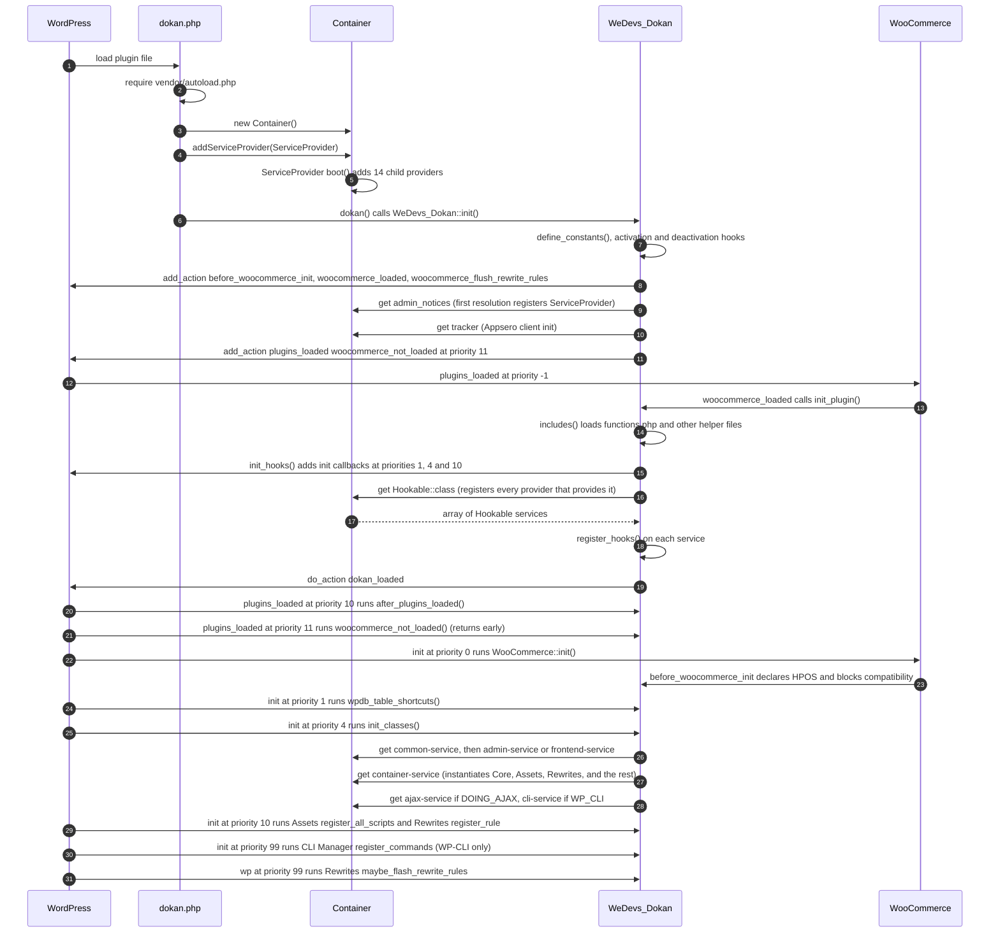
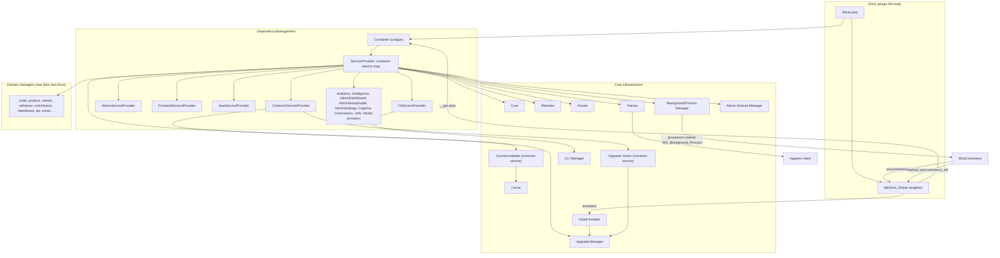
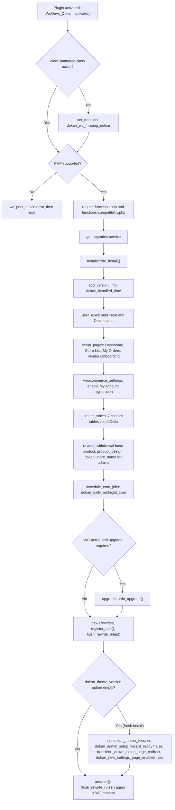
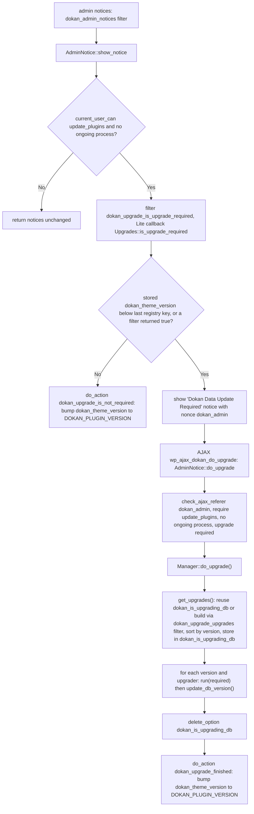

# Bootstrap, Container and Core Infrastructure

This document describes how Dokan Lite starts up. It covers the plugin entry file, the `WeDevs_Dokan` singleton, the dependency-injection container and its service providers, installation and the database upgrader, rewrite rules and query vars, script registration, background processes, the cache helpers, the WP-CLI registry, the Appsero tracker, and the global helper files.

Path prefixes: `lite:` is the Dokan Lite repository root and `wc:` is the WooCommerce plugin root. Ownership tags: **[Lite]**, **[WooCommerce]**, **[Third-party: Appsero]**, **[Third-party: League Container]** (bundled through Mozart under `lite:lib/packages/League/Container`).

---

## 1. Purpose & ownership

| Concern | Owner | What it does |
|---|---|---|
| Plugin entry, constants, activation/deactivation | [Lite] | Loads the Composer autoloader, builds the container, creates the `WeDevs_Dokan` singleton, and wires activation, deactivation and WooCommerce lifecycle hooks. |
| Dependency-injection container | [Lite] on [Third-party: League Container] | Holds every Dokan service. Services are reached through `dokan()->alias`, `dokan_get_container()->get( Class::class )`, or a tag. |
| Installer | [Lite] | Creates roles and capabilities, default pages, custom tables, the daily cron action and initial options. |
| Upgrader | [Lite] | Runs versioned data migrations (`V_x_y_z` classes) when the stored DB version is behind. Dokan Pro attaches its own upgraders through the same filter. |
| Rewrites | [Lite] | Registers Vendor-dashboard endpoints, the Store URL base, product-edit URLs and Store terms-and-conditions URLs, and resolves the matching templates. |
| Assets | [Lite] | Registers every Dokan script and style, then enqueues and localizes them per context (admin, frontend, Vendor dashboard). |
| Background processes | [Lite] on [WooCommerce] | Provides a base class over WooCommerce's bundled `WP_Background_Process` and restores in-flight processes on each request. |
| Cache | [Lite] | Provides a static object-cache and transient wrapper with group-level invalidation through versioned key prefixes. |
| CLI registry | [Lite] | Owns the `wp dokan` command namespace. Extensions contribute commands through a filter ([ADR-0008](../0008-lite-owns-the-wp-dokan-cli-namespace.md)). |
| Tracker | [Lite] on [Third-party: Appsero] | Sends opt-in usage insights and replaces the deactivation-reason list. |

Dokan Lite and Dokan Pro form one bounded context, and Pro depends on Lite, never the reverse ([ADR-0001](../0001-single-bounded-context-across-lite-and-pro.md)). Several seams in this document (`dokan_is_pro_exists`, `dokan_upgrade_upgrades`, `dokan_cli_commands`, `dokan_get_class_container`, `dokan_daily_midnight_cron`) are consumed by Dokan Pro.

**Related ADRs:** [ADR-0015](../0015-services-are-resolved-eagerly-from-a-tagged-container.md) (services resolved eagerly from a tagged container), [ADR-0018](../0018-schema-migrations-are-version-named-upgrader-classes.md) (version-named upgraders), [ADR-0001](../0001-single-bounded-context-across-lite-and-pro.md) (single bounded context), [ADR-0002](../0002-flat-dokan-admin-settings-as-canonical-store.md) and [ADR-0003](../0003-settings-legacy-mirror-mode.md) (settings store), [ADR-0005 (PHPUnit requires a webpack build)](../0005-phpunit-requires-a-webpack-build.md), [ADR-0008](../0008-lite-owns-the-wp-dokan-cli-namespace.md) (`wp dokan` CLI namespace).

---

## 2. Entry points & bootstrap

### 2.1 Entry files

| Step | Location | Behavior |
|---|---|---|
| Autoloader | `lite:dokan.php:48` | `require_once vendor/autoload.php`. This also loads the Composer `files` autoload entries `includes/functions-rest-api.php` and `includes/functions-dashboard-navigation.php` (`lite:composer.json:45-48`), so those helpers exist from the very start. |
| Singleton class | `lite:dokan.php:55` | Loads `dokan-class.php` (`WeDevs_Dokan`). |
| `DOKAN_FILE` | `lite:dokan.php:58` | Defines the main file constant. |
| Container | `lite:dokan.php:67` | `global $dokan_container = new Container()`. |
| Root provider | `lite:dokan.php:70` | `$dokan_container->addServiceProvider( new ServiceProvider() )`. League calls `boot()` on a bootable provider as soon as it is added (`lite:lib/packages/League/Container/ServiceProvider/ServiceProviderAggregate.php:25-39`). `ServiceProvider::boot()` adds the 14 child providers. **No service is instantiated at this point.** |
| `dokan_get_container()` | `lite:dokan.php:79` | Returns the global container. |
| `dokan()` | `lite:dokan.php:90` | Returns `WeDevs_Dokan::init()`. |
| Kick-off | `lite:dokan.php:95` | Calls `dokan()` while the plugin file is being loaded. |

### 2.2 `WeDevs_Dokan` (`lite:dokan-class.php:23`)

| Method | Location | Hook / trigger | Responsibility |
|---|---|---|---|
| `__construct()` | `lite:dokan-class.php:70` | Plugin file load | Calls `define_constants()`. Registers the activation and deactivation hooks. Consumes `before_woocommerce_init`, `woocommerce_loaded` and `woocommerce_flush_rewrite_rules`. Resolves the `admin_notices` service (`:81`) and the `tracker` service (`:83`, through `init_appsero_tracker()` at `:434`). Adds `woocommerce_not_loaded` on `plugins_loaded` priority 11 (`:85`). |
| `init()` | `lite:dokan-class.php:94` | — | Singleton accessor. |
| `__get( $prop )` | `lite:dokan-class.php:111` | `dokan()->x` | Looks in `$legacy_container` first, which is filled only by the `dokan_get_class_container` filter. Then checks `get_container()->has( $prop )` and returns `get( $prop )`. Returns `null` when neither knows the name. |
| `define_constants()` | `lite:dokan-class.php:217` | constructor | Defines `DOKAN_PLUGIN_VERSION`, `DOKAN_DIR`, `DOKAN_INC_DIR`, `DOKAN_TEMPLATE_DIR`, `DOKAN_LIB_DIR`, `DOKAN_PLUGIN_ASSEST`, `DOKAN_LOAD_STYLE` and `DOKAN_LOAD_SCRIPTS`. Each is guarded by `defined() \|\|`. |
| `declare_woocommerce_feature_compatibility()` | `lite:dokan-class.php:237` | `before_woocommerce_init` | Declares compatibility with `custom_order_tables` (HPOS) and `cart_checkout_blocks` through `FeaturesUtil::declare_compatibility` (`wc:src/Utilities/FeaturesUtil.php:87`). |
| `init_plugin()` | `lite:dokan-class.php:249` | `woocommerce_loaded` | Calls `includes()` and `init_hooks()`, then fires `dokan_loaded` (`:253`). |
| `init_hooks()` | `lite:dokan-class.php:261` | from `init_plugin` | Adds `localization_setup` (`init`), `init_classes` (`init` priority 4), `wpdb_table_shortcuts` (`init` priority 1), `after_plugins_loaded` (`plugins_loaded`), plugin action links, the in-plugin update message, and `register_widgets` (`widgets_init`). Then resolves every `Hookable` service and calls `register_hooks()` on each one (`:276-279`). |
| `includes()` | `lite:dokan-class.php:287` | from `init_plugin` | Loads the procedural helper files (see section 10.3). |
| `init_classes()` | `lite:dokan-class.php:316` | `init` priority 4 | Resolves the tag groups `common-service`, then `admin-service` (when `is_admin()`) or `frontend-service` (otherwise), then `container-service`. Applies `dokan_get_class_container`. Resolves `ajax-service` when `DOING_AJAX`, and `cli-service` when `WP_CLI`. |
| `wpdb_table_shortcuts()` | `lite:dokan-class.php:346` | `init` priority 1 | Sets `$wpdb->dokan_withdraw`, `dokan_orders`, `dokan_announcement`, `dokan_refund` and `dokan_vendor_balance`. |
| `after_plugins_loaded()` | `lite:dokan-class.php:365` | `plugins_loaded` priority 10 | Re-instantiates the background processes recorded in the `dokan_background_processes` option and prunes entries whose file no longer exists (section 4.4). |
| `register_widgets()` | `lite:dokan-class.php:393` | `widgets_init` | Resolves the `widgets` service. |
| `is_pro_exists()` | `lite:dokan-class.php:404` | — | Returns `apply_filters( 'dokan_is_pro_exists', false )`. |
| `activate()` | `lite:dokan-class.php:157` | activation hook | Sets the `dokan_wc_missing_notice` transient when WooCommerce is absent. Prints an error and exits when the PHP version is not supported. Otherwise loads `functions.php` and `functions-compatibility.php`, resolves `upgrades`, runs `Installer::do_install()`, and flushes rewrite rules when WooCommerce is present. |
| `deactivate()` | `lite:dokan-class.php:199` | deactivation hook | Deletes `dokan_wc_missing_notice`. |
| `flush_rewrite_rules()` | `lite:dokan-class.php:188` | `woocommerce_flush_rewrite_rules`, activation | Calls `rewrite->register_rule()`, then WordPress `flush_rewrite_rules()`. |
| `woocommerce_not_loaded()` | `lite:dokan-class.php:466` | `plugins_loaded` priority 11 | In wp-admin only, when `woocommerce_loaded` never fired: loads `functions.php`, follows the setup-wizard redirect transient, and instantiates `Admin\SetupWizardNoWC`. |
| `get_db_version_key()` | `lite:dokan-class.php:487` | — | Returns `'dokan_theme_version'`, the option that stores the Lite DB version. |

`is_supported_php()` (`lite:dokan-class.php:126`) uses `version_compare( PHP_VERSION, $min_php, '<=' )` with `$min_php = '7.4'`.

### 2.3 Initialization sequence

WooCommerce fires `woocommerce_loaded` from `WooCommerce::on_plugins_loaded()` (`wc:includes/class-woocommerce.php:301`), which is hooked to `plugins_loaded` at priority **-1** (`wc:includes/class-woocommerce.php:333`). As a result, Dokan's whole `init_plugin()` runs inside the `plugins_loaded` pass, before priority 10. The `after_plugins_loaded` callback it adds at priority 10 still runs in that same pass. `before_woocommerce_init` fires from `WooCommerce::init()` (`wc:includes/class-woocommerce.php:998`), which is hooked on `init` priority 0 (`:341`).

The ordering matters: several `container-service` classes add their own `init` callbacks at the default priority 10 in their constructors, for example `Assets::register_all_scripts` (`lite:includes/Assets.php:19`) and `Rewrites::register_rule` (`lite:includes/Rewrites.php:21`). Because `init_classes` constructs them at priority 4, those callbacks are attached before `init` reaches priority 10 and still run in the same pass.

### 2.4 `dokan()->name` service map

All entries are registered by `ServiceProvider::register()` (`lite:includes/DependencyManagement/Providers/ServiceProvider.php:96`) as **shared** definitions tagged `container-service`. The array is at `lite:includes/DependencyManagement/Providers/ServiceProvider.php:22-53`.

| `dokan()->…` alias | Class |
|---|---|
| `product_block` | `WeDevs\Dokan\Blocks\ProductBlock` |
| `pageview` | `WeDevs\Dokan\PageViews` |
| `seller_wizard` | `WeDevs\Dokan\Vendor\SetupWizard` |
| `core` | `WeDevs\Dokan\Core` |
| `scripts` | `WeDevs\Dokan\Assets` |
| `email` | `WeDevs\Dokan\Emails\Manager` |
| `vendor` | `WeDevs\Dokan\Vendor\Manager` |
| `product` | `WeDevs\Dokan\Product\Manager` |
| `shortcodes` | `WeDevs\Dokan\Shortcodes\Shortcodes` |
| `registration` | `WeDevs\Dokan\Registration` |
| `order` | `WeDevs\Dokan\Order\Manager` |
| `order_controller` | `WeDevs\Dokan\Order\Controller` |
| `api` | `WeDevs\Dokan\REST\Manager` |
| `withdraw` | `WeDevs\Dokan\Withdraw\Manager` |
| `dashboard` | `WeDevs\Dokan\Dashboard\Manager` |
| `commission` | `WeDevs\Dokan\Commission` |
| `fees` | `WeDevs\Dokan\Fees` |
| `customizer` | `WeDevs\Dokan\Customizer` |
| `upgrades` | `WeDevs\Dokan\Upgrade\Manager` |
| `product_sections` | `WeDevs\Dokan\ProductSections\Manager` |
| `reverse_withdrawal` | `WeDevs\Dokan\ReverseWithdrawal\ReverseWithdrawal` |
| `dummy_data_importer` | `WeDevs\Dokan\DummyData\Importer` |
| `catalog_mode` | `WeDevs\Dokan\CatalogMode\Controller` |
| `bg_process` | `WeDevs\Dokan\BackgroundProcess\Manager` |
| `frontend_manager` | `WeDevs\Dokan\Frontend\Frontend` |
| `rewrite` | `WeDevs\Dokan\Rewrites` |
| `widgets` | `WeDevs\Dokan\Widgets\Manager` |
| `admin_notices` | `WeDevs\Dokan\Admin\Notices\Manager` |
| `tracker` | `WeDevs\Dokan\Tracker` |
| `product_editor` | `WeDevs\Dokan\ProductEditor\FormSchema` |

Because the definitions are shared, `dokan()->order` always returns the same `Order\Manager` instance within a request. Because `init_classes()` resolves the whole `container-service` tag at `init` priority 4, every class in this table is constructed on every request, and most of them register their WordPress hooks in their constructors. Accessing `dokan()->x` before `init` priority 4 constructs that one service early. The constructor does exactly this for `admin_notices` and `tracker`.

`__get` also returns any other container id, so class-string ids work too, for example `dokan()->{ SomeClass::class }`. The supported pattern for those is `dokan_get_container()->get( SomeClass::class )`.

### 2.5 Tag groups and where they are resolved

| Tag | Provider | Definition style | Resolved at |
|---|---|---|---|
| `container-service` | `ServiceProvider` (`lite:includes/DependencyManagement/Providers/ServiceProvider.php:16`) | `addShared` + tag | `init_classes()`, `lite:dokan-class.php:325` |
| `common-service` | `CommonServiceProvider` | `share_with_implements_tags` + tag | `lite:dokan-class.php:317` |
| `admin-service` | `AdminServiceProvider` | `addShared` + tag | `lite:dokan-class.php:320`, only when `is_admin()` |
| `frontend-service` | `FrontendServiceProvider` | `addShared` + tag | `lite:dokan-class.php:322`, only when not `is_admin()` |
| `ajax-service` | `AjaxServiceProvider` | `addShared` + tag | `lite:dokan-class.php:330`, only when `DOING_AJAX` |
| `cli-service` | `CliServiceProvider` | `addShared` + tag | `lite:dokan-class.php:335`, only when `WP_CLI` |
| `WeDevs\Dokan\Contracts\Hookable` (interface used as tag) | every provider using `*_with_implements_tags` | tag added per implemented interface | `init_hooks()`, `lite:dokan-class.php:276` |
| `analytics-service`, `intelligence-service`, `admin-dashboard-service`, `admin-setup-guide-service`, `admin-settings-service`, `captcha-services`, `commission-service`, `utils` | the respective providers | see section 3 | No `get()` of these tag names exists in Lite. Their members are reached through the `Hookable` tag or by class name. |

---

## 3. Key classes

### 3.1 Container layer

| Class | File | Responsibility |
|---|---|---|
| `Container` | `lite:includes/DependencyManagement/Container.php:16` | Empty subclass of the Mozart-prefixed `League\Container\Container`. |
| `BaseServiceProvider` | `lite:includes/DependencyManagement/BaseServiceProvider.php:21` | Abstract provider holding `$services` and `$tags`. Its `provides()` (`:33`) answers true for a listed service, a listed tag, or **any interface implemented by a listed class**. The interface index is a method-level `static` array that is merged on every call and never reset (see Known gaps for how PHP versions scope it). `add_with_implements_tags()` (`:65`) and `share_with_implements_tags()` (`:86`) register a definition and tag it with each of its interfaces. `add_tags()` (`:98`) applies extra tags. |
| `BootableServiceProvider` | `lite:includes/DependencyManagement/BootableServiceProvider.php:20` | Abstract base that implements League's `BootableServiceProviderInterface`. |
| `Definition` | `lite:includes/DependencyManagement/Definition.php:13` | League `Definition` subclass. It instantiates with `new $concrete()` and then calls an `init()` method with the resolved arguments (`INJECTION_METHOD = 'init'`). See Known gaps about whether it is wired in. |
| `ContainerException` | `lite:includes/DependencyManagement/ContainerException.php` | Exception type for the container. |
| `Contracts\Hookable` | `lite:includes/Contracts/Hookable.php` | Interface with `register_hooks(): void`. Services that implement it have their hooks registered from `init_hooks()` instead of their constructor. |

### 3.2 Service providers

All providers live in `lite:includes/DependencyManagement/Providers/`. `ServiceProvider::boot()` adds them in this order (`ServiceProvider.php:60-75`).

| Provider | Tag(s) | Shared? | Services |
|---|---|---|---|
| `AdminServiceProvider` | `admin-service` | shared | `Admin\Hooks`, `Admin\Menu`, `Admin\AdminBar`, `Admin\Pointers`, `Admin\Settings`, `Admin\UserProfile`, `Admin\UserList`, `Admin\SetupWizard`, `Admin\Status\Status`. Its `provides()` lists only the tag, `Status` and `Settings`. |
| `CommonServiceProvider` | `common-service` + interfaces | shared | `Withdraw\Hooks`, `Product\Hooks`, `ProductCategory\Hooks`, `Upgrade\Hooks`, `Vendor\Hooks`, `Vendor\UserSwitch`, `CacheInvalidate`, `Shipping\Hooks`, `Privacy`, `VendorNavMenuChecker`, `Commission\RecalculateCommissions`, `Order\RefundHandler`, `Exceptions\Handler`, `Shortcodes\FullWidthVendorLayout`, `Vendor\ApiMeta`, `Abilities\ProductAbilityScope`, `Abilities\OrderAbilityScope`, `Abilities\DokanAbilityRegistrar` |
| `FrontendServiceProvider` | `frontend-service` | shared | `Vendor\StoreListsFilter`, `ThemeSupport\Manager` |
| `AjaxServiceProvider` | `ajax-service` | shared | `Ajax` |
| `AnalyticsServiceProvider` | `analytics-service` + interfaces | shared | 21 classes under `Analytics\` (the report `QueryFilter`s, `ScheduleListener`, `DataStoreModifier`, `CacheKeyModifier`, `DataStoreCacheModifier`, `Assets`, `VendorDashboardManager`, `Settings`) |
| `UtilsServiceProvider` | `utils` | **not shared** (`add`) | `Utilities\AdminSettings` |
| `CommissionServiceProvider` | `commission-service` + interfaces | **not shared** (`add_with_implements_tags( …, false )`) | `Commission\OrderCommission`, `OrderLineItemCommission`, `OrderRefundCommission`, `ProductCommission`, `Calculator`, `Order\VendorBalanceUpdateHandler` |
| `IntelligenceServiceProvider` | `intelligence-service` + interfaces | shared | `Intelligence\Assets`, `Manager`, `Admin\Settings`, the `OpenAI` and `Gemini` providers, and 12 model classes |
| `AdminDashboardServiceProvider` | `admin-dashboard-service` + interfaces | shared | `Admin\Dashboard\Dashboard`, `LegacySwitcher`, and the pages `Modules`, `Tools`, `Status`, `ProFeatures`, `Withdraw`, `Vendors`, `ReverseWithdrawal`, `Extensions`, `SetupGuide` (constructed with `AdminSetupGuide`) and `Settings` |
| `AdminSetupGuideServiceProvider` | `admin-setup-guide-service` + interfaces | shared | `Admin\OnboardingSetup\AdminSetupGuide` and the steps `BasicStep`, `CommissionStep`, `WithdrawStep`, `AppearanceStep` |
| `ModelServiceProvider` | none applied | **not shared** (`add`) | `Models\VendorBalance`, `VendorOrderStats`, `AdminDashboardStats` and their `DataStore\*Store` classes. The class declares `TAG = 'ajax-service'`, but `register()` never applies it. |
| `AdminSettingsServiceProvider` | `admin-settings-service` + interfaces | shared | `SettingsRegistry`, `SchemaValidator`, `SettingsRepository`, `LegacySettingsBridge`, `LegacySettingsRepository`, `BridgeBootstrap`, `LegacyMirror`. Because the container does not autowire, the provider passes explicit constructor arguments to two definitions (`lite:includes/DependencyManagement/Providers/AdminSettingsServiceProvider.php:44-53`): `LegacySettingsBridge` receives the shared `SettingsRepository`, and `LegacySettingsRepository` receives the shared `SettingsRepository` and `LegacySettingsBridge`. It also binds `SettingsRepositoryInterface` and `LegacySettingsRepositoryInterface` to the same shared instances (`:62-67`). Together these keep the whole settings stack on one repository snapshot instead of letting a class build its own repository when a nullable constructor parameter falls back to `null` ([ADR-0002](../0002-flat-dokan-admin-settings-as-canonical-store.md), [ADR-0003](../0003-settings-legacy-mirror-mode.md)). |
| `CaptchaServiceProvider` | `captcha-services` + interfaces | shared | `Captcha\Manager`, `GoogleRecaptchaV3Provider`, `CloudflareTurnstileProvider` |
| `CliServiceProvider` | `cli-service` | shared | `CLI\Manager` |

### 3.3 Infrastructure classes

| Class | File | Responsibility |
|---|---|---|
| `WeDevs_Dokan` | `lite:dokan-class.php:23` | Plugin singleton and service locator (section 2.2). |
| `Core` | `lite:includes/Core.php:14` | Cross-cutting request behavior: blocks wp-admin for Vendors, Customers and Vendor Staff, scopes the media library to the current Vendor, adds body classes, sets Store-page titles, requires login and the Vendor role on the dashboard page, and handles the post-activation setup-wizard redirect. |
| `Install\Installer` | `lite:includes/Install/Installer.php:15` | Creates roles, capabilities, pages, tables and the cron action, and sets the initial options. |
| `Upgrade\Manager` | `lite:includes/Upgrade/Manager.php:5` | Upgrade orchestrator (`dokan()->upgrades`). |
| `Upgrade\Upgrades` | `lite:includes/Upgrade/Upgrades.php:5` | Lite's version-to-upgrader registry and version checks. |
| `Upgrade\Hooks` | `lite:includes/Upgrade/Hooks.php:9` | Wires the registry into the filters and starts the three commission batch upgraders. |
| `Upgrade\AdminNotice` | `lite:includes/Upgrade/AdminNotice.php` | "Data Update Required" notice and its AJAX handler. |
| `Abstracts\DokanUpgrader` | `lite:includes/Abstracts/DokanUpgrader.php:7` | Base class for `V_x_y_z` upgraders. |
| `Rewrites` | `lite:includes/Rewrites.php` | Endpoints, rewrite rules, query vars, Store, terms-and-conditions and product-edit templates, and the Store product query. |
| `Assets` | `lite:includes/Assets.php` | Script and style registry, enqueueing and localization. |
| `BackgroundProcess\Manager` | `lite:includes/BackgroundProcess/Manager.php:17` | Chainable container of long-lived background processors (`dokan()->bg_process`). |
| `BackgroundProcess\RewriteVariableProductsAuthor` | `lite:includes/BackgroundProcess/RewriteVariableProductsAuthor.php:18` | `WC_Background_Process` that realigns variation authors with their parent product. |
| `Abstracts\DokanBackgroundProcesses` | `lite:includes/Abstracts/DokanBackgroundProcesses.php:18` | Base class over `WP_Background_Process` that registers itself for restoration on later requests. |
| `Cache` | `lite:includes/Cache.php:14` | Concrete `DokanCache` with group prefix `dokan_cache` and key prefix `dokan`. |
| `Abstracts\DokanCache` | `lite:includes/Abstracts/DokanCache.php:17` | Uses the `ObjectCache` and `TransientCache` traits. |
| `CacheInvalidate` | `lite:includes/CacheInvalidate.php:12` | Invalidates per-Vendor comment-count caches on comment changes. |
| `CLI\Manager` | `lite:includes/CLI/Manager.php:14` | `wp dokan` command registrar. |
| `Tracker` | `lite:includes/Tracker.php:11` | Appsero insights client. |
| `Admin\Notices\Manager` | `lite:includes/Admin/Notices/Manager.php:12` | Admin-notice hub (`dokan()->admin_notices`). Resolved in the `WeDevs_Dokan` constructor. |

### 3.4 Component diagram

---

## 4. Execution flow

### 4.1 Service resolution and the `Hookable` pass

League resolves `get( $id )` in a fixed order (`lite:lib/packages/League/Container/Container.php:172-208`):

1. If a definition with that id exists, resolve it.
2. Otherwise, if a tag with that id exists, resolve every definition with that tag and return an array.
3. Otherwise, if any provider's `provides( $id )` is true, call `register()` on **every** not-yet-registered provider that provides it (`ServiceProviderAggregate::register`, `ServiceProviderAggregate.php:57-75`), then retry.
4. Otherwise, try the delegate containers. If nothing matches, throw `NotFoundException`.

`init_hooks()` calls `get( Hookable::class )`. No definition or tag exists yet for that name, so step 3 runs. `BaseServiceProvider::provides()` reports true once `Hookable` appears in its accumulated interface index, so every not-yet-registered provider that uses the base `provides()` and answers true registers (`AdminServiceProvider` and `ModelServiceProvider` override `provides()` and only answer for their own lists). Their `*_with_implements_tags` definitions are tagged with `Hookable`, and step 2 then returns all of them. The effect is that every `Hookable` service in Common, Analytics, Intelligence, AdminDashboard (for example `Admin\Dashboard\Dashboard`, which `implements Hookable`), AdminSetupGuide, AdminSettings, Captcha and Commission is instantiated and has `register_hooks()` called during `plugins_loaded` priority -1. This happens on every request, whether or not it is an admin request. Classes registered with plain `addShared` (the `container-service` map, `AdminServiceProvider`, `FrontendServiceProvider`) are not interface-tagged, so they register their hooks in their constructors when `init_classes()` resolves their tag.

### 4.2 Activation and installation

Notes, each taken from `Installer::do_install()` (`lite:includes/Install/Installer.php:16`):

- `setup_pages()` (`:226`) returns early once `dokan_pages_created` is set. It saves the created page IDs through `dokan_save_legacy_settings_section( 'dokan_pages', … )`, which writes through the settings repository ([ADR-0002](../0002-flat-dokan-admin-settings-as-canonical-store.md)).
- `user_roles()` (`:167`) adds the `seller` role. `seller` is the legacy WordPress role name for a **Vendor** (see `CONTEXT.md`). The role gets WordPress post, product and term capabilities plus `dokandar`. `dokandar` is also added to `administrator` and `shop_manager`. Every capability returned by `dokan_get_all_caps()` is added to `seller`, `administrator` and `shop_manager`.
- `schedule_cron_jobs()` (`:95`) removes any existing `dokan_daily_midnight_cron` Action Scheduler action and reschedules it with `WC()->queue()->schedule_cron( midnight, '0 0 * * *', 'dokan_daily_midnight_cron', [], 'dokan' )`. Lite has no callback for this hook; it is consumed by Dokan Pro.
- On a fresh install, the `_dokan_setup_page_redirect` transient (30 seconds) makes `Core::redirect_after_activate` (`admin_init` priority 999) send the Site Admin to the setup wizard.

### 4.3 Database upgrades

Details:

- `Upgrades::is_upgrade_required()` (`lite:includes/Upgrade/Upgrades.php:71`) compares the stored `dokan_theme_version` with the **last key of `Upgrades::$upgrades`** (currently `5.0.0`, `:48`), not with `DOKAN_PLUGIN_VERSION`. When no DB version is stored, it returns the incoming filter value.
- `Upgrades::get_upgrades()` (`:106`) adds every registry entry whose version is greater than the stored DB version, as `$upgrades[ $version ][] = ClassName`. The filter also accepts an entry of the form `[ 'require' => <lite version>, 'upgrader' => Class ]`. `DokanUpgrader::run()` skips such an entry while the Lite DB version is below `require` (`lite:includes/Abstracts/DokanUpgrader.php:22-32`). Dokan Pro uses this form.
- `Manager::get_upgrades()` (`lite:includes/Upgrade/Manager.php:45`) caches the sorted pending list in the `dokan_is_upgrading_db` option (autoload off). The same option acts as the "ongoing process" flag in `has_ongoing_process()` (`:34`).
- `DokanUpgrader::run()` statically calls every method returned by `get_class_methods( static::class )` except `run` and `update_db_version` (`lite:includes/Abstracts/DokanUpgrader.php:34-40`), so migration steps are written as public static methods. `update_db_version()` (`:56`) derives the version from the class short name (`V_3_7_19` becomes `3.7.19`) and writes it to `static::get_db_version_key()`. The source docblock states that this method is meant to be overridden by Dokan Pro.
- Long-running migrations dispatch `DokanBackgroundProcesses` subclasses in `lite:includes/Upgrade/Upgrades/BackgroundProcesses/` (`V_2_8_3_VendorBalance`, `V_2_9_4_OrderPostAuthor`, `V_2_9_16_StoreSettings`, `V_2_9_23_StoreName`, `V_3_0_10_ProductAttributesAuthorId`, `V_3_1_1_RefundTableUpdate`, `V_3_3_8_VendorStoreTimes`, `V_3_6_2_UpdateProductCategories`, `V_3_7_19_UpdateOrderMeta`).
- `Upgrade\Hooks` (`lite:includes/Upgrade/Hooks.php:18`) also calls `init_hooks()` on `Commission\Upugrader\Update_Product_Commission`, `Update_Vendor_Commission` and `Update_Category_Commission`. These consume the actions `process_product_batch_creator`, `process_product_batch`, `process_product_item`, `process_vendor_batch_creator`, `process_vendor_batch`, `process_vendor_item`, `process_category_batch_creator`, `process_category_batch` and `process_category_item`. The directory name `Upugrader` is spelled that way in the source.

### 4.4 Background-process restoration

`DokanBackgroundProcesses::dispatch_process()` (`lite:includes/Abstracts/DokanBackgroundProcesses.php:129`) saves and dispatches the queue. It then records `static::class => <class file path>` in the `dokan_background_processes` option (autoload off). On every later request, `WeDevs_Dokan::after_plugins_loaded()` (`lite:dokan-class.php:365`) reads that option, `include_once`s each recorded file and instantiates the class. The `WP_Background_Process` constructor then re-attaches its AJAX and cron handlers. Entries whose file no longer exists are removed. `complete()` and `cancel_process()` call `clear_process()` (`:152`) to remove the entry. The action name defaults to `'dokan_' . md5( static::class )` (`set_action()`, `:114`). When the bundled classes are missing, the base class loads WooCommerce's `includes/libraries/wp-async-request.php` and `wp-background-process.php`.

`BackgroundProcess\Manager` (`lite:includes/BackgroundProcess/Manager.php:17`) is a separate, always-on mechanism. Its constructor puts `RewriteVariableProductsAuthor` and `Vendor\ChangeProductStatus` into a `ChainableContainer` and exposes them through `dokan_background_process_container`. It also adds a one-time success notice keyed on the `dokan_variable_products_author_updated` transient.

### 4.5 Rewrites and request routing

`Rewrites::register_rule()` (`lite:includes/Rewrites.php:83`, on `init` priority 10):

- **Endpoints (`EP_PAGES`)**: from the `dokan_query_var_filter` filter, defaulting to `products`, `new-product`, `orders`, `withdraw`, `withdraw-requests`, `reverse-withdrawal`, `settings`, `edit-account` and `account-migration`. Because these are page endpoints, they resolve under the Vendor dashboard page (for example `/dashboard/orders/`).
- **Product edit**: `{product_base}/{slug}(/{page})?/edit/` maps to `product=…&edit=true`. When the WooCommerce product base contains `product_cat`, the rule uses `{cat_base}/{cat}/{slug}/edit` instead. The base comes from the `woocommerce_permalinks` option.
- **Store URLs**: the base is `custom_store_url` from `dokan_general`, defaulting to `store`. The rules are:
  - `{store}/{nicename}/`
  - `/page/{n}`
  - `/section/{term}` and `/section/{term}/page/{n}`, which set `term_section=true`
  - `/toc` and `/toc/page/{n}`, which set `toc=true`
- Fires `dokan_rewrite_rules_loaded` with the Store base.

`register_query_var()` (`:166`) adds the Store base, `edit`, `term_section`, `toc` and every endpoint to WordPress `query_vars`. `resolve_wc_query_conflict()` (`:146`, filter `woocommerce_get_query_vars`) removes WooCommerce's `orders` and `edit-account` My Account endpoints when the current page is the Vendor dashboard page, so the two sets of endpoints do not collide.

Templates, all on `template_include` priority 99:

- `store_template()` (`:186`) returns `store.php` when the Store query var names a user who exists, is not Vendor Staff (unless a super admin), and passes `dokan_is_user_seller()`. Otherwise it returns the 404 template.
- `store_toc_template()` (`:226`) returns `store-toc.php`.
- `product_edit_template()` (`:256`) returns `products/edit-product-single.php` only when the user can `dokan_edit_product`. The result passes through `dokan_get_product_edit_template`.

`store_query_filter()` (`:302`, `pre_get_posts`) turns the main query on a Store page into a product query for that Vendor. It applies `dokan_store_products_per_page`, attribute and section filters and WooCommerce's hide-out-of-stock visibility, fires `dokan_store_page_query_filter`, and filters the tax query through `dokan_store_tax_query`.

`maybe_flash_rewrite_rules()` (`:544`, `wp` priority 99) flushes once when `dokan_rewrite_rules_needs_flashing` is missing or `yes`, then stores `no`.

### 4.6 Assets pipeline

`Assets::__construct()` (`lite:includes/Assets.php:18`):

- `init` priority 10 → `register_all_scripts()` (`:301`) registers every handle from `get_styles()` (`:316`) and `get_scripts()` (`:419`). It uses `wp_register_style`/`wp_register_script` with `wp_set_script_translations( …, 'dokan-lite' )`, then fires `dokan_register_scripts`.
- In admin: `admin_enqueue_scripts` priority 5 → `load_dokan_global_scripts`, priority 8 → `load_dokan_admin_notices_scripts`, priority 10 → `enqueue_admin_scripts` (`:77`, which fires `dokan-vue-admin-scripts` and `dokan_enqueue_admin_scripts`).
- On the frontend: `wp_enqueue_scripts` priority 5 → `load_dokan_global_scripts` (`:1028`), default priority → `enqueue_front_scripts` (`:839`, which fires `dokan_enqueue_scripts`). `init` → `register_wc_admin_scripts`.
- The Vendor dashboard bundles load only when `dokan_is_seller_dashboard()` is true, when the request is a product edit page, or when `dokan_forced_load_scripts` returns true (`:947`).
- Script versions default to `DOKAN_PLUGIN_VERSION`. Some styles use `filemtime`. The `.min` suffix is dropped when `SCRIPT_DEBUG` is set (`get_prefix()`, `:1388`).

### 4.7 Cache

`Cache` (static API from the `ObjectCache` and `TransientCache` traits):

- `Cache::get/set/delete( $key, $group )` store keys as `dokan_{timePrefix}_{key}` in group `dokan_cache_{group}`. The time prefix is kept in object-cache entry `{group}_prefix`. `Cache::invalidate_group( $group )` (`lite:includes/Traits/ObjectCache.php:166`) rewrites only that prefix, so earlier keys become unreachable. The source comment explains that it deliberately avoids `wp_cache_flush_group()` because a group flush scans the whole keyspace on Redis and Memcached.
- `Cache::get_transient/set_transient/delete_transient` work the same way. The version marker is the transient `dokan_cache_{group}-transient-version`, whose lifetime is filterable through `dokan_cache_transient_version_expiration` (default `MONTH_IN_SECONDS`, `lite:includes/Traits/TransientCache.php:56`). `invalidate_transient_group()` (`:196`) regenerates the marker.
- A key with no group is stored as `dokan_{key}` with no versioning.

`CacheInvalidate` (`lite:includes/CacheInvalidate.php:12`) consumes `comment_post`, `edit_comment`, `delete_comment` and `wp_set_comment_status`. It calls `Cache::invalidate_group( "count_{post_type}_comments_{author_id}" )` for the commented post's author (the Vendor).

### 4.8 CLI

`CLI\Manager` (`lite:includes/CLI/Manager.php:14`) is constructed only when `cli-service` is resolved, which happens only under `WP_CLI`. Its constructor returns early if `WP_CLI` is not defined. On `init` priority 99, `register_commands()` (`:38`) reads `apply_filters( 'dokan_cli_commands', [] )`, a map of `'dokan <command>' => HandlerClass`, and calls `WP_CLI::add_command()` for each entry. Lite currently contributes no commands of its own. Rationale, priority and the capability stance are recorded in [ADR-0008](../0008-lite-owns-the-wp-dokan-cli-namespace.md).

### 4.9 Tracker

`Tracker::appsero_init_tracker_dokan()` (`lite:includes/Tracker.php:38`) builds an `\Appsero\Client` for `DOKAN_FILE` (the client identifier is at `:39`). It adds extra payload fields: `products`, `orders` (from `get_order_count()` at `:65`, a count of `dokan_orders` rows in completed, processing, on-hold or refunded status), `is_pro`, `wc_version` and `dokan_version`. It then calls `insights->init_plugin()`, which leaves opt-in and data sending to Appsero. It also filters `appsero_custom_deactivation_reasons`, replacing the reasons only when the client slug is `dokan-lite`.

---

## 5. Hooks

### 5.1 Hooks fired by this subsystem

| Hook | Type | Fired in | Arguments / purpose |
|---|---|---|---|
| `dokan_loaded` | action | `WeDevs_Dokan::init_plugin` | After the helper files are loaded and the `Hookable` services are registered. Fired during `woocommerce_loaded`. |
| `dokan_get_class_container` | filter | `WeDevs_Dokan::init_classes` | `array $legacy_container`. Fills the legacy `dokan()->x` lookup. |
| `dokan_is_pro_exists` | filter | `WeDevs_Dokan::is_pro_exists` | `bool false`. Dokan Pro returns true. |
| `dokan_template_path` | filter | `WeDevs_Dokan::template_path` | Theme override directory, default `dokan/`. |
| `dokan_upgrade_is_upgrade_required` | filter | `Upgrade\Manager::is_upgrade_required` | `bool`. |
| `dokan_upgrade_upgrades` | filter | `Upgrade\Manager::get_upgrades` | `array [ version => [ Class \| [require, upgrader] ] ]`. |
| `dokan_upgrade_finished` | action | `Upgrade\Manager::do_upgrade` | After all upgraders run. |
| `dokan_upgrade_is_not_required` | action | `Upgrade\AdminNotice::show_notice` | When no upgrade is pending. |
| `dokan_query_var_filter` | filter | `Rewrites::register_rule` | Dashboard endpoint list. |
| `dokan_rewrite_rules_loaded` | action | `Rewrites::register_rule` | `string $custom_store_url`. |
| `dokan_get_dashboard_page_id`, `dokan_get_current_page_id` | filter | `Rewrites::resolve_wc_query_conflict` | Page-id resolution, for example for translation plugins. |
| `dokan_get_product_edit_template` | filter | `Rewrites::product_edit_template` | Template path. |
| `dokan_store_page_query_filter` | action | `Rewrites::store_query_filter` | `WP_Query $query, array $store_info`. |
| `dokan_store_products_per_page`, `dokan_store_tax_query`, `dokan_default_catalog_orderby`, `dokan_get_store_products_ordering_args` | filter | `Rewrites` | Store product listing. |
| `dokan_force_page_redirect` | filter | `Core::redirect_if_not_logged_seller` | Forces the login and Vendor checks on other pages. |
| `dokan_register_scripts` | action | `Assets::register_all_scripts` | After all handles are registered. |
| `dokan_enqueue_scripts` | action | `Assets::enqueue_front_scripts` | Frontend enqueue. |
| `dokan_enqueue_admin_scripts`, `dokan-vue-admin-scripts` | action | `Assets::enqueue_admin_scripts` | Admin enqueue. |
| `dokan_localized_args`, `dokan_react_frontend_localized_args`, `dokan_helper_localize_script`, `dokan-admin-routes`, `dokan-frontend-routes`, `dokan_forced_load_scripts`, `dokan_force_load_extra_args`, `dokan_product_types`, `DokanValidateMsg_args` | filter | `Assets` | Localization payloads and load conditions. |
| `dokan_background_process_container` | filter | `BackgroundProcess\Manager::init_classes` | Processor map. |
| `{identifier}_cron_interval` | filter | `DokanBackgroundProcesses::schedule_cron_healthcheck` | Only on WooCommerce versions below 3.5.0. |
| `dokan_cache_transient_version_expiration` | filter | `TransientCache::get_transient_version` | `int $expiration, string $group`. |
| `dokan_cli_commands` | filter | `CLI\Manager::register_commands` | `array [ 'dokan <cmd>' => Handler ]`. |
| `dokan_daily_midnight_cron` | Action Scheduler hook | scheduled by `Installer::schedule_cron_jobs` | Daily at midnight, group `dokan`. |
| `dokan_get_all_cap` | filter | `dokan_get_all_caps()` | Dokan capability catalogue. |
| `dokan_get_template_part`, `dokan_set_template_path`, `dokan_locate_template` | filter | template helpers in `functions.php` | Template resolution. |
| `dokan_before_template_part`, `dokan_after_template_part` | action | `dokan_get_template()` | Around template output. |

### 5.2 Hooks consumed by this subsystem

| Hook | Owner / where fired | Callback |
|---|---|---|
| `woocommerce_loaded` | [WooCommerce] `wc:includes/class-woocommerce.php:301` (inside `plugins_loaded` priority -1) | `WeDevs_Dokan::init_plugin` |
| `before_woocommerce_init` | [WooCommerce] `wc:includes/class-woocommerce.php:998` (`init` priority 0) | `WeDevs_Dokan::declare_woocommerce_feature_compatibility` |
| `woocommerce_flush_rewrite_rules` | [WooCommerce] `wc:includes/class-wc-install.php:683` and `wc:includes/wc-core-functions.php:1032` (`flush_rewrite_rules_on_shop_page_save`) | `WeDevs_Dokan::flush_rewrite_rules` |
| `woocommerce_get_query_vars` | [WooCommerce] `wc:includes/class-wc-query.php:237` | `Rewrites::resolve_wc_query_conflict` |
| `woocommerce_get_breadcrumb` | [WooCommerce] `wc:includes/class-wc-breadcrumb.php:52` | `Rewrites::store_page_breadcrumb` |
| `plugins_loaded` priority 10 / 11 | WordPress | `after_plugins_loaded` / `woocommerce_not_loaded` |
| `init` priorities 1, 4, 10, 99 | WordPress | `wpdb_table_shortcuts`, `init_classes`, `localization_setup` and `Assets::register_all_scripts` and `Rewrites::register_rule`, `CLI\Manager::register_commands` |
| `widgets_init` | WordPress | `register_widgets` |
| `plugin_action_links_{basename}` | WordPress | `plugin_action_links` |
| `in_plugin_update_message-dokan-lite/dokan.php` | WordPress | `Installer::in_plugin_update_message` |
| `admin_init` | WordPress | `Core::block_admin_access`, `Core::redirect_after_activate` (priority 999) |
| `posts_where` | WordPress | `Core::hide_others_uploads` |
| `body_class` (99), `wp_title` (20) | WordPress | `Core` |
| `template_redirect` (11) | WordPress | `Core::redirect_if_not_logged_seller` |
| `pre_get_posts`, `query_vars`, `template_include` (99), `tiny_mce_before_init`, `wp` (99) | WordPress | `Rewrites` |
| `admin_enqueue_scripts`, `wp_enqueue_scripts` | WordPress | `Assets` |
| `comment_post`, `edit_comment`, `delete_comment`, `wp_set_comment_status` | WordPress | `CacheInvalidate` |
| `dokan_admin_notices` | [Lite] `Admin\Notices\Helper` | `Upgrade\AdminNotice::show_notice`, `BackgroundProcess\Manager::show_variable_products_author_updated_notice` |
| `dokan_upgrade_is_upgrade_required`, `dokan_upgrade_upgrades` (priority 1) | [Lite] `Upgrade\Manager` | `Upgrades::is_upgrade_required`, `Upgrades::get_upgrades` |
| `dokan_upgrade_is_not_required`, `dokan_upgrade_finished` | [Lite] | `Upgrades::update_db_dokan_version` |
| `wp_ajax_dokan_do_upgrade` | WordPress | `Upgrade\AdminNotice::do_upgrade` |
| `appsero_custom_deactivation_reasons` | [Third-party: Appsero] | `Tracker::get_custom_deactivation_reasons` |

---

## 6. Data storage

### 6.1 Custom tables created by `Installer::create_tables()` (`lite:includes/Install/Installer.php:331`)

All tables use `CREATE TABLE IF NOT EXISTS … ENGINE=InnoDB` with the site charset and collation, run through `dbDelta`.

| Table | Columns | Keys |
|---|---|---|
| `{prefix}dokan_withdraw` | `id` bigint PK AI, `user_id` bigint, `amount` decimal(19,4), `date` timestamp, `status` int(1), `method` varchar(30), `note` text, `details` longtext NULL, `ip` varchar(50) | PK `id` |
| `{prefix}dokan_orders` | `id` bigint PK AI, `order_id` bigint, `seller_id` bigint, `order_total` decimal(19,4), `net_amount` decimal(19,4), `order_status` varchar(30) | PK, `order_id`, `seller_id` |
| `{prefix}dokan_announcement` | `id` bigint PK AI, `user_id` bigint, `post_id` bigint(11), `status` varchar(30) | PK |
| `{prefix}dokan_refund` | `id` PK AI, `order_id`, `seller_id`, `refund_amount` decimal(19,4), `refund_reason` text, `item_qtys` varchar(200), `item_totals` text, `item_tax_totals` text, `restock_items` varchar(10), `date` timestamp, `status` int(1), `method` varchar(30) | PK |
| `{prefix}dokan_vendor_balance` | `id` PK AI, `vendor_id`, `trn_id`, `trn_type` varchar(30), `perticulars` text, `debit` decimal(19,4), `credit` decimal(19,4), `status` varchar(30), `trn_date` timestamp, `balance_date` timestamp | PK |
| `{prefix}dokan_reverse_withdrawal` | `id` PK AI, `trn_id`, `trn_type` varchar(200) default `order_commission`, `vendor_id`, `note` mediumtext, `debit`, `credit` decimal(19,4), `trn_date` int unsigned | PK, `trn_date`, `vendor_id_trn_date`, `vendor_id`, `trn_id_type`, `vendor_id_trn_date_type`. Created by `ReverseWithdrawal\InstallerHelper::create_reverse_withdrawal_table`. |
| `{prefix}dokan_order_stats` | `order_id` PK, `vendor_id`, `order_type` tinyint (0 to 9, documented in the column comment), `vendor_earning`, `vendor_gateway_fee`, `vendor_shipping_fee`, `vendor_discount`, `vendor_shipping_tax`, `vendor_order_tax`, `admin_earning`, `admin_commission`, `admin_gateway_fee`, `admin_shipping_fee`, `admin_discount`, `admin_shipping_tax`, `admin_order_tax`, `admin_subsidy` (all double) | PK, `vendor_id`, `order_type`. Created by `create_dokan_order_stats_table` (`:551`). The `V_5_0_0` upgrader adds the newer columns on older installs. |

`seller_id` and `vendor_id` both refer to the **Vendor**'s user ID. `seller_id` is a legacy column name. `$wpdb->dokan_withdraw`, `dokan_orders`, `dokan_announcement`, `dokan_refund` and `dokan_vendor_balance` are shortcut properties set on `init` priority 1.

### 6.2 Options

| Option | Written by | Meaning |
|---|---|---|
| `dokan_theme_version` | `Installer::do_install` (fresh install), `DokanUpgrader::update_db_version`, `Upgrades::update_db_dokan_version` | Lite DB schema version (`get_db_version_key()`). |
| `dokan_installed_time` | `Installer::add_version_info` | First install timestamp. |
| `dokan_pages_created` | `Installer::setup_pages` | Guard against creating the pages twice. |
| `dokan_pages` | `Installer::setup_pages` through `dokan_save_legacy_settings_section` | Page IDs: `dashboard`, `store_listing`, `my_orders`, `vendor_onboarding`. |
| `dokan_admin_setup_wizard_ready` | `Installer::do_install` | Set to `false` on a fresh install. |
| `dokan_new_settings_page_enabled` | `Installer::do_install` (`LegacySwitcher::NEW_SETTINGS_OPTION`) | Set to `yes` on fresh installs so they start on the new settings UI. |
| `woocommerce_enable_myaccount_registration` | `Installer::woocommerce_settings` | WooCommerce option set to `yes`. |
| `dokan_is_upgrading_db` | `Upgrade\Manager::get_upgrades` | Pending upgrade map, which doubles as the "in progress" flag. Deleted when the upgrade completes. |
| `dokan_background_processes` | `DokanBackgroundProcesses::dispatch_process` / `clear_process` | `[ Class => file ]` of processes to restore. |
| `dokan_rewrite_rules_needs_flashing` | `Rewrites::maybe_flash_rewrite_rules` | `no` after the one-time flush. |
| `dokan_general` (`custom_store_url`, `admin_access`, `store_products_per_page`) | settings | Read by `Rewrites` and `Core` through `dokan_get_option()`. |

### 6.3 Transients

| Transient | Set by | Purpose |
|---|---|---|
| `dokan_wc_missing_notice` | `activate()` | WooCommerce-missing notice. Deleted in `deactivate()`. |
| `_dokan_setup_page_redirect` (30 s) | `Installer::do_install` | Redirect to the setup wizard after a fresh install. |
| `dokan_setup_wizard_no_wc` (15 min), `dokan_theme_version_for_updater` | `Installer::do_install` when WooCommerce is absent | Supports the no-WooCommerce setup path. |
| `dokan_upgrade_notice_{version}` (1 day) | `Installer::in_plugin_update_message` | Parsed upgrade notice from the wordpress.org readme. |
| `dokan_variable_products_author_updated` | `RewriteVariableProductsAuthor` | One-time success notice. |
| `dokan_cache_{group}-transient-version` | `TransientCache` | Group version marker. |

### 6.4 User meta

| Key | Where | Meaning |
|---|---|---|
| `dokan_store_name` | `Installer::add_store_name_meta_key_for_admin_users` | Filled with the display name for `administrator` and `shop_manager` users, because those users are treated as Vendors by default and SQL queries depend on this key. |
| `_vendor_id` | read by `dokan_get_current_user_id()` | Maps a Vendor Staff user to their Vendor. |

No post types are registered by the classes in this document.

---

## 7. REST / AJAX / CLI endpoints

| Endpoint | Method | Handler | Permission |
|---|---|---|---|
| `admin-ajax.php?action=dokan_do_upgrade` | POST | `Upgrade\AdminNotice::do_upgrade` (`lite:includes/Upgrade/AdminNotice.php:69`) | `check_ajax_referer( 'dokan_admin' )` and `current_user_can( 'update_plugins' )`. Rejected with HTTP 400 while an upgrade is running or when none is required. |
| `wp dokan <command>` | CLI | registered by `CLI\Manager::register_commands` | No Dokan capability gate. Shell access is the boundary ([ADR-0008](../0008-lite-owns-the-wp-dokan-cli-namespace.md)). |

REST routes are registered by the `api` service (`REST\Manager`) and are out of scope here. AJAX handlers other than the upgrader belong to the `ajax-service` (`WeDevs\Dokan\Ajax`) and are documented with their domains.

---

## 8. Permissions & capabilities

- **Roles and capabilities**: `Installer::user_roles()` creates the `seller` role (a Vendor) and grants `dokandar` and every capability from `dokan_get_all_caps()` (`lite:includes/functions.php:2835`, filter `dokan_get_all_cap`) to `seller`, `administrator` and `shop_manager`.
- **Store Admin**: `manage_woocommerce` is the canonical admin capability for Vendor authorization ([ADR-0005](../0005-canonical-admin-capability.md)). `Core::hide_others_uploads` skips media scoping for that capability. For `dokandar` users on `upload.php` and `media-upload.php`, it limits attachments to `post_author = dokan_get_current_user_id()`.
- **wp-admin access**: `Core::block_admin_access` redirects users whose first role is `seller`, `customer` or `vendor_staff` to the home page when the `admin_access` setting is `on`. With HPOS enabled the setting is always treated as `on`. `admin-ajax.php`, `admin-post.php`, `async-upload.php` and `media-upload.php` stay reachable, and the check is skipped under `WP_CLI`.
- **Vendor dashboard**: `Core::redirect_if_not_logged_seller` calls `dokan_redirect_login()` and `dokan_redirect_if_not_seller()` on the dashboard page, or on any page where `dokan_force_page_redirect` returns true.
- **Product edit template**: requires `dokan_edit_product`.
- **Store page**: renders only for users who pass `dokan_is_user_seller()` and are not Vendor Staff.
- **Upgrades**: the `update_plugins` capability and the `dokan_admin` nonce are required.
- **Vendor Staff**: `dokan_get_current_user_id()` (`lite:includes/functions.php:52`) resolves a `vendor_staff` user to their Vendor through `_vendor_id`, so ownership checks act on the Vendor.
- **CLI**: no capability check ([ADR-0008](../0008-lite-owns-the-wp-dokan-cli-namespace.md)).

---

## 9. WooCommerce touchpoints

- Dokan's `init_plugin()` is gated on `woocommerce_loaded`. Without WooCommerce, only the constructor work (container, admin notices, tracker) and `woocommerce_not_loaded()` run. The plugin header also declares `Requires Plugins: woocommerce` (`lite:dokan.php:10`).
- HPOS (`custom_order_tables`) and Cart/Checkout Blocks compatibility are declared on `before_woocommerce_init`.
- Rewrite rules are rebuilt whenever WooCommerce fires `woocommerce_flush_rewrite_rules`.
- The product-edit rule reads WooCommerce's `woocommerce_permalinks['product_base']`.
- `Rewrites::resolve_wc_query_conflict` removes WooCommerce's `orders` and `edit-account` My Account endpoints on the Vendor dashboard page.
- The Store page alters the WooCommerce breadcrumb and respects `woocommerce_hide_out_of_stock_items` and `woocommerce_default_catalog_orderby`.
- The Installer enables My Account registration (`woocommerce_enable_myaccount_registration = yes`) and schedules `dokan_daily_midnight_cron` through `WC()->queue()->schedule_cron()` (Action Scheduler).
- Background processes build on WooCommerce's bundled `WP_Background_Process` and `WC_Background_Process` libraries.
- `Assets` uses `WC()->plugin_url()` for shared libraries such as `accounting.min.js`, and maps legacy WooCommerce script handles through `Assets::get_wc_handler()`.

---

## 10. Dependencies

### 10.1 External

- **WooCommerce** 8.5.0 or later (plugin header): lifecycle hooks, Action Scheduler, background-process libraries, `FeaturesUtil`.
- **League Container** (Mozart-namespaced under `WeDevs\Dokan\ThirdParty\Packages\League\Container`): DI container, definitions, tags and service-provider aggregation.
- **Appsero client**: `\Appsero\Client` for the Tracker.
- **WordPress**: rewrite API, roles API, transients and object cache, `dbDelta`.

### 10.2 Internal

- `dokan_get_option()` routes reads through the container's `LegacySettingsRepository` and falls back to a raw `get_option()` when the container is unavailable ([ADR-0002](../0002-flat-dokan-admin-settings-as-canonical-store.md), [ADR-0003](../0003-settings-legacy-mirror-mode.md)). The bootstrap classes in this document depend on it.
- `ReverseWithdrawal\InstallerHelper` supplies the reverse-withdrawal table and base product at install time.
- `Admin\Dashboard\LegacySwitcher` provides the new-settings option name.

### 10.3 Helper files (`functions*.php`)

| File | Loaded | Major helpers |
|---|---|---|
| `includes/functions-rest-api.php` | Composer `files` autoload, always (`dokan.php:48`) | `dokan_rest_validate_store_id`, `dokan_rest_validate_order_id` |
| `includes/functions-dashboard-navigation.php` | Composer `files` autoload, always | `dokan_get_dashboard_nav`, `dokan_dashboard_nav`, `dokan_check_menu_permission`, `dokan_nav_sort_by_pos` |
| `includes/functions.php` (`lite:includes/functions.php`) | `WeDevs_Dokan::includes()` on `woocommerce_loaded`; also in `activate()` and `woocommerce_not_loaded()` | **Identity:** `dokan_get_current_user_id` (`:52`), `dokan_is_user_seller` (`:77`), `dokan_is_user_customer`, `dokan_is_seller_enabled`, `dokan_is_seller_trusted`, `dokan_get_vendor` (`:2820`). **Context:** `dokan_is_seller_dashboard` (`:193`), `dokan_is_store_page` (`:165`), `dokan_is_product_edit_page`, `dokan_is_store_listing`. **Redirects:** `dokan_redirect_login`, `dokan_redirect_if_not_seller`, `dokan_redirect_to_admin_setup_wizard`. **Settings:** `dokan_get_option` (`:1083`), `dokan_save_legacy_settings_section` (`:1131`). **Templates:** `dokan_get_template_part` (`:847`), `dokan_get_template` (`:898`), `dokan_locate_template` (`:933`). **URLs:** `dokan_get_page_url`, `dokan_get_navigation_url` (`:2113`), `dokan_get_store_url` (`:1202`), `dokan_edit_product_url`, `dokan_get_admin_page_url`. **Store data:** `dokan_get_store_info` (`:1318`), `dokan_get_store_tabs`, `dokan_get_seller_address`. **Capabilities:** `dokan_get_all_caps` (`:2835`), `dokan_get_all_cap_labels`. **Date and time:** `dokan_current_datetime` (`:3801`), `dokan_format_datetime`, `dokan_wp_timezone`. **Counts:** `dokan_count_posts`, `dokan_get_seller_count`. **Utilities:** `dokan_log`, `dokan_parse_args`, `dokan_remove_hook_for_anonymous_class`, `dokan_clear_product_caches`. |
| `includes/functions-compatibility.php` | `includes()`, `activate()` | WooCommerce CRUD compatibility wrappers: `dokan_wc_get_product`, `dokan_get_prop`, `dokan_get_date_created`, `dokan_get_metadata`, `dokan_save_product_price`, `dokan_process_product_file_download_paths_permission` |
| `includes/reports.php` | `includes()` only when `dokan_pro()` is not defined | Lite-only reports helpers |
| `includes/Order/functions.php`, `Product/functions.php`, `Withdraw/functions.php`, `wc-functions.php`, `wc-template.php`, `store-functions.php` | `includes()` | Domain helpers, documented with their domains |
| `includes/Admin/functions.php` / `includes/template-tags.php` | `includes()`, admin requests / non-admin requests respectively | Admin helpers / frontend template tags |

---

## 11. Extension points

- **Read a service**: `dokan()->order`, `dokan()->vendor` and the other aliases (section 2.4), or `dokan_get_container()->get( SomeClass::class )`.
- **Register a new Lite service**: add the class to an existing provider's `$services`, or create a provider that extends `BaseServiceProvider` and add it in `ServiceProvider::boot()`. To have hooks registered automatically from `init_hooks()`, implement `Contracts\Hookable` and register the class with `share_with_implements_tags()` so it receives the `Hookable` tag. The existing [`docs/container.md`](../../container.md) walks through this.
- **Override or extend a service from another plugin**: use League's `dokan_get_container()->extend( $id )`, which registers a lazy provider first if needed (`Container::extend`), or add your own provider with `dokan_get_container()->addServiceProvider()` before the service is first resolved. The legacy route is the `dokan_get_class_container` filter, which adds entries to the `dokan()->x` lookup.
- **Run after Dokan loads**: `add_action( 'dokan_loaded', … )`.
- **Dashboard endpoints**: add slugs through `dokan_query_var_filter`, then flush rewrite rules. Add custom rules on `dokan_rewrite_rules_loaded`.
- **Templates**: override in the theme under `dokan/` (filter `dokan_template_path`), or redirect resolution with `dokan_locate_template` and `dokan_get_template_part`.
- **Upgrades**: add `[ version => [ YourUpgrader::class ] ]` through `dokan_upgrade_upgrades`. `YourUpgrader` extends `DokanUpgrader`, is named `V_x_y_z`, exposes public static migration methods, and overrides `get_db_version_key()` if it tracks a separate version. Use `[ 'require' => <lite version>, 'upgrader' => Class ]` to wait for a minimum Lite DB version. Also return true from `dokan_upgrade_is_upgrade_required` when your upgraders are pending.
- **Background work**: extend `DokanBackgroundProcesses` and call `dispatch_process()` so the process survives across requests. Add always-on processors through `dokan_background_process_container`.
- **Caching**: use `WeDevs\Dokan\Cache::get/set/invalidate_group` and the transient equivalents. Tune the marker lifetime with `dokan_cache_transient_version_expiration`.
- **Assets**: enqueue against registered handles after `dokan_register_scripts`. Extend localized data through `dokan_localized_args`, `dokan_react_frontend_localized_args` and `dokan_helper_localize_script`. Force dashboard assets on custom pages with `dokan_forced_load_scripts`.
- **CLI**: add `'dokan <command>' => Handler::class` to `dokan_cli_commands` before `init` priority 99.
- **Capabilities**: extend the catalogue through `dokan_get_all_cap`. New capabilities are granted to roles only when `Installer::user_roles()` runs, which happens on activation.

---

## Known gaps

- `WeDevs\Dokan\DependencyManagement\Definition` (with its `init()` injection method) exists, but no code was found that installs it into the container. League's `DefinitionAggregate` instantiates its own `Definition` class (`lite:lib/packages/League/Container/Definition/DefinitionAggregate.php:30`). Whether any service relies on `init()` injection could not be confirmed from source.
- `BaseServiceProvider::provides()` keeps its interface index in a method-level `static` array. Since PHP 8.1, method statics are shared across inheriting classes, so which providers answer true for an interface id can depend on the PHP version and on resolution order. The practical effect on registration order was not traced.
- The script and style handle inventory in `Assets::get_scripts()` and `get_styles()` (more than 1,000 lines) is not listed here. Only the registration and enqueue pipeline is documented.
- The `dokan_get_class_container` filter has no consumer inside Lite. Which external callers still depend on the legacy lookup was not determined.
- No Lite callback for `dokan_daily_midnight_cron` exists. The work it triggers is Pro-side and out of scope for this public document.
- The internals of the Analytics, Intelligence, Captcha, Abilities, Admin Dashboard and Settings services that this container registers are deferred to their own documents.
- The specific data changes made by each `V_x_y_z` upgrader and upgrade background process are not documented individually.
- `Installer::create_page()` looks for an existing page with `get_page_by_path( $page['post_title'] )` (by title, not slug). How this behaves with localized titles was not verified.
- The callbacks attached to the commission batch hooks (`process_product_batch` and the others) and the code that schedules them were not traced further.

_Verified against Lite @e1ce7fc81 / Pro @65975a952 / WooCommerce 11.2.1 — 2026-10-22._
