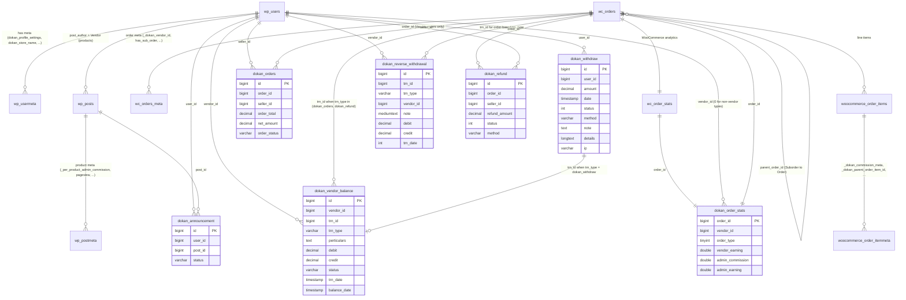
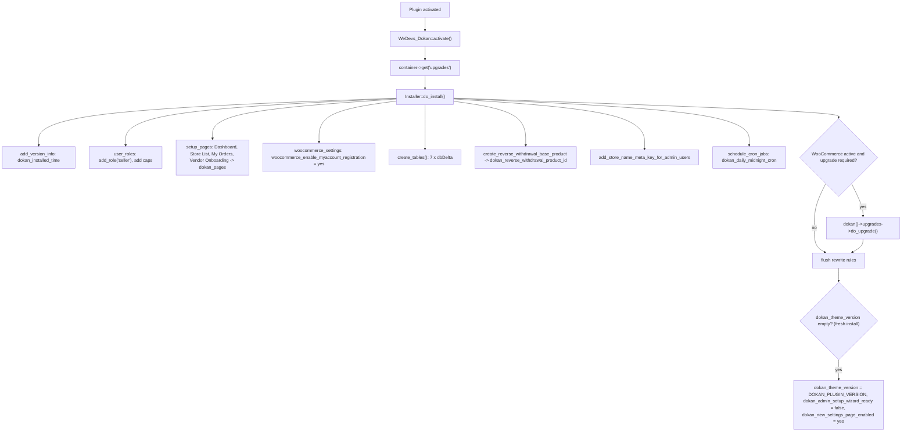
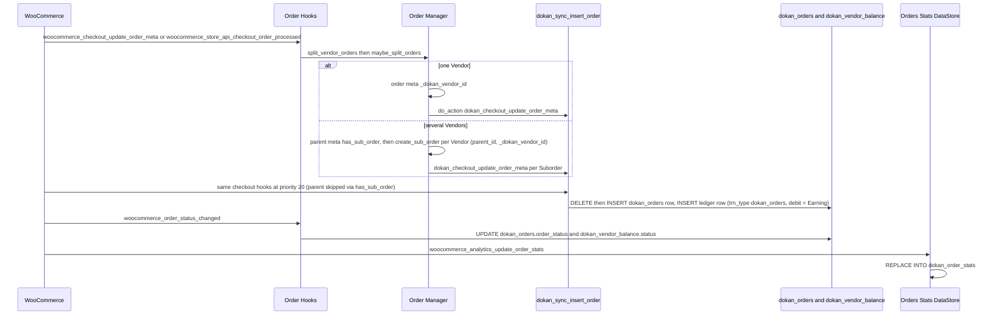
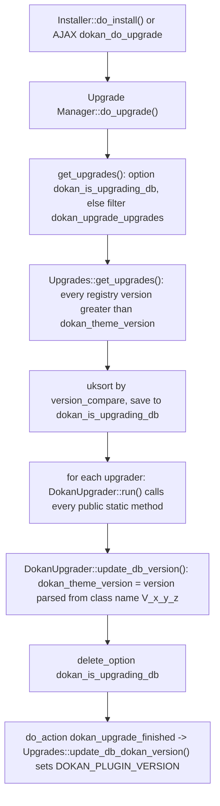

# Database structures (Dokan Lite)

This document lists every persistent data structure that Dokan Lite creates or relies on: its seven custom tables, the WordPress and WooCommerce tables it stores data in (posts, users, orders and their meta), its `wp_options` rows and transients, and the schema migration (upgrader) mechanism that keeps all of this current.

Terminology follows `CONTEXT.md`: **Vendor** (not seller), **Order** / **Suborder** / **Vendor order**, **Commission** = the admin's share, **Earning** = the Vendor's share, **Balance** = the Vendor's running ledger, **Withdraw** and **Reverse withdrawal**. Column, table and function names in code still say `seller`; those are quoted exactly as they appear.

Related documents: [orders-commission-fees.md](orders-commission-fees.md), [withdraw-and-reverse-withdrawal.md](withdraw-and-reverse-withdrawal.md), [vendor-and-store.md](vendor-and-store.md), [products.md](products.md), [bootstrap-and-container.md](bootstrap-and-container.md).

---

## 1. Purpose & ownership

| Concern | Owner |
|---|---|
| DDL for the custom tables `dokan_withdraw`, `dokan_orders`, `dokan_announcement`, `dokan_refund`, `dokan_vendor_balance`, `dokan_reverse_withdrawal`, `dokan_order_stats` | [Lite] |
| Schema migrations (the `V_x_y_z` upgraders) and the stored DB version | [Lite] |
| Vendor profile and settings user meta, product meta, order and order-item meta written by Lite | [Lite] |
| `seller` role and capability grants (stored in the `{prefix}user_roles` option) | [Lite] |
| Admin settings options (`dokan_admin_settings` and legacy `dokan_<section>` rows) | [Lite], see ADR-0002 and ADR-0003 |
| Orders, order items, refunds, products, customers, Analytics lookup tables (`wc_orders`, `wc_order_stats`, ...) | [WooCommerce]. Lite stores data alongside them through WooCommerce CRUD and joins against them. |
| Rows in `dokan_announcement` and `dokan_refund` | Lite creates both tables. Lite code never inserts into either; both are filled by Dokan Pro (Lite does delete `dokan_refund` rows when a Vendor order is deleted). |
| Other `dokan_*` tables that appear in `uninstall.php` | Created by Dokan Pro. Out of scope here. |

Lite registers **no custom post types, post statuses or taxonomies**. A search for `register_post_type`, `register_taxonomy` and `register_post_status` under `includes/` finds nothing. Lite reuses WooCommerce's `product`, `shop_order`, `shop_order_refund` and the core `page` type. The only post-type registration change it makes is to filter `woocommerce_register_post_type_product`, which maps the `edit_post` meta capability to `edit_product` (`dokan_manage_capability_for_woocommerce_product`, `lite:includes/wc-template.php:152`). WooCommerce fires that filter at `wc:includes/class-wc-post-types.php:370`.

**Related ADRs:** [ADR-0013](../0013-marketplace-money-lives-in-custom-tables-not-post-types.md) (money in custom tables, entities reuse WordPress and WooCommerce types), [ADR-0017](../0017-orders-are-storage-agnostic-through-woocommerce-crud.md) (storage-agnostic orders and HPOS), [ADR-0018](../0018-schema-migrations-are-version-named-upgrader-classes.md) (version-named upgraders), [ADR-0002](../0002-flat-dokan-admin-settings-as-canonical-store.md) and [ADR-0003](../0003-settings-legacy-mirror-mode.md) (settings options), [ADR-0014](../0014-reverse-withdrawal-is-a-separate-receivable-ledger.md) (`dokan_reverse_withdrawal` ledger).

---

## 2. Entry points & bootstrap

| What | Where |
|---|---|
| Activation hook registered | `lite:dokan-class.php:73` (`register_activation_hook( DOKAN_FILE, [ $this, 'activate' ] )`) |
| `WeDevs_Dokan::activate()` builds the `upgrades` service, then runs the installer | `lite:dokan-class.php:157` |
| `Installer::do_install()`: roles, pages, tables, base product, cron, then upgrades | `lite:includes/Install/Installer.php:16` |
| `Installer::create_tables()`: creates all seven tables in order | `lite:includes/Install/Installer.php:331` |
| `InstallerHelper::create_reverse_withdrawal_table()` | `lite:includes/ReverseWithdrawal/InstallerHelper.php:23` |
| `Installer::create_dokan_order_stats_table()` (public, also called by an upgrader) | `lite:includes/Install/Installer.php:551` |
| `$wpdb` table aliases set on `init` priority 1 | `lite:dokan-class.php:267` → `WeDevs_Dokan::wpdb_table_shortcuts` at `lite:dokan-class.php:346` |
| DB version option key `dokan_theme_version` | `lite:dokan-class.php:62` |
| Upgrader registry (version → class) | `lite:includes/Upgrade/Upgrades.php:14` |
| Upgrade runner `Upgrade\Manager::do_upgrade()` | `lite:includes/Upgrade/Manager.php:85` |
| Upgrader base `DokanUpgrader::run()` / `update_db_version()` | `lite:includes/Abstracts/DokanUpgrader.php:22` |
| Upgrade hook wiring (`Upgrade\Hooks`) | `lite:includes/Upgrade/Hooks.php:18` |
| Uninstall data removal | `lite:uninstall.php` (`Dokan_Uninstaller`) |

`wpdb_table_shortcuts()` sets five aliases: `$wpdb->dokan_withdraw`, `$wpdb->dokan_orders`, `$wpdb->dokan_announcement`, `$wpdb->dokan_refund` and `$wpdb->dokan_vendor_balance`. No alias exists for `dokan_reverse_withdrawal` or `dokan_order_stats`. Code reaches those through `ReverseWithdrawal\Manager::get_table()` and `Analytics\Reports\Orders\Stats\DataStore::get_db_table_name()`.

Every table is created with `CREATE TABLE IF NOT EXISTS ... ENGINE=InnoDB {$wpdb->get_charset_collate()}` and passed to `dbDelta()`. All table names use the site's `$wpdb->prefix`.

---

## 3. Key classes

| Class | File | Responsibility |
|---|---|---|
| `WeDevs\Dokan\Install\Installer` | `lite:includes/Install/Installer.php:15` | Install routine: DDL for six tables, `seller` role, default pages, initial options, daily cron |
| `WeDevs\Dokan\ReverseWithdrawal\InstallerHelper` | `lite:includes/ReverseWithdrawal/InstallerHelper.php:15` | DDL for `dokan_reverse_withdrawal`; creates the hidden Reverse withdrawal payment product |
| `WeDevs\Dokan\Upgrade\Upgrades` | `lite:includes/Upgrade/Upgrades.php:5` | Static registry of Lite upgraders; decides whether an upgrade is needed |
| `WeDevs\Dokan\Upgrade\Manager` | `lite:includes/Upgrade/Manager.php:5` | Collects upgraders through filters, runs them, stores progress in `dokan_is_upgrading_db` |
| `WeDevs\Dokan\Abstracts\DokanUpgrader` | `lite:includes/Abstracts/DokanUpgrader.php:7` | Runs every public static method of an upgrader class, then writes the version derived from the class name |
| `WeDevs\Dokan\Models\BaseModel` / `Models\DataStore\BaseDataStore` | `lite:includes/Models/BaseModel.php:8`, `lite:includes/Models/DataStore/BaseDataStore.php` | `WC_Data`-style model and data store over a custom table |
| `WeDevs\Dokan\Models\VendorBalance` | `lite:includes/Models/VendorBalance.php:8` | Model for one `dokan_vendor_balance` row; `TRN_TYPE_*` constants |
| `WeDevs\Dokan\Models\DataStore\VendorBalanceStore` | `lite:includes/Models/DataStore/VendorBalanceStore.php:14` | Field formats and Balance aggregation queries for `dokan_vendor_balance` |
| `WeDevs\Dokan\Withdraw\Withdraw` | `lite:includes/Withdraw/Withdraw.php` | Inserts, updates and deletes `dokan_withdraw` rows (`create()` at line 436) |
| `WeDevs\Dokan\Order\Manager` | `lite:includes/Order/Manager.php` | Suborder creation (order meta writes); `delete_seller_order()` cascade across four tables (line 490) |
| `WeDevs\Dokan\Order\Hooks` | `lite:includes/Order/Hooks.php` | Keeps `dokan_orders` and `dokan_vendor_balance` in step with WooCommerce order status changes |
| `WeDevs\Dokan\Order\RefundHandler` | `lite:includes/Order/RefundHandler.php` | Writes `dokan_refund` type ledger rows into `dokan_vendor_balance` when a WooCommerce refund is created |
| `WeDevs\Dokan\ReverseWithdrawal\Manager` | `lite:includes/ReverseWithdrawal/Manager.php` | Reads and inserts `dokan_reverse_withdrawal` rows (`insert()` at line 512) |
| `WeDevs\Dokan\Analytics\Reports\Orders\Stats\DataStore` | `lite:includes/Analytics/Reports/Orders/Stats/DataStore.php:20` | Upserts and deletes `dokan_order_stats` rows |
| `WeDevs\Dokan\Analytics\Reports\OrderType` | `lite:includes/Analytics/Reports/OrderType.php:16` | Constants for the `order_type` column (0–9) |
| `WeDevs\Dokan\Admin\Settings\Repository\SettingsRepository` | `lite:includes/Admin/Settings/Repository/SettingsRepository.php:15` | Owns the `dokan_admin_settings` option |
| `WeDevs\Dokan\Admin\Settings\Repository\LegacySettingsRepository` | `lite:includes/Admin/Settings/Repository/LegacySettingsRepository.php:14` | Reads and writes legacy `dokan_<section>` options |
| `WeDevs\Dokan\Admin\Settings\Migration\LegacyMirror` | `lite:includes/Admin/Settings/Migration/LegacyMirror.php` | Keeps legacy option rows populated from canonical settings (ADR-0003) |

---

## 4. Custom tables

The column lists below are the schema a **fresh install** produces, taken from the `CREATE TABLE` statements. Older sites reach the same shape through the upgraders in §5.3, with one exception noted under `dokan_withdraw.details`.

### 4.1 `{prefix}dokan_orders`: per-Vendor-order sync table

Created by `Installer::create_sync_table()` (`lite:includes/Install/Installer.php:372`). It holds one row per **Vendor order**: a Suborder, or a single-vendor Order. Parent Orders that have Suborders are skipped (`has_sub_order` = 1 check in `dokan_sync_insert_order`).

| Column | Type | Null / default | Meaning |
|---|---|---|---|
| `id` | `bigint(20) unsigned` | NOT NULL, AUTO_INCREMENT, PK | Row id |
| `order_id` | `bigint(20)` | NULL | WooCommerce order id (`wc_orders.id` under HPOS, `wp_posts.ID` otherwise) |
| `seller_id` | `bigint(20)` | NULL | Vendor user id (`wp_users.ID`) |
| `order_total` | `decimal(19,4)` | NULL | `WC_Order::get_total()` at sync time |
| `net_amount` | `decimal(19,4)` | NULL | Vendor Earning for the order (`dokan()->commission->get_earning_by_order()`, filtered by `dokan_order_net_amount`) |
| `order_status` | `varchar(30)` | NULL | WooCommerce status with the `wc-` prefix |

Indexes: `PRIMARY KEY (id)`, `KEY order_id (order_id)`, `KEY seller_id (seller_id)`.

Writers: `dokan_sync_insert_order()` (`lite:includes/Order/functions.php:217`) deletes any existing row for the order and Vendor, then inserts a new one. `Order\Hooks::on_order_status_change()` (`lite:includes/Order/Hooks.php:95`) updates `order_status`. `Fees` and `Commission\RecalculateCommissions` update `net_amount` when gateway fees or Commission are recalculated. `Order\Manager::delete_seller_order()` deletes rows.

### 4.2 `{prefix}dokan_vendor_balance`: the Balance ledger

Created by `Installer::create_vendor_balance_table()` (`lite:includes/Install/Installer.php:445`). It is a double-entry-style ledger. The Vendor's Balance is computed as `SUM(debit) - SUM(credit)` over qualifying rows (`VendorBalanceStore::get_total_earning_by_vendor`, and `Vendor::get_balance` in `lite:includes/Vendor/Vendor.php`). Note the direction: `debit` holds money that **accrues to** the Vendor (Earnings), and `credit` holds money that **leaves** the Balance (Withdraws and Refunds).

| Column | Type | Null / default | Meaning |
|---|---|---|---|
| `id` | `bigint(20) unsigned` | NOT NULL, AUTO_INCREMENT, PK | Row id |
| `vendor_id` | `bigint(20) unsigned` | NOT NULL | Vendor user id |
| `trn_id` | `bigint(20) unsigned` | NOT NULL | Source record id: a Vendor order id for `dokan_orders` and `dokan_refund` rows, a `dokan_withdraw.id` for `dokan_withdraw` rows |
| `trn_type` | `varchar(30)` | NOT NULL | `dokan_orders`, `dokan_withdraw` or `dokan_refund` (`VendorBalance::TRN_TYPE_*`, `lite:includes/Models/VendorBalance.php:9`) |
| `perticulars` | `text` | NOT NULL | Free-text description (column name misspelled in the schema; the model exposes it as `get_particulars()` / `set_particulars()`) |
| `debit` | `decimal(19,4)` | NOT NULL | Amount added to the Balance |
| `credit` | `decimal(19,4)` | NOT NULL | Amount removed from the Balance |
| `status` | `varchar(30)` | NULL | For `dokan_orders` rows, the order status with `wc-` prefix, written by `Order\Hooks::on_order_status_change()` (`dokan_sync_insert_order()` does not set it, so the model default of an empty string is stored at insert). For `dokan_withdraw` and `dokan_refund` rows, `approved`. |
| `trn_date` | `timestamp` | NOT NULL | Transaction date |
| `balance_date` | `timestamp` | NOT NULL | Date from which the amount counts toward the withdrawable Balance (`trn_date` + withdraw threshold days for orders) |

Indexes: `PRIMARY KEY (id)` only.

Row producers:

| `trn_type` | Written by | Columns set |
|---|---|---|
| `dokan_orders` | `dokan_sync_insert_order()` via the `VendorBalance` model (`lite:includes/Order/functions.php:274`) | `debit` = Earning, particulars `New order`, `balance_date` = now + `dokan_get_withdraw_threshold()` days (`lite:includes/functions.php:4058`) |
| `dokan_orders` (status) | `Order\Hooks::on_order_status_change()` updates `status` unless the COD exclusion applies (`dokan_order_should_exclude_from_vendor_balance` filter) | `status` |
| `dokan_withdraw` | `Withdraw\Hooks::update_vendor_balance()` on `dokan_withdraw_request_approved` (`lite:includes/Withdraw/Hooks.php:110`) | `credit` = Withdraw amount, `status` = `approved` |
| `dokan_refund` | `RefundHandler::insert_into_balance_table()` on `dokan_refund_adjust_vendor_balance` (`lite:includes/Order/RefundHandler.php:191`) and `Order\Hooks::manage_refunded_for_order()` (`lite:includes/Order/Hooks.php:290`) | `credit` = refunded Earning, `status` = `approved` |

### 4.3 `{prefix}dokan_withdraw`: Withdraw requests

Created by `Installer::create_withdraw_table()` (`lite:includes/Install/Installer.php:348`).

| Column | Type | Null / default | Meaning |
|---|---|---|---|
| `id` | `bigint(20) unsigned` | NOT NULL, AUTO_INCREMENT, PK | Withdraw id |
| `user_id` | `bigint(20) unsigned` | NOT NULL | Vendor user id |
| `amount` | `decimal(19,4)` | NOT NULL | Requested amount |
| `date` | `timestamp` | NOT NULL | Request date |
| `status` | `int(1)` | NOT NULL | `0` pending, `1` approved, `2` cancelled (`Withdraw\Manager::get_status_name`) |
| `method` | `varchar(30)` | NOT NULL | Withdraw method id (for example `paypal`, `bank`) |
| `note` | `text` | NOT NULL | Admin note |
| `details` | `longtext` | NULL (fresh install) | Serialized array: the method's formatted details plus `charge`, `receivable` and `charge_data` (`Withdraw::create`, filtered by `dokan_withdraw_request_details_data`) |
| `ip` | `varchar(50)` | NOT NULL | Requester IP address |

Indexes: `PRIMARY KEY (id)` only.

On upgraded sites the `details` column was added by `V_3_2_12::update_dokan_withdraw_table` as `longtext NOT NULL` and by `V_3_3_1::update_withdraw_table_column` as `longtext`. `V_3_3_7::update_withdraw_table_column` then changes it to `longtext NULL`.

### 4.4 `{prefix}dokan_reverse_withdrawal`: Reverse withdrawal ledger

Created by `InstallerHelper::create_reverse_withdrawal_table()` (`lite:includes/ReverseWithdrawal/InstallerHelper.php:23`), called from both `Installer::create_tables()` and the `V_3_5_1` upgrader. Per `CONTEXT.md`, this is a receivable the Vendor owes the admin. It is never a Balance entry, and this table is separate from `dokan_vendor_balance`.

| Column | Type | Null / default | Meaning |
|---|---|---|---|
| `id` | `bigint(20) UNSIGNED` | NOT NULL, AUTO_INCREMENT, PK | Row id |
| `trn_id` | `bigint(20) UNSIGNED` | NOT NULL | Source id (an order id for order-based types) |
| `trn_type` | `varchar(200)` | NOT NULL, default `order_commission` | One of the keys from `ReverseWithdrawal\Helper::get_transaction_types()` (`lite:includes/ReverseWithdrawal/Helper.php:57`): `opening_balance`, `order_commission`, `failed_transfer_reversal`, `product_advertisement`, `manual_order_commission`, `vendor_payment`, `order_refund`, `manual_product`, `manual_order`, `other` |
| `vendor_id` | `bigint(20) UNSIGNED` | NOT NULL | Vendor user id |
| `note` | `mediumtext` | NULL | Free text |
| `debit` | `decimal(19,4)` | NOT NULL, default `0.0000` | Amount the Vendor owes (per the helper's comments, the "admin will get payment" types) |
| `credit` | `decimal(19,4)` | NOT NULL, default `0.0000` | Amount the Vendor paid or that was reversed |
| `trn_date` | `int(11) UNSIGNED` | NOT NULL, default `0` | **Unix timestamp**. This differs from the `timestamp` columns in the other ledgers. `Manager::insert()` defaults it to `time()`. |

Indexes: `PRIMARY KEY (id)`, `KEY trn_date (trn_date)`, `KEY vendor_id_trn_date (vendor_id, trn_date)`, `KEY vendor_id (vendor_id)`, `KEY trn_id_type (trn_id, trn_type(191))`, `KEY vendor_id_trn_date_type (vendor_id, trn_date, trn_type(191))`.

`ReverseWithdrawal\Manager::insert()` rejects a `trn_type` that is not in the helper's list. The helper's own comment warns against changing the keys because queries depend on them.

### 4.5 `{prefix}dokan_order_stats`: Analytics lookup table

Created by `Installer::create_dokan_order_stats_table()` (`lite:includes/Install/Installer.php:551`). Existing sites got it from `V_3_13_0::resync_wc_order_stats_to_sync_dokan_stats`, which also calls WooCommerce `ReportsSync::regenerate_report_data()` to backfill the table. It is a one-to-one companion of WooCommerce's `wc_order_stats` and is joined on `order_id` (`BaseQueryFilter::add_join_subquery`, `lite:includes/Analytics/Reports/BaseQueryFilter.php:27`).

| Column | Type | Null / default | Meaning |
|---|---|---|---|
| `order_id` | `bigint UNSIGNED` | NOT NULL, PK | WooCommerce order or refund id |
| `vendor_id` | `bigint UNSIGNED` | NOT NULL, default `0` | Vendor id for Suborders and single-vendor Orders and their refunds; `0` otherwise |
| `order_type` | `tinyint(1)` | NOT NULL, default `0` | See the table below |
| `vendor_earning` | `double` | NOT NULL, default `0` | Vendor Earning |
| `vendor_gateway_fee` | `double` | NOT NULL, default `0` | Gateway fee borne by the Vendor |
| `vendor_shipping_fee` | `double` | NOT NULL, default `0` | Shipping received by the Vendor |
| `vendor_discount` | `double` | NOT NULL, default `0` | Discount borne by the Vendor |
| `vendor_shipping_tax` | `double` | NOT NULL, default `0` | Shipping tax received by the Vendor (added in 5.0.0) |
| `vendor_order_tax` | `double` | NOT NULL, default `0` | Order tax received by the Vendor (added in 5.0.0) |
| `admin_earning` | `double` | NOT NULL, default `0` | Admin total earning (added in 5.0.0) |
| `admin_commission` | `double` | NOT NULL, default `0` | Commission |
| `admin_gateway_fee` | `double` | NOT NULL, default `0` | Gateway fee borne by the admin |
| `admin_shipping_fee` | `double` | NOT NULL, default `0` | Shipping received by the admin |
| `admin_discount` | `double` | NOT NULL, default `0` | Discount borne by the admin |
| `admin_shipping_tax` | `double` | NOT NULL, default `0` | Shipping tax received by the admin (added in 5.0.0) |
| `admin_order_tax` | `double` | NOT NULL, default `0` | Order tax received by the admin (added in 5.0.0) |
| `admin_subsidy` | `double` | NOT NULL, default `0` | Admin subsidy |

Indexes: `PRIMARY KEY (order_id)`, `KEY vendor_id (vendor_id)`, `KEY order_type (order_type)`.

`order_type` values (`lite:includes/Analytics/Reports/OrderType.php:16`):

| Value | Constant | Meaning |
|---|---|---|
| 0 | `DOKAN_PARENT_ORDER` | Parent Order that has Suborders |
| 1 | `DOKAN_SINGLE_ORDER` | Single-vendor Order (the Order is the Vendor order) |
| 2 | `DOKAN_SUBORDER` | Suborder |
| 3 | `DOKAN_PARENT_ORDER_REFUND` | Refund of a parent Order |
| 4 | `DOKAN_SUBORDER_REFUND` | Refund of a Suborder |
| 5 | `DOKAN_SINGLE_ORDER_REFUND` | Refund of a single-vendor Order |
| 6 | `DOKAN_ADVERTISEMENT_PRODUCT_ORDER` | Advertisement product order |
| 7 | `DOKAN_ADVERTISEMENT_REFUND_ORDER` | Advertisement refund |
| 8 | `DOKAN_SUBSCRIPTION_ORDER` | Vendor subscription order |
| 9 | `DOKAN_SUBSCRIPTION_REFUND_ORDER` | Vendor subscription refund |

Writer: `DataStore::update()` (`lite:includes/Analytics/Reports/Orders/Stats/DataStore.php:99`) runs `$wpdb->replace()` with values from `Commission\OrderCommission` for `shop_order` objects. Refund rows get zeros in every money column. The data passes through the `dokan_analytics_update_order_stats_data` filter first. `DataStore::delete_order()` (line 203) deletes the row.

### 4.6 `{prefix}dokan_refund`: refund request table

Created by `Installer::create_refund_table()` (`lite:includes/Install/Installer.php:418`). It was first introduced by `V_2_4_11::create_refund_table`. Lite only defines the schema and deletes rows in `Order\Manager::delete_seller_order()`. Rows are written by Dokan Pro.

| Column | Type | Null / default |
|---|---|---|
| `id` | `bigint(20) unsigned` | NOT NULL, AUTO_INCREMENT, PK |
| `order_id` | `bigint(20) unsigned` | NOT NULL |
| `seller_id` | `bigint(20)` | NOT NULL |
| `refund_amount` | `decimal(19,4)` | NOT NULL |
| `refund_reason` | `text` | NULL |
| `item_qtys` | `varchar(200)` | NULL |
| `item_totals` | `text` | NULL |
| `item_tax_totals` | `text` | NULL |
| `restock_items` | `varchar(10)` | NULL |
| `date` | `timestamp` | NOT NULL |
| `status` | `int(1)` | NOT NULL |
| `method` | `varchar(30)` | NOT NULL |

Indexes: `PRIMARY KEY (id)` only.

### 4.7 `{prefix}dokan_announcement`

Created by `Installer::create_announcement_table()` (`lite:includes/Install/Installer.php:397`; also called by `V_2_1::create_announcement_table`). No Lite code reads or writes it. It is consumed by Dokan Pro.

| Column | Type | Null / default |
|---|---|---|
| `id` | `bigint(20) unsigned` | NOT NULL, AUTO_INCREMENT, PK |
| `user_id` | `bigint(20) unsigned` | NOT NULL |
| `post_id` | `bigint(11)` | NOT NULL |
| `status` | `varchar(30)` | NOT NULL |

Indexes: `PRIMARY KEY (id)` only.

### 4.8 Entity-relationship diagram

No table declares foreign keys. The relationships below are logical: they are enforced in PHP, not by the database. Order ids point at `wc_orders.id` when HPOS is enabled and at `wp_posts.ID` (post type `shop_order` / `shop_order_refund`) when it is not. Lite declares HPOS compatibility at `lite:dokan-class.php:239` and switches its raw SQL on `OrderUtil::is_hpos_enabled()` (for example `Order\Manager`'s status-count query joins `OrderUtil::get_order_table_name()`).

(`dokan_order_stats` is abbreviated in the diagram; §4.5 lists every column. `wc_orders_meta` stands for `wp_postmeta` on non-HPOS sites.)

---

## 5. Execution flow

### 5.1 Install

Points worth knowing:

- `add_store_name_meta_key_for_admin_users()` (`lite:includes/Install/Installer.php:66`) writes `dokan_store_name` user meta for every `administrator` and `shop_manager` that lacks it. The docblock explains why: admins are treated as Vendors by default, and several SQL queries rely on that meta key.
- `create_reverse_withdrawal_base_product()` exits early unless WooCommerce is active and the current user has `manage_options`. It creates a hidden, virtual, zero-price simple product and stores its id in the `dokan_reverse_withdrawal_product_id` option.
- Only fresh installs set `dokan_new_settings_page_enabled` to `yes`. The inline comment says upgraded sites stay on the classic settings page.

### 5.2 How a Vendor order populates the tables

The parent Order is a mirror, and operational accounting happens only on Vendor orders. This is deliberate; see ADR-0004 (`docs/adr/0004-vendor-order-is-authoritative-parent-is-mirror.md`). It is the reason `dokan_orders` and `dokan_vendor_balance` contain no rows for parent Orders that have Suborders.

When a Vendor order is deleted, `Order\Manager::delete_seller_order()` (`lite:includes/Order/Manager.php:490`) deletes data in this sequence: `dokan_orders` rows (by `order_id`, optionally also `seller_id`); `dokan_refund` rows by `order_id`; then it fires `dokan_after_deleting_seller_order`; then it deletes `dokan_vendor_balance` rows whose `trn_id` is the order id and whose `trn_type` is `dokan_orders`, `dokan_refund` or `dokan_withdraw`; finally it deletes `dokan_reverse_withdrawal` rows whose `trn_type` is `order_commission`, `manual_order_commission` or `order_refund`.

### 5.3 Schema migrations (upgraders)

`Upgrades::is_upgrade_required()` returns true only when `dokan_theme_version` is set **and** is lower than the newest key in the registry. A fresh install, where the option is empty, never runs upgraders. The schema-relevant upgraders are:

| Version | Upgrader method | Schema effect |
|---|---|---|
| 1.2 | `V_1_2::generate_sync_table` | Backfills `dokan_orders` |
| 2.1 | `V_2_1::create_announcement_table` | Creates `dokan_announcement` |
| 2.4.11 | `V_2_4_11::create_refund_table` | Creates `dokan_refund` (original types `float(11)` / `varchar(50)`) |
| 2.7.3 | `V_2_7_3` | `dokan_orders.order_total` and `net_amount` become `float(11,4)`; writes `_dokan_admin_fee` post meta on existing Suborders |
| 2.7.6 | `V_2_7_6::update_table_structure` | `dokan_withdraw.ip` becomes `varchar(50)` (IPv6 length) |
| 2.8.3 | `V_2_8_3` → background process `V_2_8_3_VendorBalance` | Creates `dokan_vendor_balance` and migrates rows from `dokan_orders` and `dokan_withdraw` |
| 2.9.4 | `V_2_9_4::update_refund_table` | `dokan_refund` item columns become `varchar(200)`; also a background process that rewrites `shop_order` `post_author` |
| 2.9.13 | `V_2_9_13::update_spmv_product_map_table` | Adds a column to an optional table created by Dokan Pro, only if that table exists |
| 3.0.4 | `V_3_0_4::update_dokan_tables` | All money columns in `dokan_withdraw`, `dokan_refund`, `dokan_vendor_balance` and `dokan_orders` become `DECIMAL(19,4)` |
| 3.1.1 | `V_3_1_1::update_dokan_refund_table` | Background process changes `item_totals` and `item_tax_totals` to `text NULL` |
| 3.2.12 | `V_3_2_12::update_dokan_withdraw_table` | Adds `dokan_withdraw.details` |
| 3.3.1 | `V_3_3_1` | Adds `details` if it is still missing; changes the refund item columns to `text` |
| 3.3.7 | `V_3_3_7::update_withdraw_table_column` | `dokan_withdraw.details` becomes `longtext NULL` |
| 3.5.1 | `V_3_5_1` | Creates `dokan_reverse_withdrawal` and the base product |
| 3.13.0 | `V_3_13_0::resync_wc_order_stats_to_sync_dokan_stats` | Creates `dokan_order_stats` and triggers a WooCommerce Analytics resync |
| 3.14.0 | `V_3_14_0` | Rewrites the Commission settings in `dokan_selling`; background jobs migrate product, Vendor and category Commission meta |
| 5.0.0 | `V_5_0_0::alter_dokan_order_stats_table_and_regenerate` | Adds the five tax and earning columns to `dokan_order_stats` and updates the `order_type` column comment |

Some upgraders run as background processes. Their class name and file path are saved in the `dokan_background_processes` option, and `WeDevs_Dokan::after_plugins_loaded()` (`lite:dokan-class.php:365`) re-instantiates them on every load until they finish.

---

## 6. Data storage (non-table)

### 6.1 Options (`wp_options`)

| Option | Written by | Purpose |
|---|---|---|
| `dokan_theme_version` | `Installer::do_install`, `DokanUpgrader::update_db_version`, `Upgrades::update_db_dokan_version` | Lite DB schema version (`WeDevs_Dokan::$db_version_key`) |
| `dokan_is_upgrading_db` | `Upgrade\Manager::get_upgrades` | Pending upgrader list. Its presence means an upgrade is in progress (`has_ongoing_process`). |
| `dokan_background_processes` | `DokanBackgroundProcesses` | Map of background-process class to file path |
| `dokan_installed_time` | `Installer::add_version_info`, `V_3_3_1::add_version_info` | Unix time of first install |
| `dokan_pages_created` | `Installer::setup_pages` | Guard so pages are created only once |
| `dokan_pages` | `Installer::setup_pages` (through `dokan_save_legacy_settings_section`), `V_5_0_0::create_vendor_onboarding_page` | Page ids keyed `dashboard`, `store_listing`, `my_orders`, `vendor_onboarding` |
| `dokan_admin_setup_wizard_ready` | `Installer::do_install` | Set to `false` on fresh install |
| `dokan_new_settings_page_enabled` | `Installer::do_install` (`LegacySwitcher::NEW_SETTINGS_OPTION`, `lite:includes/Admin/Dashboard/LegacySwitcher.php:28`) | Enables the new admin settings page on fresh installs |
| `dokan_admin_settings` | `SettingsRepository` (`OPTION_KEY`, `lite:includes/Admin/Settings/Repository/SettingsRepository.php:15`) | Canonical flat settings store (ADR-0002) |
| `dokan_admin_settings_legacy_snapshot` | `LegacyMirror` (`SNAPSHOT_KEY`) | Snapshot used to reconcile the legacy mirror on `admin_init` (ADR-0003) |
| `dokan_general`, `dokan_selling`, `dokan_withdraw`, `dokan_pages`, `dokan_appearance`, `dokan_privacy`, `dokan_reverse_withdrawal`, `dokan_shipping_status_setting`, `dokan_ai`, `dokan_geolocation`, `dokan_colors` | `LegacySettingsRepository` / `dokan_save_legacy_settings_section()` (`lite:includes/functions.php:1131`), kept populated by the Legacy mirror | Legacy per-section settings arrays read through `dokan_get_option( $key, $section )`. These are the sections Lite reads; the authoritative list comes from the Legacy bridge mapping (`BridgeBootstrap::known_sections`). |
| `dokan_reverse_withdrawal_product_id` | `InstallerHelper::create_reverse_withdrawal_base_product` (`Helper::get_base_product_option_key`) | Id of the hidden Reverse withdrawal payment product |
| `dokan_advertisement_product_id` | read by Lite | Id of the advertisement product (written outside Lite) |
| `woocommerce_enable_myaccount_registration` | `Installer::woocommerce_settings` | Forced to `yes` [WooCommerce option] |
| `{prefix}user_roles` | `Installer::user_roles` via `add_role` / `WP_Roles::add_cap` | `seller` role; `dokandar` and every `dokan_get_all_caps()` capability granted to `seller`, `administrator` and `shop_manager` |
| Other UI-state options | various admin classes | Examples: `dokan_lite_whats_new_versions`, `dokan_review_notice_hidden`, `dokan_review_notice_postponed`, `dokan_hide_pro_nag`, `dokan_marketplace_goal`, `dokan_onboarding`, `dokan_share_essentials`, `dokan_legacy_dashboard_page`, `dokan_dummy_data_import_success`, `dokan_rewrite_rules_needs_flashing`, `dokan_admin_setup_guide_steps_completed`, `dokan_pointer_*` |

### 6.2 Transients

| Transient | Set in | Purpose |
|---|---|---|
| `dokan_wc_missing_notice` | `WeDevs_Dokan::activate` | WooCommerce-missing notice; deleted on deactivate |
| `dokan_setup_wizard_no_wc`, `dokan_theme_version_for_updater` | `Installer::do_install` (no WooCommerce) | No-WooCommerce setup wizard |
| `_dokan_setup_page_redirect` | `Installer::do_install` (fresh install, 30 s) | Redirect to the setup wizard |
| `dokan_upgrade_notice_{version}` | `Installer::in_plugin_update_message` (1 day) | Cached upgrade notice parsed from readme.txt |
| Others | various | `dokan_help_docs`, `dokan_store_listing_random_orderby`, `dokan_variable_products_author_updated`, `get_dokan_settings_fields`, `promo_notices`, `dokan_store_follow_deactivated_forcefully` |

### 6.3 User meta (`wp_usermeta`)

| Meta key | Written by | Content |
|---|---|---|
| `dokan_profile_settings` | `Registration` (`lite:includes/Registration.php:281`), `Vendor\Manager`, `Vendor::apply_changes` (`lite:includes/Vendor/Vendor.php:1629`) | Serialized store profile. Defaults from `Vendor::popluate_store_data`: `store_name`, `social`, `payment`, `phone`, `show_email`, `address`, `location`, `banner`, `icon`, `gravatar`, `enable_tnc`, `store_tnc`, `show_min_order_discount`, `store_seo`, `dokan_store_time_enabled`, `dokan_store_open_notice`, `dokan_store_close_notice`. Registration also adds `profile_completion`. |
| `dokan_store_name` | Registration, `Vendor::update_meta_data`, `Installer::add_store_name_meta_key_for_admin_users` | Store name, kept separate so it can be searched with SQL |
| `dokan_enable_selling` | `Vendor::make_active` / `make_inactive` (`lite:includes/Vendor/Vendor.php:1017`, `:1035`), admin user profile | `yes` / `no`: Selling activation |
| `dokan_publishing` | `Vendor\Manager`, admin user profile, `dokan_user_update_to_seller` (`lite:includes/functions.php:4457`) | `yes` / `no`: Direct publishing |
| `dokan_feature_seller` | `Vendor\Manager` | `yes` / `no`: featured Vendor |
| `reset_sub_category` | `Vendor\Manager` | `yes` / `no` |
| `dokan_admin_percentage`, `dokan_admin_percentage_type`, `dokan_admin_additional_fee`, `admin_category_commission` | `Commission\Settings\Vendor::save` (`lite:includes/Commission/Settings/Vendor.php:93`), `Vendor\Manager` | Vendor-level Commission formula override |
| `dokan_withdraw_default_method` | `Withdraw\Hooks` AJAX, `WithdrawControllerV2` | Vendor's default withdraw method |
| `withdraw_date_limit` | read in `dokan_get_withdraw_threshold()` | Per-Vendor withdraw threshold in days; falls back to the `withdraw_date_limit` setting in `dokan_withdraw` |
| `_dokan_reverse_withdrawal_threshold_exceeded_date` | `ReverseWithdrawal\Helper` (`lite:includes/ReverseWithdrawal/Helper.php:37`) | Date the Reverse withdrawal threshold was exceeded |
| `_dokan_reverse_withdrawal_failed_actions` | `ReverseWithdrawal\Helper` (`lite:includes/ReverseWithdrawal/Helper.php:46`) | Actions applied because of unpaid Reverse withdrawal |
| `_vendor_id` | read in `dokan_get_current_user_id` (`lite:includes/functions.php:55`) and `VendorUtil` | Links a Vendor Staff user to its Vendor; the meta itself is written outside Lite |
| `first_name`, `last_name` | `dokan_user_update_to_seller` | Core WordPress user meta |

### 6.4 Post meta (`wp_postmeta`) and post fields

Vendor ownership of a product is stored in the core `wp_posts.post_author` column, not in meta. `dokan_get_vendor_by_product()` (`lite:includes/Product/functions.php:553`) reads `post_author` and falls back to the parent product for variations, through the `dokan_get_vendor_by_product` filter.

| Meta key | Object | Written by | Purpose |
|---|---|---|---|
| `_per_product_admin_commission`, `_per_product_admin_commission_type`, `_per_product_admin_additional_fee` | product | `Commission\Settings\Product::save` (`lite:includes/Commission/Settings/Product.php:76`) | Product-level Commission formula |
| `_dokan_new_product_email_sent` | product | `Product\Hooks`, `Emails\NewProduct`, `Emails\NewProductPending` | `yes` / `no` guard against sending the new-product email twice |
| `_dokan_previous_status` | product | `ProductStatusChanger` (`lite:includes/Abstracts/ProductStatusChanger.php:309`), `ProductStatusRollback` | Status to restore after a bulk status change |
| `_dokan_catalog_mode` | product | `CatalogMode\Dashboard\Products` (`lite:includes/CatalogMode/Dashboard/Products.php:99`), `ProductBulkEdit` | Per-product catalog mode settings |
| `chosen_product_cat` | product | `ProductCategory\Helper` (`lite:includes/ProductCategory/Helper.php:197`) | Categories selected in the Vendor dashboard |
| `pageview` | product | `PageViews` (`lite:includes/PageViews.php:62`) | View counter; `dokan_author_pageviews()` sums it per Vendor |
| `dokan_dummy_data` | product | `DummyData\Importer` | Marks imported sample data |
| `_wp_page_template` | page | `Installer::create_page` (only when a template is given) | Page template |
| Standard WooCommerce product meta (`_regular_price`, `_sale_price`, `_stock`, ...) | product | Legacy helpers in `lite:includes/wc-functions.php` | [WooCommerce] meta written directly by Lite's legacy product form handlers |

Term meta read by Lite: `per_category_admin_commission`, `per_category_admin_commission_type` and `per_category_admin_additional_fee` on `product_cat` terms. `Update_Category_Commission` reads these and migrates them into the `commission_category_based_values` setting. `Vendor::get_store_categories` reads `dokan_cat_icon` and `dokan_cat_icon_color`.

### 6.5 Order meta and order-item meta

Order meta is read and written through WooCommerce CRUD (`$order->get_meta()` / `update_meta_data()`). It therefore lands in `wc_orders_meta` under HPOS and in `wp_postmeta` otherwise. Suborders are linked to their parent through WooCommerce's own parent field (`$order->set_parent_id()`, `lite:includes/Order/Manager.php:653`), which is `wc_orders.parent_order_id` or `wp_posts.post_parent`. Suborders are created with `created_via = dokan`.

| Meta key | Level | Written by | Meaning |
|---|---|---|---|
| `has_sub_order` | Order | `Order\Manager::maybe_split_orders` (`lite:includes/Order/Manager.php:949`), `REST\OrderController` | Truthy on a parent Order that has Suborders |
| `_dokan_vendor_id` | Order | `Order\Manager::create_sub_order` (`:622`) and the single-vendor branch (`:940`) | Vendor that owns this Vendor order |
| `dokan_gateway_fee` | Order | `Fees` (`lite:includes/Fees.php:100`) | Gateway processing fee |
| `dokan_gateway_fee_paid_by`, `dokan_admin_gateway_fee` | Order | read by `Commission\OrderCommission` and `OrderRefundCommission` | Who bears the gateway fee, and the admin's portion (written outside Lite) |
| `shipping_fee_recipient`, `tax_fee_recipient`, `shipping_tax_fee_recipient` | Order | `Fees` (`lite:includes/Fees.php:170`, `:203`, `:231`) | Fee recipient snapshot (`admin` / `seller`) |
| `_dokan_admin_fee` | Order | `V_2_7_3` (legacy) | Historical admin fee on old Suborders |
| `_dokan_reverse_withdrawal_payment_settled` | Order | `ReverseWithdrawal\Order` (`PAYMENT_SETTLED_META`, `lite:includes/ReverseWithdrawal/Order.php:24`) | `yes` once a Reverse withdrawal payment order has been credited |
| `_dokan_commission_source`, `_dokan_commission_rate`, `_dokan_commission_type`, `_dokan_additional_fee`, `_dokan_commission_meta` | line item | `Commission\Settings\OrderItem::save` (`lite:includes/Commission/Settings/OrderItem.php:88`) | Commission formula snapshot at order time. `Order\Hooks` filters the legacy key `dokan_commission_meta` into `_dokan_commission_meta`. |
| `_dokan_parent_order_item_id` | line item | `Order\Manager` (`:700`) | Links a Suborder line item to the parent Order's line item |
| `_dokan_reverse_withdrawal_balance` | line item | `ReverseWithdrawal\Order::store_line_item_metas` (`:202`) | Amount being paid toward the Reverse withdrawal |
| `coupon_info`, `coupon_data` | coupon item | `Order\Manager` (`:875`) | Coupon snapshot copied onto Suborders |
| `_dokan_coupon_info` | coupon item | `Vendor\Coupon` (`DOKAN_COUPON_META_KEY`, `lite:includes/Vendor/Coupon.php:16`) | Dokan coupon details |
| `seller_id` | shipping item | `Shipping\Hooks` (`lite:includes/Shipping/Hooks.php:92`) | Vendor that a shipping package belongs to |

---

## 7. Hooks fired / hooks consumed

### 7.1 Hooks Dokan Lite fires (data layer)

| Hook | Type | Fired in | Purpose |
|---|---|---|---|
| `dokan_upgrade_is_upgrade_required` | filter | `Upgrade\Manager::is_upgrade_required` | Lite and Pro registries report whether an upgrade is needed |
| `dokan_upgrade_upgrades` | filter | `Upgrade\Manager::get_upgrades` | Collects upgraders, keyed by version |
| `dokan_upgrade_finished` | action | `Upgrade\Manager::do_upgrade` | After all upgraders have run |
| `dokan_order_net_amount` | filter | `dokan_sync_insert_order` | Adjust the Earning stored in `dokan_orders.net_amount` and the ledger `debit` |
| `dokan_order_should_exclude_from_vendor_balance` | filter | `Order\Hooks::on_order_status_change` | Skip the ledger status update (COD exclusion) |
| `dokan_after_deleting_seller_order` | action | `Order\Manager::delete_seller_order` | Between the `dokan_refund` delete and the ledger delete |
| `dokan_vendor_total_balance_order_status`, `dokan_vendor_total_balance_trn_types` | filter | `VendorBalanceStore::get_total_earning_by_vendor` | Which ledger rows count toward total Earnings |
| `dokan_vendor_refund_amount_before_insert`, `dokan_refund_should_insert_into_vendor_balance` | filter | `RefundHandler::insert_into_balance_table` | Adjust or veto the refund ledger row |
| `dokan_refund_adjust_vendor_balance`, `dokan_refund_adjust_dokan_orders` | action | `RefundHandler::handle_refund` | Refund side effects |
| `dokan_withdraw_request_details_data` | filter | `Withdraw::create` | Content of `dokan_withdraw.details` |
| `dokan_withdraw_created`, `dokan_withdraw_updated`, `dokan_withdraw_deleted` | action | `Withdraw::create` / `update` / `delete` | After `dokan_withdraw` writes |
| `dokan_withdraw_request_{pending\|approved\|cancelled}` | action | `Withdraw::update` (status name from `Withdraw\Manager::get_status_name`) | After a `dokan_withdraw` row is updated |
| `dokan_reverse_withdrawal_created` | action | `ReverseWithdrawal\Manager::insert` | After a Reverse withdrawal row is inserted |
| `dokan_analytics_update_order_stats_data` | filter | `Orders\Stats\DataStore::update` | Row written to `dokan_order_stats` |
| `dokan_analytics_update_order_stats`, `dokan_analytics_delete_order_stats` | action | `Orders\Stats\DataStore::update` / `delete_order` | After the upsert or delete |
| `dokan_get_vendor_by_product` | filter | `dokan_get_vendor_by_product` | Override the `post_author`-based Vendor lookup |
| `dokan_admin_settings_changed` | action | `SettingsRepository` (lines 101, 128) | Canonical settings write; the Legacy mirror listens to it |
| `dokan_legacy_settings_pre_save` (filter), `dokan_legacy_settings_changed` (action) | both | `LegacySettingsRepository` | Legacy section writes |
| `dokan_admin_settings_legacy_mirror` | filter | `LegacySettingsBridge` (line 150) | Turn the Legacy mirror off (ADR-0003) |

### 7.2 Hooks Dokan Lite consumes (data layer)

| Hook | Owner and where fired | Lite callback |
|---|---|---|
| `woocommerce_checkout_update_order_meta` | [WooCommerce] `wc:includes/class-wc-checkout.php:514` | `Order\Hooks::split_vendor_orders`; `dokan_sync_insert_order` (priority 20) |
| `woocommerce_store_api_checkout_order_processed` | [WooCommerce] `wc:src/StoreApi/Routes/V1/Checkout.php:695`, `wc:src/StoreApi/Routes/V1/CheckoutOrder.php:160` | Same two callbacks |
| `woocommerce_process_shop_order_meta` (admin only) | [WooCommerce] `wc:includes/admin/class-wc-admin-meta-boxes.php:262`, `wc:src/Internal/Admin/Orders/Edit.php:318` | `dokan_sync_insert_order` (priority 60) |
| `woocommerce_order_status_changed` | [WooCommerce] `wc:includes/class-wc-order.php:478` | `Order\Hooks::on_order_status_change` (10), `manage_refunded_for_order` (15), `on_sub_order_change` (99) |
| `woocommerce_order_refunded` | [WooCommerce] `wc:includes/wc-order-functions.php:752` | `RefundHandler::handle_refund` |
| `woocommerce_analytics_update_order_stats` | [WooCommerce] `wc:src/Admin/API/Reports/Orders/Stats/DataStore.php:658` | `Orders\Stats\ScheduleListener::sync_dokan_order` |
| `woocommerce_analytics_delete_order_stats` | [WooCommerce] `wc:src/Admin/API/Reports/Orders/Stats/DataStore.php:691`, `:739` | `Orders\Stats\ScheduleListener::delete_order` |
| `woocommerce_register_post_type_product` | [WooCommerce] `wc:includes/class-wc-post-types.php:370` | `dokan_manage_capability_for_woocommerce_product` |
| `dokan_checkout_update_order_meta` | [Lite] `Order\Manager::maybe_split_orders` | `dokan_sync_insert_order` |
| `dokan_withdraw_request_approved` | [Lite] `Withdraw::update` | `Withdraw\Hooks::update_vendor_balance` (priority 11) |
| `dokan_upgrade_is_upgrade_required`, `dokan_upgrade_upgrades` | [Lite] | `Upgrades::is_upgrade_required`, `Upgrades::get_upgrades` (priority 1) |
| `dokan_upgrade_finished`, `dokan_upgrade_is_not_required` | [Lite] | `Upgrades::update_db_dokan_version` |
| `init` (priority 1) | [WordPress] | `WeDevs_Dokan::wpdb_table_shortcuts` |

---

## 8. REST/AJAX endpoints

The data layer itself exposes one endpoint. All table-backed REST resources (orders, Withdraws, Reverse withdrawal, analytics) are documented in [rest-api-and-permissions.md](rest-api-and-permissions.md) and the subsystem documents.

| Endpoint | Method | Permission |
|---|---|---|
| `wp_ajax_dokan_do_upgrade` → `Upgrade\AdminNotice::do_upgrade` | POST (admin-ajax) | `check_ajax_referer( 'dokan_admin' )` plus `current_user_can( 'update_plugins' )`. It refuses to start if an upgrade is already running or none is needed. |

---

## 9. Permissions & capabilities

- **Schema changes** run only from the activation hook, which WordPress restricts to users who can activate plugins, or from the upgrade AJAX action, which is nonce-checked and requires `update_plugins`. The upgrade notice is shown only to users with `update_plugins` (`AdminNotice::show_notice`).
- **Roles and capabilities** are stored in the `{prefix}user_roles` option. `Installer::user_roles()` (`lite:includes/Install/Installer.php:167`) creates the `seller` role, labelled "Vendor", with WordPress and WooCommerce product capabilities plus `dokandar`. It grants every capability from `dokan_get_all_caps()` to `seller`, `administrator` and `shop_manager`. Capability semantics are covered in ADR-0005 (`docs/adr/0005-canonical-admin-capability.md`) and ADR-0007 (`docs/adr/0007-staff-actions-gated-by-dokan-capabilities.md`).
- **Raw SQL** in the data layer uses `$wpdb->prepare()` with placeholders, or `$wpdb->insert()` / `update()` / `delete()` / `replace()` with explicit format arrays. Identifier placeholders use `%i` in the newer upgraders. Values are sanitized before persistence (for example `wc_format_decimal` for Commission amounts and `sanitize_text_field` / `wc_clean` for meta).
- **Ownership** of a row is expressed by its Vendor id column: `seller_id`, `vendor_id` or `user_id`. Ownership enforcement happens in the abilities and REST layers (ADR-0006), not in the database.

---

## 10. WooCommerce touchpoints

- Orders, refunds, items and their meta are stored by WooCommerce. Lite uses only CRUD for meta, so it works with both HPOS (`wc_orders`, `wc_orders_meta`) and legacy post storage. Raw SQL that joins orders branches on `OrderUtil::is_hpos_enabled()`.
- `dokan_order_stats` extends WooCommerce Analytics. It is filled from WooCommerce's own analytics sync hooks and joined to `wc_order_stats` by the `Analytics\Reports\*\QueryFilter` classes.
- Installation forces the WooCommerce option `woocommerce_enable_myaccount_registration` to `yes`, and uses `WC()->queue()->schedule_cron()` (Action Scheduler) for `dokan_daily_midnight_cron`.
- The Reverse withdrawal base product is a WooCommerce simple product with hidden catalog visibility.

---

## 11. Dependencies

| Dependency | Use |
|---|---|
| WordPress `dbDelta()` (`wp-admin/includes/upgrade.php`) | Table creation |
| WordPress options, user meta and post meta APIs | Non-table storage |
| [WooCommerce] `WC_Data` | Base of `Models\BaseModel` |
| [WooCommerce] `OrderUtil`, `ReportsSync`, `Admin\API\Reports\DataStore` | HPOS detection, Analytics backfill, base class of `Orders\Stats\DataStore` |
| [WooCommerce] Action Scheduler (`as_next_scheduled_action`, `WC()->queue()`) | Daily cron |
| [Lite] `Commission\OrderCommission` | Money values for `dokan_order_stats` |
| [Lite] `WeDevs\Dokan\Cache` | Caching of aggregates read from these tables: Balance (`Vendor::get_balance`, group `withdraws_seller_{vendor_id}`), order status counts (`Order\Manager`, group `seller_order_data_{vendor_id}`) and pageviews (`dokan_author_pageviews`) |

---

## 12. Extension points

- **Add an upgrader.** Dokan Pro and other add-ons hook `dokan_upgrade_upgrades` and return `[ 'x.y.z' => [ ClassName::class ] ]`, or `[ [ 'upgrader' => ClassName::class, 'require' => 'lite-version' ] ]` to require a minimum Lite DB version (`DokanUpgrader::run`). The class extends `DokanUpgrader`, is named `V_x_y_z`, and puts each step in a public static method. Override `get_db_version_key()` to track a separate version option. Hook `dokan_upgrade_is_upgrade_required` so the notice appears.
- **Change stored money values.** Use `dokan_order_net_amount` for `dokan_orders` and the ledger, `dokan_analytics_update_order_stats_data` for `dokan_order_stats`, and `dokan_vendor_refund_amount_before_insert` / `dokan_refund_should_insert_into_vendor_balance` for refund ledger rows.
- **Change what counts toward Balance.** Use `dokan_vendor_total_balance_order_status` and `dokan_vendor_total_balance_trn_types`.
- **React to row lifecycle.** Use `dokan_withdraw_created` / `_updated` / `_deleted`, `dokan_reverse_withdrawal_created`, `dokan_after_deleting_seller_order`, `dokan_analytics_update_order_stats` and `dokan_analytics_delete_order_stats`.
- **Settings storage.** Read and write through the settings accessor API against `dokan_admin_settings` (ADR-0002). Do not write legacy `dokan_<section>` rows directly; the Legacy mirror adopts such writes, but the canonical store is authoritative. Disable mirroring with `add_filter( 'dokan_admin_settings_legacy_mirror', '__return_false' )` (ADR-0003).
- **Uninstall.** `uninstall.php` removes data only when the `data_clear_on_uninstall` setting in `dokan_general` is `on`. It then changes Vendors to the customer role, removes roles and capabilities, drops the tables in `Dokan_Uninstaller::get_tables()` (`lite:uninstall.php:145`), deletes a fixed list of user meta keys (`delete_usermeta`, line 226), deletes the Dokan pages, and deletes every option whose name contains `dokan` (line 50).

**Related ADRs:** ledger business rules [0039](../0039-a-vendor-order-earning-is-written-to-the-vendor-balance-ledger-once-when-the-order-is-created-not-when-it-is-paid.md), [0043](../0043-the-vendor-balance-ledger-copies-the-vendor-order-status-on-every-status-change.md), [0041](../0041-editing-a-vendor-order-recalculates-its-earning-in-the-vendor-balance-ledger.md), [0044](../0044-trashing-an-order-parks-its-vendor-earning-and-deleting-it-in-wp-admin-erases-its-ledger-rows.md), [0047](../0047-each-refund-is-booked-as-a-separate-dokan-refund-credit-on-the-vendor-balance.md), [0055](../0055-a-withdraw-moves-money-only-when-the-admin-approves-it-and-approval-is-final.md), [0063](../0063-the-withdrawable-balance-is-matured-earnings-in-a-withdraw-order-status-minus-every-matured-withdraw-and-refund.md); analytics table [0097](../0097-analytics-count-each-sale-once-at-the-vendor-order-level-and-never-count-parent-orders.md), [0099](../0099-commission-and-earning-in-analytics-are-the-vendor-orders-figures-after-refunds-while-refunds-reduce-sales-as-separate-rows.md).

---

## Known gaps

- `dokan_order_stats` is not in the `Dokan_Uninstaller::get_tables()` drop list (`lite:uninstall.php:145`). Whether it is removed by some other mechanism on uninstall could not be determined from Lite source.
- The full list of legacy `dokan_<section>` option rows is built at runtime from the Legacy bridge mappings (`BridgeBootstrap::known_sections`). The sections listed in §6.1 are those that Lite code reads through `dokan_get_option()`. Sections added by Dokan Pro are not enumerated.
- `dokan_admin_gateway_fee`, `dokan_gateway_fee_paid_by`, the `_vendor_id` user meta and the `dokan_advertisement_product_id` option are read by Lite, but no Lite code writes them. They are written outside Lite (consumed by Dokan Pro or gateway integrations); their writers are out of scope for this public document.
- The exact structure of the serialized `dokan_withdraw.details` payload depends on each withdraw method's `get_formatted_details()` implementation and on the `dokan_withdraw_request_details_data` filter, so it is not fully specified here.
- Sites upgraded through `V_3_2_12` before `V_3_3_7` ran may briefly have had `dokan_withdraw.details` as `NOT NULL`. `V_3_3_7` corrects this, but the column state of a site where that upgrader did not complete cannot be determined from source.
- `dokan_orders.order_id`, `dokan_vendor_balance.trn_id` and the other order references are not declared as foreign keys, so referential integrity relies entirely on the PHP cascade in `Order\Manager::delete_seller_order()`. Whether every deletion path, such as trashing versus permanent deletion of an order, reaches that cascade was not traced in this document; see [orders-commission-fees.md](orders-commission-fees.md).

_Verified against Lite @e1ce7fc81 / Pro @65975a952 / WooCommerce 11.2.1 — 2026-10-22._
