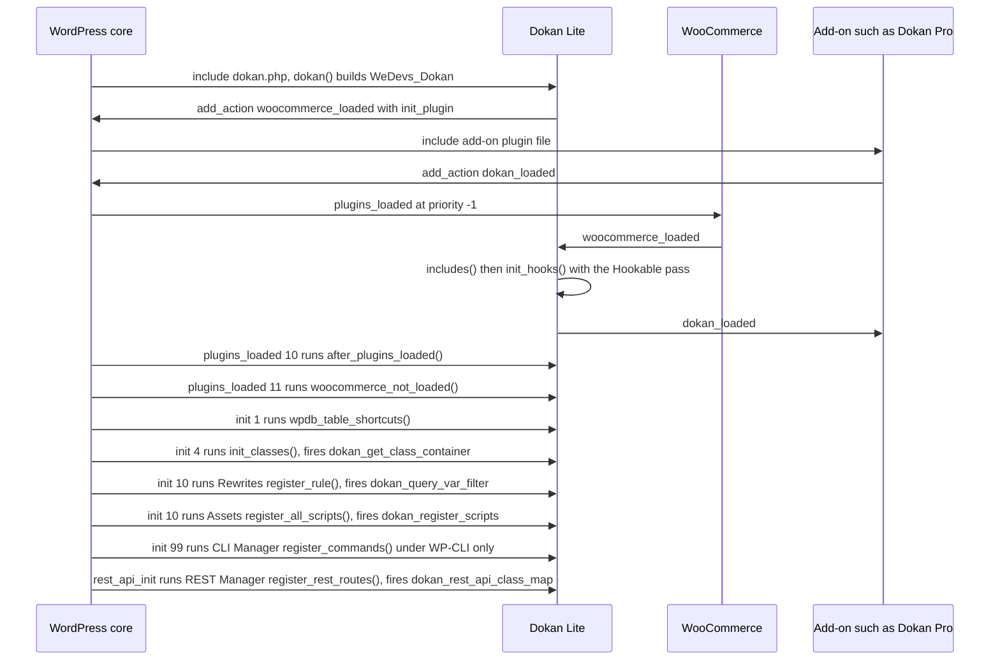
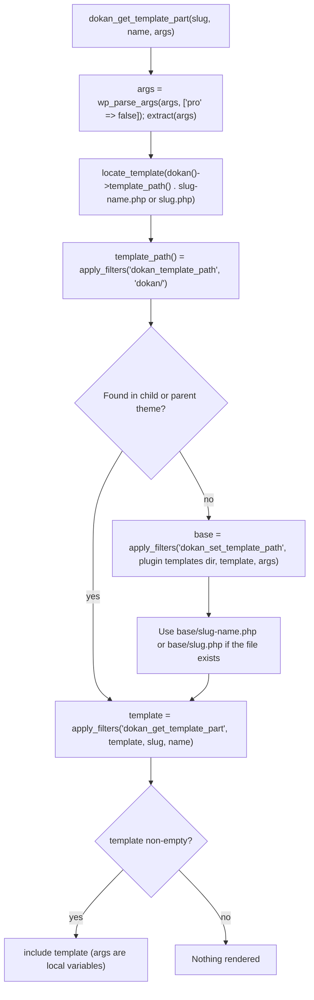
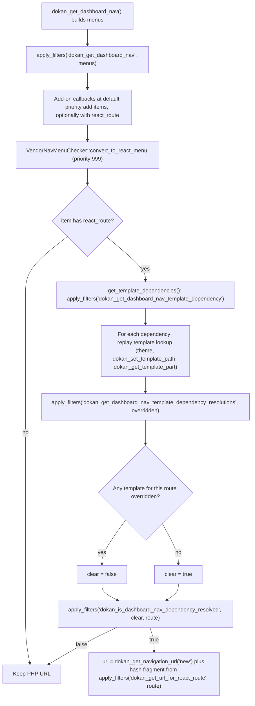

# Extension Seams (Lite side)

This document describes how Dokan Lite exposes extension points to add-ons, including Dokan Pro. It covers load ordering, Pro detection, the dependency-injection container, filter-based class and feature overrides, the template override system, settings filters, Vendor dashboard navigation filters, REST controller registration, admin page registration, script registration hooks, and the JavaScript seams (`wp.hooks` filters, Slot/Fill, `PluginArea`, and `window.dokan` globals).

It documents only the Lite side of each seam. Where a seam is used by Dokan Pro, the table says so, without describing how Pro uses it. Dokan Lite and Dokan Pro form one bounded context, and Pro depends on Lite and never the reverse ([ADR-0001](../0001-single-bounded-context-across-lite-and-pro.md)). Every seam below is therefore a Lite-owned contract that Pro and third-party plugins consume.

Path prefixes: `lite:` is the Dokan Lite repository root and `wc:` is the WooCommerce plugin root. Ownership tags: **[Lite]**, **[WooCommerce]**, **[Third-party: League Container]** (bundled through Mozart), **[Third-party: WordPress packages]** (`@wordpress/hooks`, `@wordpress/components`, `@wordpress/plugins`).

The bootstrap sequence itself is described in [bootstrap-and-container.md](./bootstrap-and-container.md). This document refers to it rather than repeating it.

---

## 1. Purpose & ownership

Dokan Lite is designed to be extended in place. Add-ons do not call a separate API surface; they attach to WordPress actions and filters fired by Lite, resolve or replace services in Lite's container, override Lite templates, and contribute routes, slots and globals to Lite's React applications.

| Seam family | Owner | Mechanism |
|---|---|---|
| Load ordering (`dokan_loaded`) | [Lite] on [WooCommerce] | Action fired once Lite's files and hooks are loaded, inside WooCommerce's `woocommerce_loaded`. |
| Pro detection | [Lite] | `dokan()->is_pro_exists()` (filter `dokan_is_pro_exists`), plus `function_exists( 'dokan_pro' )` checks. |
| Container | [Lite] on [Third-party: League Container] | A shared container instance exposed through `dokan_get_container()`; add-ons can add providers, resolve services, or extend definitions. A `Hookable` tag pass and a legacy `dokan_get_class_container` filter complete it. |
| Class/feature overrides | [Lite] | Filters that return class maps or class lists (`dokan_rest_api_class_map`, `dokan_email_classes`, `dokan_widgets`, `dokan_cli_commands`, `dokan_upgrade_upgrades`), and the React-route override checker (`VendorNavMenuChecker`). |
| Template overrides | [Lite] | Theme directory lookup (`yourtheme/dokan/`) and three filters on the template loader. |
| Settings | [Lite] | Legacy section/field filters and the flat admin-settings schema filters. |
| Vendor dashboard navigation | [Lite] | Menu filters, rewrite endpoint filter, and the custom-template action. |
| REST | [Lite] | `dokan_rest_api_class_map`. |
| Admin pages | [Lite] | `dokan_admin_menu`, legacy Vue routes (`dokan-admin-routes`), React admin pages (`dokan_admin_dashboard_pages` / `Pageable`). |
| Assets | [Lite] | Script registration and enqueue actions, localization filters. |
| JavaScript | [Lite] on [Third-party: WordPress packages] | `wp.hooks` route filters, `Slot` names, `PluginArea` scopes, `window.dokan.*` libraries. |

### 1.1 Top seams at a glance

"Consumed by Pro" was determined by searching Dokan Pro for a matching `add_filter`/`add_action` (or `addFilter`, `Fill`, or subclassing for the JS and class-based seams). "Not found in Pro" means no single-line exact match was found; it does not prove the seam is unused.

| Hook / function | Kind | Fired at | Purpose | Consumed by add-ons (e.g. Pro) |
|---|---|---|---|---|
| `dokan_loaded` | action | `lite:dokan-class.php:253` | Signals that Lite's helper files are loaded and its hooks registered. The canonical "Dokan is ready, boot now" hook. | Yes |
| `dokan_is_pro_exists` | filter | `lite:dokan-class.php:405` | Backs `dokan()->is_pro_exists()`. Defaults to `false`. | Yes |
| `dokan_get_container()` / `dokan()->get_container()` | function | `lite:dokan.php:79`, `lite:dokan-class.php:498` | Return the shared DI container for `get()`, `has()`, `addServiceProvider()` and `extend()`. | Yes |
| `Hookable` tag | interface | `lite:dokan-class.php:277-280` | Every container service implementing `WeDevs\Dokan\Contracts\Hookable` gets `register_hooks()` called during `init_hooks()`. | Yes (Pro classes implement the interface) |
| `dokan_get_class_container` | filter | `lite:dokan-class.php:327` | Adds objects to the legacy property map read by `dokan()->__get()`. | Yes |
| `dokan_template_path` | filter | `lite:dokan-class.php:149` | Theme sub-directory searched for template overrides (default `dokan/`). | Not found in Pro |
| `dokan_set_template_path` | filter | `lite:includes/functions.php:869` | Replaces the plugin template directory used by `dokan_get_template_part()`. | Yes |
| `dokan_get_template_part` | filter | `lite:includes/functions.php:881` | Final say on the resolved template file path. | Not found in Pro |
| `dokan_locate_template` | filter | `lite:includes/functions.php:955` | Final say on the path resolved by `dokan_locate_template()` / `dokan_get_template()`. | Yes |
| `dokan_before_template_part` / `dokan_after_template_part` | action | `lite:includes/functions.php:911`, `:915` | Wrap every `dokan_get_template()` include. | Not found in Pro |
| `dokan_settings_sections` | filter | `lite:includes/Admin/Settings.php:397` | Legacy admin settings sections. | Yes |
| `dokan_settings_fields` | filter | `lite:includes/Admin/Settings.php:1018` | Legacy admin settings fields. | Yes |
| `dokan_get_admin_settings_schema` | filter | `lite:includes/Admin/Settings/Schema/SettingsSchema.php:78` | Flat admin-settings schema (pages, sections, fields). | Yes |
| `dokan_settings_{path}_children` | filter (dynamic) | `lite:includes/Admin/Settings/Schema/SettingsRegistry.php:270` | Inject children under a specific structural node of the flat schema. | Yes |
| `dokan_legacy_settings_key_mapping` | filter | `lite:includes/Admin/Settings/Migration/LegacySettingsBridge.php:752` | Map a new flat setting id to a legacy option/field pair. | Not found in Pro |
| `dokan_get_dashboard_nav` | filter | `lite:includes/functions-dashboard-navigation.php:114` | Vendor dashboard top-level menu. | Yes |
| `dokan_get_dashboard_settings_nav` | filter | `lite:includes/functions-dashboard-navigation.php:107` | Vendor dashboard Settings submenu. | Yes |
| `dokan_dashboard_nav_submenu` | filter | `lite:includes/functions-dashboard-navigation.php:131` | Submenu of any menu item, per key. | Not found in Pro |
| `dokan_query_var_filter` | filter | `lite:includes/Rewrites.php:84` | Vendor dashboard rewrite endpoints (`add_rewrite_endpoint`). | Yes |
| `dokan_load_custom_template` | action | `lite:includes/Shortcodes/Dashboard.php:123` | Render a dashboard page for a query var Lite does not handle. | Yes |
| `dokan_get_dashboard_nav_template_dependency` | filter | `lite:includes/VendorNavMenuChecker.php:69` | Declare which PHP templates, when overridden, keep a React route on its legacy page. | Yes |
| `dokan_is_dashboard_nav_dependency_resolved` | filter | `lite:includes/VendorNavMenuChecker.php:163` | Force a route to the React or legacy page. | Yes |
| `dokan_get_navigation_url` | filter | `lite:includes/functions.php:2131` | Final Vendor dashboard URL for a page name. | Yes |
| `dokan_rest_api_class_map` | filter | `lite:includes/REST/Manager.php:225` | Map of controller file → controller class registered on `rest_api_init`. | Yes |
| `dokan_admin_menu` | action | `lite:includes/Admin/Menu.php:71` | Add submenu pages under the Dokan admin menu. | Yes |
| `dokan_menu_capability` | filter | `lite:includes/functions.php:41` | Capability for the Dokan admin menu (default `manage_woocommerce`). | Not found in Pro |
| `dokan-admin-routes` | filter | `lite:includes/Assets.php:288` | Legacy Vue admin SPA routes. | Yes |
| `dokan_admin_dashboard_pages` | filter | `lite:includes/Admin/Dashboard/Dashboard.php:72` | React admin dashboard pages (`Pageable` objects). | Yes (through `AbstractPage` subclasses) |
| `dokan_admin_dashboard_pages_settings` | filter | `lite:includes/Admin/Dashboard/Dashboard.php:282` | Settings payload localized to the React admin app. | Yes |
| `dokan_email_classes` | filter | `lite:includes/Emails/Manager.php:97` | Dokan emails added to WooCommerce's email list. | Yes |
| `dokan_get_all_cap` | filter | `lite:includes/functions.php:2897` | Vendor capability catalogue. | Yes |
| `dokan_admin_notices` | filter | `lite:includes/Admin/Notices/Helper.php:22` | Notices shown on Dokan admin pages. | Yes |
| `dokan_widgets` | filter | `lite:includes/Widgets/Manager.php:19` | Widget id → widget class map. | Yes |
| `dokan_store_tabs` | filter | `lite:includes/functions.php:1343` | Tabs on the Store page. | Yes |
| `dokan_cli_commands` | filter | `lite:includes/CLI/Manager.php:40` | `wp dokan <command>` registry ([ADR-0008](../0008-lite-owns-the-wp-dokan-cli-namespace.md)). | Yes |
| `dokan_upgrade_upgrades` | filter | `lite:includes/Upgrade/Manager.php:59` | Versioned upgrader classes. | Yes |
| `dokan_register_scripts` | action | `lite:includes/Assets.php:308` | After Lite registers all its scripts and styles. | Yes |
| `dokan_enqueue_scripts` | action | `lite:includes/Assets.php:1020` | After Lite enqueues frontend scripts. | Yes |
| `dokan_enqueue_admin_scripts` | action | `lite:includes/Assets.php:150` | After Lite enqueues admin scripts. | Yes |
| `dokan-vue-admin-scripts` | action | `lite:includes/Assets.php:109` | Before the legacy Vue admin app script is enqueued. | Yes |
| `dokan_admin_localize_script` | filter | `lite:includes/Assets.php:1473` | Data localized to the legacy Vue admin app (`window.dokan`). | Yes |
| `dokan_localized_args` | filter | `lite:includes/Assets.php:902` | Data localized to frontend scripts. | Yes |
| `dokan_react_frontend_localized_args` | filter | `lite:includes/Assets.php:1103` | Data localized as `window.dokanFrontend`. | Yes |
| `dokan-dashboard-routes` | JS filter (`wp.hooks`) | `lite:src/routing/index.tsx:76` | Vendor dashboard React routes. | Yes |
| `dokan-admin-dashboard-routes` | JS filter (`wp.hooks`) | `lite:src/admin/dashboard/components/Dashboard.tsx:110` | React admin dashboard routes. | Yes |
| `Slot` / `PluginArea` | JS components | `lite:src/layout/index.tsx:118-128`, `lite:src/admin/dashboard/components/Layout.tsx:23-34` | Named fill points and plugin scopes inside both React apps. | Yes |
| `dokan_add_route` / `window.dokan.libs` | JS globals | `lite:src/utils/Bootstrap.js:87-133` | Legacy Vue admin route components and shared libraries. | Yes |

**Related ADRs:** [ADR-0001](../0001-single-bounded-context-across-lite-and-pro.md) (single bounded context; Pro depends on Lite), [ADR-0015](../0015-services-are-resolved-eagerly-from-a-tagged-container.md) (tagged container and the `Hookable` pass), [ADR-0016](../0016-rest-versions-are-additive-controller-subclasses.md) (REST controllers in the class map), [ADR-0018](../0018-schema-migrations-are-version-named-upgrader-classes.md) (`dokan_upgrade_upgrades`), [ADR-0002](../0002-flat-dokan-admin-settings-as-canonical-store.md) and [ADR-0003](../0003-settings-legacy-mirror-mode.md) (settings filters), [ADR-0008](../0008-lite-owns-the-wp-dokan-cli-namespace.md) (`dokan_cli_commands`).

---

## 2. Entry points & bootstrap

### 2.1 Load ordering

`dokan()` is called while `dokan.php` is included (`lite:dokan.php:95`). The `WeDevs_Dokan` constructor (`lite:dokan-class.php:70`) consumes `woocommerce_loaded` with `init_plugin()` (`lite:dokan-class.php:77`). WooCommerce hooks its own `on_plugins_loaded()` to `plugins_loaded` at priority `-1` (`wc:includes/class-woocommerce.php:333`) and fires `woocommerce_loaded` from it (`wc:includes/class-woocommerce.php:301`).

`init_plugin()` (`lite:dokan-class.php:249`) loads the procedural helper files (`includes()`), registers Lite's hooks (`init_hooks()`, including the `Hookable` pass), and then fires `dokan_loaded` (`lite:dokan-class.php:253`).

Consequences for add-ons:

- `dokan_loaded` fires inside `plugins_loaded` at priority `-1`. An add-on must call `add_action( 'dokan_loaded', ... )` while its own plugin file is being included. Registering it from the add-on's own `plugins_loaded` callback at the default priority is too late.
- Because the hook is registered at include time and only fired later by WooCommerce, the alphabetical order in which WordPress includes Lite and the add-on does not matter.
- `dokan_loaded` fires only when WooCommerce is active, because it depends on `woocommerce_loaded`. When WooCommerce is missing, Lite shows a notice from `woocommerce_not_loaded()` (`plugins_loaded` priority 11, `lite:dokan-class.php:85`) and none of the seams in this document are reached.
- At `dokan_loaded`, the global helper functions (`includes/functions.php` and friends) exist, but tagged services have not been resolved yet. They are resolved on `init` priority 4 by `init_classes()` (`lite:dokan-class.php:316`). An add-on that needs to filter a value Lite builds in a service constructor must register its filter before `init` priority 4.
- `after_plugins_loaded()` (`lite:dokan-class.php:365`) carries the docblock note "At this point Dokan Pro is loaded". It restores background processes and is not itself an extension seam.

### 2.2 Pro detection in Lite

Lite uses two techniques to detect Pro. Neither is defined in a way that is specific to Pro's internals; both are simple presence checks.

| Technique | Location | Behavior |
|---|---|---|
| `dokan()->is_pro_exists()` | `lite:dokan-class.php:404` | Returns `apply_filters( 'dokan_is_pro_exists', false )`. This is the filterable check. Pro flips it to `true`; tests can also override it (see the comment at `lite:includes/Admin/Settings/Schema/SettingsSchema.php:39-42`). Used for example to gate Pro-only settings fields (`SettingsSchema::get_schema`), to hide the "Get Pro" link (`WeDevs_Dokan::plugin_action_links`), and to fill `hasPro`, `proNag` and `proVersion` in the admin localization (`Assets::get_admin_localized_scripts`). |
| `function_exists( 'dokan_pro' )` | 9 lines across `includes/`, `templates/` and `dokan-class.php`, for example `lite:dokan-class.php:290`, `lite:includes/Order/Admin/Hooks.php:444`, `lite:includes/Product/Hooks.php:430`, and templates under `lite:templates/settings/`, `lite:templates/products/` and `lite:templates/withdraw/` | Checks whether Pro's global accessor function is defined. `dokan_pro()` is **not** defined by Lite. `includes()` uses it to skip loading `includes/reports.php` when Pro is present. Some Lite templates additionally ask Pro whether a given Pro module is active before showing UI. |
| `DOKAN_PRO_PLUGIN_VERSION` | `lite:includes/Admin/Menu.php:66` | Read only after `is_pro_exists()` returns `true`, to decide whether Lite registers the legacy "Vendors" submenu. |

A third-party add-on that is not Pro should not filter `dokan_is_pro_exists`, because Lite treats a `true` result as permission to call Pro's accessor (for example `dokan_pro()->version` in `Assets::get_admin_localized_scripts`).

---

## 3. Key classes

| Class / file | Location | Responsibility as a seam |
|---|---|---|
| `WeDevs_Dokan` | `lite:dokan-class.php:23` | Fires `dokan_loaded`, exposes `is_pro_exists()`, `get_container()`, `template_path()`, and the magic `__get()` that serves `dokan()->service`. |
| `WeDevs\Dokan\DependencyManagement\Container` | `lite:includes/DependencyManagement/Container.php:16` | Empty subclass of the Mozart-namespaced League container. Adds no Dokan-specific behavior; the seam is the shared instance. |
| `BaseServiceProvider` | `lite:includes/DependencyManagement/BaseServiceProvider.php:21` | Base for providers. `share_with_implements_tags()` tags every service with the interfaces it implements, which is how the `Hookable` tag is populated. |
| `WeDevs\Dokan\Contracts\Hookable` | `lite:includes/Contracts/Hookable.php:11` | One method, `register_hooks(): void`. Implementations resolved through the container get it called automatically in `init_hooks()`. |
| `VendorNavMenuChecker` | `lite:includes/VendorNavMenuChecker.php` | Decides whether a Vendor dashboard menu item points to the React app or the legacy PHP page, based on template overrides. Registered in `CommonServiceProvider` (`lite:includes/DependencyManagement/Providers/CommonServiceProvider.php:23`). |
| `WeDevs\Dokan\Shortcodes\Dashboard` | `lite:includes/Shortcodes/Dashboard.php` | Renders the legacy Vendor dashboard per query var; falls through to `dokan_load_custom_template`. |
| `WeDevs\Dokan\Rewrites` | `lite:includes/Rewrites.php` | Registers rewrite endpoints from `dokan_query_var_filter` (`register_rule()` at `:83`, hooked to `init` at `:21`). |
| `WeDevs\Dokan\REST\Manager` | `lite:includes/REST/Manager.php` | Builds the controller map and registers routes. Service alias `api` (`lite:includes/DependencyManagement/Providers/ServiceProvider.php:35`). |
| `WeDevs\Dokan\Admin\Settings` | `lite:includes/Admin/Settings.php` | Legacy settings sections/fields and their AJAX read/save handlers. |
| `SettingsSchema` / `SettingsRegistry` | `lite:includes/Admin/Settings/Schema/SettingsSchema.php:18`, `lite:includes/Admin/Settings/Schema/SettingsRegistry.php` | Flat admin-settings schema and its processing pipeline (hook-key generation, child injection, defaults, values). |
| `WeDevs\Dokan\Admin\Dashboard\Dashboard` | `lite:includes/Admin/Dashboard/Dashboard.php` | React admin dashboard host; collects `Pageable` pages through `dokan_admin_dashboard_pages`. |
| `Pageable` / `AbstractPage` | `lite:includes/Admin/Dashboard/Pageable.php:12`, `lite:includes/Admin/Dashboard/Pages/AbstractPage.php:8` | Contract and base class for React admin pages. `AbstractPage` implements `Hookable` and enlists itself on `dokan_admin_dashboard_pages` (`:22`). |
| `WeDevs\Dokan\Assets` | `lite:includes/Assets.php` | Registers and enqueues scripts; fires the asset actions and localization filters. |
| `src/routing/index.tsx`, `src/layout/index.tsx` | `lite:src/routing/index.tsx`, `lite:src/layout/index.tsx` | Vendor dashboard React router and layout with `Slot`s and `PluginArea`. |
| `src/admin/dashboard/components/Dashboard.tsx`, `Layout.tsx` | `lite:src/admin/dashboard/components/` | React admin dashboard router and layout. |
| `src/utils/Bootstrap.js` | `lite:src/utils/Bootstrap.js` | Legacy Vue globals: `window.dokan_add_route`, `window.dokan.libs`, `dokan.hooks`. |

---

## 4. Execution flow

### 4.1 Container seams

Lite does not fire a filter or action for service registration. `Container` is an empty subclass of the League container (`lite:includes/DependencyManagement/Container.php:16`). The extension surface is the shared instance:

| Operation | How | Notes |
|---|---|---|
| Resolve a Lite service | `dokan_get_container()->get( Class::class )` or `dokan()->alias` | `__get()` (`lite:dokan-class.php:111`) checks the legacy map first, then `get_container()->has()`. |
| Register services | `dokan_get_container()->addServiceProvider( new MyProvider() )` | Providers should extend `BaseServiceProvider` so interface tags (including `Hookable`) are applied. League boots a bootable provider as soon as it is added. |
| Replace a Lite service | `dokan()->get_container()->extend( Service::class )->setConcrete( ... )` | Documented in [docs/container.md](../../container.md#override-the-existing-service). |
| Get hooks registered automatically | Implement `WeDevs\Dokan\Contracts\Hookable` and register the class through a `BaseServiceProvider` helper | `init_hooks()` resolves `Hookable::class` (a tag) and calls `register_hooks()` on each (`lite:dokan-class.php:277-280`). This happens inside `init_plugin()`, just before `dokan_loaded`, so a provider must be added before `woocommerce_loaded` fires for its `Hookable` services to be included in this pass. |
| Legacy property map | `add_filter( 'dokan_get_class_container', fn( $map ) => $map + [ 'name' => $object ] )` | Applied in `init_classes()` (`lite:dokan-class.php:327`). Entries win over container aliases in `__get()`. |

### 4.2 Template override resolution

`dokan_get_template_part( $slug, $name, $args )` (`lite:includes/functions.php:847`) is the loader used for most Vendor dashboard and Store templates. `dokan_get_template( $template_name, $args, $template_path, $default_path )` (`lite:includes/functions.php:898`) uses `dokan_locate_template()` (`lite:includes/functions.php:933`) and is used for templates addressed by file name.

Details that matter to extenders:

- **Theme override path.** Themes override a template by placing it under `yourtheme/dokan/` with the same relative path, for example `yourtheme/dokan/withdraw/withdraw.php`. The `dokan/` prefix comes from `WeDevs_Dokan::template_path()` (`lite:dokan-class.php:148-149`) and can be changed with `dokan_template_path`. WordPress `locate_template()` checks the child theme before the parent theme.
- **The `pro` argument.** `dokan_get_template_part()` defaults `$args['pro']` to `false` and passes the whole `$args` array to `dokan_set_template_path`. Lite itself never reads `pro`; it exists so that an add-on can return its own template directory from `dokan_set_template_path` when its templates are requested with `[ 'pro' => true ]`. The theme lookup still runs first, so themes can override add-on templates through the same `yourtheme/dokan/` path.
- **`dokan_set_template_path` vs `dokan_get_template_part`.** The first replaces the *base directory* for the default file; the second replaces the *final file path* after the theme lookup. The second also wins over a theme override.
- **`dokan_get_template()` path.** `dokan_locate_template()` looks for `yourtheme/{template_path}/{template_name}`, where `template_path` defaults to `dokan()->template_path()`, and otherwise falls back to `{default_path}{template_name}` (default `templates/` in Lite). The final path passes through `dokan_locate_template`. Its fourth parameter `$pro` is accepted but not used by Lite. `dokan_get_template()` fires `dokan_before_template_part` and `dokan_after_template_part` around the include (`lite:includes/functions.php:911`, `:915`) and raises `_doing_it_wrong` when the resolved file does not exist.

### 4.3 React-route override checker (feature override)

When a legacy PHP Vendor dashboard page has been rebuilt in React, a site whose theme or plugin overrides that page's PHP templates must keep seeing the legacy page. `VendorNavMenuChecker` implements this. The developer guide for it is [docs/feature-override/readme.md](../../feature-override/readme.md).

- The converter runs at priority 999 on `dokan_get_dashboard_nav` (`lite:includes/VendorNavMenuChecker.php:55`), so items added by add-ons at normal priorities are converted too. Submenus are converted recursively.
- `VendorNavMenuChecker::get_overridden_template` (`lite:includes/VendorNavMenuChecker.php:239`) treats a template as overridden only when the resolved path differs from the default file found under the `dokan_set_template_path` directory. Returning a different directory from `dokan_set_template_path` therefore does not count as an override; returning a different file from `dokan_get_template_part`, or a theme file, does.
- `maybe_rewrite_to_react_route()` (`lite:includes/VendorNavMenuChecker.php:109`) hooks `dokan_get_navigation_url` at priority 5 so `dokan_get_navigation_url( 'withdraw' )` returns the React URL when the menu item was converted.
- Lite's built-in dependency list covers the `settings/store` and `withdraw` routes (`lite:includes/VendorNavMenuChecker.php:17-35`). Forcefully resolved routes and overridden templates are reported in the admin notices (`dokan_admin_notices`) and on the Dokan status page (`dokan_status_after_describing_elements`).

### 4.4 Vendor dashboard navigation and legacy page rendering

1. `dokan_get_dashboard_nav()` (`lite:includes/functions-dashboard-navigation.php:32`) builds the default menus. Each item may carry `title`, `icon`, `icon_name`, `url`, `pos`, `permission`, `react_route` and `submenu`.
2. `dokan_get_dashboard_settings_nav` (`:107`) filters the Settings submenu, then `dokan_get_dashboard_nav` (`:114`) filters the full menu.
3. For each menu, `dokan_dashboard_nav_submenu` (`:131`) filters its submenu. Missing `pos` defaults to 190 for menus and 200 for submenu items. Items are sorted by `pos` and filtered through `dokan_check_menu_permission()` (`:176`), which hides an item whose `permission` capability the current user lacks. A menu with no submenu is kept as is (the submenu step is skipped for it). A menu that had submenu items but lost all of them to the permission filter is removed.
4. `dokan_dashboard_nav()` (`:198`) renders the menu; it exposes presentation filters such as `dokan_dashboard_nav_menu_key`, `dokan_vendor_dashboard_menu_title` and `dokan_dashboard_nav_common_link`.
5. To serve a new legacy PHP page, an add-on adds its endpoint with `dokan_query_var_filter` (`lite:includes/Rewrites.php:84`). Each var becomes an `EP_PAGES` rewrite endpoint. `dokan_rewrite_rules_loaded` (`lite:includes/Rewrites.php:134`) fires after Lite's rules are added.
6. The dashboard shortcode (`Dashboard::render_shortcode`) checks that the user is a Vendor, filters `$wp->query_vars` through `dokan_dashboard_shortcode_query_vars`, renders Lite's own pages (each guarded by a capability), and otherwise fires `dokan_load_custom_template` with the query vars (`lite:includes/Shortcodes/Dashboard.php:123`). The add-on renders its template from that action. The new-product page is delegated to `dokan_render_new_product_template` (`lite:includes/Shortcodes/Dashboard.php:66`).

### 4.5 Settings seams

There are two generations of admin settings. The flat `dokan_admin_settings` option is the canonical store ([ADR-0002](../0002-flat-dokan-admin-settings-as-canonical-store.md)); legacy per-section options are kept populated by the legacy mirror ([ADR-0003](../0003-settings-legacy-mirror-mode.md)).

**Legacy settings (Vue admin page).** `Settings::get_settings_sections()` (`lite:includes/Admin/Settings.php:331`) returns `apply_filters( 'dokan_settings_sections', $sections )` (`:397`) and `Settings::get_settings_fields()` (`:407`) returns `apply_filters( 'dokan_settings_fields', $settings_fields, $this )` (`:1018`). The AJAX handlers `wp_ajax_dokan_get_setting_values` and `wp_ajax_dokan_save_settings` (`lite:includes/Admin/Settings.php:29-30`) expose further filters and actions: `dokan_get_settings_values`, `dokan_save_settings_value`, `dokan_before_saving_settings` and `dokan_after_saving_settings`.

**Flat settings schema (React admin page).** `SettingsRegistry::get_schema()` (`lite:includes/Admin/Settings/Schema/SettingsRegistry.php:58`) runs this pipeline:

```mermaid
flowchart LR
    A["SettingsSchema::get_schema()"] --> B["Drop fields with is_lite=false when is_pro_exists() is false"]
    B --> C["apply_filters('dokan_get_admin_settings_schema', elements)"]
    C --> D["generate_keys(): hook_key = dokan_settings_{path}_children"]
    D --> E["fire_hook_key_filters(): apply_filters(hook_key, children, node) per structural node"]
    E --> F["fill_defaults()"]
    F --> G["populate_values() from storage"]
    G --> H["resolve_dynamic_options()"]
    H --> I["maybe_validate() (schema validator filters)"]
```

- Add elements anywhere with `dokan_get_admin_settings_schema` (append flat element arrays with the correct parent pointer keys), or under a specific node with its dynamic `dokan_settings_{path}_children` filter. The hook key is generated from the node's position in the tree (`lite:includes/Admin/Settings/Schema/SettingsRegistry.php:205`), for example `dokan_settings_general_marketplace_marketplace_settings_children`. The filter result is merged only when it contains more entries than the original children; then only children whose `id` is new are merged, and non-array entries are skipped (`SettingsRegistry::fire_hook_key_filters`).
- Elements without an `is_lite` key are never removed by the Pro gate, so add-on fields are preserved when Pro is inactive.
- Save-time seams: `dokan_admin_settings_pre_save` and `dokan_admin_settings_changed` (`lite:includes/Admin/Settings/Repository/SettingsRepository.php:74`, `:101`), `dokan_legacy_settings_pre_save` (`lite:includes/Admin/Settings/Repository/LegacySettingsRepository.php:91`), `dokan_admin_settings_legacy_mirror` (`lite:includes/Admin/Settings/Migration/LegacySettingsBridge.php:150`) and `dokan_legacy_settings_key_mapping` (`:752`). Validator filters such as `dokan_admin_settings_schema_skip_validation` and `dokan_admin_settings_known_variants` live in `SchemaValidator`.
- The extension guide is [docs/settings/extending.md](../../settings/extending.md).

### 4.6 REST controller registration

`REST\Manager::__construct()` hooks `register_rest_routes()` to `rest_api_init` (`lite:includes/REST/Manager.php:28`). `register_rest_routes()` (`:48`) calls `get_rest_api_class_map()`, which builds the map once through `dokan_rest_api_class_map` (`:225`). For each `file => class` entry it skips missing files, `require_once`s the file, skips undefined classes, instantiates the class, skips objects that are not `WP_REST_Controller` instances, and calls `register_routes()`.

Add-ons add `__FILE__ => My\Controller::class` pairs. The array literal in Lite lists many keys twice. Every duplicated key maps to the same class name both times, so the duplication has no effect: the effective map is the union of all distinct keys. Some controllers appear only once, for example `AdminSettingsController` (`lite:includes/REST/Manager.php:254`) and `ProductControllerV3` (`lite:includes/REST/Manager.php:262`).

### 4.7 Admin page registration

- **Admin menu.** `Menu::add_admin_menu()` registers the Dokan top-level menu with `dokan_admin_menu_capability()` (filter `dokan_menu_capability`, default `manage_woocommerce`, `lite:includes/functions.php:40-41`) and fires `dokan_admin_menu( $capability, $menu_position )` (`lite:includes/Admin/Menu.php:71`), then `dokan_admin_menu_after_help` and `dokan_admin_menu_after_settings`.
- **Legacy Vue admin SPA.** Routes come from `Assets::get_vue_admin_routes()` through `dokan-admin-routes` (`lite:includes/Assets.php:223`, `:288`) and are localized as `routes`. An add-on enqueues its bundle on `dokan-vue-admin-scripts` (`:109`), which runs after `dokan-vue-bootstrap` and before `dokan-vue-admin`, and calls `dokan_add_route( Component )` (`lite:src/utils/Bootstrap.js:91`) so the component is found by name in `window.dokan.routeComponents`.
- **React admin dashboard.** `Dashboard::get_pages()` (`lite:includes/Admin/Dashboard/Dashboard.php:71`) applies `dokan_admin_dashboard_pages` and throws `InvalidArgumentException` for any entry that is not a `Pageable`. `register_menu()` (hooked to `dokan_admin_menu` priority 99, `:53`) adds a submenu link `admin.php?page=dokan-dashboard#/{route}` per page. The simplest way to add a page is to extend `AbstractPage` and register it in the container: as a `Hookable`, it enlists itself on `dokan_admin_dashboard_pages` on admin requests only, since `AbstractPage::register_hooks` returns early when `is_admin()` is false (`lite:includes/Admin/Dashboard/Pages/AbstractPage.php:18-22`). Per-page settings pass through `dokan_admin_dashboard_page_settings` (`:272`) and the whole payload through `dokan_admin_dashboard_pages_settings` (`:282`). The page's React component is contributed through the `dokan-admin-dashboard-routes` JS filter (section 4.8).

### 4.8 JavaScript seams

**Route filters (`wp.hooks`).**

| Filter | Fired at | Value | Notes |
|---|---|---|---|
| `dokan-dashboard-routes` | `lite:src/routing/index.tsx:76` | `Array<DokanRoute>` | Evaluated by `getRoutes()` inside the Vendor dashboard `App` component (`lite:src/dashboard/index.tsx:31`). Lite appends a catch-all `dokan-404` route after the filter. Wrap components with the exported `withRouter( Component, capabilities )` to receive router props and a capability check that renders the 403 page. |
| `dokan-admin-dashboard-routes` | `lite:src/admin/dashboard/components/Dashboard.tsx:110` | `Array<DokanAdminRoute>` | Lite appends a catch-all `dokan-404` route after the filter. |

**Slot/Fill and `PluginArea`.** Both React apps wrap their layout in `SlotFillProvider` and render a `PluginArea`, so a plugin registered with `@wordpress/plugins` can render `Fill`s:

- Vendor dashboard: `SlotFillProvider` and `<PluginArea scope={ route.id } />` in `lite:src/layout/index.tsx:118-128`. Layout slots include `dokan-before-header`, `dokan-header-after-title`, `dokan-header-actions` and `dokan-after-header` (`lite:src/layout/Header.tsx`), `dokan-layout-content-area-before` / `-after` (`lite:src/layout/ContentArea.tsx:9-11`), `dokan-footer-area` (`lite:src/layout/Footer.tsx:4`), and before/after slots on the 403, 404 and 500 pages. Shared components add namespaced slots, for example `dokan-before-vendor-data-table-${ tableNameSpace }` (`lite:src/components/dataviews/DataViewTable.tsx:150`).
- Admin dashboard: `SlotFillProvider` and `<PluginArea scope={ 'dokan-admin-dashboard-' + route.id } />` in `lite:src/admin/dashboard/components/Layout.tsx:23-34`.
- The slot catalogue and conventions are in [docs/slots/](../../slots/README.md).

**Other `wp.hooks` filters.** Lite fires many component-level filters, for example `dokan_product_list_table_fields`, `dokan_product_list_table_actions`, `dokan_admin_dashboard_tools_sections`, `dokan-admin-vendor-tabs` and `dokan_vendor_add_edit_commission_types`. In the legacy Vue code, `dokan.hooks` is an alias for `window.wp.hooks` (`lite:src/utils/Bootstrap.js:146`), so `dokan.hooks.applyFilters( 'getDokanAppCustomComponents', [] )` (`lite:src/admin/App.vue:21`) is the same bus.

**`window.dokan` globals.** Webpack exposes shared bundles on `window.dokan` using `library: { name: [ 'dokan', ... ], type: 'window' }` (`lite:webpack-entries.js:56-99`, `lite:webpack.config.js:35-67`). Exposed names include `components`, `utilities`, `reactHooks`, `coreStore`, `vendorsStore`, `productsStore`, `productCategoriesStore`, `productEditorStore`, `productEditor`, `dokanUI` and `pluginUI`. The matching WordPress script handles are registered in `Assets::get_scripts()`, for example `dokan-react-components`, `dokan-utilities`, `dokan-hooks` and `dokan-stores-core` (`lite:includes/Assets.php:654-699`). An add-on bundle should declare these handles as script dependencies so the globals exist when it runs. The legacy Vue libraries are on `window.dokan.libs` (`lite:src/utils/Bootstrap.js:97-133`) and are read with `dokan_get_lib( name )`.

---

## 5. Hooks

### 5.1 Hooks fired by Lite that are primarily extension seams

The table in section 1.1 lists the main seams with their fire sites. Additional seams referenced in this document:

| Hook | Type | Fired at | Purpose |
|---|---|---|---|
| `dokan_dashboard_shortcode_query_vars` | filter | `lite:includes/Shortcodes/Dashboard.php:40` | Query vars before the dashboard picks a page. |
| `dokan_render_new_product_template` | action | `lite:includes/Shortcodes/Dashboard.php:66` | Render the new-product page. |
| `dokan_rewrite_rules_loaded` | action | `lite:includes/Rewrites.php:134` | After Lite's rewrite rules are added; receives the Store URL base. |
| `dokan_get_dashboard_nav_template_dependency_resolutions` | filter | `lite:includes/VendorNavMenuChecker.php:225` | The resolved list of overridden templates per route. |
| `dokan_get_url_for_react_route` | filter | `lite:includes/VendorNavMenuChecker.php:196` | Route fragment used in the React URL. |
| `dokan_admin_menu_after_help`, `dokan_admin_menu_after_settings` | action | `Menu::add_admin_menu` | Positioned admin submenu insertion points. |
| `dokan_admin_dashboard_page_settings` | filter | `lite:includes/Admin/Dashboard/Dashboard.php:272` | Settings of one React admin page. |
| `dokan_enqueue_admin_dashboard_script` | action | `lite:includes/Admin/Menu.php:187` | While the admin dashboard page renders. |
| `dokan-frontend-routes` | filter | `lite:includes/Assets.php:295` | Legacy Vue frontend routes, localized as `routes` in the frontend localization (`:913`). |
| `dokan_settings_general_site_options` and other `dokan_settings_*` filters | filter | `Settings::get_settings_fields` | Per-section legacy field arrays. |
| `dokan_admin_settings_schema_*` | filter/action | `SchemaValidator` | Validation behavior of the flat schema. |

### 5.2 Hooks consumed by the seam infrastructure

| Hook | Owner | Fired at | Consumer | Purpose |
|---|---|---|---|---|
| `woocommerce_loaded` | [WooCommerce] | `wc:includes/class-woocommerce.php:301` | `WeDevs_Dokan::init_plugin` (`lite:dokan-class.php:77`) | Starts Lite and fires `dokan_loaded`. |
| `before_woocommerce_init` | [WooCommerce] | `wc:includes/class-woocommerce.php:998` | `WeDevs_Dokan::declare_woocommerce_feature_compatibility` (`lite:dokan-class.php:76`) | Feature compatibility declarations. |
| `plugins_loaded` | WordPress | core | `WeDevs_Dokan::after_plugins_loaded` (10), `woocommerce_not_loaded` (11) | Post-load tasks and missing-WooCommerce notice. |
| `init` | WordPress | core | `init_classes` (4), `Rewrites::register_rule` (10), `Assets::register_all_scripts` (10), `CLI\Manager::register_commands` (99) | Fire the container, rewrite, asset and CLI seams. |
| `rest_api_init` | WordPress | core | `REST\Manager::register_rest_routes` | Fires `dokan_rest_api_class_map`. |
| `woocommerce_email_classes` | [WooCommerce] | `wc:includes/class-wc-emails.php:339` | `Emails\Manager::load_dokan_emails` (priority 35, `lite:includes/Emails/Manager.php:17`) | Adds Dokan emails, then fires `dokan_email_classes`. |
| `dokan_get_dashboard_nav` | [Lite] | `lite:includes/functions-dashboard-navigation.php:114` | `VendorNavMenuChecker::convert_to_react_menu` (999) | React-route conversion. |
| `dokan_get_navigation_url` | [Lite] | `lite:includes/functions.php:2131` | `VendorNavMenuChecker::maybe_rewrite_to_react_route` (5) | React URL rewriting. |
| `dokan_admin_menu` | [Lite] | `lite:includes/Admin/Menu.php:71` | `Admin\Dashboard\Dashboard::register_menu` (99) | React admin page submenus. |
| `dokan_admin_dashboard_pages` | [Lite] | `lite:includes/Admin/Dashboard/Dashboard.php:72` | `AbstractPage::enlist` | Self-registration of pages. |

---

## 6. Data storage

The seams in this document do not own custom tables, post types or meta keys. They read the following options:

| Option | Read by | Purpose |
|---|---|---|
| `dokan_pages` (`dashboard` key) | `dokan_get_navigation_url()` | Vendor dashboard page used as the base of every dashboard URL. |
| `dokan_general` (`custom_store_url` key, default `store`) | `Rewrites::register_rule()` | Store URL base passed to `dokan_rewrite_rules_loaded`. |
| `woocommerce_permalinks` (`product_base`) | `Rewrites::register_rule()` | Product base for the product edit rewrite rule. |
| `dokan_admin_settings` | `SettingsRepository` (`OPTION_KEY`, `lite:includes/Admin/Settings/Repository/SettingsRepository.php:15`) | Canonical flat settings store. |
| Legacy `dokan_*` section options | `Settings::get_settings_value`, `LegacySettingsBridge` | Legacy settings sections listed by `dokan_settings_sections`. |
| `dokan_background_processes` | `WeDevs_Dokan::after_plugins_loaded` | Background processes restored on each request. |

---

## 7. REST / AJAX endpoints

The seams register endpoints on behalf of extensions rather than owning many of their own. Endpoints directly involved in the settings seams:

| Route / action | Method | Permission |
|---|---|---|
| `dokan/v1/admin/settings` | GET | `DokanBaseAdminController::check_permission` → `current_user_can( 'manage_woocommerce' )` (`lite:includes/REST/DokanBaseAdminController.php:26-28`) |
| `dokan/v1/admin/settings/(?P<page_id>[a-z_-]+)` | POST/PUT/PATCH (`EDITABLE`) | Same as above |
| `wp_ajax_dokan_get_setting_values` | POST (admin-ajax) | `manage_woocommerce` and a valid `dokan_admin` nonce |
| `wp_ajax_dokan_save_settings` | POST (admin-ajax) | `manage_woocommerce` and a valid `dokan_admin` nonce |

Controllers added through `dokan_rest_api_class_map` define their own routes and `permission_callback`s. Lite's base classes use the namespaces `dokan/v1` (`lite:includes/REST/DokanBaseController.php:21`) and `dokan/v1/admin` (`lite:includes/REST/DokanBaseAdminController.php:17`).

---

## 8. Permissions & capabilities

- **Vendor dashboard menus.** Each menu item may declare a `permission` capability; `dokan_check_menu_permission()` removes items the current user cannot access. The default items use `dokan_view_overview_menu`, `dokan_view_product_menu`, `dokan_view_order_menu`, `dokan_view_withdraw_menu`, `dokan_view_store_settings_menu` and `dokan_view_store_payment_menu`.
- **Vendor dashboard pages.** The dashboard shortcode refuses non-Vendors (`dokan_is_user_seller()`) and checks a capability before each built-in page, rendering `global/no-permission` on failure. Pages rendered from `dokan_load_custom_template` are responsible for their own capability checks.
- **Capability catalogue.** Add-ons add Vendor capabilities to the catalogue through `dokan_get_all_cap` (`lite:includes/functions.php:2897`).
- **React routes.** `withRouter( Component, capabilities )` checks each capability with the core store's `hasCap` selector and renders the 403 page when any is missing. This is a UI gate; the REST permission callbacks remain the enforcement point.
- **Admin pages.** The Dokan admin menu uses `dokan_admin_menu_capability()` (`manage_woocommerce` by default, filter `dokan_menu_capability`), and the same capability is passed to `dokan_admin_menu` listeners and to `Pageable::menu()`.
- **Settings.** Legacy AJAX handlers require `manage_woocommerce` and the `dokan_admin` nonce; the flat-settings REST controller requires `manage_woocommerce`. Legacy values are sanitized through `Settings::sanitize_options()` with per-field sanitize callbacks.
- **CLI.** Commands registered through `dokan_cli_commands` carry no Dokan capability gate; shell access is the boundary ([ADR-0008](../0008-lite-owns-the-wp-dokan-cli-namespace.md)).

---

## 9. WooCommerce touchpoints

- `woocommerce_loaded` (`wc:includes/class-woocommerce.php:301`) is the trigger for `dokan_loaded`; Lite's seams do not exist without WooCommerce.
- `woocommerce_email_classes` (`wc:includes/class-wc-emails.php:339`) is where `dokan_email_classes` hooks Dokan and add-on emails into WooCommerce's email system.
- Rewrites read `woocommerce_permalinks` and consume `woocommerce_get_query_vars` (`Rewrites::resolve_wc_query_conflict`) so Dokan endpoints do not collide with WooCommerce account endpoints.
- `REST\Manager` adds Dokan controllers alongside WooCommerce's REST API and consumes `woocommerce_rest_prepare_product_object`, `woocommerce_export_report_controller_map` and `woocommerce_export_report_data_endpoint`.

---

## 10. Dependencies

### 10.1 External

| Dependency | Used for |
|---|---|
| [WooCommerce] | Load trigger, emails, REST, permalinks. |
| [Third-party: League Container] (Mozart-namespaced under `lite:lib/packages/League/Container`) | Container, service providers, tags, `extend()`. |
| [Third-party: WordPress packages] `@wordpress/hooks`, `@wordpress/components`, `@wordpress/plugins`, `react-router-dom` | JS filters, Slot/Fill, `PluginArea`, routing. |
| Vue 2 (legacy admin) | `dokan_add_route`, `window.dokan.libs`. |

### 10.2 Internal

- [bootstrap-and-container.md](./bootstrap-and-container.md) for the container, providers and tag groups.
- `includes/functions.php` (template loader, `dokan_get_navigation_url`, `dokan_get_all_caps`), `includes/functions-dashboard-navigation.php` (menus, autoloaded through Composer `files`).
- Developer guides: [docs/container.md](../../container.md), [docs/feature-override/readme.md](../../feature-override/readme.md), [docs/integration/dashboard-menu-registration.md](../../integration/dashboard-menu-registration.md), [docs/settings/extending.md](../../settings/extending.md), [docs/slots/](../../slots/README.md).

---

## 11. Extension points (how a developer extends Lite)

| Goal | Recommended seam |
|---|---|
| Boot an add-on after Dokan | `add_action( 'dokan_loaded', ... )` registered at plugin include time. |
| Check whether Pro is active | `dokan()->is_pro_exists()`. |
| Register services and hooks | `dokan_get_container()->addServiceProvider()` with a `BaseServiceProvider` subclass; implement `Hookable` for automatic `register_hooks()`. |
| Replace a Lite service | `dokan()->get_container()->extend( Class::class )->setConcrete( ... )`. |
| Ship templates from an add-on | Call `dokan_get_template_part( $slug, $name, [ 'pro' => true ] )` or a custom flag and return your directory from `dokan_set_template_path`; themes can still override through `yourtheme/dokan/`. |
| Override a Lite template from a theme | Copy the file to `yourtheme/dokan/<same path>`. |
| Override a Lite template from a plugin | `dokan_get_template_part` (part templates) or `dokan_locate_template` (`dokan_get_template()` templates). |
| Add a legacy PHP dashboard page | `dokan_query_var_filter` + `dokan_get_dashboard_nav` + `dokan_load_custom_template`. |
| Add a React dashboard page | `dokan_get_dashboard_nav` item with `react_route`, plus a `dokan-dashboard-routes` JS filter entry. |
| Keep a migrated page on PHP when templates are overridden | `dokan_get_dashboard_nav_template_dependency` or `dokan_is_dashboard_nav_dependency_resolved`. |
| Add legacy admin settings | `dokan_settings_sections` and `dokan_settings_fields`. |
| Add flat admin settings | `dokan_get_admin_settings_schema` or a `dokan_settings_{path}_children` filter; add `dokan_legacy_settings_key_mapping` if a legacy option must stay in sync. |
| Add REST controllers | `dokan_rest_api_class_map` with `file => class` pairs; the class must extend `WP_REST_Controller`. |
| Add an admin submenu | `dokan_admin_menu`. |
| Add a React admin page | Extend `AbstractPage`, register it in the container, and add a `dokan-admin-dashboard-routes` JS route. |
| Add a legacy Vue admin page | `dokan-admin-routes` + `dokan-vue-admin-scripts` + `dokan_add_route()`. |
| Inject UI into React layouts | `Fill` with a Lite `Slot` name inside a plugin registered with `@wordpress/plugins`. |
| Add emails, widgets, Store tabs, capabilities, CLI commands, upgraders | `dokan_email_classes`, `dokan_widgets`, `dokan_store_tabs`, `dokan_get_all_cap`, `dokan_cli_commands`, `dokan_upgrade_upgrades`. |
| Load scripts with Dokan | `dokan_register_scripts`, `dokan_enqueue_scripts`, `dokan_enqueue_admin_scripts`; pass data with `dokan_localized_args`, `dokan_react_frontend_localized_args` or `dokan_admin_localize_script`. |

---

## Known gaps

- Lite fires no filter or action for container service registration. `Container` is an empty League subclass, so add-ons rely on calling League's API (`addServiceProvider()`, `extend()`) on the shared instance. The exact timing guarantees for providers added after `woocommerce_loaded` (for example whether their `Hookable` services are ever registered) were not traced beyond `init_hooks()`.
- "Consumed by Pro" was determined by single-line grep for `add_filter`/`add_action`/`addFilter` with an exact quoted hook name, plus `AbstractPage` subclass and `Fill` counts. Multiline registrations, dynamic hook names, or indirect consumption may be missed; seams marked "Not found in Pro" may still be used. Positioned admin-menu actions (`dokan_admin_menu_after_help` at `lite:includes/Admin/Menu.php:90`, `dokan_admin_menu_after_settings` at `:108`) were not checked against Pro.
- `docs/settings/extending.md` names the flat option `dokan_settings`, while the code uses `dokan_admin_settings` (`SettingsRepository::OPTION_KEY`) and the ADRs agree with the code.
- `docs/feature-override/readme.md` carries a TODO header, uses `route` and `react_route` interchangeably, and names `dokan_is_dashboard_nav_dependency_cleared` in prose while the code fires `dokan_is_dashboard_nav_dependency_resolved`. Its Lite dependency example (`''` and `products` routes) does not match the current list in `VendorNavMenuChecker` (`settings/store` and `withdraw`).
- `docs/slots/dashboard-layout-slots.md` does not list every `Slot` used in `src/` (for example `dokan-header-after-title`, the error-page slots, and component slots in `DokanModal`, `Tab`, `AdminTab`, `sortable-list` and the admin Vendor pages). A complete slot catalogue was not compiled here.
- No Lite consumer of the `dokan-frontend-routes` filter was found; its value is localized into the frontend `routes` field, but how (or whether) any script reads it was not determined.
- The exact moment at which an add-on's `dokan-dashboard-routes` filter must be registered was inferred from `getRoutes()` being called inside the `App` component; the mounting code after `domReady` was not traced line by line, and Lite does not document a required script dependency for add-on route bundles.
- The full list of component-level `wp.hooks` filters in `src/` (roughly 75 files call `applyFilters`) is not enumerated here.

_Verified against Lite @e1ce7fc81 / Pro @65975a952 / WooCommerce 11.2.1 — 2026-10-22._
