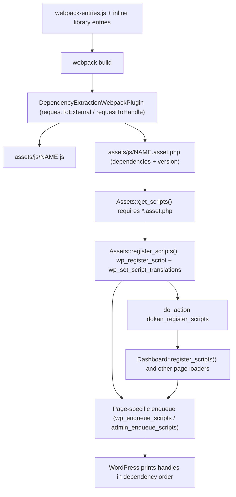
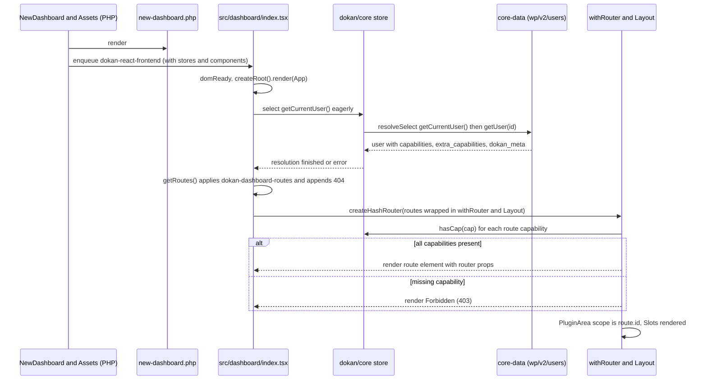
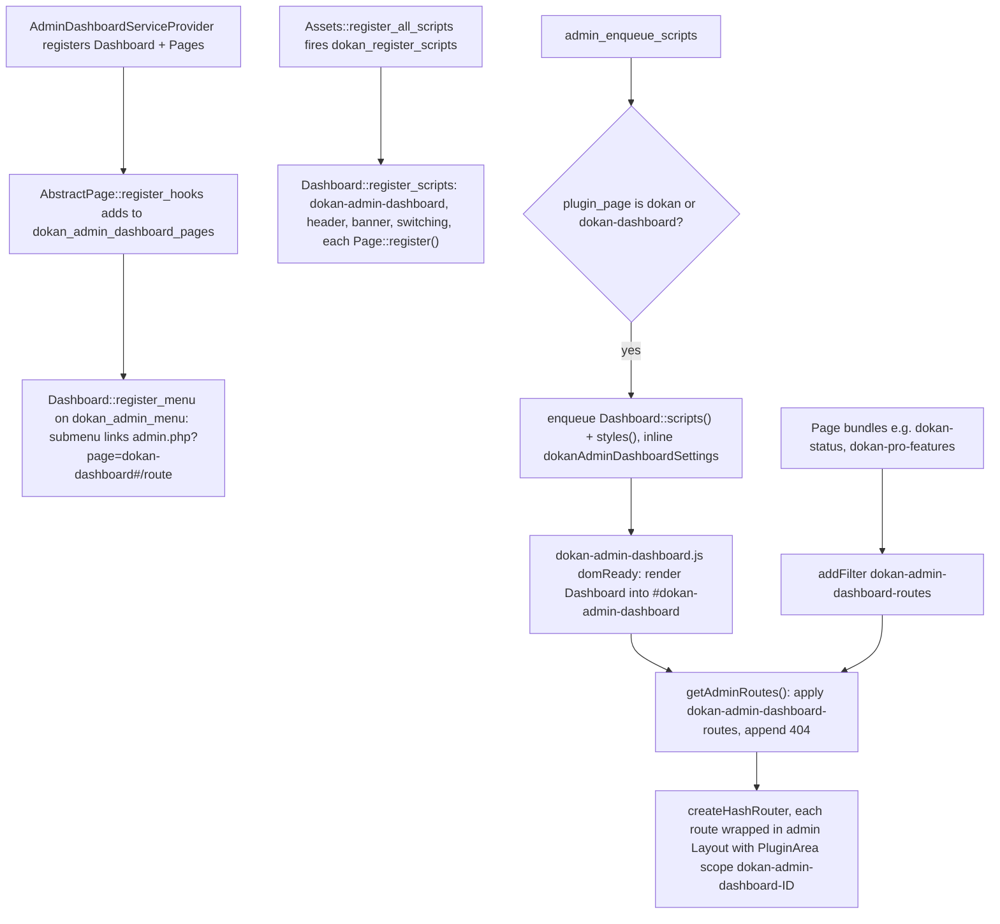

# Frontend Architecture (Dokan Lite)

This document describes how Dokan Lite's JavaScript and TypeScript code is organised, built, registered with WordPress and exposed to other plugins. It covers the `src/` tree (React admin dashboard, React vendor dashboard, legacy Vue 2 apps, `@wordpress/data` stores, shared hooks, components and utilities), the webpack build and its entry points, the PHP side that registers and enqueues the bundles (`WeDevs\Dokan\Assets` and a few page-specific loaders), the `window.dokan` globals, and the extension seams (route filters, Slot/Fill, `PluginArea`, `wp.hooks` filters) that other plugins use. It focuses on architecture rather than on individual components.

Related reading:

- `CONTEXT.md` for canonical terms (**Vendor**, **Vendor Staff**, **Site Admin**, **Vendor Scope**).
- [ADR-0005: PHPUnit requires a webpack build](../0005-phpunit-requires-a-webpack-build.md), which explains why `assets/js/*.asset.php` must exist before the plugin can boot.
- [ADR-0002: Flat `dokan_admin_settings` as canonical store](../0002-flat-dokan-admin-settings-as-canonical-store.md) for the settings data the React settings page reads and writes.
- `docs/slots/README.md` and `docs/slots/dashboard-layout-slots.md` for the slot documentation convention.
- `docs/product-editor.md` for the React product editor's form schema.

---

## 1. Purpose & ownership

| Concern | Owner |
|---|---|
| `src/` React/TypeScript and Vue sources, `assets/src/js` jQuery sources, `webpack.config.js`, `webpack-entries.js`, `webpack-dependency-mapping.js` | [Lite] |
| Script/style registration and localisation (`WeDevs\Dokan\Assets`, `Admin\Dashboard\Dashboard`, `Shortcodes\FullWidthVendorLayout`, `Dashboard\Templates\NewDashboard`, `Analytics\Assets`, `Intelligence\Assets`) | [Lite] |
| `wp-element`, `wp-data`, `wp-core-data`, `wp-components`, `wp-hooks`, `wp-plugins`, `wp-api-fetch`, `wp-i18n` script handles | WordPress core |
| `wc-components`, `wc-date`, `wc-csv`, `wc-settings` and other `wc-*` admin handles; the accounting, flot, tipTip, blockUI and DOMPurify scripts Dokan reuses | [WooCommerce] |
| `@wedevs/plugin-ui` (settings/DataViews/theme UI kit) and `@getdokan/dokan-ui` (Dokan UI kit) | [Third-party: weDevs npm packages, bundled into Lite as shared bundles] |
| Additional routes, slots fills, store consumers, Pro-only screens | Consumed by Dokan Pro through the seams in section 11 (not documented here) |

The frontend has four generations of code that coexist:

1. **jQuery scripts** under `assets/src/js/` (vendor dashboard forms, product editor legacy page, store lists, withdraw, admin helpers). Bundled by webpack but not modular.
2. **Vue 2.7 apps** under `src/admin/` (the legacy WP-admin Dokan page) and `src/frontend/`, plus `src/promo-notice/` and `src/admin/notice/`.
3. **React apps** built on `@wordpress/element` (React 18): the admin dashboard (`src/admin/dashboard`), the vendor dashboard SPA (`src/dashboard`), the full-width vendor dashboard chrome (`src/vendor-dashboard/layout`), vendor analytics (`src/vendor-dashboard/reports`), setup wizard (`src/admin/onboard`), and several small admin widgets.
4. **Shared library bundles** exposed on `window.dokan.*`: components, utilities, hooks, five `@wordpress/data` stores, product-editor utilities and the two third-party UI kits.

**Related ADRs:** [ADR-0005 (PHPUnit requires a webpack build)](../0005-phpunit-requires-a-webpack-build.md), [ADR-0002](../0002-flat-dokan-admin-settings-as-canonical-store.md) (flat settings store read by the React settings page), [ADR-0015](../0015-services-are-resolved-eagerly-from-a-tagged-container.md) (`Assets` is constructed eagerly with the other tagged services), [ADR-0016](../0016-rest-versions-are-additive-controller-subclasses.md) (the REST versions the clients call).

## 2. Entry points & bootstrap

### 2.1 Build entry points

All entries come from `lite:webpack-entries.js:1` (including the five store libraries and `product-editor-utils`) plus five shared/library entries declared inline in `lite:webpack.config.js:30` (`plugin-ui`, `dokan-ui`, `components`, `utilities`, `react-hooks`). Output goes to `assets/js/[name].js` (`lite:webpack.config.js:73`). `assets/js/` and `assets/css/` are gitignored build output (`.gitignore` line 31), so a checkout must be built before it can run (ADR-0005).

| Entry (bundle name) | Source | Kind | Mount point / effect |
|---|---|---|---|
| `frontend` | `src/dashboard/index.tsx` | React app | `#dokan-vendor-dashboard-root` (vendor dashboard SPA) |
| `vendor-dashboard/layout/index` | `src/vendor-dashboard/layout/index.tsx` | React app | `#dokan-vendor-dashboard-layout-root` (full-width header/sidebar chrome) |
| `vendor-dashboard/reports/index` | `src/vendor-dashboard/reports/index.js` | React app | Vendor analytics (WooCommerce Admin style reports) |
| `dokan-admin-dashboard` | `src/admin/dashboard/index.tsx` | React app | `#dokan-admin-dashboard` (WP admin `Dokan > Dashboard` SPA) |
| `dokan-admin-panel-header` | `src/admin/header/index.tsx` | React widget | `#dokan-admin-panel-header` |
| `dokan-admin-switching` | `src/admin/panel-switcher/index.tsx` | React widget | `#dokan-admin-switching` (legacy/new admin panel switch) |
| `setup-guide-banner` | `src/admin/banner/SetupGuideBanner.tsx` | React widget | Setup guide banner in the admin header |
| `dokan-admin-onboard` | `src/admin/onboard/index.tsx` | React app | `#admin-onboard-root` inside `.dokan-admin-setup-wizard` |
| `dokan-status` | `src/Status/index.tsx` | Route plug-in | Adds `/status` to the admin dashboard routes |
| `dokan-pro-features` | `src/ProFeatures/index.tsx` | Route plug-in | Adds `/pro-features` to the admin dashboard routes |
| `dokan-intelligence` | `src/intelligence/index.tsx` | React widget | `#ai-prompt-app` |
| `vue-vendor`, `vue-bootstrap` | `src/utils/vue-vendor.js`, `src/utils/Bootstrap.js` | Vue runtime | `vue-vendor` is a shim that no longer bundles the Vue dependencies (per its header comment) but remains a dependency handle; `vue-bootstrap` populates `window.dokan.libs`, `dokan.api`, `dokan.hooks` |
| `vue-admin` | `src/admin/main.js` | Vue app | `#dokan-vue-admin` (legacy `toplevel_page_dokan`) |
| `vue-frontend` | `src/frontend/main.js` | Vue app | `#vue-frontend-app` |
| `dokan-promo-notice`, `dokan-admin-notice` | `src/promo-notice/main.js`, `src/admin/notice/main.js` | Vue widgets | `#dokan-promo-notices`, `#dokan-admin-notices` |
| `dokan`, `dokan-admin`, `helper`, `login-form-popup`, `vendor-registration`, `reverse-withdrawal`, `product-category-ui`, etc. | `assets/src/js/*.js` | jQuery | Legacy dashboard and admin behaviour |
| `dokan-tailwind` | `src/base-tailwind.css` | CSS | Single shared Tailwind 4 bundle |
| `style`, `rtl`, `admin`, `plugin`, `global-admin`, `setup`, ... | `assets/src/less/*.less` | CSS | Legacy LESS styles |
| `components`, `utilities`, `react-hooks` | `src/components/index.tsx`, `src/utilities/index.ts`, `src/hooks/index.tsx` | Library (`window.dokan.*`) | See section 4.2 |
| `core-store`, `vendors-store`, `products-store`, `product-categories-store`, `product-editor-store` | `src/stores/*/store.ts` | Library (`window.dokan.*Store`) | Registers `@wordpress/data` stores |
| `product-editor-utils` | `src/dashboard/product-editor/exports.ts` | Library (`window.dokan.productEditor`) | Product editor hooks/field config/layout helpers |
| `plugin-ui`, `dokan-ui` | `src/externals/plugin-ui.js`, `src/externals/dokan-ui.js` | Library (`window.dokan.pluginUI`, `window.dokan.dokanUI`) | Single shared copy of each UI kit |

### 2.2 PHP bootstrap of the asset layer

| Entry point | Location | How it is loaded |
|---|---|---|
| `dokan()->scripts` (`WeDevs\Dokan\Assets`) | `lite:includes/DependencyManagement/Providers/ServiceProvider.php:27` | Container alias `scripts`; constructor hooks at `lite:includes/Assets.php:18` |
| `Assets::register_all_scripts()` | `lite:includes/Assets.php:301` | `init` priority 10; fires `dokan_register_scripts` at line 308 |
| `Assets::enqueue_front_scripts()` | `lite:includes/Assets.php:839` | `wp_enqueue_scripts` (front end only) |
| `Assets::enqueue_admin_scripts()` | `lite:includes/Assets.php:77` | `admin_enqueue_scripts` priority 10 |
| `Assets::load_dokan_global_scripts()` | `lite:includes/Assets.php:1028` | `wp_enqueue_scripts` / `admin_enqueue_scripts` priority 5 |
| `Assets::register_wc_admin_scripts()` | `lite:includes/Assets.php:813` | `init` (front end only) |
| `Admin\Dashboard\Dashboard` | `lite:includes/DependencyManagement/Providers/AdminDashboardServiceProvider.php:38`; hooks at `lite:includes/Admin/Dashboard/Dashboard.php:52` | `Hookable` service tagged `admin-dashboard-service` |
| `Dashboard\Templates\NewDashboard` | `lite:includes/Dashboard/Templates/Manager.php:34`; class at `lite:includes/Dashboard/Templates/NewDashboard.php:7` | Instantiated by the dashboard templates manager |
| `Shortcodes\FullWidthVendorLayout` | `lite:includes/DependencyManagement/Providers/CommonServiceProvider.php:27`; hooks at `lite:includes/Shortcodes/FullWidthVendorLayout.php:28` | `Hookable` common service |
| `VendorNavMenuChecker` | `lite:includes/DependencyManagement/Providers/CommonServiceProvider.php:23`; constructor at `lite:includes/VendorNavMenuChecker.php:54` | Common service |
| `Vendor\ApiMeta` | `lite:includes/DependencyManagement/Providers/CommonServiceProvider.php:28`; field at `lite:includes/Vendor/ApiMeta.php:28` | Common service |
| `Analytics\Assets` | `lite:includes/DependencyManagement/Providers/AnalyticsServiceProvider.php:35` | Analytics service provider |
| `Intelligence\Assets` | `lite:includes/DependencyManagement/Providers/IntelligenceServiceProvider.php:31` | Intelligence service provider |

## 3. Key classes and modules

### 3.1 PHP

| Class | File | Responsibility |
|---|---|---|
| `WeDevs\Dokan\Assets` | `lite:includes/Assets.php` | Declares every shared script and style (`get_scripts()` line 419, `get_styles()` line 316), registers them with translations (`register_scripts()` line 1401), enqueues the legacy front-end/admin assets, and localises `dokan`, `dokan_helper`, `dokanFrontend`, `dokanAdmin` and others. Also supplies the legacy Vue route tables (`get_vue_admin_routes()` line 223, `get_vue_frontend_routes()` line 291). |
| `WeDevs\Dokan\Admin\Dashboard\Dashboard` | `lite:includes/Admin/Dashboard/Dashboard.php:14` | Owns the React admin dashboard: submenu registration, page container rendering (`render_dashboard_page()` line 141), registration of `dokan-admin-dashboard`, `dokan-admin-panel-header`, `dokan-setup-guide-banner`, `dokan-admin-switching`, and per-page assets; injects `dokanAdminDashboard` and `dokanAdminDashboardSettings`. |
| `WeDevs\Dokan\Admin\Dashboard\Pageable` / `Pages\AbstractPage` | `lite:includes/Admin/Dashboard/Pageable.php`, `lite:includes/Admin/Dashboard/Pages/AbstractPage.php:8` | Contract for an admin dashboard page: `get_id()`, `menu()`, `settings()`, `scripts()`, `styles()`, `register()`. `AbstractPage::enlist()` adds the page through the `dokan_admin_dashboard_pages` filter. |
| `WeDevs\Dokan\Dashboard\Templates\NewDashboard` | `lite:includes/Dashboard/Templates/NewDashboard.php:7` | Adds the `new` query var, renders `templates/dashboard/new-dashboard.php` (which contains `#dokan-vendor-dashboard-root`) and enqueues `dokan-react-frontend` on that page. |
| `WeDevs\Dokan\Shortcodes\FullWidthVendorLayout` | `lite:includes/Shortcodes/FullWidthVendorLayout.php:14` | When `vendor_layout_style` is `latest`, swaps the seller dashboard template for `templates/dashboard/fullwidth-dashboard.php` and loads the `dokan-vendor-dashboard` React chrome with `vendorDashboardLayoutConfig`. |
| `WeDevs\Dokan\VendorNavMenuChecker` | `lite:includes/VendorNavMenuChecker.php` | Rewrites vendor dashboard nav items that declare a `react_route` to `.../dashboard/new/#<route>` unless a theme overrides a template that route depends on. |
| `WeDevs\Dokan\Vendor\ApiMeta` | `lite:includes/Vendor/ApiMeta.php:28` | Registers the `dokan_meta` REST field (including `vendor_id`) on the WordPress `user` object read by the React apps. |

### 3.2 JavaScript / TypeScript

| Module | File | Responsibility |
|---|---|---|
| Vendor dashboard SPA root | `lite:src/dashboard/index.tsx:30` | `App` eagerly resolves the current user from `dokan/core`, maps routes through `withRouter` + `Layout`, builds a hash router, mounts on `domReady` (line 133). |
| Route registry | `lite:src/routing/index.tsx:73` (`getRoutes`), `lite:src/routing/routes.tsx:11` | Lite's vendor routes (`/products`, `/products/create`, `/products/:productId/edit`, `/orders`, `/withdraw`, `/withdraw-requests`, `/reverse-withdrawal`, `/settings/store`) filtered by `dokan-dashboard-routes`; a `*` 404 route is appended last. |
| `withRouter` | `lite:src/routing/index.tsx:24` | Higher-order component: checks every required capability with `select( coreStore ).hasCap()`; renders `Forbidden` (`src/layout/403.tsx`) if any is missing; otherwise injects router props (`navigate`, `params`, `location`, `matches`, `navigation`, `redirect`, `replace`, `useParams`, `createSearchParams`, `useSearchParams`). |
| Vendor `Layout` | `lite:src/layout/index.tsx:107` | Wraps every vendor route in a Plugin UI `ThemeProvider`, a `SlotFillProvider`, `Header`/`ContentArea`/`Footer`, `PluginArea scope={ route.id }` and `DokanToaster`; also syncs the PHP-rendered sidebar menu's active state via `data-react-route` (line 67). |
| Vendor `Header` | `lite:src/layout/Header.tsx` | Title and back button (both filterable) plus the header slots. |
| Admin dashboard root | `lite:src/admin/dashboard/components/Dashboard.tsx:130` | Builds admin routes (`getAdminRoutes()` line 29) filtered by `dokan-admin-dashboard-routes` (line 109), wraps each in the admin `Layout`, hash router. |
| Admin `Layout` | `lite:src/admin/dashboard/components/Layout.tsx:11` | `SlotFillProvider`, Plugin UI `ThemeProvider` (`pluginId="dokan-admin-dashboard"`), `PluginArea scope={ 'dokan-admin-dashboard-' + route.id }` (line 34), `DokanToaster`; loads translated strings into the `default` text domain. |
| Full-width chrome | `lite:src/vendor-dashboard/layout/index.tsx:6` | Renders header and collapsible sidebar from `vendorDashboardLayoutConfig`. |
| Vue bootstrap | `lite:src/utils/Bootstrap.js:87` | Defines `dokan_get_lib`, `dokan_add_route`, fills `window.dokan.libs`, `dokan.api`, `dokan.hooks`, `dokan.addFilterComponent`. |
| Legacy Vue admin | `lite:src/admin/main.js:8`, `lite:src/admin/router/index.js:43` | Mounts on `#dokan-vue-admin`, resolves `dokan.routes` component names to registered route components (`parseRouteComponent`). |
| Shared components barrel | `lite:src/components/index.tsx:1` | DataViews wrappers (`DataViews`, `AdminDataViews`), `DokanModal`, `Filter`, `AdminFilter`, `DokanTab`, `AdminTab`, async selects, price/date inputs, `MapPicker`, `WeeklyTimeSlots`, commission components, layout error pages, and re-exports from `@wordpress/dataviews/wp` and `@wedevs/plugin-ui`. |
| Shared hooks barrel | `lite:src/hooks/index.tsx:1` | `useWindowDimensions`, `useCurrentUser`, `useMutationObserver`, `usePermission`, `useCustomerSearch`, `useCustomerById`, `useCategories`, `useProducts`. |
| Shared utilities barrel | `lite:src/utilities/index.ts:1` | Case conversion, accounting/price formatting, `@woocommerce/date` re-export, colour helpers, truncation, HTML sanitising, CSV download, translated strings. |
| Product editor exports | `lite:src/dashboard/product-editor/exports.ts:1` | Public surface of the React product editor (`useProductEditor`, `useLayouts`, `getFieldConfig`, `CustomField`, layout utilities, types). |

## 4. Execution flow

### 4.1 Build, register, enqueue

The build and the PHP registration are coupled through the dependency-extraction plugin. Lite replaces the default `DependencyExtractionWebpackPlugin` from `@wordpress/scripts` with one configured with its own `requestToExternal` and `requestToHandle` (`lite:webpack.config.js:133`, `lite:webpack-dependency-mapping.js:144`, `lite:webpack-dependency-mapping.js:193`). For every bundle, webpack writes `[name].asset.php` listing the WordPress script handles the bundle needs. PHP reads those files to register the bundle with the right dependencies.

Import specifier mapping (`lite:webpack-dependency-mapping.js:144`):

| Import specifier in source | Runtime global | WordPress handle |
|---|---|---|
| `@dokan/stores/core`, `@dokan/stores/vendors`, `@dokan/stores/products`, `@dokan/stores/product-categories`, `@dokan/stores/product-editor` | `window.dokan.<camelCase>Store` | `dokan-stores-<kebab-case>` |
| `@dokan/components` | `window.dokan.components` | `dokan-react-components` |
| `@dokan/utilities` | `window.dokan.utilities` | `dokan-utilities` |
| `@dokan/hooks` | `window.dokan.reactHooks` | `dokan-hooks` |
| `@dokan/product-editor` | `window.dokan.productEditor` | `dokan-product-editor-utils` |
| `@wedevs/plugin-ui` (bare specifier only) | `window.dokan.pluginUI` | `dokan-plugin-ui` |
| `@getdokan/dokan-ui` (bare specifier only) | `window.dokan.dokanUI` | `dokan-ui` |
| `@woocommerce/<pkg>` (listed packages) | `window.wc.<camelCase>` (with irregular maps for `block-data`, `blocks-registry`, `settings`) | `wc-<pkg>` (with `wc-store-data`, `wc-blocks-data-store`, `wc-csv` exceptions) |
| `@wordpress/ui` | Bundled (returns `false`) | None |
| Other `@wordpress/*` | Default `wp.*` mapping of the plugin | `wp-*` |

A static `externals` block also maps `jquery`, `chart.js`, `moment` and some `@woocommerce/blocks-*` packages to their globals (`lite:webpack.config.js:104`).

Two consequences follow:

- **Lite consumes its own libraries through the globals.** `src/dashboard/index.tsx` imports `@dokan/stores/core` and `@dokan/utilities`, so the built `frontend.asset.php` lists `dokan-stores-core`, `dokan-utilities`, `dokan-react-components`, `dokan-plugin-ui`, `dokan-ui`, `dokan-product-editor-utils`, `dokan-hooks`, `dokan-stores-products`, `dokan-stores-product-categories` and `dokan-stores-product-editor`. The handle names in `Assets::get_scripts()` (lines 654-800) and the names produced by `requestToHandle` must stay identical.
- **Shared UI kits are loaded once.** `src/externals/plugin-ui.js` and `src/externals/dokan-ui.js` import the packages by deep path so the bundles do not re-export themselves. Deep imports such as `@getdokan/dokan-ui/dist/components/...` elsewhere stay bundled with their consumer. If `plugin-ui.asset.php` or `dokan-ui.asset.php` is missing, `Assets::get_scripts()` logs an error via `dokan_log()` and skips the handle (line 753 onward), and WordPress then refuses to print every bundle that depends on it.

CSS output: the custom `MiniCssExtractPlugin` writes `../css/[name].css` (`lite:webpack.config.js:122`). Only the dependency-extraction plugin is filtered out of `@wordpress/scripts`' default plugins (`lite:webpack.config.js:119`), so the defaults also run: `MiniCSSExtractPlugin` with `filename: '[name].css'` and `RtlCssPlugin` (`node_modules/@wordpress/scripts/config/webpack.config.js`, lines 415 and 419). They write CSS and `-rtl.css` next to the JS in `assets/js/`. The build therefore emits CSS in both directories. `Assets::get_styles()` and `Dashboard::register_admin_dashboard_scripts()` read `assets/css/`; `FullWidthVendorLayout::register_vendor_dashboard_assets()` and `Analytics\Assets::register_scripts()` read `assets/js/vendor-dashboard/.../index.css`.

### 4.2 The `window.dokan` namespace

Every library entry uses webpack's `library: { type: 'window', name: [ 'dokan', X ] }`, which compiles to `(window.dokan = window.dokan || {}).X = exports` (confirmed in the built `core-store.js` and `utilities.js`). They extend whatever `window.dokan` object already exists.

On the front end, `Assets::enqueue_front_scripts()` creates the base object with `wp_localize_script( 'dokan-util-helper', 'dokan', $localize_data )` (`lite:includes/Assets.php:933`). `dokan-util-helper` is registered with `in_footer => false`, so that object is printed in the head before the library bundles. On the legacy `toplevel_page_dokan` admin page, the object comes from `wp_localize_script( 'dokan-vue-vendor', 'dokan', ... )` (`lite:includes/Assets.php:103`). Where neither runs, the first library bundle creates the object. Because `wp_localize_script` emits `var dokan = {...}`, the localised object must be printed before any library bundle, otherwise it would replace the libraries. On the front end, the head placement of `dokan-util-helper` ensures this. `Assets.php:932` also attaches the same `dokan` localisation to `dokan-i18n-jed`, which is registered for the footer and marked for removal. The only Lite code that depends on `dokan-i18n-jed` is the setup wizard's `dokan-vue-bootstrap` registration (`lite:includes/Admin/SetupWizard.php:115`).

| Global | Set by | Contents |
|---|---|---|
| `window.dokan.components` | `components` bundle (handle `dokan-react-components`) | Shared React components (section 3.2) |
| `window.dokan.utilities` | `utilities` bundle (`dokan-utilities`) | Shared utilities |
| `window.dokan.reactHooks` | `react-hooks` bundle (`dokan-hooks`) | Shared React hooks |
| `window.dokan.coreStore`, `vendorsStore`, `productsStore`, `productCategoriesStore`, `productEditorStore` | Store bundles (`dokan-stores-*`) | Store descriptors (also registered with `@wordpress/data`) |
| `window.dokan.productEditor` | `product-editor-utils` (`dokan-product-editor-utils`) | Product editor public API |
| `window.dokan.pluginUI`, `window.dokan.dokanUI` | `plugin-ui` (`dokan-plugin-ui`), `dokan-ui` (`dokan-ui`) | Shared UI kits |
| `dokan` (localised fields) | `Assets.php:933` (front end), `Assets.php:103` (legacy admin) | AJAX URL, nonces, currency format, i18n strings, `rest` root/nonce, Vue `routes`, `urls`, `orderStatuses`; filtered by `dokan_localized_args`, `dokan_frontend_localize_script`, `dokan_admin_localize_script` |
| `dokan.libs.*`, `dokan.api`, `dokan.routeComponents`, `dokan.hooks`, `dokan.addFilterComponent`, `dokan_get_lib()`, `dokan_add_route()`, `window.__` | `lite:src/utils/Bootstrap.js:14`, `:87`-`:163` | Legacy Vue runtime: Vue, Router, moment, ListTable, Multiselect, Chart, Modal, GoogleMaps, Mapbox, vendor field components, etc. |
| `dokan_helper` | `lite:includes/Assets.php:1093` | Date/time formats, week start, reverse withdrawal flag, picker and SweetAlert locales (`dokan_helper_localize_script`) |
| `dokanFrontend` | `lite:includes/Assets.php:1100` on `dokan-react-frontend` | `currency` from `Assets::get_localized_price()` plus product listing data (`dokan_react_frontend_localized_args`) |
| `dokanAdmin` | `lite:includes/Assets.php:113` | Commission types, reserved slugs (`dokan_vue_admin_localize_script`) |
| `dokan_admin_product`, `dokan_promo`, `dokanRegistrationI18n`, `DokanValidateMsg` | `lite:includes/Assets.php:147`, `:71`, `:938`, `:1133` | Page-specific data for legacy scripts |
| `dokanAdminDashboard` | Inline script in `Dashboard::register_admin_dashboard_scripts()` (`lite:includes/Admin/Dashboard/Dashboard.php:415`) | Currency, countries/states, `dokan_admin` nonce, banner dimensions, admin URLs (`dokan_admin_dashboard_localize_scripts`) |
| `dokanAdminDashboardSettings` | Inline script in `Dashboard::enqueue_scripts()` (`lite:includes/Admin/Dashboard/Dashboard.php:571`) | Per-page settings keyed by page id plus `header_info`, `help_menu_items`; read by `src/admin/dashboard/settings/getSettings.ts` and `src/admin/dashboard/components/Header.tsx` |
| `dokanAdminSwitching`, `dokanAdminPanelHeaderSettings`, `dokanSetupGuideBanner` | `Dashboard.php:534`, `:454`, `:492` | Panel switch nonce, header logo/info, setup guide URL and completion flag |
| `vendorDashboardLayoutConfig` | `lite:includes/Shortcodes/FullWidthVendorLayout.php:170` | Site info, Vendor name/avatar, user, `sidebarNav` (`dokan_get_dashboard_nav()`), `headerNav` (`dokan_vendor_dashboard_layout_config`) |
| `vendorAnalyticsDokanConfig`, `vendorSharedSettings` | `Analytics\Assets::enqueue_front_scripts()` | Analytics URLs and seller ID; WooCommerce-admin-style shared settings |

### 4.3 Vendor dashboard: three React applications

The vendor dashboard can load up to three independent React applications on the same request.

| App | Bundle / handle | Loaded when | Loader |
|---|---|---|---|
| Vendor dashboard SPA | `frontend.js` / `dokan-react-frontend` | Seller dashboard with the `new` query var (`/dashboard/new/`) | `NewDashboard::enqueue_scripts()` (`lite:includes/Dashboard/Templates/NewDashboard.php:72`) |
| Full-width chrome (header + sidebar) | `vendor-dashboard/layout/index.js` / `dokan-vendor-dashboard` | Logged-in user on the seller dashboard and `dokan_appearance.vendor_layout_style === 'latest'` | `FullWidthVendorLayout::enqueue_vendor_dashboard_assets()` (`lite:includes/Shortcodes/FullWidthVendorLayout.php:266`) |
| Vendor analytics | `vendor-dashboard/reports/index.js` / `vendor_analytics_script` | Seller dashboard, when `ReportUtil::is_analytics_enabled()` is true (hooks are registered only then) | `Analytics\Assets::enqueue_front_scripts()` |

`dokan-react-frontend` is also a dependency of the admin dashboard, the admin panel switcher and the analytics style, so it is registered on every request by `Assets::register_all_scripts()` even though it renders only where `#dokan-vendor-dashboard-root` exists.

**Getting into the SPA.** Vendor dashboard nav items in `includes/functions-dashboard-navigation.php` can declare a `react_route` (for example `orders`, `withdraw`). `VendorNavMenuChecker::convert_to_react_menu()` (`lite:includes/VendorNavMenuChecker.php:82`, on `dokan_get_dashboard_nav` priority 999) rewrites such an item's URL to `dokan_get_navigation_url( 'new' ) . '#' . $route` (`get_url_for_route()` line 195). It skips the rewrite when a theme overrides any PHP template listed for that route in `$template_dependencies` (`is_dependency_resolved()` line 155), so a site with customised legacy templates keeps the legacy page. `maybe_rewrite_to_react_route()` (line 109) applies the same mapping to `dokan_get_navigation_url()` calls.

While the current user is resolving, `App` renders `Skeleton`. If resolution fails, it logs the error and renders `InternalError` (`src/layout/500.tsx`). Its retry button invalidates both the core-data and the `dokan/core` resolutions (`lite:src/dashboard/index.tsx:49`). Routes default to the `dokandar` capability when a route declares none (line 71). After mounting, `addPrimaryColorVariant()` derives `--colors-primary-*` CSS variables from `--dokan-button-background-color`.

`Layout` also keeps the PHP-rendered sidebar in sync. On each navigation, `handleMenuActiveStates()` (`lite:src/layout/index.tsx:67`) toggles `active`/`current` classes on `.dokan-dashboard-menu li[data-react-route=...]`.

### 4.4 Admin dashboard (React)

The admin dashboard's built-in routes are `/`, `/setup`, `/pro-modules`, `/withdraw`, `/vendors`, `/vendors/:id`, `/vendors/create`, `/vendors/edit/:id`, `/reverse-withdrawal`, `/reverse-withdrawal/store/:id`, `/settings`, `/extensions`, `/tools`, `/changelog` and `/dummy-data` (`lite:src/admin/dashboard/components/Dashboard.tsx:30`). `/status` and `/pro-features` are added by their own bundles through the route filter. The Pro Features page registers its bundle only when Pro is absent (`ProFeatures::register()`).

`dokan-admin-dashboard` declares `dokan-react-components`, `dokan-react-frontend`, `jquery`, `media-upload` and `media-views` as extra dependencies (`lite:includes/Admin/Dashboard/Dashboard.php:355`). Admin routes are wrapped with `withRouter( route.element )` and no capability list (`Dashboard.tsx:134`). Access is controlled by the WordPress menu capability passed to `add_submenu_page()` (section 8).

The React settings page (`src/admin/dashboard/pages/settings/index.tsx`) is built on `@wedevs/plugin-ui` settings components. It reads `GET /dokan/v1/admin/settings` and saves per scope to `/dokan/v1/admin/settings/{scopeId}`. The settings storage model is described in ADR-0002.

### 4.5 Legacy Vue admin

On the `toplevel_page_dokan` screen, `Assets::enqueue_admin_scripts()` (`lite:includes/Assets.php:77`) runs these steps in order:

1. Enqueues `dokan-vue-vendor` and localises `dokan`.
2. Enqueues `dokan-vue-bootstrap`, which fills `dokan.libs` and defines `dokan_add_route()`.
3. Fires `dokan-vue-admin-scripts` so other plugins can register Vue route components.
4. Enqueues `dokan-vue-admin` and localises `dokanAdmin`.

`src/admin/router/index.js` registers Lite's components with `dokan_add_route()`. It then replaces each component name in `dokan.routes` (the PHP array from `apply_filters( 'dokan-admin-routes', ... )`, `lite:includes/Assets.php:288`) with the registered component before it constructs the Vue router. `Admin\Menu::dashboard()` renders the `#dokan-vue-admin` container (`lite:includes/Admin/Menu.php:203`).

`dokan-vue-frontend` is registered (`lite:includes/Assets.php:552`) with an empty, filterable route table (`dokan-frontend-routes`), but Lite itself does not enqueue it.

### 4.6 State management (`@wordpress/data`)

Each store follows the `createReduxStore` + `register` pattern. `store.ts` calls `register( store )` at module load, so loading the store bundle is enough to make it available through `select( 'dokan/...' )`.

| Store name | Source | Library global / handle | Data sources (REST) |
|---|---|---|---|
| `dokan/core` | `lite:src/stores/core/index.ts:8` | `dokan.coreStore` / `dokan-stores-core` | `@wordpress/core-data` `getCurrentUser()` + `getUser( id )`; `/dokan/v1/settings` (`getStoreSettings`); `/dokan/v1/admin/settings` (`getGlobalSettings`) |
| `dokan/vendors` | `lite:src/stores/vendors/index.ts:8` | `dokan.vendorsStore` / `dokan-stores-vendors` | `/dokan/v1/stores`, `/dokan/v1/stores/{id}`, `/dokan/v1/stores/{id}/stats`, `/dokan/v1/products/best_selling` |
| `dokan/products` | `lite:src/stores/products/index.ts:8` | `dokan.productsStore` / `dokan-stores-products` | `/dokan/v2/products` (reads `X-WP-Total` / `X-WP-TotalPages`), `/dokan/v2/products/{id}` |
| `dokan/product-categories` | `lite:src/stores/productCategories/index.ts:8` | `dokan.productCategoriesStore` / `dokan-stores-product-categories` | `/dokan/v1/products/categories`, `/dokan/v1/products/categories/{id}` |
| `dokan/product-editor` | `lite:src/stores/productEditor/store.ts:8` | `dokan.productEditorStore` / `dokan-stores-product-editor` | `/dokan/v3/products`, `/dokan/v3/products/batch`, `/dokan/v3/products/{id}/fields`, `/dokan/v2/products/{id}/variations` (+ `/generate`) |

`dokan/core` selectors (`lite:src/stores/core/selectors.ts`) are `getCurrentUser`, `hasCap( capability )`, `isVendor`, `isVendorStaff`, `getStoreSettings`, `getGlobalSettings` and `getVendorId`. `hasCap` returns `null` until the user has resolved. After that it parses the matching value from `capabilities` or `extra_capabilities`. `isVendor` is true for the `vendor` role, or for an `administrator` with the `dokandar` capability.

Component-local state, React context (the vendor `ThemeContext`) and the `@wedevs/plugin-ui` settings context make up the rest of the state handling. No global Redux store exists outside `@wordpress/data`.

### 4.7 Styling

`src/base-tailwind.css` is the single Tailwind 4 entry (`dokan-tailwind`). It imports the `@getdokan/dokan-ui` CSS and the Plugin UI WordPress styles, defines theme tokens that map to `--dokan-*` CSS variables (driven by the appearance settings), and scopes preflight under `.dokan-layout`. The main React mount containers (`#dokan-vendor-dashboard-root`, `#dokan-vendor-dashboard-layout-root`, `#dokan-admin-dashboard`, `#dokan-admin-panel-header`) carry the `dokan-layout` class. `dokan-react-components` CSS depends on `wp-components` and `dokan-tailwind` (`lite:includes/Assets.php:404`). Plugin UI's `ThemeProvider` receives `pluginUITokens` (`lite:src/layout/index.tsx:17`), which map `primary`/`success` tokens to the same CSS variables.

## 5. Hooks fired / hooks consumed

### 5.1 PHP hooks fired by Lite's asset layer

| Hook | Type | Where | Purpose |
|---|---|---|---|
| `dokan_register_scripts` | action | `Assets::register_all_scripts()` (`lite:includes/Assets.php:308`) | Register additional handles after Lite's own |
| `dokan_enqueue_scripts` | action | `Assets::enqueue_front_scripts()` (line 1020) | Enqueue extra front-end assets |
| `dokan_enqueue_admin_scripts` | action | `Assets::enqueue_admin_scripts()` (line 150) | Enqueue extra admin assets; receives `$hook` |
| `dokan-vue-admin-scripts` | action | `Assets::enqueue_admin_scripts()` (line 109) | Load Vue route components before `dokan-vue-admin` |
| `dokan_enqueue_admin_dashboard_script` | action | `Admin\Menu::dashboard_script()` | Legacy admin dashboard assets |
| `dokan_localized_args` | filter | `Assets.php:902` | Front-end `dokan` localisation |
| `dokan_frontend_localize_script` | filter | `Assets.php:903` | Vue/REST part of the front-end `dokan` object |
| `dokan_admin_localize_script` | filter | `Assets::get_admin_localized_scripts()` (line 1473) | Legacy admin `dokan` object |
| `dokan_vue_admin_localize_script` | filter | `Assets::get_vue_admin_localized_scripts()` (line 1547) | `dokanAdmin` |
| `dokan_promo_notice_localize_script` | filter | `Assets.php:58` | `dokan_promo` |
| `dokan_helper_localize_script` | filter | `Assets.php:1032` | `dokan_helper` |
| `dokan_react_frontend_localized_args` | filter | `Assets.php:1103` | `dokanFrontend` (Lite itself adds product listing args via `add_product_listing_localized_args()`) |
| `dokan_force_load_extra_args`, `dokan_forced_load_scripts` | filter | `Assets.php:1280`, `:947` | Force-load extra localisation / dashboard scripts |
| `dokan-admin-routes`, `dokan-frontend-routes` | filter | `Assets.php:288`, `:295` | Legacy Vue route tables |
| `dokan_admin_dashboard_pages` | filter | `Dashboard::get_pages()` (`lite:includes/Admin/Dashboard/Dashboard.php:72`) | Admin dashboard page list (`Pageable` instances only) |
| `dokan_admin_dashboard_page_settings`, `dokan_admin_dashboard_pages_settings` | filter | `Dashboard::settings()` (lines 272, 282) | `dokanAdminDashboardSettings` contents |
| `dokan_admin_dashboard_localize_scripts` | filter | `Dashboard.php:367` | `dokanAdminDashboard` |
| `dokan_admin_setup_guides_header_info` | filter | `Dashboard.php:258` | Admin header info |
| `dokan_vendor_dashboard_layout_config` | filter | `FullWidthVendorLayout.php:233` | `vendorDashboardLayoutConfig` |
| `dokan_get_url_for_react_route` | filter | `VendorNavMenuChecker::get_url_for_route()` | Route fragment appended to `/new/#` |
| `dokan_is_dashboard_nav_dependency_resolved` | filter | `VendorNavMenuChecker::is_dependency_resolved()` | Force React or legacy for a route |
| `dokan_get_dashboard_nav_template_dependency`, `dokan_get_dashboard_nav_template_dependency_resolutions` | filter | `VendorNavMenuChecker` | Template list that blocks the React switch |
| `dokan_vendor_dashboard_order_listing_statuses`, `dokan_vendor_dashboard_excluded_order_statuses` | filter | `Assets::get_order_listing_statuses()` | `dokan.orderStatuses` for the React order list |

### 5.2 PHP hooks consumed

| Hook | Source | Callback |
|---|---|---|
| `init` | WordPress core | `Assets::register_all_scripts` (10), `Assets::register_wc_admin_scripts` (front end), `Intelligence\Assets::register_all_scripts`, `Analytics\Assets::register_all_scripts` |
| `wp_enqueue_scripts` | WordPress core | `Assets::enqueue_front_scripts`, `Assets::load_dokan_global_scripts` (5), `NewDashboard::enqueue_scripts`, `FullWidthVendorLayout::register_vendor_dashboard_assets` (5) / `enqueue_vendor_dashboard_assets`, `Intelligence\Assets::enqueue_ai_assets`, `Analytics\Assets::enqueue_front_scripts` |
| `admin_enqueue_scripts` | WordPress core | `Assets::load_dokan_global_scripts` (5), `Assets::load_dokan_admin_notices_scripts` (8), `Assets::enqueue_admin_scripts` (10), `Dashboard::enqueue_scripts` |
| `template_include` | WordPress core | `FullWidthVendorLayout::rewrite_vendor_dashboard_template` |
| `admin_footer_text`, `update_footer`, `admin_notices` | WordPress core | `Dashboard::add_switching_container`, `add_update_footer`, `inject_before_notices` / `inject_after_notices` |
| `doing_it_wrong_trigger_error` | WordPress core | Temporarily suppressed around `WCAdminAssets::register_scripts()` |
| `dokan_register_scripts` | Lite | `Dashboard::register_scripts` |
| `dokan_admin_menu` | Lite | `Dashboard::register_menu` (priority 99) |
| `dokan_query_var_filter`, `dokan_load_custom_template` | Lite | `NewDashboard::add_query_var`, `new_dashboard_content` |
| `dokan_get_dashboard_nav` (999), `dokan_get_navigation_url` (5) | Lite | `VendorNavMenuChecker::convert_to_react_menu`, `maybe_rewrite_to_react_route` |

### 5.3 JavaScript (`wp.hooks`) filters and actions fired

Route and layout filters (the main seams):

| Hook | Type | Where | Value |
|---|---|---|---|
| `dokan-dashboard-routes` | filter | `lite:src/routing/index.tsx:75` | Array of `DokanRoute` (`id`, `path`, `element`, `title`, `capabilities`, `header`, `footer`, `backUrl`, `order`, `parent`, `icon`) |
| `dokan-admin-dashboard-routes` | filter | `lite:src/admin/dashboard/components/Dashboard.tsx:109` | Array of `DokanAdminRoute` (`id`, `path`, `element`, `parent`) |
| `dokan-vendor-dashboard-header-title` | filter | `lite:src/layout/Header.tsx:38` | Header title |
| `dokan-vendor-<kebab(route id)>-dashboard-header-backUrl` | filter | `lite:src/layout/Header.tsx:60` | Back URL; `:param` tokens are replaced from route params |
| `dokan_sidebar_menu_title`, `dokan_sidebar_submenu_title` | filter | `src/vendor-dashboard/layout/components/Sidebar.tsx` | Menu labels in the full-width chrome |
| `dokan-vendor-dashboard-visit-store` | filter | `src/components/VisitStore.tsx` | Visit-store button props |

Generated-name filters in shared components (namespace supplied by the caller):

| Pattern | Component |
|---|---|
| `dokan_<snake(namespace)>_dataviews_<element>` | `AdminDataViewTable` (also the unexported `DataViewTable`; see Known gaps) |
| `dokan_<snake(namespace)>_tab_<element>`, `dokan_admin_<snake(namespace)>_tab_<element>` | `Tab`, `AdminTab` |
| `dokan_<snake(namespace)>_price_input_props` | `PriceInput` |
| `filterId` argument | `Filter`, `AdminFilter` (filter the list of filter fields) |
| `dokan_admin_chart_tooltip_<metric>_data` | `D3Chart` |

Feature-level filters and actions (representative, not exhaustive):

| Area | Hooks |
|---|---|
| Vendor product list | `dokan_product_list_table_fields`, `dokan_product_list_table_actions`, `dokan_product_list_table_tabs`, `dokan_product_list_filter_fields`, `dokan_product_list_type_options`, `dokan_product_list_header_buttons`, `dokan_product_list_page_notices`, `dokan_product_list_after_content`, `dokan_product_list_exclude_types`, `dokan_product_status_counts`, `dokan_product_status_label`, `dokan_product_status_badge_variant`, `dokan_product_type_label` |
| Product editor | filters `dokan_product_editor_ui_variant`, `dokan_product_editor_select_options`, `dokan_product_editor_is_valid_new_option`, `dokan_product_editor_after_ui_field`, `dokan_product_editor_after_ui_image_id`, `dokan_product_editor_after_attributes`, `dokan_product_editor_file_field_read_only`, `dokan_product_editor_file_field_uploader_params`; actions `dokan_product_editor_field_changed`, `dokan_product_editor_after_save` |
| Admin vendors | `dokan-admin-vendors-list-column-fields`, `dokan-admin-vendors-list-view`, `dokan_admin_vendors_list_filters`, `dokan_admin_vendors_before_request`, `dokan-admin-vendor-tabs`, `dokan-admin-vendor-sorted-tabs` (and action `dokan-admin-vendor-tabs-sort`), `dokan.dashboard.vendor.header.storeName`, `dokan_admin_dashboard_payment_gateways_names`, `dokan_admin_dashboard_payment_gateways_value_map`, `dokan-create-vendor-required-fields`, `dokan-edit-vendor-required-fields`, `dokan-should-submit-vendor-form`, `dokan-should-submit-vendor-edit-form`, `dokan-create-vendor-initial-data`, `dokan-vendor-form-data-tabs-<formKey>`, `dokan_vendor_add_edit_commission_types` |
| Admin dashboard misc. | `dokan_admin_dashboard_tools_sections`, `dokan_admin_dashboard_notices_scopes`, `dokan_admin_dashboard_*_default_table_data`, `dokan_extensions_services_benefits`, `dokan_extensions_ecosystem_items`, `dokan_social_platforms_config`, `dokan_status_custom_element` |
| Onboarding | `dokan_reserved_url_slugs`, `dokan_onboarding_site_url` |
| Analytics | Redirect/block-navigation filters in `src/vendor-dashboard/reports/helper.ts`, `dokan_analytics_should_hold_prevent_url` |

### 5.4 JavaScript hooks consumed by Lite

| Hook | Where | Purpose |
|---|---|---|
| `i18n.gettext_default` | `lite:src/dashboard/index.tsx:19` | Re-route the DataViews "Actions" label to the `dokan-lite` text domain |
| `dokan-admin-dashboard-routes` | `lite:src/Status/index.tsx:7`, `lite:src/ProFeatures/index.tsx:21` | Add `/status` and `/pro-features` admin routes |

## 6. Data storage

The frontend layer has no custom tables. It reads these server-side values:

| Key | Type | Used by |
|---|---|---|
| `vendor_layout_style` in `dokan_appearance` (`legacy` / `latest`) | Dokan setting | `FullWidthVendorLayout::is_latest_layout()` (`lite:includes/Shortcodes/FullWidthVendorLayout.php:54`) |
| `disable_dokan_fontawesome` in `dokan_appearance` | Dokan setting | Font Awesome enqueue in `Assets::enqueue_front_scripts()` |
| `dokan_legacy_dashboard_page` | transient | Chooses `dokan` vs `dokan-dashboard` for `dokanAdminDashboard.urls.adminDashboardUrl` |
| `dokan_admin_setup_guide_steps_completed` | option | `dokanSetupGuideBanner.is_setup_guide_steps_completed` |
| `_vendor_id` user meta (via `VendorUtil::get_vendor_id_for_user()`) | user meta | Exposed as `dokan_meta.vendor_id` on the REST user |

Client-side state lives in `@wordpress/data` stores in memory, so nothing persists across page loads. Routing uses hash URLs (`createHashRouter`), so the route lives in `location.hash`.

## 7. REST/AJAX endpoints

The frontend does not register REST routes or AJAX actions itself. It consumes endpoints whose permission callbacks are documented in the owning subsystem docs (`products.md`, `vendor-and-store.md`, `withdraw-and-reverse-withdrawal.md`, `orders-commission-fees.md`).

| Route | Method | Consumer |
|---|---|---|
| `/wp/v2/users/me`, `/wp/v2/users/{id}` | GET | `dokan/core` via `@wordpress/core-data` |
| `/dokan/v1/settings` | GET | `dokan/core` `getStoreSettings` |
| `/dokan/v1/admin/settings` | GET | `dokan/core` `getGlobalSettings`, admin settings page |
| `/dokan/v1/admin/settings/{scopeId}` | PUT | Admin settings page save (`src/admin/dashboard/pages/settings/index.tsx:213`) |
| `/dokan/v1/stores`, `/dokan/v1/stores/{id}`, `/dokan/v1/stores/{id}/stats` | GET | `dokan/vendors` |
| `/dokan/v1/products/best_selling` | GET | `dokan/vendors` `getTopProducts` |
| `/dokan/v2/products`, `/dokan/v2/products/{id}` | GET | `dokan/products` resolvers |
| `/dokan/v2/products/{id}/variations*` | GET, PUT, POST (create, generate, batch), DELETE | `dokan/product-editor` actions |
| `/dokan/v3/products`, `/dokan/v3/products/{id}` | POST (create), PUT (update) | `dokan/product-editor` save (`src/stores/productEditor/actions.ts:208`) |
| `/dokan/v3/products/batch`, `/dokan/v3/products/{id}/fields` | POST, GET | `dokan/product-editor` |
| `admin-ajax.php` actions | POST | Legacy jQuery/Vue code using `dokan.ajaxurl` and the localised nonces |

All REST calls go through `@wordpress/api-fetch`. WordPress core's `wp-api-fetch` handle attaches the `wp_rest` nonce through its nonce middleware. The legacy Vue `dokan.api` helper (`src/utils/Api.js`) uses the `rest.root` and `rest.nonce` values localised in the `dokan` object.

## 8. Permissions & capabilities

- **Server-side gating decides what loads.** The SPA container renders only if the user has `dokan_view_overview_menu`; otherwise `global/no-permission` is shown (`NewDashboard::new_dashboard_content()`). The full-width chrome assets are enqueued only on the seller dashboard for logged-in users (`FullWidthVendorLayout::enqueue_vendor_dashboard_assets()`); the analytics assets are enqueued only on the seller dashboard (`Analytics\Assets::enqueue_front_scripts()`). The React admin dashboard and its pages are registered with the Dokan admin menu capability passed to `Dashboard::register_menu( $capability, $position )`, and assets are enqueued only when `$plugin_page` is `dokan` or `dokan-dashboard` (`Dashboard::is_dokan_admin_page()`).
- **Client-side route gating is a UX layer.** Each vendor route lists `capabilities` (Lite uses `dokan_view_product_menu`, `dokan_view_order_menu`, `dokan_view_withdraw_menu`, `dokan_view_store_settings_menu`; default `dokandar`). `withRouter` checks them with `dokan/core` `hasCap()`, which reads the `capabilities` and `extra_capabilities` maps of the WordPress REST user object. `usePermission()` (`src/hooks/usePermission.ts`) exposes the same check to components. Authorization is enforced by each REST endpoint's permission callback. For product writes, ownership is enforced in the Abilities layer (ADR-0006), and Vendor Staff actions are gated by Dokan capabilities (ADR-0007).
- **Vendor Scope on the client.** `dokan_meta.vendor_id` on the REST user (`lite:includes/Vendor/ApiMeta.php:28`) lets the UI resolve the Vendor a Vendor Staff user acts for. `vendorDashboardLayoutConfig` is built with `dokan_get_current_user_id()`, which returns the Vendor ID for staff.
- **Nonces exposed to scripts.** `wp_rest` (`dokan.rest.nonce`, `dokan_promo.rest.nonce`), `dokan_reviews`, `dokan_view_order`, `dokan_edit_product_nonce`, `dokan_store_product_search_nonce`, `dokan_vendor_order_export_action` (front end), `dokan_admin` (`dokanAdminDashboard.nonce`) and `dokan_switch_admin_panel` (`dokanAdminSwitching.nonce`).
- **Output escaping.** Sidebar labels arrive escaped from `esc_html__()` and are decoded with `decodeEntities()` for display, while JSX escapes markup (`Sidebar.tsx` `getMenuTitle`). `SanitizeHtml` in `src/utilities` is available for rendering trusted HTML fragments.

## 9. WooCommerce touchpoints

| Touchpoint | Detail |
|---|---|
| WooCommerce Admin scripts on the front end | `Assets::register_wc_admin_scripts()` (`lite:includes/Assets.php:813`) calls `WCAdminAssets::get_instance()->register_scripts()` [WooCommerce] (`wc:src/Internal/Admin/WCAdminAssets.php:299`) so `wc-components`, `wc-date`, `wc-csv` and related handles exist for the vendor dashboard, with `doing_it_wrong_trigger_error` suppressed during the call. |
| `wc-*` handle resolution | `wooRequestToHandle()` / `wooRequestToExternal()` in `lite:webpack-dependency-mapping.js:92` mirror WooCommerce's own dependency-extraction mapping. |
| Date utilities | `src/utilities/index.ts` re-exports `@woocommerce/date` (externalised to `wc-date`). |
| Reused WooCommerce scripts | `dokan-accounting` (`accounting.min.js`), `dokan-flot*`, tipTip, blockUI and DOMPurify are served from `WC()->plugin_url()`. `Assets::get_wc_handler()` (`lite:includes/Assets.php:34`) switches `jquery-blockui` / `jquery-tiptip` to `wc-` prefixed handles on WooCommerce 10.3.0+, and DOMPurify is registered when WooCommerce is newer than 10.0.2 and has not registered it. |
| Currency/locale data | `Assets::get_localized_price()` (line 207) builds the `currency` object (`wc_get_price_decimals()`, `get_woocommerce_currency_symbol()`, separators, `woocommerce_currency_pos`, price format) used by `dokanFrontend` and `dokanAdminDashboard`; `WC()->countries` supplies `states` / `countries`. |
| Styles | `woocommerce-general` and WooCommerce's `select2.css` are enqueued on dashboard/admin pages; `dokan-admin-dashboard` CSS depends on `wc-components`. |
| Analytics | `vendor_analytics_style` depends on `wc-components`, `wc-admin-layout`, `wc-customer-effort-score`, `wc-experimental`. |

## 10. Dependencies

**Internal:** the DI container (`dokan()->scripts`), `dokan_get_option()` / settings bridge, `dokan_is_seller_dashboard()`, `dokan_get_navigation_url()`, `dokan_get_dashboard_nav()`, `dokan_get_current_user_id()`, `dokan_log()`, `VendorUtil`, `OrderUtil`, `ReportUtil`, `Captcha\Manager` (front-end captcha assets), `CategoryHelper` (multistep category UI).

**External (npm, from `package.json`):** `@wordpress/scripts` (build), `@wordpress/data`, `@wordpress/core-data`, `@wordpress/components`, `@wordpress/dataviews`, `@wordpress/plugins`, `@wordpress/hooks`, `@wordpress/api-fetch`, `react-router-dom` 6, `vue` 2.7 (+ `vue-router`, `vue-loader`), `tailwindcss` 4, `@wedevs/plugin-ui`, `@getdokan/dokan-ui`, `@woocommerce/*` packages, `lodash`, `papaparse`, `vuedraggable` and others listed in `package.json`.

**Runtime script handles:** WordPress core `wp-*` handles, WooCommerce `wc-*` handles, `jquery`, `jquery-ui-*`, `selectWoo`, `moment`, `media-upload` / `media-views` (`wp_enqueue_media()`).

## 11. Extension points

A plugin, Dokan Pro included, extends the frontend through five mechanisms. All of them are public seams; the Pro side is not documented here.

1. **Add or replace routes.** Add a vendor dashboard route with `wp.hooks.addFilter( 'dokan-dashboard-routes', ns, routes => [ ...routes, { id, path, element, title, capabilities } ] )`. Add an admin dashboard route with `dokan-admin-dashboard-routes`. To get a WP admin submenu entry and per-page assets, register a PHP `Pageable` (extend `AbstractPage`), whose `scripts()` / `styles()` handles `Dashboard::enqueue_scripts()` enqueues. To point a vendor nav item at a React route, give the nav item a `react_route` and, if needed, use `dokan_get_url_for_react_route` / `dokan_is_dashboard_nav_dependency_resolved`. Legacy Vue screens still accept `dokan-admin-routes` plus `dokan_add_route()` during `dokan-vue-admin-scripts`.
2. **Slot/Fill.** Every vendor and admin route renders inside a `SlotFillProvider`, so a `Fill` from `@wordpress/components` with a matching `name` injects UI.

   | Slot name | Location | Fill props |
   |---|---|---|
   | `dokan-before-header` | `src/layout/Header.tsx:68` | None |
   | `dokan-header-after-title` | `src/layout/Header.tsx` | `{ title, ...routerProps }` |
   | `dokan-header-actions`, `dokan-after-header` | `src/layout/Header.tsx` | `{ ...routerProps }` |
   | `dokan-layout-content-area-before`, `dokan-layout-content-area-after` | `src/layout/ContentArea.tsx` | None |
   | `dokan-footer-area` | `src/layout/Footer.tsx` | None |
   | `before-dokan-forbidden` / `after-dokan-forbidden`, `before-dokan-not-found` / `after-dokan-not-found`, `before-dokan-internal-error` / `after-dokan-internal-error`, `before-dokan-admin-not-found` / `after-dokan-admin-not-found` | `src/layout/403.tsx`, `404.tsx`, `500.tsx`, `admin404.tsx` | None |
   | `dokan-vendor-dashboard-withdraw-payment-details` | `src/dashboard/withdraw/PaymentDetails.tsx` | An object of payment-detail values (see source) |
   | `dokan-admin-header-before-info-section` | `src/admin/header/AdminBar.tsx` | An object of header values (see source) |
   | `dokan-admin-vendors-list-before-add-vendor-btn`, `dokan-admin-vendors-list-after-add-vendor-btn` | `src/admin/dashboard/pages/vendors.tsx` | `{ props }` |
   | `dokan-admin-vendor-before-info-contents`, `dokan-admin-vendor-after-info-*` (registered-since, contact, commission-type, product-publishing, payment-method, social-links, contents) | `src/admin/dashboard/pages/vendors-single/InfoCard.tsx` | `{ vendor }` |
   | `dokan-admin-vendor-before-tabs` | `src/admin/dashboard/pages/vendors-single/TabSections.tsx` | `{ vendor, getSortedTabs }` |
   | `dokan-admin-vendor-before-top-selling-products`, `dokan-admin-vendor-after-top-selling-products` | `src/admin/dashboard/pages/vendors-single/InformationTabs/OverviewTab.tsx` | `{ vendor, topProducts }` |
   | `dokan-admin-dashboard-vendor-single-generaltab-section-after` | `src/admin/dashboard/pages/vendors-single/InformationTabs/GeneralTab.tsx` | An object of tab values (see source) |
   | `<formKey>-after-*`, `<formKey>-before-store-image`, `<formKey>-after-*-information-card`, `<formKey>-after-send-email` (`formKey` defaults to `dokan-create-new-vendor`) | `src/admin/dashboard/pages/vendor-create-edit/form/*` | None on the slots that pass no `fillProps`; the field-level slots in `General.tsx` are listed in source |
   | `dokan-before-admin-data-table-<ns>` / `dokan-after-admin-data-table-<ns>` | `AdminDataViewTable` | `{ ...filteredProps }` |
   | `dokan-before-tab-<ns>` / `dokan-after-tab-<ns>` | `Tab`, `AdminTab` | `{ ...filteredProps }` |
   | `dokan-before-dialog-header-<ns>` / `dokan-after-dialog-header-<ns>`, `dokan-before-<ns>-dialog-content` / `dokan-after-<ns>-dialog-content` | `DokanModal` | `{ namespace }` |
   | `dokan-before-sortable-<ns>` / `dokan-after-sortable-<ns>` | `SortableList` | `{ items, strategy }` |

   `docs/slots/` defines how slot documentation is written. `docs/slots/dashboard-layout-slots.md` covers the vendor layout slots.
3. **`PluginArea` scopes.** `registerPlugin( name, { render, scope } )` from `@wordpress/plugins` renders a plugin's component (typically a set of `Fill`s) on a single route. Use `scope: <route id>` for the vendor dashboard (for example `dokan-products`, `dokan-orders`) or `scope: 'dokan-admin-dashboard-' + <route id>` for the admin dashboard (`lite:src/layout/index.tsx:128`, `lite:src/admin/dashboard/components/Layout.tsx:34`).
4. **`wp.hooks` filters** listed in section 5.3, including the generated-name filters on shared components.
5. **Shared libraries.** A plugin's webpack build can import `@dokan/components`, `@dokan/utilities`, `@dokan/hooks`, `@dokan/product-editor`, `@dokan/stores/<name>`, `@wedevs/plugin-ui` and `@getdokan/dokan-ui` with the same `requestToExternal` / `requestToHandle` mapping. Its `.asset.php` then lists `dokan-react-components`, `dokan-stores-core` and the other handles, so WordPress loads Lite's single copies first. Stores are reachable at runtime by name (`select( 'dokan/core' )`) once their bundle has loaded. Type declarations for `@dokan/components`, `@dokan/utilities`, `@dokan/hooks` and `@dokan/product-editor` live in `lite:types/externals.d.ts:70`.

On the PHP side, the localisation filters in section 5.1 (`dokan_react_frontend_localized_args`, `dokan_admin_dashboard_localize_scripts`, `dokan_admin_dashboard_page_settings`, `dokan_vendor_dashboard_layout_config`) are the supported way to pass extra boot data to these apps.

## Known gaps

- **Unguarded `require` of build artifacts.** `Assets::get_scripts()` requires `assets/js/frontend.asset.php` without a `file_exists()` check (`lite:includes/Assets.php:424`), as do `Pages\Status::register()`, `Pages\ProFeatures::register()` and `Analytics\Assets::register_scripts()`. This is documented, intended behaviour; see ADR-0005. Most other `.asset.php` reads are guarded.
- **`dokan-vue-frontend` is never enqueued by Lite.** It is registered at `lite:includes/Assets.php:552` with an empty `dokan-frontend-routes` table, but no Lite code enqueues it. Which consumers enqueue it was not determined from Lite source.
- **Unused `DataViewTable` with a duplicate slot name.** `src/components/dataviews/DataViewTable.tsx` renders `dokan-before-vendor-data-table-<ns>` both before (line 150) and after (line 153) the table. The component is not exported from `src/components/index.tsx` (which exports `DokanDataViews` as `DataViews` and `AdminDataViewTable` as `AdminDataViews`), and no other file in `src/` imports it, so these slots are not reachable through the public component library at this revision.
- **`dokan-i18n-jed` localisation.** Besides the setup wizard dependency, no Lite code enqueues `dokan-i18n-jed`, so its copy of the `dokan` localisation prints only on the setup wizard or wherever another plugin enqueues the handle.
- **Dual CSS emission.** CSS is written to both `assets/css/` and `assets/js/` (the latter with `-rtl.css` variants), and different PHP loaders read different directories (section 4.1). This doc does not establish whether RTL variants are enqueued for the React bundles.
- **Type resolution for `@dokan/stores/*` and `@dokan/definitions/*`.** `types/externals.d.ts` declares only `@dokan/components`, `@dokan/utilities`, `@dokan/hooks` and `@dokan/product-editor`, and `tsconfig.json` `paths` has no `@dokan/*` entry. How the TypeScript checker resolves store and definition imports could not be determined from the files read.
- **REST user context.** `dokan/core` reads `capabilities` / `extra_capabilities` from the user that `@wordpress/core-data` returns for `getUser( id )`. The request context used by core-data for that call was not verified in source.
- **`getGlobalSettings` endpoint.** The resolver carries a TODO to replace `/dokan/v1/admin/settings` with a dedicated global-settings endpoint (`src/stores/core/resolvers.ts`).
- **Script ordering on the admin dashboard.** The route plug-in bundles (`dokan-status`, `dokan-pro-features`) are registered with `strategy: defer` and add their filter in `domReady`. This doc does not state a guaranteed ordering relative to the first render of `dokan-admin-dashboard`, because it was not traced through React's scheduling.
- **Vendor analytics, intelligence and the setup wizard** are covered here only as bundles and mount points. Their internal flows belong in their own subsystem docs.
- **Legacy jQuery code under `assets/src/js/`** is listed as entries only; its behaviour is documented with the owning subsystems.

_Verified against Lite @63ad89353 / Pro @a8a98c732 / WooCommerce 11.2.1 — 2026-10-14._
