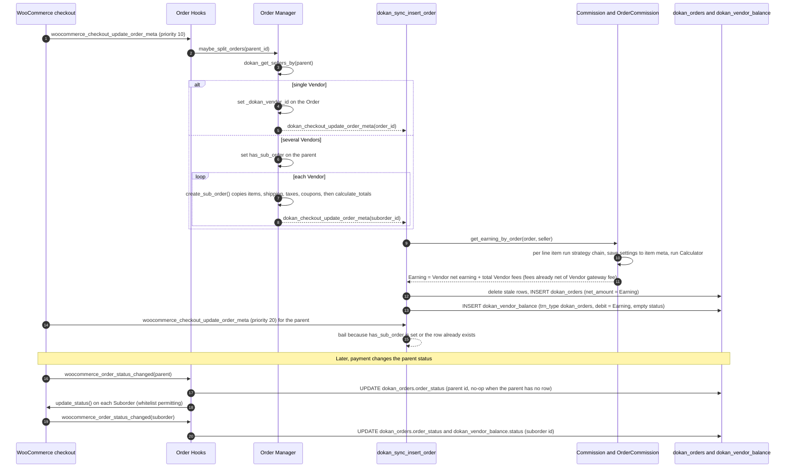
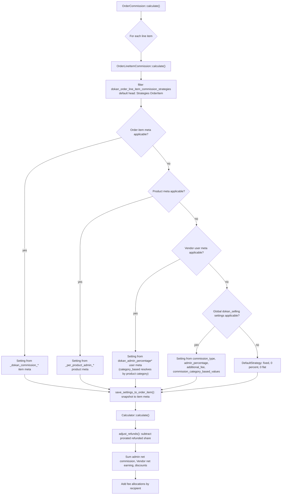
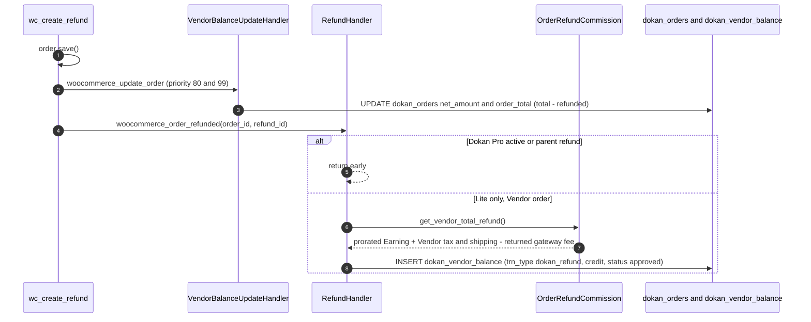
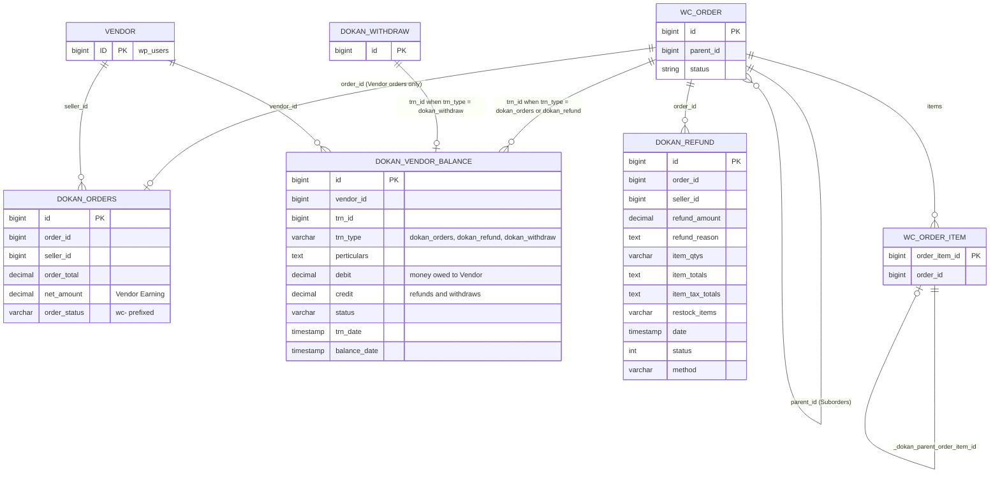

# Orders, Commission, Fees and Vendor Balance (Dokan Lite)

This document describes how Dokan Lite turns a WooCommerce checkout into Vendor orders, how it computes the admin's Commission and the Vendor's Earning for each Vendor order, how fee recipients (shipping, tax, shipping tax, order fees, gateway fees) are resolved, and how the results are written to the `dokan_orders` sync table and the `dokan_vendor_balance` ledger. It also covers the Lite refund path and the Lite shipping-package split.

Terminology follows `CONTEXT.md`: **Order** is the customer-facing WooCommerce order, a **Suborder** is the per-Vendor order split off a multi-vendor Order, and a **Vendor order** is the order a Vendor processes (the Suborder, or the Order itself when it is single-vendor). **Commission** is always the admin's share, **Earning** is the Vendor's share, and **Balance** is the Vendor ledger. The legacy word "seller" survives only in code identifiers (`seller_id`, `dokan_get_seller_id_by_order()`), and this document uses it only when quoting code.

> Read [ADR-0004](../0004-vendor-order-is-authoritative-parent-is-mirror.md) before changing anything here. Parent Orders deliberately do not reduce stock, do not carry Commission or Balance rows, and refunds made directly on a parent Order are outside vendor accounting. All of that is intentional.

---

## 1. Purpose & ownership

| Concern | Owner | Notes |
|---|---|---|
| Splitting a multi-vendor Order into Suborders | [Lite] | `WeDevs\Dokan\Order\Manager::maybe_split_orders` |
| Parent and Suborder status sync, completion roll-up, parent stock guard | [Lite] | `WeDevs\Dokan\Order\Hooks` |
| `dokan_orders` sync table (one row per Vendor order) | [Lite] | `dokan_sync_insert_order()` and several updaters |
| Commission calculation (strategies, calculator, refunds) | [Lite] | `includes/Commission/*`, facade `WeDevs\Dokan\Commission` (`dokan()->commission`) |
| Fee recipients and payment-gateway fee | [Lite] | `WeDevs\Dokan\Fees` (`dokan()->fees`) |
| `dokan_vendor_balance` ledger writes for orders and refunds | [Lite] | Order sync, status hooks, `RefundHandler`, `Fees`, `VendorBalanceUpdateHandler` |
| `dokan_vendor_balance` ledger writes for Withdraws | [Lite] | `WeDevs\Dokan\Withdraw\Hooks::update_vendor_balance` (covered only as a ledger writer here) |
| Shipping package split per Vendor, shipping tax rate | [Lite] | `WeDevs\Dokan\Shipping\Hooks`, `WeDevs\Dokan\Shipping\Tax` |
| `dokan_refund` table | [Lite] creates and cleans up rows | Rows are written by Dokan Pro (consumed by Dokan Pro); Lite never inserts into it |
| Refund accounting when Dokan Pro is active | consumed by Dokan Pro | `RefundHandler::handle_refund` returns early when `dokan()->is_pro_exists()` |
| Order objects, statuses, refunds, stock, checkout | [WooCommerce] | Dokan reacts to WooCommerce hooks |

**Related ADRs:** [ADR-0004](../0004-vendor-order-is-authoritative-parent-is-mirror.md) (Vendor order is authoritative), [ADR-0011](../0011-suborders-are-created-synchronously-at-checkout.md) (Suborders created synchronously at checkout), [ADR-0012](../0012-commission-terms-are-frozen-onto-the-order-at-first-calculation.md) (Commission terms frozen at first calculation), [ADR-0013](../0013-marketplace-money-lives-in-custom-tables-not-post-types.md) (money in custom tables), [ADR-0017](../0017-orders-are-storage-agnostic-through-woocommerce-crud.md) (storage-agnostic orders).

---

## 2. Entry points & bootstrap

| What | Where |
|---|---|
| Table name shortcuts (`$wpdb->dokan_orders`, `$wpdb->dokan_refund`, `$wpdb->dokan_vendor_balance`, `$wpdb->dokan_withdraw`) set on `init` priority 1 | `lite:dokan-class.php:346` (`WeDevs_Dokan::wpdb_table_shortcuts`, hooked at `lite:dokan-class.php:267`) |
| Procedural order helpers (`dokan_sync_insert_order()`, `dokan_get_seller_id_by_order()`, `dokan_get_sellers_by()`) loaded with the plugin | `lite:dokan-class.php:294` requires `lite:includes/Order/functions.php` |
| Container aliases `order`, `order_controller`, `commission`, `fees` | `lite:includes/DependencyManagement/Providers/ServiceProvider.php:33-39` |
| `order_controller` instantiates the order hook classes | `lite:includes/Order/Controller.php:34` (`Controller::init_classes`) |
| Commission services (`OrderCommission`, `OrderLineItemCommission`, `OrderRefundCommission`, `ProductCommission`, `Calculator`, `VendorBalanceUpdateHandler`) registered non-shared, tag `commission-service` | `lite:includes/DependencyManagement/Providers/CommissionServiceProvider.php:19-36` |
| Shared common services including `Shipping\Hooks`, `Commission\RecalculateCommissions`, `Order\RefundHandler`, `Withdraw\Hooks` | `lite:includes/DependencyManagement/Providers/CommonServiceProvider.php:13-26` |
| All `Hookable` services get `register_hooks()` called (this is how `RefundHandler` and `VendorBalanceUpdateHandler` attach) | `lite:dokan-class.php:276-279` |
| `container-service` and `common-service` resolved on `init` priority 4 | `lite:dokan-class.php:316-325` (`WeDevs_Dokan::init_classes`) |
| Table DDL | `lite:includes/Install/Installer.php:375` (`dokan_orders`), `:421` (`dokan_refund`), `:448` (`dokan_vendor_balance`) |

Because the `commission-service` definitions are registered with `shared = false` (`add_with_implements_tags( $service, $service, false )`), every `dokan_get_container()->get( OrderCommission::class )` returns a fresh calculator, so per-order state never leaks between calls.

`Order\Controller::init_classes` always creates `Hooks`, `MiscHooks`, `EmailHooks`, `OrderCache`, `Frontend\Hooks` and `OrderEventListener`; it adds `Admin\Permissions` and `Admin\Hooks` only when `is_admin()`, and `Order\Ajax` only during AJAX.

---

## 3. Key classes

| Class | File | Responsibility |
|---|---|---|
| `WeDevs\Dokan\Order\Manager` | `lite:includes/Order/Manager.php:20` | Order queries (`all`, `get_child_orders`, `count_orders`), Suborder creation (`maybe_split_orders` at `:896`, `create_sub_order` at `:582`), sync-row deletion (`delete_seller_order` at `:490`). HPOS-aware. |
| `WeDevs\Dokan\Order\Hooks` | `lite:includes/Order/Hooks.php:25` | Checkout split trigger, status cascade parent to Suborders, completion roll-up, refunded-status Balance entry, coupon validity guard, parent stock guard. |
| `dokan_sync_insert_order()` | `lite:includes/Order/functions.php:217` | Inserts the `dokan_orders` row and the `dokan_orders` ledger row for one Vendor order. |
| `dokan_get_sellers_by()` | `lite:includes/Order/functions.php:522` | Groups an order's line items by Vendor (product `post_author`, filterable). |
| `dokan_get_seller_id_by_order()` | `lite:includes/Order/functions.php:296` | Resolves the Vendor of an order from `dokan_orders`, then `_dokan_vendor_id` meta, then the line items; returns `0` for a parent with Suborders. |
| `WeDevs\Dokan\Order\VendorBalanceUpdateHandler` | `lite:includes/Order/VendorBalanceUpdateHandler.php:17` | Re-syncs `dokan_orders` and the ledger debit after a WooCommerce order save (order edit, refund). |
| `WeDevs\Dokan\Order\RefundHandler` | `lite:includes/Order/RefundHandler.php:10` | Lite-only refund accounting: writes a `dokan_refund` ledger credit on `woocommerce_order_refunded`. |
| `WeDevs\Dokan\Order\OrderEventListener` | `lite:includes/Order/OrderEventListener.php:8` | Mirrors trash/untrash status into `dokan_orders` and the ledger. |
| `WeDevs\Dokan\Order\OrderCache` | `lite:includes/Order/OrderCache.php:17` | Clears per-Vendor order caches on order events. |
| `WeDevs\Dokan\Order\Admin\Hooks` | `lite:includes/Order/Admin/Hooks.php:22` | WP-admin order list columns, Suborder toggle, cascading trash/untrash/delete, Commission meta box. |
| `WeDevs\Dokan\Order\Admin\Permissions` | `lite:includes/Order/Admin/Permissions.php:17` | Maps `edit_post` for a Vendor's own order and scopes the admin order list to the current Vendor. |
| `WeDevs\Dokan\Commission` | `lite:includes/Commission.php:18` | Facade (`dokan()->commission`): `get_earning_by_order` (`:204`), `get_earning_from_order_table` (`:364`), `get_earning_by_product` (`:164`), `get_commission` (`:608`), `get_all_order_to_be_processed` (`:512`). |
| `WeDevs\Dokan\Commission\OrderCommission` | `lite:includes/Commission/OrderCommission.php:18` | Sums line-item commissions for one order and adds fee allocations (`calculate` at `:65`, `calculate_for_refund` at `:153`). |
| `WeDevs\Dokan\Commission\OrderLineItemCommission` | `lite:includes/Commission/OrderLineItemCommission.php:16` | One line item: resolves the strategy chain, snapshots settings onto the item, runs `Calculator`, nets out prior refunds (`calculate` at `:108`). |
| `WeDevs\Dokan\Commission\ProductCommission` | `lite:includes/Commission/ProductCommission.php:18` | Commission for a product price outside any order (product editor previews, REST `/commission`). |
| `WeDevs\Dokan\Commission\Calculator` | `lite:includes/Commission/Calculator.php:10` | The actual arithmetic (`calculate` at `:114`, `calculate_for_refund` at `:191`). |
| `WeDevs\Dokan\Commission\OrderRefundCommission` | `lite:includes/Commission/OrderRefundCommission.php:20` | Splits one `WC_Order_Refund` into Vendor and admin portions (`get_vendor_total_refund` at `:287`). |
| `WeDevs\Dokan\Commission\CouponInfo` | `lite:includes/Commission/CouponInfo.php:5` | Splits coupon discount on a line item into admin-funded and Vendor-funded parts. |
| `WeDevs\Dokan\Commission\Strategies\*` | `lite:includes/Commission/Strategies/` | Chain of responsibility: `OrderItem` to `Product` to `Vendor` to `GlobalStrategy` to `DefaultStrategy`. |
| `WeDevs\Dokan\Commission\Settings\*` | `lite:includes/Commission/Settings/` | Read and write commission settings at each level (order item meta, product meta, user meta, global option). |
| `WeDevs\Dokan\Commission\Model\Setting` / `Model\Commission` | `lite:includes/Commission/Model/` | Value objects for a resolved setting and a commission result. |
| `WeDevs\Dokan\Commission\Formula\*` | `lite:includes/Commission/Formula/` | Formula classes (`fixed`, `flat`, `percentage`, `combine`, `category_based`). Their calculation logic is not on the live path (only `Calculator::calculate` computes amounts); the upgraders (`Upugrader/*`, `Upgrade/Upgrades/V_3_14_0.php`) use them, and `Settings\DefaultSetting`, `Settings\OrderItem` and `Product\Hooks` reference `Fixed::SOURCE` / `Flat::SOURCE` only as type identifiers. |
| `WeDevs\Dokan\Commission\RecalculateCommissions` | `lite:includes/Commission/RecalculateCommissions.php:12` | Dormant: its constructor `return`s before registering any hook (`:16-18`). |
| `WeDevs\Dokan\Fees` | `lite:includes/Fees.php:9` | Fee recipients (`get_shipping_fee_recipient` at `:155`, `get_tax_fee_recipient` at `:188`, `get_shipping_tax_fee_recipient` at `:220`), gateway fee (`calculate_gateway_fee` at `:57`). |
| `WeDevs\Dokan\Models\VendorBalance` | `lite:includes/Models/VendorBalance.php:8` | Model for a ledger row; constants `TRN_TYPE_DOKAN_ORDERS`, `TRN_TYPE_DOKAN_WITHDRAW`, `TRN_TYPE_DOKAN_REFUND`. |
| `WeDevs\Dokan\Models\DataStore\VendorBalanceStore` | `lite:includes/Models/DataStore/VendorBalanceStore.php:14` | Data store for the ledger; `get_total_earning_by_vendor` at `:59`. |
| `WeDevs\Dokan\Shipping\Hooks` | `lite:includes/Shipping/Hooks.php:15` | Per-Vendor shipping packages (Lite without Pro), shipping item `seller_id` meta, shipping tax rate. |
| `WeDevs\Dokan\Shipping\Tax` | `lite:includes/Shipping/Tax.php:7` | Picks the shipping tax class from a Vendor's package contents. |

---

## 4. Execution flow

### 4.1 Checkout to Suborders to Commission to Balance

Both the classic checkout (`woocommerce_checkout_update_order_meta`, fired at `wc:includes/class-wc-checkout.php:514`) and the Store API / block checkout (`woocommerce_store_api_checkout_order_processed`, fired at `wc:src/StoreApi/Routes/V1/Checkout.php:695` and `wc:src/StoreApi/Routes/V1/CheckoutOrder.php:160`) run the same two Dokan listeners registered in `Order\Hooks::__construct` (`lite:includes/Order/Hooks.php:41-46`):

1. Priority 10: `Hooks::split_vendor_orders` calls `Manager::maybe_split_orders`.
2. Priority 20: `dokan_sync_insert_order` for the parent Order.

`Manager::maybe_split_orders` (`lite:includes/Order/Manager.php:896`):

- Returns immediately if the order already has `_dokan_vendor_id` (already processed).
- If `$force_create` is true or `has_sub_order` is set, deletes existing child orders first.
- Groups items with `dokan_get_sellers_by()`. No Vendor found: returns.
- **One Vendor:** fires `dokan_create_parent_order`, writes `_dokan_vendor_id` on the Order itself, saves, and fires `dokan_checkout_update_order_meta( $order_id, $seller_id )`. No Suborder is created; the Order is the Vendor order (ADR-0004).
- **Several Vendors:** writes `has_sub_order = true` on the parent, saves, and calls `create_sub_order()` once per Vendor.

`Manager::create_sub_order` (`lite:includes/Order/Manager.php:582`) builds a new `WC_Order` with `created_via = dokan`, copies customer, currency, tax mode, payment method, billing/shipping address and `_dokan_vendor_id`, then:

- `create_line_items()` clones the Vendor's line items including all item meta and adds `_dokan_parent_order_item_id` (used later for stock sync).
- `create_shipping()` copies the parent's shipping items whose `seller_id` item meta matches the Vendor (filters `dokan_shipping_method` (deprecated) and `dokan_shipping_methods`).
- `create_taxes()` adds tax items for each parent tax rate with the Vendor's product tax total and shipping tax total.
- `create_coupons()` adds one coupon item per coupon code found in the Suborder items' `_dokan_coupon_info` meta; the discount is the sum of the per-item discounts, counted only for codes that are also present on the parent. When Dokan Pro is active, Lite removes a Dokan Pro filter on `woocommerce_order_get_items` before reading coupons and does not re-add it in this method (`lite:includes/Order/Manager.php:822-825`).
- Fires `dokan_create_sub_order_before_calculate_totals`, calls `calculate_totals()`, copies the parent status, sets `parent_id`, saves, updates WooCommerce total sales, and fires `dokan_checkout_update_order_meta( $suborder_id, $seller_id )`.
- Any `Throwable` is logged and returned as `WP_Error( 'dokan-suborder-error' )`.

`dokan_checkout_update_order_meta` is consumed by `dokan_sync_insert_order` (`lite:includes/Order/Hooks.php:49`) and by `OrderCache::reset_seller_order_data`. `dokan_sync_insert_order` (`lite:includes/Order/functions.php:217`):

1. Bails for a missing order, a `WC_Subscription`, an order already present in `dokan_orders` (`Manager::is_order_already_synced`), or a parent with `has_sub_order`.
2. Resolves the Vendor (`dokan_get_seller_id_by_order`), order total and `wc-`-prefixed status.
3. Computes the Earning with `dokan()->commission->get_earning_by_order( $order, 'seller' )` (the `dokan_is_admin_coupon_applied()` branch passes `'seller'` explicitly; the other branch uses the default, which is also `'seller'`), then applies `dokan_order_net_amount`.
4. Calls `Manager::delete_seller_order( $order_id, $seller_id )` to remove stale rows (see 4.6), then inserts the `dokan_orders` row.
5. Saves a `VendorBalance` model: `trn_type = dokan_orders`, `perticulars = 'New order'`, `debit = net_amount`, `trn_date = now`, `balance_date = now + withdraw threshold days` (`dokan_get_withdraw_threshold()`: user meta `withdraw_date_limit`, falling back to option `dokan_withdraw.withdraw_date_limit`). The `status` column is not set here, so the row is created with the model default (an empty string, `lite:includes/Models/VendorBalance.php:32-42`). It is filled in later by `Hooks::on_order_status_change` the next time the order's status changes (4.2).

Because the Suborders were synced inside step 1, the priority-20 sync for the parent bails on `has_sub_order`; for a single-vendor Order it bails on `is_order_already_synced`.

`get_earning_by_order` (`lite:includes/Commission.php:204`) returns `null` for a parent with Suborders. It returns legacy `_dokan_admin_fee`-based values if that meta exists, otherwise the cached `dokan_orders` value if a row exists, and only then runs `OrderCommission::calculate()`. At checkout no row exists yet, so the calculator runs, which also snapshots the resolved commission settings onto each line item (4.3).

Orders created in WP-admin are split lazily: `Hooks::on_order_status_change` calls `maybe_split_orders` when an order without a parent and without `has_sub_order` changes status in admin (`lite:includes/Order/Hooks.php:100-109`), and `dokan_sync_insert_order` also runs on `woocommerce_process_shop_order_meta` priority 60 in admin (`lite:includes/Order/Hooks.php:54-56`; WooCommerce fires it at `wc:includes/admin/class-wc-admin-meta-boxes.php:262` and `wc:src/Internal/Admin/Orders/Edit.php:318`).

### 4.2 Status changes

WooCommerce fires `woocommerce_order_status_changed` from `WC_Order::status_transition()` only when there is a previous status (`wc:includes/class-wc-order.php:478`). Dokan Lite listeners on it:

| Priority | Listener | Effect |
|---|---|---|
| 10 | `Order\Hooks::on_order_status_change` | Lazy admin split; `UPDATE dokan_orders SET order_status` (a no-op for a multi-vendor parent, which has no row); cascade the new status to each Suborder if `is_status_change_allowed()` permits (filter `dokan_sub_order_status_update_whitelist`), otherwise log; unless the COD exclusion applies, `UPDATE dokan_vendor_balance SET status` for `trn_type = dokan_orders`. |
| 10 | `Order\OrderCache::reset_order_cache` | Cache invalidation. |
| 15 | `Order\Hooks::manage_refunded_for_order` | Vendor-dashboard "refunded" status change: inserts a `dokan_refund` credit for the whole Earning and zeroes the `dokan_orders` totals (4.5). |
| 99 | `Order\Hooks::on_sub_order_change` | For a Suborder: auto-completes paid, non-manual-gateway Suborders that do not need processing, then completes the parent when every Suborder is `completed`. |
| 100 | `Fees::calculate_gateway_fee` | Deducts the payment-gateway processing fee from Vendor orders (4.4). |

The default Suborder transition whitelist (`lite:includes/Order/Hooks.php:205-213`) lets `pending` move anywhere, forbids moving out of `cancelled` and `refunded`, allows `completed` only to `refunded`, and so on. Statuses not in the whitelist are always allowed.

COD exclusion: when option `dokan_withdraw.exclude_cod_payment` is `on` and the payment method is `cod`, the ledger status update is skipped (filter `dokan_order_should_exclude_from_vendor_balance`). Because the checkout insert leaves `status` empty, such rows do not acquire an earning status through the status-change path and therefore do not count toward Balance (see the Balance queries in section 6). Note that `OrderEventListener::process_order_status` (trash/untrash) writes the ledger status without a COD check.

Trash and untrash (`woocommerce_trash_order` fired at `wc:includes/data-stores/abstract-wc-order-data-store-cpt.php:336` and `wc:src/Internal/DataStores/Orders/OrdersTableDataStore.php:2695`; `woocommerce_untrash_order` at `wc:src/Internal/DataStores/Orders/OrdersTableDataStore.php:2916`) are mirrored by `OrderEventListener::process_order_status`, which writes the order's current status into both tables. In admin, `Admin\Hooks::admin_on_trash_order` / `admin_on_untrash_order` cascade trash/untrash from a parent to its Suborders.

### 4.3 Commission calculation

**Strategy chain.** `AbstractStrategy::get_eligible_strategy()` (`lite:includes/Commission/Strategies/AbstractStrategy.php:55`) returns the first strategy whose `Setting::is_applicable()` is true, which means the percentage or the flat value is a non-empty string (`lite:includes/Commission/Model/Setting.php:289`). The chain is `OrderItem` (source taken from saved meta) then `Product` then `Vendor` then `GlobalStrategy` then `DefaultStrategy`. The category used by `Vendor` and `GlobalStrategy` for `category_based` is the first chosen category from `ProductCategory\Helper::get_saved_products_category()`. Variations read commission meta from their parent product (`Settings\Product::__construct`).

**Snapshot.** `AbstractStrategy::save_settings_to_order_item()` writes the resolved setting to the order item only when the head of the chain is an `OrderItem` strategy (`lite:includes/Commission/Strategies/AbstractStrategy.php:100-108`), via `Settings\OrderItem::save()` (filter `dokan_order_line_item_commission_settings_before_save`, action `dokan_order_line_item_commission_settings_after_save`). After the first calculation the item meta is applicable, so later recalculations use the rate in force at purchase, not the current settings. The class comment in `Strategies\OrderItem` states that this protects orders when the admin changes rates.

**Arithmetic.** `Calculator::calculate()` (`lite:includes/Commission/Calculator.php:114`):

- `admin_discount` = admin-funded part of the item's coupons (`CouponInfo`: `from_vendor`/`default` is Vendor-funded, `from_admin` is admin-funded, `shared_coupon` splits by percentage or by a capped fixed amount).
- `raw_admin = (item_total + admin_discount) * percentage / 100 + flat * quantity + combine_flat - admin_discount`. `flat` counts per unit unless the type is the legacy `combine`, in which case the flat value is added once (`Setting::get_flat_value` / `get_combine_flat`).
- `admin_commission = min( round( raw_admin, wc_get_price_decimals() ), item_total )`.
- `vendor_net_earning = item_total - admin_commission` (the Vendor takes the exact remainder so no fraction is lost).

A negative `admin_commission` is possible when an admin-funded discount exceeds the computed commission. `Model\Commission::get_admin_commission()` clamps at zero and `get_admin_subsidy()` returns the absolute negative part.

**Order totals.** `OrderCommission::calculate()` sums line items. For admin-earning order types (`Analytics\Reports\OrderType::is_admin_order_type()`), the item totals go to `admin_net_earning` instead. After the line-item loop, the summed `vendor_net_earning` passes through the filter `dokan_order_vendor_net_earning` and the summed `admin_net_commission` through `dokan_order_admin_net_commission` (both receive the order and the calculator, `lite:includes/Commission/OrderCommission.php:120` and `:131`) before they are stored. These filters run only in `calculate()`, not in `calculate_for_refund()`, and they do not change `admin_net_earning` or the per-item results kept in `commission_by_line_item`. Fee allocation is added on top:

| Getter | Formula |
|---|---|
| `get_vendor_earning()` | `vendor_net_earning + get_total_vendor_fees()` |
| `get_total_vendor_fees()` | Vendor shipping + Vendor tax + Vendor shipping tax - Vendor gateway fee + Vendor order fees |
| `get_total_admin_fees()` | admin shipping + admin tax + admin shipping tax - admin gateway fee + admin order fees |
| `get_admin_total_earning()` | `max(admin_net_commission, 0) + get_total_admin_fees()` |
| `get_admin_commission()` (override) | `admin_net_commission + get_total_admin_fees()` (not clamped) |
| `get_vendor_earning_subtotal()` | `get_vendor_earning()` minus `abs( get_admin_commission() )` when that override is negative |

Each shipping/tax figure is net of refunds when `should_adjust_refund` is true (the default). Order fee items go to the admin unless the order meta `_wc_order_attribution_source_type` is `vendor`, in which case they go to the Vendor (filter `dokan_order_commission_order_fee_recipient`).

**Product-level calculation.** `ProductCommission::calculate()` runs the chain from `Strategies\Product` with quantity 1 and the supplied total amount as total (falling back to the product price when no amount is set); it is used by `Commission::get_commission()` (when no `order_item_id` is given), `Commission::get_earning_by_product()` and the `GET dokan/v1/commission` endpoint.

### 4.4 Fees

`Fees::get_shipping_fee_recipient`, `get_tax_fee_recipient` and `get_shipping_tax_fee_recipient` read order meta first (`shipping_fee_recipient`, `tax_fee_recipient`, `shipping_tax_fee_recipient`). On the first read they resolve the value from `dokan_selling` options (defaults `seller`; shipping tax defaults to the tax recipient), apply `dokan_shipping_fee_recipient` / `dokan_tax_fee_recipient` / `dokan_shipping_tax_fee_recipient`, and **persist the result to order meta and save the order**. The recipient is therefore fixed per order at the time of the first commission calculation (write-on-read).

`Fees::calculate_gateway_fee()` (`lite:includes/Fees.php:57`) runs on `woocommerce_order_status_changed` (priority 100), `woocommerce_thankyou_ppec_paypal` (priority 10) and `woocommerce_paypal_payments_order_captured` (priority 99). It reads the processing fee from known PayPal metas (`PayPal Transaction Fee`, the PPEC constant meta, or the PayPal Payments fee breakdown; filter `dokan_get_processing_fee`). For each Vendor order (`Commission::get_all_order_to_be_processed`) that already has a `dokan_orders` row and no `dokan_gateway_fee` meta, it prorates `fee * vendor_order_total / order_total` (filter `dokan_get_processing_gateway_fee`), subtracts it from the stored Earning (filter `dokan_orders_vendor_net_amount`), updates `dokan_orders.net_amount` and the ledger `debit`, saves `dokan_gateway_fee` on the Vendor order, optionally adds an order note (filter `dokan_commission_log_gateway_fee_to_order_note`), and clears the earning caches. Who bears a gateway fee is read by `OrderCommission` from `dokan_gateway_fee_paid_by` (an empty value means `admin` for `dokan-stripe-connect` and `seller` otherwise) and `dokan_admin_gateway_fee`.

`Fees::hide_extra_data` hides `_dokan_commission_rate`, `_dokan_commission_type` and `_dokan_additional_fee` from formatted item meta (`woocommerce_order_item_get_formatted_meta_data`, fired at `wc:includes/class-wc-order-item.php:377`).

### 4.5 Refunds in Lite

Refunds are recorded against the Vendor order; refunds on a parent Order are outside the model (ADR-0004, `CONTEXT.md` "Refund").

**Path A: WooCommerce refund (Lite without Pro).** `wc_create_refund()` saves the order (`wc:includes/wc-order-functions.php:749`) and then fires `woocommerce_order_refunded` (`wc:includes/wc-order-functions.php:752`). `RefundHandler::handle_refund` (`lite:includes/Order/RefundHandler.php:37`):

1. Returns if Dokan Pro is active (Pro owns refund accounting).
2. Returns if the refund is a parent-order refund (`OrderType::DOKAN_PARENT_ORDER_REFUND`).
3. Computes the Vendor's portion through filter `dokan_vendor_earning_in_refund`, which `RefundHandler::get_vendor_earning_in_refund` answers with `OrderRefundCommission::get_vendor_total_refund()`: the prorated line-item Earning (`Calculator::calculate_for_refund`, which rounds the admin share and gives the Vendor the remainder), plus refunded tax and shipping tax whose recipient is the Vendor, plus refunded shipping if the Vendor is the shipping recipient, minus any gateway fee returned to the Vendor (filter `dokan_refund_gateway_fee`, default 0).
4. Fires `dokan_refund_adjust_vendor_balance( $vendor_refund, $refund, $order, $vendor_refund )` (in Lite the payout amount and the earning amount passed are the same value) and `dokan_refund_adjust_dokan_orders( $vendor_refund, $refund, $order )`.

`RefundHandler::insert_into_balance_table` (on `dokan_refund_adjust_vendor_balance`) resolves the Vendor, applies `dokan_vendor_refund_amount_before_insert`, checks `dokan_refund_should_insert_into_vendor_balance` (default: amount > 0; `RefundHandler::exclude_cod_payment` returns false for excluded COD orders, itself filterable by `dokan_order_refund_should_exclude_from_vendor_balance`), and inserts a ledger row with `trn_type = dokan_refund`, `trn_id = order id`, `credit = amount`, `status = approved`, `balance_date = now`.

In Lite the `dokan_refund_adjust_dokan_orders` listener (`RefundHandler::update_order_amounts`) is commented out (`lite:includes/Order/RefundHandler.php:22-23`). The `dokan_orders` row is reconciled instead by `VendorBalanceUpdateHandler::update_dokan_order_table` on `woocommerce_update_order`, which recalculates the Earning with refund adjustment and stores `order_total = total - total_refunded`.

**Path B: vendor-dashboard status change to refunded.** `Hooks::manage_refunded_for_order` acts only for a POST carrying a valid `dokan_change_status` nonce with `post_type = shop_order` and a new status of `wc-refunded`. If no approved `dokan_refund` ledger row exists for the order yet, it inserts a credit equal to the full stored Earning and sets `dokan_orders.order_total` and `net_amount` to 0. COD-excluded orders are skipped.

### 4.6 Order edits, deletion and cleanup

`VendorBalanceUpdateHandler` (`lite:includes/Order/VendorBalanceUpdateHandler.php:29-33`) listens to `woocommerce_update_order` (fired at `wc:includes/data-stores/class-wc-order-data-store-cpt.php:244` and `wc:src/Internal/DataStores/Orders/OrdersTableDataStore.php:3137`), skipping parents with Suborders:

- Priority 80, `update_dokan_order_table`: recalculates the Earning (refund-adjusted) and updates `dokan_orders.net_amount` and `order_total` when they differ; clears earning caches.
- Priority 99, `handle_order_edit`: recalculates without refund adjustment, adds back the Vendor gateway fee (`get_vendor_earning() + get_vendor_gateway_fee()`), compares with the stored ledger `debit` (or a short-lived transient), and updates the `dokan_orders` ledger row's `debit` when it changed. Refunds therefore stay as separate credit rows instead of reducing the order's debit.

`Manager::delete_seller_order` (`lite:includes/Order/Manager.php:490`) deletes the `dokan_orders` row (optionally scoped by Vendor), every `dokan_refund` row for the order, fires `dokan_after_deleting_seller_order`, deletes ledger rows with `trn_id = order id` and `trn_type` in (`dokan_orders`, `dokan_refund`, `dokan_withdraw`), and deletes reverse-withdrawal rows (`trn_type` in `order_commission`, `manual_order_commission`, `order_refund`). It runs before every `dokan_sync_insert_order` insert and, through `delete_seller_order_with_suborders`, when an order is permanently deleted in admin (`woocommerce_delete_order`, fired at `wc:includes/data-stores/abstract-wc-order-data-store-cpt.php:310` and `wc:src/Internal/DataStores/Orders/OrdersTableDataStore.php:2670`, or `delete_post` for CPT storage).

### 4.7 Stock and coupons

- `Hooks::prevent_stock_reduction_for_parent_order` returns false on `woocommerce_can_reduce_order_stock` (`wc:includes/wc-stock-functions.php:178`) for orders with `has_sub_order`; Suborders reduce stock.
- `Hooks::sync_parent_order_item_stock` on `woocommerce_reduce_order_item_stock` (`wc:includes/wc-stock-functions.php:233`) copies the Suborder item's `_reduced_stock` to the parent item identified by `_dokan_parent_order_item_id`, for display only.
- `Hooks::ensure_coupon_is_valid` on `woocommerce_coupon_is_valid` (`wc:includes/class-wc-discounts.php:1260`) throws for a `fixed_cart` coupon when the cart spans more than one Vendor, then applies `dokan_coupon_is_valid`.

### 4.8 Shipping (Lite parts)

When Dokan Pro is not active, `Shipping\Hooks` (`lite:includes/Shipping/Hooks.php:22-31`) splits the cart into one shipping package per Vendor (`woocommerce_cart_shipping_packages`, fired at `wc:includes/class-wc-cart.php:1733`; virtual items skipped; Vendor = product `post_author`; filter `dokan_cart_shipping_packages`), labels each package "Shipping: {store name}" (`woocommerce_shipping_package_name`, `wc:includes/class-wc-cart.php:1814`; filter `dokan_shipping_package_name`), and stores the package's `seller_id` on the created shipping item (`woocommerce_checkout_create_order_shipping_item`, `wc:includes/class-wc-checkout.php:690`). That `seller_id` item meta is what `Manager::create_shipping()` uses to route shipping lines to Suborders.

Always (Lite and Pro), `Shipping\Hooks::add_shipping_method_rate` on `woocommerce_shipping_method_add_rate` (`wc:includes/abstracts/abstract-wc-shipping-method.php:376`) recalculates per-order shipping tax for taxable methods using `Shipping\Tax::get_tax_rates()`, which picks the tax class from the Vendor package's shipping-taxable items (standard class first, then the single class, then the first class in the store's configured order).

---

## 5. Hooks

### 5.1 Hooks Dokan Lite fires

| Hook | Type | Fired in | Purpose |
|---|---|---|---|
| `dokan_create_parent_order` | action | `Manager::maybe_split_orders` | Single-vendor Order identified; args `$parent_order, $seller_id`. |
| `dokan_checkout_update_order_meta` | action | `Manager::maybe_split_orders`, `Manager::create_sub_order` | A Vendor order is ready; args `$order_id, $seller_id`. Drives the sync insert. |
| `dokan_create_sub_order_before_calculate_totals` | action | `Manager::create_sub_order` | Last chance to alter a Suborder before totals. |
| `dokan_after_create_line_items` | action | `Manager::create_line_items` | After items are cloned to a Suborder. |
| `dokan_shipping_method` | filter (deprecated 3.7.19) | `Manager::create_shipping` | Replaced by `dokan_shipping_methods`. |
| `dokan_shipping_methods` | filter | `Manager::create_shipping` | Shipping items applied to a Suborder. |
| `dokan_get_child_orders_args` | filter | `Manager::get_child_orders` | Query args for Suborders. |
| `dokan_get_vendor_orders_args`, `dokan_get_vendor_orders`, `dokan_get_vendor_orders_count` | filters | `Manager::all` | Order list query and result. |
| `dokan_order_status_count` | filter | `Manager::count_orders` | Status buckets. |
| `dokan_get_customer_orders_by_seller` | filter | `Manager::get_customer_order_ids_by_seller` | Query args. |
| `dokan_after_deleting_seller_order` | action | `Manager::delete_seller_order` | After sync and refund rows are deleted. |
| `dokan_get_sellers_by` | filter | `dokan_get_sellers_by()` | Vendor of a line item. |
| `dokan_get_seller_id_by_order` | filter | `dokan_get_seller_id_by_order()` | Resolved Vendor. |
| `dokan_order_net_amount` | filter | `dokan_sync_insert_order()` | Earning stored at insert. |
| `dokan_sub_order_status_update_whitelist` | filter | `Hooks::is_status_change_allowed` | Allowed Suborder transitions. |
| `dokan_order_should_exclude_from_vendor_balance` | filter | `Hooks::on_order_status_change` | COD exclusion for status sync. |
| `dokan_excluded_payment_gateways_on_order_status_update` | filter | `Hooks::on_sub_order_change` | Gateways excluded from digital auto-complete (default `bacs`, `cheque`, `cod`). |
| `dokan_coupon_is_valid` | filter | `Hooks::ensure_coupon_is_valid` | Coupon validity. |
| `dokan_get_earning_by_order` | filter | `Commission::get_earning_by_order` | Computed Earning or Commission. |
| `dokan_order_admin_commission` | filter (deprecated 2.9.21 for the computed path) | `Commission::get_earning_by_order` | Also applied to the legacy `_dokan_admin_fee` path. |
| `dokan_get_earning_from_order_table` | filter | `Commission::get_earning_from_order_table` | Value read from `dokan_orders`. |
| `dokan_get_earning_by_product` | filter | `Commission::get_earning_by_product` | Product-level result. |
| `dokan_get_vendor_earning_subtotal_by_order` | filter | `Commission::get_vendor_earning_subtotal_by_order` | Earning without subsidy. |
| `dokan_after_commission_calculation` | filter | `Commission::calculate_commission` (deprecated method) | Legacy. |
| `dokan_commission_types` | filter | `dokan_commission_types()` | Selectable types (`fixed`, `category_based`). |
| `dokan_earning_by_order_item_price` | filter | `OrderLineItemCommission::calculate` | Item price passed as subtotal. |
| `dokan_order_line_item_commission_strategies` | filter | `OrderLineItemCommission::calculate` | Replace the strategy chain head for order items. |
| `dokan_product_commission_strategies` | filter | `ProductCommission::calculate` | Replace the chain head for products. |
| `dokan_order_line_item_commission_settings_before_save` / `_after_save` | filter / action | `Settings\OrderItem::save` | Snapshot to item meta. |
| `dokan_product_commission_settings_before_save` / `_after_save` | filter / action | `Settings\Product::save` | Product commission meta. |
| `dokan_vendor_commission_settings_before_save` / `_after_save` | filter / action | `Settings\Vendor::save` | Vendor commission user meta. |
| `dokan_global_commission_settings_before_save` / `_after_save` | filter / action | `Settings\GlobalSetting::save` | Global commission options. |
| `dokan_order_vendor_net_earning`, `dokan_order_admin_net_commission` | filters (since 5.3.1) | `OrderCommission::calculate` | Order-level Vendor net Earning and admin net Commission after the line items are summed; args `$amount, $order, $order_commission`. |
| `dokan_order_commission_order_fee_recipient` | filter | `OrderCommission::get_order_fee_recipient` | Recipient of order fee items. |
| `dokan_order_commission_tax_refunded_before` / `_after` | actions | `OrderCommission::get_tax_refunded` | Around the tax-refunded read. |
| `dokan_shipping_fee_recipient`, `dokan_tax_fee_recipient`, `dokan_shipping_tax_fee_recipient` | filters | `Fees` recipient getters | Recipient on first resolution. |
| `dokan_get_processing_fee`, `dokan_get_processing_gateway_fee`, `dokan_orders_vendor_net_amount`, `dokan_commission_log_gateway_fee_to_order_note` | filters | `Fees::calculate_gateway_fee` / `get_processing_fee` | Gateway fee. |
| `dokan_vendor_earning_in_refund` | filter | `RefundHandler::handle_refund` | Vendor portion of a refund. |
| `dokan_refund_adjust_vendor_balance` | action | `RefundHandler::handle_refund` | Write the refund ledger row. |
| `dokan_refund_adjust_dokan_orders` | action | `RefundHandler::handle_refund` | No Lite listener at this revision. |
| `dokan_vendor_refund_amount_before_insert`, `dokan_refund_should_insert_into_vendor_balance` | filters | `RefundHandler::insert_into_balance_table` | Amount and guard. |
| `dokan_order_refund_should_exclude_from_vendor_balance` | filter | `RefundHandler::exclude_cod_payment` | COD exclusion for refunds. |
| `dokan_refund_after_dokan_orders_updated` | action | `RefundHandler::update_order_amounts` (not hooked in Lite) | Cache clearing. |
| `dokan_refund_gateway_fee` | filter | `OrderRefundCommission::get_gateway_fee_refund_for` | Gateway fee returned on refund (default 0). |
| `dokan_vendor_total_balance_order_status`, `dokan_vendor_total_balance_trn_types` | filters | `VendorBalanceStore::get_total_earning_by_vendor` | Ledger query scope. |
| `dokan_get_seller_balance`, `dokan_get_formatted_seller_balance` | filters | `Vendor::get_balance` | Balance value. |
| `dokan_get_seller_earnings`, `dokan_get_formatted_seller_earnings` | filters | `Vendor::get_earnings` | Earnings value. |
| `dokan_withdraw_active_status` | filter | `dokan_withdraw_get_active_order_status()` | Order statuses that count as earning. |
| `dokan_dokan_vendor_balance_get_data_store` | filter | `VendorBalance::__construct` | Swap the ledger data store (prefix from `BaseModel::get_hook_prefix`). |
| `dokan_dokan_vendor_balance_created` | action | `BaseDataStore::create` | After a ledger row is inserted through the model. |
| `dokan_cart_shipping_packages`, `dokan_shipping_package_name` | filters | `Shipping\Hooks` | Shipping packages and labels. |

### 5.2 Hooks Dokan Lite consumes

| Hook | Owner / fire site | Listener (priority) |
|---|---|---|
| `woocommerce_checkout_update_order_meta` | [WooCommerce] `wc:includes/class-wc-checkout.php:514` | `Hooks::split_vendor_orders` (10), `dokan_sync_insert_order` (20) |
| `woocommerce_store_api_checkout_order_processed` | [WooCommerce] `wc:src/StoreApi/Routes/V1/Checkout.php:695`, `wc:src/StoreApi/Routes/V1/CheckoutOrder.php:160` | same two listeners (10, 20) |
| `dokan_checkout_update_order_meta` | [Lite] | `dokan_sync_insert_order` (10), `OrderCache::reset_seller_order_data` (10) |
| `woocommerce_process_shop_order_meta` | [WooCommerce] `wc:includes/admin/class-wc-admin-meta-boxes.php:262`, `wc:src/Internal/Admin/Orders/Edit.php:318` | `dokan_sync_insert_order` (60, admin only) |
| `woocommerce_order_status_changed` | [WooCommerce] `wc:includes/class-wc-order.php:478` | see table in 4.2 |
| `woocommerce_update_order` | [WooCommerce] `wc:includes/data-stores/class-wc-order-data-store-cpt.php:244`, `wc:src/Internal/DataStores/Orders/OrdersTableDataStore.php:3137` | `VendorBalanceUpdateHandler::update_dokan_order_table` (80), `handle_order_edit` (99), `OrderCache::reset_order_cache` (10) |
| `woocommerce_order_refunded` | [WooCommerce] `wc:includes/wc-order-functions.php:752` | `RefundHandler::handle_refund` (10), `OrderCache::reset_order_cache` (10) |
| `woocommerce_can_reduce_order_stock` | [WooCommerce] `wc:includes/wc-stock-functions.php:178` | `Hooks::prevent_stock_reduction_for_parent_order` (10) |
| `woocommerce_reduce_order_item_stock` | [WooCommerce] `wc:includes/wc-stock-functions.php:233` | `Hooks::sync_parent_order_item_stock` (10) |
| `woocommerce_coupon_is_valid` | [WooCommerce] `wc:includes/class-wc-discounts.php:1260` | `Hooks::ensure_coupon_is_valid` (10) |
| `woocommerce_order_item_get__dokan_commission_meta` | [WooCommerce] dynamic `{hook_prefix}{meta_key}` filter applied by `WC_Data::get_meta()` in view context, `wc:includes/abstracts/abstract-wc-data.php:438` | `Hooks::get_dokan_commission_meta` (10): migrates legacy `dokan_commission_meta` to `_dokan_commission_meta` |
| `woocommerce_trash_order` | [WooCommerce] `wc:includes/data-stores/abstract-wc-order-data-store-cpt.php:336`, `wc:src/Internal/DataStores/Orders/OrdersTableDataStore.php:2695` | `OrderEventListener::after_order_trash`; `Admin\Hooks::admin_on_trash_order` (HPOS) |
| `woocommerce_untrash_order` | [WooCommerce] `wc:src/Internal/DataStores/Orders/OrdersTableDataStore.php:2916` | `OrderEventListener::after_order_untrash`; `Admin\Hooks::admin_on_untrash_order` (HPOS) |
| `woocommerce_delete_order` | [WooCommerce] `wc:includes/data-stores/abstract-wc-order-data-store-cpt.php:310`, `wc:src/Internal/DataStores/Orders/OrdersTableDataStore.php:2670` | `Admin\Hooks::admin_on_delete_order` (HPOS) |
| `wp_trash_post`, `untrash_post`, `delete_post` | WordPress core | `Admin\Hooks` equivalents (CPT storage) |
| `woocommerce_order_data_store_cpt_get_orders_query` | [WooCommerce] `wc:includes/data-stores/class-wc-order-data-store-cpt.php:1055` | Temporary closure in `Manager::all` (CPT storage only) |
| `woocommerce_new_order` | [WooCommerce] `wc:includes/data-stores/class-wc-order-data-store-cpt.php:117`, `wc:src/Internal/DataStores/Orders/OrdersTableDataStore.php:3029` | `OrderCache::reset_order_cache`, `OrderCache::clear_product_cache` |
| `woocommerce_order_item_get_formatted_meta_data` | [WooCommerce] `wc:includes/class-wc-order-item.php:377` | `Fees::hide_extra_data` |
| `woocommerce_thankyou_ppec_paypal` | [WooCommerce] dynamic `woocommerce_thankyou_{payment_method}` at `wc:templates/checkout/thankyou.php:96` (and `wc:src/Blocks/BlockTypes/OrderConfirmation/AdditionalInformation.php:32`), for the `ppec_paypal` gateway of [Third-party: PayPal Express Checkout] | `Fees::calculate_gateway_fee` (10) |
| `woocommerce_paypal_payments_order_captured` | [Third-party: WooCommerce PayPal Payments] (plugin not installed here; fire site not verified) | `Fees::calculate_gateway_fee` (99) |
| `woocommerce_cart_shipping_packages` | [WooCommerce] `wc:includes/class-wc-cart.php:1733` | `Shipping\Hooks::split_shipping_packages` (Lite without Pro) |
| `woocommerce_shipping_package_name` | [WooCommerce] `wc:includes/class-wc-cart.php:1814` | `Shipping\Hooks::change_shipping_pack_name` (Lite without Pro) |
| `woocommerce_checkout_create_order_shipping_item` | [WooCommerce] `wc:includes/class-wc-checkout.php:690` | `Shipping\Hooks::add_shipping_pack_meta` (Lite without Pro) |
| `woocommerce_shipping_method_add_rate` | [WooCommerce] `wc:includes/abstracts/abstract-wc-shipping-method.php:376` | `Shipping\Hooks::add_shipping_method_rate` |
| `dokan_refund_adjust_vendor_balance` | [Lite] (also fired by Dokan Pro) | `RefundHandler::insert_into_balance_table` (10) |
| `dokan_refund_should_insert_into_vendor_balance` | [Lite] | `RefundHandler::exclude_cod_payment` (10) |
| `dokan_vendor_earning_in_refund` | [Lite] | `RefundHandler::get_vendor_earning_in_refund` (10) |
| `dokan_refund_after_dokan_orders_updated` | [Lite] | `RefundHandler::clear_order_caches` (10) |
| `dokan_withdraw_request_approved` | [Lite] | `Withdraw\Hooks::update_vendor_balance` (11) |
| `dokan_cache_deleted` | [Lite] | `VendorBalanceUpdateHandler::remove_vendor_balance_cache` |

---

## 6. Data storage

### 6.1 Custom tables

**`{prefix}dokan_orders`** (`lite:includes/Install/Installer.php:375`): one row per Vendor order. Keys on `order_id` and `seller_id`. `net_amount` holds the Vendor's Earning; the admin's figure is derived as `order_total - net_amount` by `Commission::get_earning_from_order_table( $id, 'admin' )`. Writers: `dokan_sync_insert_order()` (insert), `Hooks::on_order_status_change` and `OrderEventListener` (status), `Hooks::manage_refunded_for_order` (zeroes totals), `Fees::calculate_gateway_fee` and `VendorBalanceUpdateHandler::update_dokan_order_table` (amounts), `Manager::delete_seller_order` (delete). Parent Orders with Suborders have no row.

**`{prefix}dokan_vendor_balance`** (`lite:includes/Install/Installer.php:448`): the Balance ledger. The column is spelled `perticulars` in the schema and the model maps it to `get_particulars()`. Row kinds written by Lite:

| `trn_type` | `trn_id` | Written by | debit | credit | status |
|---|---|---|---|---|---|
| `dokan_orders` | Vendor order id | `dokan_sync_insert_order()` | Earning | 0 | empty at insert; then the `wc-` order status via `Hooks::on_order_status_change` / `OrderEventListener` |
| `dokan_refund` | Vendor order id | `RefundHandler::insert_into_balance_table`, `Hooks::manage_refunded_for_order` | 0 | refunded Earning | `approved` |
| `dokan_withdraw` | withdraw id | `Withdraw\Hooks::update_vendor_balance` | 0 | withdraw amount | `approved` |

The `dokan_orders` debit is later adjusted by `Fees::calculate_gateway_fee` and `VendorBalanceUpdateHandler::handle_order_edit`.

**`{prefix}dokan_refund`** (`lite:includes/Install/Installer.php:421`): created and upgraded by Lite; Lite only deletes rows (`Manager::delete_seller_order`). Writers are outside Lite (consumed by Dokan Pro).

`Manager::delete_seller_order` also deletes from `{prefix}dokan_reverse_withdrawal`, a table owned by Lite's Reverse withdrawal module.

### 6.2 Balance and Earnings queries

| Method | Formula |
|---|---|
| `Vendor::get_balance()` (`lite:includes/Vendor/Vendor.php:873`) | `SUM(debit)` of rows with `balance_date <= date` and `status` in the active order statuses, minus `SUM(credit)` of all rows with `balance_date <= date` (no status filter on credits). |
| `Vendor::get_earnings()` (`lite:includes/Vendor/Vendor.php:820`) | `SUM(debit)` of `dokan_orders` rows with an active status, minus `SUM(credit)` of `dokan_refund` rows with status `approved`, both with `balance_date <= date`. Withdraws are ignored. |
| `VendorBalanceStore::get_total_earning_by_vendor()` (`lite:includes/Models/DataStore/VendorBalanceStore.php:59`) | `SUM(debit) - SUM(credit)` over `trn_type` in (`dokan_orders`, `dokan_refund`) (filterable) and `status` in active statuses plus `approved` (filterable), with `balance_date <= date`. |

"Active statuses" come from `dokan_withdraw_get_active_order_status()`: `wc-refunded` plus option `dokan_withdraw.withdraw_order_status` (default `wc-completed`), filterable via `dokan_withdraw_active_status`. `balance_date` is pushed forward by the withdraw threshold at insert, so a new order's Earning enters Balance only after that many days. Results are cached per Vendor (`Cache` groups `withdraws_seller_{id}` and `seller_order_data_{id}`).

### 6.3 Meta keys

| Scope | Key | Written by | Meaning |
|---|---|---|---|
| Order | `_dokan_vendor_id` | `Manager::maybe_split_orders`, `create_sub_order` | Vendor of a Vendor order; also the "already processed" marker. |
| Order | `has_sub_order` | `Manager::maybe_split_orders` | Parent with Suborders. |
| Order | `shipping_fee_recipient`, `tax_fee_recipient`, `shipping_tax_fee_recipient` | `Fees` getters (write-on-read) | `seller` or `admin`. |
| Order | `dokan_gateway_fee` | `Fees::calculate_gateway_fee` | Prorated gateway fee; also the "already applied" marker. |
| Order | `dokan_gateway_fee_paid_by`, `dokan_admin_gateway_fee` | read by `OrderCommission` and `OrderRefundCommission` | Who bears the gateway fee. Lite only reads these keys; nothing in Lite writes them. |
| Order | `_dokan_admin_fee` | read only (legacy) | Pre-calculator commission; short-circuits `get_earning_by_order`. |
| Order | `_wc_order_attribution_source_type` | read only ([WooCommerce]) | `vendor` routes order fees to the Vendor. |
| Order item | `_dokan_parent_order_item_id` | `Manager::create_line_items` | Link from Suborder item to parent item. |
| Order item | `_dokan_commission_source`, `_dokan_commission_rate`, `_dokan_commission_type`, `_dokan_additional_fee`, `_dokan_commission_meta` | `Settings\OrderItem::save` | Commission snapshot. Legacy `dokan_commission_meta` is migrated on read. |
| Order item | `_dokan_coupon_info` (`Vendor\Coupon::DOKAN_COUPON_META_KEY`) | `Vendor\Coupon` | Per-item coupon discounts and funding type. |
| Shipping item | `seller_id` | `Shipping\Hooks::add_shipping_pack_meta` | Vendor of the shipping line. |
| Product | `_per_product_admin_commission`, `_per_product_admin_commission_type`, `_per_product_admin_additional_fee` | `Settings\Product::save` (via `Product\Manager::save_commission_settings`) | Product-level commission. |
| User | `dokan_admin_percentage`, `dokan_admin_percentage_type`, `dokan_admin_additional_fee`, `admin_category_commission` | `Settings\Vendor::save` (via `Vendor::save_commission_settings`) | Vendor-level commission. |
| User | `withdraw_date_limit` | read by `dokan_get_withdraw_threshold()` | Per-Vendor threshold days. |

### 6.4 Options and transients

| Option (section.key) | Read by | Default |
|---|---|---|
| `dokan_selling.commission_type`, `admin_percentage`, `additional_fee`, `commission_category_based_values` | `Settings\GlobalSetting::get` (written by `GlobalSetting::save` through `dokan_save_legacy_settings_section`) | empty |
| `dokan_selling.shipping_fee_recipient`, `tax_fee_recipient` | `Fees` | `seller` |
| `dokan_selling.shipping_tax_fee_recipient` | `Fees` | the resolved tax recipient |
| `dokan_selling.order_status_change` | REST `update_order_permissions_check`, `Frontend\Hooks::bulk_order_status_change`, `WeDevs\Dokan\Ajax` order handlers | `on` (the bulk action passes no default; it only blocks on an explicit `off`) |
| `dokan_withdraw.exclude_cod_payment` | `Hooks`, `RefundHandler` | `off` |
| `dokan_withdraw.withdraw_order_status` | `dokan_withdraw_get_active_order_status()` | `[ 'wc-completed' ]` |
| `dokan_withdraw.withdraw_date_limit` | `dokan_get_withdraw_threshold()` | `0` |

These are read through `dokan_get_option( $key, $section )`; the canonical admin store and legacy bridging are described in [ADR-0002](../0002-flat-dokan-admin-settings-as-canonical-store.md) and [ADR-0003](../0003-settings-legacy-mirror-mode.md).

Transient: `dokan_vendor_earning_without_refund_{order_id}` in group `dokan_vendor_balance_update_handler`, 5 minutes, set by `VendorBalanceUpdateHandler::update_balance` to avoid re-processing the same edit. Object cache keys: `get_earning_from_order_table_{id}_{seller|admin}` (and `_raw`), `get_seller_id_by_order_{id}`, `count_orders_{vendor}`.

Option prefix `dokan_commission_recalculate_order_id:` is defined in `RecalculateCommissions` but is not used at runtime because that class registers nothing.

No custom post types are introduced; Suborders are ordinary `shop_order` orders with `parent_id` set and `created_via = dokan`.

---

## 7. REST / AJAX endpoints

Order REST controllers are summarized here only as consumers of this subsystem.

| Route | Methods | Permission callback |
|---|---|---|
| `dokan/v1/orders` | GET | `OrderController::get_orders_permissions_check` (`dokan_view_order_menu`) |
| `dokan/v1/orders/{id}` | GET | `get_single_order_permissions_check` (shop manager, administrator, or the order's Vendor via `dokan_get_seller_id_by_order`) |
| `dokan/v1/orders/{id}` | PUT/PATCH | `update_order_permissions_check` (`dokan_manage_order` and `dokan_selling.order_status_change` not `off`) |
| `dokan/v1/orders/{id}/notes`, `.../notes/{note_id}` | GET, POST, DELETE | `get_single_order_permissions_check` |
| `dokan/v1/orders/summary` | GET | `check_orders_summary_permissions` (`dokan_view_order_report`) |
| `dokan/v2/orders/{id}/downloads`, `.../downloads/{permission_id}` | GET, POST, DELETE, PUT/PATCH | `get_single_order_permissions_check` |
| `dokan/v2/orders/bulk-actions` | POST | `update_order_permissions_check` |
| `dokan/v3/orders/...` | inherits v2 | `OrderControllerV3` (`lite:includes/REST/OrderControllerV3.php:12`) only changes the namespace and download formatting |
| `dokan/v1/commission` | GET | `CommissionControllerV1::get_permissions_check`: `manage_woocommerce`, or a `dokandar` user with `dokan_add_product` or `dokan_edit_product` who targets only their own Vendor id and own products (ADR-0007) |

Non-REST entry points: `Frontend\Hooks::bulk_order_status_change` on `template_redirect` (nonce `bulk_order_status_change`, capability `dokan_manage_order`, `order_status_change` not `off`), and the vendor-dashboard status change processed by `Hooks::manage_refunded_for_order` (nonce `dokan_change_status`). `Order\Ajax` registers `wp_ajax_dokan_search_downloadable_products`, which is unrelated to money flow.

---

## 8. Permissions & capabilities

- **Vendor dashboard and REST:** `dokan_view_order_menu`, `dokan_manage_order`, `dokan_view_order_report` gate listing, editing and summaries. Single-order access requires Ownership: the requesting user must be the Vendor recorded for the order (`dokan_get_seller_id_by_order`), unless they hold `shop_manager` or `administrator`. See [ADR-0005](../0005-canonical-admin-capability.md), [ADR-0006](../0006-ownership-enforced-in-abilities-layer.md) and [ADR-0007](../0007-staff-actions-gated-by-dokan-capabilities.md) for the wider model.
- **Store Admin setting:** `dokan_selling.order_status_change = off` removes Vendors' ability to change order status through REST and the bulk action.
- **WP-admin order screens:** `Admin\Permissions::map_meta_caps` (`map_meta_cap`, priority 12) maps `edit_post` / `edit_others_shop_orders` to `edit_shop_orders` when `_dokan_vendor_id` equals the user. The list is scoped to the current Vendor for users without `manage_woocommerce` (`woocommerce_order_list_table_prepare_items_query_args` with HPOS, `posts_clauses` otherwise).
- **Commission settings** are Operating Terms (`CONTEXT.md`): Vendors never set their own Commission. The REST commission endpoint is read-only and limited to the caller's own Vendor and products.
- **Nonces and sanitization:** the dashboard refunded-status path verifies `dokan_change_status`; bulk status change verifies `bulk_order_status_change` and sanitizes ids with `absint`. All ledger and sync SQL uses `$wpdb->prepare`, `$wpdb->insert` or `$wpdb->update` with explicit formats. Vendor filters are passed through `absint` in `Manager::get_backward_compatibility_args`.

---

## 9. WooCommerce touchpoints

- **Order objects:** Suborders are real `WC_Order` instances created with the CRUD API, so they work with both CPT and HPOS storage. `Manager::all()` passes `id` for HPOS and `post__in` for CPT, and adds Vendor meta queries through `woocommerce_order_data_store_cpt_get_orders_query` only for CPT. `Manager::count_orders()` joins `dokan_orders` with `OrderUtil::get_order_table_name()` using `status` (HPOS) or `post_status` (CPT). `Admin\Hooks` and `Admin\Permissions` register HPOS-specific or CPT-specific hooks based on `OrderUtil::is_hpos_enabled()` (`lite:includes/Utilities/OrderUtil.php:20`).
- **Order type:** `Manager::get_backward_compatibility_args` defaults `type` to `shop_order` so refunds do not appear in order lists, and `get_child_orders` also queries `type = shop_order`.
- **Totals and taxes:** Suborder totals come from `WC_Order::calculate_totals()` after Dokan copies items, shipping, taxes and coupons.
- **Stock:** parent stock reduction is blocked; Suborders reduce stock through WooCommerce, and the parent item's `_reduced_stock` is mirrored.
- **Refunds:** `wc_create_refund()` and `WC_Order_Refund` are used as-is; Dokan reads `_refunded_item_id` from refund items and per-item refund totals (`get_total_refunded_for_item`, `get_tax_refunded_for_item`).
- **Total sales:** `wc_update_total_sales_counts()` is called for each Suborder.
- **Emails:** `Order\EmailHooks` suppresses duplicate customer emails for Suborders (outside this document's scope).

---

## 10. Dependencies

**Internal (Lite):** `Vendor\Manager` / `Vendor\Vendor` (commission settings, Balance), `Vendor\Coupon` (coupon item meta), `Product\Manager` (product commission settings), `ProductCategory\Helper` (category for category-based commission), `Analytics\Reports\OrderType` (parent refund and admin-earning order detection), `Withdraw` functions (active statuses, threshold), `Models\BaseModel` / `BaseDataStore`, `Cache`, `Utilities\OrderUtil`, `ReverseWithdrawal` (table cleaned on delete), `dokan_log()`.

**External:** WooCommerce order CRUD, checkout, Store API, stock, coupon and shipping APIs; `Automattic\WooCommerce\Utilities\NumberUtil` for rounding. Optional: WooCommerce PayPal Payments (`PayPalGateway::FEES_META_KEY`) and PayPal Express Checkout (`PPEC_FEE_META_NAME_NEW`) for gateway fee metas.

**Seams consumed by Dokan Pro:** `dokan_checkout_update_order_meta`, `dokan_create_parent_order`, `dokan_refund_adjust_vendor_balance`, `dokan_refund_adjust_dokan_orders`, the strategy filters, the `dokan_refund` table, and the `is_pro_exists()` short-circuits in `RefundHandler::handle_refund` and `Shipping\Hooks::__construct`.

---

## 11. Extension points

- **Change how items are attributed to Vendors:** filter `dokan_get_sellers_by` (per item) or `dokan_get_seller_id_by_order`.
- **Customize Suborders:** `dokan_create_sub_order_before_calculate_totals`, `dokan_after_create_line_items`, `dokan_shipping_methods`; react with `dokan_checkout_update_order_meta`.
- **Control the status cascade:** `dokan_sub_order_status_update_whitelist`; `dokan_excluded_payment_gateways_on_order_status_update`.
- **Replace the commission rule source:** return a custom `AbstractStrategy` from `dokan_order_line_item_commission_strategies` or `dokan_product_commission_strategies`. Implement `get_source()`, `set_settings()` and `set_next()`; `get_eligible_strategy()` walks the chain. Keep in mind that only an `Strategies\OrderItem` head triggers the item-meta snapshot.
- **Adjust amounts:** `dokan_earning_by_order_item_price`, `dokan_order_vendor_net_earning`, `dokan_order_admin_net_commission`, `dokan_get_earning_by_order`, `dokan_order_net_amount`, `dokan_get_earning_from_order_table`, `dokan_order_commission_order_fee_recipient`.
- **Fee routing:** `dokan_shipping_fee_recipient`, `dokan_tax_fee_recipient`, `dokan_shipping_tax_fee_recipient` (effective only before the first resolution writes order meta).
- **Gateway fees:** a gateway integration can supply `dokan_get_processing_fee`, write `dokan_gateway_fee` / `dokan_gateway_fee_paid_by` / `dokan_admin_gateway_fee`, and return refunded fees through `dokan_refund_gateway_fee`.
- **Balance:** `dokan_order_should_exclude_from_vendor_balance`, `dokan_order_refund_should_exclude_from_vendor_balance`, `dokan_refund_should_insert_into_vendor_balance`, `dokan_vendor_refund_amount_before_insert`, `dokan_vendor_total_balance_order_status`, `dokan_vendor_total_balance_trn_types`, `dokan_withdraw_active_status`.
- **Programmatic use:** `dokan()->commission->get_commission( [ 'product_id' => ..., 'total_amount' => ... ] )` for previews; `dokan_get_container()->get( OrderCommission::class )->set_order( $order )->calculate()` for full breakdowns (`get_data()` returns all components).

**Related ADRs:** business rules for [Commission](../decisions-index.md#commission) ([0028](../0028-the-commission-formula-is-taken-from-the-product-then-the-vendor-then-the-global-setting-then-zero.md), [0019](../0019-a-commission-of-zero-is-a-deliberate-setting-and-only-an-empty-field-falls-through-to-the-next-level.md), [0025](../0025-fixed-commission-is-a-percentage-of-the-line-total-plus-a-flat-fee-charged-per-unit.md), [0022](../0022-category-based-commission-uses-the-products-chosen-category-and-falls-back-to-the-all-categories-rate.md), [0023](../0023-commission-is-rounded-and-capped-on-the-admin-share-and-the-vendor-takes-the-exact-remainder.md), [0024](../0024-coupon-discounts-reduce-commission-according-to-who-funds-the-coupon.md), [0029](../0029-the-commission-on-a-vendor-order-is-the-sum-of-its-line-item-commissions.md)), [fee recipients](../decisions-index.md#fees-shipping-and-tax-attribution) ([0035](../0035-shipping-tax-and-fees-are-added-to-the-vendor-earning-or-the-admin-commission-outside-the-commission-formula.md), [0034](../0034-shipping-fees-go-to-the-vendor-unless-the-shipping-fee-recipient-is-set-to-admin.md), [0033](../0033-product-tax-goes-to-the-tax-fee-recipient-and-excludes-shipping-tax.md), [0036](../0036-shipping-tax-goes-to-the-shipping-tax-fee-recipient-and-falls-back-to-the-product-tax-recipient.md), [0031](../0031-a-paypal-processing-fee-is-prorated-across-vendor-orders-and-deducted-from-the-vendor-earning.md)) and [order status and earnings](../decisions-index.md#order-status-and-earnings) ([0039](../0039-a-vendor-order-earning-is-written-to-the-vendor-balance-ledger-once-when-the-order-is-created-not-when-it-is-paid.md), [0043](../0043-the-vendor-balance-ledger-copies-the-vendor-order-status-on-every-status-change.md), [0041](../0041-editing-a-vendor-order-recalculates-its-earning-in-the-vendor-balance-ledger.md), [0046](../0046-a-refund-reverses-commission-and-vendor-earning-pro-rata-to-the-refunded-share-of-each-line-item.md)).

---

## Known gaps

- `dokan_sync_insert_order()` leaves the `dokan_orders` ledger row's `status` empty. Whether a status transition reliably follows for every Suborder created at checkout (for example a Suborder created already in its final status, or an order whose status never changes after split) was not traced through WooCommerce's `status_transition()` logic for newly created orders. Rows with an empty status do not count in any Balance query.
- `wc_create_refund()` calls `$order->save()` before `woocommerce_order_refunded`, but whether WooCommerce fires `woocommerce_update_order` on that save in every storage mode (HPOS skips the hook in some cases, see `wc:src/Internal/DataStores/Orders/OrdersTableDataStore.php:3130-3135`) was not verified. The refund adjustment of `dokan_orders.net_amount` in Lite depends on it.
- The `woocommerce_order_status_changed` listener `OrderCache::reset_order_cache` and others in `OrderCache` were listed but their cache keys were not fully enumerated.
- `Vendor\Coupon` (how `_dokan_coupon_info` is computed, and the `coupon_commissions_type` values) is only summarized as an input; the coupon module deserves its own document.
- `Order\MiscHooks`, `Order\EmailHooks` and the vendor-dashboard order templates were not analyzed in depth.
- The `RecalculateCommissions` class is dormant at this revision; whether any caller fires `dokan_recalculate_order_commission_and_adjust_vendor_balance` expecting it to run was not searched outside Lite.
- The exact parameter schemas and response shapes of the order REST controllers are out of scope here.
- `Withdraw\Hooks::update_vendor_balance` is documented only as a ledger writer; Withdraw lifecycle belongs to a separate document.

_Verified against Lite @e1ce7fc81 / Pro @65975a952 / WooCommerce 11.2.1 — 2026-10-22._
