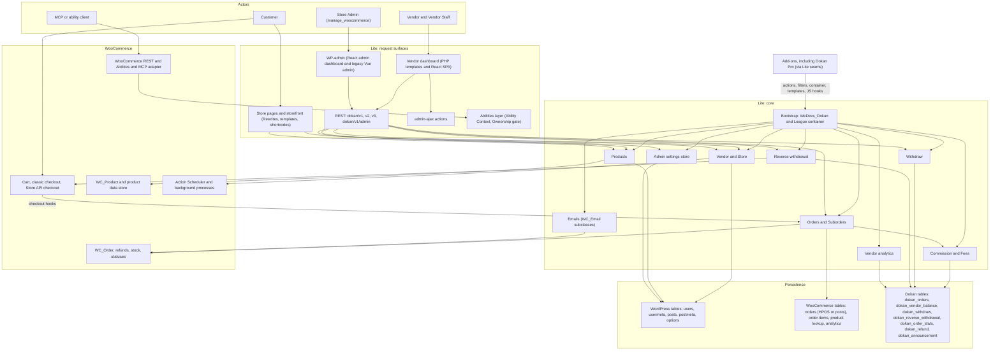

# Dokan Lite system overview

This page is the one-page picture of Dokan Lite. It gives a component diagram, a short narrative of how the system works, and an end-to-end workflow from product creation to Withdraw. It is built only from the verified subsystem documents in this directory: every statement links to the document section that carries the source citation. Read the linked section before relying on a detail.

Conventions (citation prefixes, ownership labels, fired versus consumed hooks) are explained in [README.md](./README.md). Terminology follows [`CONTEXT.md`](../../../CONTEXT.md): **Vendor**, **Store**, **Order**, **Suborder**, **Vendor order**, **Commission** (the admin's share), **Earning** (the Vendor's share), **Balance**, **Withdraw** and **Reverse withdrawal**.

---

## 1. Component diagram

Sources for the diagram: actors and surfaces from [rest-api-and-permissions.md §1](./rest-api-and-permissions.md#1-purpose--ownership) and [security-model-and-testing.md §8.2](./security-model-and-testing.md#82-actor-matrix); core services from [bootstrap-and-container.md §2.4](./bootstrap-and-container.md#24-dokan-name-service-map) and [§3.4](./bootstrap-and-container.md#34-component-diagram); the vendor dashboard and admin apps from [frontend-architecture.md §1](./frontend-architecture.md#1-purpose--ownership) and [admin-dashboard-and-settings.md §5](./admin-dashboard-and-settings.md#5-vendor-dashboard); tables from [database.md §1](./database.md#1-purpose--ownership) and [§4.8](./database.md#48-entity-relationship-diagram); Reverse withdrawal checkout from [woocommerce-integration-catalog-refund-shipping.md §4.7](./woocommerce-integration-catalog-refund-shipping.md#47-withdraw-interplay-with-woocommerce); add-on seams from [extension-seams.md §1](./extension-seams.md#1-purpose--ownership).

---

## 2. The system in one page

**One bounded context, extended in place.** Dokan Lite and Dokan Pro share one domain language, and Pro depends on Lite, never the reverse ([bootstrap-and-container.md §1](./bootstrap-and-container.md#1-purpose--ownership), [ADR-0001](../0001-single-bounded-context-across-lite-and-pro.md)). Add-ons do not call a separate API. They attach to Lite's actions and filters, resolve or replace services in Lite's container, override Lite templates, and contribute routes, slots and globals to Lite's React applications ([extension-seams.md §1](./extension-seams.md#1-purpose--ownership)). The canonical "Dokan is ready" signal is the `dokan_loaded` action ([extension-seams.md §1.1](./extension-seams.md#11-top-seams-at-a-glance)).

**Bootstrap.** `dokan.php` loads the Composer autoloader, builds a League container and adds the root service provider without instantiating any service ([bootstrap-and-container.md §2.1](./bootstrap-and-container.md#21-entry-files)). The plugin initializes inside WooCommerce's `woocommerce_loaded` action, fires `dokan_loaded`, and resolves every service that implements `Hookable` so each one registers its hooks ([§2.3](./bootstrap-and-container.md#23-initialization-sequence), [§4.1](./bootstrap-and-container.md#41-service-resolution-and-the-hookable-pass)). On `init` priority 4, `WeDevs_Dokan::init_classes()` resolves the tagged service groups (`common-service`, then `admin-service` or `frontend-service`, then `container-service`, plus `ajax-service` and `cli-service` when relevant) ([§2.5](./bootstrap-and-container.md#25-tag-groups-and-where-they-are-resolved)). Services are reached as `dokan()->alias`, for example `dokan()->order` or `dokan()->commission` ([§2.4](./bootstrap-and-container.md#24-dokan-name-service-map)). This eager model is deliberate ([ADR-0015](../0015-services-are-resolved-eagerly-from-a-tagged-container.md)).

**Vendors and Stores.** A Vendor is a WordPress user with the `seller` role, and the Store is not a separate entity: there is one Store per Vendor, keyed by the user ID ([vendor-and-store.md §1](./vendor-and-store.md#1-purpose-and-ownership), [ADR-0009](../0009-vendor-is-a-wordpress-user-with-the-seller-role.md)). The Store profile is the serialized `dokan_profile_settings` user meta ([§4.1](./vendor-and-store.md#41-the-vendor-object-and-the-store-profile)). Visitors and Customers become Vendors through four paths, and Selling Activation (`dokan_enable_selling`) decides whether a Vendor may sell ([§4.3](./vendor-and-store.md#43-becoming-a-vendor), [§4.4](./vendor-and-store.md#44-selling-activation-approval)). Store pages are served by Dokan's rewrite rules, which run a product query scoped to the Vendor ([§4.2](./vendor-and-store.md#42-store-url-resolution-and-store-page-rendering)).

**Products.** Dokan adds no product table. A product belongs to the Vendor whose user ID is in `wp_posts.post_author` ([products.md §1](./products.md#1-purpose--ownership), [ADR-0010](../0010-product-ownership-is-post-author.md)). Vendors create products through the legacy PHP editor, an AJAX quick-create popup, or the React editor backed by the `dokan/v3/products` REST API ([§4.2](./products.md#42-legacy-editor-create-and-update), [§4.3](./products.md#43-react-editor-rest-v3)). A new product is published directly only when the Vendor has Direct Publishing; otherwise it starts as `pending` ([§4.4](./products.md#44-product-status-and-publishing-rules)).

**Cart and checkout.** Lite does not limit a cart to one Vendor ([woocommerce-integration-orders.md §1](./woocommerce-integration-orders.md#1-purpose--ownership)). In the cart it enforces purchasability rules, records per-line-item coupon shares, and, when Dokan Pro is not active, splits shipping into one package per Vendor ([§4.1](./woocommerce-integration-orders.md#41-end-to-end-add-to-cart-checkout-suborders-commission-balance), [orders-commission-fees.md §4.8](./orders-commission-fees.md#48-shipping-lite-parts)). Both the classic checkout and the Checkout Block (Store API) reach the same Dokan listeners ([woocommerce-integration-orders.md §4.3](./woocommerce-integration-orders.md#43-classic-checkout-versus-block-checkout-store-api)).

**Suborders.** At checkout, `Order\Manager::maybe_split_orders` groups line items by product author. A single-vendor Order becomes the Vendor order itself; a multi-vendor Order gets one Suborder per Vendor ([orders-commission-fees.md §4.1](./orders-commission-fees.md#41-checkout-to-suborders-to-commission-to-balance), [ADR-0011](../0011-suborders-are-created-synchronously-at-checkout.md)). The Vendor order is authoritative and the parent Order is a mirror: the parent does not reduce stock, status changes cascade from parent to Suborders, and completion rolls up from Suborders to the parent ([woocommerce-integration-orders.md §4.4](./woocommerce-integration-orders.md#44-status-sync-between-parent-order-and-suborders-adr-0004), [ADR-0004](../0004-vendor-order-is-authoritative-parent-is-mirror.md)). Orders go through WooCommerce CRUD, so the same build supports HPOS and posts storage ([woocommerce-integration-orders.md §4.5](./woocommerce-integration-orders.md#45-hpos-versus-posts-storage), [ADR-0017](../0017-orders-are-storage-agnostic-through-woocommerce-crud.md)).

**Commission and Fees.** For each Vendor order, `dokan_sync_insert_order()` computes the Earning and writes a `dokan_orders` row plus a debit row in the `dokan_vendor_balance` ledger ([orders-commission-fees.md §4.1](./orders-commission-fees.md#41-checkout-to-suborders-to-commission-to-balance)). The Commission rate for each line item is resolved through a strategy chain (order item, product, Vendor, global settings, default) and snapshotted onto the order item, so later rate changes do not alter past orders ([§4.3](./orders-commission-fees.md#43-commission-calculation), [ADR-0012](../0012-commission-terms-are-frozen-onto-the-order-at-first-calculation.md)). Shipping, tax and shipping-tax Fee recipients are resolved once per order and persisted, and a PayPal gateway fee can be deducted from the Earning after a status change ([§4.4](./orders-commission-fees.md#44-fees)).

**Money storage.** Marketplace money lives in custom tables, while domain entities reuse WordPress and WooCommerce types ([database.md §4](./database.md#4-custom-tables), [ADR-0013](../0013-marketplace-money-lives-in-custom-tables-not-post-types.md)). The ledger records Earnings as `debit` and Refunds and Withdraws as `credit` ([woocommerce-integration-catalog-refund-shipping.md §4.2.2](./woocommerce-integration-catalog-refund-shipping.md#422-lite-refund-path-dokan-pro-not-active)). Balance counts debits only for ledger rows whose status is in the Withdraw order-status setting (plus `wc-refunded`, which is always added) and whose balance date has passed the Withdraw threshold ([withdraw-and-reverse-withdrawal.md A4.4](./withdraw-and-reverse-withdrawal.md#a44-balance-calculation-available-balance-and-threshold)).

**Refunds.** Refunds are recorded against the Vendor order. When Dokan Pro is not active, `RefundHandler::handle_refund` reacts to `woocommerce_order_refunded` and inserts a credit row for the Vendor's portion into the `dokan_vendor_balance` table with `trn_type` `'dokan_refund'`; when Pro is active, Lite steps aside ([orders-commission-fees.md §4.5](./orders-commission-fees.md#45-refunds-in-lite), [woocommerce-integration-catalog-refund-shipping.md §4.2.2](./woocommerce-integration-catalog-refund-shipping.md#422-lite-refund-path-dokan-pro-not-active)). A refund made directly on a parent Order is outside vendor accounting ([§4.2.4](./woocommerce-integration-catalog-refund-shipping.md#424-parent-orders-and-dokan-pro)).

**Withdraw and Reverse withdrawal.** A Vendor may have one pending Withdraw request at a time; the request is validated against Balance, the minimum limit and the Vendor's active Withdraw methods, and approval inserts a `dokan_withdraw` credit in the ledger ([withdraw-and-reverse-withdrawal.md A4.2](./withdraw-and-reverse-withdrawal.md#a42-creating-a-request), [A4.3](./withdraw-and-reverse-withdrawal.md#a43-approval-and-the-ledger-credit)). When a Vendor collects the full payment directly (by default, cash on delivery), the admin's Commission is recorded as a debt in the separate Reverse withdrawal ledger, which the Vendor settles by buying a hidden WooCommerce product ([Part B](./withdraw-and-reverse-withdrawal.md#part-b-reverse-withdrawal), [ADR-0014](../0014-reverse-withdrawal-is-a-separate-receivable-ledger.md)).

**Request surfaces and the security model.** Lite exposes the `dokan/v1`, `dokan/v2`, `dokan/v3` and `dokan/v1/admin` REST namespaces, `admin-ajax.php` actions, and an Abilities layer for WooCommerce's abilities and four Dokan-native abilities ([rest-api-and-permissions.md §1](./rest-api-and-permissions.md#1-purpose--ownership)). REST versions are additive controller subclasses ([ADR-0016](../0016-rest-versions-are-additive-controller-subclasses.md)). Authorization requires both a capability and Ownership; Vendor Staff resolve to their Vendor for data scope, and `manage_woocommerce` is the canonical admin capability ([security-model-and-testing.md §1](./security-model-and-testing.md#1-purpose--ownership), [ADR-0005](../0005-canonical-admin-capability.md)). Inside an Ability Context, Dokan enforces Ownership itself ([rest-api-and-permissions.md §4.3](./rest-api-and-permissions.md#43-abilities-layer-ability-context-and-the-ownership-gate), [ADR-0006](../0006-ownership-enforced-in-abilities-layer.md), [ADR-0007](../0007-staff-actions-gated-by-dokan-capabilities.md)). Records are kept apart per Vendor by `post_author`, `_dokan_vendor_id`, `dokan_orders.seller_id` and `dokan_withdraw.user_id` ([security-model-and-testing.md §4.5](./security-model-and-testing.md#45-data-isolation-between-vendors)).

**Admin, dashboard and frontend.** The flat `dokan_admin_settings` option is the canonical settings store, kept compatible with legacy per-section rows by a bridge and a mirror ([admin-dashboard-and-settings.md §3](./admin-dashboard-and-settings.md#3-admin-settings-store), [ADR-0002](../0002-flat-dokan-admin-settings-as-canonical-store.md), [ADR-0003](../0003-settings-legacy-mirror-mode.md)). The vendor dashboard combines PHP templates with a React SPA mounted at the `new` endpoint ([§5](./admin-dashboard-and-settings.md#5-vendor-dashboard), [frontend-architecture.md §4.3](./frontend-architecture.md#43-vendor-dashboard-three-react-applications)). The frontend has four coexisting generations of code (jQuery, Vue 2.7, React, and shared library bundles on `window.dokan`) ([frontend-architecture.md §1](./frontend-architecture.md#1-purpose--ownership)). Vendor analytics scope WooCommerce Analytics to a Vendor through the `dokan_order_stats` lookup table ([admin-dashboard-and-settings.md §6](./admin-dashboard-and-settings.md#6-vendor-analytics-and-legacy-reports)). Emails are `WC_Email` subclasses ([§8](./admin-dashboard-and-settings.md#8-emails)).

**Schema evolution.** Tables are created on activation, and later changes are applied by version-named upgrader classes run once from the stored DB version `dokan_theme_version` ([database.md §5.3](./database.md#53-schema-migrations-upgraders), [ADR-0018](../0018-schema-migrations-are-version-named-upgrader-classes.md)).

---

## 3. End-to-end workflow

The diagram follows one sale from product creation to Withdraw. Each node names the document section that cites the code.

```mermaid
flowchart TD
    subgraph P["1. Product creation (products.md 4.2 to 4.4)"]
        P1["Vendor saves product in legacy editor or React editor (dokan/v3)"]
        P2["post_author = Vendor; status publish if Direct Publishing, else pending"]
        P3["do_action dokan_new_product_added or dokan_product_updated"]
        P1 --> P2 --> P3
    end

    subgraph C["2. Cart (woocommerce-integration-orders.md 4.1)"]
        C1["woocommerce_is_purchasable: own-product and catalog-mode rules"]
        C2["woocommerce_cart_shipping_packages: one package per Vendor (Lite without Pro)"]
        C3["woocommerce_coupon_is_valid: fixed_cart coupon limited to one Vendor"]
        C1 --> C2 --> C3
    end

    subgraph K["3. Checkout (woocommerce-integration-orders.md 4.1 and 4.3)"]
        K1{"Checkout type"}
        K2["woocommerce_checkout_update_order_meta"]
        K3["woocommerce_store_api_checkout_order_processed"]
        K1 -- "classic" --> K2
        K1 -- "Checkout Block" --> K3
    end

    subgraph S["4. Suborders (orders-commission-fees.md 4.1)"]
        S1["Order Hooks split_vendor_orders calls Manager maybe_split_orders"]
        S2{"How many Vendors?"}
        S3["One: _dokan_vendor_id on the Order, no Suborder"]
        S4["Several: has_sub_order on parent, create_sub_order per Vendor"]
        S5["do_action dokan_checkout_update_order_meta per Vendor order"]
        S1 --> S2
        S2 -- "one" --> S3 --> S5
        S2 -- "several" --> S4 --> S5
    end

    subgraph M["5. Commission and Balance (orders-commission-fees.md 4.1 to 4.4)"]
        M1["dokan_sync_insert_order: get_earning_by_order"]
        M2["Strategy chain per line item, settings snapshot to item meta"]
        M3["INSERT dokan_orders row and dokan_vendor_balance debit (empty status)"]
        M4["woocommerce_order_status_changed: status cascade, ledger status update"]
        M5["Fees calculate_gateway_fee (priority 100)"]
        M1 --> M2 --> M3 --> M4 --> M5
    end

    subgraph R["6. Refund (woocommerce-integration-catalog-refund-shipping.md 4.2.2)"]
        R1["wc_create_refund on a Vendor order"]
        R2["VendorBalanceUpdateHandler reconciles dokan_orders on woocommerce_update_order"]
        R3{"Dokan Pro active or parent refund?"}
        R4["RefundHandler: INSERT dokan_vendor_balance credit (trn_type dokan_refund), status approved"]
        R5["Lite returns early"]
        R1 --> R2 --> R3
        R3 -- "no" --> R4
        R3 -- "yes" --> R5
    end

    subgraph W["7. Withdraw (withdraw-and-reverse-withdrawal.md A4.2 to A4.4)"]
        W1["Balance = eligible debits minus credits"]
        W2["Vendor requests Withdraw (AJAX or REST), one pending at a time"]
        W3["Admin approves: dokan_withdraw_request_approved"]
        W4["Withdraw Hooks update_vendor_balance: INSERT dokan_withdraw credit"]
        W1 --> W2 --> W3 --> W4
    end

    subgraph RW["Reverse withdrawal branch (withdraw-and-reverse-withdrawal.md B4.2)"]
        X1["Vendor order completed with a Reverse withdrawal gateway (default cod)"]
        X2["order_commission debit in dokan_reverse_withdrawal"]
        X3["Vendor pays via hidden product checkout: vendor_payment credit"]
        X1 --> X2 --> X3
    end

    P3 --> C1
    C3 --> K1
    K2 --> S1
    K3 --> S1
    S5 --> M1
    M5 --> R1
    M5 --> W1
    R4 --> W1
    M4 -. "COD Vendor order completed" .-> X1
```

| Step | What happens | Read |
|---|---|---|
| 1. Product creation | Ownership is set through `post_author`; status follows Direct Publishing; `dokan_new_product_added` / `dokan_product_updated` fire | [products.md §4.2](./products.md#42-legacy-editor-create-and-update), [§4.3](./products.md#43-react-editor-rest-v3), [§4.4](./products.md#44-product-status-and-publishing-rules), [woocommerce-integration-catalog-refund-shipping.md §4.1](./woocommerce-integration-catalog-refund-shipping.md#41-products-and-the-woocommerce-product-data-store) |
| 2. Cart | Purchasability, Vendor shown on cart items, per-Vendor shipping packages, coupon validity and per-item coupon shares | [woocommerce-integration-orders.md §4.1](./woocommerce-integration-orders.md#41-end-to-end-add-to-cart-checkout-suborders-commission-balance), [woocommerce-integration-catalog-refund-shipping.md §4.3](./woocommerce-integration-catalog-refund-shipping.md#43-shipping), [§4.4](./woocommerce-integration-catalog-refund-shipping.md#44-coupons) |
| 3. Checkout | Classic and Block checkout both trigger the split; re-entry on retried payment recreates Suborders | [woocommerce-integration-orders.md §4.2](./woocommerce-integration-orders.md#42-suborder-creation-details), [§4.3](./woocommerce-integration-orders.md#43-classic-checkout-versus-block-checkout-store-api) |
| 4. Suborders | One Vendor order per Vendor; the parent is a mirror | [orders-commission-fees.md §4.1](./orders-commission-fees.md#41-checkout-to-suborders-to-commission-to-balance), [woocommerce-integration-orders.md §4.4](./woocommerce-integration-orders.md#44-status-sync-between-parent-order-and-suborders-adr-0004), [ADR-0004](../0004-vendor-order-is-authoritative-parent-is-mirror.md), [ADR-0011](../0011-suborders-are-created-synchronously-at-checkout.md) |
| 5. Commission and Balance | Earning computed and written to `dokan_orders` and the ledger; status changes set the ledger status; gateway fee deducted | [orders-commission-fees.md §4.2](./orders-commission-fees.md#42-status-changes), [§4.3](./orders-commission-fees.md#43-commission-calculation), [§4.4](./orders-commission-fees.md#44-fees), [database.md §5.2](./database.md#52-how-a-vendor-order-populates-the-tables), [ADR-0012](../0012-commission-terms-are-frozen-onto-the-order-at-first-calculation.md) |
| 6. Refund | Vendor portion credited to the ledger in Lite; Pro takes over when active; parent refunds ignored | [orders-commission-fees.md §4.5](./orders-commission-fees.md#45-refunds-in-lite), [woocommerce-integration-catalog-refund-shipping.md §4.2.2](./woocommerce-integration-catalog-refund-shipping.md#422-lite-refund-path-dokan-pro-not-active), [§4.2.4](./woocommerce-integration-catalog-refund-shipping.md#424-parent-orders-and-dokan-pro) |
| 7. Withdraw | Balance computed from the ledger; request validated; approval writes a credit | [withdraw-and-reverse-withdrawal.md A4.1](./withdraw-and-reverse-withdrawal.md#a41-status-model), [A4.2](./withdraw-and-reverse-withdrawal.md#a42-creating-a-request), [A4.3](./withdraw-and-reverse-withdrawal.md#a43-approval-and-the-ledger-credit), [A4.4](./withdraw-and-reverse-withdrawal.md#a44-balance-calculation-available-balance-and-threshold) |
| Reverse withdrawal | Commission on directly-collected orders becomes a receivable; paid back through checkout | [withdraw-and-reverse-withdrawal.md B4.1](./withdraw-and-reverse-withdrawal.md#b41-transaction-types-and-sign-convention), [B4.2](./withdraw-and-reverse-withdrawal.md#b42-accrual-payment-and-enforcement), [ADR-0014](../0014-reverse-withdrawal-is-a-separate-receivable-ledger.md) |

The excluded cash-on-delivery case connects both ledgers: with the Withdraw setting `exclude_cod_payment` on, a COD order's ledger status is not updated on status changes, so it does not count toward Balance, and the Reverse withdrawal module covers the admin's Commission on such orders ([orders-commission-fees.md §4.2](./orders-commission-fees.md#42-status-changes), [woocommerce-integration-catalog-refund-shipping.md §4.7](./woocommerce-integration-catalog-refund-shipping.md#47-withdraw-interplay-with-woocommerce)).

---

## 4. Where to go next

| Question | Document |
|---|---|
| Which hook should my add-on use? | [extension-seams.md §1.1](./extension-seams.md#11-top-seams-at-a-glance) |
| Which table or meta key holds a value? | [database.md §4](./database.md#4-custom-tables) and [§6](./database.md#6-data-storage-non-table) |
| Who may call a route, and how is Ownership checked? | [rest-api-and-permissions.md §7](./rest-api-and-permissions.md#7-restajax-endpoints) and [§8](./rest-api-and-permissions.md#8-permissions--capabilities) |
| How do I run the tests, and what does CI run? | [security-model-and-testing.md, Testing inventory](./security-model-and-testing.md#testing-inventory) and [§4.7](./security-model-and-testing.md#47-ci-what-runs-when) |
| Why does the code do something surprising? | [decisions-index.md](../decisions-index.md) |

---

## Known gaps

- This page summarizes the subsystem documents and adds no source citations of its own. Any gap recorded in a subsystem document's Known gaps section also applies to the summary of that subsystem here.
- The end-to-end diagram shows the Lite-only path. Where Dokan Pro is active it replaces parts of the flow (the per-Vendor shipping split and refund accounting, as stated in [orders-commission-fees.md §1](./orders-commission-fees.md#1-purpose--ownership) and [woocommerce-integration-orders.md §1](./woocommerce-integration-orders.md#1-purpose--ownership)); what Pro does instead is documented only in Pro's private repository.
- The diagram does not show the Vendor dashboard "refunded" status path (`Order\Hooks::manage_refunded_for_order`), because [woocommerce-integration-catalog-refund-shipping.md §4.2.3](./woocommerce-integration-catalog-refund-shipping.md#423-vendor-dashboard-status-change-to-refunded) records that it could not be confirmed that any Lite surface meets all of that path's conditions.
- The diagram does not show the lazy split for orders created in WP-admin, the Reverse withdrawal failed actions, or Withdraw cancellation; see [orders-commission-fees.md §4.1](./orders-commission-fees.md#41-checkout-to-suborders-to-commission-to-balance), [withdraw-and-reverse-withdrawal.md B4.2](./withdraw-and-reverse-withdrawal.md#b42-accrual-payment-and-enforcement) and [A4.1](./withdraw-and-reverse-withdrawal.md#a41-status-model).
- The component diagram groups classes into components for readability. The grouping is an editorial view; the container's actual registration is in [bootstrap-and-container.md §2.4 and §2.5](./bootstrap-and-container.md#24-dokan-name-service-map).

_Verified against Lite @63ad89353 / Pro @a8a98c732 / WooCommerce 11.2.1 — 2026-10-14._
