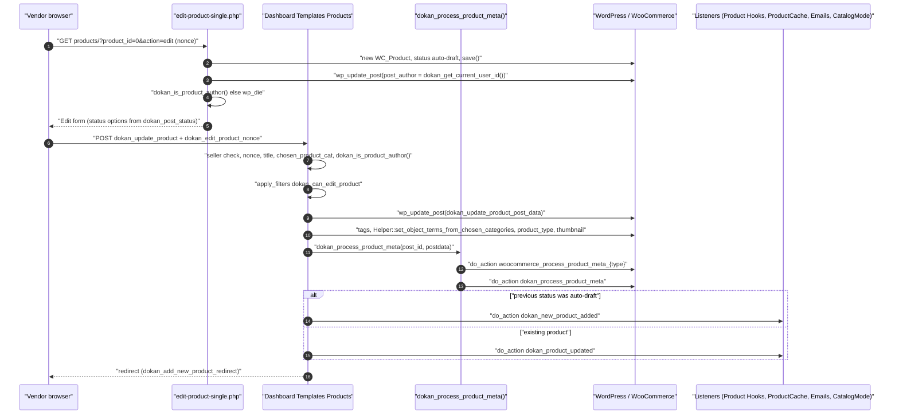
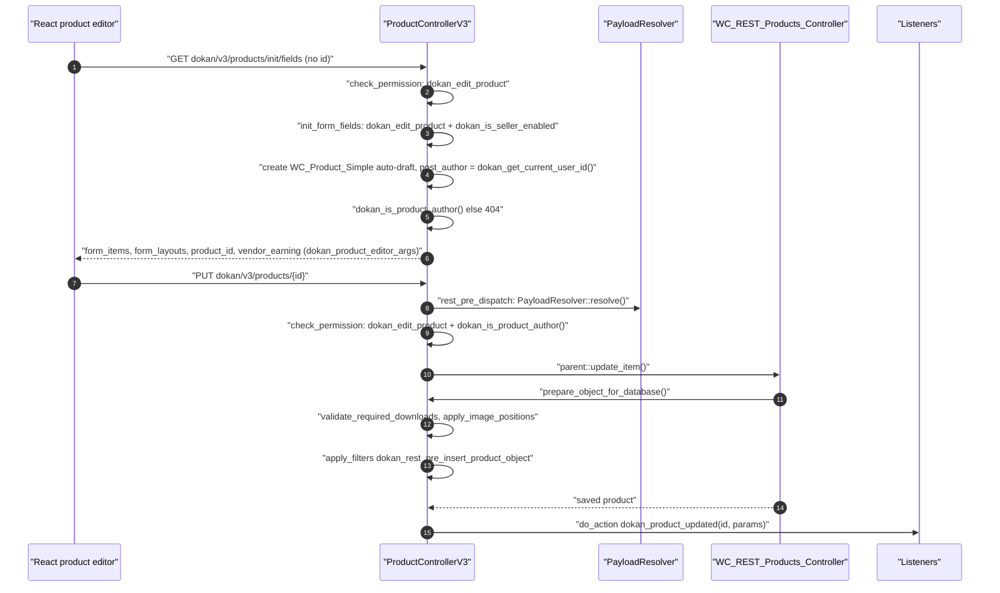
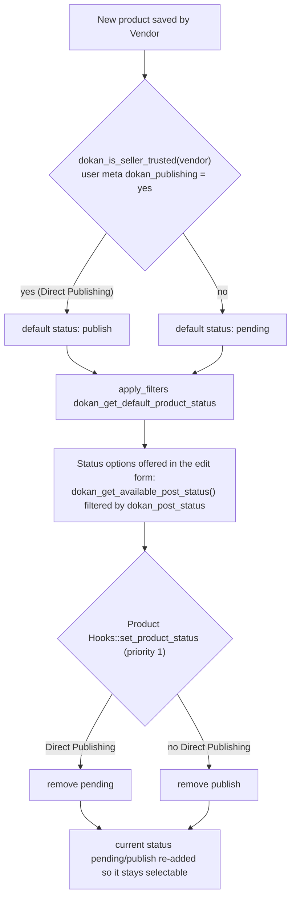

# Products (Dokan Lite)

This document covers how Dokan Lite models marketplace products on top of WooCommerce: who owns a product, how a Vendor creates and edits one from the vendor dashboard (legacy PHP form, AJAX quick-create popup, and the React product editor), how status and publishing rules apply, and the supporting subsystems for product categories, store product sections, catalog mode, product blocks and status rollback.

Related reading:

- `CONTEXT.md` for canonical terms (**Vendor**, **Vendor Staff**, **Store Admin**, **Ownership**, **Vendor Scope**, **Direct Publishing**).
- [ADR-0006](../0006-ownership-enforced-in-abilities-layer.md) (Ownership enforced by the Abilities layer) and [ADR-0007](../0007-staff-actions-gated-by-dokan-capabilities.md) (Vendor Staff actions gated by Dokan capabilities).
- `docs/product-editor.md` for the React product editor's form-schema reference.

---

## 1. Purpose & ownership

| Concern | Owner |
|---|---|
| Product storage (`product` / `product_variation` post types, `WC_Product` CRUD, data stores, product REST v3 base controller) | [WooCommerce] |
| Vendor Ownership of a product (the WordPress `post_author` column), vendor-dashboard create/edit/delete, product status defaults, chosen-category bookkeeping, store product sections, catalog mode, product block configuration | [Lite] |
| Additional product types, extra status values, extra editor fields | Consumed by Dokan Pro through the filters listed in section 11 (not documented here) |

**Ownership model.** Dokan adds no product table and no "vendor id" meta. A product belongs to the Vendor whose user ID is in `wp_posts.post_author`. Every ownership check goes through that column:

- `dokan_is_product_author()` (`lite:includes/functions.php:148`) compares `post_author` with `dokan_get_current_user_id()`. The value it compares against passes through the filter `dokan_is_product_author`.
- `dokan_get_current_user_id()` (`lite:includes/functions.php:52`) returns the user's own ID, except for a user with the `vendor_staff` capability: for them it returns the Vendor ID stored in the user meta `_vendor_id`. This is how **Vendor Staff** share the Vendor's data boundary (Vendor Scope).
- `dokan_get_vendor_by_product()` (`lite:includes/Product/functions.php:553`) resolves the owning Vendor from `post_author`. For a variation with no author it falls back to the parent's author. The result passes through the filter `dokan_get_vendor_by_product`.

**Related ADRs:** [ADR-0010](../0010-product-ownership-is-post-author.md) (Product Ownership is `post_author`), [ADR-0006](../0006-ownership-enforced-in-abilities-layer.md) (Ownership in the Abilities layer), [ADR-0007](../0007-staff-actions-gated-by-dokan-capabilities.md) (Vendor Staff gated by Dokan capabilities), [ADR-0016](../0016-rest-versions-are-additive-controller-subclasses.md) (product REST v1, v2 and v3 side by side).

## 2. Entry points & bootstrap

| Entry point | Location | How it is loaded |
|---|---|---|
| `dokan()->product` service (`Product\Manager`) | `lite:includes/DependencyManagement/Providers/ServiceProvider.php:30` | Container alias `product` |
| `dokan()->product_editor` service (`ProductEditor\FormSchema`) | `lite:includes/DependencyManagement/Providers/ServiceProvider.php:52` | Container alias `product_editor` |
| `dokan()->product_sections` (`ProductSections\Manager`) | `lite:includes/DependencyManagement/Providers/ServiceProvider.php:42` | Container alias |
| `dokan()->catalog_mode` (`CatalogMode\Controller`) | `lite:includes/DependencyManagement/Providers/ServiceProvider.php:45` | Container alias |
| `dokan()->product_block` (`Blocks\ProductBlock`) | `lite:includes/DependencyManagement/Providers/ServiceProvider.php:23` | Container alias |
| `Product\Hooks` | `lite:includes/DependencyManagement/Providers/CommonServiceProvider.php:15` | Shared common service; hooks registered in `lite:includes/Product/Hooks.php:23` |
| `ProductCategory\Hooks` | `lite:includes/DependencyManagement/Providers/CommonServiceProvider.php:16` | Shared common service; `lite:includes/ProductCategory/Hooks.php:19` |
| `Abilities\ProductAbilityScope` | `lite:includes/DependencyManagement/Providers/CommonServiceProvider.php:29` | `Hookable`; `register_hooks()` at `lite:includes/Abilities/ProductAbilityScope.php:109`, invoked by the `Hookable` loop in `lite:dokan-class.php:276` |
| Vendor-dashboard form handlers (`Dashboard\Templates\Products`) | `lite:includes/Dashboard/Templates/Manager.php:28` | Instantiated by the dashboard templates manager; hooks at `lite:includes/Dashboard/Templates/Products.php:29` |
| Product procedural helpers | `lite:includes/Product/functions.php` | `require_once` in `WeDevs_Dokan::includes()` (`lite:dokan-class.php`) |
| AJAX quick-create (`wp_ajax_dokan_create_new_product`) | `lite:includes/Ajax.php:44` → `Ajax::create_product` (`lite:includes/Ajax.php:128`) | Ajax service |
| REST controllers `dokan/v1`, `dokan/v2`, `dokan/v3` products | `lite:includes/REST/Manager.php` (`dokan_rest_api_class_map`) | `rest_api_init` |
| `ProductStatusRollback` | `lite:includes/ProductStatusRollback.php:46` | See Known gaps: no Lite registration was found at this revision |

## 3. Key classes

| Class | File | Responsibility |
|---|---|---|
| `WeDevs\Dokan\Product\Manager` | `lite:includes/Product/Manager.php:18` | Thin product service over `WC_Product`: `all()` (cached `WP_Query`), `get()`, `create()` / `update()` (maps an args array onto WooCommerce setters and saves), `delete()`, `featured()`, `latest()`, `best_selling()`, `top_rated()`, commission settings (`get_commission_settings()` / `save_commission_settings()`), brands (`save_brands()` / `get_brands()`). |
| `WeDevs\Dokan\Product\Hooks` | `lite:includes/Product/Hooks.php:16` | Status options (`set_product_status`), vendor bulk delete, store-page product search AJAX, chosen-category sync, new-variation author assignment, brand support, per-product commission fields in WP admin, "own product" notice, product-review notification recipients. |
| `WeDevs\Dokan\Product\ProductCache` | `lite:includes/Product/ProductCache.php:18` | Invalidates per-Vendor product cache groups on product lifecycle events. |
| `WeDevs\Dokan\Product\VendorStoreInfo` | `lite:includes/Product/VendorStoreInfo.php:14` | Prints the Vendor's store info on the single product page (`woocommerce_product_meta_end`) and registers its admin setting. |
| `WeDevs\Dokan\Product\ProductAttribute` | `lite:includes/Product/ProductAttribute.php:17` | Builds/sets product attributes for REST requests; `contains_php_object()` rejects serialized PHP objects in meta values. |
| `WeDevs\Dokan\Dashboard\Templates\Products` | `lite:includes/Dashboard/Templates/Products.php:15` | Legacy vendor-dashboard handlers: add (`handle_product_add`), update (`handle_product_update`), delete (`handle_delete_product`) and the template loaders for listing/new/edit screens. |
| `WeDevs\Dokan\REST\ProductControllerV3` | `lite:includes/REST/ProductControllerV3.php:19` | `dokan/v3/products` REST API used by the React product editor; extends `WC_REST_Products_Controller` and adds Ownership checks, payload resolution, validation and the `dokan_new_product_added` / `dokan_product_updated` bridge. |
| `WeDevs\Dokan\REST\ProductController` / `ProductControllerV2` | `lite:includes/REST/ProductController.php:30`, `lite:includes/REST/ProductControllerV2.php:18` | `dokan/v1` and `dokan/v2` product endpoints (listing, CRUD, summary, public storefront collections). |
| `WeDevs\Dokan\ProductEditor\FormSchema` | `lite:includes/ProductEditor/FormSchema.php` | Builds the React editor's field schema and layouts (`get_schema()` at line 479, `get_layouts()` at line 235) and resolves per-product values. |
| `WeDevs\Dokan\ProductEditor\PayloadResolver` | `lite:includes/ProductEditor/PayloadResolver.php:25` | Translates editor payloads (keyed by schema field id) into the WooCommerce REST product shape. |
| `WeDevs\Dokan\ProductEditor\Elements` | `lite:includes/ProductEditor/Elements.php:12` | Constants for section, layout, product-type and field ids. |
| `WeDevs\Dokan\Admin\Dashboard\LegacySwitcher` | `lite:includes/Admin/Dashboard/LegacySwitcher.php:270` | Decides whether the legacy PHP editor or the React editor is used (`is_product_editor_legacy_preferred()`) and builds the React editor URL. |
| `WeDevs\Dokan\Abilities\ProductAbilityScope` | `lite:includes/Abilities/ProductAbilityScope.php:38` | Applies Vendor Scope to WooCommerce product REST permission checks, product queries and WordPress Abilities (see ADR-0006). |
| `WeDevs\Dokan\ProductCategory\Helper` | `lite:includes/ProductCategory/Helper.php` | Category selection mode and "chosen category" logic (`generate_chosen_categories()` line 113, `set_object_terms_from_chosen_categories()` line 174). |
| `WeDevs\Dokan\ProductCategory\Categories` | `lite:includes/ProductCategory/Categories.php:6` | Builds the in-memory category tree (parents, children, breadcrumbs) for the multi-step category picker. |
| `WeDevs\Dokan\ProductCategory\Hooks` / `ProductCategoryCache` | `lite:includes/ProductCategory/Hooks.php:12`, `lite:includes/ProductCategory/ProductCategoryCache.php` | Repairs `chosen_product_cat` meta when a term is deleted; clears category caches. |
| `WeDevs\Dokan\ProductSections\Manager` + `AbstractProductSection`, `Featured`, `Latest`, `BestSelling`, `TopRated` | `lite:includes/ProductSections/Manager.php:17` | Extra product sections on the single Store page, toggled in the Customizer. |
| `WeDevs\Dokan\CatalogMode\Controller` + `Hooks`, `Helper`, `Dashboard\Products`, `Dashboard\ProductBulkEdit`, `Dashboard\Settings`, `Admin\Settings` | `lite:includes/CatalogMode/Controller.php:21` | Catalog mode: hide the add-to-cart button and optionally the price, per product or per Vendor. |
| `WeDevs\Dokan\Blocks\ProductBlock` | `lite:includes/Blocks/ProductBlock.php:10` | Configuration payload (statuses, visibility, stock, tags, default category) for the block-based product UI. |
| `WeDevs\Dokan\ProductStatusRollback` | `lite:includes/ProductStatusRollback.php:15` | Batch job that moves products in a `reject` status back to `draft` (see Known gaps). |

## 4. Execution flow

### 4.1 Which editor does a Vendor get?

`dokan_edit_product_url()` (`lite:includes/functions.php:1009`) builds every "edit product" link. It asks `LegacySwitcher::is_product_editor_legacy_preferred()` with the product author's user ID. The switcher reads the site-wide option `dokan_appearance['vendor_product_editor']`: the value `latest` selects the React editor, and any other value selects the legacy PHP editor. Anonymous contexts (cron, e-mails with no current user) get the React editor URL.

- Legacy editor URL: `{dashboard}/products/?product_id={id}&action=edit&_dokan_edit_product_nonce=…`
- React editor URL: `{dashboard}/new/#products/{id}/edit`, or `…#products/create` for a new product (`LegacySwitcher::get_new_product_editor_url`, built on `dokan_get_navigation_url( 'products', true )`).

The final URL passes through the filter `dokan_get_edit_product_url`.

### 4.2 Legacy editor: create and update

The legacy flow has three ways in. All three end in `dokan_new_product_added` or `dokan_product_updated`.

**a) Edit-form auto-draft (the main path).** `templates/products/edit-product-single.php` handles `product_id=0` by creating an `auto-draft` `WC_Product` and immediately setting `post_author` to `dokan_get_current_user_id()`. It then refuses to render (`wp_die`) unless `dokan_is_product_author()` passes. The form posts to `Products::handle_product_update` (`lite:includes/Dashboard/Templates/Products.php:456`), which:

1. Returns early unless the user is logged in, `dokan_is_user_seller()` is true, `dokan_update_product` is posted and the nonce `dokan_edit_product` verifies.
2. Collects errors for an empty title, a missing product id, a failed `dokan_is_product_author()` check, an empty `chosen_product_cat`, and a tag count above `dokan_product_tags_select_max_length` (default `-1`, no limit). The error list is filtered through `dokan_can_edit_product`; any error aborts the save.
3. Calls `wp_update_post()` with the array filtered through `dokan_update_product_post_data` (ID, title, content, excerpt, `post_status`, `comment_status` from `_enable_reviews`). An `editable-post-name` slug is made unique with `wp_unique_post_slug()`.
4. Sets tags, chosen categories (section 4.5), the `product_type` term and the featured image.
5. Calls `dokan_process_product_meta()` (`lite:includes/wc-functions.php:14`). That function writes WooCommerce meta (downloadable/virtual, gallery, prices, stock, downloads and so on), fires `dokan_process_file_download` for download permission sync, then fires the WooCommerce-named action `woocommerce_process_product_meta_{$product_type}` and Dokan's `dokan_process_product_meta`, and finally calls `wc_delete_product_transients()`. When it rebuilds the downloadable files from `_wc_file_urls`, a file whose URL is unchanged keeps its stored download id, so buyers' existing download permissions (download limit, expiry and count) survive the save. Stored ids are queued per URL, so two files that share one URL each keep their own id, and only a new file gets the id `md5( url )` (`lite:includes/wc-functions.php:345-354`).
6. Fires `dokan_new_product_added` when the product was an `auto-draft` before this save, otherwise `dokan_product_updated`.

**b) Full "add new product" form.** `Products::handle_product_add` (`lite:includes/Dashboard/Templates/Products.php:287`) handles `dokan_add_new_product_nonce` / `add_product`. It validates the title and category (single vs. multiple selection mode), filters errors through `dokan_can_add_product`, inserts the post with `wp_insert_post()` using the array filtered through `dokan_insert_product_post_data`, and sets `post_status` to `dokan_get_default_product_status()`. Because `post_author` is not passed, WordPress assigns the current user. It then writes tags, categories, type, gallery, prices and sale dates as post meta and fires `dokan_new_product_added`. The `templates/products/new-product.php` template is only rendered by `render_new_product_template` when Dokan Pro is not active.

**c) AJAX quick-create popup.** `Ajax::create_product` (`lite:includes/Ajax.php:128`) checks the `dokan_reviews` AJAX referer and the `dokan_add_product` capability, then calls `dokan_save_product()` (`lite:includes/Product/functions.php:19`). That function validates the title and category, applies `dokan_new_product_popup_args` (which may return a `WP_Error`), and refuses an update to a product that fails `dokan_is_product_author()`. It applies `dokan_insert_product_post_data` and delegates to `Product\Manager::create()`, then sets chosen categories and fires `dokan_new_product_added` or `dokan_product_updated`.

**Delete.** `Products::handle_delete_product` (`lite:includes/Dashboard/Templates/Products.php:615`) requires `dokan_is_user_seller()`, the `dokan_delete_product` capability, the `dokan-delete-product` nonce and `dokan_is_product_author()`. It fires `dokan_product_delete`, force-deletes through `dokan()->product->delete( $id, true )`, then fires `dokan_product_deleted`.

**Bulk actions.** `Product\Hooks::bulk_product_status_change` (`lite:includes/Product/Hooks.php:253`) requires `dokan_delete_product` and the `bulk_product_status_change` nonce, then fires `dokan_bulk_product_status_change( $status, $product_ids )`. Lite's own listeners are `Hooks::bulk_product_delete` (status `delete`; deletes only products that pass `dokan_is_product_author()`, wrapped in `dokan_product_bulk_delete` / `dokan_product_bulk_deleted`) and `CatalogMode\Dashboard\ProductBulkEdit::save_bulk_edit_catalog_mode_data` (statuses `enable_catalog_mode` / `disable_catalog_mode`, also limited to the Vendor's own products). The bulk options shown are filtered through `dokan_bulk_product_statuses`.

### 4.3 React editor (REST v3)

Key points, all in `lite:includes/REST/ProductControllerV3.php`:

- `register_routes()` (line 195) registers create, update, batch, `init/fields` and `{id}/fields` routes, and hooks `resolve_product_payload_before_validation` on `rest_pre_dispatch`. That callback rewrites only `dokan/v3/products` and `dokan/v3/products/{id}` request bodies through `PayloadResolver::resolve()`, so WooCommerce's schema validation sees a WooCommerce-shaped payload.
- `init_form_fields()` (line 592) creates the `auto-draft` product for a new editor session and assigns `post_author` explicitly. The React editor therefore edits an existing, Vendor-owned id, much like the legacy auto-draft path. A `type` query parameter preselects the product type when it is a registered WooCommerce product type.
- `prepare_object_for_database()` (line 340) runs on every save (create, update, batch). It rejects a downloadable product with no file when the form schema marks "Downloadable Files" as required and visible. It restores the featured/gallery image split, applies `dokan_rest_pre_insert_product_object` (extensions can return `WP_Error` to reject the save), and fires `dokan_process_file_download` on updates that touch downloads.
- `save_downloadable_files()` (line 537) overrides WooCommerce's method of the same name (`wc:includes/rest-api/Controllers/Version2/class-wc-rest-products-v2-controller.php:1573`). The React editor sends a file's attachment id as `id`, so before delegating to the parent the override replaces that id with the stored download id of any still-attached file whose URL is unchanged. As in the legacy path, ids are queued per URL, so files that share a URL each keep their own id, and buyers' download permissions stay valid.
- `create_item()` / `update_item()` copy the resolved params into `$_POST` (`populate_post_data`) so that legacy listeners reading `$_POST` keep working. They then fire `dokan_new_product_added` / `dokan_product_updated`.
- `batch_items()` resolves each `create`/`update` item through `PayloadResolver` before delegating to WooCommerce. WooCommerce calls `update_item_permissions_check()` / `delete_item_permissions_check()` per item, and that is where the Ownership check applies inside a batch.

### 4.4 Product status and publishing rules

- **Default status.** `dokan_get_default_product_status()` (`lite:includes/functions.php:533`) returns `publish` when the Vendor has **Direct Publishing** (`dokan_is_seller_trusted()`, `lite:includes/functions.php:1186`, which reads user meta `dokan_publishing === 'yes'`), otherwise `pending`. It applies the deprecated filter `dokan_get_new_post_status` and then `dokan_get_default_product_status( $status, $seller_id, $is_trusted )`. While Dokan Pro is active below version 3.8.3, a non-`publish` result falls back to the option `dokan_selling['product_status']`.
- **Where the default is used.** It is used by the full add form (`handle_product_add`), `dokan_save_product()` when no status is posted, the legacy "others" section (`Products::load_others_template`, through the filter `dokan_post_edit_default_status`), and the React editor's status field value for an `auto-draft` (`FormSchema::resolve_field_value`, case `Elements::STATUS`, which also applies `dokan_post_edit_default_status`).
- **Selectable statuses.** `dokan_get_available_post_status()` (`lite:includes/functions.php:755`) offers `publish`, `draft` and `pending`, filtered through `dokan_post_status( $statuses, $product_id )`. `Product\Hooks::set_product_status` (`lite:includes/Product/Hooks.php:368`, priority 1) removes `publish` for Vendors without Direct Publishing and removes `pending` for Vendors with it. It then adds the product's current `pending` or `publish` status back so the status in effect stays selectable. Logged-out callers get `draft` only. The React editor's status field uses the same function for its options (`FormSchema`, `Elements::STATUS` field), and the block UI configuration exposes it as `statuses` (`ProductBlock::get_configurations`).
- **Display labels.** `dokan_get_post_status()` (`lite:includes/functions.php:727`) maps `publish`, `draft`, `pending` and `future` to labels (filter `dokan_get_post_status`). `Product\Manager::all()` lists `publish`, `draft`, `pending` and `future` by default (filter `dokan_get_product_status`).
- **Notifications.** `Product\Hooks::set_new_product_email_status` sets meta `_dokan_new_product_email_sent = no` on `dokan_new_product_added`. The `NewProduct` e-mail (to admin, product `publish`) and the `NewProductPending` e-mail (product `pending`) both listen to `dokan_new_product_added` and `dokan_product_updated`, send once, and then set the meta to `yes`. When a Store Admin moves a product from pending to publish, `Admin\Hooks::send_notification_on_product_publish` (on WordPress's `pending_to_publish`) fires `dokan_pending_product_published_notification`, which the `ProductPublished` e-mail handles.

### 4.5 Chosen categories

Dokan keeps the categories the Vendor actually picked in post meta `chosen_product_cat`, separately from the `product_cat` terms:

- `Helper::product_category_selection_is_single()` reads `dokan_selling['product_category_style']` (`single` by default). `Helper::is_any_category_selection_enabled()` reads `dokan_selling['dokan_any_category_selection']`.
- `Helper::set_object_terms_from_chosen_categories()` saves `chosen_product_cat` and assigns terms with `wp_set_object_terms()`. Unless "any category selection" is on, it assigns every ancestor of each chosen category as well.
- `Helper::generate_chosen_categories()` goes the other way: from a set of assigned terms it derives the deepest term per lineage. `Product\Hooks::update_product_categories` uses it on admin quick/bulk edit (`woocommerce_product_quick_edit_save`, `woocommerce_product_bulk_edit_save`), on admin saves (`woocommerce_new_product`, `woocommerce_update_product` while `is_admin()`), and on Vendor saves (`dokan_new_product_added`, `dokan_product_updated` via `sync_category_data_for_commission`), so commission and other category-dependent logic sees a consistent chosen set.
- When a term is deleted, `ProductCategory\Hooks::add_chosen_categories_to_action_queue` (on `pre_delete_term`) pages through `chosen_product_cat` meta and queues `dokan_delete_reference_category_from_chosen_cat` jobs (WooCommerce Action Scheduler). These jobs replace the deleted id with its parent or with the `default_product_cat` option.

### 4.6 Variation authorship and admin reassignment

- `Product\Hooks::set_new_variation_author_to_vendor` (`lite:includes/Product/Hooks.php:73`) filters WooCommerce's `woocommerce_new_product_variation_data` so a new variation's `post_author` is the parent product's Vendor, even when a Store Admin creates it.
- `Admin\Hooks::override_product_author_by_admin` (on `woocommerce_process_product_meta`, priority 12) lets a Store Admin reassign a product from the WP-admin "Vendor" meta box (`dokan_product_author_override`). `dokan_override_product_author()` updates `post_author` on the product and on its variations (for `variable` / `variable-subscription`) and fires `dokan_after_override_product_author`.
- `ProductAbilityScope::assign_vendor_as_product_author` (`lite:includes/Abilities/ProductAbilityScope.php:257`, on `woocommerce_new_product` priority 99) sets `post_author` to the acting Vendor for products created in a vendor Ability Context, or to an explicitly selected `vendor_id`.

### 4.7 Storefront features

- **Store product sections.** `ProductSections\Manager::render_additional_product_sections` (on `dokan_store_profile_frame_after`, priority 20) renders `featured`, `latest`, `best_selling` and `top_rated` blocks for the Store being viewed, via `dokan_get_featured_products()` and its siblings in `wc-functions.php`, which call `Product\Manager`. Each section is shown only when the Customizer setting `dokan_appearance['product_sections'][{id}]` is explicitly not `on` (the stored `on` means "hide"). Titles come from `dokan_appearance['product_sections'][{id}_title]`.
- **Store product search.** `Product\Hooks::store_product_search_action` serves `wp_ajax(_nopriv)_dokan_store_product_search_action` (nonce `dokan_store_product_search_nonce`). It searches title, content and `_sku` among `publish` products of one Store (`post_author`), limited to 100 results, filterable through `dokan_store_product_search_results`.
- **Catalog mode.** Active only when the Store Admin enables `dokan_selling['catalog_mode_hide_add_to_cart_button']`. `CatalogMode\Hooks` then filters `woocommerce_is_purchasable` (priority 20) and `woocommerce_get_price_html` (priority 9). Per-product settings live in meta `_dokan_catalog_mode` and per-Vendor settings in the store info `catalog_mode` key. Price hiding additionally needs `dokan_selling['catalog_mode_hide_product_price']`.
- **Own product notice.** `Product\Hooks::own_product_not_purchasable_notice` (on `woocommerce_before_single_product`) prints a notice to the product's own Vendor, except for `auction` products.
- **Review notifications.** `Product\Hooks::product_review_notification_recipients` (on `comment_notification_recipients`) removes the Vendor's address from product-review notification e-mails and adds `admin_email`.

## 5. Hooks

### 5.1 Hooks Dokan Lite fires

| Hook | Type | Fired in | Purpose |
|---|---|---|---|
| `dokan_new_product_added` | action `( $product_id, $data )` | `Products::handle_product_add`, `Products::handle_product_update` (auto-draft), `dokan_save_product()`, `ProductControllerV3::create_item`, `REST\Manager::on_dokan_rest_insert_product` | A Vendor product was created |
| `dokan_product_updated` | action `( $product_id, $data )` | `Products::handle_product_update`, `dokan_save_product()`, `ProductControllerV3::update_item` | A Vendor product was updated |
| `dokan_product_delete` / `dokan_product_deleted` | action `( $product_id )` | `Products::handle_delete_product` | Before/after single delete |
| `dokan_bulk_product_status_change` | action `( $status, $product_ids )` | `Product\Hooks::bulk_product_status_change` | Dashboard bulk action dispatch |
| `dokan_product_bulk_delete` / `dokan_product_bulk_deleted` | action `( $product_ids )` | `Product\Hooks::bulk_product_delete` | Before/after bulk delete |
| `dokan_process_product_meta` | action `( $post_id )` | `dokan_process_product_meta()` | After legacy meta save |
| `woocommerce_process_product_meta_{$product_type}` | action `( $post_id )` | `dokan_process_product_meta()` (`lite:includes/wc-functions.php:442`) | Dokan fires this WooCommerce-named hook so WooCommerce-style listeners run on vendor saves. WooCommerce itself fires it in `wc:includes/admin/meta-boxes/class-wc-meta-box-product-data.php:461` |
| `dokan_process_file_download` | action `( $product_id, $variation_id, $files )` | `dokan_process_product_meta()`, `ProductControllerV3::prepare_object_for_database` | Sync download permissions |
| `dokan_after_override_product_author` | action `( $product, $seller_id )` | `dokan_override_product_author()` | After Store Admin reassigns Ownership |
| `dokan_pending_product_published_notification` | action `( $post, $seller )` | `Admin\Hooks::send_notification_on_product_publish` | Pending to publish |
| `dokan_before_product_rollback` / `dokan_after_product_status_rollback` | action `( $product, $target_status )` | `ProductStatusRollback::process_reject_operation` | Around a rollback |
| `dokan_rest_insert_product_object` | action `( $object, $request, $creating )` | `DokanRESTController::create_item` / `update_item` (v1/v2) | After v1/v2 save |
| `dokan_get_default_product_status` | filter `( $status, $seller_id, $is_trusted )` | `dokan_get_default_product_status()` | Default status for new products |
| `dokan_get_new_post_status` | filter (deprecated since 3.8.2) | same | Legacy alias |
| `dokan_post_status` | filter `( $statuses, $product_id )` | `dokan_get_available_post_status()` | Selectable statuses |
| `dokan_get_post_status` | filter | `dokan_get_post_status()` | Status labels |
| `dokan_post_edit_default_status` | filter `( $status, $product )` | `Products::load_others_template`, `FormSchema::resolve_field_value` | Pre-selected status in editors |
| `dokan_get_product_status` | filter | `Product\Manager::all()` | Statuses listed by default |
| `dokan_all_products_query`, `dokan_featured_products_query`, `dokan_latest_products_query`, `dokan_best_selling_products_query`, `dokan_top_rated_products_query` | filter | `Product\Manager` | Query args |
| `dokan_is_product_author` | filter `( $current_vendor_id, $product_id )` | `dokan_is_product_author()` | Ownership comparison value |
| `dokan_get_vendor_by_product` | filter `( $vendor_id, $product )` | `dokan_get_vendor_by_product()` | Owning Vendor resolution |
| `dokan_can_add_product` / `dokan_can_edit_product` | filter `( $errors )` | `Products::handle_product_add` / `handle_product_update` | Add validation errors |
| `dokan_new_product_popup_args` | filter `( '', $data )` | `dokan_save_product()` | Return `WP_Error` to reject |
| `dokan_insert_product_post_data` / `dokan_update_product_post_data` | filter | legacy handlers, `dokan_save_product()` | Post array before insert/update |
| `dokan_product_tags_select_max_length` | filter (default `-1`) | `Products::handle_product_update`, `dokan_save_product()`, `ProductBlock::get_configurations`, `Assets` (script data) | Tag limit |
| `dokan_add_new_product_redirect` | filter `( $url, $product_id )` | legacy handlers | Post-save redirect |
| `dokan_get_edit_product_url` | filter `( $url, $product )` | `dokan_edit_product_url()` | Edit link |
| `dokan_bulk_product_statuses` | filter | `Products::render_product_listing_template` | Bulk action options |
| `dokan_product_row_actions` / `dokan_product_row_action_html` | filter | `dokan_product_get_row_action()` | Listing row actions |
| `dokan_product_types` | filter | legacy edit template, `FormSchema::get_product_types`, v2 listing | Product types offered (Lite default: `simple`) |
| `dokan_hide_inventory_template` | filter `( false, $post_id )` | `Products::load_inventory_template` | Hide inventory section |
| `dokan_restrict_product_image_gallery_on_edit` | filter | `dokan_process_product_meta()` | Gallery restriction |
| `dokan_rest_pre_insert_product_object` | filter `( $product, $request, $creating )` | `ProductControllerV3::prepare_object_for_database` | Reject/modify a v3 save |
| `dokan_product_editor_args` | filter `( $args, $product_id, $product )` | `ProductControllerV3::init_form_fields` | Editor bootstrap payload |
| `dokan_rest_prepare_product_editor_fields` | filter | `ProductControllerV3::get_form_fields` | Fields payload |
| `dokan_product_editor_schema`, `dokan_product_editor_prepared_schema`, `dokan_product_editor_layouts`, `dokan_product_editor_layout_children`, `dokan_product_editor_schema_value` | filter | `FormSchema` | Editor schema, layouts, custom field values |
| `dokan_product_editor_schema_payload`, `dokan_product_editor_single_select_fields` | filter | `PayloadResolver` | Payload translation |
| `dokan_multistep_product_categories` | filter | `Categories::get` | Category tree for the picker |
| `dokan_get_product_categories_tree` | filter | `Helper::get_product_categories_tree` | Category tree |
| `dokan_product_sections_container` | filter | `ProductSections\Manager::init_classes` | Register/replace store sections |
| `dokan_{section_id}_product_section_item_count`, `dokan_{section_id}_product_section_title` | filter | `AbstractProductSection`, section classes | Section size/title |
| `dokan_catalog_mode_hide_add_to_cart_button`, `dokan_catalog_mode_hide_product_price`, `dokan_catalog_mode_vendor_settings`, `dokan_catalog_mode_default_vendor_settings` | filter | `CatalogMode\Hooks`, `CatalogMode\Helper` | Catalog mode overrides |
| `dokan_get_product_block_configurations` | filter | `ProductBlock::get_configurations` | Block UI config |
| `dokan_product_rollback_status` | filter (default `draft`) | `ProductStatusRollback` | Rollback target |
| `dokan_store_product_search_results` | filter | `Product\Hooks::store_product_search_action` | Store search results |
| `dokan_product_cache_delete_all_data` | filter | `ProductCache::delete` | Skip cache flush |

### 5.2 Hooks Dokan Lite consumes

| Hook | Owner / fired at | Callback | Purpose |
|---|---|---|---|
| `template_redirect` | [WordPress] | `Products::handle_product_add`, `handle_product_update` (11), `handle_delete_product`, `render_product_edit_page_for_email` (1); `Product\Hooks::bulk_product_status_change` | Legacy form handling |
| `wp_ajax_dokan_create_new_product` | [WordPress] | `Ajax::create_product` | Quick-create popup |
| `wp_ajax_dokan_store_product_search_action`, `wp_ajax_nopriv_dokan_store_product_search_action` | [WordPress] | `Product\Hooks::store_product_search_action` | Store search |
| `woocommerce_new_product_variation_data` | [WooCommerce] `wc:includes/data-stores/class-wc-product-variation-data-store-cpt.php:137` | `Product\Hooks::set_new_variation_author_to_vendor` | Variation author = Vendor |
| `woocommerce_new_product` | [WooCommerce] `wc:includes/data-stores/class-wc-product-data-store-cpt.php:263` | `Product\Hooks::update_category_data_for_new_and_update_product`, `ProductCache::clear_seller_product_caches` (20), `ProductAbilityScope::assign_vendor_as_product_author` (99) | Category sync, cache, Ability authorship |
| `woocommerce_update_product` | [WooCommerce] `wc:includes/data-stores/class-wc-product-data-store-cpt.php:398` | `Product\Hooks::update_category_data_for_new_and_update_product`, `ProductCache::clear_seller_product_caches` | Category sync, cache |
| `woocommerce_product_quick_edit_save` / `woocommerce_product_bulk_edit_save` | [WooCommerce] `wc:includes/admin/class-wc-admin-post-types.php:544` / `:692` | `Product\Hooks::update_category_data_for_bulk_and_quick_edit`; `Admin\Hooks::save_custom_bulk_edit_field` (bulk) | Admin edits |
| `woocommerce_product_options_advanced` | [WooCommerce] `wc:includes/admin/meta-boxes/views/html-product-data-advanced.php:91` | `Product\Hooks::add_per_product_commission_options` (15) | Per-product Commission field (Store Admin) |
| `woocommerce_process_product_meta_simple` / `_variable` | [WooCommerce] `wc:includes/admin/meta-boxes/class-wc-meta-box-product-data.php:461`; also fired by Dokan in `dokan_process_product_meta()` | `Product\Hooks::save_per_product_commission_options` (15) | Saves Commission only for `manage_woocommerce` users |
| `woocommerce_process_product_meta` | [WooCommerce] | `Admin\Hooks::override_product_author_by_admin` (12) | Admin reassignment |
| `woocommerce_before_single_product` | [WooCommerce] `wc:templates/content-single-product.php:27` | `Product\Hooks::own_product_not_purchasable_notice` | Own-product notice |
| `woocommerce_product_meta_end` | [WooCommerce] | `VendorStoreInfo::add_vendor_info_on_product_single_page` (only when `dokan_general['show_vendor_info']` is `on`) | Store info on product page |
| `woocommerce_is_purchasable` / `woocommerce_get_price_html` | [WooCommerce] | `CatalogMode\Hooks::hide_add_to_cart_button` (20) / `hide_product_price` (9) | Catalog mode |
| `woocommerce_rest_check_permissions`, `woocommerce_product_data_store_cpt_get_products_query`, `woocommerce_rest_product_object_query`, `wp_register_ability_args` | [WooCommerce] / [WordPress] | `ProductAbilityScope` | Vendor Scope for WC REST and Abilities (ADR-0006) |
| `woocommerce_rest_prepare_product_object` | [WooCommerce] | `REST\Manager::prepare_product_response` | Product REST response shaping |
| `rest_pre_dispatch` | [WordPress] | `ProductControllerV3::resolve_product_payload_before_validation` (1) | Payload translation |
| `pending_to_publish` | [WordPress] | `Admin\Hooks::send_notification_on_product_publish` | Publish notification |
| `comment_notification_recipients` | [WordPress] | `Product\Hooks::product_review_notification_recipients` | Review e-mail recipients |
| `pre_delete_term`, `edit_product_cat`, `create_product_cat`, `wpml_sync_term_hierarchy_done` | [WordPress] / [Third-party: WPML] | `ProductCategory\Hooks`, `ProductCategoryCache` | Chosen-category repair and cache |
| `dokan_new_product_added` / `dokan_product_updated` | [Lite] | `Product\Hooks::set_new_product_email_status` (1, added only), `update_product_brands_by_id`, `sync_category_data_for_commission`; `ProductCache` (20, 999); `CatalogMode\Dashboard\Products::save_catalog_mode_data` (13); `Emails\NewProduct` / `NewProductPending::trigger` (30) | Post-save side effects |
| `dokan_post_status` | [Lite] | `Product\Hooks::set_product_status` (1) | Direct Publishing status rules |
| `dokan_bulk_product_status_change` | [Lite] | `Product\Hooks::bulk_product_delete`, `CatalogMode\Dashboard\ProductBulkEdit::save_bulk_edit_catalog_mode_data`, `ProductCache::cache_clear_bulk_product_status_change` | Bulk actions |
| `dokan_product_listing_filter_args` | [Lite] | `Product\Hooks::remove_product_type_filter` | Hide type filter without Pro |
| `dokan_store_profile_frame_after` | [Lite] | `Product\Hooks::store_products_orderby` (30), `ProductSections\Manager::render_additional_product_sections` (20) | Store page UI |
| `dokan_rollback_product_status_reject_to_draft_schedule` | [Lite] Action Scheduler | `ProductStatusRollback::process_reject_operation` | Rollback batch |

## 6. Data storage

Dokan Lite creates **no custom table** for products. Everything lives in WooCommerce/WordPress storage.

| Storage | Key | Written by | Meaning |
|---|---|---|---|
| `wp_posts.post_author` | (column) | WordPress on insert; `init_form_fields`, legacy edit template, `DokanRESTController::update_post_author_if_needed`, `dokan_override_product_author()`, `ProductAbilityScope`, `set_new_variation_author_to_vendor` | **Ownership**: the owning Vendor's user ID |
| `wp_posts.post_status` | `auto-draft`, `draft`, `pending`, `publish`, `future` (`reject` only when an extension registers it) | Editors / REST | Product lifecycle |
| Post meta | `chosen_product_cat` | `Helper::set_object_terms_from_chosen_categories` | Category ids the Vendor picked (array) |
| Post meta | `_dokan_new_product_email_sent` | `Product\Hooks::set_new_product_email_status`, `Emails\NewProduct`, `Emails\NewProductPending` | `no` until the admin e-mail was sent, then `yes` |
| Post meta | `_dokan_catalog_mode` | `CatalogMode\Dashboard\Products`, `ProductBulkEdit` | `['hide_add_to_cart_button' => on/off, 'hide_product_price' => on/off]` |
| Post meta | `_per_product_admin_commission`, `_per_product_admin_commission_type`, `_per_product_admin_additional_fee` | `Product\Hooks::save_per_product_commission_options` → `Product\Manager::save_commission_settings` → `Commission\Settings\Product` | Per-product Commission |
| Post meta | `_dokan_previous_status` | `ProductStatusRollback` | Status before rollback |
| Post meta (WooCommerce) | `_regular_price`, `_sale_price`, `_price`, `_sale_price_dates_from`, `_sale_price_dates_to`, `_product_image_gallery`, `_visibility`, `_stock_status`, `_sold_individually`, `_downloadable`, `_virtual`, `total_sales`, and the rest | Legacy handlers / `dokan_process_product_meta()` / `WC_Product` setters | Standard WooCommerce product data |
| Taxonomies | `product_cat`, `product_tag`, `product_type`, `product_brand`, `product_visibility` | Handlers, `Manager::save_brands()` | Standard WooCommerce taxonomies |
| User meta | `dokan_publishing` | (Vendor settings, outside this scope) | `yes` = Direct Publishing |
| User meta | `_vendor_id` | (Vendor Staff, outside this scope) | Vendor a staff user acts for |
| Option | `dokan_appearance` keys `vendor_product_editor`, `product_sections`, `store_products` | Admin settings / Customizer | Editor choice, store sections, store product filter |
| Option | `dokan_selling` keys `product_category_style`, `dokan_any_category_selection`, `disable_product_popup`, `product_vendors_can_create_tags`, `add_new_attribute`, `catalog_mode_hide_add_to_cart_button`, `catalog_mode_hide_product_price`, `product_status` (legacy) | Admin settings | Product policy |
| Option | `dokan_general['global_digital_mode']` | Admin settings | `sell_physical` hides the downloadable/virtual sections |
| Option (WordPress/WooCommerce) | `default_product_cat`, `woocommerce_manage_stock`, `woocommerce_catalog_columns` | WooCommerce | Read by Lite |
| Object cache groups | `product_data`, `seller_product_data_{vendor_id}`, `seller_product_stock_data_{vendor_id}` | `Product\Manager::all()`, invalidated by `ProductCache::delete` | Product query cache |
| Transients | `multistep_categories` (per WPML language when WPML is active), product-category transient groups | `ProductCategoryCache` | Category picker cache |
| Action Scheduler groups | `dokan-product-status-rollback`; jobs `dokan_delete_reference_category_from_chosen_cat`, `dokan_rollback_product_status_reject_to_draft_schedule` | `ProductCategory\Hooks`, `ProductStatusRollback` | Background work |

## 7. REST / AJAX endpoints

| Route | Method | Permission callback | Notes |
|---|---|---|---|
| `dokan/v3/products` | POST | `ProductControllerV3::create_item_permissions_check` (`dokan_add_product`) | WooCommerce create with Dokan payload resolution |
| `dokan/v3/products/{id}` | PUT/PATCH/POST | `ProductControllerV3::check_permission` (`dokan_edit_product` + `dokan_is_product_author`) | Update |
| `dokan/v3/products/batch` | PUT/PATCH/POST | `batch_items_permissions_check` (`dokan_edit_product`); per item, WooCommerce's `batch_items()` calls `create_item_permissions_check` / `update_item_permissions_check` / `delete_item_permissions_check` (`dokan_delete_product` + Ownership) | Batch |
| `dokan/v3/products/init/fields` | GET | `check_permission` | Editor bootstrap; creates an auto-draft when no id is given |
| `dokan/v3/products/{id}/fields` | GET | `check_permission` | Schema with values |
| `dokan/v1/products` | GET / POST | `get_product_permissions_check` (`dokan_view_product_menu` or `manage_options`) / `create_product_permissions_check` (`dokan_add_product` or `manage_options`) | Listing is scoped to `dokan_get_current_user_id()` unless a caller holding `dokan_admin_menu_capability()` passes an `id` parameter (`DokanRESTController::prepare_objects_query`) |
| `dokan/v1/products/{id}` | GET / PUT / DELETE | `get_single_product_permissions_check` (`manage_options`, or `dokandar` + Ownership) / `update_product_permissions_check` (`dokan_edit_product` or `manage_options`) / `delete_product_permissions_check` (`dokan_delete_product` or `manage_options`) | Update and delete re-check `post_author` in `validation_before_update_item` / `validation_before_delete_item`. A Site Admin may target another Vendor through `post_author` (`validate_post_author_override`) |
| `dokan/v1/products/summary` | GET | `dokan_view_product_status_report` | Status counts |
| `dokan/v1/products/{id}/related`, `/top_rated`, `/best_selling`, `/featured`, `/latest` | GET | `__return_true` | Public storefront collections |
| `dokan/v1/products/multistep-categories` | GET | `get_product_permissions_check` | Category tree |
| `dokan/v2/products` (+ `/filter-by-data`) | GET | `get_product_permissions_check` | v2 listing; non-admins are forced to `author = dokan_get_current_user_id()` |
| `dokan/v1/blocks/products/{id}` | GET | `get_single_product_permissions_check` | Block-UI product payload (`ProductBlockController`) |
| `dokan/v1/products/categories` (+ `/tree`, `/{id}`) | GET | `VendorProductCategoriesController::get_items_permissions_check` (`dokandar`) | Vendor-facing category listing |
| `admin-ajax.php?action=dokan_create_new_product` | POST | `check_ajax_referer( 'dokan_reviews' )` + `dokan_add_product` | Quick-create popup |
| `admin-ajax.php?action=dokan_store_product_search_action` | POST | nonce `dokan_store_product_search_nonce` (public) | Store product search |

## 8. Permissions & capabilities

Authorization for products has two independent parts. Both must pass, as described for **Ownership** in `CONTEXT.md`:

1. **Capability**: may the actor perform this kind of action at all? The product capabilities are listed in `dokan_get_all_caps()` (`lite:includes/functions.php:2835`, filter `dokan_get_all_cap`): `dokan_add_product`, `dokan_edit_product`, `dokan_delete_product`, `dokan_view_product`, `dokan_duplicate_product`, `dokan_import_product`, `dokan_export_product`, plus the menu capability `dokan_view_product_menu`. Being a Vendor is `user_can( $id, 'dokandar' )` (`dokan_is_user_seller()`).
2. **Ownership**: may the actor act on *this* product? This is always `dokan_is_product_author()`, which compares `post_author` with the acting Vendor (staff resolve to their Vendor).

Where each check applies:

| Path | Capability check | Ownership check | Nonce |
|---|---|---|---|
| Legacy edit page render | `dokan_edit_product` (`load_product_edit_template`) | `dokan_is_product_author()` in `edit-product-single.php` | `dokan_edit_product_nonce` (GET) |
| Legacy update | `dokan_is_user_seller()` | `dokan_is_product_author()` | `dokan_edit_product` |
| Legacy add | `dokan_is_user_seller()` | new post authored by current user | `dokan_add_new_product` |
| Quick-create AJAX | `dokan_add_product` | `dokan_is_product_author()` when an `ID` is supplied | `dokan_reviews` |
| Single delete | `dokan_delete_product` | `dokan_is_product_author()` | `dokan-delete-product` |
| Bulk delete / bulk catalog mode | `dokan_delete_product` (dispatch), `dokan_edit_product` (catalog mode) | per item `dokan_is_product_author()` | `bulk_product_status_change` |
| REST v3 | see section 7 | `check_ownership()` → `dokan_is_product_author()` | WordPress REST cookie nonce |
| REST v1/v2 | see section 7 | `post_author` comparison in `validation_before_*`; listings forced to the Vendor's id | WordPress REST cookie nonce |
| WooCommerce REST / Abilities | native capabilities | `ProductAbilityScope` (ADR-0006, amended by ADR-0007) | n/a |
| Per-product Commission fields | `manage_woocommerce` | n/a (Store Admin) | WooCommerce product meta box |

**Operating Terms.** Direct Publishing (`dokan_publishing`) and Commission are Operating Terms: Vendors cannot set them for themselves. Per-product Commission saving (`Product\Hooks::save_per_product_commission_options`) returns early unless the user has `manage_woocommerce`, including when Dokan fires `woocommerce_process_product_meta_{type}` during a Vendor save.

**Sanitization approach.** Titles use `sanitize_text_field()`, content and excerpt use `wp_kses_post()` (legacy) or `wp_filter_post_kses()` (`Product\Manager::create`), ids use `absint()`, prices use `wc_format_decimal()`, and other scalars use `wc_clean()`. Status values passed to `Product\Manager::create()` fall back to `draft` when they are not a registered post status. Meta values are checked with `ProductAttribute::contains_php_object()` in the v1 REST controller.

## 9. WooCommerce touchpoints

- Products are plain `WC_Product` objects. `Product\Manager::create()` uses `WC_Product_Factory::get_classname_from_product_type()` and WooCommerce setters, and lets the WooCommerce data store persist them. On insert, WooCommerce's data store sets `post_author` to `get_current_user_id()` (`wc:includes/data-stores/class-wc-product-data-store-cpt.php:213`, inside the `woocommerce_new_product_data` filter). Dokan's flows that must guarantee Vendor Ownership (auto-draft creation, Abilities) correct `post_author` explicitly afterwards.
- `ProductControllerV3` extends `WC_REST_Products_Controller` (`wc:includes/rest-api/Controllers/Version3/class-wc-rest-products-controller.php:30`) and inherits its schema, `prepare_object_for_database()` and `batch_items()`.
- Variations are saved through WooCommerce's variation controller and data store. Lite only adjusts their author (`woocommerce_new_product_variation_data`). As the controller docblock states, the required-downloads rule does not reach variations.
- Stock: `Product\Manager::create()` honours `woocommerce_manage_stock`, and for variable products without managed stock it syncs child stock status and calls `WC_Product_Variable::sync()`.
- Storefront queries use `wc_get_product_visibility_term_ids()` to exclude hidden products, and `WC_Shortcodes::order_by_rating_post_clauses` for top-rated sorting.
- Background work uses WooCommerce's Action Scheduler (`WC()->queue()`).

## 10. Dependencies

**Internal (Lite):** `Cache` (object cache and transient groups), `Commission\Settings\Product` and `Commission\Formula\Fixed` (per-product Commission), `dokan()->commission->get_earning_by_product()` (vendor earning in the editor), `dokan()->vendor` (Vendor objects), `Emails\NewProduct` / `NewProductPending` / `ProductPublished`, `Admin\Dashboard\LegacySwitcher`, `Abilities\ProductAbilityScope` and `Abilities\Support\*`, `Intelligence\Manager` (AI flags in the editor bootstrap), `Utilities\ReportUtil` (product report URL on the listing route), and the dashboard navigation helpers (`dokan_get_navigation_url()`).

**External:** WooCommerce (product CRUD, REST controllers, Action Scheduler, taxonomies including `product_brand`), and WordPress core (posts, terms, REST, Customizer, Abilities API). WPML is optional: when it is active, the category cache is cleared per language.

## 11. Extension points

- **Change Ownership resolution:** filter `dokan_is_product_author` (the comparison value) or `dokan_get_vendor_by_product` (owning Vendor).
- **Change publishing policy:** filter `dokan_get_default_product_status` for new products and `dokan_post_status` for the selectable statuses (Lite's own callback runs at priority 1, so later priorities see its result). Use `dokan_post_edit_default_status` for the pre-selected value.
- **Validate or reject saves:** `dokan_can_add_product` / `dokan_can_edit_product` (legacy, return a non-empty error array), `dokan_new_product_popup_args` (quick-create, return `WP_Error`), `dokan_rest_pre_insert_product_object` (React editor, return `WP_Error`).
- **React for side effects after a save:** `dokan_new_product_added` and `dokan_product_updated` fire on every vendor path (legacy, AJAX, REST v3). The v3 controller also copies its params into `$_POST` for listeners that read the request directly.
- **Extend the React editor:** add fields with `dokan_product_editor_schema` (field types must be among the supported variants in `FormSchema`), add layouts with `dokan_product_editor_layouts` / `dokan_product_editor_layout_children`, supply values with `dokan_product_editor_schema_value`, map payloads with `dokan_product_editor_schema_payload`, and extend the bootstrap with `dokan_product_editor_args`. See `docs/product-editor.md`.
- **Extend the legacy editor:** template actions such as `dokan_product_edit_after_title`, `dokan_product_edit_after_pricing`, `dokan_product_edit_after_main`, `dokan_product_edit_after_inventory_variants`, `dokan_product_edit_after_options`, and the `dokan_process_product_meta` action for saving. Templates under `templates/products/` are theme-overridable.
- **Product types:** `dokan_product_types` (Lite offers `simple` only).
- **Bulk actions:** add an option with `dokan_bulk_product_statuses` and handle it on `dokan_bulk_product_status_change`, checking `dokan_is_product_author()` per product as Lite's handlers do.
- **Store sections:** add an `AbstractProductSection` subclass through `dokan_product_sections_container`.
- **Catalog mode:** opt a product out with `dokan_catalog_mode_hide_add_to_cart_button` / `dokan_catalog_mode_hide_product_price` returning `no`.
- **Rollback:** `dokan_product_rollback_status`, `dokan_before_product_rollback`, `dokan_after_product_status_rollback`.

**Related ADRs:** [Products business rules](../decisions-index.md#products): [0083](../0083-dokan-lite-lets-vendors-create-only-simple-products.md), [0076](../0076-a-new-vendor-product-is-published-immediately-only-when-the-vendor-has-direct-publishing-otherwise-it-waits-as-pending-review.md), [0077](../0077-a-pending-vendor-product-goes-live-only-when-a-store-admin-publishes-it-and-each-side-is-emailed-once.md), [0078](../0078-a-vendor-can-choose-only-the-product-statuses-direct-publishing-allows-and-editing-a-published-product-keeps-it-published.md), [0079](../0079-a-vendor-product-needs-a-category-and-single-category-mode-keeps-only-one.md), [0082](../0082-choosing-a-subcategory-also-assigns-its-parent-categories-unless-any-category-selection-is-on.md), [0081](../0081-catalog-mode-hides-add-to-cart-only-when-the-admin-allows-it-and-the-vendor-turns-it-on-for-the-store-or-the-product.md), [0080](../0080-catalog-mode-can-hide-the-product-price-only-together-with-the-add-to-cart-button.md), [0084](../0084-vendors-delete-their-own-products-permanently-without-a-trash-step.md), [0069](../0069-disabling-a-vendor-puts-their-published-products-into-pending-review-and-re-enabling-restores-only-those.md), [0020](../0020-a-variation-is-charged-the-commission-of-its-parent-product.md), [0030](../0030-the-product-earning-preview-is-an-estimate-for-one-unit-at-the-current-price-without-coupons.md).

## Known gaps

- `WeDevs\Dokan\ProductStatusRollback` (`lite:includes/ProductStatusRollback.php`) implements `Hookable`, but no Lite service provider registers it at this revision, and nothing in Lite schedules `dokan_rollback_product_status_reject_to_draft_schedule`. According to its class docblock, Dokan Pro schedules the job on deactivation. Whether and how the class is instantiated in a Lite-only install could not be confirmed from Lite source.
- The `reject` post status that the rollback job looks for is not registered by Lite. Its registration lives outside this repository.
- `ProductControllerV3::create_item` relies on WooCommerce's insert, which sets `post_author` to `get_current_user_id()`. For Vendor Staff, re-authoring to the Vendor through this specific route was not traced in Lite beyond `ProductAbilityScope::assign_vendor_as_product_author`, which applies only in a vendor Ability Context. The React editor's normal flow creates the product through `init/fields` instead, which sets the Vendor as author explicitly.
- This document describes the status options Lite presents and the defaults it applies. It does not describe status policy that extensions may enforce through `dokan_update_product_post_data`, `dokan_insert_product_post_data` or `dokan_rest_pre_insert_product_object`.
- The React product editor's front-end code (`src/`) was not reviewed. Its behaviour is inferred from the REST contract in `ProductControllerV3` and from `LegacySwitcher`.
- The full list of fields `FormSchema::get_schema()` builds (about 500 lines of field definitions) and the meta keys written by every branch of `dokan_process_product_meta()` are summarized, not enumerated.
- The `dokan_rest_api_class_map` array literal in `REST\Manager::get_rest_api_class_map()` lists several product controllers twice (PHP keeps one entry per key, and `ProductControllerV3` appears only in the second run of entries). The duplication has no effect on which routes are registered, but why it exists is not documented in source.
- Product duplication (`dokan_duplicate_product`, `dokan_product_duplicate_after_save`), import/export, and the legacy listing template logic beyond the author scoping in `templates/products/products-listing.php` are outside this document's scope.

_Verified against Lite @e1ce7fc81 / Pro @65975a952 / WooCommerce 11.2.1 — 2026-10-22._
