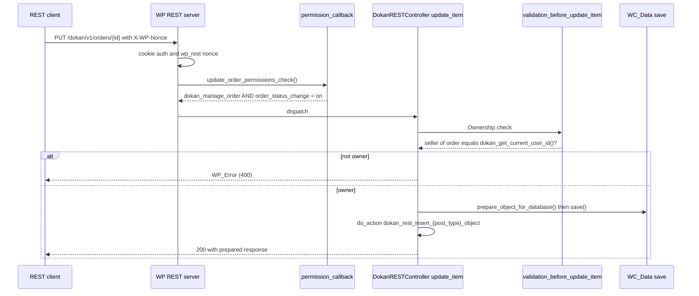
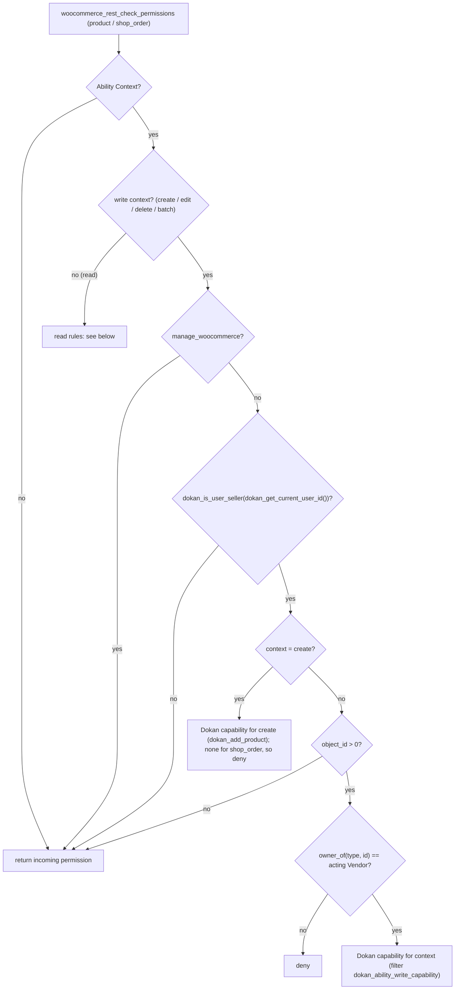

# REST API, Abilities & Permissions (Dokan Lite)

This document covers the three request surfaces Dokan Lite exposes and how each one decides who may do what:

1. The `dokan/v1`, `dokan/v2`, `dokan/v3` and `dokan/v1/admin` REST namespaces, registered by `WeDevs\Dokan\REST\Manager`.
2. The **Abilities layer** (`includes/Abilities`), which applies Vendor Scope and Ownership to WooCommerce's own abilities and registers four Dokan-native abilities. MCP clients reach these abilities through WooCommerce's MCP integration.
3. The `admin-ajax.php` actions registered by `WeDevs\Dokan\Ajax`.

It also describes the capability model all three share: the `seller` role, the `dokandar` capability, the 41 `dokan_*` capabilities, and the choice of `manage_woocommerce` as the canonical admin capability.

Related reading:

- `CONTEXT.md` for canonical terms: **Vendor**, **Vendor Staff**, **Store Admin**, **Site Admin**, **Customer**, **Ownership**, **Vendor Scope**, **Operating Terms**, **Ability Context**.
- [ADR-0005](../0005-canonical-admin-capability.md): `manage_woocommerce` is the canonical admin capability.
- [ADR-0006](../0006-ownership-enforced-in-abilities-layer.md): Ownership is enforced by the Abilities layer, not delegated to WooCommerce.
- [ADR-0007](../0007-staff-actions-gated-by-dokan-capabilities.md): Vendor Staff actions over MCP are gated by `dokan_*` capabilities.
- [products.md](./products.md) explains how product Ownership is stored (`wp_posts.post_author`) and how `dokan_is_product_author()` and `dokan_get_current_user_id()` resolve it. This document does not repeat that material.

---

## 1. Purpose & ownership

| Concern | Owner |
|---|---|
| REST routing, `WP_REST_Controller`, `permission_callback` dispatch, the `wp_rest` cookie nonce | WordPress core |
| Base REST controllers that several Dokan controllers extend (`WC_REST_Products_Controller`, `WC_REST_Customers_Controller`, `WC_REST_Product_Attributes_V1_Controller`, `WC_REST_Product_Attribute_Terms_V1_Controller`, `WC_REST_Product_Categories_Controller`, `WC_REST_Data_Countries_Controller`, `WC_REST_Data_Continents_Controller`, the Analytics `GenericController` and export `Controller`), the `wc_rest_check_*_permissions()` helpers, the Abilities loader and its MCP adapter | [WooCommerce] |
| The Abilities API runtime (`wp_register_ability_args`, `wp_before_execute_ability`, `wp_after_execute_ability`) | WordPress core, or the copy WooCommerce bundles under `vendor/wordpress/abilities-api` (see Known gaps) |
| The Dokan REST namespaces and every controller in `includes/REST`, the controller class map, the shared base controllers and the `VendorAuthorizable` trait | [Lite] |
| The Abilities-layer scoping (`ProductAbilityScope`, `OrderAbilityScope`, `OwnershipGate`, `RequestContext`) and the four `dokan/*` abilities | [Lite] |
| The `seller` role, the `dokandar` capability and the `dokan_*` capability catalogue | [Lite] |
| The `vendor_staff` capability and the `_vendor_id` user meta that link Vendor Staff to a Vendor | Read by Lite (see section 8). The role that grants them is not defined in Lite; this seam is consumed by Dokan Pro. |
| Additional controllers, routes and abilities | Consumed by Dokan Pro through `dokan_rest_api_class_map` and `dokan_ability_definition_classes` (not documented here) |

**Authorization model in one paragraph.** A *capability* decides whether an actor may perform a kind of action at all. *Ownership* decides whether they may perform it on a given record. Both must pass (CONTEXT.md, **Ownership**). Vendor Staff resolve to their Vendor for data scope through `dokan_get_current_user_id()` but keep their own, narrower set of `dokan_*` capabilities. A Store Admin (`manage_woocommerce`) is unscoped. On the REST surface each controller implements this pair itself: the capability usually sits in the `permission_callback`, and Ownership sits either there or in the controller's `validation_before_*` step. On the Abilities surface a single shared gate, `OwnershipGate`, implements both halves.

**Related ADRs:** [ADR-0016](../0016-rest-versions-are-additive-controller-subclasses.md) (REST versions are additive controller subclasses), [ADR-0005 (canonical admin capability)](../0005-canonical-admin-capability.md), [ADR-0006](../0006-ownership-enforced-in-abilities-layer.md) (Ownership in the Abilities layer), [ADR-0007](../0007-staff-actions-gated-by-dokan-capabilities.md) (Vendor Staff gated by Dokan capabilities), [ADR-0009](../0009-vendor-is-a-wordpress-user-with-the-seller-role.md) (the `seller` role and `dokandar`).

## 2. Entry points & bootstrap

| Entry point | Location | How it is loaded |
|---|---|---|
| `dokan()->api` service (`REST\Manager`) | `lite:includes/DependencyManagement/Providers/ServiceProvider.php:35` | Container alias `api`, tagged `container-service`. The tag is resolved in `WeDevs_Dokan::init_classes()` at `lite:dokan-class.php:325`, which runs the constructor. |
| `rest_api_init` → `Manager::register_rest_routes()` | `lite:includes/REST/Manager.php:28`, method at `lite:includes/REST/Manager.php:48` | `rest_api_init` priority 10 |
| Controller class map | `lite:includes/REST/Manager.php:226` (`Manager::get_rest_api_class_map()`) | Filter `dokan_rest_api_class_map` |
| `ReverseWithdrawalController` added to the map | `lite:includes/ReverseWithdrawal/ReverseWithdrawal.php:84`, entry at `:97` | `dokan_rest_api_class_map` filter |
| `Intelligence\REST\AIRequestController` added to the map | `lite:includes/Intelligence/Admin/Settings.php:16`, entry at `:153` | `dokan_rest_api_class_map` filter |
| Abilities hookables (`ProductAbilityScope`, `OrderAbilityScope`, `DokanAbilityRegistrar`) | `lite:includes/DependencyManagement/Providers/CommonServiceProvider.php:29-31` | `Hookable` services; `register_hooks()` is called by the loop at `lite:dokan-class.php:276` |
| `WeDevs\Dokan\Ajax` | `lite:includes/DependencyManagement/Providers/AjaxServiceProvider.php:39` | Tagged `ajax-service`; resolved only when `DOING_AJAX` is true, at `lite:dokan-class.php:330`. Hooks are added in the constructor at `lite:includes/Ajax.php:18`. |
| REST validation helpers (`dokan_rest_validate_store_id`, `dokan_rest_validate_order_id`) | `lite:includes/functions-rest-api.php:14`, `:52` | Composer `files` autoload, `lite:composer.json:46`, so they are available before the plugin boots |

`Manager::register_rest_routes()` iterates the class map. For each entry it skips missing files, `require_once`s the file, skips classes that do not exist or are not `WP_REST_Controller` instances, instantiates the controller and calls `register_routes()`.

## 3. Key classes

| Class | File | Responsibility |
|---|---|---|
| `WeDevs\Dokan\REST\Manager` | `lite:includes/REST/Manager.php:10` | Registers controllers from the class map on `rest_api_init`. Also post-processes vendor and product responses (section 9) and registers the withdraw export controller with WooCommerce's CSV exporter. |
| `WeDevs\Dokan\REST\DokanBaseController` | `lite:includes/REST/DokanBaseController.php:14` | Abstract base, namespace `dokan/v1`. Supplies `format_collection_response()` (`X-WP-Total`, `X-WP-TotalPages`, `Link` headers). |
| `WeDevs\Dokan\REST\DokanBaseAdminController` | `lite:includes/REST/DokanBaseAdminController.php:11` | Abstract base for admin routes. Namespace `dokan/v1/admin`; `check_permission()` returns `current_user_can( 'manage_woocommerce' )`. |
| `WeDevs\Dokan\Abstracts\DokanRESTAdminController` | `lite:includes/Abstracts/DokanRESTAdminController.php:15` | Deprecated (since 3.14.11) empty subclass of `DokanBaseAdminController`, kept for older controllers that still extend it. |
| `WeDevs\Dokan\REST\DokanBaseVendorController` | `lite:includes/REST/DokanBaseVendorController.php:14` | Abstract base for Vendor routes. Uses `VendorAuthorizable`; default `rest_base` is `vendor`. |
| `WeDevs\Dokan\REST\DokanBaseCustomerController` | `lite:includes/REST/DokanBaseCustomerController.php:14` | Abstract base for Customer routes; `check_permission()` returns `is_user_logged_in()`. No Lite controller extends it at this revision. |
| `WeDevs\Dokan\Abstracts\DokanRESTController` | `lite:includes/Abstracts/DokanRESTController.php:20` | Abstract CRUD controller for post-backed resources (products, orders). Provides `get_items()`/`create_item()`/`update_item()`/`delete_item()`, the `validation_before_*` hooks for Ownership checks, the author-scoped list query `prepare_objects_query()` (line 333), `set_forced_author()` (line 49) for public routes, and `update_post_author_if_needed()` (line 510). |
| `WeDevs\Dokan\Traits\VendorAuthorizable` | `lite:includes/Traits/VendorAuthorizable.php:7` | `check_permission()` (`dokandar`, line 16), `can_access_vendor_store()` (line 36), `get_vendor_id_for_user()` (line 76), `validate_store_id()`, `is_staff_only()` (line 122). |
| `WeDevs\Dokan\Utilities\VendorUtil` | `lite:includes/Utilities/VendorUtil.php:4` | `get_vendor_id_for_user()` (line 72): the Vendor's own ID for a Vendor, the `_vendor_id` meta for a `vendor_staff` user, otherwise 0. |
| `WeDevs\Dokan\Abilities\Support\RequestContext` | `lite:includes/Abilities/Support/RequestContext.php:25` | Detects an **Ability Context** and a *vendor* Ability Context. |
| `WeDevs\Dokan\Abilities\Support\OwnershipGate` | `lite:includes/Abilities/Support/OwnershipGate.php:28` | The shared Ownership and capability gate for product and order abilities (ADR-0006, ADR-0007). |
| `WeDevs\Dokan\Abilities\ProductAbilityScope` | `lite:includes/Abilities/ProductAbilityScope.php:38` | Scopes WooCommerce's product abilities: per-object permission, list scoping, `vendor_id` input, vendor in output, author assignment on create. |
| `WeDevs\Dokan\Abilities\OrderAbilityScope` | `lite:includes/Abilities/OrderAbilityScope.php:43` | Scopes WooCommerce's order abilities: per-object permission, list scoping across CPT and HPOS stores, Suborder relationship annotations in output. |
| `WeDevs\Dokan\Abilities\DokanAbilityRegistrar` | `lite:includes/Abilities/DokanAbilityRegistrar.php:27` | Registers the `dokan` ability category and appends Dokan's ability classes to WooCommerce's loader. |
| `WeDevs\Dokan\Abilities\Definitions\AbstractVendorAbility` | `lite:includes/Abilities/Definitions/AbstractVendorAbility.php:23` | Base for Dokan-native abilities: shared `check_permission()` and the `guard()` re-check inside `execute()`. |
| `CurrentVendor`, `VendorStatsGet`, `WithdrawsQuery`, `VendorsQuery` | `lite:includes/Abilities/Definitions/CurrentVendor.php:19`, `VendorStatsGet.php:12`, `WithdrawsQuery.php:12`, `VendorsQuery.php:17` | The four `dokan/*` abilities (section 7). |
| `WeDevs\Dokan\Abilities\Support\VendorPayload` | `lite:includes/Abilities/Support/VendorPayload.php:17` | Builds the `{ id, store_name }` vendor object attached to ability output. |
| `WeDevs\Dokan\Ajax` | `lite:includes/Ajax.php:11` | Vendor-dashboard and storefront `admin-ajax.php` handlers (section 7). |

## 4. Execution flow

### 4.1 Two-stage REST authorization in post-backed controllers

`ProductController` and `OrderController` extend `Abstracts\DokanRESTController`. For these controllers the decision is split across two stages. The `permission_callback` checks a capability. The `validation_before_update_item()` / `validation_before_delete_item()` step, called at the top of `DokanRESTController::update_item()` and `::delete_item()`, checks Ownership. For example:

- `OrderController::update_order_permissions_check` (`lite:includes/REST/OrderController.php:821`) checks only `dokan_manage_order` and the `order_status_change` setting. `OrderController::validation_before_update_item` (`lite:includes/REST/OrderController.php:228`) then compares `dokan_get_current_user_id()` with `dokan_get_seller_id_by_order()` and returns an error when they differ.
- `ProductController::validation_before_update_item` and `::validation_before_delete_item` compare the store ID with the product author and allow a mismatch only for `manage_options` (ADR-0005 explains why `ProductController` still uses `manage_options`).

List endpoints are scoped in the query instead. `DokanRESTController::prepare_objects_query` sets `author` to `dokan_get_current_user_id()` unless the caller holds `dokan_admin_menu_capability()` and passed an `id`. `OrderController::get_items` forces `seller_id` to `dokan_get_current_user_id()` unless the caller holds `manage_options`. Routes with a public `permission_callback` pin the author themselves with `set_forced_author()`. `StoreController::get_store_products` does this for `GET /dokan/v1/stores/{id}/products` and also forces `status=publish`.

### 4.2 Store updates (`PUT /dokan/v1/stores/{id}` and `/dokan/v1/settings`)

`StoreController::update_store_permissions_check` (`lite:includes/REST/StoreController.php:376`) resolves the requested ID with `get_vendor_id_for_user()`, so a Vendor Staff ID resolves to its Vendor, and then calls `can_access_vendor_store()`. That method lets `manage_woocommerce` through and otherwise requires the resolved Vendor to equal the caller's own Vendor. `StoreController::update_store` (`lite:includes/REST/StoreController.php:394`) repeats the same resolution and access check inside the callback. It then removes restricted fields and calls `dokan()->vendor->update()`.

`StoreController::get_restricted_fields_for_update` (`lite:includes/REST/StoreController.php:461`) removes `email` and `password` for callers who are neither a Site Admin nor a Vendor (that is, Vendor Staff). For callers without `manage_options` it also removes four commission field names (`dokan_admin_percentage`, `dokan_admin_percentage_type`, `dokan_admin_additional_fee`, `admin_category_commission`). ADR-0005 records that **Operating Terms are enforced by `Vendor\Manager::update()`**. That method writes `enabled`, `featured` and `trusted` (Direct Publishing) only for `manage_woocommerce` (`lite:includes/Vendor/Manager.php:381`). The list is filterable through `dokan_rest_store_restricted_fields_for_update`.

`StoreSettingController` (`/dokan/v1/settings`) has a different permission callback. `StoreSettingController::get_settings_permission_callback` calls `get_vendor()` with no request, so it only confirms that the caller is logged in and that `dokan()->vendor->get( dokan_get_current_user_id() )` returns a record with a non-empty ID. `update_settings()` then copies the `vendor_id` parameter into `id` and calls `StoreController::update_store`. Per-store access is therefore decided by the `can_access_vendor_store()` check inside `update_store()`, not by the permission callback.

### 4.3 Abilities layer: Ability Context and the Ownership gate

The Abilities layer is designed to leave normal storefront, admin and REST traffic unchanged. Its `woocommerce_rest_check_permissions` filters return early unless `RequestContext::is_ability_context()` is true. The order-query filters require `RequestContext::is_vendor_ability_context()`. The product-query filters act only on state that the wrapped product abilities set while they run. The `wp_register_ability_args` filters modify the registration of the named WooCommerce abilities only. `RequestContext::is_ability_context()` returns true when any of the following holds:

- the request was flagged as MCP by `RequestContext::flag_mcp_request` (hooked to `mcp_adapter_execute_ability_capability`, which the MCP adapter fires during its permission pre-flight);
- an ability is executing (a depth counter maintained on `wp_before_execute_ability` / `wp_after_execute_ability`);
- the request URI matches a known MCP endpoint (WooCommerce's `MCPAdapterProvider::is_mcp_request()` when present, otherwise `#/(?:woocommerce|dokan)/mcp(?:/|$)#` on a REST request).

The result is filterable through `dokan_is_ability_context`. `RequestContext::is_vendor_ability_context()` additionally requires that the caller is not a Store Admin and that `dokan_is_user_seller( dokan_get_current_user_id() )` is true.

Inside an Ability Context, `ProductAbilityScope::scope_product_permissions` and `OrderAbilityScope::scope_order_permissions` filter `woocommerce_rest_check_permissions` (priority 99). WooCommerce fires that filter from `wc_rest_check_post_permissions()` (`wc:includes/wc-rest-functions.php:249`). Write contexts go to `OwnershipGate::can_write` (`lite:includes/Abilities/Support/OwnershipGate.php:131`):

The capability map in `OwnershipGate::CAPABILITIES` is:

| Object type | create | edit | delete | batch |
|---|---|---|---|---|
| `product` | `dokan_add_product` | `dokan_edit_product` | `dokan_delete_product` | `dokan_edit_product` |
| `shop_order` | (none, so denied) | `dokan_manage_order` | `dokan_manage_order` | `dokan_manage_order` |

A missing entry fails closed. `owner_of()` uses `dokan_get_seller_id_by_order()` for orders and `post_author` for products. A collection-level write (object ID 0) passes through because a batch request re-checks each contained operation with a real ID.

**Read rules.** For products, a read of an object is allowed for a Store Admin or when the product is published. Otherwise it requires `dokan_is_product_author()` and `OwnershipGate::has_read_capability( 'product', 'item' )`. For orders, Store Admins and non-Vendors pass through unchanged. A Vendor may read an order whose seller is the acting Vendor if they also hold `dokan_view_order`. A collection read requires `dokan_view_order_menu`. `OwnershipGate::READ_CAPABILITIES` maps product item/list reads to `dokan_view_product_menu`, order item reads to `dokan_view_order` and order list reads to `dokan_view_order_menu`. The map is filterable through `dokan_ability_read_capability`.

**List scoping.** `OrderAbilityScope::scope_orders_query` intersects `post__in` with the acting Vendor's order IDs. It obtains those IDs once per request from `dokan()->order->all( [ 'seller_id' => …, 'return' => 'ids' ] )`, guarded against re-entry. An empty intersection becomes `[ 0 ]`, so the result is empty rather than unscoped. `ProductAbilityScope::prepare_product_query_scope` restricts product lists to `post_status = publish` unless the caller is a Store Admin, or is browsing their own store (`vendor_id` equals the caller) while holding `dokan_view_product_menu`.

**Creates.** `ProductAbilityScope::resolve_create_vendor` lets a Store Admin choose a `vendor_id`, which must satisfy `dokan_is_user_seller()`. A Store Admin who does not choose one defaults to their own store if it is enabled; otherwise an Ability Context create returns `dokan_ability_vendor_required`. `ProductAbilityScope::assign_vendor_as_product_author` (on `woocommerce_new_product`) re-authors the new product to the resolved Vendor. For Vendor Staff this means the product is authored to their Vendor.

**Why the gate replaces rather than supplements native capabilities.** ADR-0006 records that `wc_rest_check_post_permissions()` does not give a uniform Ownership answer across the `product` and `shop_order` post types, so Dokan asserts Ownership itself for both types. ADR-0007 records that below Store Admin, once Ownership resolves, the gate decides from the Dokan capability and ignores the incoming native answer. Do not remove the product-side check because native capabilities currently agree with it (ADR-0006, Consequences).

### 4.4 Dokan-native abilities

`AbstractVendorAbility::check_permission` lets a Store Admin through. Every other caller must be a Vendor (`dokan_is_user_seller( dokan_get_current_user_id() )`) and must hold the ability's `required_capability()`, filtered through `dokan_ability_required_capability`. `execute()` calls `guard()`, which repeats the same check, because an ability's callbacks can be reached without the Abilities API's own permission pre-flight.

## 5. Hooks fired / hooks consumed

### 5.1 Hooks Dokan fires (authorization-relevant)

| Hook | Type | Fired in | Purpose |
|---|---|---|---|
| `dokan_rest_api_class_map` | filter | `Manager::get_rest_api_class_map` (`lite:includes/REST/Manager.php:226`) | Add, replace or remove REST controllers (file path ⇒ class). |
| `dokan_menu_capability` | filter | `dokan_admin_menu_capability()` (`lite:includes/functions.php:40`) | Admin capability used by `DokanRESTController::prepare_objects_query` and the data controllers. Default `manage_woocommerce`. |
| `dokan_get_all_cap` | filter | `dokan_get_all_caps()` (`lite:includes/functions.php:2835`) | The `dokan_*` capability catalogue. |
| `dokan_is_product_author` | filter | `dokan_is_product_author()` (`lite:includes/functions.php:148`) | The user ID compared against `post_author`. |
| `dokan_rest_store_restricted_fields_for_update` | filter | `StoreController::get_restricted_fields_for_update` | Fields removed from a store update. |
| `dokan_rest_store_restricted_fields_for_view` | filter | `StoreController` (view side) | Fields hidden from a store response. |
| `dokan_rest_protected_user_caps` | filter | `CustomersController::is_target_user_allowed` | Capabilities that make a user an invalid target for a Vendor's customer edits. |
| `dokan_rest_{$post_type}_object_query` | filter | `DokanRESTController::prepare_objects_query` | List query arguments after author scoping. |
| `dokan_rest_insert_{$post_type}_object` | action | `DokanRESTController::create_item` / `::update_item` | After a create (third argument `true`) or update (`false`). |
| `dokan_rest_delete_{$post_type}_object` | action | `DokanRESTController::delete_item` | After a delete. |
| `dokan_new_product_added` | action | `Manager::on_dokan_rest_insert_product`, `ProductControllerV3` | New product created through REST. |
| `dokan_rest_stores_update_store`, `dokan_rest_stores_create_store`, `dokan_rest_store_settings_after_update` | action | `StoreController::update_store`, `::create_store`, `StoreSettingController::update_settings` | After store writes. |
| `dokan_is_ability_context` | filter | `RequestContext::is_ability_context` (`lite:includes/Abilities/Support/RequestContext.php:106`) | Override Ability Context detection. |
| `dokan_ability_write_capability` | filter | `OwnershipGate::has_capability` (`lite:includes/Abilities/Support/OwnershipGate.php:245`) | Dokan capability required for a write; an empty string means none. |
| `dokan_ability_read_capability` | filter | `OwnershipGate::has_read_capability` (`lite:includes/Abilities/Support/OwnershipGate.php:207`) | Dokan capability required for a read. |
| `dokan_ability_required_capability` | filter | `AbstractVendorAbility::check_permission` (`lite:includes/Abilities/Definitions/AbstractVendorAbility.php:119`) | Capability for a Dokan-native ability. |
| `dokan_ability_definition_classes` | filter | `DokanAbilityRegistrar::ability_classes` (`lite:includes/Abilities/DokanAbilityRegistrar.php:102`) | Dokan ability classes appended to WooCommerce's loader. |

The REST controllers also fire many response-shaping filters (for example `dokan_rest_prepare_store_item_for_response`, `dokan_rest_prepare_withdraw_object`, `dokan_rest_admin_settings_sanitize_field`, `dokan_rest_vendor_settings_validate_field`). They do not change authorization and are listed in the per-subsystem documents.

### 5.2 Hooks Dokan consumes

| Hook | Fired by | Consumer | Purpose |
|---|---|---|---|
| `rest_api_init` | WordPress core | `Manager::register_rest_routes` (`lite:includes/REST/Manager.php:28`) | Register controllers. |
| `rest_pre_dispatch` (priority 1) | WordPress core | `ProductControllerV3::resolve_product_payload_before_validation` | Translate React product editor payloads before schema validation (see products.md). |
| `woocommerce_rest_prepare_product_object` | [WooCommerce] `"woocommerce_rest_prepare_{$this->post_type}_object"` at `wc:includes/rest-api/Controllers/Version2/class-wc-rest-products-v2-controller.php:314` | `Manager::prepare_product_response` | Adds a `store` object to WooCommerce product responses. |
| `dokan_vendor_to_array` | [Lite] | `Manager::filter_store_open_close_option`, `Manager::filter_payment_response` | Hide address, phone and email per the vendor-info settings, and mask `payment` as `******`, unless the caller is a Store Admin or the Vendor themselves. |
| `dokan_rest_insert_product_object` | [Lite] | `Manager::on_dokan_rest_insert_product` | Fire `dokan_new_product_added` on create. |
| `woocommerce_export_report_controller_map`, `woocommerce_export_report_data_endpoint` | [WooCommerce] `wc:src/Admin/ReportCSVExporter.php:280`, `:381` | `Manager::register_export_controllers`, `Manager::register_data_endpoint` | Map the `withdraws` report type to `WithdrawExportController` and `dokan/v1/reports/withdraws`. |
| `woocommerce_rest_check_permissions` (priority 99) | [WooCommerce] `wc:includes/wc-rest-functions.php:249` | `ProductAbilityScope::scope_product_permissions`, `OrderAbilityScope::scope_order_permissions` | Ownership gate in an Ability Context. |
| `woocommerce_rest_check_permissions` (priority 10, added and removed around a single call) | [WooCommerce] `wc:includes/wc-rest-functions.php:305` (user objects) | `CustomersController::check_vendor_permission` via `perform_vendor_action()` | Lets a Vendor pass WooCommerce's customer permission checks while an action runs, subject to the target-user rules. |
| `woocommerce_order_data_store_cpt_get_orders_query` | [WooCommerce] `wc:includes/data-stores/class-wc-order-data-store-cpt.php:1055` | `OrderAbilityScope::scope_orders_query` | Vendor order list scoping (CPT). |
| `woocommerce_orders_table_datastore_get_orders_query` | [WooCommerce] `wc:src/Internal/DataStores/Orders/OrdersTableDataStore.php:3367` | `OrderAbilityScope::scope_orders_query` | Vendor order list scoping (HPOS). |
| `woocommerce_rest_orders_prepare_object_query` | [WooCommerce] `wc:includes/rest-api/Controllers/Version2/class-wc-rest-orders-v2-controller.php:685` | `OrderAbilityScope::scope_rest_orders_query` | Vendor order list scoping (REST-proxy abilities). |
| `woocommerce_product_data_store_cpt_get_products_query` | [WooCommerce] `wc:includes/data-stores/class-wc-product-data-store-cpt.php:2531` | `ProductAbilityScope::scope_products_query` | `vendor_id` filter and published-only guard. |
| `woocommerce_rest_product_object_query` | [WooCommerce] `"woocommerce_rest_{$this->post_type}_object_query"` at `wc:includes/rest-api/Controllers/Version3/class-wc-rest-crud-controller.php:355` | `ProductAbilityScope::scope_rest_products_query` | Same, for REST-proxy abilities. |
| `woocommerce_new_product` (priority 99) | [WooCommerce] `wc:includes/data-stores/class-wc-product-data-store-cpt.php:263` | `ProductAbilityScope::assign_vendor_as_product_author` | Author ability-created products to the resolved Vendor. |
| `wp_register_ability_args` | WordPress core (`wp-includes/abilities-api/class-wp-abilities-registry.php:139`) or WooCommerce's bundled copy (`wc:vendor/wordpress/abilities-api/includes/abilities-api/class-wp-abilities-registry.php:120`) | `ProductAbilityScope::extend_product_abilities`, `OrderAbilityScope::extend_order_abilities` | Extend WooCommerce product/order abilities in place (input schema, output schema, wrapped execute callback). |
| `wp_before_execute_ability`, `wp_after_execute_ability` | WordPress core (`wp-includes/abilities-api/class-wp-ability.php:852` and `:875`) or WooCommerce's bundled copy (`wc:vendor/wordpress/abilities-api/includes/abilities-api/class-wp-ability.php:596` and `:617`) | `RequestContext::mark_ability_execution_started` / `_finished` | Ability execution depth. |
| `mcp_adapter_execute_ability_capability` | [WooCommerce] bundled MCP adapter, `wc:vendor/wordpress/mcp-adapter/includes/Abilities/ExecuteAbilityAbility.php:140` | `RequestContext::flag_mcp_request` | Mark the request as MCP before the target ability's permission callback runs. The value is returned unchanged. |
| `woocommerce_ability_definition_classes` | [WooCommerce] `wc:src/Internal/Abilities/AbilitiesLoader.php:208` | `DokanAbilityRegistrar::register_definition_classes` | Register Dokan's ability classes. |
| `wp_abilities_api_categories_init` (also hooked: `abilities_api_categories_init`) | WordPress core `wp-includes/abilities-api/class-wp-ability-categories-registry.php:229`, or WooCommerce's bundled copy at `wc:vendor/wordpress/abilities-api/includes/abilities-api/class-wp-ability-categories-registry.php:229` | `DokanAbilityRegistrar::register_category` | Register the `dokan` ability category. |

## 6. Data storage

This subsystem adds **no custom tables, post types or transients**. It reads and writes the following:

| Kind | Key | Used for |
|---|---|---|
| Role (`wp_user_roles` option) | `seller` | Created by `Installer::user_roles` (`lite:includes/Install/Installer.php:174`). |
| Role capabilities | `dokandar` and the 41 `dokan_*` capabilities | Granted to `seller`, `administrator` and `shop_manager` (`lite:includes/Install/Installer.php:211-217`). |
| User meta | `_vendor_id` | The Vendor a Vendor Staff user acts for. Read by `dokan_get_current_user_id()` and `VendorUtil::get_vendor_id_for_user()`. |
| Post column | `wp_posts.post_author` | Product Ownership (see products.md). |
| Option `dokan_selling` | `order_status_change` | When `off`, Vendors may not change order status (`OrderController::update_order_permissions_check`, the order-status AJAX handlers). |
| Option `dokan_selling` | `add_new_attribute` | When not `on`, `ProductAttributeController::create_attribute_term_permissions_check` refuses new attribute terms. |
| Option `dokan_appearance` | `store_open_close` | `Manager::filter_store_open_close_option` removes `store_open_close` from vendor responses when disabled. |
| Option | `dokan_hide_pro_nag` | Set to `hide` by `Ajax::dismiss_pro_notice`. |

## 7. REST/AJAX endpoints

All routes below are relative to `/wp-json/`. Unless stated, the permission callback is a method on the same controller. "Inherited" means the route is registered by the WooCommerce parent class's `register_routes()`; Dokan overrides only the permission methods named. "PUT/PATCH" denotes `WP_REST_Server::EDITABLE`, which also accepts POST.

### 7.1 `dokan/v1` (public, Vendor and mixed routes)

| Controller (file) | Route | Methods | Permission callback → rule |
|---|---|---|---|
| `StoreController` (`lite:includes/REST/StoreController.php:21`) | `dokan/v1/stores` | GET | `__return_true` |
| | `dokan/v1/stores` | POST | `permission_check_for_manageable_part` → `manage_woocommerce` |
| | `dokan/v1/stores/{id}` | GET | `__return_true` (fields hidden through `dokan_rest_store_restricted_fields_for_view`) |
| | `dokan/v1/stores/{id}` | PUT/PATCH | `update_store_permissions_check` → `can_access_vendor_store()` (section 4.2) |
| | `dokan/v1/stores/{id}` | DELETE | `manage_woocommerce` |
| | `dokan/v1/stores/{id}/products`, `/{id}/reviews`, `/{id}/categories`, `/check`, `/{id}/contact` (POST) | GET / POST | `__return_true`. Products are pinned with `set_forced_author()` and `status=publish`. |
| | `dokan/v1/stores/{id}/status`, `dokan/v1/stores/batch` | PUT/PATCH | `manage_woocommerce` |
| `StoreSettingController` (`lite:includes/REST/StoreSettingController.php:16`) | `dokan/v1/settings` | GET, PUT/PATCH | `get_settings_permission_callback` → logged in, with a vendor record for `dokan_get_current_user_id()`; per-store access is checked in `update_store()` (section 4.2) |
| `ProductController` (`lite:includes/REST/ProductController.php:30`) | `dokan/v1/products` | GET | `get_product_permissions_check` → `dokan_view_product_menu` or `manage_options` |
| | `dokan/v1/products` | POST | `create_product_permissions_check` → `dokan_add_product` or `manage_options` |
| | `dokan/v1/products/{id}` | GET | `get_single_product_permissions_check` → `manage_options`; otherwise `dokandar` plus `dokan_is_product_author()` |
| | `dokan/v1/products/{id}` | PUT/PATCH, DELETE | `dokan_edit_product` / `dokan_delete_product` or `manage_options`; Ownership in `validation_before_update_item` / `_delete_item` |
| | `dokan/v1/products/summary` | GET | `dokan_view_product_status_report` |
| | `dokan/v1/products/multistep-categories` | GET | `get_product_permissions_check` |
| | `dokan/v1/products/{id}/related`, `/top_rated`, `/best_selling`, `/featured`, `/latest` | GET | `__return_true` |
| `ProductBlockController` (`lite:includes/REST/ProductBlockController.php:16`) | `dokan/v1/blocks/products/{id}` | GET | `get_single_product_permissions_check` (inherited from `ProductController`) |
| `ProductAttributeController` (`lite:includes/REST/ProductAttributeController.php:12`) | `dokan/v1/products/attributes`, `/{id}`, `/batch` (inherited) | GET / POST / PUT / DELETE | `dokandar` for reads and batch; `dokan_add_product` create; `dokan_edit_product` update; `dokan_delete_product` delete |
| | `dokan/v1/products/attributes/edit-product/{id}`, `/set-default/{id}` | PUT/PATCH | `update_product_attribute_permissions_check` → `manage_woocommerce` or `dokan_is_product_author()`, plus `dokan_edit_product` |
| | `dokan/v1/products/attributes/{id}/terms` | GET / POST | `dokandar` / `create_attribute_term_permissions_check` (`add_new_attribute` must be `on`, plus `dokan_edit_product`) |
| `ProductAttributeTermsController` (`lite:includes/REST/ProductAttributeTermsController.php:10`) | `dokan/v1/products/attributes/{attribute_id}/terms`, `/{id}`, `/batch` (all inherited) | GET / POST / PUT / DELETE | `dokandar` reads; `dokan_add_product` create; `dokan_edit_product` update; `dokan_delete_product` delete |
| `VendorProductCategoriesController` (`lite:includes/REST/VendorProductCategoriesController.php:12`) | `dokan/v1/products/categories`, `/tree`, `/{id}` | GET | `dokandar` |
| `OrderController` (`lite:includes/REST/OrderController.php:21`) | `dokan/v1/orders` | GET | `get_orders_permissions_check` → `dokan_view_order_menu`; rows scoped to the caller unless `manage_options` |
| | `dokan/v1/orders/{id}` | GET | `get_single_order_permissions_check` → `current_user_can( 'shop_manager' )` or `current_user_can( 'administrator' )`; otherwise `dokan_get_seller_id_by_order()` must equal `get_current_user_id()` |
| | `dokan/v1/orders/{id}` | PUT/PATCH | `update_order_permissions_check` → `dokan_manage_order` and `order_status_change` on; Ownership in `validation_before_update_item` |
| | `dokan/v1/orders/{id}/notes`, `/{id}/notes/{note_id}` | GET / POST / DELETE | `get_single_order_permissions_check` |
| | `dokan/v1/orders/summary` | GET | `dokan_view_order_report` |
| `WithdrawController` (`lite:includes/REST/WithdrawController.php:19`) | `dokan/v1/withdraw`, `/balance`, `/charges`, `/charge` | GET | `get_items_permissions_check` → `dokan_manage_withdraw` |
| | `dokan/v1/withdraw` | POST | `manage_woocommerce` or `dokan_manage_withdraw`. A Store Admin may pass `user_id`, which must hold `dokan_manage_withdraw`; everyone else is fixed to `dokan_get_current_user_id()`. |
| | `dokan/v1/withdraw/{id}` | GET, PUT/PATCH | `get_item_permissions_check` → `manage_woocommerce`; otherwise the withdraw's `user_id` must equal `get_current_user_id()` |
| | `dokan/v1/withdraw/{id}` | DELETE | `manage_woocommerce` |
| | `dokan/v1/withdraw/payment_methods` | GET | `dokan_manage_withdraw` |
| | `dokan/v1/withdraw/batch` | PUT/PATCH | `manage_woocommerce` |
| `CommissionControllerV1` (`lite:includes/REST/CommissionControllerV1.php:14`) | `dokan/v1/commission` | GET | `get_permissions_check` → `manage_woocommerce`; otherwise `dokandar` plus `dokan_add_product` or `dokan_edit_product`, and any `vendor_id` / `product_id` must belong to the caller |
| `CustomersController` (`lite:includes/REST/CustomersController.php:14`) | `dokan/v1/customers`, `/{id}`, `/batch` (inherited), `/customers/search` | GET / POST / PUT / DELETE | `check_permission()` → caller must be a Vendor. For `view`/`edit`/`delete` with an `id`, the target must not hold a protected capability (`dokan_rest_protected_user_caps`), must not be a Vendor, and must have ordered from this Vendor. `edit` refuses password changes and email changes. |
| `DokanDataCountriesController` / `DokanDataContinentsController` (`lite:includes/REST/DokanDataCountriesController.php:9`, `DokanDataContinentsController.php:9`) | `dokan/v1/data/countries`, `/{location}`; `dokan/v1/data/continents`, `/{location}` (inherited) | GET | `check_dokan_permission` → `dokan_admin_menu_capability()` or `dokandar` |
| `VendorDashboardController` (`lite:includes/REST/VendorDashboardController.php:19`) | `dokan/v1/vendor-dashboard`, `/profile`, `/sales`, `/products`, `/orders` | GET | `is_user_logged_in`; callbacks scope data to `dokan_get_current_user_id()` |
| | `dokan/v1/vendor-dashboard/preferences` | GET | `__return_true` |
| `VendorStoreSettingsController` (`lite:includes/REST/VendorStoreSettingsController.php:22`) | `dokan/v1/vendor-settings/store` | GET, PUT/PATCH | `check_permission` → `dokandar` and `dokan_view_store_settings_menu` |
| `DummyDataController` (`lite:includes/REST/DummyDataController.php:18`) | `dokan/v1/dummy-data/status`, `/import` (POST), `/clear` (DELETE) | GET / POST / DELETE | `manage_woocommerce` |
| `ExportController` (`lite:includes/REST/ExportController.php:19`) | `dokan/v1/reports/{type}/export`, `/{export_id}/status` | POST / GET | `manage_woocommerce` or `dokan_view_reports` |
| `WithdrawExportController` (`lite:includes/REST/WithdrawExportController.php:21`) | `dokan/v1/reports/withdraws` (registered by WooCommerce's reports controller chain) | GET | `get_items_permissions_check` → `manage_woocommerce` or `dokan_view_reports` |
| `ReverseWithdrawalController` (`lite:includes/REST/ReverseWithdrawalController.php:25`) | `dokan/v1/reverse-withdrawal/stores-balance`, `/stores` | GET | `manage_options` |
| | `dokan/v1/reverse-withdrawal/transactions` | GET / POST | GET: logged in and `dokan_is_user_seller( dokan_get_current_user_id() )`; POST: `manage_options` |
| | `dokan/v1/reverse-withdrawal/vendor-due-status` | GET | logged in and a Vendor (staff resolve to their Vendor) |
| | `dokan/v1/reverse-withdrawal/transaction-types` | GET | `is_user_logged_in` |
| | `dokan/v1/reverse-withdrawal/add-to-cart` | POST | logged in and `dokandar`; returns `dokan_rest_cannot_add_to_cart` otherwise |
| `Intelligence\REST\AIRequestController` (`lite:includes/Intelligence/REST/AIRequestController.php:18`) | `dokan/v1/ai/generate` | PUT/PATCH/POST (EDITABLE) | `check_permission` (`VendorAuthorizable`) → `dokandar` |

### 7.2 `dokan/v2` and `dokan/v3`

| Controller (file) | Routes | Permission |
|---|---|---|
| `ProductControllerV2` (`lite:includes/REST/ProductControllerV2.php:18`) | Calls `parent::register_routes()`, so every `dokan/v1/products*` route above is also registered under `dokan/v2`. Adds `dokan/v2/products` (GET, redefined) and `dokan/v2/products/filter-by-data` (GET). | Same as `ProductController`; the new routes use `get_product_permissions_check`. |
| `OrderControllerV2` (`lite:includes/REST/OrderControllerV2.php:19`) | Every `dokan/v1/orders*` route under `dokan/v2`, plus `dokan/v2/orders/{id}/downloads` (GET/POST/DELETE), `/{id}/downloads/{permission_id}` (PUT/PATCH) and `dokan/v2/orders/bulk-actions` (POST). | Downloads use `get_single_order_permissions_check`; bulk actions use `update_order_permissions_check`. |
| `OrderControllerV3` (`lite:includes/REST/OrderControllerV3.php:12`) | Does not override `register_routes()`, so it registers every `OrderControllerV2` route under `dokan/v3`. It only changes download data formatting. | Same as V2. |
| `WithdrawControllerV2` (`lite:includes/REST/WithdrawControllerV2.php:10`) | Every `dokan/v1/withdraw*` route under `dokan/v2`, plus `/withdraw/settings` (GET), `/withdraw/summary` (GET) and `/withdraw/make-default-method` (POST). | New routes use `get_items_permissions_check` (`dokan_manage_withdraw`). |
| `StoreSettingControllerV2` (`lite:includes/REST/StoreSettingControllerV2.php:19`) | Does not call the parent: `dokan/v2/settings`, `/{group_id}`, `/{group_id}/{id}`, `/{group_id}/{parent_id}/{id}` (GET, and PUT/PATCH on the last three). | `get_settings_permission_callback`. |
| `ProductControllerV3` (`lite:includes/REST/ProductControllerV3.php:19`) | Extends `WC_REST_Products_Controller` but does not call the parent's `register_routes()`. Registers only `dokan/v3/products` (POST), `/{id}` (PUT/PATCH), `/batch` (PUT/PATCH), `/init/fields` (GET) and `/{id}/fields` (GET). | Create: `dokan_add_product`. Update and the field routes: `check_permission` → `dokan_edit_product` and `check_ownership()` (`dokan_is_product_author()` when an `id` is present). Batch: `dokan_edit_product`. `delete_item_permissions_check()` (`dokan_delete_product` and `check_ownership()`) is defined, but no `dokan/v3` delete route is registered. |

### 7.3 `dokan/v1/admin` (Store Admin)

Every controller here extends `DokanBaseAdminController`, either directly or through the deprecated `DokanRESTAdminController`. Unless stated, the permission callback is `check_permission` → `manage_woocommerce`.

| Controller (file) | Routes |
|---|---|
| `AdminDashboardController` (`lite:includes/REST/AdminDashboardController.php:18`) | `dashboard/feed`, `dashboard/status` (GET) |
| `AdminDashboardStatsController` (`lite:includes/REST/AdminDashboardStatsController.php:19`) | `dashboard/todo`, `/analytics`, `/monthly-overview`, `/sales-chart`, `/all-time-stats`, `/top-performing-vendors`, `/most-reviewed-products`, `/vendor-metrics` (GET) |
| `AdminReportController` (`lite:includes/REST/AdminReportController.php:18`) | `report/summary`, `report/overview` (GET) |
| `AdminMiscController` (`lite:includes/REST/AdminMiscController.php:15`) | `help` (GET), `option` (GET; `section` and `option` sanitized with `sanitize_text_field`) |
| `AdminNoticeController` (`lite:includes/REST/AdminNoticeController.php:18`) | `notices/admin`, `notices/promo` (GET) |
| `ChangeLogController` (`lite:includes/REST/ChangeLogController.php:16`) | `changelog/lite` (GET) |
| `AdminSetupGuideController` (`lite:includes/REST/AdminSetupGuideController.php:11`) | `setup-guide` (GET, PUT/PATCH), `setup-guide/{id}` (GET, PUT/PATCH) |
| `AdminOnboardingController` (`lite:includes/REST/AdminOnboardingController.php:14`) | `onboarding` (POST, GET) |
| `AdminSettingsController` (`lite:includes/REST/AdminSettingsController.php:22`) | `settings` (GET), `settings/{page_id}` (PUT/PATCH) |
| `ToolsController` (`lite:includes/REST/ToolsController.php:17`) | `tools/create-pages` (POST), `tools/check-all-dokan-pages-exists` (GET), `tools/clear-caches` (POST) |
| `AdminExtensionsController` (`lite:includes/REST/AdminExtensionsController.php:17`) | `extensions/install` (POST): `check_install_permission` → `install_plugins` |

### 7.4 Dokan-native abilities

| Ability | Permission callback | Required capability (non-admin) | Returns |
|---|---|---|---|
| `dokan/current-vendor` | `__return_true` | none | The caller's user ID, Vendor ID and store name, plus `is_vendor`, `is_staff` and `is_admin` flags |
| `dokan/vendor-stats-get` | `AbstractVendorAbility::check_permission` | `dokan_view_sales_overview` | Balance and withdraw summary for `dokan_get_current_user_id()` |
| `dokan/withdraws-query` | `AbstractVendorAbility::check_permission` | `dokan_manage_withdraw` | Paginated withdraw requests for the acting Vendor (`per_page` clamped to 1–100) |
| `dokan/vendors-query` | `__return_true` | none | Paginated Vendor directory. Statuses other than `approved` are coerced to `approved` for non-Store-Admins. |

All four are registered in the `dokan` category with `show_in_rest => true` and `mcp.public => true` (`AbstractVendorAbility::base_meta`).

WooCommerce abilities that Lite scopes in place (it does not re-register them): `woocommerce/products-query`, `product-create`, `product-update`, `products-list`, `products-get`, `products-create`, `products-update` (`ProductAbilityScope`), and `woocommerce/orders-query`, `orders-list`, `orders-get`, `orders-create`, `orders-update` (`OrderAbilityScope`).

### 7.5 AJAX actions (`WeDevs\Dokan\Ajax`)

Registered in `Ajax::__construct` (`lite:includes/Ajax.php:18-63`). "Owner check" means the handler confirms the record belongs to the acting Vendor before acting.

| Action | Handler | Nonce (action / how checked) | Capability | Owner check |
|---|---|---|---|---|
| `wp_ajax_withdraw_ajax_submission` | `withdraw_export_csv` | `dokan_admin` / `check_ajax_referer( …, 'nonce' )` | `manage_woocommerce` | n/a |
| `wp_ajax_dokan_settings` | `Dashboard\Templates\Settings::ajax_settings` (`lite:includes/Dashboard/Templates/Settings.php:374`) | Per form: `dokan_profile_settings_nonce`, `dokan_store_settings_nonce`, `dokan_payment_settings_nonce` / `wp_verify_nonce` | `dokan_is_user_seller()`, then per form `dokan_view_store_social_menu`, `dokan_view_store_settings_menu`, `dokan_view_store_payment_menu` | Saves for the acting Vendor |
| `wp_ajax_dokan-mark-order-complete` / `-processing` | `complete_order` / `process_order` | `dokan-mark-order-complete` / `dokan-mark-order-processing` / `check_admin_referer` | `is_admin()`, `dokandar`, `order_status_change` on | `dokan_is_seller_has_order()` |
| `wp_ajax_dokan_grant_access_to_download` | `grant_access_to_download` | `grant-access` / `check_ajax_referer( …, 'security' )` | `dokandar` | `dokan_is_seller_has_order()` and `dokan_is_product_author()` per product |
| `wp_ajax_dokan_revoke_access_to_download` | `revoke_access_to_download` | `revoke-access` / `check_ajax_referer( …, 'security' )` | `dokandar` | The download permission's order must belong to the Vendor; fires `woocommerce_ajax_revoke_access_to_product_download` |
| `wp_ajax_dokan_add_order_note` | `add_order_note` | `add-order-note` / `check_ajax_referer` | logged in, `dokan_manage_order_note` | `dokan_is_seller_has_order()` |
| `wp_ajax_dokan_delete_order_note` | `delete_order_note` | `delete-order-note` / `check_ajax_referer` | logged in, `dokandar` | The note's order must belong to the Vendor |
| `wp_ajax_dokan_add_shipping_tracking_info` | `add_shipping_tracking_info` | `add-shipping-tracking-info` / `wp_verify_nonce` | logged in, `dokan_manage_order_note` | `dokan_is_seller_has_order()` |
| `wp_ajax_dokan_change_status` | `change_order_status` | `dokan_change_status` / `check_ajax_referer` | `dokan_manage_order`, `order_status_change` on | `dokan_is_seller_has_order()` |
| `wp_ajax_dokan_create_new_product` | `create_product` | `dokan_reviews` / `check_ajax_referer` | `dokan_add_product` (`dokan_edit_product` decides whether the edit URL is returned) | n/a (creates for the acting Vendor) |
| `wp_ajax_custom-header-crop` | `crop_store_banner` | `image_editor-{attachment_id}` / `check_ajax_referer( …, 'nonce' )` | `dokan_is_user_seller( get_current_user_id() )` | n/a |
| `wp_ajax_dokan_json_search_vendor_customers` | `dokan_json_search_vendor_customers` | `search-customer` / `check_ajax_referer` | `edit_shop_orders` | n/a |
| `wp_ajax_dokan_json_search_products_tags` / `_brands` | `dokan_json_search_products_tags` / `_brands` | `search-products-tags` / `search-products-brands` | none beyond login | n/a |
| `wp_ajax[_nopriv]_dokan_json_search_products_and_variations` | `json_search_product` | `search-products` / `check_ajax_referer` | none | Optional `user_ids` filter |
| `wp_ajax[_nopriv]_dokan_contact_seller` | `contact_seller` | `dokan_contact_seller` / `wp_verify_nonce` | none (public); fires `dokan_trigger_contact_seller_mail` | n/a |
| `wp_ajax[_nopriv]_shop_url` | `shop_url_check` | `dokan_reviews` / `wp_verify_nonce` | none (public) | n/a |
| `wp_ajax[_nopriv]_dokan_seller_listing_search` | `seller_listing_search` | `dokan-seller-listing-search` / `wp_verify_nonce` | none (public) | n/a |
| `wp_ajax_nopriv_dokan_get_login_form`, `wp_ajax_nopriv_dokan_login_user` | `get_login_form`, `login_user` | `dokan_reviews` / `check_ajax_referer` | none (logged-out only) | n/a |
| `wp_ajax_create_pages`, `wp_ajax_check_all_dokan_pages_exists` | `create_pages`, `check_all_dokan_pages_exists` | none | `manage_woocommerce` | n/a |
| `wp_ajax_dokan_clear_caches` | `clear_caches` | `dokan_admin` / `wp_verify_nonce` | `manage_woocommerce` | n/a |
| `wp_ajax_dokan-upgrade-dissmiss` | `dismiss_pro_notice` | none | `manage_woocommerce` | n/a |

Other Lite classes register their own `wp_ajax_*` handlers outside `Ajax.php` (for example `Order\Ajax`, `ReverseWithdrawal\Ajax`, `Product\Hooks`, `Withdraw\Hooks`, `Admin\Settings` and the admin notice classes). They are documented with their subsystems.

**Nonce sources.** `wp_create_nonce( 'dokan_reviews' )` is localized for the frontend at `lite:includes/Assets.php:862`, `dokan_admin` for admin screens at `:1476`, and the REST cookie nonce `wp_rest` at `:63`, `:907` and `:1479`. The legacy Vue admin client sends `window.dokan.rest.nonce` as `X-WP-Nonce` (`lite:src/utils/Api.js:40`). WordPress core validates it in its cookie authentication handler before any Dokan `permission_callback` runs.

## 8. Permissions & capabilities

### 8.1 Roles and capabilities

`Installer::user_roles` (`lite:includes/Install/Installer.php:167`) creates the `seller` role, labelled "Vendor". The role holds native post capabilities, the WooCommerce product capabilities (`edit_product`, `edit_products`, `publish_products`, `delete_products`, `read_private_products`, `edit_published_products` and related), `edit_shop_orders`, `upload_files`, product-term capabilities, and `dokandar`. It does not hold `edit_others_products`. The installer then grants `dokandar` to `shop_manager` and `administrator`, and grants every `dokan_*` capability from `dokan_get_all_caps()` to `seller`, `administrator` and `shop_manager`.

`dokan_get_all_caps()` (`lite:includes/functions.php:2835`) defines 41 capabilities in eight groups:

| Group | Capabilities |
|---|---|
| overview | `dokan_view_sales_overview`, `dokan_view_sales_report_chart`, `dokan_view_announcement`, `dokan_view_order_report`, `dokan_view_review_reports`, `dokan_view_product_status_report` |
| report | `dokan_view_overview_report`, `dokan_view_daily_sale_report`, `dokan_view_top_selling_report`, `dokan_view_top_earning_report`, `dokan_view_statement_report` |
| order | `dokan_view_order`, `dokan_manage_order`, `dokan_manage_order_note`, `dokan_manage_refund`, `dokan_export_order` |
| coupon | `dokan_add_coupon`, `dokan_edit_coupon`, `dokan_delete_coupon` |
| review | `dokan_view_reviews`, `dokan_manage_reviews` |
| withdraw | `dokan_manage_withdraw` |
| product | `dokan_add_product`, `dokan_edit_product`, `dokan_delete_product`, `dokan_view_product`, `dokan_duplicate_product`, `dokan_import_product`, `dokan_export_product` |
| menu | `dokan_view_overview_menu`, `dokan_view_product_menu`, `dokan_view_order_menu`, `dokan_view_coupon_menu`, `dokan_view_report_menu`, `dokan_view_review_menu`, `dokan_view_withdraw_menu`, `dokan_view_store_settings_menu`, `dokan_view_store_payment_menu`, `dokan_view_store_shipping_menu`, `dokan_view_store_social_menu`, `dokan_view_store_seo_menu` |

Some routes check `dokan_view_reports` (`ExportController`, `WithdrawExportController`). That capability is not in Lite's catalogue; a non-admin holds it only if something outside Lite grants it.

### 8.2 Identity helpers

| Helper | Location | Behaviour |
|---|---|---|
| `dokan_get_current_user_id()` | `lite:includes/functions.php:52` | For a user with the `vendor_staff` capability, returns the `_vendor_id` meta (or the user's own ID if the meta is empty). Otherwise returns `get_current_user_id()`. This is how Vendor Staff share their Vendor's **Vendor Scope**. |
| `dokan_is_user_seller( $user_id, $exclude_staff = false )` | `lite:includes/functions.php:77` | `user_can( $user_id, 'dokandar' )`. With `$exclude_staff`, returns false for `vendor_staff` users. Because `administrator` and `shop_manager` also hold `dokandar`, this returns true for them as well. |
| `dokan_is_product_author()` | `lite:includes/functions.php:148` | `post_author` equals the filtered `dokan_get_current_user_id()`. |
| `dokan_admin_menu_capability()` | `lite:includes/functions.php:40` | `apply_filters( 'dokan_menu_capability', 'manage_woocommerce' )`. |
| `VendorUtil::get_vendor_id_for_user()` | `lite:includes/Utilities/VendorUtil.php:72` | A Vendor (excluding staff) gets their own ID, a `vendor_staff` user gets `_vendor_id`, anyone else gets 0. |
| `VendorAuthorizable::can_access_vendor_store()` | `lite:includes/Traits/VendorAuthorizable.php:36` | `manage_woocommerce` passes; otherwise the caller's resolved Vendor must equal the target Vendor. |

### 8.3 Canonical admin capability (ADR-0005)

`manage_woocommerce` is the canonical **Store Admin** capability. It is used by `DokanBaseAdminController`, `VendorAuthorizable`, `Vendor\Manager`, the Abilities layer and most write gates. A Store Admin may read and write any Vendor's data and set **Operating Terms**. **Site Admin** (`manage_options`) draws no authorization boundary of its own in the domain model. Some REST gates still check `manage_options`: `ProductController`'s permission callbacks and its Site Admin Ownership override, `OrderController::get_items`'s cross-vendor listing, `ReverseWithdrawalController`'s admin routes, `StoreController::get_restricted_fields_for_update`, `StoreController::can_view_commission_settings`, and `DokanRESTController::update_post_author_if_needed`. ADR-0005 names `StoreController::get_restricted_fields_for_update()` as the outlier to bring in line, and records that the `manage_options` checks in `ProductController`'s permission callbacks and in `StoreController` were deliberately left alone, because converting them would grant `shop_manager` access it does not have today.

### 8.4 Actor matrix (summary)

| Actor | Identity | Typical REST outcome |
|---|---|---|
| Store Admin (`administrator`, `shop_manager`) | `manage_woocommerce`, plus `dokandar` and all `dokan_*` | Unscoped on routes that check `manage_woocommerce`. Routes that check `manage_options` admit `administrator` only (ADR-0005). |
| Vendor (`seller`) | `dokandar` and all `dokan_*` | Limited to their own records through `dokan_get_current_user_id()` and the Ownership checks above. |
| Vendor Staff | `vendor_staff`, a subset of `dokan_*` granted outside Lite, `_vendor_id` | Shares the Vendor's scope. Each action is gated by the staff member's own `dokan_*` capabilities (ADR-0007). Some routes deliberately exclude staff, for example `reverse-withdrawal/add-to-cart` (requires `dokandar`) and store email/password updates. |
| Customer / anonymous | none | Only `__return_true` routes, `is_user_logged_in` routes (whose callbacks scope to the caller), and public AJAX actions. |

### 8.5 Sanitization approach

Route `args` declare `type`, `sanitize_callback` and `validate_callback`; for example `AdminMiscController`'s `option` route uses `sanitize_text_field`, and `StoreSettingController` validates `vendor_id` as a positive integer. `dokan_rest_validate_store_id()` and `dokan_rest_validate_order_id()` are reusable `validate_callback`s that return a 400 `rest_invalid_param` error for a non-integer or unknown ID. `VendorAuthorizable::validate_store_id()` does the same for store IDs and accepts Vendor Staff IDs. AJAX handlers unslash and sanitize every `$_POST`/`$_GET` value (`sanitize_text_field`, `sanitize_key`, `absint`, `wc_clean`). Settings controllers expose sanitize and validate filters (`dokan_rest_admin_settings_sanitize_field`, `dokan_rest_vendor_settings_sanitize_field`, `dokan_rest_vendor_settings_validate_field`).

## 9. WooCommerce touchpoints

- **Controller inheritance.** `ProductControllerV3`, `CustomersController`, `ProductAttributeController`, `ProductAttributeTermsController`, `VendorProductCategoriesController`, `DokanDataCountriesController`, `DokanDataContinentsController`, `WithdrawExportController` (`Admin\API\Reports\GenericController`) and `ExportController` (`Admin\API\Reports\Export\Controller`) extend WooCommerce controllers and move them into a Dokan namespace with Dokan permission methods.
- **`wc_rest_check_*_permissions()`.** Dokan does not use these as its REST authorization boundary. It filters them in two places: Ability Context scoping (section 4.3) and `CustomersController::perform_vendor_action`, which adds the filter only for the duration of one call.
- **Product responses.** `Manager::prepare_product_response` adds a `store` object (`id`, `name`, `shop_name`, `url`, `address`, `avatar`, `banner`) to every `woocommerce_rest_prepare_product_object` response, including WooCommerce's own `/wc/v3/products`.
- **Analytics export.** `Manager::register_export_controllers` and `Manager::register_data_endpoint` plug the `withdraws` report type into WooCommerce's `ReportCSVExporter`.
- **Abilities and MCP.** Dokan's abilities load through WooCommerce's `AbilitiesLoader` (WooCommerce 10.9+), and WooCommerce's own product and order abilities are extended in place through `wp_register_ability_args`.
- **WP admin order screens.** `Order\Admin\Permissions` filters `map_meta_cap` and the order list query. It is instantiated only when `is_admin()` (`lite:includes/Order/Controller.php:42-43`), so it does not affect REST or ability requests. ADR-0007 records why this mechanism was not reused for the Abilities layer.

## 10. Dependencies

**Internal:** `dokan()->vendor` (`Vendor\Manager::update`, `::get`, `::get_vendors`, `::delete`), `dokan()->order->all()`, `dokan()->withdraw` (`get_user_balance`, `get_user_withdraw_summary`, `get_withdraw_requests`, `has_pending_request`), `dokan_get_seller_id_by_order()` (`lite:includes/Order/functions.php:296`), `dokan_is_seller_has_order()`, `dokan_customer_has_order_from_this_seller()`, `dokan_get_option()`, the `Hookable` contract and the container service providers.

**External:** WordPress REST API and cookie authentication; WordPress Abilities API (core 6.9+ or WooCommerce's bundled copy); WooCommerce REST controllers and `wc-rest-functions.php`; WooCommerce Analytics report and export controllers; WooCommerce 10.9+ `AbilitiesLoader` and its bundled `wordpress/mcp-adapter`.

## 11. Extension points

- **Add or replace a REST controller.** Filter `dokan_rest_api_class_map`, adding `absolute file path => FQCN`. The class must be a `WP_REST_Controller`. Extend `DokanBaseAdminController` for `manage_woocommerce` routes under `dokan/v1/admin`, or `DokanBaseVendorController` for `dokandar` routes with `can_access_vendor_store()` available. Extend `Abstracts\DokanRESTController` for post-backed CRUD with author-scoped listing, and implement `validation_before_update_item()` / `validation_before_delete_item()` for Ownership.
- **Public listing routes.** Call `set_forced_author()` on the controller instead of relying on `prepare_objects_query()`'s capability-based author scoping.
- **Change the admin capability.** Filter `dokan_menu_capability`. This affects only code that calls `dokan_admin_menu_capability()`; the many direct `manage_woocommerce` checks are unaffected.
- **Extend the capability catalogue.** Filter `dokan_get_all_cap` (and `dokan_get_all_cap_labels` for group labels). Note that the installer grants capabilities only when it runs.
- **Ownership resolution.** Filter `dokan_is_product_author` to change the user ID compared against `post_author`.
- **Store update and view fields.** Filter `dokan_rest_store_restricted_fields_for_update` and `dokan_rest_store_restricted_fields_for_view`.
- **Customer target protection.** Filter `dokan_rest_protected_user_caps`.
- **Abilities.** Append ability classes, which must implement WooCommerce's `AbilityDefinition`; extending `AbstractVendorAbility` gives the shared permission and guard, through `dokan_ability_definition_classes`. Change the capability an ability, read or write requires through `dokan_ability_required_capability`, `dokan_ability_read_capability` or `dokan_ability_write_capability` (an empty string removes the capability requirement but not Ownership). Force or suppress Ability Context detection with `dokan_is_ability_context`.
- **Response post-processing.** `dokan_vendor_to_array` (consumed by `Manager` to hide private vendor fields) and the per-controller `dokan_rest_prepare_*` filters.

## Known gaps

- The role or mechanism that grants the `vendor_staff` capability, sets `_vendor_id`, and assigns a narrowed `dokan_*` set to Vendor Staff is not defined in Lite. Lite only reads these values. The staff behaviour described here is limited to what Lite's code does with them.
- `dokan_view_reports`, checked by `ExportController` and `WithdrawExportController`, is not in `dokan_get_all_caps()`. Where (if anywhere) a non-admin is granted it could not be determined from Lite source.
- `DokanBaseCustomerController` has no subclass in Lite at this revision. Its intended consumers are outside this repository.
- `dokan_rest_validate_store_id()` and `dokan_rest_validate_order_id()` have no caller in Lite's `includes/` at this revision. They are kept as public helpers for other plugins.
- The `dokan_rest_api_class_map` array literal in `Manager::get_rest_api_class_map()` lists most controllers twice. PHP keeps one entry per key, so this does not change registration; the reason is not documented in source (also noted in products.md).
- Which copy of the Abilities API is active (WordPress core `wp-includes/abilities-api` or WooCommerce's bundled `vendor/wordpress/abilities-api`) depends on the WordPress version at runtime. Both fire the hooks Dokan consumes, at the line numbers cited in section 5.2.
- `WithdrawExportController` does not define `register_routes()`. The route `dokan/v1/reports/withdraws` is inferred from WooCommerce's reports controller chain (`WC_REST_Reports_Controller` → V2 → V1 `register_routes()` at `wc:includes/rest-api/Controllers/Version1/class-wc-rest-reports-v1-controller.php:43`, using `'/' . $rest_base`) and from `Manager::register_data_endpoint`. Exact path normalization of the leading slash in `$rest_base` was not traced through `register_rest_route()`.
- The view-side field filtering in `StoreController` (which fields `get_store` hides for which caller, beyond `payment` and `enabled` for the public) and each settings controller's per-field sanitization were summarized, not enumerated.
- The internals of `dokan_get_seller_id_by_order()`, `dokan_is_seller_has_order()` and `dokan_customer_has_order_from_this_seller()` were not reviewed for this document. Their behaviour is taken from their names and call sites.
- The `wp_ajax_*` handlers registered outside `includes/Ajax.php` (listed in section 7.5) are out of scope here.
- Apart from `src/utils/Api.js`, the React and Vue clients under `src/` were not reviewed for how they attach the `wp_rest` nonce.
- `DokanAbilityRegistrar` also hooks `abilities_api_categories_init`, but neither installed copy of the Abilities API (WordPress core or WooCommerce's bundled one) fires that hook. Which Abilities API version fires it was not determined.

_Verified against Lite @e1ce7fc81 / Pro @65975a952 / WooCommerce 11.2.1 — 2026-10-22._
