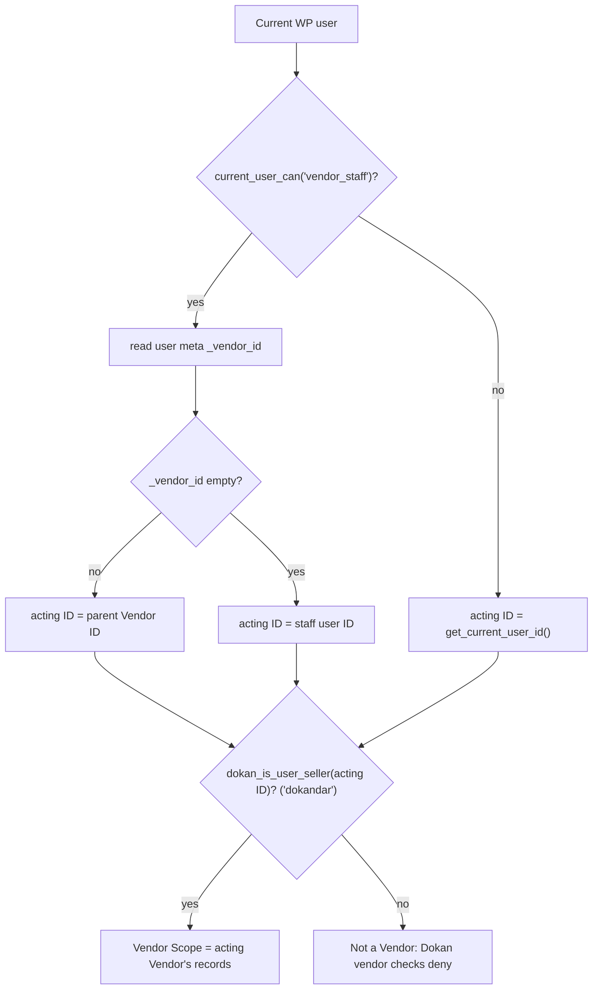
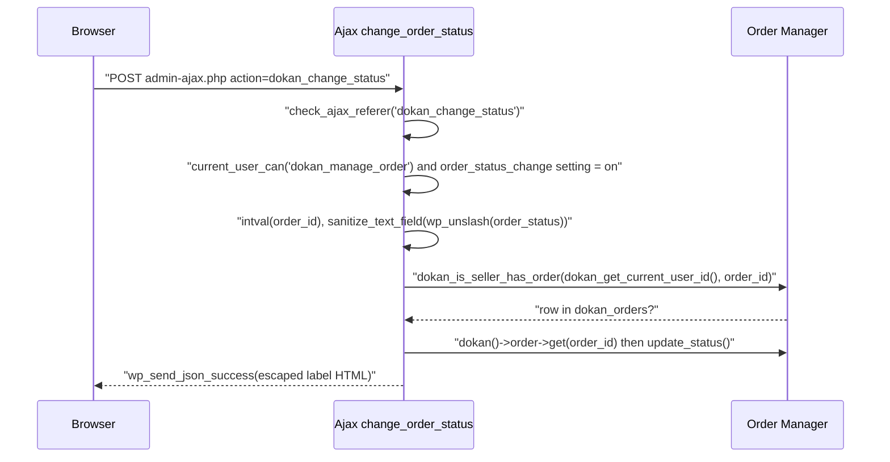
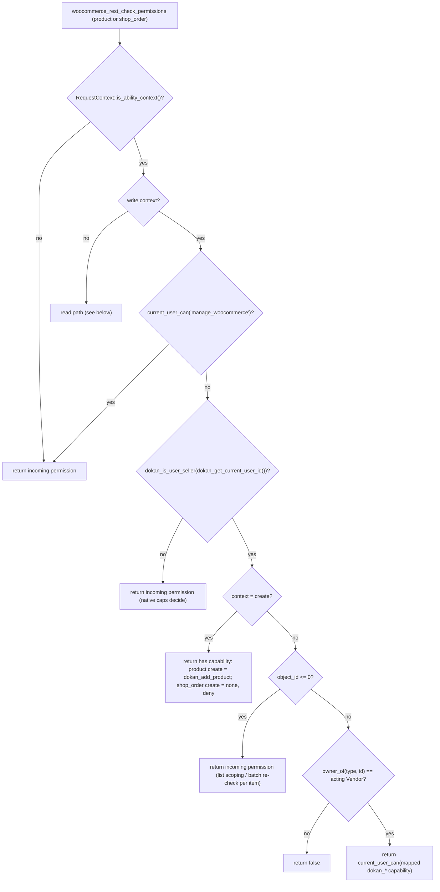
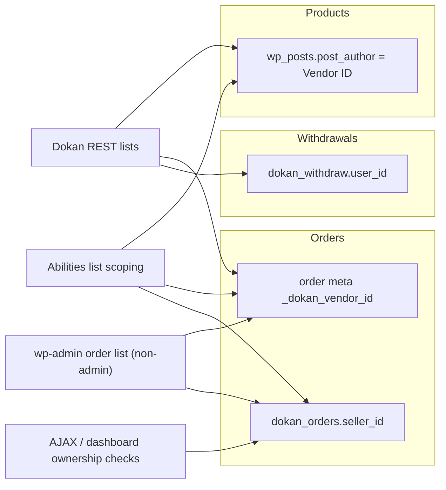
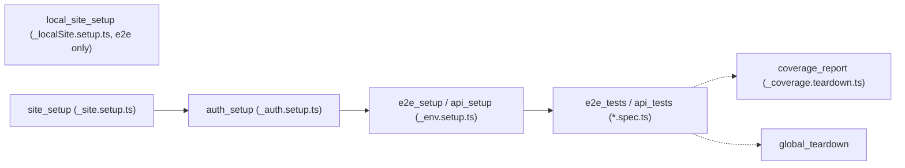
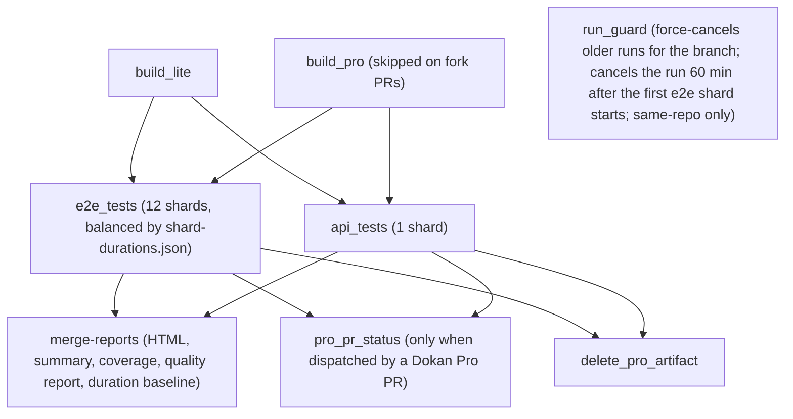

# Security Model, Testing & Compatibility (Dokan Lite)

This document describes three cross-cutting concerns of Dokan Lite:

1. The **security model**: how Dokan decides who may do what, on which records. It covers roles and capabilities, nonces, the REST and AJAX permission patterns, the Abilities ownership layer, Vendor Staff capability gating, sanitization and escaping conventions, and how queries are scoped to a single Vendor.
2. The **test suites**: PHPUnit under `tests/php`, Playwright under `tests/pw`, and the GitHub Actions workflows under `.github/workflows` that run them.
3. **Compatibility**: minimum PHP, WordPress and WooCommerce versions, the WooCommerce feature-compatibility declarations, and multisite.

It describes the model only. It does not catalogue weaknesses.

Related reading:

- `CONTEXT.md` for canonical terms: **Vendor**, **Vendor Staff**, **Store Admin**, **Site Admin**, **Customer**, **Ownership**, **Vendor Scope**, **Operating Terms**, **Ability Context**.
- [rest-api-and-permissions.md](./rest-api-and-permissions.md) holds the full per-route permission table, the store-update flow, and the hook tables for the REST and Abilities surfaces. This document summarises that material and does not repeat the route tables.
- [products.md](./products.md) and [orders-commission-fees.md](./orders-commission-fees.md) for how product and order Ownership is stored.
- [ADR-0005 (canonical admin capability)](../0005-canonical-admin-capability.md), [ADR-0006](../0006-ownership-enforced-in-abilities-layer.md), [ADR-0007](../0007-staff-actions-gated-by-dokan-capabilities.md), [ADR-0005 (PHPUnit requires a webpack build)](../0005-phpunit-requires-a-webpack-build.md).

---

## 1. Purpose & ownership

**Authorization model in one paragraph.** A *capability* decides whether an actor may perform a kind of action at all. *Ownership* decides whether they may perform it on a given record. Both must pass (`CONTEXT.md`, **Ownership**). The set of records an actor may touch is their **Vendor Scope**: their own Store for a Vendor, their Vendor's Store for Vendor Staff. A caller-supplied identifier may narrow a Vendor Scope but never widen it (`CONTEXT.md`, **Vendor Scope**). A **Store Admin** (`manage_woocommerce`) is deliberately unscoped ([ADR-0005](../0005-canonical-admin-capability.md)).

| Concern | Owner |
|---|---|
| Roles, `current_user_can()`, `map_meta_cap`, nonces (`wp_create_nonce`, `wp_verify_nonce`, `check_ajax_referer`), REST `permission_callback` dispatch, the `wp_rest` cookie nonce, the Abilities API | WordPress core |
| `wc_rest_check_post_permissions()` and the `woocommerce_rest_check_permissions` filter, the order/product data stores and their query filters, the Abilities loader and the bundled MCP adapter, HPOS, `FeaturesUtil` | [WooCommerce] |
| The `seller` role, the `dokandar` capability, the 41 `dokan_*` capabilities, Vendor/Staff identity helpers, the `dokan_orders` sync table, REST/AJAX permission checks, the Abilities ownership layer (`includes/Abilities`), PHPUnit and Playwright suites, CI workflows | [Lite] |
| The Vendor Staff role and the user interface for assigning `dokan_*` capabilities to staff | Consumed from Dokan Pro; Lite only resolves staff to their Vendor (see §8) |

**Related ADRs:** [ADR-0005 (canonical admin capability)](../0005-canonical-admin-capability.md), [ADR-0006](../0006-ownership-enforced-in-abilities-layer.md) (Ownership in the Abilities layer), [ADR-0007](../0007-staff-actions-gated-by-dokan-capabilities.md) (Vendor Staff gated by Dokan capabilities), [ADR-0009](../0009-vendor-is-a-wordpress-user-with-the-seller-role.md) (the `seller` role), [ADR-0010](../0010-product-ownership-is-post-author.md) (product Ownership column), [ADR-0005 (PHPUnit requires a webpack build)](../0005-phpunit-requires-a-webpack-build.md).

---

## 2. Entry points & bootstrap

| Entry point | Location | What it establishes |
|---|---|---|
| Plugin header | `lite:dokan.php:1` | `Requires Plugins: woocommerce`, `WC requires at least: 8.5.0`, `WC tested up to: 11.0.1`. |
| Minimum PHP | `lite:dokan-class.php:44` (`$min_php = '7.4'`), checked by `WeDevs_Dokan::is_supported_php` (`lite:dokan-class.php:126`) | Activation refuses to proceed on an unsupported PHP version (`WeDevs_Dokan::activate`). |
| Activation / deactivation | `lite:dokan-class.php:73-74` | `register_activation_hook` → `WeDevs_Dokan::activate` → `Installer::do_install()`, which registers roles and capabilities. |
| WooCommerce feature declarations | Hooked at `lite:dokan-class.php:76` on `before_woocommerce_init`; body at `lite:dokan-class.php:237` | Declares HPOS (`custom_order_tables`) and Cart/Checkout Blocks (`cart_checkout_blocks`) compatibility. WooCommerce fires `before_woocommerce_init` at `wc:includes/class-woocommerce.php:998`. |
| Role and capability install | `Installer::user_roles` (`lite:includes/Install/Installer.php:167`, `add_role` at line 174) | Creates the `seller` role and grants `dokandar` plus every `dokan_*` capability (see §8). |
| Abilities layer registration | `lite:includes/DependencyManagement/Providers/CommonServiceProvider.php:29-31` | Registers `ProductAbilityScope`, `OrderAbilityScope` and `DokanAbilityRegistrar` as `Hookable` services; `WeDevs_Dokan::init_hooks` calls `register_hooks()` on each (`lite:dokan-class.php:276-279`). |
| Admin order permissions | `Order\Controller::init_classes` (`lite:includes/Order/Controller.php:42-44`) | Instantiates `Order\Admin\Permissions` only when `is_admin()`. |
| AJAX handlers | `WeDevs\Dokan\Ajax` (`lite:includes/Ajax.php:11`) | Registers the `wp_ajax_*` / `wp_ajax_nopriv_*` actions. |
| PHPUnit bootstrap | `lite:tests/php/bootstrap.php:1` | Loads WooCommerce and Dokan on `muplugins_loaded`, forces HPOS on, installs both plugins on `setup_theme`. |
| Playwright configs | `lite:tests/pw/e2e.config.ts`, `lite:tests/pw/api.config.ts`, `lite:tests/pw/playwright.config.ts` | Project chains and tag filters (see §4.6). |
| CI workflows | `lite:.github/workflows/phpunit.yml`, `phpcs.yml`, `e2e_api_tests.yml`, `deploy.yml` | See §4.7. |

---

## 3. Key classes

| Class / function | File | Responsibility |
|---|---|---|
| `dokan_get_current_user_id()` | `lite:includes/functions.php:52` | Resolves the acting Vendor. A user holding `vendor_staff` resolves to the user ID in their `_vendor_id` user meta; everyone else resolves to `get_current_user_id()`. |
| `dokan_is_user_seller()` | `lite:includes/functions.php:77` | `user_can( $user_id, 'dokandar' )`; with `$exclude_staff = true`, users holding `vendor_staff` return `false`. |
| `dokan_is_product_author()` | `lite:includes/functions.php:148` | Compares a product's `post_author` with `dokan_get_current_user_id()` (filterable via `dokan_is_product_author`). |
| `dokan_get_all_caps()` | `lite:includes/functions.php:2835` | The 41 `dokan_*` capabilities, grouped (overview, report, order, coupon, review, withdraw, product, menu); filterable via `dokan_get_all_cap`. |
| `dokan_admin_menu_capability()` | `lite:includes/functions.php:40` | Returns `manage_woocommerce`, filterable via `dokan_menu_capability`. |
| `dokan_get_seller_id_by_order()` | `lite:includes/Order/functions.php:296` | Resolves an order's Vendor from `{prefix}dokan_orders.seller_id` (cached). |
| `Order\Manager::is_seller_has_order` | `lite:includes/Order/Manager.php:393` | `SELECT 1 FROM {prefix}dokan_orders WHERE seller_id = %d AND order_id = %d`. |
| `Order\Manager::all` | `lite:includes/Order/Manager.php:31` | Order queries; a `seller_id` argument becomes a `_dokan_vendor_id` meta query (line 122). |
| `Abstracts\DokanRESTController::prepare_objects_query` | `lite:includes/Abstracts/DokanRESTController.php:333` | Forces `author` to `dokan_get_current_user_id()` unless the caller holds `dokan_admin_menu_capability()` and passes `id`. |
| `Traits\VendorAuthorizable` | `lite:includes/Traits/VendorAuthorizable.php:7` | Shared Vendor-route checks: `check_permission()` (`dokandar`, line 16), `can_access_vendor_store()`, `get_vendor_id_for_user()`, `validate_store_id()`, `is_staff_only()`. |
| `REST\DokanBaseAdminController::check_permission` | `lite:includes/REST/DokanBaseAdminController.php:26` | Admin routes require `manage_woocommerce`. |
| `Order\Admin\Permissions` | `lite:includes/Order/Admin/Permissions.php:17` | wp-admin only: hooks registered in the constructor (line 23); `map_meta_caps` (line 51) and Vendor-scoped order list filters for HPOS (line 87) and legacy CPT (line 123). |
| `Abilities\Support\OwnershipGate` | `lite:includes/Abilities/Support/OwnershipGate.php:28` | The single Ownership + `dokan_*` capability gate for the Abilities layer: `can_write()` (line 131), `has_read_capability()` (line 189). |
| `Abilities\Support\RequestContext` | `lite:includes/Abilities/Support/RequestContext.php:25` | Detects an **Ability Context**: `is_ability_context()` (line 93), `is_vendor_ability_context()`. |
| `Abilities\ProductAbilityScope` | `lite:includes/Abilities/ProductAbilityScope.php:38` | Applies Vendor Scope and Ownership to WooCommerce's product abilities. |
| `Abilities\OrderAbilityScope` | `lite:includes/Abilities/OrderAbilityScope.php:43` | Applies Vendor Scope and Ownership to WooCommerce's order abilities across CPT and HPOS stores. |
| `Abilities\Definitions\AbstractVendorAbility` | `lite:includes/Abilities/Definitions/AbstractVendorAbility.php:23` | Base for Dokan-native abilities: `check_permission()` (line 100) and `guard()` (line 154). |
| `Abilities\DokanAbilityRegistrar` | `lite:includes/Abilities/DokanAbilityRegistrar.php:27` | Registers the `dokan` ability category and the four Dokan-native abilities. |
| `Ajax::change_order_status` | `lite:includes/Ajax.php:363` | Reference example of the AJAX pattern (nonce → capability → Ownership). |
| `Test\DokanTestCase` | `lite:tests/php/src/DokanTestCase.php:23` | Base PHPUnit case: REST server, users fixture, Brain Monkey and Mockery lifecycle, request helpers. |
| `Test\DokanAjaxTestCase` | `lite:tests/php/src/DokanAjaxTestCase.php:11` | Base case for AJAX tests (`WP_Ajax_UnitTestCase`). |
| `Test\Factories\DokanFactory` | `lite:tests/php/src/Factories/DokanFactory.php:6` | Fixture factory exposing `customer`, `seller`, `coupon`, `product`, `order`, `shipping`. |

---

## 4. Execution flow

### 4.1 Actor resolution

Every Dokan permission check starts by resolving who is acting and for which Vendor.

- `dokan_get_current_user_id()` returns the *data-scope* identity. Vendor Staff share their Vendor's boundary.
- `current_user_can( 'dokan_*' )` is always evaluated against the *real* user. Vendor Staff therefore keep their own, narrower set of permitted actions. Sharing the boundary is not the same as sharing the permissions (`CONTEXT.md`, **Vendor Staff**).
- A Store Admin is detected by `current_user_can( 'manage_woocommerce' )` ([ADR-0005](../0005-canonical-admin-capability.md)). On the scoping paths below, a Store Admin is not restricted to one Vendor.

### 4.2 REST pattern (summary)

The full per-route table lives in [rest-api-and-permissions.md §7](./rest-api-and-permissions.md). The pattern is:

1. **`permission_callback` checks a capability.** Examples: `WithdrawController::get_items_permissions_check` returns `current_user_can( 'dokan_manage_withdraw' )`; `VendorAuthorizable::check_permission` returns `current_user_can( 'dokandar' )`; `DokanBaseAdminController::check_permission` returns `current_user_can( 'manage_woocommerce' )`.
2. **Ownership is checked per record**, either in the permission callback itself (`WithdrawController::get_item_permissions_check` compares the withdraw's `user_id` with the caller), in a `validation_before_update_item()` / `validation_before_delete_item()` step called by `DokanRESTController::update_item()` / `::delete_item()` (`OrderController::validation_before_update_item` compares `dokan_get_current_user_id()` with `dokan_get_seller_id_by_order()`), or with `VendorAuthorizable::can_access_vendor_store()` for store records.
3. **List endpoints are scoped in the query.** `DokanRESTController::prepare_objects_query` pins `author`; `WithdrawController::get_items` pins `user_id` to `dokan_get_current_user_id()` for non-admins; `StoreController::get_store_products` pins the author and forces `status=publish` on a public route.
4. **Operating Terms** (Commission, Selling Activation, Direct Publishing, featured status) are applied only for a Store Admin: `Vendor\Manager::update` (`lite:includes/Vendor/Manager.php:323`) wraps those writes in `current_user_can( 'manage_woocommerce' )` (line 381). ADR-0005 identifies this gate as the real protection for Operating Terms.

### 4.3 AJAX pattern

Logged-in AJAX handlers in `WeDevs\Dokan\Ajax` follow nonce → capability → Ownership → sanitized input. `Ajax::change_order_status` is the reference:

Unauthenticated (`wp_ajax_nopriv_*`) handlers also verify a nonce where they accept a form submission. Examples are `Ajax::contact_seller` (`dokan_contact_seller` nonce, `lite:includes/Ajax.php:412`) and `Ajax::seller_listing_search` (`dokan-seller-listing-search` nonce, line 650).

### 4.4 Abilities layer: Ability Context and the Ownership gate (ADR-0006, ADR-0007)

The Abilities layer applies Dokan's model to WooCommerce's own product and order abilities and to Dokan's native abilities. MCP clients reach those abilities through WooCommerce's MCP integration. Detailed hook tables are in [rest-api-and-permissions.md §4.3–4.4](./rest-api-and-permissions.md).

**Ability Context detection.** `RequestContext::is_ability_context()` is true when any of the following holds:

- the MCP adapter flagged the request during its permission pre-flight. `RequestContext::flag_mcp_request` is hooked to `mcp_adapter_execute_ability_capability`, fired by the bundled adapter at `wc:vendor/wordpress/mcp-adapter/includes/Abilities/ExecuteAbilityAbility.php:140`;
- an ability is executing. A depth counter is driven by `wp_before_execute_ability` and `wp_after_execute_ability`, so the context follows the ability whatever transport invoked it;
- the request is a REST request whose URI matches `/(woocommerce|dokan)/mcp`, or WooCommerce's `MCPAdapterProvider::is_mcp_request()` says so.

The result is filterable via `dokan_is_ability_context`. Because the context follows the ability, Vendor Scope applies to in-process and WP-CLI ability calls too (`CONTEXT.md`, **Ability Context**).

**Per-object decisions.** Inside an Ability Context, `ProductAbilityScope::scope_product_permissions` and `OrderAbilityScope::scope_order_permissions` filter `woocommerce_rest_check_permissions` at priority 99. WooCommerce fires that filter from `wc_rest_check_post_permissions()` at `wc:includes/wc-rest-functions.php:249`. Write contexts (`create`, `edit`, `delete`, `batch`) go to `OwnershipGate::can_write`:

The capability map in `OwnershipGate::CAPABILITIES` is:

| Object type | create | edit | delete | batch |
|---|---|---|---|---|
| `product` | `dokan_add_product` | `dokan_edit_product` | `dokan_delete_product` | `dokan_edit_product` |
| `shop_order` | (none: denied) | `dokan_manage_order` | `dokan_manage_order` | `dokan_manage_order` |

Each entry is filterable via `dokan_ability_write_capability`. An empty string means no capability is required. A context missing from the map fails closed.

`owner_of()` resolves a product's Vendor from `post_author` and an order's Vendor from `dokan_get_seller_id_by_order()`.

**Reads.** `OwnershipGate::has_read_capability` maps reads to the same capabilities the vendor dashboard uses. Product `item` and `list` reads need `dokan_view_product_menu`. Order `item` reads need `dokan_view_order`, and order `list` reads need `dokan_view_order_menu`. The map is filterable via `dokan_ability_read_capability` and fails closed for unmapped entries. Published products are public. `ProductAbilityScope::scope_product_permission` returns `true` for `publish` status. An unpublished product is readable only by a Store Admin, or by its owner if they hold the read capability. A single order is readable only when `dokan_get_seller_id_by_order()` equals the acting Vendor and the read capability is held.

**Why the gate replaces native capabilities below Store Admin.** [ADR-0006](../0006-ownership-enforced-in-abilities-layer.md) records that `wc_rest_check_post_permissions()` denies cross-vendor product writes but allows cross-vendor order writes, so Dokan asserts Ownership itself for both. The product-side check must not be removed as "redundant". [ADR-0007](../0007-staff-actions-gated-by-dokan-capabilities.md) records that, once Ownership resolves, the gate decides from the `dokan_*` capability for every actor below Store Admin, on reads as well as writes. For Vendor Staff it grants what native capabilities would refuse (`edit_others_products` on the parent Vendor's products). ADR-0007 names this gate the highest-risk code in the Abilities layer.

**Dokan-native abilities.** `AbstractVendorAbility::check_permission` lets a Store Admin through. Every other caller must be a Vendor and hold `required_capability()`, filtered via `dokan_ability_required_capability`. `guard()` repeats the check inside `execute()`, because an ability's callbacks are reachable without the Abilities API's pre-flight.

| Ability | Class | Required capability | Permission |
|---|---|---|---|
| `dokan/current-vendor` | `Definitions\CurrentVendor` | n/a | `__return_true`; reports identity only, including for anonymous callers. |
| `dokan/vendors-query` | `Definitions\VendorsQuery` | n/a | `__return_true`; public store directory. `VendorsQuery::resolve_status` coerces `pending`/`all` to `approved` for non-Store-Admins. |
| `dokan/vendor-stats-get` | `Definitions\VendorStatsGet` | `dokan_view_sales_overview` | `check_permission()` |
| `dokan/withdraws-query` | `Definitions\WithdrawsQuery` | `dokan_manage_withdraw` | `check_permission()` |

### 4.5 Data isolation between Vendors

Dokan uses four distinct mechanisms to keep one Vendor's records out of another's view. Which one applies depends on the record type and the surface.

| Record | Ownership key | Where it is enforced |
|---|---|---|
| Product | `wp_posts.post_author` | `DokanRESTController::prepare_objects_query` (forced `author`), `dokan_is_product_author()`, `StoreController::get_store_products` (forced author plus `publish`), `ProductAbilityScope::apply_product_query_scope` (while a products-query ability runs, applies the optional `vendor_id` input as `author`, and forces `publish` unless the caller is a Store Admin or is filtering on their own store while holding `dokan_view_product_menu`; see `ProductAbilityScope::prepare_product_query_scope`). |
| Order (query) | `_dokan_vendor_id` order meta | `Order\Manager::all` turns `seller_id` into a `_dokan_vendor_id IN (...)` meta query; `OrderController::get_items` forces `seller_id` to the acting Vendor for callers without `manage_options`; `Order\Admin\Permissions::hpos_filter_orders_for_current_vendor` forces it for non-Store-Admins on the HPOS admin list; `OrderAbilityScope::get_vendor_order_ids` resolves the acting Vendor's order IDs through `dokan()->order->all( [ 'seller_id' => ... ] )` for ability list scoping. |
| Order (ownership lookup) | `{prefix}dokan_orders.seller_id` | `dokan_get_seller_id_by_order()`, `Order\Manager::is_seller_has_order`, `Order\Manager::count_orders`; `Order\Admin\Permissions::filter_orders_for_current_vendor` joins `dokan_orders` on the legacy-CPT admin list. |
| Withdrawal | `dokan_withdraw.user_id` | `WithdrawController::get_items` pins `user_id`; `WithdrawController::get_item_permissions_check` compares owner; `WithdrawsQuery` scopes to `dokan_get_current_user_id()`. |
| Store profile | Vendor user ID | `VendorAuthorizable::can_access_vendor_store()` (acting Vendor must equal target, unless Store Admin). |

**Narrow, never widen.** `OrderAbilityScope::scope_orders_query` implements the `CONTEXT.md` rule directly. When the incoming query already has `post__in`, it is intersected with the acting Vendor's order IDs. An empty intersection becomes `[0]`, which matches no rows, rather than an empty array, which would match every order. Without `post__in`, the Vendor's IDs are injected.

Per [ADR-0004](../0004-vendor-order-is-authoritative-parent-is-mirror.md), the Vendor order (Suborder) is authoritative and the parent order is a mirror. Ownership checks therefore resolve to the Vendor order's `seller_id`.

### 4.6 Test execution flow

**PHPUnit.** `npm run phpunit` runs `vendor/bin/phpunit -c phpunit.xml` inside the wp-env `cli` container (`package.json`). The bootstrap (`lite:tests/php/bootstrap.php`) does the following:

1. Requires Composer's autoloader and the WP test library (`WP_TESTS_DIR` or `WP_PHPUNIT__DIR`).
2. On `muplugins_loaded` (priority 1), forces `custom_order_tables` on and enables HPOS plus data sync through `pre_option_*` filters.
3. On `muplugins_loaded`, loads `woocommerce/woocommerce.php` and `dokan.php`.
4. On `setup_theme`, runs WooCommerce's uninstall, `WC_Install::install()`, creates HPOS and Analytics tables, then truncates Dokan tables (`dokan_withdraw`, `dokan_orders`, `dokan_announcement`, `dokan_refund`, `dokan_vendor_balance`) and HPOS tables and calls `dokan()->activate()`.

`phpunit.xml` converts errors, notices and warnings to exceptions. The suite needs built assets: a bare `require` of `assets/js/frontend.asset.php` during `init` is fatal without a webpack build ([ADR-0005, PHPUnit requires a webpack build](../0005-phpunit-requires-a-webpack-build.md)).

`DokanTestCase::set_up` calls `Monkey\setUp()` and flushes the settings repository caches. It sets permalinks and Dokan pages. Unless `$is_unit_test` is true, it also boots a `WP_REST_Server`, fires `rest_api_init`, and creates one administrator, one customer and two sellers (`$admin_id`, `$customer_id`, `$seller_id1`, `$seller_id2`). `tear_down` calls `Monkey\tearDown()`. `DokanTestCase::create_vendor_staff()` creates a `vendor_staff` user with `_vendor_id` meta, which the authorization tests use.

**Playwright.** Each config defines a project chain:

With `NO_SETUP=true`, the setup dependencies are dropped. Test selection is tag-driven:

| Config | `grep` | `grepInvert` |
|---|---|---|
| `e2e.config.ts` / `playwright.config.ts` | `@lite`, `@liteOnly`, `@pro` | `DOKAN_PRO` set (`e2e.config.ts` tests the raw string; `playwright.config.ts` uses `parseBoolean`): `@liteOnly`, `@serial`. Otherwise: `@pro`, `@serial`. |
| `api.config.ts` | `@lite`, `@pro` | `DOKAN_PRO` true: none. Otherwise: `@pro`. |

On CI the configs use one worker and two retries. Locally they use four workers and no retries.

### 4.7 CI: what runs when

| Workflow | Trigger | What it does |
|---|---|---|
| `phpunit.yml` (PHPUnit Tests) | `pull_request` (any base) and `push` to `develop`, both path-filtered to `**.php`, `tests/php/**`, `composer.*`, `package.json`, `phpunit.xml`, `.wp-env.json`, the workflow file; `workflow_dispatch` | Matrix PHP 7.4 and 8.3 (`fail-fast: false`). Restores or builds `assets/js` + `assets/css` (cache keyed on frontend sources), `composer install` (runs Mozart), rewrites `.wp-env.override.json` `phpVersion` from the matrix, pre-seeds Docker images, `npm run env:start`, `npm run phpunit -- --log-junit`. No retry wrapper. JUnit annotations; debug log and container logs on failure. Concurrency cancels superseded runs per PR / per develop ref. |
| `phpcs.yml` (PHPCS Inspections) | `pull_request` touching `**.php` | PHP 7.4; runs `vendor/bin/phpcs` only on PHP files the PR changes (merge commit vs first parent), reported through `cs2pr`. |
| `e2e_api_tests.yml` (E2E_API Tests) | `push` to `develop`, `pull_request` (both with `paths-ignore` for docs, Markdown, text, translations, SVG, images); `schedule` at 02:00 UTC (latest WP/WC, gating) and 14:00 UTC (pinned stack from `.wp-env*.json`, non-gating); `workflow_dispatch` with `testsuite` (E2E / API / All), `wp_stack`, and inputs used when a Dokan Pro PR dispatches the run | See the diagram below. |
| `deploy.yml` | `push` of any tag | PHP 7.4, `composer install --no-dev -o`, `npm run build`, deploys to WordPress.org SVN (`10up/action-wordpress-plugin-deploy`), creates a GitHub release with the zip. |

E2E shards run with `continue-on-error`. Failed tests are then re-run in isolation (`--last-failed`), and the shard fails only when that re-run does not clear every failure. The workflow sets `DOKAN_PRO: true`, so `@pro` specs run when the Pro build is available. On fork PRs, `build_pro` is skipped and the test jobs run Lite only (per the workflow's own comment). Only the 14:00 UTC pinned lane may fail without failing the run.

---

## 5. Hooks fired / hooks consumed

### 5.1 Hooks Dokan fires (security-relevant)

| Hook | Type | Fired in | Purpose |
|---|---|---|---|
| `dokan_menu_capability` | filter | `dokan_admin_menu_capability()` | Change the admin capability (default `manage_woocommerce`). |
| `dokan_get_all_cap` | filter | `dokan_get_all_caps()` | Add or remove `dokan_*` capabilities (installed onto roles at activation). |
| `dokan_is_product_author` | filter | `dokan_is_product_author()` | Override the acting-Vendor ID compared with `post_author`. |
| `dokan_is_ability_context` | filter | `RequestContext::is_ability_context` | Force or suppress Ability Context detection. |
| `dokan_ability_write_capability` | filter | `OwnershipGate::has_capability` | Capability for an Abilities-layer write. |
| `dokan_ability_read_capability` | filter | `OwnershipGate::has_read_capability` | Capability for an Abilities-layer read. |
| `dokan_ability_required_capability` | filter | `AbstractVendorAbility::check_permission` | Capability for a Dokan-native ability. |
| `dokan_ability_definition_classes` | filter | `DokanAbilityRegistrar::ability_classes` | Add or remove Dokan-native ability classes. |
| `dokan_redirect_login` | filter | `dokan_redirect_login()` | Login redirect target for unauthenticated dashboard access. |
| `dokan_loaded` | action | `WeDevs_Dokan::init_plugin` | Plugin loaded. |

### 5.2 Hooks Dokan consumes (security-relevant)

| Hook | Fired by | Dokan callback | Purpose |
|---|---|---|---|
| `before_woocommerce_init` | [WooCommerce] `wc:includes/class-woocommerce.php:998` | `WeDevs_Dokan::declare_woocommerce_feature_compatibility` | HPOS and Blocks compatibility. |
| `woocommerce_rest_check_permissions` (priority 99) | [WooCommerce] `wc:includes/wc-rest-functions.php:249` | `ProductAbilityScope::scope_product_permissions`, `OrderAbilityScope::scope_order_permissions` | Ownership gate in an Ability Context. |
| `woocommerce_product_data_store_cpt_get_products_query` | [WooCommerce] `wc:includes/data-stores/class-wc-product-data-store-cpt.php:2531` | `ProductAbilityScope::scope_products_query` | Product list scoping (Layer 2). |
| `woocommerce_rest_product_object_query` | [WooCommerce] `wc:includes/rest-api/Controllers/Version3/class-wc-rest-crud-controller.php:355` (`woocommerce_rest_{$this->post_type}_object_query`) | `ProductAbilityScope::scope_rest_products_query` | Product list scoping (Layer 1). |
| `woocommerce_order_data_store_cpt_get_orders_query` | [WooCommerce] `wc:includes/data-stores/class-wc-order-data-store-cpt.php:1055` | `OrderAbilityScope::scope_orders_query` | Order list scoping, legacy CPT. |
| `woocommerce_orders_table_datastore_get_orders_query` | [WooCommerce] `wc:src/Internal/DataStores/Orders/OrdersTableDataStore.php:3367` | `OrderAbilityScope::scope_orders_query` | Order list scoping, HPOS. |
| `woocommerce_rest_orders_prepare_object_query` | [WooCommerce] `wc:includes/rest-api/Controllers/Version2/class-wc-rest-orders-v2-controller.php:685` | `OrderAbilityScope::scope_rest_orders_query` | Order list scoping (Layer 1). |
| `woocommerce_new_product` (priority 99) | [WooCommerce] `wc:includes/data-stores/class-wc-product-data-store-cpt.php:263` | `ProductAbilityScope::assign_vendor_as_product_author` | Author ability-created products to the Vendor (matters for Vendor Staff). |
| `woocommerce_ability_definition_classes` | [WooCommerce] `wc:src/Internal/Abilities/AbilitiesLoader.php:208` | `DokanAbilityRegistrar::register_definition_classes` | Register Dokan-native abilities. |
| `mcp_adapter_execute_ability_capability` | [WooCommerce] bundled MCP adapter, `wc:vendor/wordpress/mcp-adapter/includes/Abilities/ExecuteAbilityAbility.php:140` | `RequestContext::flag_mcp_request` | Mark the request as MCP before the ability's permission callback runs. |
| `wp_before_execute_ability` / `wp_after_execute_ability` | WordPress core Abilities API | `RequestContext::mark_ability_execution_started` / `_finished` | Track the Ability Context regardless of transport. |
| `abilities_api_categories_init` / `wp_abilities_api_categories_init` | WordPress core Abilities API | `DokanAbilityRegistrar::register_category` | Register the `dokan` category. |
| `wp_register_ability_args` | WordPress core Abilities API | `ProductAbilityScope::extend_product_abilities`, `OrderAbilityScope::extend_order_abilities` | Wrap WooCommerce ability callbacks to add Vendor input/output. |
| `map_meta_cap` (priority 12) | WordPress core | `Order\Admin\Permissions::map_meta_caps` | In wp-admin only: maps `edit_post` / `edit_others_shop_orders` to `edit_shop_orders` when the order's `_dokan_vendor_id` equals the user. |
| `woocommerce_order_list_table_prepare_items_query_args` | [WooCommerce] `wc:src/Internal/Admin/Orders/ListTable.php:424` | `Order\Admin\Permissions::hpos_filter_orders_for_current_vendor` | Scope the HPOS admin order list for non-Store-Admins. |
| `posts_clauses` (priority 12) | WordPress core | `Order\Admin\Permissions::filter_orders_for_current_vendor` | Scope the legacy-CPT admin order list for non-Store-Admins. |

ADR-0007 considered and rejected widening `Order\Admin\Permissions::map_meta_caps`, which is registered only when `is_admin()`, into a global product meta-capability remap. The reason was that it changes capability answers well beyond the MCP surface.

---

## 6. Data storage

| Store | Key | Security role |
|---|---|---|
| Role `seller` | Created by `Installer::user_roles` | Vendor role; carries `dokandar`, WooCommerce product capabilities, `edit_shop_orders`, `upload_files`, and every `dokan_*` capability. |
| Capability `dokandar` | Granted to `seller`, `administrator`, `shop_manager` | "Is a Vendor" marker tested by `dokan_is_user_seller()`. |
| Capabilities `dokan_*` (41) | Granted to `seller`, `administrator`, `shop_manager` | Action model for Vendors and Vendor Staff. |
| User meta `_vendor_id` | On a Vendor Staff user | Parent Vendor resolved by `dokan_get_current_user_id()`. |
| Order meta `_dokan_vendor_id` | On each Vendor order | Vendor filter for order queries and the wp-admin meta-cap mapping. |
| Table `{prefix}dokan_orders` | `id` bigint PK, `order_id` bigint (indexed), `seller_id` bigint (indexed), `order_total` decimal(19,4), `net_amount` decimal(19,4), `order_status` varchar(30); created by `Installer::create_sync_table` (`lite:includes/Install/Installer.php:372`, DDL at line 375) | Order → Vendor lookup used by Ownership checks. |
| Table `{prefix}dokan_withdraw` | `user_id` column | Withdrawal ownership (see [withdraw-and-reverse-withdrawal.md](./withdraw-and-reverse-withdrawal.md)). |
| `wp_posts.post_author` | Products | Product ownership. |
| Option `dokan_selling` → `order_status_change` | Admin setting | When not `on`, Vendors cannot change order status (`Ajax::change_order_status`, `OrderController::update_order_permissions_check`). |
| Transient `dokan_wc_missing_notice` | Set on activation without WooCommerce | Admin notice flag; removed on deactivation. |

---

## 7. REST/AJAX endpoints

The complete route list with permission callbacks is in [rest-api-and-permissions.md §7](./rest-api-and-permissions.md). This section records only the conventions.

| Surface | Authentication | CSRF protection | Authorization |
|---|---|---|---|
| `dokan/v1`, `v2`, `v3` (Vendor and public routes) | WordPress cookie or application credentials | `wp_rest` nonce, localized to scripts by `Assets` (`lite:includes/Assets.php:63`, `:907`, `:1479`) and checked by WordPress core's REST cookie authentication | `permission_callback` capability + Ownership (§4.2) |
| `dokan/v1/admin` | Same | Same | `DokanBaseAdminController::check_permission` → `manage_woocommerce` |
| `admin-ajax.php` (`WeDevs\Dokan\Ajax`, 29 `wp_ajax_*` registrations, plus handlers in other classes) | Cookie | `check_ajax_referer()` / `wp_verify_nonce()` with per-action nonce names | Capability + `dokan_is_seller_has_order()` / `dokan_is_product_author()` (§4.3) |
| Dashboard form posts | Cookie | `wp_nonce_field()` + `wp_verify_nonce()`, e.g. `dokan_add_new_product` (`lite:includes/Dashboard/Templates/Products.php:296`), `dokan_edit_product` (line 469), `dokan_withdraw` (`lite:includes/Withdraw/Hooks.php:166`) | Capability + Ownership in the handler |
| Abilities / MCP | WordPress Abilities API / MCP adapter | Handled by the transport | `OwnershipGate` and `AbstractVendorAbility::check_permission` (§4.4) |

**Nonce strategy.** Nonces are per action rather than global. About 65 `wp_create_nonce()` calls exist across `includes/` and `templates/` (52 in `includes/`), with action names such as `dokan_admin`, `seller-order-filter-nonce`, `dokan_edit_product_nonce`, `dokan_reviews`, `dokan_view_order`, `dokan_add_product_nonce`, `dokan_reverse_withdrawal_payment`, `dokan_vendor_order_export_action`, and WooCommerce-compatible names such as `search-products`, `search-customer`, `load-variations`, `save-variations`. Verification uses about 21 `check_ajax_referer()` and 70 `wp_verify_nonce()` calls across `includes/` and `templates/`. The handlers cited above (`Ajax::contact_seller`, `Ajax::seller_listing_search`, the product form handlers and the withdraw form handler) pass the nonce through `sanitize_key()` before `wp_verify_nonce()`. A nonce proves intent only. Every handler still performs its own capability and Ownership checks.

---

## 8. Permissions & capabilities

### 8.1 Roles and capabilities installed by Lite

`Installer::user_roles` creates the `seller` role (display name "Vendor") with WordPress post capabilities, WooCommerce product capabilities (`edit_products`, `publish_products`, `delete_products`, and others), `edit_shop_orders`, `upload_files` and `dokandar`. It then adds `dokandar` to `administrator` and `shop_manager`, and adds every capability from `dokan_get_all_caps()` to `seller`, `administrator` and `shop_manager` (`lite:includes/Install/Installer.php:211-217`).

The 41 `dokan_*` capabilities by group:

| Group | Capabilities |
|---|---|
| overview | `dokan_view_sales_overview`, `dokan_view_sales_report_chart`, `dokan_view_announcement`, `dokan_view_order_report`, `dokan_view_review_reports`, `dokan_view_product_status_report` |
| report | `dokan_view_overview_report`, `dokan_view_daily_sale_report`, `dokan_view_top_selling_report`, `dokan_view_top_earning_report`, `dokan_view_statement_report` |
| order | `dokan_view_order`, `dokan_manage_order`, `dokan_manage_order_note`, `dokan_manage_refund`, `dokan_export_order` |
| coupon | `dokan_add_coupon`, `dokan_edit_coupon`, `dokan_delete_coupon` |
| review | `dokan_view_reviews`, `dokan_manage_reviews` |
| withdraw | `dokan_manage_withdraw` |
| product | `dokan_add_product`, `dokan_edit_product`, `dokan_delete_product`, `dokan_view_product`, `dokan_duplicate_product`, `dokan_import_product`, `dokan_export_product` |
| menu | `dokan_view_overview_menu`, `dokan_view_product_menu`, `dokan_view_order_menu`, `dokan_view_coupon_menu`, `dokan_view_report_menu`, `dokan_view_review_menu`, `dokan_view_withdraw_menu`, `dokan_view_store_settings_menu`, `dokan_view_store_payment_menu`, `dokan_view_store_shipping_menu`, `dokan_view_store_social_menu`, `dokan_view_store_seo_menu` |

Lite does not register a `vendor_staff` role. It only recognises the capability in `dokan_get_current_user_id()` and `dokan_is_user_seller( $id, true )`. The role is supplied by Dokan Pro.

### 8.2 Actor matrix

| Actor | Identified by | Vendor Scope | Action model |
|---|---|---|---|
| Store Admin | `manage_woocommerce` | Unscoped | May act on any Vendor and set Operating Terms ([ADR-0005](../0005-canonical-admin-capability.md)). |
| Site Admin | `manage_options` | Unscoped | No separate boundary in the model; some REST callbacks still gate on it (see ADR-0005, Consequences). |
| Vendor | `dokandar`, not `vendor_staff` | Own records | All `dokan_*` capabilities by default. |
| Vendor Staff | `vendor_staff` + `_vendor_id` meta | Parent Vendor's records | Their own `dokan_*` subset; on the Abilities path this subset is the only authority once Ownership resolves ([ADR-0007](../0007-staff-actions-gated-by-dokan-capabilities.md)). |
| Customer / guest | Neither | None | Public catalogue and store directory only. |

### 8.3 Sanitization and escaping conventions

- **Input.** Request values are unslashed and sanitized at the point of read. The codebase uses `wp_unslash()` (about 330 call sites in `includes/` and `templates/`), `sanitize_text_field()` (about 250), `absint()`/`intval()` for IDs (about 190 `absint`), `sanitize_key()` for nonces and slugs, `sanitize_email()` for e-mail, and WooCommerce's `wc_clean()` (about 107). Argument schemas declare `sanitize_callback` (about 190 occurrences in `includes/`, 154 of them under `includes/REST/`) and `validate_callback` (about 35). Store IDs use `VendorAuthorizable::validate_store_id`.
- **SQL.** Direct queries go through `$wpdb->prepare()` (about 115 occurrences), for example in `dokan_get_seller_id_by_order()` and `Order\Manager::is_seller_has_order`.
- **Output.** Escaping uses the `esc_html*`, `esc_attr*`, `esc_url` and `wp_kses*` families (about 1,785 / 668 / 218 / 204 lines containing them in `includes/` and `templates/`, respectively). Strings returned in JSON responses that contain HTML are escaped before they are concatenated (for example the label in `Ajax::change_order_status`).
- **Tooling.** `phpcs.xml.dist` applies `WordPress` and `WordPress-Extra` with `PHPCompatibilityWP` (`testVersion 7.4-`) and `minimum_supported_wp_version 6.4`. `WordPress.Security.ValidatedSanitizedInput` is configured with the custom sanitizers `wc_clean`, `wc_esc_json` and `dokan_sanitize_phone_number`. `WordPress.Security.EscapeOutput.OutputNotEscaped` is set to severity 0, so output escaping is upheld by convention and review rather than by this sniff. `WordPress.DB.PreparedSQL.NotPrepared` reports as a warning. Two custom sniffs under `tools/phpcs-sniffs/` guard the admin settings store. CI runs PHPCS on changed files only (§4.7).

---

## 9. WooCommerce touchpoints

- **Permission filter.** The Abilities layer filters `woocommerce_rest_check_permissions`, scoped to `product` and `shop_order` and only inside an Ability Context, so WooCommerce's own REST requests outside that context are untouched (§4.4).
- **Data-store query filters** for products (CPT) and orders (CPT and HPOS), plus the v2/v3 REST query filters (§5.2).
- **HPOS-aware admin scoping.** `Order\Admin\Permissions` picks `woocommerce_order_list_table_prepare_items_query_args` when `OrderUtil::is_hpos_enabled()`, and `posts_clauses` otherwise.
- **Abilities API.** Dokan-native abilities implement WooCommerce's public `Automattic\WooCommerce\Abilities\AbilityDefinition` interface and are registered through `woocommerce_ability_definition_classes`. Per the `DokanAbilityRegistrar` docblock, this needs WooCommerce 10.9+. On older WooCommerce the filter never runs and the classes are never autoloaded.
- **Feature compatibility.** `FeaturesUtil::declare_compatibility` for `custom_order_tables` and `cart_checkout_blocks` (see §2 and the Compatibility section).
- **Tests.** The PHPUnit bootstrap installs WooCommerce from the sibling `woocommerce/` directory and runs it with HPOS enabled and sync on. `tests/php/src/Helpers/WC_Helper_*` provide WooCommerce fixture helpers (coupon, customer, order, product, queue, shipping).

---

## 10. Dependencies

**Internal:** the DI container and `Hookable` contract (`CommonServiceProvider`), `Order\Manager`, `Vendor\Manager`, `Utilities\VendorUtil` (behind `VendorAuthorizable::get_vendor_id_for_user`), `Cache`, `Installer`.

**External, runtime:** WordPress (roles, nonces, REST, the Abilities API with `wp_register_ability_category`), WooCommerce (REST helpers, data stores, HPOS, `FeaturesUtil`, the Abilities loader and the bundled `wordpress/mcp-adapter`).

**External, test and CI** (from `composer.json` and `tests/pw/package.json`): `phpunit/phpunit ^9.6`, `wp-phpunit/wp-phpunit`, `yoast/phpunit-polyfills`, `brain/monkey ^2.0` (which brings Mockery), `@wordpress/env` (wp-env) for both suites, Playwright with Chromium, `shivammathur/setup-php`, `mikepenz/action-junit-report`, `10up/action-wordpress-plugin-deploy`, `softprops/action-gh-release`.

---

## 11. Extension points

| To... | Use |
|---|---|
| Change who counts as the admin for Dokan menus and REST admin scoping | `dokan_menu_capability` |
| Add a Vendor capability (installed onto roles at activation) | `dokan_get_all_cap` |
| Change the capability an Abilities-layer read or write requires | `dokan_ability_read_capability`, `dokan_ability_write_capability` |
| Change the capability a Dokan-native ability requires | `dokan_ability_required_capability` |
| Add a Dokan-native ability | Implement a subclass of `AbstractVendorAbility`, add it via `dokan_ability_definition_classes`, override `required_capability()`, and call `guard()` at the top of `execute()` |
| Treat a custom MCP endpoint as an Ability Context | `dokan_is_ability_context` |
| Override product-author resolution | `dokan_is_product_author` |
| Write a REST controller | Extend `DokanBaseVendorController` (uses `VendorAuthorizable`) or `DokanBaseAdminController`; scope list queries to `dokan_get_current_user_id()`; check Ownership per record |
| Write an AJAX handler | `check_ajax_referer()` → `current_user_can( 'dokan_*' )` → Ownership helper → sanitize input → escape output |
| Write a PHPUnit test | Extend `DokanTestCase` (or `DokanAjaxTestCase`), use `self::factory()->seller/product/order/...`, `create_vendor_staff()`, the `get_request`/`post_request`/`put_request`/`delete_request` helpers, `assertDatabaseHas`/`assertDatabaseCount`/`assertDatabaseMissing` (`DBAssertionTrait`) and `assertNestedContains` (`NestedArrayAssertionTrait`). Tag authorization tests with `@group dokan-authorization` or `@group security`. |
| Write a Playwright test | Place the spec under `tests/pw/tests/e2e/<feature>/` or `tests/pw/tests/api/`; tag it with a gate (`@lite`, `@liteOnly` or `@pro`) and a role (`@admin`, `@vendor`, `@customer`, `@guest`) |

---

## Testing inventory

### PHPUnit: `tests/php/src` (102 `*Test.php` files)

| Area | Test files | Notes |
|---|---|---|
| `REST/` | 28 | Includes the authorization and ownership tests: `StoreControllerAuthorizationTest`, `CommissionControllerAuthorizationTest`, `ProductControllerV3BatchAuthorizationTest`, `OrderBulkActionsOwnershipTest`, `OrderDownloadsGrantOwnershipTest`, `OrderDownloadsRevokeOwnershipTest`, `StoreProductsScopeTest`, `StoreCategoriesCommissionDisclosureTest`, `AdminPluginInstallCapabilityTest`, `AdminSettingsFieldSanitizeTest`. |
| `Admin/` | 20 | Plus one non-test support file. Includes `UserProfileCommissionTest`, which checks that saving the wp-admin user profile leaves the Vendor-level Commission formula unchanged. |
| `Analytics/` | 15 | Plus one non-test support file. |
| `Orders/` | 8 | Includes `BulkOrderStatusOwnershipTest`. |
| `Commission/` | 6 | |
| `Abilities/` | 4 | `OrderAbilityScopeTest`, `ProductAbilityScopeTest`, `DokanNativeAbilitiesTest`, `VendorPayloadTest`: 79 test methods, covering cross-vendor denial, staff capability gating on reads and writes, order-create denial, MCP pre-flight flagging, query scoping, and filterable capabilities. This is the dense coverage ADR-0007 asks for. |
| `Withdrawal/` | 3 | |
| `Vendor/` | 3 | |
| `Product/` | 2 | Plus one non-test support file (`Dokan_Object_Injection_Probe`). |
| `Abstracts/`, `Cache/`, `CatalogMode/`, `Coupon/`, `Intelligence/`, `Models/`, `ReverseWithdrawal/`, `Shortcodes/`, `Traits/` | 1 each | `CatalogMode/CatalogModeBulkEditOwnershipTest` and `ReverseWithdrawal/PaymentAmountReconciliationTest` are in the `security` group. |
| Top level | 4 | `RegistrationTest`, `DokanFactoryTest`, `ReactUrlGenerationTest`, `VendorNavMenuCheckerTest`. |
| `Factories/` | 0 (7 support files) | `DokanFactory`, `SellerFactory`, `CustomerFactory`, `ProductFactory`, `OrderFactory`, `CouponFactory`, `ShippingFactory`. |
| `Helpers/` | 0 (7 support files) | `Dokan_Test_Helpers` and `WC_Helper_{Coupon,Customer,Order,Product,Queue,Shipping}`. |
| `CustomAssertion/` | 0 (2 support files) | `DBAssertionTrait`, `NestedArrayAssertionTrait`. |

The most-used `@group` annotations are `admin-settings` (21), `analytics` (16), `rest-api` (11), `dokan-authorization` (11), `orders` (10), `security` (9) and `commission` (6).

Brain Monkey's `setUp()`/`tearDown()` lifecycle is wired into `DokanTestCase`, and Mockery is integrated through `MockeryPHPUnitIntegration`. A search of `tests/php/src` found `Brain\Monkey` imported only in `DokanTestCase` itself. Most tests are integration tests against a real WordPress + WooCommerce install rather than function-mocking tests.

### Playwright: `tests/pw`

| Path | Contents |
|---|---|
| `tests/e2e/` | 254 `*.spec.ts` files in about 105 feature directories (for example `orders`, `products`, `commission`, `refunds`, `reverse-withdraws`, `vendor-staff`, `withdraws`, `settings`), plus the `_site`, `_localSite`, `_auth`, `_env` setup and `_coverage` teardown files. |
| `tests/api/` | 50 `*.spec.ts` files, one per REST resource (`orders`, `products`, `stores`, `withdraws`, `roles`, `vendorStaff`, `commissions`, `refunds`, and others), plus setup and teardown files. |
| `pages/` | Page objects (`basePage`, `adminPage`, `adminSettingsPage`, `adminSettingsPageNew`, `loginPage`, `vendorStoreSettingsPage`). |
| `utils/` | `apiUtils`, `apiEndPoints`, `schemas`, `payloads`, `dbUtils`, `authStates`, shard balancing (`getShardSpecs.js`, `shard-durations.json`, `specDurationReporter.ts`), report generators. |
| `feature-map/feature-map.yml` | Feature mapping used by reporting. |

Tag usage across `tests/pw/tests/` (single-quoted tag literals such as `'@pro'`): `@pro` 2,183, `@admin` 1,194, `@vendor` 1,149, `@lite` 1,063, `@new-ui` 407, `@customer` 360, `@exploratory` 151, `@migration` 112, `@guest` 71, `@security` 15, `@permission` 11, `@serial` 9, `@staff` 4, `@liteOnly` 2. `tests/pw/README.md` defines the core tags: `@lite` runs with or without Pro, `@liteOnly` only without Pro, `@pro` requires Pro, and `@serial` is excluded by default.

---

## Compatibility

| Item | Value | Source |
|---|---|---|
| PHP minimum | 7.4 | `$min_php` (`lite:dokan-class.php:44`); `Requires PHP: 7.4` in `readme.txt`; PHPCS `testVersion 7.4-`; PHPUnit CI matrix 7.4 and 8.3 |
| WordPress | Requires at least 7.0, tested up to 7.1 | `readme.txt` header. The plugin header carries no `Requires at least`. `phpcs.xml.dist` sets `minimum_supported_wp_version` to 6.4. `.wp-env.json` pins WordPress 7.0.3 for local and pinned-lane runs. |
| WooCommerce | Requires at least 8.5.0, tested up to 11.0.1 | `lite:dokan.php` header and `readme.txt`. This document was verified against WooCommerce 11.2.1. |
| WooCommerce dependency | `Requires Plugins: woocommerce` | `lite:dokan.php` header |
| HPOS | Declared compatible (`custom_order_tables`) | `lite:dokan-class.php:239`. Order scoping handles both stores (§4.5). PHPUnit runs with HPOS on. |
| Cart & Checkout Blocks | Declared compatible (`cart_checkout_blocks`) | `lite:dokan-class.php:240` |
| Abilities / MCP | Needs WooCommerce 10.9+ for `woocommerce_ability_definition_classes`; supports both the pre-6.9 and 6.9+ category action names | `DokanAbilityRegistrar` docblock and `register_hooks()` |
| Multisite | No multisite-specific code | No `is_multisite`, `switch_to_blog` or `network_wide` references outside vendored code. Activation uses a plain `register_activation_hook`. Tables are created with `$wpdb->prefix`, so they are per site. |

---

## Known gaps

- **Vendor Staff role origin.** Lite never registers `vendor_staff`. How the role is created and how staff capability subsets are assigned is outside this repository.
- **Multisite behaviour.** No multisite-specific code was found. Behaviour under network activation (for example whether `Installer::do_install()` runs on each site) cannot be determined from Lite's source and was not tested.
- **WordPress minimum.** `readme.txt` (7.0) and `phpcs.xml.dist` (6.4) disagree. Which value the team treats as the supported floor is not stated in source.
- **ADR numbering.** Two ADRs share the number 0005 (`0005-canonical-admin-capability.md` and `0005-phpunit-requires-a-webpack-build.md`). This document links them by filename.
- **Counts are approximate.** Occurrence counts for nonce, sanitization and escaping functions come from `grep` over `includes/` and `templates/`. They count text matches, not distinct call paths.
- **Playwright detail.** `tests/pw/README.md`, `setup.md`, `test-cases.md` and `feature-map/feature-map.yml` were only partly read. Per-feature spec ownership and the full meaning of secondary tags (`@migration`, `@new-ui`, `@v2`; `tests/pw/README.md` describes `@exploratory` as smoke-level coverage with relaxed assertions) are not documented here beyond their counts.
- **AJAX inventory.** Only `WeDevs\Dokan\Ajax` and a few other handlers were inspected. A complete list of every `wp_ajax_*` action with its nonce and capability is not included.

_Verified against Lite @e1ce7fc81 / Pro @65975a952 / WooCommerce 11.2.1 — 2026-10-22._
