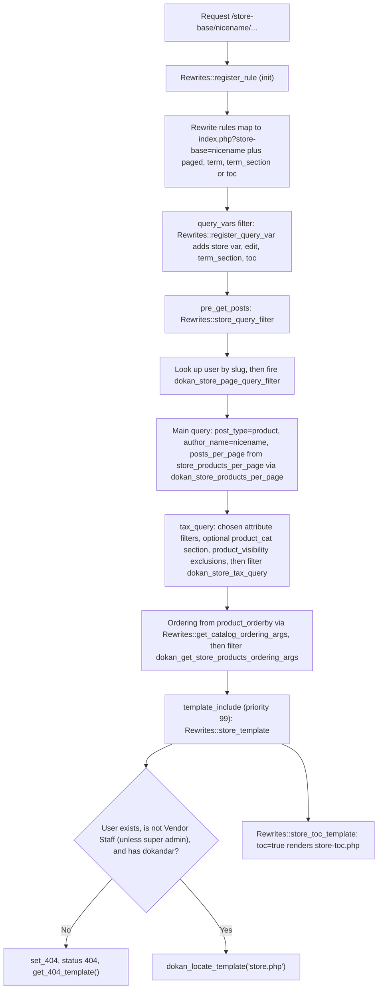
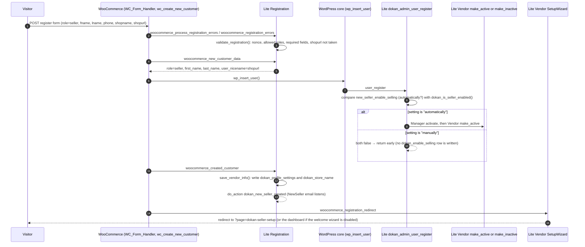
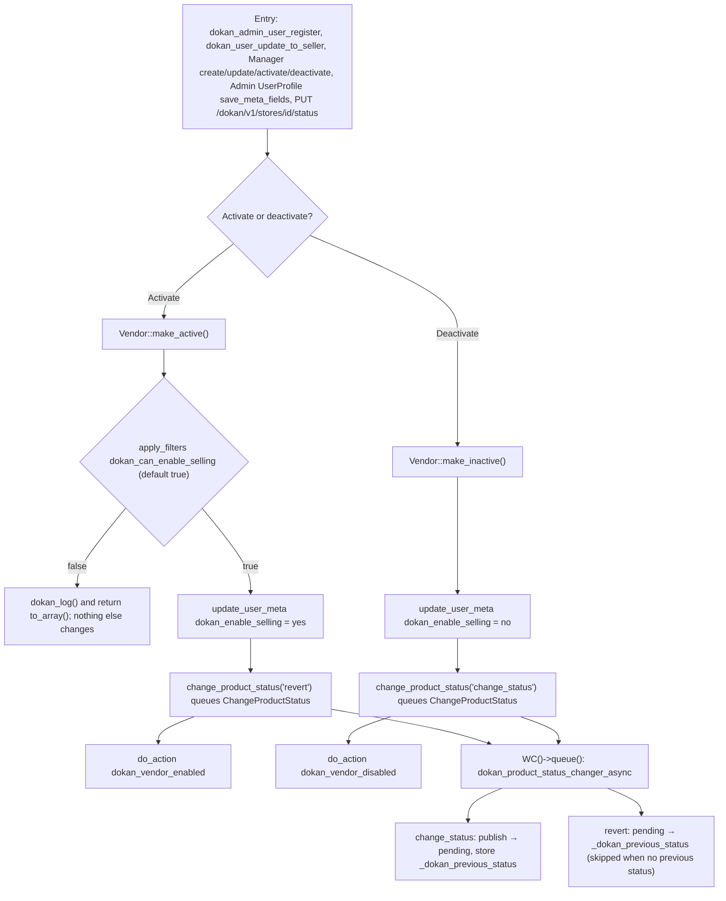

# Vendor and Store

This document describes how Dokan Lite models a **Vendor** (a WordPress user with the `seller` role) and its **Store** (the public-facing facet of that Vendor: store URL, storefront page, store profile and store listing). It covers the Vendor domain object and manager, the registration paths that turn a visitor or Customer into a Vendor, Selling Activation (the approval / enable-selling flow), the store URL rewrite layer, store templates, shortcodes, widgets, walkers, Customizer controls, theme compatibility shims, page-view counting and the privacy exporter/eraser.

Terminology follows `CONTEXT.md`: **Vendor** (never "seller", except where the code literally uses the `seller` role or legacy function names), **Store**, **Store Admin** (`manage_woocommerce`), **Vendor Staff**, **Selling Activation** (`dokan_enable_selling`), **Direct Publishing** (`dokan_publishing`), **Approved Vendor** / **Pending** Vendor, and **Operating Terms** (Commission, Selling Activation, Direct Publishing and featured status).

---

## 1. Purpose and ownership

| Concern | Owner | Notes |
|---|---|---|
| Vendor domain object, Vendor manager, store profile storage | [Lite] | `WeDevs\Dokan\Vendor\Vendor`, `WeDevs\Dokan\Vendor\Manager` |
| `seller` role and the `dokandar` / `dokan_*` capabilities | [Lite] | Installed by `Installer::user_roles` |
| Vendor registration via WooCommerce's My Account form, dedicated Vendor registration and onboarding shortcodes | [Lite] on top of [WooCommerce] registration | `WeDevs\Dokan\Registration` hooks into `wc_create_new_customer()` |
| Customer to Vendor upgrade ("Become a Vendor") | [Lite] | `WeDevs\Dokan\Frontend\MyAccount\BecomeAVendor` |
| Selling Activation (approval) | [Lite] | `Vendor::make_active()` / `Vendor::make_inactive()`, admin setting `new_seller_enable_selling` |
| Vendor setup wizard (`?page=dokan-seller-setup`) | [Lite] | `WeDevs\Dokan\Vendor\SetupWizard`, which extends `WeDevs\Dokan\Admin\SetupWizard` |
| Store URL rewrite rules and store page templates | [Lite] | `WeDevs\Dokan\Rewrites`, `templates/store*.php` |
| Store listing (`[dokan-stores]`), widgets, Customizer, theme support | [Lite] | Several seams are consumed by Dokan Pro (not described here) |
| Personal data export / erase for Vendors | [Lite] on [WooCommerce] `WC_Abstract_Privacy` | `WeDevs\Dokan\Privacy` |
| Optional "switch to vendor" integration | [Third-party: User Switching] | `WeDevs\Dokan\Vendor\UserSwitch` always registers its hooks, but its callbacks only act when `user-switching/user-switching.php` is active (`UserSwitch::is_feature_active`) |

The Store is not a separate entity: there is exactly one Store per Vendor, keyed by the Vendor's user ID, and the store slug is the Vendor's `user_nicename` (see `dokan_get_store_url()`).

**Related ADRs:** [ADR-0009](../0009-vendor-is-a-wordpress-user-with-the-seller-role.md) (a Vendor is a WordPress user with the `seller` role; the Store lives in user meta), [ADR-0005 (canonical admin capability)](../0005-canonical-admin-capability.md) (Store Admin sets Operating Terms), [ADR-0006](../0006-ownership-enforced-in-abilities-layer.md) and [ADR-0007](../0007-staff-actions-gated-by-dokan-capabilities.md) (Ownership and Vendor Staff).

---

## 2. Entry points and bootstrap

Dokan resolves its services from a League DI container. The classes in scope are registered by three service providers and instantiated on `init` priority 4.

| Step | Citation | What happens |
|---|---|---|
| Hooks wired | `lite:dokan-class.php:261` (`WeDevs_Dokan::init_hooks`) | Adds `init` → `init_classes` (priority 4) and `widgets_init` → `register_widgets` (`lite:dokan-class.php:274`). |
| Procedural helpers loaded | `lite:dokan-class.php:287` (`WeDevs_Dokan::includes`) | Loads `functions.php`, `template-tags.php` (front end only), and `store-functions.php` (`lite:dokan-class.php:308`). |
| Services instantiated | `lite:dokan-class.php:316` (`WeDevs_Dokan::init_classes`) | Resolves tags `common-service`, then `frontend-service` (only when `! is_admin()`), then `container-service`. Resolving a tag constructs every class in it. |
| Aliased services | `lite:includes/DependencyManagement/Providers/ServiceProvider.php:22` | Aliases in scope: `pageview` → `PageViews`, `seller_wizard` → `Vendor\SetupWizard`, `vendor` → `Vendor\Manager`, `shortcodes` → `Shortcodes\Shortcodes`, `registration` → `Registration`, `customizer` → `Customizer`, `frontend_manager` → `Frontend\Frontend`, `rewrite` → `Rewrites`, `widgets` → `Widgets\Manager`. All are tagged `container-service` (`ServiceProvider::register`). |
| Common services | `lite:includes/DependencyManagement/Providers/CommonServiceProvider.php:13` | `Vendor\Hooks`, `Vendor\UserSwitch`, `Privacy`, `Shortcodes\FullWidthVendorLayout`, `Vendor\ApiMeta`. |
| Front-end services | `lite:includes/DependencyManagement/Providers/FrontendServiceProvider.php:24` | `Vendor\StoreListsFilter` and `ThemeSupport\Manager` (so theme shims and the store-list filter never load in wp-admin). |
| Widgets | `lite:dokan-class.php:393` (`WeDevs_Dokan::register_widgets`) | Resolves `widgets`, whose constructor calls `register_widget()` for each class (`lite:includes/Widgets/Manager.php:18`). |
| Rewrite flush helper | `lite:dokan-class.php:188` (`WeDevs_Dokan::flush_rewrite_rules`) | Calls `Rewrites::register_rule()` and then `flush_rewrite_rules()`. |
| Vendor accessors | `dokan()->vendor` and `dokan_get_vendor()` (`lite:includes/functions.php:2820`) | Return `Vendor\Manager` / a `Vendor` instance. |

`Vendor\Hooks` (`lite:includes/Vendor/Hooks.php:14`) is a thin bootstrapper: its constructor instantiates `VendorCache`, `SettingsApi\Manager` (vendor dashboard settings pages) and `Coupon` (vendor coupon distribution).

---

## 3. Key classes

| Class | File | Responsibility |
|---|---|---|
| `Vendor\Vendor` | `lite:includes/Vendor/Vendor.php:18` | Domain object wrapping a `WP_User`. Lazily loads the `dokan_profile_settings` user meta into a private `shop_data` array, exposes getters (`get_shop_name`, `get_shop_url`, `get_address`, `get_banner`, `get_rating`, `get_earnings`, `get_balance`, etc.), tracks setter changes in a private `changes` array and persists them on `save()`. Owns Selling Activation (`make_active` / `make_inactive`). |
| `Vendor\Manager` | `lite:includes/Vendor/Manager.php:15` | Service `dokan()->vendor`. Queries Vendors (`get_vendors`, `all`, `get_featured`), creates, updates, deletes, activates and deactivates them. |
| `Registration` | `lite:includes/Registration.php:12` | Validates and completes Vendor sign-up on WooCommerce's registration pipeline. |
| `Frontend\Frontend` | `lite:includes/Frontend/Frontend.php:19` | Chainable container; currently holds only `become_a_vendor`. |
| `Frontend\MyAccount\BecomeAVendor` | `lite:includes/Frontend/MyAccount/BecomeAVendor.php:16` | Customer → Vendor upgrade form on My Account (`account-migration` endpoint). |
| `Vendor\SetupWizard` | `lite:includes/Vendor/SetupWizard.php:12` | Front-end Vendor setup wizard: introduction, store address, payment (only when withdraw methods are active), ready. |
| `Rewrites` | `lite:includes/Rewrites.php:10` | Store URL rewrite rules, query vars, the store product query, store / TOC / product-edit template routing, breadcrumbs. |
| `Vendor\StoreListsFilter` | `lite:includes/Vendor/StoreListsFilter.php:10` | Sort/filter UI and SQL ordering for the store listing. |
| `Vendor\VendorCache` | `lite:includes/Vendor/VendorCache.php:17` | Invalidates the `vendors` cache group (and per-vendor product caches) on Vendor lifecycle events. |
| `Vendor\ChangeProductStatus` | `lite:includes/Vendor/ChangeProductStatus.php:16` | Background job (extends `Abstracts\ProductStatusChanger`) that moves a Vendor's products to `pending` on deactivation and back on activation. |
| `Vendor\ApiMeta` | `lite:includes/Vendor/ApiMeta.php:12` | Adds a `dokan_meta` field (with `vendor_id`) to the core `wp/v2/users` REST resource. |
| `Vendor\UserSwitch` | `lite:includes/Vendor/UserSwitch.php:15` | Integration with the User Switching plugin (switch URL on store REST data, "switched" notice on the dashboard). |
| `Vendor\Settings\StoreSettingsWriter` | `lite:includes/Vendor/Settings/StoreSettingsWriter.php:16` | Merges a settings slice into `dokan_profile_settings` for the 5.3 vendor-settings REST endpoint. |
| `Vendor\Settings\Schema\StoreSettingsSchema` | `lite:includes/Vendor/Settings/Schema/StoreSettingsSchema.php:35` | Flat store-settings schema (branding, store information, address, map, schedule, terms, catalog mode). |
| `Shortcodes\Shortcodes` | `lite:includes/Shortcodes/Shortcodes.php:13` | Registers all Dokan shortcodes (each extends `Abstracts\DokanShortcode`, which calls `add_shortcode()` in its constructor). |
| `Widgets\Manager` | `lite:includes/Widgets/Manager.php:7` | Registers store and product widgets. |
| `Walkers\Category`, `Walkers\StoreCategory`, `Walkers\TaxonomyDropdown` | `lite:includes/Walkers/Category.php:7`, `lite:includes/Walkers/StoreCategory.php:8`, `lite:includes/Walkers/TaxonomyDropdown.php:7` | `Walker` subclasses for category menus (generic product category menu, a Vendor's store category menu with store-scoped links, and a taxonomy `<select>`). |
| `Customizer` (+ `Customizer\HeadingControl`, `Customizer\RadioImageControl`) | `lite:includes/Customizer.php:11` | "Dokan" Customizer panel writing store appearance options. |
| `ThemeSupport\Manager` | `lite:includes/ThemeSupport/Manager.php:12` | Loads one compatibility shim for the active parent theme. |
| `PageViews` | `lite:includes/PageViews.php:8` | Counts product views (post meta `pageview`) used by Vendor statistics. |
| `Privacy` | `lite:includes/Privacy.php:24` | WooCommerce privacy exporter/eraser for Vendor store data. |
| `Admin\UserProfile` | `lite:includes/Admin/UserProfile.php:12` | Adds Dokan fields (Selling Activation, Direct Publishing, featured, store fields) to the wp-admin user profile screen. It renders and saves no Commission fields; the Vendor-level Commission formula is managed from the Dokan Vendor screens. Included here because it is one of the Selling Activation entry points. |
| `Utilities\AdminSettings` | `lite:includes/Utilities/AdminSettings.php:5` | Normalizes the `new_seller_enable_selling` setting to `automatically` / `manually`. |

---

## 4. Execution flows

### 4.1 The Vendor object and the store profile

`Vendor::__construct()` (`lite:includes/Vendor/Vendor.php:86`) accepts a user ID or `WP_User` and fires `dokan_vendor`. Store data is loaded lazily by `Vendor::popluate_store_data()` (`lite:includes/Vendor/Vendor.php:233`; the method name is misspelled in code): it reads the `dokan_profile_settings` user meta, merges it over a defaults array, and passes the result through `dokan_vendor_shop_data`. `Vendor::__call()` turns any undefined `get_<key>()` call into a lookup of `<key>` in that array, which is how getters such as `get_address()` and `get_location()` work.

Writes are batched. Setters such as `set_store_name()`, `set_phone()`, `set_<social>()`, `set_paypal_email()`, `set_bank_<field>()`, `set_<address field>()` and `set_store_times()` record differences in the private `changes` array (via `set_prop`, `set_social_prop`, `set_payment_prop`, `set_address_prop`, `set_store_open_close_prop`). `Vendor::save()` → `Vendor::apply_changes()` (`lite:includes/Vendor/Vendor.php:1627`) merges `changes` recursively into `shop_data`, writes the whole array back to `dokan_profile_settings`, mirrors a changed store name into the scalar `dokan_store_name` meta (`Vendor::update_meta_data`), and clears `changes`. `apply_changes()` fires no hook; callers (`Manager::create`, `Manager::update`) fire their own.

`Vendor::to_array()` (`lite:includes/Vendor/Vendor.php:135`) produces the canonical array representation (used by REST and by `make_active`/`make_inactive` return values) and is filterable through `dokan_vendor_to_array`.

### 4.2 Store URL resolution and store page rendering

The store base slug comes from the `custom_store_url` setting (default `store`), read through `dokan_get_option()` (see section 6.4). `dokan_get_store_url()` (`lite:includes/functions.php:1202`) builds `home_url( '/{custom_store_url}/{user_nicename}/[tab/]' )` and passes it through `dokan_get_store_url`. `dokan_is_store_page()` (`lite:includes/functions.php:165`) is true when the query var named after the store base is set.

Details worth knowing:

- **Rules** (`Rewrites::register_rule`, `lite:includes/Rewrites.php:83`): `{base}/{nicename}/`, `.../page/{n}/`, `.../section/{term_id}/` (store category section), `.../section/{term_id}/page/{n}/`, `.../toc` and `.../toc/page/{n}/`, plus the front-end product edit rule (`{product_base}/{slug}/edit/`). It also registers vendor dashboard endpoints on `EP_PAGES` from the filterable list `dokan_query_var_filter`, and finally fires `dokan_rewrite_rules_loaded` with the store base.
- **WooCommerce query-var conflict** (`Rewrites::resolve_wc_query_conflict`, `lite:includes/Rewrites.php:146`): on the Dokan dashboard page it removes WooCommerce's `orders` and `edit-account` query vars so Dokan's endpoints win.
- **Flushing**: `Rewrites::maybe_flash_rewrite_rules` (`lite:includes/Rewrites.php:544`) flushes once on `wp` while the option `dokan_rewrite_rules_needs_flashing` is `yes`. When the store base changes, `Admin\Settings::flush_store_url_rewrites` (hooked to `dokan_after_saving_settings`) re-registers the rules and flushes, but only if the old and new `custom_store_url` differ.
- **Templates**: `templates/store.php` loads `dokan()->vendor->get( get_query_var( 'author' ) )` (the `author` var is populated by WordPress from the `author_name` that `store_query_filter` set), renders the sidebar on the left or right according to the `store_layout` theme mod, includes `store-header.php`, fires `dokan_store_profile_frame_after`, then runs the standard WooCommerce product loop (`wc_get_template_part( 'content', 'product' )`). It also fires the WooCommerce-named actions `woocommerce_before_main_content` / `woocommerce_after_main_content` itself so themes wrap it like a shop page. `store-header.php` chooses a layout from the `store_header_template` appearance setting.
- **Breadcrumbs**: `Rewrites::store_page_breadcrumb` rewrites WooCommerce breadcrumbs on store pages (link to the store listing page, then the store), and steps aside when Yoast breadcrumbs are enabled.
- **Store tabs**: `dokan_get_store_tabs()` (`lite:includes/functions.php:1331`) returns Products and Terms and Conditions, filterable through `dokan_store_tabs`.

### 4.3 Becoming a Vendor

There are four entry paths. All of them end with the user holding the `seller` role and a populated `dokan_profile_settings` array; they differ in how Selling Activation is decided.

**Path A: WooCommerce My Account registration and the Dokan registration shortcodes.**

- Form rendering: `dokan_seller_reg_form_fields()` (`lite:includes/template-tags.php:443`) is attached to WooCommerce's `woocommerce_register_form` (fired at `wc:templates/myaccount/form-login.php:103`) and renders `global/seller-registration-form.php` with the role radio buttons. The `[dokan-vendor-registration]` shortcode (`Shortcodes\VendorRegistration`) and `[dokan-vendor-onboarding-registration]` shortcode (`Shortcodes\VendorOnboardingRegistration`, with `show_login` / `show_registration` attributes) render dedicated forms with a hidden `role=seller`. Both shortcodes return early for logged-in users and pass their HTML through `dokan_vendor_reg_form`. Default field values come from `dokan_get_seller_registration_form_data()` (`lite:includes/template-tags.php:611`).
- Form marker: the dedicated Vendor form fires `dokan_vendor_reg_form_start` (`templates/account/vendor-registration.php`), on which `Registration::render_vendor_form_marker` prints a nonce field named `dokan_vendor_registration_form_nonce` (action `dokan_vendor_registration_form`). `Registration::inject_vendor_form_marker` (on `dokan_vendor_reg_form`) adds the same marker to rendered markup that did not print it (for example, an outdated theme override), but only when the markup contains a `role` input.
- Role allow-list: `Registration::get_allowed_registration_roles()` (`lite:includes/Registration.php:107`) always allows `customer`, and adds `seller` when the request carries the Vendor form marker or the `show_register_as_vendor` appearance setting is not `off`. The list is filterable via `dokan_register_user_role`.
- Validation: `Registration::validate_registration()` (`lite:includes/Registration.php:144`) is attached to both `woocommerce_process_registration_errors` (`wc:includes/class-wc-form-handler.php:1362`) and `woocommerce_registration_errors` (`wc:includes/wc-user-functions.php:134`). It skips checkout, WP-CLI and REST requests; verifies the `woocommerce-register` nonce (the `dokan_register_nonce_check` filter controls whether this check runs); rejects roles outside the allow-list; and, for `seller`, requires every field in `dokan_seller_registration_required_fields` (default `fname`, `lname`, `phone`, `shopname`, `shopurl`) and rejects a `shopurl` already used as a user slug.
- User data: `Registration::set_new_vendor_names()` on `woocommerce_new_customer_data` (`wc:includes/wc-user-functions.php:163`) sets `role`, `first_name`, `last_name` and `user_nicename` (from `shopurl`), so the store slug is fixed at insert time.
- Selling Activation: `wp_insert_user()` fires core's `user_register`, consumed by `dokan_admin_user_register()` (`lite:includes/functions.php:1496`, hooked at `lite:includes/functions.php:1516`). For a `seller`, it compares "setting is `automatically`" with `dokan_is_seller_enabled()` and calls `Manager::activate()` or `Manager::deactivate()` only when they differ. Under the `manually` setting a fresh user is already "not enabled", so the function returns without writing `dokan_enable_selling`. This is why a Pending Vendor commonly has **no** `dokan_enable_selling` row at all, and why both `dokan_is_seller_enabled()` and `Manager::exclude_approved_vendors()` treat "anything other than `yes`, including absent" as Pending.
- Profile: `Registration::save_vendor_info()` (`lite:includes/Registration.php:229`) on `woocommerce_created_customer` (`wc:includes/wc-user-functions.php:198`) writes the initial `dokan_profile_settings` (store name, empty social profiles, address, phone, `show_email = no`, `banner = 0`, and a `profile_completion` block seeded at 20% with per-field weights), mirrors `dokan_store_name`, and fires `dokan_new_seller_created`.
- Redirect: `Vendor\SetupWizard::filter_woocommerce_registration_redirect()` (`lite:includes/Vendor/SetupWizard.php:32`) on `woocommerce_registration_redirect` (`wc:includes/class-wc-form-handler.php:1398`) sends new Vendors to `?page=dokan-seller-setup` (filter `dokan_seller_setup_wizard_url`) unless `disable_welcome_wizard` is `on`, in which case it sends them to the dashboard.

**Path B: Customer upgrades to Vendor ("Become a Vendor").** `BecomeAVendor::render_become_a_vendor_section()` adds a call-to-action on `woocommerce_after_my_account` (`wc:templates/myaccount/dashboard.php:79`) for non-Vendors. The form lives on the `account-migration` endpoint (`woocommerce_account_account-migration_endpoint`, fired from `wc:includes/wc-template-functions.php:3829`) or the `[dokan-customer-migration]` shortcode. `BecomeAVendor::become_a_seller_form_handler()` (`lite:includes/Frontend/MyAccount/BecomeAVendor.php:73`, on `template_redirect`) verifies the `account_migration` nonce, rejects guests and existing Vendors, enforces `dokan_customer_migration_required_fields`, and calls `dokan_user_update_to_seller()` (`lite:includes/functions.php:4414`; pluggable via `function_exists`). That function strips existing roles, adds `seller`, sets `user_nicename` from `shopurl`, saves first/last name, saves store name / phone / address through the `Vendor` setters, then calls `make_active()` or `make_inactive()` directly according to `new_seller_enable_selling`, writes `dokan_publishing = no`, and fires `dokan_new_seller_created`. The handler then redirects (filter `dokan_customer_migration_redirect`) to the setup wizard or dashboard. `BecomeAVendor::remove_account_update_feature_from_dokan_pro()` unhooks an older duplicate of this feature when an old Dokan Pro version is active.

**Path C: Programmatic / admin creation.** `Manager::create()` (`lite:includes/Vendor/Manager.php:205`) inserts the user with the role forced to `seller`, sends new-user notifications, builds the store array through `dokan_vendor_create_data`, and writes `dokan_profile_settings` and `dokan_store_name` (and sets the store name on the `Vendor` object) first (`lite:includes/Vendor/Manager.php:268-270`), so that `make_active()` reads and caches the real store data. Only then, and only when the current user has `manage_woocommerce` (`lite:includes/Vendor/Manager.php:272`), does it apply the Operating Terms from the payload (`enabled` → `make_active()`, `featured`, `trusted` → `dokan_publishing`, commission fields). Finally it fires `dokan_before_create_vendor`, saves, and fires `dokan_new_vendor`. Because `wp_insert_user()` fires `user_register`, `dokan_admin_user_register()` also runs here.

**Path D: Admin edits a user profile.** `Admin\UserProfile::save_meta_fields()` (`lite:includes/Admin/UserProfile.php:528`) on `personal_options_update` / `edit_user_profile_update` requires `manage_woocommerce` and the `dokan_update_user_profile_info` nonce, saves store fields and the store slug, toggles Selling Activation through `Manager::activate()` / `deactivate()` when it changed, writes `dokan_publishing` (Direct Publishing), `dokan_feature_seller` and `dokan_store_name`, and fires `dokan_process_seller_meta_fields`. It does not read or write the Vendor-level Commission metas (`dokan_admin_percentage`, `dokan_admin_percentage_type`), so saving this screen leaves a Vendor's Commission formula unchanged.

### 4.4 Selling Activation (approval)

- `Vendor::make_active()` (`lite:includes/Vendor/Vendor.php:985`) applies `dokan_can_enable_selling`, a short-circuit for verification or compliance extensions. Callers cannot tell a blocked activation from a successful one by the return value; they must check `dokan_is_seller_enabled()` afterwards (as documented in the docblock).
- `Vendor::make_inactive()` (`lite:includes/Vendor/Vendor.php:1034`) has no equivalent filter.
- `Vendor::change_product_status()` (`lite:includes/Vendor/Vendor.php:1055`) resets the `dokan()->bg_process->change_vendor_product_status` job, sets the Vendor ID and queues the task. `ChangeProductStatus::get_products()` selects the Vendor's `publish` products (for `change_status`) or `pending` products (for `revert`) of every product type except `product_pack`. `ProductStatusChanger::add_to_queue()` schedules `dokan_product_status_changer_async` through WooCommerce's queue (Action Scheduler); the batch size is filterable via `dokan_product_status_changer_per_page` (default 100). The job fires `dokan_product_change_status_before_save` / `_after_save` and `dokan_product_status_revert_before_save` / `_after_save`.
- `dokan_is_seller_enabled()` (`lite:includes/functions.php:1172`) is the single read path: `'yes' === dokan_enable_selling`, filterable through `dokan_is_seller_enabled`.
- The default for new Vendors is the `new_seller_enable_selling` setting, normalized by `AdminSettings::get_new_seller_enable_selling_status()` (`lite:includes/Utilities/AdminSettings.php:17`): legacy `on` maps to `automatically`, `off` to `manually`, and the result is filterable through `dokan_new_seller_enable_selling_status`. The option list is filterable through `dokan_new_seller_enable_selling_statuses`, which is how additional statuses can be introduced.

### 4.5 Vendor queries and the store listing

`Manager::get_vendors()` (`lite:includes/Vendor/Manager.php:57`) wraps `WP_User_Query` with defaults `role__in = [seller, administrator]`, `status = [approved]`. `Manager::resolve_status()` collapses the requested statuses to one of `approved`, `pending` or `all`; unknown values fall back to `approved`.

- `approved` adds `meta_query dokan_enable_selling = yes`.
- `pending` sets the private query var `dokan_pending_only` and hooks `Manager::exclude_approved_vendors()` on `pre_user_query`, which appends a correlated `NOT EXISTS` subquery excluding users with `dokan_enable_selling = yes`. Absent rows therefore count as Pending.
- `featured = yes` adds `meta_query dokan_feature_seller = yes`.
- `fields` other than `all` returns raw results; otherwise each row becomes a `Vendor`.

`dokan_get_sellers()` (`lite:includes/functions.php:1421`) returns `[ 'users' => WP_User[], 'count' => total ]` and is what the `[dokan-stores]` shortcode uses.

`Shortcodes\Stores::render_shortcode()` (`lite:includes/Shortcodes/Stores.php:20`) accepts `per_page`, `search`, `per_row`, `featured`, `category`, `order`, `orderby`, `store_id` and `with_products_only`. It reads search input only when the `dokan_store_lists_filter_nonce` nonce verifies, searches `dokan_store_name` with `LIKE`, translates `category` into a `store_category_query` on a `store_category` taxonomy (that taxonomy is not registered by Lite; it is consumed by Dokan Pro), passes the args through `dokan_seller_listing_args`, and renders `store-lists.php` with `dokan_store_list_args`; the final HTML goes through `dokan_seller_listing`.

`Vendor\StoreListsFilter` (front end only) renders the filter bar on `dokan_store_lists_filter_form` and, on `dokan_seller_listing_args`, sets `orderby` from the request or the `store_list_sort_by` appearance setting, then hooks `pre_user_query` (priority 9) to apply SQL ordering: `most_recent` (`ID DESC`), `total_orders` (joins a per-Vendor count from `{$wpdb->dokan_orders}`), or `random` (one of five orderings, cached for five minutes in the `dokan_store_listing_random_orderby` transient). Options are filterable via `dokan_store_lists_sort_by_options`, and `dokan_before_filter_user_query` fires before the SQL is altered.

### 4.6 Vendor setup wizard

`Vendor\SetupWizard::setup_wizard()` (`lite:includes/Vendor/SetupWizard.php:50`) runs on `init` priority 9999 when `?page=dokan-seller-setup` is requested by a logged-in user. It resolves the store ID with `dokan_get_current_user_id()`, builds steps in `set_steps()` (`lite:includes/Vendor/SetupWizard.php:700`; filter `dokan_seller_wizard_steps`), reads the current step from `step` only when `_admin_sw_nonce` verifies (`dokan_admin_setup_wizard_nonce`), runs the step handler on POST, renders the wizard and exits.

- Store step: `dokan_setup_store_save()` (`lite:includes/Vendor/SetupWizard.php:478`) verifies the `dokan-seller-setup` nonce, validates street, city, ZIP, country and state (state may be empty only when WooCommerce lists the country with an empty states array), recalculates address profile completion via `Registration::check_and_set_address_profile_completion()`, writes `dokan_profile_settings`, and fires `dokan_store_profile_saved` and `dokan_seller_wizard_store_field_save`.
- Payment step (only present when `dokan_withdraw_get_active_methods()` is non-empty): `dokan_setup_payment_save()` (`lite:includes/Vendor/SetupWizard.php:577`) verifies the same nonce, saves payment details and fires `dokan_seller_wizard_payment_field_save`; the redirect is filterable via `dokan_ww_payment_redirect`.
- Navigation: `get_next_step_link()` skips the payment step when no withdraw methods are active and is filterable via `dokan_seller_wizard_next_step`.

### 4.7 Product page views

`PageViews::load_views()` enqueues `page-views.js` on single product pages when the viewer is not the product's author. The script posts to `admin-ajax.php?action=dokan_pageview`; `PageViews::update_ajax()` checks the `dokan_pageview` nonce, increments the `pageview` post meta and deletes the `pageview_{vendor_id}` cache entry. `Vendor::get_product_views()` reports the aggregate through `dokan_author_pageviews()`.

### 4.8 Privacy

`Privacy` extends WooCommerce's `WC_Abstract_Privacy`, whose constructor registers `admin_init` → `add_privacy_message` and the `wp_privacy_personal_data_exporters` / `wp_privacy_personal_data_erasers` filters (`wc:includes/abstracts/abstract-wc-privacy.php:74`). Dokan registers one exporter and one eraser, both with ID `dokan-vendor-data`:

- `Privacy::vendor_data_exporter()` exports a "Vendor Data" group only for users with `dokandar`. Exported props, their values, payment data and the final array are filterable (`dokan_privacy_export_vendor_personal_data_props`, `dokan_privacy_export_vendor_personal_data_prop_value`, `dokan_privacy_export_vendor_payment_data`, `dokan_privacy_export_vendor_personal_data`).
- `Privacy::vendor_data_eraser()` blanks every scalar leaf of `dokan_profile_settings` (keeping the array shape) and writes it back; the response is filterable via `dokan_privacy_erase_personal_data_vendor`.
- `Privacy::anonymize_custom_data_types()` on `wp_privacy_anonymize_data` adds `address_state`, `address_country`, `phone` and `numeric_id` anonymization types.
- The suggested privacy-policy text is filterable via `dokan_privacy_policy_content`.

---

## 5. Hooks

### 5.1 Hooks Dokan fires

| Hook | Type | Fired in | Purpose |
|---|---|---|---|
| `dokan_vendor` | action | `Vendor::__construct` | Every Vendor object construction. |
| `dokan_vendor_shop_data` | filter | `Vendor::popluate_store_data` | Store profile array after defaults are merged. |
| `dokan_vendor_to_array` | filter | `Vendor::to_array` | Array representation of a Vendor. |
| `dokan_get_banner_url`, `dokan_get_avatar_url` | filter | `Vendor::get_banner`, `Vendor::get_avatar` | Store banner / avatar URL. |
| `dokan_seller_total_sales`, `dokan_get_seller_earnings`, `dokan_get_formatted_seller_earnings`, `dokan_get_seller_balance`, `dokan_get_formatted_seller_balance`, `dokan_seller_rating_value` | filter | `Vendor` getters | Statistics shown on the dashboard and store. |
| `dokan_can_enable_selling` | filter | `Vendor::make_active` | Short-circuit activation. |
| `dokan_vendor_enabled` / `dokan_vendor_disabled` | action | `Vendor::make_active` / `make_inactive` | Selling Activation changed. |
| `dokan_vendor_profile_url` | filter | `Vendor::get_profile_url` | Admin edit URL for a Vendor. |
| `dokan_is_seller_enabled` | filter | `dokan_is_seller_enabled()` | Selling Activation read. |
| `dokan_vendor_create_data` | filter | `Manager::create` | Initial store array. |
| `dokan_before_create_vendor`, `dokan_new_vendor` | action | `Manager::create` | Before save / after creation. |
| `dokan_before_update_vendor`, `dokan_update_vendor` | action | `Manager::update` | Before save / after update. |
| `dokan_delete_vendor` | action | `Manager::delete` | After `wp_delete_user()`. |
| `dokan_register_user_role` | filter | `Registration::get_allowed_registration_roles` | Allowed sign-up roles. |
| `dokan_register_nonce_check` | filter | `Registration::validate_nonce`, `Registration::is_vendor_form_request` | Disable registration nonce checks for custom sign-up forms. |
| `dokan_seller_registration_required_fields` | filter | `Registration::validate_registration` | Required Vendor fields. |
| `dokan_new_seller_created` | action | `Registration::save_vendor_info`, `dokan_user_update_to_seller()` | New Vendor via sign-up or upgrade. Also registered as a WooCommerce email action in `Emails\Manager::register_email_actions`. |
| `dokan_vendor_reg_form_start` | action | `templates/account/vendor-registration.php` | Start of the dedicated Vendor form. |
| `dokan_vendor_reg_form` | filter | `VendorRegistration` / `VendorOnboardingRegistration` shortcodes | Rendered Vendor sign-up markup. |
| `dokan_registration_form_role` | action | `templates/global/seller-registration-form.php` | After the role selector. |
| `dokan_customer_migration_required_fields`, `dokan_customer_migration_redirect` | filter | `BecomeAVendor::become_a_seller_form_handler` | Upgrade form validation / redirect. |
| `dokan_seller_setup_wizard_url` | filter | `Vendor\SetupWizard`, `BecomeAVendor` | Wizard URL. |
| `dokan_seller_wizard_steps`, `dokan_seller_wizard_next_step`, `dokan_ww_payment_redirect` | filter | `Vendor\SetupWizard` | Wizard steps and navigation. |
| `dokan_seller_wizard_introduction`, `dokan_seller_wizard_store_setup_after_address_field`, `dokan_seller_wizard_store_setup_before_map_field`, `dokan_seller_wizard_store_setup_after_map_field`, `dokan_seller_wizard_store_setup_field`, `dokan_seller_wizard_after_store_setup_form`, `dokan_seller_wizard_payment_setup_field`, `dokan_seller_wizard_after_payment_setup_form` | action | `Vendor\SetupWizard` views | Inject wizard fields. |
| `dokan_seller_wizard_store_field_save`, `dokan_seller_wizard_payment_field_save` | action | `Vendor\SetupWizard` handlers | Save injected fields. |
| `dokan_store_profile_saved` | action | `Dashboard\Templates\Settings::insert_settings_info`, `Vendor\SetupWizard::dokan_setup_store_save`, `StoreSettingsWriter::save` | Store profile written (args: vendor ID, new settings, previous settings). |
| `dokan_store_profile_settings_args` | filter | `StoreSettingsWriter::save`, `Dashboard\Templates\Settings::insert_settings_info` | Final store array before write. |
| `dokan_get_vendor_settings_schema` | filter | `StoreSettingsSchema::get_schema` | Flat store-settings schema. |
| `dokan_process_seller_meta_fields` | action | `Admin\UserProfile::save_meta_fields` | Admin profile save. |
| `dokan_query_var_filter` | filter | `Rewrites::register_rule` | Dashboard endpoints. |
| `dokan_rewrite_rules_loaded` | action | `Rewrites::register_rule` | Add rules relative to the store base. |
| `dokan_store_page_query_filter` | action | `Rewrites::store_query_filter` | Alter the store product query. |
| `dokan_store_products_per_page`, `dokan_store_tax_query`, `dokan_default_catalog_orderby`, `dokan_get_store_products_ordering_args` | filter | `Rewrites` | Store product query. |
| `dokan_get_product_edit_template` | filter | `Rewrites::product_edit_template` | Front-end product edit template. |
| `dokan_get_store_url` | filter | `dokan_get_store_url()` | Store URL. |
| `dokan_store_tabs` | filter | `dokan_get_store_tabs()` | Store page tabs. |
| `dokan_store_profile_frame_after`, `dokan_sidebar_store_before`, `dokan_sidebar_store_after`, `dokan_store_header_after_store_name`, `dokan_store_header_info_fields`, `dokan_after_store_tabs`, `dokan_store_before_{section}_product_section`, `dokan_store_after_{section}_product_section` | action | `templates/store*.php` | Store page injection points. |
| `woocommerce_before_main_content`, `woocommerce_after_main_content` | action | `templates/store.php`, `templates/store-toc.php` | [Lite] fires these WooCommerce-named hooks so themes wrap store pages. |
| `dokan_store_lists_filter`, `dokan_show_seller_search` | filter | `templates/store-lists.php` | Toggle filter bar / search. |
| `dokan_store_lists_filter_form`, `dokan_after_seller_listing_serach_form`, `dokan_before_seller_listing_loop`, `dokan_after_seller_listing_loop` | action | `templates/store-lists.php` | Store listing injection points. |
| `dokan_seller_listing_after_featured`, `dokan_store_list_loop_after_store_name`, `dokan_seller_listing_after_store_data`, `dokan_seller_listing_footer_content` | action | `templates/store-lists-loop.php` | Store card injection points. |
| `dokan_store_listing_per_page`, `dokan_seller_listing_args`, `dokan_store_list_args`, `dokan_seller_listing` | filter | `Shortcodes\Stores` | Store listing defaults, query, template args, output. |
| `dokan_store_lists_sort_by_options` | filter | `StoreListsFilter::sort_by_options` | Sort options. |
| `dokan_before_filter_user_query` | action | `StoreListsFilter::filter_user_query` | Before listing SQL ordering. |
| `dokan_seller_listing_search_args` | filter | `Ajax::seller_listing_search` | AJAX store search args. |
| `dokan_shortcodes` | filter | `Shortcodes\Shortcodes::__construct` | Shortcode registry. |
| `dokan_dashboard_shortcode_query_vars`, `dokan_load_custom_template`, `dokan_render_new_product_template` | filter / action | `Shortcodes\Dashboard` | Dashboard routing. |
| `dokan_widgets` | filter | `Widgets\Manager::__construct` | Widget registry. |
| `dokan_widget_store_categories_render`, `dokan_widget_store_contact_form_render`, `dokan_widget_store_location_render`, `dokan_widget_store_open_close_render`, `dokan_store_widget_before_map`, `dokan_store_widget_after_map` | action | Store widgets | Widget extension points. |
| `dokan_load_theme_support_files` | filter | `ThemeSupport\Manager::include_support` | Theme shim registry. |
| `dokan_store_customizer_after_vendor_info`, `dokan_store_customizer_after_vendor_products` | action | `Customizer` | Add Customizer controls. |
| `dokan_vendor_api_meta_get_user_data_values`, `dokan_vendor_get_user_data_fields` | filter | `Vendor\ApiMeta` | `dokan_meta` REST field contents. |
| `dokan_user_switching_switched_message` | filter | `UserSwitch::show_user_switching_message` | Switched-user notice. |
| `dokan_trigger_contact_seller_mail` | action | `Ajax::contact_seller` | Store contact form submitted (consumed by the ContactSeller email). |
| `dokan_new_seller_enable_selling_status`, `dokan_new_seller_enable_selling_statuses` | filter | `Utilities\AdminSettings` | Default Selling Activation for new Vendors. |
| `dokan_get_all_cap` | filter | `dokan_get_all_caps()` | Vendor dashboard capability catalog. |
| `dokan_template_path`, `dokan_set_template_path`, `dokan_get_template_part`, `dokan_locate_template` | filter | `WeDevs_Dokan::template_path`, `dokan_get_template_part()`, `dokan_locate_template()` | Template override resolution. |
| `dokan_before_template_part`, `dokan_after_template_part` | action | `dokan_get_template()` | Around template includes. |
| `dokan_privacy_*` (see 4.8) | filter | `Privacy` | Export / erase customization. |
| `dokan_product_status_changer_per_page`, `dokan_product_status_changer_after_queued`, `dokan_product_change_status_before_save`, `dokan_product_change_status_after_save`, `dokan_product_status_revert_before_save`, `dokan_product_status_revert_after_save` | filter / action | `Abstracts\ProductStatusChanger` | Product status job on (de)activation. |

### 5.2 Hooks Dokan consumes

| Hook | Owner | Fired at | Callback | Purpose |
|---|---|---|---|---|
| `woocommerce_process_registration_errors` | [WooCommerce] | `wc:includes/class-wc-form-handler.php:1362` | `Registration::validate_registration` | Validate Vendor sign-up. |
| `woocommerce_registration_errors` | [WooCommerce] | `wc:includes/wc-user-functions.php:134` | `Registration::validate_registration` | Same validation inside `wc_create_new_customer()`. |
| `woocommerce_new_customer_data` | [WooCommerce] | `wc:includes/wc-user-functions.php:163` | `Registration::set_new_vendor_names` | Role, names, `user_nicename`. |
| `woocommerce_created_customer` | [WooCommerce] | `wc:includes/wc-user-functions.php:198` | `Registration::save_vendor_info` | Initial store profile. |
| `woocommerce_registration_redirect` | [WooCommerce] | `wc:includes/class-wc-form-handler.php:1398` | `Vendor\SetupWizard::filter_woocommerce_registration_redirect` | Send new Vendors to the wizard. |
| `woocommerce_login_redirect` | [WooCommerce] | `wc:includes/class-wc-form-handler.php:1261` | Closure in `lite:includes/Shortcodes/VendorOnboardingRegistration.php` | Redirect after logging in from the onboarding page. |
| `woocommerce_register_form` | [WooCommerce] | `wc:templates/myaccount/form-login.php:103` | `dokan_seller_reg_form_fields()` | Vendor fields on the WooCommerce form. |
| `woocommerce_after_my_account` | [WooCommerce] | `wc:templates/myaccount/dashboard.php:79` | `BecomeAVendor::render_become_a_vendor_section` | Upgrade CTA. |
| `woocommerce_account_account-migration_endpoint` | [WooCommerce] | `wc:includes/wc-template-functions.php:3829` | `BecomeAVendor::load_customer_to_vendor_update_template` | Upgrade form. |
| `woocommerce_get_query_vars` | [WooCommerce] | `wc:includes/class-wc-query.php:237` | `Rewrites::resolve_wc_query_conflict` | Drop conflicting WC endpoints on the dashboard. |
| `woocommerce_get_breadcrumb` | [WooCommerce] | `wc:includes/class-wc-breadcrumb.php:52` | `Rewrites::store_page_breadcrumb` | Store breadcrumbs. |
| `wp_privacy_personal_data_exporters` / `_erasers` | WordPress core (fired by core's privacy tools); the callbacks are added by [WooCommerce] at `wc:includes/abstracts/abstract-wc-privacy.php:76` | WordPress core | `WC_Abstract_Privacy::register_exporters` / `register_erasers` → `Privacy` callbacks | Vendor data export / erase. |
| `user_register` | WordPress core | `wp_insert_user()` | `dokan_admin_user_register()`, `VendorCache::after_created_new_wp_user` | Default Selling Activation; cache. |
| `profile_update`, `delete_user` | WordPress core | user APIs | `VendorCache` | Cache invalidation. |
| `personal_options_update`, `edit_user_profile_update`, `show_user_profile`, `edit_user_profile` | WordPress core | `wp-admin/user-edit.php` | `Admin\UserProfile` | Admin Vendor fields. |
| `init` | WordPress core | | `Rewrites::register_rule`, `Vendor\SetupWizard::setup_wizard` (9999), `BecomeAVendor::remove_account_update_feature_from_dokan_pro` (5) | |
| `pre_get_posts` | WordPress core | | `Rewrites::store_query_filter` | Store product query. |
| `query_vars` | WordPress core | | `Rewrites::register_query_var` | Store query vars. |
| `template_include` (99) | WordPress core | | `Rewrites::store_template`, `Rewrites::product_edit_template`, `Rewrites::store_toc_template` | Template routing. |
| `wp` (99) | WordPress core | | `Rewrites::maybe_flash_rewrite_rules` | One-time flush. |
| `template_redirect` | WordPress core | | `BecomeAVendor::become_a_seller_form_handler`, `PageViews::load_views` (25) | |
| `pre_user_query` | WordPress core | | `Manager::exclude_approved_vendors`, `StoreListsFilter::filter_user_query` (9) | Vendor listing SQL. |
| `rest_api_init` | WordPress core | | `ApiMeta::register_user_data` | `dokan_meta` on users. |
| `wp_privacy_anonymize_data` | WordPress core | | `Privacy::anonymize_custom_data_types` | Custom anonymization types. |
| `customize_register`, `customize_controls_enqueue_scripts`, `customize_preview_init` | WordPress core | | `Customizer` | Customizer panel. |
| `widgets_init` | WordPress core | | `WeDevs_Dokan::register_widgets` | Widget registration. |
| `login_init` | WordPress core | | `dokan_redirect_to_register()` | Redirect `wp-login.php?action=register` to My Account. |
| `dokan_new_vendor`, `dokan_update_vendor`, `dokan_delete_vendor`, `dokan_vendor_enabled`, `dokan_vendor_disabled`, `dokan_store_profile_saved` | [Lite] | see 5.1 | `VendorCache` | Cache invalidation. |
| `dokan_new_seller_created` | [Lite] | see 5.1 | `Emails\NewSeller::trigger` (priority 30) | New Vendor admin email. |
| `dokan_vendor_reg_form_start`, `dokan_vendor_reg_form` | [Lite] | see 5.1 | `Registration::render_vendor_form_marker`, `Registration::inject_vendor_form_marker` | Vendor form marker. |
| `dokan_seller_listing_args`, `dokan_store_lists_filter_form` | [Lite] | see 5.1 | `StoreListsFilter` | Listing sort/filter. |
| `dokan_after_saving_settings` | [Lite] | `Admin\Settings`, `LegacyMirror` | `Admin\Settings::flush_store_url_rewrites` | Flush on store-base change. |
| `dokan_admin_localize_script`, `dokan_admin_dashboard_vendors_settings`, `dokan_rest_store_additional_fields`, `dokan_dashboard_content_inside_before` | [Lite] | admin / REST / dashboard | `UserSwitch` | User Switching integration. |
| Theme hooks (`astra_page_layout`, `avia_layout_filter`, `avf_sidebar_position`, `body_class`, `wp_head`, etc.) | [Third-party: themes] | | `ThemeSupport\*` | Layout fixes per theme. |

---

## 6. Data storage

Lite introduces **no custom tables** for Vendors or Stores. A Vendor is a row in `wp_users` with the `seller` role; everything else is user meta, post meta, options, transients and object cache. (The `total_orders` sort reads `{$wpdb->dokan_orders}` and `Vendor::get_earnings` / `get_balance` read `{$wpdb->prefix}dokan_vendor_balance`; those tables belong to the order and withdraw subsystems.)

### 6.1 `wp_users` columns with Vendor meaning

| Column | Meaning |
|---|---|
| `ID` | Vendor ID = Store ID. |
| `user_nicename` | Store slug used in the store URL. Set from `shopurl` at registration, from `dokan_store_url` in the admin profile, or by `dokan_user_update_to_seller()`. Uniqueness is checked against existing user slugs (`get_user_by( 'slug', ... )`). |
| `display_name` | `Vendor::get_name()`. |

### 6.2 User meta: `dokan_profile_settings` (serialized array)

Defaults come from `Vendor::popluate_store_data()`; registration adds `find_address`, `dokan_category` and `profile_completion`.

| Key | Type | Notes |
|---|---|---|
| `store_name` | string | Mirrored to the scalar `dokan_store_name` meta for searching. |
| `social` | array | Keys from `dokan_get_social_profile_fields()` (for example `fb`, `twitter`, `pinterest`, `linkedin`, `youtube`, `instagram`, `flickr`, `threads`, `tiktok`). |
| `payment` | array | `paypal.email`; `bank.ac_name`, `ac_type`, `ac_number`, `bank_name`, `bank_addr`, `routing_number`, `iban`, `swift`. |
| `phone` | string | |
| `show_email` | `yes`/`no` | |
| `address` | array | `street_1`, `street_2`, `city`, `zip`, `state`, `country`. |
| `location`, `find_address` | string | Map coordinates / search string. |
| `banner`, `gravatar` | int | Attachment IDs. |
| `icon` | mixed | |
| `enable_tnc` (`on`/`off`), `store_tnc` | string | Store terms and conditions. |
| `show_min_order_discount` | `yes`/`no` | |
| `store_seo` | array | |
| `dokan_store_time_enabled` (`yes`/`no`), `dokan_store_open_notice`, `dokan_store_close_notice`, `dokan_store_time` | mixed | Store opening hours. |
| `profile_completion` | array | Progress percentage, `next_todo` and per-field weights (`progress_vals`). |

### 6.3 User meta: scalar keys

| Meta key | Values | Written by | Meaning |
|---|---|---|---|
| `dokan_store_name` | string | `Registration`, `Manager`, `Vendor::update_meta_data`, `StoreSettingsWriter`, `Admin\UserProfile`; also seeded for administrators and shop managers by `Installer::add_store_name_meta_key_for_admin_users` | Searchable store name. |
| `dokan_enable_selling` | `yes` / `no` / absent | `Vendor::make_active` / `make_inactive` | **Selling Activation**. Only `yes` is an Approved Vendor; `no` or absent is Pending. |
| `dokan_publishing` | `yes` / `no` | `Manager::create/update`, `Admin\UserProfile`, `dokan_user_update_to_seller()` | **Direct Publishing** (`dokan_is_seller_trusted()`). |
| `dokan_feature_seller` | `yes` / `no` | `Manager`, `Admin\UserProfile` | Featured status. |
| `dokan_admin_percentage`, `dokan_admin_percentage_type`, `dokan_admin_additional_fee`, `admin_category_commission` | mixed | `Manager::create/update` (Store Admin only) | Vendor-level Commission settings (see the commission subsystem). |
| `reset_sub_category` | `yes` / `no` | `Manager::update` | Exposed as `Vendor::get_reset_sub_category()`. |
| `_vendor_id` | int | (Vendor Staff, outside Lite's scope) | Read by `dokan_get_current_user_id()` to map Vendor Staff to their Vendor. |
| `first_name`, `last_name` | string | Registration, `Manager::update` | Standard WordPress meta. |

### 6.4 Options and settings

Settings are read with `dokan_get_option( $key, $section )` (`lite:includes/functions.php:1083`), which first maps legacy keys and then reads through `Admin\Settings\Repository\LegacySettingsRepository`. Per ADR-0002 the canonical store is the flat `dokan_admin_settings` option, and per ADR-0003 the legacy section rows (`dokan_general`, `dokan_selling`, `dokan_appearance`, `dokan_pages`) are kept mirrored. The legacy section names below are what the code passes in.

| Setting (section) | Default | Used by |
|---|---|---|
| `custom_store_url` (`dokan_general`) | `store` | `Rewrites`, `dokan_get_store_url()`, `dokan_is_store_page()` |
| `store_products_per_page` (`dokan_general`) | 12 | `Rewrites::store_query_filter` |
| `setup_wizard_logo_url`, `setup_wizard_message` (`dokan_general`) | | `Vendor\SetupWizard` |
| `enable_tc_on_reg` (`dokan_general`), `reg_tc_page` (`dokan_pages`) | `on`, 0 | Upgrade form (`BecomeAVendor`) and the registration templates (`global/seller-registration-form.php`, `account/vendor-registration.php`) |
| `new_seller_enable_selling` (`dokan_selling`) | `on` → `automatically` | Default Selling Activation |
| `disable_welcome_wizard` (`dokan_selling`) | `off` | Wizard redirect |
| `show_register_as_vendor` (`dokan_appearance`) | `on` | Registration role allow-list and role selector |
| `enable_theme_store_sidebar` (`dokan_appearance`) | `off` | `dokan_store_theme_sidebar_enabled()` (`lite:includes/store-functions.php:10`) |
| `store_header_template`, `hide_vendor_info[email/phone/address]`, `store_products[hide_product_filter]`, `store_map`, `contact_seller`, `store_open_close`, `store_list_sort_by` (`dokan_appearance`) | | Store templates, widgets, `StoreListsFilter`; editable in the Customizer |
| `dashboard`, `store_listing`, `my_orders`, `vendor_onboarding` (`dokan_pages`) | created on install | Page IDs created by `Installer::setup_pages` |
| `dokan_pages_created` | `true` after install | Prevents re-creating pages |
| `dokan_rewrite_rules_needs_flashing` | `yes` until first flush | `Rewrites::maybe_flash_rewrite_rules` |

The Customizer registers its settings as `type => option` keys such as `dokan_appearance[store_header_template]`, so it writes the `dokan_appearance` row directly. The theme mod `store_layout` (`left`/`right`/other) controls the store sidebar position in `templates/store.php`.

### 6.5 Post meta, transients and cache

| Key | Kind | Owner | Notes |
|---|---|---|---|
| `pageview` | product post meta | `PageViews` | View counter. |
| `_dokan_previous_status` | product meta | `ProductStatusChanger` | Status to restore on reactivation. |
| `dokan_store_listing_random_orderby` | transient (5 min) | `StoreListsFilter` | Random listing order. |
| `dokan_legacy_vendors_page` | transient (read) | `UserSwitch::add_localize_data` | |
| `get_store_categories_{id}` / `get_best_selling_categories_{id}` (WPML language-aware) | `Cache` transient, group `seller_product_data_{id}` | `Vendor::get_store_categories` | Store category menu data. |
| `seller_earnings_{id}_{date}` | `Cache`, group `seller_order_data_{id}` | `Vendor::get_earnings` | |
| `seller_balance_{id}_{date}` | `Cache`, group `withdraws_seller_{id}` | `Vendor::get_balance` | |
| `pageview_{vendor_id}` | `Cache` | `PageViews::update_view` deletes it | |
| `vendors` | `Cache` group | `VendorCache::delete` invalidates it | Invalidated on every Vendor lifecycle hook. |

### 6.6 Writers of `dokan_profile_settings`

Because several code paths write the same meta key, the hook each one fires matters for extensions:

| Writer | Hook fired |
|---|---|
| `Vendor::apply_changes` (via `Vendor::save`) | none itself; `Manager::create` fires `dokan_before_create_vendor` / `dokan_new_vendor`, `Manager::update` fires `dokan_before_update_vendor` / `dokan_update_vendor` |
| `Registration::save_vendor_info` | `dokan_new_seller_created` |
| `dokan_user_update_to_seller()` | `dokan_new_seller_created` |
| `Vendor\SetupWizard::dokan_setup_store_save` | `dokan_store_profile_saved`, `dokan_seller_wizard_store_field_save` |
| `Vendor\SetupWizard::dokan_setup_payment_save` | `dokan_seller_wizard_payment_field_save` |
| `Dashboard\Templates\Settings::insert_settings_info` (legacy dashboard settings AJAX) | `dokan_store_profile_settings_args` filter, then `dokan_store_profile_saved` |
| `StoreSettingsWriter::save` (`PUT /dokan/v1/vendor-settings/store`) | `dokan_store_profile_settings_args` filter, then `dokan_store_profile_saved` |
| `Admin\UserProfile::save_meta_fields` | `dokan_process_seller_meta_fields` |
| `Privacy::vendor_data_eraser` | `dokan_privacy_erase_personal_data_vendor` (filter) |

---

## 7. REST and AJAX endpoints

The store REST controllers are covered in detail in the REST architecture docs; the rows below list the routes that read or write Vendor and Store data, with their permission callbacks.

### 7.1 REST

| Route | Methods | Permission callback | Notes |
|---|---|---|---|
| `dokan/v1/stores` | GET | `__return_true` | `StoreController::get_stores`; args filterable via `dokan_rest_api_store_collection_params`, query args via `dokan_seller_listing_args` and `dokan_rest_get_stores_args`; statuses normalized by `Manager::resolve_status`. |
| `dokan/v1/stores` | POST | `StoreController::permission_check_for_manageable_part` (`manage_woocommerce`) | Creates a Vendor through `Manager::create`. |
| `dokan/v1/stores/{id}` | GET | `__return_true` | Public store data; sensitive fields only for authorized users (per the controller's docblock). |
| `dokan/v1/stores/{id}` | PUT/PATCH | `StoreController::update_store_permissions_check` → `VendorAuthorizable::can_access_vendor_store` | Store Admin, or the Vendor (or that Vendor's Staff) for their own Store. |
| `dokan/v1/stores/{id}` | DELETE | `manage_woocommerce` | `Manager::delete`. |
| `dokan/v1/stores/{id}/products`, `/reviews`, `/categories` | GET | `__return_true` | Public store catalogue data. |
| `dokan/v1/stores/check` | GET | `__return_true` | `StoreController::check_store_availability` (slug availability). |
| `dokan/v1/stores/{id}/contact` | POST | `__return_true` | Store contact form. |
| `dokan/v1/stores/{id}/status` | PUT/PATCH | `manage_woocommerce` | `StoreController::update_vendor_status` accepts `active` / `inactive` and calls `make_active()` / `make_inactive()`. |
| `dokan/v1/stores/batch` | PUT/PATCH | `manage_woocommerce` | Batch operations. |
| `dokan/v1/settings` | GET, PUT/PATCH | `StoreSettingController::get_settings_permission_callback` (resolves the current Vendor; 404 when none) | Legacy store settings for the current Vendor. |
| `dokan/v2/settings`, `dokan/v2/settings/{group_id}`, `.../{group_id}/{id}`, `.../{group_id}/{parent_id}/{id}` | GET (and PUT/PATCH on group and item routes) | inherited `get_settings_permission_callback` | `StoreSettingControllerV2`. |
| `dokan/v1/vendor-settings/store` | GET, PUT/PATCH | `VendorStoreSettingsController::check_permission` (`dokandar` and `dokan_view_store_settings_menu`) | Flat schema from `StoreSettingsSchema`, saved through `ValueMapper` and `StoreSettingsWriter`. |
| `wp/v2/users` field `dokan_meta` | GET | core users permissions | Added by `ApiMeta::register_user_data`. |

### 7.2 AJAX (`admin-ajax.php`)

| Action | Logged-out? | Handler | Security model |
|---|---|---|---|
| `shop_url` | yes | `Ajax::shop_url_check` (`lite:includes/Ajax.php:163`) | Nonce `dokan_reviews`; checks a slug against `user_nicename`, treating the current Customer's own slug (upgrade case) or the edited Vendor's slug (admin) as available. |
| `dokan_seller_listing_search` | yes | `Ajax::seller_listing_search` (`lite:includes/Ajax.php:649`) | Nonce `dokan-seller-listing-search`; args filterable via `dokan_seller_listing_search_args`. |
| `dokan_contact_seller` | yes | `Ajax::contact_seller` (`lite:includes/Ajax.php:411`) | Nonce `dokan_contact_seller`, sanitized name/email/message, optional captcha via `Captcha\Manager`; fires `dokan_trigger_contact_seller_mail`. |
| `dokan_pageview` | yes | `PageViews::update_ajax` | `check_ajax_referer( 'dokan_pageview' )`. |
| `custom-header-crop` | no | `Ajax::crop_store_banner` (`lite:includes/Ajax.php:708`) | `check_ajax_referer( 'image_editor-{post_id}', 'nonce' )`. |

---

## 8. Permissions and capabilities

**The `seller` role.** `Installer::user_roles()` (`lite:includes/Install/Installer.php:167`, `add_role` at line 174) creates `seller` (label "Vendor") with core post capabilities (`read`, `edit_posts`, `publish_posts`, `upload_files`, `manage_categories`, `moderate_comments`, ...), WooCommerce product capabilities (`edit_product(s)`, `publish_products`, `delete_product(s)`, `read_private_products`, `manage_product_terms`, `assign_product_terms`, ...), `edit_shop_orders`, and `dokandar`. Note that `seller` does not get `edit_others_products`.

**`dokandar` is the "is a Vendor" test.** `dokan_is_user_seller()` (`lite:includes/functions.php:77`) returns `user_can( $user_id, 'dokandar' )`, optionally excluding Vendor Staff. `Installer::user_roles` also grants `dokandar` to `administrator` and `shop_manager`, so both can open the dashboard; administrators additionally appear in Vendor queries because `Manager::get_vendors` includes `administrator` (but not `shop_manager`) in its default `role__in`.

**Dashboard capabilities.** `dokan_get_all_caps()` (`lite:includes/functions.php:2835`, filter `dokan_get_all_cap`) defines grouped `dokan_*` capabilities (overview, report, order, coupon, review, withdraw, product, menu, such as `dokan_view_product_menu`, `dokan_add_product`, `dokan_view_store_settings_menu`). The installer grants all of them to `seller`, `administrator` and `shop_manager`. `Shortcodes\Dashboard` checks them per dashboard section and renders `global/no-permission` when missing; `Rewrites::product_edit_template` requires `dokan_edit_product`.

**Selling Activation versus role.** Holding the `seller` role does not make a Store live. Per `CONTEXT.md`, Selling Activation is independent of the role; Dokan reads it with `dokan_is_seller_enabled()`. Store pages themselves only require the user to exist, have `dokandar`, and not be Vendor Staff (`Rewrites::store_template`).

**Store Admin.** `manage_woocommerce` is the canonical admin capability for setting Operating Terms (ADR-0005): `Manager::create` / `Manager::update` only apply `enabled`, `featured`, `trusted` and commission fields when the current user has it, and `Admin\UserProfile::save_meta_fields` and the admin-only REST routes check it. `dokan_admin_menu_capability()` returns `manage_woocommerce` through the `dokan_menu_capability` filter.

**Vendor Staff and ownership.** `dokan_get_current_user_id()` (`lite:includes/functions.php:52`) maps a user with `vendor_staff` to the Vendor stored in `_vendor_id`. `VendorAuthorizable::can_access_vendor_store()` grants Store Admins access to any Store, and Vendors (or their Staff) access only to their own. ADR-0006 and ADR-0007 describe how Ownership and Staff actions are enforced elsewhere.

**Request integrity.** Front-end forms are protected by nonces: `woocommerce-register` (registration), `dokan_vendor_registration_form` (dedicated form marker), `account_migration` (upgrade), `dokan-seller-setup` and `dokan_admin_setup_wizard_nonce` (wizard), `dokan_store_lists_filter_nonce` (listing filter), `dokan-seller-listing-search`, `dokan_contact_seller`, `dokan_pageview`, `dokan_reviews` (slug check), and `dokan_update_user_profile_info` (admin profile). Input is sanitized with `sanitize_text_field`, `sanitize_user` / `sanitize_title` (slugs), `sanitize_email`, `wc_clean`, `dokan_sanitize_phone_number` and `wc_format_decimal` (commission values). The Customizer uses the `manage_options` capability for its panel and settings. `dokan_media_uploader_restrict()` limits the media library query to the current Vendor's own attachments for users without `manage_woocommerce`.

---

## 9. WooCommerce touchpoints

- **Registration pipeline**: Dokan piggybacks on `WC_Form_Handler::process_registration` and `wc_create_new_customer()` through the five registration hooks listed in 5.2, and on `woocommerce_register_form` for the role selector.
- **My Account**: `woocommerce_after_my_account` and the `account-migration` endpoint (registered by Dokan as a rewrite endpoint through `dokan_query_var_filter`'s default list, rendered via WooCommerce's `woocommerce_account_{endpoint}_endpoint` dispatcher).
- **Query layer**: `woocommerce_get_query_vars` conflict resolution; store queries use `wc_get_product_visibility_term_ids()`, the `woocommerce_hide_out_of_stock_items` option, `woocommerce_default_catalog_orderby`, and join `{$wpdb->wc_product_meta_lookup}` for price, popularity and rating sorts.
- **Templates**: store pages use `get_header( 'shop' )`, `woocommerce_product_loop_start()`, `wc_get_template_part( 'content', 'product' )` and fire `woocommerce_before_main_content` / `woocommerce_after_main_content`. The product base for edit URLs comes from the `woocommerce_permalinks` option.
- **Breadcrumbs**: `woocommerce_get_breadcrumb`.
- **Background jobs**: `WC()->queue()` (Action Scheduler) runs `dokan_product_status_changer_async`; products are changed through `WC_Product::set_status()` / `save()`.
- **Privacy**: `WC_Abstract_Privacy` base class.
- **Logging**: `dokan_log()` writes through `wc_get_logger()` (used when activation is blocked).
- **Countries**: `WC_Countries` for state validation in the setup wizard.

---

## 10. Dependencies

**Internal (Lite):** `Cache` / `ProductCache` (invalidation), `BackgroundProcess\Manager` (`change_vendor_product_status`), `Commission\Settings\Vendor` (`Vendor::get_commission_settings` / `save_commission_settings`), `Utilities\VendorUtil` (Vendor ID resolution in `ApiMeta`), `Utilities\AdminSettings`, `Admin\Settings\Repository\LegacySettingsRepository` (via `dokan_get_option`), `Emails\NewSeller` and `Emails\ContactSeller`, `Captcha\Manager` (contact form), `Dashboard\Templates\Settings` (legacy store settings save), `Withdraw` helpers (`dokan_withdraw_get_active_methods()` for the wizard's payment step; `dokan_withdraw_get_active_order_status_in_comma()` for earnings), `Traits\VendorAuthorizable` and `Traits\ChainableContainer`.

**External:** WordPress core (users, roles, rewrite API, Customizer, widgets, privacy tools), WooCommerce (registration, My Account, product queries, Action Scheduler queue, privacy base class, logger). Optional: the User Switching plugin (`UserSwitch`), Yoast SEO breadcrumbs (`Rewrites::store_page_breadcrumb`, `templates/store.php`), WPML (language-aware store category cache keys), and the themes listed below.

---

## 11. Extension points

| Goal | How |
|---|---|
| Block or gate Selling Activation (KYC, verification) | Return `false` from `dokan_can_enable_selling`; react to `dokan_vendor_enabled` / `dokan_vendor_disabled`. |
| Change who counts as enabled | Filter `dokan_is_seller_enabled`. |
| Add a default activation mode | Extend `dokan_new_seller_enable_selling_statuses` and map it in `dokan_new_seller_enable_selling_status`. |
| Add store profile data | Write extra keys through the `Vendor` object or `dokan_store_profile_settings_args`; expose them with `dokan_vendor_shop_data` and `dokan_vendor_to_array`; listen on `dokan_store_profile_saved`. |
| Add fields to the new store settings UI | Filter `dokan_get_vendor_settings_schema`. |
| Customize registration | `dokan_register_user_role`, `dokan_seller_registration_required_fields`, `dokan_registration_form_role`, `dokan_vendor_reg_form_start`, `dokan_new_seller_created`; for custom forms, `dokan_register_nonce_check` disables the nonce checks. |
| Customize the Customer → Vendor upgrade | `dokan_customer_migration_required_fields`, `dokan_customer_migration_redirect`, or redefine the pluggable `dokan_user_update_to_seller()`. |
| Extend the setup wizard | `dokan_seller_wizard_steps` (each step has `name`, `view`, `handler`), field actions listed in 5.1, `dokan_seller_wizard_next_step`. |
| Add store page tabs or sections | `dokan_store_tabs`; `dokan_rewrite_rules_loaded` to add rules under the store base (then flush); template actions in `store.php` / `store-header.php`. |
| Change store product queries | `dokan_store_page_query_filter`, `dokan_store_tax_query`, `dokan_store_products_per_page`, `dokan_get_store_products_ordering_args`. |
| Change store URLs | `dokan_get_store_url`. |
| Customize the store listing | `[dokan-stores]` attributes, `dokan_seller_listing_args`, `dokan_store_list_args`, `dokan_store_lists_sort_by_options`, `dokan_before_filter_user_query`, listing template actions. |
| Override templates | Copy files into `yourtheme/dokan/` (path from `dokan_template_path`); or redirect lookups with `dokan_set_template_path`, `dokan_get_template_part` and `dokan_locate_template`. |
| Add or replace shortcodes / widgets | `dokan_shortcodes` (map of tag to object extending `Abstracts\DokanShortcode`), `dokan_widgets` (map of ID to `WP_Widget` class name). |
| Add theme compatibility | `dokan_load_theme_support_files` (map of template slug, without a trailing `-theme`, to class name). |
| Add Customizer controls | `dokan_store_customizer_after_vendor_info`, `dokan_store_customizer_after_vendor_products`. |
| Extend privacy export/erase | `dokan_privacy_*` filters in 4.8. |
| Extend the `dokan_meta` users REST field | `dokan_vendor_get_user_data_fields`, `dokan_vendor_api_meta_get_user_data_values`. |

Many of these seams (for example `dokan_store_tabs`, `dokan_seller_listing_args`, `dokan_query_var_filter`, `dokan_seller_wizard_steps`, `dokan_new_seller_enable_selling_statuses` and the `store_category` taxonomy query) are consumed by Dokan Pro.

### Shortcodes

| Tag | Class | Behaviour |
|---|---|---|
| `dokan-dashboard` | `Shortcodes\Dashboard` | Vendor dashboard router; requires WooCommerce and `dokandar`. |
| `dokan-stores` | `Shortcodes\Stores` | Store listing (4.5). |
| `dokan-vendor-registration` | `Shortcodes\VendorRegistration` | Dedicated Vendor sign-up form. |
| `dokan-vendor-onboarding-registration` | `Shortcodes\VendorOnboardingRegistration` | Combined login + Vendor sign-up page (installed as the "Vendor Onboarding" page). |
| `dokan-customer-migration` | `Shortcodes\CustomerMigration` | Renders the Customer → Vendor upgrade form. |
| `dokan-my-orders` | `Shortcodes\MyOrders` | Customer order list (logged-in only). |
| `dokan-best-selling-product`, `dokan-top-rated-product` | `Shortcodes\BestSellingProduct`, `Shortcodes\TopRatedProduct` | Product grids. |

`Shortcodes\FullWidthVendorLayout` is not a shortcode; it is a `Hookable` service that swaps the dashboard page template and assets for the full-width vendor dashboard layout.

### Widgets

| Widget ID | Class | Renders |
|---|---|---|
| `dokan-best-selling-widget` | `Widgets\BestSellingProducts` | Best-selling products. |
| `dokan-category-menu` | `Widgets\ProductCategoryMenu` | Product category tree (uses `Walkers\Category`). |
| `dokan-store-menu` | `Widgets\StoreCategoryMenu` | On store pages: the Vendor's product categories. |
| `dokan-store-contact-widget` | `Widgets\StoreContactForm` | On store pages and single products: contact form posting to `dokan_contact_seller`. |
| `dokan-store-location` | `Widgets\StoreLocation` | On store pages: store map. |
| `dokan-store-open-close-widget` | `Widgets\StoreOpenClose` | On store pages: opening hours. |
| `dokan-top-rated` | `Widgets\TopratedProducts` | Top-rated products. |
| `dokan-filter-product` | `Widgets\FilterByAttributes` | On store listing and store pages: attribute filter. |

### Theme support shims

`ThemeSupport\Manager` loads a class only when `get_template()` (with a trailing `-theme` removed) matches a key: `storefront`, `flatsome`, `divi`, `rehub`, `electro`, `enfold`, `twentytwenty`, `astra`. The shims adjust sidebars, body classes, wrappers and styles on store and dashboard pages (for example `Divi` hooks `dokan_store_page_query_filter`, `Flatsome` wraps `dokan_dashboard_wrap_before/after`, `Rehub` filters `dokan_load_hamburger_menu`).

**Related ADRs:** [Vendor lifecycle business rules](../decisions-index.md#vendor-lifecycle): [0067](../0067-a-visitor-can-register-as-a-vendor-only-through-a-form-that-offers-the-vendor-role.md), [0075](../0075-vendor-registration-requires-store-details-and-a-unique-store-url-that-becomes-the-store-slug.md), [0064](../0064-a-customer-becomes-a-vendor-through-become-a-vendor-and-loses-their-previous-roles.md), [0065](../0065-a-new-vendors-selling-is-enabled-automatically-or-left-pending-according-to-the-enable-selling-setting.md), [0070](../0070-enabling-a-vendors-selling-can-be-vetoed-by-an-add-on-but-disabling-cannot.md), [0066](../0066-a-vendor-without-selling-enabled-keeps-the-dashboard-but-cannot-add-products-or-request-a-withdraw.md), [0069](../0069-disabling-a-vendor-puts-their-published-products-into-pending-review-and-re-enabling-restores-only-those.md), [0073](../0073-only-the-store-admin-approves-disables-trusts-or-features-a-vendor.md), [0072](../0072-only-approved-vendors-appear-in-public-store-listings.md), [0071](../0071-new-vendors-are-sent-to-the-store-setup-wizard-unless-the-welcome-wizard-is-turned-off.md), [0074](../0074-store-opening-hours-are-shown-to-customers-but-never-block-a-purchase.md), [0068](../0068-deleting-a-vendor-without-reassigning-their-content-permanently-deletes-their-products.md), [0027](../0027-only-the-store-admin-sets-commission-and-a-vendor-can-never-set-their-own.md).

---

## Known gaps

- The `store_category` taxonomy used by the `[dokan-stores]` `category` attribute and by `store_category_query` is not registered anywhere in Lite; its registration and the handling of `store_category_query` live outside Lite and are not documented here.
- How `get_vendors()` consumes the custom `store_category_query` argument was not traced (no Lite code reads it).
- Visibility rules for Pending Vendors on the public REST store collection and single-store routes (field-level redaction in `StoreController::prepare_item_for_response`) are not analysed here; see the REST architecture docs.
- The full list of fields that `Dashboard\Templates\Settings::insert_settings_info` writes, and the vendor dashboard `SettingsApi` pages (`Vendor\SettingsApi\*`), were not read in depth.
- `Vendor\Coupon` and `DokanOrderLineItemCouponInfo` live in `includes/Vendor` but belong to the coupon subsystem; they are not documented here.
- The front-end JavaScript (`dokan-vendor-registration`, `page-views.js`, Customizer preview scripts) was not inspected.
- The exact set of social profile keys depends on `dokan_get_social_profile_fields()` and its filter; the list in 6.2 reflects the `Vendor` setters present in code.
- The internals of the `ChangeProductStatus` batch loop (pagination and requeueing in `ProductStatusChanger::process_background_task`) were only skimmed.
- `templates/store-header.php` layout variants (`store_header_template` values) and their template files were not enumerated.

_Verified against Lite @e1ce7fc81 / Pro @65975a952 / WooCommerce 11.2.1 — 2026-10-22._
