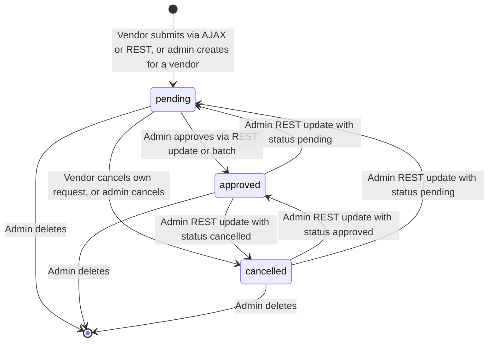
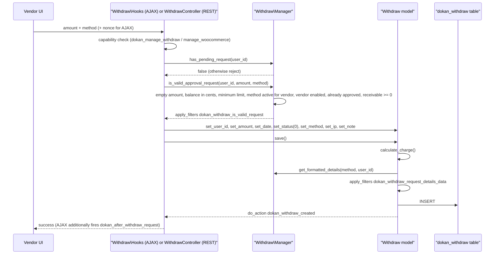
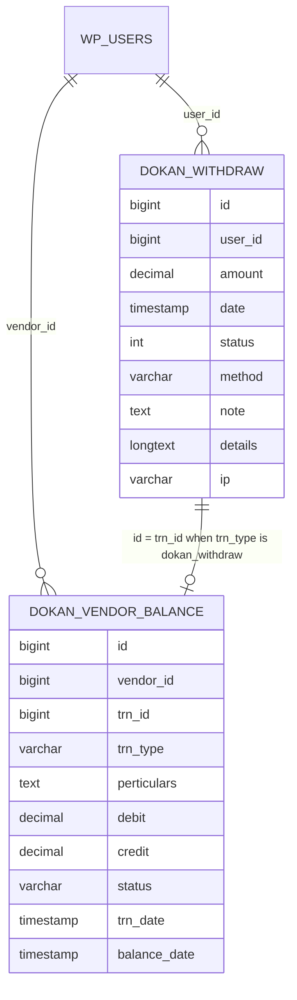
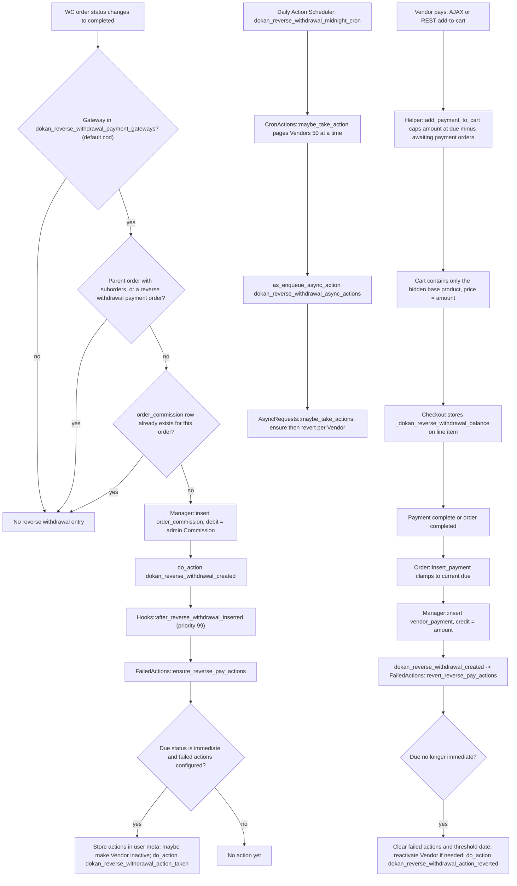
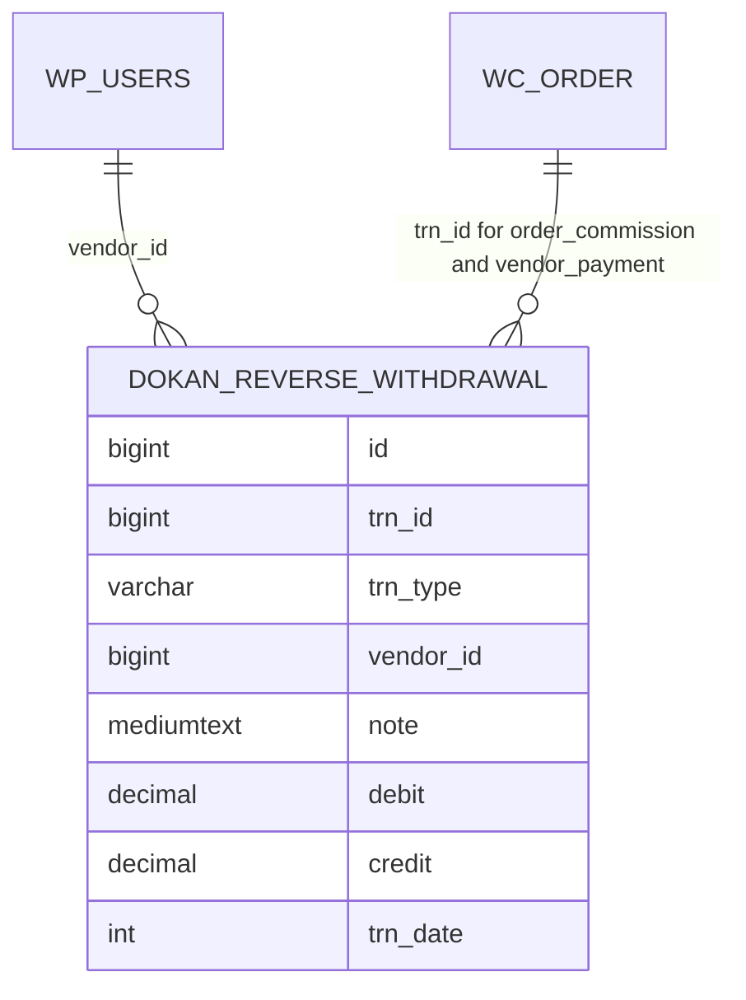

# Withdraw and Reverse withdrawal

This document describes two money subsystems that ship in Dokan Lite:

- **Withdraw** (`includes/Withdraw/`): a Vendor's request to be paid out from their Balance through a withdraw method, subject to a minimum amount and admin approval.
- **Reverse withdrawal** (`includes/ReverseWithdrawal/`): a receivable owed by the Vendor to the admin when the Vendor collected the full order payment directly (for example, cash on delivery), including the admin's Commission.

The two concepts are deliberately kept separate. Per `CONTEXT.md`, a Reverse withdrawal "is never a negative Withdraw": it is a receivable tracked in its own ledger table, never a Balance entry. The spellings differ on purpose (Withdraw vs Reverse withdrawal) and match the module names in code.

Terminology follows `CONTEXT.md`: **Vendor** (not seller), **Commission** = the admin's share, **Earning** = the Vendor's share, **Balance** = the Vendor's running ledger. Function and hook names in code still use `seller`; those are quoted verbatim.

---

## Part A: Withdraw

### A1. Purpose & ownership

| Concern | Owner |
|---|---|
| Withdraw request model, validation, persistence, status lifecycle | [Lite] |
| Vendor Balance computation (`dokan_vendor_balance` ledger reads) | [Lite] |
| Built-in methods `paypal` and `bank`; charge (fee) calculation | [Lite] |
| Additional methods, automatic/scheduled Withdraw processing, the `dokan_custom` method's settings, per-Vendor threshold UI | Seams consumed by Dokan Pro (filters listed in A11); internals out of scope |
| Order totals, statuses, refunds that feed the ledger | [WooCommerce], mirrored into the ledger by Lite's Order subsystem |

**Related ADRs:** [ADR-0013](../0013-marketplace-money-lives-in-custom-tables-not-post-types.md) (money in custom tables; Balance computed from the ledger), [ADR-0014](../0014-reverse-withdrawal-is-a-separate-receivable-ledger.md) (Reverse withdrawal is a separate receivable ledger, covered in Part B), [ADR-0016](../0016-rest-versions-are-additive-controller-subclasses.md) (Withdraw REST v1 and v2).

### A2. Entry points & bootstrap

| What | Where |
|---|---|
| `dokan()->withdraw` service → `WeDevs\Dokan\Withdraw\Manager` | `lite:includes/DependencyManagement/Providers/ServiceProvider.php:36` |
| `WeDevs\Dokan\Withdraw\Hooks` registered as a common (always-loaded) service | `lite:includes/DependencyManagement/Providers/CommonServiceProvider.php:14` |
| Procedural API `includes/Withdraw/functions.php` required at bootstrap | `lite:dokan-class.php:296` |
| `$wpdb->dokan_withdraw` and `$wpdb->dokan_vendor_balance` table aliases | `lite:dokan-class.php:349`, `lite:dokan-class.php:353` |
| `dokan_withdraw` table DDL | `lite:includes/Install/Installer.php:348` (`Installer::create_withdraw_table`) |
| `dokan_vendor_balance` table DDL | `Installer::create_vendor_balance_table` in `lite:includes/Install/Installer.php` |
| `Withdraw\Hooks` constructor (AJAX actions, ledger listener, cache) | `lite:includes/Withdraw/Hooks.php:14` |
| REST v1 controller `dokan/v1/withdraw` | `lite:includes/REST/WithdrawController.php:42` |
| REST v2 controller `dokan/v2/withdraw` (extends v1) | `lite:includes/REST/WithdrawControllerV2.php:26` |
| Legacy vendor-dashboard template controller | `WeDevs\Dokan\Dashboard\Templates\Withdraw` (`lite:includes/Dashboard/Templates/Withdraw.php:36`) |
| MCP/Abilities read surface `dokan/withdraws-query` | `WeDevs\Dokan\Abilities\Definitions\WithdrawsQuery` (`lite:includes/Abilities/Definitions/WithdrawsQuery.php:21`) |

### A3. Key classes

| Class / file | Responsibility |
|---|---|
| `WeDevs\Dokan\Withdraw\Manager` (`lite:includes/Withdraw/Manager.php:18`) | Service facade: validation (`is_valid_approval_request` `:29`, `is_valid_cancellation_request` `:101`), status code ↔ name mapping (`get_status_code` `:289`, `get_status_name` `:337`), lookups (`get` `:403`, `all` `:361`, `get_withdraw_requests` `:254`), `create` `:454`, `has_pending_request` `:223`, limit/balance accessors (`get_withdraw_limit` `:487`, `get_user_balance` `:498`), payment-profile snapshot (`get_formatted_details` `:313`), summary (`get_user_withdraw_summary` `:524`). Also retains two legacy write methods with no Lite caller: `insert_withdraw` `:176` and `update_status` `:135`. |
| `WeDevs\Dokan\Withdraw\Withdraw` (`lite:includes/Withdraw/Withdraw.php:7`) | Active-record model for one `dokan_withdraw` row. Computes charge/receivable (`calculate_charge` `:383`) and persists (`save` `:421`, `create` `:436`, `update` `:493`, `delete` `:544`). Fires the lifecycle actions. |
| `WeDevs\Dokan\Withdraw\Withdraws` (`lite:includes/Withdraw/Withdraws.php:7`) | Query object behind `Manager::all()`: filtering by `ids`, `user_id`, `amount`, date range, `status`, `method`, `ip`; pagination via `SQL_CALC_FOUND_ROWS`; status counts (`return => 'count'`). |
| `WeDevs\Dokan\Withdraw\Hooks` (`lite:includes/Withdraw/Hooks.php:5`) | Registers AJAX handlers, writes the ledger credit on approval (`update_vendor_balance` `:110`), CSV log download, React localization, custom-method title. |
| `WeDevs\Dokan\Withdraw\WithdrawCache` (`lite:includes/Withdraw/WithdrawCache.php:16`) | Invalidates the `withdraws` and `withdraws_seller_{id}` cache groups on lifecycle events. |
| `WeDevs\Dokan\Withdraw\Export\Manager`, `Export\CSV` | Legacy CSV export (`Manager::export()`): writes `email,amount,currency` lines. |
| `includes/Withdraw/functions.php` | Method registry and settings readers (`dokan_withdraw_register_methods` `:12`, `dokan_get_seller_active_withdraw_methods` `:67`, `dokan_withdraw_get_method_charges` `:543`, `dokan_withdraw_get_active_order_status` `:355`, etc.). |
| `WeDevs\Dokan\Vendor\Vendor::get_balance` (`lite:includes/Vendor/Vendor.php:873`) | Computes the withdrawable Balance from `dokan_vendor_balance`. |
| `WeDevs\Dokan\REST\WithdrawController`, `WithdrawControllerV2`, `WithdrawExportController` | REST surfaces (A7). |

### A4. Execution flow

#### A4.1 Status model

Status is an integer column. `Manager::get_status_code()` and `Manager::get_status_name()` map it:

| Code | `get_status_name()` | Accepted by `get_status_code()` | Label in `Withdraws` count query |
|---|---|---|---|
| `0` | `pending` | `pending` | `pending` |
| `1` | `approved` | `approved`, `completed` | `completed` |
| `2` | `cancelled` | `cancelled` | `cancelled` |

Note the two spellings for code `1`: the dynamic action is `dokan_withdraw_request_approved`, while REST list headers and `dokan_get_withdraw_count()` report it as `completed` (`Withdraws::query`, `WithdrawController::get_items` sets `X-Status-Completed`).



How the transitions are enforced:

- **Vendor cancellation** (`WithdrawController::update_item` without `manage_woocommerce`, and `Dashboard\Templates\Withdraw::handle_cancel_request`) goes through `Manager::is_valid_cancellation_request()`, which only finds rows whose current status is `0` (pending) and requires the passed `user_id` to own the row or hold `manage_woocommerce`. The dashboard handler passes the current user's ID; the REST path passes the row's own data and relies on `update_item_permissions_check` (row owner or `manage_woocommerce`) for caller ownership. Vendors can only set status to cancelled.
- **Admin update** (`WithdrawController::update_item` with `manage_woocommerce`) may set `user_id`, `amount`, `method`, `note` and any `status` value. Before validation it temporarily clears status (`get_status_code( null )`) so `is_valid_approval_request()` does not reject an already-approved row, re-runs full approval validation (balance, limit, method, Vendor enabled, charge), then applies the requested status. The edges out of `approved`/`cancelled` in the diagram are therefore reachable through this endpoint, subject to that validation.
- **Batch** (`WithdrawController::batch_items`) processes only the `approved`, `cancelled` and `delete` keys of the request. Approve runs `is_valid_approval_request()`; cancel runs `is_valid_cancellation_request()` (pending-only). A `pending` key, shown in the method's docblock, is not processed.
- **Delete** (`WithdrawController::delete_item`, batch `delete`) removes the row via `Withdraw::delete()`; `manage_woocommerce` only.

#### A4.2 Creating a request



Step details:

1. **One open request per Vendor.** Both the AJAX handler (`Hooks::ajax_handle_withdraw_request`, `lite:includes/Withdraw/Hooks.php:165`) and REST (`WithdrawController::create_item`, `lite:includes/REST/WithdrawController.php:445`) reject the request if `Manager::has_pending_request()` finds any row with status `0` for the user.
2. **Validation order** in `Manager::is_valid_approval_request()` (`lite:includes/Withdraw/Manager.php:29`):
   1. amount must be non-empty (`dokan_withdraw_empty`);
   2. amount must not exceed the Balance, compared in integer cents to avoid floating-point drift (`dokan_withdraw_not_enough_balance`);
   3. amount must be at least `withdraw_limit` (`dokan_withdraw_amount`);
   4. method must be in `dokan_get_seller_active_withdraw_methods( $user_id )`, i.e. the Vendor has filled in that payment profile (`dokan_withdraw_invalid_method`);
   5. the Vendor must be enabled for selling (`dokan_withdraw_seller_not_enabled`);
   6. if an `id` and status `1` are passed, reject as already approved;
   7. charge is computed and `receivable` must be `>= 0` (`Withdraw amount is less then the withdraw charge.`);
   8. finally `apply_filters( 'dokan_withdraw_is_valid_request', true, $args )`.
3. **Charge calculation** (`Withdraw::calculate_charge`, `lite:includes/Withdraw/Withdraw.php:383`): `charge = fixed + (percentage / 100 × amount)` from `dokan_withdraw_get_method_charges()[ $method ]`; `receivable = amount − charge`. Methods without `apply_charge` in the registry always get `fixed = 0, percentage = 0`.
4. **Details snapshot** (`Withdraw::create`, `lite:includes/Withdraw/Withdraw.php:436`): the Vendor's payment profile for the chosen method (`Manager::get_formatted_details`, from `Vendor::get_payment_profiles()`; for `dokan_custom` from store settings plus the `withdraw_method_name` option) is merged with `charge`, `receivable`, `charge_data`, filtered through `dokan_withdraw_request_details_data`, and stored serialized in `details`. The model reads these back from `details` on load.
5. **Hooks fired on create.** `Withdraw::create()` fires `dokan_withdraw_created` with the reloaded `Withdraw`. The AJAX handler additionally fires `dokan_after_withdraw_request( $user_id, $amount, $method, $withdraw_id )` (`lite:includes/Withdraw/Hooks.php:228`). The REST `create_item` path does not fire `dokan_after_withdraw_request`.

#### A4.3 Approval and the ledger credit

`Withdraw::update()` (`lite:includes/Withdraw/Withdraw.php:493`) writes `user_id, amount, date, status, method, note, ip` (not `details`) and then fires, on **every** save:

1. `dokan_withdraw_request_{status_name}` (`pending` / `approved` / `cancelled`), and
2. `dokan_withdraw_updated`.

The status-named action fires whenever the row is saved, not only when the status changes. Lite listeners on `dokan_withdraw_request_approved`:

| Priority | Listener | Effect |
|---|---|---|
| 11 | `Withdraw\Hooks::update_vendor_balance` (`lite:includes/Withdraw/Hooks.php:110`) | Re-checks Balance ≥ amount (in cents) and, if no `dokan_vendor_balance` row with `trn_id = withdraw id` and `trn_type = 'dokan_withdraw'` exists yet, inserts one with `credit = amount`, `status = 'approved'`, `trn_date = withdraw date`, `balance_date = now`. The existence check makes repeated `approved` saves idempotent. |
| 30 | `WeDevs\Dokan\Emails\WithdrawApproved::trigger` | Vendor email. |

Because `update()` does not rewrite `details`, an admin changing `amount` through REST leaves the stored `charge`/`receivable` as they were computed at creation.

Lite contains no listener that removes or reverses the `dokan_withdraw` ledger row when an approved Withdraw is later saved with another status or deleted; `Withdraw::delete()` deletes only the `dokan_withdraw` row and `WithdrawCache` only invalidates cache.

#### A4.4 Balance calculation (available balance and threshold)

`dokan_get_seller_balance( $id, $formatted )` (`lite:includes/wc-functions.php:746`) delegates to `Vendor::get_balance()` (`lite:includes/Vendor/Vendor.php:873`), which runs one query against `dokan_vendor_balance`:

```
earnings = SUM(debit)  WHERE vendor_id = V AND DATE(balance_date) <= today AND status IN (<active statuses>)
withdraw = SUM(credit) WHERE vendor_id = V AND DATE(balance_date) <= today
balance  = earnings − round(withdraw, wc_get_rounding_precision())
```

- **Active statuses** come from `dokan_withdraw_get_active_order_status()` (`lite:includes/Withdraw/functions.php:355`): the `withdraw_order_status` setting (default `[ 'wc-completed' ]`) plus `wc-refunded`, which is always added, filtered by `dokan_withdraw_active_status`.
- **The credit side has no status or `trn_type` filter.** All credit rows with a matured `balance_date` (Withdraw rows `dokan_withdraw` and Refund rows `dokan_refund`) reduce the Balance.
- **Withdraw threshold (holding period).** `dokan_get_withdraw_threshold( $user_id )` (`lite:includes/functions.php:4058`) returns the `withdraw_date_limit` user meta if set, else the `withdraw_date_limit` option in the `dokan_withdraw` section, else `0`. The threshold is applied when the order Earning is written, not when it is read: `dokan_sync_insert_order()` stores `balance_date = now + threshold days` (`lite:includes/Order/functions.php:281`). Rows whose `balance_date` is in the future are excluded by `DATE(balance_date) <= today`, which is what makes part of the Earning "not yet available". `Vendor::get_balance()` also computes a threshold-shifted `$date` (`lite:includes/Vendor/Vendor.php:879`), but that value is not used in the query.
- **Caching.** The result is cached under key `seller_balance_{id}_{Y_m_d}` in group `withdraws_seller_{id}`, which `WithdrawCache` invalidates.
- **Filters.** `dokan_get_seller_balance` (raw float) and `dokan_get_formatted_seller_balance` (HTML).

`Vendor::get_earnings()` (`lite:includes/Vendor/Vendor.php:820`) uses a different formula: debit restricted to `trn_type = 'dokan_orders'` with active statuses, minus credit restricted to `trn_type = 'dokan_refund'` and `status = 'approved'`. It is not used for Withdraw validation.

Ledger writers that feed the Balance:

| `trn_type` | Column | Writer |
|---|---|---|
| `dokan_orders` | `debit` = Vendor Earning | `dokan_sync_insert_order()` via `VendorBalance` model (`lite:includes/Order/functions.php:217`) |
| `dokan_orders` status sync | `status` = new order status | `Order\Hooks::on_order_status_change` (`lite:includes/Order/Hooks.php:95`), skipped for COD when `exclude_cod_payment` is on or `dokan_order_should_exclude_from_vendor_balance` returns true; also `OrderEventListener` |
| `dokan_refund` | `credit` | `Order\RefundHandler` (`lite:includes/Order/RefundHandler.php:225`), `Order\Hooks::manage_refunded_for_order` (`lite:includes/Order/Hooks.php:328`) |
| `dokan_withdraw` | `credit` = Withdraw amount | `Withdraw\Hooks::update_vendor_balance` (`lite:includes/Withdraw/Hooks.php:130`) |

Per ADR-0004, ledger accounting is driven by the Vendor order (Suborder), not the parent Order; `dokan_sync_insert_order()` returns early for orders with `has_sub_order = 1`.

### A5. Hooks

#### Fired by Lite (Withdraw)

| Hook | Type | Fired in | Arguments |
|---|---|---|---|
| `dokan_withdraw_methods` | filter | `dokan_withdraw_register_methods` | `$methods` (`key => [title, callback, apply_charge]`) |
| `dokan_get_active_withdraw_methods` | filter | `dokan_withdraw_get_active_methods` | `$methods` |
| `dokan_get_seller_active_withdraw_methods` | filter | `dokan_get_seller_active_withdraw_methods` | `$active_methods, $vendor_id` |
| `dokan_get_withdraw_method_title` | filter | `dokan_withdraw_get_method_title` | `$title, $method_key, $request` |
| `dokan_bank_payment_required_fields` | filter | `dokan_bank_payment_required_fields` | `$fields` |
| `dokan_bank_payment_fields_placeholders` | filter | `dokan_bank_payment_fields_placeholders` | `$placeholders` |
| `dokan_withdraw_active_status` | filter | `dokan_withdraw_get_active_order_status` | `$statuses` |
| `dokan_withdraw_method_icon` | filter | `dokan_withdraw_get_method_icon` | `$icon_url, $method_key` |
| `dokan_withdraw_method_additional_info` | filter | `dokan_withdraw_get_method_additional_info` | `$info, $method_key` |
| `dokan_withdraw_manual_request_enable` | filter | `dokan_withdraw_is_manual_request_enabled` | `true` |
| `dokan_withdraw_disable` | filter | `dokan_withdraw_is_disabled` | `false` |
| `dokan_withdraw_withdrawable_payment_methods` | filter | `dokan_withdraw_get_withdrawable_active_methods` | `[ 'paypal', 'bank' ]` |
| `dokan_withdraw_is_valid_request` | filter | `Manager::is_valid_approval_request` | `true, $args` |
| `dokan_withdraw_request_details_data` | filter | `Withdraw::create` | `$details, $withdraw` |
| `dokan_withdraw_created` | action | `Withdraw::create` | `Withdraw $withdraw` |
| `dokan_withdraw_request_pending` / `_approved` / `_cancelled` | action | `Withdraw::update` (every save) | `Withdraw $withdraw` |
| `dokan_withdraw_updated` | action | `Withdraw::update` | `Withdraw $withdraw` |
| `dokan_withdraw_deleted` | action | `Withdraw::delete` | `Withdraw $withdraw` |
| `dokan_after_withdraw_request` | action | `Hooks::ajax_handle_withdraw_request`; also legacy `Manager::insert_withdraw` | `$user_id, $amount, $method, $withdraw_id` |
| `dokan_withdraw_status_updated` | action | legacy `Manager::update_status` | `$status, $user_id, $id` |
| `dokan_withdraw_frontend_scripts_localize_args` | filter | `Hooks::localize_withdraw_scripts` | `[ paymentSettingUrl, isManualWithdrawEnable ]` |
| `dokan_get_seller_balance` / `dokan_get_formatted_seller_balance` | filter | `Vendor::get_balance` | `$balance, $vendor_id` |
| `dokan_rest_prepare_withdraw_object` | filter | `WithdrawController::prepare_item_for_response` | `$response, $withdraw, $request` |
| `dokan_rest_prepare_withdraw_payment_method_object` | filter | `WithdrawController::prepare_payment_method_item_for_response` | `$response, $method, $request` |

#### Consumed by Lite (Withdraw)

| Hook | Source | Callback | Priority |
|---|---|---|---|
| `init` | WordPress | `Withdraw\Hooks::download_withdraw_log_export_file` | 10 |
| `dokan_react_frontend_localized_args` | Lite | `Withdraw\Hooks::localize_withdraw_scripts` | 10 |
| `dokan_withdraw_request_approved` | Lite | `Withdraw\Hooks::update_vendor_balance` | 11 |
| `dokan_withdraw_request_approved` | Lite | `Emails\WithdrawApproved::trigger` | 30 |
| `dokan_withdraw_request_cancelled` | Lite | `Emails\WithdrawCancelled::trigger` | 30 |
| `dokan_withdraw_created` | Lite | `Emails\VendorWithdrawRequest::trigger` | 30 |
| `dokan_get_withdraw_method_title` | Lite | `Withdraw\Hooks::dokan_withdraw_dokan_custom_method_title` | 10 |
| `dokan_after_withdraw_request` | Lite | `WithdrawCache::withdraw_request_created` | 10 |
| `dokan_withdraw_status_updated` | Lite | `WithdrawCache::withdraw_status_updated` | 10 |
| `dokan_withdraw_updated`, `dokan_withdraw_deleted` | Lite | `WithdrawCache::invalidate_withdraw_cache` | 10 |
| `wp_ajax_dokan_handle_withdraw_request` | WordPress | `Withdraw\Hooks::ajax_handle_withdraw_request` | 10 (only when `wp_doing_ajax()`) |
| `wp_ajax_dokan_withdraw_handle_make_default_method` | WordPress | `Withdraw\Hooks::ajax_handle_make_default_method` | 10 (only when `wp_doing_ajax()`) |

`Emails\Manager::register_email_actions` (consuming WooCommerce's `woocommerce_email_actions` filter) also appends `dokan_after_withdraw_request`, `dokan_withdraw_request_approved` and `dokan_withdraw_request_cancelled` to WooCommerce's email action list; the Dokan list itself is filterable through `dokan_email_actions`.

`WithdrawCache` does not listen to `dokan_withdraw_created`, so a Withdraw created through REST relies on the next `dokan_withdraw_updated` / `dokan_withdraw_deleted` (or cache expiry) to clear the `withdraws_seller_{id}` listing cache, whereas the AJAX path clears it immediately through `dokan_after_withdraw_request`. `Withdraws::query` caches only status counts, not listings.

### A6. Data storage

#### `{prefix}dokan_withdraw` (`Installer::create_withdraw_table`)

| Column | Type | Notes |
|---|---|---|
| `id` | `bigint(20) unsigned` PK AI | |
| `user_id` | `bigint(20) unsigned` | Vendor user ID |
| `amount` | `decimal(19,4)` | Requested amount (gross, before charge) |
| `date` | `timestamp` | Request time, site timezone |
| `status` | `int(1)` | `0` pending, `1` approved, `2` cancelled |
| `method` | `varchar(30)` | Method key (`paypal`, `bank`, or filtered-in keys) |
| `note` | `text` | Admin note (REST `create_item` accepts `note` only from `manage_woocommerce`) |
| `details` | `longtext` NULL | Serialized payment-profile snapshot plus `charge`, `receivable`, `charge_data` |
| `ip` | `varchar(50)` | `dokan_get_client_ip()` at creation |

No secondary indexes are declared.

#### `{prefix}dokan_vendor_balance` (`Installer::create_vendor_balance_table`)

| Column | Type | Notes |
|---|---|---|
| `id` | `bigint(20) unsigned` PK AI | |
| `vendor_id` | `bigint(20) unsigned` | |
| `trn_id` | `bigint(20) unsigned` | Order ID for `dokan_orders` / `dokan_refund`; Withdraw ID for `dokan_withdraw` |
| `trn_type` | `varchar(30)` | `dokan_orders`, `dokan_refund`, `dokan_withdraw` |
| `perticulars` | `text` | Free text (column name spelled this way in the schema) |
| `debit` | `decimal(19,4)` | Earnings |
| `credit` | `decimal(19,4)` | Withdraws and Refunds |
| `status` | `varchar(30)` | Order status (`wc-*`) for order rows; `approved` for withdraw/refund rows |
| `trn_date` | `timestamp` | Transaction time |
| `balance_date` | `timestamp` | Date from which the row counts toward the Balance |

The ledger column naming is from the accountant's point of view of the marketplace: an Earning is a `debit` row and a Withdraw is a `credit` row, while `CONTEXT.md` describes the Balance as "credited by Earnings, debited by Withdraws". The math in `Vendor::get_balance()` is `SUM(debit) − SUM(credit)`.



#### Settings (legacy section `dokan_withdraw`)

Read through `dokan_get_option( $key, 'dokan_withdraw' )`, which resolves via `LegacySettingsRepository`. The canonical store is the flat `dokan_admin_settings` option (ADR-0002); the legacy row is kept populated by the legacy mirror (ADR-0003).

| Key | Default in reader | Used by |
|---|---|---|
| `withdraw_methods` | `[ 'paypal' ]` | `dokan_withdraw_get_active_methods` |
| `withdraw_charges` | `[]` → zero charges | `dokan_withdraw_get_method_charges` |
| `withdraw_limit` | `0` | `Manager::get_withdraw_limit` (minimum amount) |
| `withdraw_order_status` | `[ 'wc-completed' ]` | `dokan_withdraw_get_active_order_status` |
| `exclude_cod_payment` | `off` | `Order\Hooks::on_order_status_change` |
| `withdraw_date_limit` | `0` | `dokan_get_withdraw_threshold` (holding days) |
| `withdraw_method_name` | `''` | `dokan_custom` method title/details |
| `disbursement` | — | `WithdrawControllerV2::get_withdraw_settings` reads `['manual']` |

The first five are defined in Lite's legacy settings fields (`Admin\Settings`); `withdraw_date_limit`, `withdraw_method_name` and `disbursement` are read by Lite but their fields are not defined in the Lite legacy section.

#### User meta

| Key | Purpose |
|---|---|
| `dokan_profile_settings` → `payment.paypal.email`, `payment.bank.ac_number` (and the other `payment.bank.*` fields), `payment.skrill.email`, `payment.dokan_custom.value` | Vendor payment profiles. `dokan_get_seller_active_withdraw_methods` marks `paypal`, `bank` and `skrill` active when `paypal.email`, `bank.ac_number` or `skrill.email` respectively is non-empty (other methods only through its filter); `payment.dokan_custom.value` is read by `Manager::get_formatted_details` |
| `dokan_withdraw_default_method` | Vendor's default method (AJAX/REST make-default) |
| `withdraw_date_limit` | Per-Vendor override of the holding period |

#### Cache groups

`withdraws`, `withdraws_seller_{vendor_id}` (Balance and per-Vendor listings), `seller_order_data_{vendor_id}` (Earnings).

### A7. REST / AJAX endpoints

| Route | Method | Callback | Permission |
|---|---|---|---|
| `dokan/v1/withdraw` | GET | `get_items` (list; `is_export=true` runs `WithdrawLogExporter` in steps) | `dokan_manage_withdraw` |
| `dokan/v1/withdraw` | POST | `create_item` | `manage_woocommerce` or `dokan_manage_withdraw` |
| `dokan/v1/withdraw/balance` | GET | `get_balance` (current balance, limit, threshold, methods, last approved) | `dokan_manage_withdraw` |
| `dokan/v1/withdraw/{id}` | GET | `get_item` | `manage_woocommerce`, or row owner |
| `dokan/v1/withdraw/{id}` | PUT/PATCH | `update_item` | same as GET; Vendors may only cancel |
| `dokan/v1/withdraw/{id}` | DELETE | `delete_item` | `manage_woocommerce` |
| `dokan/v1/withdraw/payment_methods` | GET | `get_payment_method_items` (distinct methods used) | `dokan_manage_withdraw` |
| `dokan/v1/withdraw/batch` | POST/PUT/PATCH | `batch_items` | `manage_woocommerce` |
| `dokan/v1/withdraw/charges` | GET | `get_all_method_charges` | `dokan_manage_withdraw` |
| `dokan/v1/withdraw/charge` | GET | `get_method_charge` (`method`, `amount` required) | `dokan_manage_withdraw` |
| `dokan/v2/withdraw/*` | — | All v1 routes re-registered under v2 | as v1 |
| `dokan/v2/withdraw/settings` | GET | `get_withdraw_settings` | `dokan_manage_withdraw` |
| `dokan/v2/withdraw/summary` | GET | `get_withdraw_summary` (counts by status) | `dokan_manage_withdraw` |
| `dokan/v2/withdraw/make-default-method` | POST | `handle_make_default_method` | `dokan_manage_withdraw` |
| `dokan/v1/reports/withdraws` | GET | WooCommerce Admin reports export route inherited from `wc:includes/rest-api/Controllers/Version1/class-wc-rest-reports-v1-controller.php:42` | `manage_woocommerce` or `dokan_view_reports` |

For `GET /withdraw`, non-admins are forced to their own `user_id`; admins may filter by `user_id`. Response headers `X-Status-Pending`, `X-Status-Completed`, `X-Status-Cancelled` carry counts.

| AJAX action / request | Nonce action | Capability |
|---|---|---|
| `wp_ajax_dokan_handle_withdraw_request` | `dokan_withdraw` (field `_handle_withdraw_request`) | `dokan_manage_withdraw` |
| `wp_ajax_dokan_withdraw_handle_make_default_method` | `dokan_withdraw_make_default` | `dokan_manage_withdraw` |
| `template_redirect` cancel (`dokan_handle_withdraw_request=cancel`) | `dokan_cancel_withdraw` | `dokan_manage_withdraw` + ownership |
| `init` CSV download (`?download-withdraw-log-csv=`) | `download-withdraw-log-csv-nonce` | `dokan_manage_withdraw` |

Ability: `dokan/withdraws-query` requires `dokan_manage_withdraw` (`WithdrawsQuery::required_capability`) and reads the acting Vendor's requests via `Manager::get_withdraw_requests()`; see ADR-0007 for why the capability gate applies below Store Admin.

### A8. Permissions & capabilities

- `dokan_manage_withdraw` — Vendor-level capability for creating requests, listing own requests, reading balance and charges (`dokan_get_all_caps()` in `lite:includes/functions.php:2870`).
- `dokan_view_withdraw_menu` — shows the Withdraw dashboard nav item (`functions-dashboard-navigation.php`) and gates `Dashboard\Templates\Withdraw::display_request_listing` (`lite:includes/functions.php:2888`).
- `manage_woocommerce` — Store Admin (ADR-0005): may create on behalf of a Vendor (target must hold `dokan_manage_withdraw`), edit any field, approve, delete, batch.
- **Ownership:** `get_item_permissions_check` compares the row's `user_id` with the current user; `is_valid_cancellation_request` requires ownership or `manage_woocommerce`; non-admin list queries are pinned to `dokan_get_current_user_id()`.
- **Input handling:** AJAX inputs are passed through `sanitize_text_field`/`sanitize_key` and `wc_format_decimal`; method keys are checked against the active-method lists; all SQL uses `$wpdb->prepare` or `$wpdb->insert/update` with formats.

### A9. WooCommerce touchpoints

- Prices are formatted with `wc_price()` and normalized with `wc_format_decimal()`; rounding uses `wc_get_rounding_precision()` / `wc_get_price_decimals()`.
- Balance eligibility depends on WooCommerce order statuses (`wc-completed`, `wc-refunded`, and configured statuses), synced into the ledger by Lite's Order subsystem on `woocommerce_order_status_changed` (fired at `wc:includes/class-wc-order.php:478`) and on refunds (`woocommerce_order_refunded`).
- The list export extends WooCommerce Admin's `Automattic\WooCommerce\Admin\API\Reports\GenericController` and implements `ExportableInterface`.
- The legacy CSV export reads `get_option( 'woocommerce_currency' )`.

### A10. Dependencies

- Internal: `dokan()->vendor` (`Vendor::get_balance`, `get_payment_profiles`), `dokan_is_seller_enabled`, `dokan_get_store_info`, `WeDevs\Dokan\Cache`, `Emails\*`, `Admin\WithdrawLogExporter`, Order subsystem (ledger writers), `LegacySettingsRepository` for settings.
- External: WordPress REST API and AJAX, WooCommerce (formatting, statuses, Admin reports controller).

### A11. Extension points

- **Add a withdraw method:** filter `dokan_withdraw_methods` (title, settings-form callback, `apply_charge`); make it selectable for a Vendor via `dokan_get_seller_active_withdraw_methods`; optionally `dokan_withdraw_withdrawable_payment_methods`, `dokan_withdraw_method_icon`, `dokan_withdraw_method_additional_info`, `dokan_get_withdraw_method_title`. These seams are consumed by Dokan Pro.
- **Add validation rules:** `dokan_withdraw_is_valid_request` (return `WP_Error` to reject).
- **Augment the stored snapshot:** `dokan_withdraw_request_details_data`.
- **React to lifecycle:** `dokan_withdraw_created`, `dokan_withdraw_request_{pending|approved|cancelled}`, `dokan_withdraw_updated`, `dokan_withdraw_deleted`. Remember the status-named action fires on every save.
- **Change which order statuses count toward the Balance:** `dokan_withdraw_active_status`; exclude orders with `dokan_order_should_exclude_from_vendor_balance`.
- **Hide manual requests / the whole Withdraw UI:** `dokan_withdraw_manual_request_enable`, `dokan_withdraw_disable`.
- **REST shape:** `dokan_rest_prepare_withdraw_object`.

---

## Part B: Reverse withdrawal

### B1. Purpose & ownership

When a Vendor is paid directly by the customer through a gateway that bypasses the marketplace (by default `cod`), the admin's Commission is sitting with the Vendor. Reverse withdrawal records that Commission as a debt (`debit`) in its own ledger, lets the Vendor pay it back by purchasing a hidden WooCommerce product, records the payment as a `credit`, and applies configurable restrictions ("failed actions") when the debt is overdue.

| Concern | Owner |
|---|---|
| Ledger table, transaction types, balance/due computation, payment-via-cart, failed actions, crons, REST, settings | [Lite] |
| Producers of the transaction types Lite never writes itself (everything except `order_commission` and `vendor_payment`, see B4.1) and additional gateways via `dokan_reverse_withdrawal_payment_gateways` | Extension seams (some consumed by Dokan Pro); internals out of scope |
| Cart, checkout, order, product, Action Scheduler | [WooCommerce] |

### B2. Entry points & bootstrap

| What | Where |
|---|---|
| `dokan()->reverse_withdrawal` service → `WeDevs\Dokan\ReverseWithdrawal\ReverseWithdrawal` | `lite:includes/DependencyManagement/Providers/ServiceProvider.php:43` |
| Sub-controllers: `settings`, `hooks`, `async_hooks`, `admin_hooks`, `cron_actions`, `order_hooks`, `cart_hooks`, `cache_hooks`, and `ajax` (AJAX requests only) | `lite:includes/ReverseWithdrawal/ReverseWithdrawal.php:61` |
| REST controller registered through `dokan_rest_api_class_map` | `lite:includes/ReverseWithdrawal/ReverseWithdrawal.php:84` |
| Table DDL | `lite:includes/ReverseWithdrawal/InstallerHelper.php:23` (called from `Installer::create_reverse_withdrawal_table`) |
| Base product creation | `lite:includes/ReverseWithdrawal/InstallerHelper.php:55`; also on settings save (`Admin\Settings::create_reverse_withdrawal_base_product`, `lite:includes/ReverseWithdrawal/Admin/Settings.php:234`) |
| Vendor dashboard page | `WeDevs\Dokan\Dashboard\Templates\ReverseWithdrawal` (instantiated by `Dashboard\Templates\Manager`) |

`Hooks`, `Cart` and most of `Order` return early from their constructors when `SettingsHelper::is_enabled()` is false; `Order` still registers its two order-item display filters.

### B3. Key classes

| Class | File | Responsibility |
|---|---|---|
| `ReverseWithdrawal` | `lite:includes/ReverseWithdrawal/ReverseWithdrawal.php:20` | Container of sub-controllers (`ChainableContainer`). |
| `Manager` | `lite:includes/ReverseWithdrawal/Manager.php:20` | Data access: `all` `:50` (multi-mode query), `get_stores_balance` `:323`, `get_store_balance` `:367`, `get_store_transactions` `:396`, `get` `:487`, `insert` `:512`, `is_reverse_withdrawal_added` `:584`, `is_payment_inserted` `:604`, `get_payments_by_vendor` `:645`, `get_stores` `:707`. |
| `Helper` | `lite:includes/ReverseWithdrawal/Helper.php` | Transaction-type map (`get_transaction_types` `:57`), meta keys, Vendor balance and due status (`get_vendor_balance` `:420`, `get_vendor_due_status` `:483`, `get_vendor_payable_amount_by_month` `:359`), payment-order detection, awaiting-payment guard, `add_payment_to_cart` `:895`. |
| `SettingsHelper` | `lite:includes/ReverseWithdrawal/SettingsHelper.php:15` | Typed readers for the `dokan_reverse_withdrawal` settings section and option lists. |
| `Hooks` | `lite:includes/ReverseWithdrawal/Hooks.php:15` | Writes the Commission debit on order completion; applies failed-action effects (menu, purchasability, price); dashboard nav. |
| `Order` | `lite:includes/ReverseWithdrawal/Order.php:15` | Stores the payment amount on the order line item and writes the Vendor payment credit when the payment order completes. |
| `Cart` | `lite:includes/ReverseWithdrawal/Cart.php:15` | Sets the payment product's price from cart item data and blocks mixing with other products. |
| `FailedActions` | `lite:includes/ReverseWithdrawal/FailedActions.php:15` | Applies (`ensure_reverse_pay_actions` `:25`) and reverts (`revert_reverse_pay_actions` `:69`) restrictions. |
| `Ajax` | `lite:includes/ReverseWithdrawal/Ajax.php:16` | `wp_ajax_dokan_reverse_withdrawal_payment_to_cart`. |
| `Cache` | `lite:includes/ReverseWithdrawal/Cache.php:15` | Invalidates `reverse_withdrawal` and `reverse_withdrawal_{vendor_id}` on insert. |
| `BackgroundProcess\CronActions` | `lite:includes/ReverseWithdrawal/BackgroundProcess/CronActions.php:15` | Daily and monthly Action Scheduler jobs; fans out Vendors in batches. |
| `BackgroundProcess\AsyncRequests` | `lite:includes/ReverseWithdrawal/BackgroundProcess/AsyncRequests.php:19` | Per-batch async worker: apply/revert actions, send invoice emails. |
| `Admin\Settings`, `Admin\Hooks` | `lite:includes/ReverseWithdrawal/Admin/` | Settings fields/validation; re-evaluate actions after save; clear base product option on trash. |
| `REST\ReverseWithdrawalController` | `lite:includes/REST/ReverseWithdrawalController.php:47` | `dokan/v1/reverse-withdrawal/*`. |

### B4. Execution flow

#### B4.1 Transaction types and sign convention

`Helper::get_transaction_types()` is a closed list (the code comment forbids filtering it, because keys are used in queries). `Manager::insert()` rejects any other `trn_type`.

| Key | Label | Direction (per code comment) | Lite writer |
|---|---|---|---|
| `opening_balance` | Opening Balance | — | Synthesized row in transaction listings; no insert in Lite |
| `order_commission` | Commission | debit (Vendor owes admin) | `Hooks::process_order_status_changed` |
| `failed_transfer_reversal` | Failed Transfer Reversal | debit | none in Lite |
| `product_advertisement` | Product Advertisement | debit | none in Lite |
| `manual_order_commission` | Manual Order Commission | debit | none in Lite |
| `vendor_payment` | Payment | credit (Vendor paid admin) | `Order::insert_payment` |
| `order_refund` | Refund | credit | none in Lite |
| `manual_product`, `manual_order`, `other` | Manual / Other | credit | none in Lite |

Any type can also be inserted by an administrator through `POST dokan/v1/reverse-withdrawal/transactions`.

The outstanding amount a Vendor owes is `SUM(debit) − SUM(credit)` over their rows (`Manager::get_store_balance`).

#### B4.2 Accrual, payment and enforcement



Details:

1. **Commission accrual** (`Hooks::process_order_status_changed`, `lite:includes/ReverseWithdrawal/Hooks.php:187`, on `woocommerce_order_status_changed` priority 10). Requires: real status change to `completed`; payment method enabled for reverse withdrawal (`SettingsHelper::is_gateway_enabled_for_reverse_withdrawal`, where enabled gateways are all keys of `dokan_reverse_withdrawal_payment_gateways`, default `[ 'cod' ]`); order without `has_sub_order` meta (only Vendor orders accrue, consistent with ADR-0004); not itself a `cod` reverse-withdrawal payment order; no existing `order_commission` row for that order. The debit is `dokan()->commission->get_earning_by_order( $order_id, 'admin' )` and `vendor_id` is `dokan_get_seller_id_by_order()`.
2. **Paying the debt.** `Helper::add_payment_to_cart( $amount )` (`lite:includes/ReverseWithdrawal/Helper.php:895`):
   - rejects amounts `<= 0`;
   - computes the ceiling from the Vendor's total outstanding balance (not `payable_amount`, so early payment under monthly billing works), minus the sum of the Vendor's reverse-withdrawal payment orders still in `pending`, `processing`, `on-hold` or `failed` that have not yet reached the ledger (`get_awaiting_payment_orders`). If that leaves nothing, the error names the blocking orders and links to pay or cancel them;
   - applies `dokan_reverse_withdrawal_payable_amount` with context `cart`;
   - compares in scaled integers, requires the base product to exist and be published, loads the cart if needed, **empties the cart**, and adds the base product with cart item data `dokan_reverse_withdrawal_balance => $amount`.
   `Cart::woocommerce_custom_price_to_cart_item` (on `woocommerce_before_calculate_totals`, priority 99) sets that price; `Cart::prevent_purchasing_multiple_products` blocks adding other products while it is in the cart; `Cart::remove_seller_name_from_cart_item` removes Dokan's vendor-name line for it. `Hooks::skip_cart_validation_for_reverse_withdraw` returns `false` from the `dokan_stripe_express_needs_cart_validation` filter (fired by Dokan Pro, not Lite) when the payment product is in the cart.
3. **Recording the payment** (`Order::insert_payment`, `lite:includes/ReverseWithdrawal/Order.php:98`, from `woocommerce_payment_complete` and from `woocommerce_order_status_changed` → `completed`). Skips when the order has no `_dokan_reverse_withdrawal_balance` item meta, when a `vendor_payment` row for the order already exists, or when the order carries `_dokan_reverse_withdrawal_payment_settled = yes`. The credited amount is clamped to the current outstanding balance (after `dokan_reverse_withdrawal_payable_amount` with context `completion`); an order note records any shortfall. If nothing remains to credit, the order is marked with `_dokan_reverse_withdrawal_payment_settled` and no row is written. The credit row's `vendor_id` is the order's **customer ID**, which is why only users with the `dokandar` capability may start a payment (B8).
4. **Due status** (`Helper::get_vendor_due_status`, `lite:includes/ReverseWithdrawal/Helper.php:483`):
   - `by_amount`: due when `payable_amount` (= full balance) `>= reverse_balance_threshold`. The first day the threshold is seen exceeded is stored in user meta `_dokan_reverse_withdrawal_threshold_exceeded_date`, and `dokan_reverse_withdrawal_balance_threshold_exceed` fires once at that moment. Due date = that date + (`due_period` − 1) days at 23:59:59; past it, `due_date = 'immediate'`.
   - `by_month`: `payable_amount` = balance up to the last day of the previous month minus payments made in the current month (`get_vendor_payable_amount_by_month`). Due date = first of the month + (`monthly_billing_day` − 1) + (`due_period` − 1) days; past it, `immediate`.
5. **Failed actions.** `FailedActions::ensure_reverse_pay_actions` runs only if no actions are already stored, the due status is `immediate`, and at least one action is configured. It stores the configured list in `_dokan_reverse_withdrawal_failed_actions` and, for `status_inactive`, calls `Vendor::make_inactive()`. Effects are applied at render time by `Hooks`:
   - `hide_withdraw_menu` → `Hooks::unset_withdraw_menu` removes `withdraw` from `dokan_get_dashboard_nav`;
   - `enable_catalog_mode` → `Hooks::hide_add_to_cart_button` returns `false` from `woocommerce_is_purchasable` for that Vendor's products (the base product is always purchasable);
   - `hide_product_price` → `Hooks::hide_product_price` blanks `woocommerce_get_price_html` (this key is honored in code but is not among Lite's default `get_failed_payment_actions()` options; it can be added through `dokan_reverse_withdrawal_failed_payment_actions`).
   `revert_reverse_pay_actions` clears them once the due status is no longer `immediate`, reactivating the Vendor if `status_inactive` had been applied.
6. **Background processing** (`CronActions`): on `init`, schedules the recurring Action Scheduler action `dokan_reverse_withdrawal_midnight_cron` (daily from tomorrow) when enabled and unschedules it when disabled. When settings are saved with `billing_type = by_month`, `after_save_settings` schedules `dokan_reverse_withdrawal_monthly_cron` with cron expression `0 8 {monthly_billing_day} * *`. Both fan out Vendors (`dokan()->vendor->all`, 50 per batch daily, 5 per batch monthly) to `dokan_reverse_withdrawal_async_actions`. The monthly task additionally fires `dokan_reverse_withdrawal_invoice_email_sent` for each Vendor whose due status is true; `Emails\ReverseWithdrawalInvoice::trigger` listens at priority 30. `Admin\Hooks::maybe_take_action` re-runs the daily fan-out immediately after the settings section is saved with the feature enabled.
7. **Order deletion.** `Order\Manager::delete_seller_order` deletes `order_commission`, `manual_order_commission` and `order_refund` rows whose `trn_id` is the deleted order (`lite:includes/Order/Manager.php:537`).

### B5. Hooks

#### Fired by Lite (Reverse withdrawal)

| Hook | Type | Fired in | Arguments |
|---|---|---|---|
| `dokan_reverse_withdrawal_created` | action | `Manager::insert` | `$data, $insert_id, $args` |
| `dokan_reverse_withdrawal_action_taken` | action | `FailedActions::ensure_reverse_pay_actions` | `$vendor_id, $failed_actions, $due_status` |
| `dokan_reverse_withdrawal_action_reverted` | action | `FailedActions::revert_reverse_pay_actions` | `$vendor_id, $failed_actions, $due_status` |
| `dokan_reverse_withdrawal_balance_threshold_exceed` | action | `Helper::get_vendor_due_status` (`by_amount`, first detection) | `$vendor_id, $due_status, $exceed_date` |
| `dokan_reverse_withdrawal_invoice_email_sent` | action | `AsyncRequests::send_billing_invoice_email` | `$vendor_id, $due_status, $date` |
| `dokan_reverse_withdrawal_async_actions` | Action Scheduler async action | `CronActions::maybe_take_action`, `CronActions::send_billing_invoice_email` | `[ 'task' => ..., 'data' => vendor IDs ]` |
| `dokan_reverse_withdrawal_midnight_cron`, `dokan_reverse_withdrawal_monthly_cron` | Action Scheduler recurring/cron actions | `CronActions::schedule_action`, `CronActions::after_save_settings` | — |
| `dokan_reverse_withdrawal_payable_amount` | filter | `Helper::add_payment_to_cart` (`cart`), `Order::insert_payment` (`completion`) | `$due, $vendor_id, $context` |
| `dokan_reverse_withdrawal_payment_gateways` | filter | `SettingsHelper::get_reverse_withrawal_payment_gateways` | `[ 'cod' => label ]` |
| `dokan_reverse_withdrawal_billing_type_options` | filter | `SettingsHelper::get_billing_type_options` | `[ by_amount, by_month ]` |
| `dokan_reverse_withdrawal_failed_payment_actions` | filter | `SettingsHelper::get_failed_payment_actions` | `[ enable_catalog_mode, hide_withdraw_menu, status_inactive ]` |
| `dokan_reverse_withdrawal_setting_fields` | filter | `Admin\Settings::load_settings_fields` | `$fields` |
| `woocommerce_valid_order_statuses_for_cancel` | filter (WooCommerce hook re-applied by Lite) | `Helper::get_awaiting_payment_message` | `[ 'pending', 'failed' ], $order` |

#### Consumed by Lite (Reverse withdrawal)

| Hook | Source (fired at) | Callback | Priority |
|---|---|---|---|
| `woocommerce_order_status_changed` | [WooCommerce] `wc:includes/class-wc-order.php:478` | `Hooks::process_order_status_changed` (debit) | 10 |
| `woocommerce_order_status_changed` | [WooCommerce] `wc:includes/class-wc-order.php:478` | `Order::process_order_status_changed` (credit) | 10 |
| `woocommerce_payment_complete` | [WooCommerce] `wc:includes/class-wc-order.php:186` | `Order::process_payment` | 10 |
| `woocommerce_checkout_create_order_line_item` | [WooCommerce] `wc:includes/class-wc-checkout.php:611` | `Order::store_line_item_metas` | 10 |
| `woocommerce_order_item_display_meta_key` | [WooCommerce] `wc:includes/class-wc-order-item.php:372` | `Order::hide_order_item_meta_key` | 999 |
| `woocommerce_order_item_display_meta_value` | [WooCommerce] `wc:includes/class-wc-order-item.php:373`, `wc:includes/class-wc-order-item-meta.php:154` | `Order::hide_order_item_meta_value` | 999 |
| `woocommerce_add_to_cart_validation` | [WooCommerce] `wc:includes/class-wc-form-handler.php:1088`, `wc:includes/class-wc-ajax.php:555` | `Cart::prevent_purchasing_multiple_products` | 10 |
| `woocommerce_get_item_data` | [WooCommerce] `wc:includes/wc-template-functions.php:4591`, `wc:src/StoreApi/Schemas/V1/CartItemSchema.php:174` | `Cart::remove_seller_name_from_cart_item` | 9 |
| `woocommerce_before_calculate_totals` | [WooCommerce] `wc:includes/class-wc-cart.php:1604` | `Cart::woocommerce_custom_price_to_cart_item` | 99 |
| `woocommerce_is_purchasable` | [WooCommerce] `wc:includes/abstracts/abstract-wc-product.php:1785` | `Hooks::hide_add_to_cart_button` | 20 |
| `woocommerce_get_price_html` | [WooCommerce] `wc:includes/abstracts/abstract-wc-product.php:2059` | `Hooks::hide_product_price` | 20 |
| `dokan_reverse_withdrawal_created` | Lite | `Hooks::after_reverse_withdrawal_inserted` | 99 |
| `dokan_reverse_withdrawal_created` | Lite | `Cache::clear_cache` | 10 |
| `dokan_get_dashboard_nav` | Lite | `Hooks::unset_withdraw_menu`, `Hooks::add_reverse_withdrawal_nav` | 10 |
| `dokan_stripe_express_needs_cart_validation` | Not fired by Lite (fired by Dokan Pro) | `Hooks::skip_cart_validation_for_reverse_withdraw` | 10 |
| `dokan_rest_api_class_map` | Lite | `ReverseWithdrawal::rest_api_class_map` | 10 |
| `init` | WordPress | `CronActions::schedule_action` | 10 |
| `dokan_after_saving_settings` | Lite | `CronActions::after_save_settings` (10), `Admin\Hooks::maybe_take_action` (11), `Admin\Settings::create_reverse_withdrawal_base_product` (20) | as listed |
| `dokan_before_saving_settings` | Lite | `Admin\Settings::validate_admin_settings` | 20 |
| `dokan_settings_fields` | Lite | `Admin\Settings::load_settings_fields` | 21 |
| `dokan_log_exclude_commission` | Not fired by Lite (fired by Dokan Pro) | `Admin\Hooks::report_log_exclude_commission` | 10 |
| `wp_trash_post` | WordPress | `Admin\Hooks::delete_base_product` | 10 |
| `dokan_reverse_withdrawal_midnight_cron` | Action Scheduler | `CronActions::maybe_take_action` | 10 |
| `dokan_reverse_withdrawal_monthly_cron` | Action Scheduler | `CronActions::send_billing_invoice_email` (registered only when billing type is `by_month`) | 10 |
| `dokan_reverse_withdrawal_async_actions` | Action Scheduler | `AsyncRequests::maybe_take_actions`, `AsyncRequests::send_billing_invoice_email` | 10 |
| `dokan_reverse_withdrawal_invoice_email_sent` | Lite | `Emails\ReverseWithdrawalInvoice::trigger` | 30 |
| `wp_ajax_dokan_reverse_withdrawal_payment_to_cart` | WordPress | `Ajax::reverse_withdrawal_payment` | 10 |

### B6. Data storage

#### `{prefix}dokan_reverse_withdrawal` (`InstallerHelper::create_reverse_withdrawal_table`)

| Column | Type | Notes |
|---|---|---|
| `id` | `bigint(20) unsigned` PK AI | |
| `trn_id` | `bigint(20) unsigned` | Order ID (Commission, payment) or other reference |
| `trn_type` | `varchar(200)` default `order_commission` | One of the B4.1 keys |
| `vendor_id` | `bigint(20) unsigned` | |
| `note` | `mediumtext` NULL | |
| `debit` | `decimal(19,4)` default `0` | Amount owed by the Vendor |
| `credit` | `decimal(19,4)` default `0` | Amount paid/credited |
| `trn_date` | `int(11) unsigned` default `0` | **Unix timestamp** (`time()`), unlike the `timestamp` columns in the Withdraw tables |

Indexes: `trn_date`; `(vendor_id, trn_date)`; `vendor_id`; `(trn_id, trn_type(191))`; `(vendor_id, trn_date, trn_type(191))`.



#### Options and settings

| Key | Where | Purpose |
|---|---|---|
| `dokan_reverse_withdrawal_product_id` | `wp_options` | ID of the hidden, virtual, sold-individually, zero-price base product titled "Reverse Withdrawal Payment" (`Helper::get_base_product_option_key`) |
| Legacy section `dokan_reverse_withdrawal` → `enabled` (`off`), `billing_type` (`by_amount`), `reverse_balance_threshold` (`150`), `monthly_billing_day` (`1`), `due_period` (`7`), `failed_actions` (`[]` in reader; field default `enable_catalog_mode`), `display_notice` (`on`), `send_announcement` (`off`) | read via `dokan_get_option`, canonical store per ADR-0002/0003 | Feature configuration (`SettingsHelper`) |

#### Meta

| Key | Object | Purpose |
|---|---|---|
| `_dokan_reverse_withdrawal_failed_actions` | user | Actions currently applied to the Vendor |
| `_dokan_reverse_withdrawal_threshold_exceeded_date` | user | `Y-m-d` when the `by_amount` threshold was first exceeded |
| `_dokan_reverse_withdrawal_balance` | order item | Payment amount on the payment order's line item |
| `_dokan_reverse_withdrawal_payment_settled` | order | `yes` when a payment order was resolved without writing a ledger row |
| `dokan_reverse_withdrawal_balance` | cart item data | Price to apply to the base product in the cart |

Cache groups: `reverse_withdrawal`, `reverse_withdrawal_{vendor_id}`.

### B7. REST / AJAX endpoints

| Route | Method | Callback | Permission callback |
|---|---|---|---|
| `dokan/v1/reverse-withdrawal/stores-balance` | GET | `get_stores_balance` | `manage_options` |
| `dokan/v1/reverse-withdrawal/vendor-due-status` | GET | `get_vendor_due_status` | logged in and `dokan_is_user_seller()` |
| `dokan/v1/reverse-withdrawal/transactions` | GET | `get_store_transactions` | logged in and `dokan_is_user_seller()` |
| `dokan/v1/reverse-withdrawal/transactions` | POST | `create_transaction` (manual entry of any valid `trn_type`) | logged in and `manage_options` |
| `dokan/v1/reverse-withdrawal/transaction-types` | GET | `get_transaction_types` | logged in |
| `dokan/v1/reverse-withdrawal/stores` | GET | `get_stores` | `manage_options` |
| `dokan/v1/reverse-withdrawal/add-to-cart` | POST | `add_to_cart` | logged in and `dokandar` |

For `transactions` and `vendor-due-status`, a `vendor_id` parameter is honored only when the caller holds `dokan_admin_menu_capability()` (default `manage_woocommerce`, filter `dokan_menu_capability`); otherwise it is forced to `dokan_get_current_user_id()`.

| AJAX action | Nonce action (field) | Capability |
|---|---|---|
| `wp_ajax_dokan_reverse_withdrawal_payment_to_cart` | `dokan_reverse_withdrawal_payment` (`_reverse_withdrawal_nonce`) | `dokandar` |

### B8. Permissions & capabilities

- **Admin reads/writes of the ledger** use `manage_options` (`stores-balance`, `stores`, `transactions` POST) and `dokan_admin_menu_capability()` for cross-Vendor reads.
- **Vendor reads** use `dokan_is_user_seller( dokan_get_current_user_id() )`, which resolves Vendor staff to their parent Vendor.
- **Paying** requires `dokandar` on both the REST and AJAX paths. The REST permission callback documents why: the payment order is recorded under the purchasing user's customer ID, so staff (who resolve to the parent through `dokan_is_user_seller()` but lack `dokandar`) are excluded.
- **Dashboard navigation** item `reverse-withdrawal` requires `dokan_view_withdraw_menu`.
- **Integrity guards:** amounts are normalized with `wc_format_decimal` and compared in scaled integers; the payment ceiling is computed server-side from the ledger; duplicate rows are prevented by `is_reverse_withdrawal_added`, `is_payment_inserted` and the settled-order meta; `Manager::all()` whitelists `orderby` and casts ID filters with `absint`; inserts use `$wpdb->insert` with formats.

### B9. WooCommerce touchpoints

- A real WooCommerce simple product (hidden catalog visibility, virtual, no tax, sold individually) is the vehicle for payments; payments flow through standard cart, checkout and order processing.
- Order lifecycle hooks (`woocommerce_order_status_changed`, `woocommerce_payment_complete`) drive both debit and credit writes.
- Product display hooks (`woocommerce_is_purchasable`, `woocommerce_get_price_html`) implement catalog-mode style restrictions.
- `wc_get_orders()` (customer, status filter) finds awaiting payment orders; `WC_Order::get_checkout_payment_url()` and `get_cancel_order_url_raw()` build the guidance links.
- Action Scheduler (bundled with WooCommerce) provides `as_schedule_recurring_action`, `as_schedule_cron_action`, `as_enqueue_async_action`, `as_unschedule_all_actions`, `as_next_scheduled_action`.

### B10. Dependencies

- Internal: `dokan()->commission->get_earning_by_order()` (admin Commission), `dokan_get_seller_id_by_order()`, `dokan()->vendor` (`all`, `get`, `make_active`, `make_inactive`), `WeDevs\Dokan\Cache`, `Emails\ReverseWithdrawalInvoice`, dashboard navigation, settings repository.
- External: WooCommerce (cart, checkout, orders, products), Action Scheduler, WordPress REST/AJAX.

### B11. Extension points

- **Enable more gateways for accrual:** `dokan_reverse_withdrawal_payment_gateways`.
- **Add a billing mode or failed action to the settings UI:** `dokan_reverse_withdrawal_billing_type_options`, `dokan_reverse_withdrawal_failed_payment_actions`, `dokan_reverse_withdrawal_setting_fields`. Note that due computation in `Helper::get_vendor_due_status` only implements `by_amount` and `by_month`, and effects are implemented only for the keys handled in `Hooks` and `FailedActions`.
- **Record other debts or credits:** instantiate `WeDevs\Dokan\ReverseWithdrawal\Manager` and call `insert()` with one of the fixed transaction types (this is how Lite's own writers do it); insertion triggers `dokan_reverse_withdrawal_created`, which re-evaluates failed actions. Transaction types themselves are not filterable.
- **Change the payment ceiling consistently:** `dokan_reverse_withdrawal_payable_amount` (filter both the `cart` and `completion` contexts; the docblock in `Helper::add_payment_to_cart` explains why).
- **React to enforcement:** `dokan_reverse_withdrawal_action_taken`, `dokan_reverse_withdrawal_action_reverted`, `dokan_reverse_withdrawal_balance_threshold_exceed`, `dokan_reverse_withdrawal_invoice_email_sent`.

**Related ADRs:** [Withdraw business rules](../decisions-index.md#withdraw): [0063](../0063-the-withdrawable-balance-is-matured-earnings-in-a-withdraw-order-status-minus-every-matured-withdraw-and-refund.md), [0062](../0062-the-withdraw-threshold-delays-each-earning-by-a-fixed-number-of-days-counted-from-checkout.md), [0057](../0057-cash-on-delivery-earnings-stay-out-of-the-withdrawable-balance-only-while-exclude-cod-payments-is-on.md), [0056](../0056-a-withdraw-must-be-at-least-the-minimum-withdraw-limit-and-at-most-the-balance-and-there-is-no-maximum-limit.md), [0053](../0053-a-vendor-may-have-only-one-pending-withdraw-request-and-a-pending-request-does-not-hold-the-balance.md), [0054](../0054-a-withdraw-can-use-only-a-method-the-admin-enabled-and-the-vendor-has-filled-in.md), [0060](../0060-the-withdraw-charge-is-a-fixed-fee-plus-a-percentage-deducted-from-the-requested-amount.md), [0055](../0055-a-withdraw-moves-money-only-when-the-admin-approves-it-and-approval-is-final.md), [0058](../0058-only-a-pending-withdraw-can-be-cancelled-and-cancelling-never-changes-the-balance.md), [0061](../0061-the-withdraw-page-and-manual-withdraw-requests-are-always-on-in-lite-and-only-add-ons-switch-them-off.md), [0059](../0059-overdue-reverse-withdrawal-debt-can-block-withdraws-but-is-never-deducted-from-the-balance.md).

---

## Known gaps

- `Admin\WithdrawLogExporter` (used by `GET /withdraw?is_export=true` and the CSV download) and `Admin\Settings` field rendering for the `dokan_withdraw` section were not traced in detail.
- `Dashboard\Templates\ReverseWithdrawal` (vendor dashboard notices and rendering for `display_notice`) and the React/Vue front-end for both subsystems were not traced.
- Email classes (`WithdrawApproved`, `WithdrawCancelled`, `VendorWithdrawRequest`, `ReverseWithdrawalInvoice`) were confirmed only at their `add_action` registration; their templates and recipients were not read.
- The settings fields for `withdraw_date_limit`, `withdraw_method_name` and `disbursement`, the `dokan_custom` method registration, the per-Vendor threshold UI and any automatic/scheduled disbursement are not defined in Lite; they arrive through filters consumed by Dokan Pro and are out of scope for this public document.
- No Lite code writes `order_refund`, `failed_transfer_reversal`, `product_advertisement`, `manual_order_commission`, `manual_product`, `manual_order` or `other` reverse-withdrawal rows other than the admin `POST /reverse-withdrawal/transactions` route; the producers of those types were not traced.
- `SettingsHelper::send_balance_exceeded_announcement()` (the `send_announcement` setting) has no caller in Lite. `display_notice` is read by `Dashboard\Templates\ReverseWithdrawal` and returned in the `vendor-due-status` REST response; the notice rendering itself was not traced.
- `Manager::insert_withdraw()` and `Manager::update_status()` have no callers in Lite; whether external code still uses them was not determined. `update_status()` passes `'%s'` as the format for the integer `status` column.
- Lite has no listener that reverses the `dokan_withdraw` ledger credit when an approved Withdraw is later cancelled or deleted (A4.3); whether this is handled elsewhere was not determined.
- No `wp dokan withdraw` CLI command was found under `includes/CLI` at this revision (ADR-0008 concerns namespace ownership only).
- Upgrade routines that migrated historical withdraw data (`includes/Upgrade/Upgrades/BackgroundProcesses/V_2_8_3_VendorBalance.php`, `V_3_2_12`, `V_3_3_1`, `V_3_3_7`) were not analyzed.

_Verified against Lite @e1ce7fc81 / Pro @65975a952 / WooCommerce 11.2.1 — 2026-10-22._
