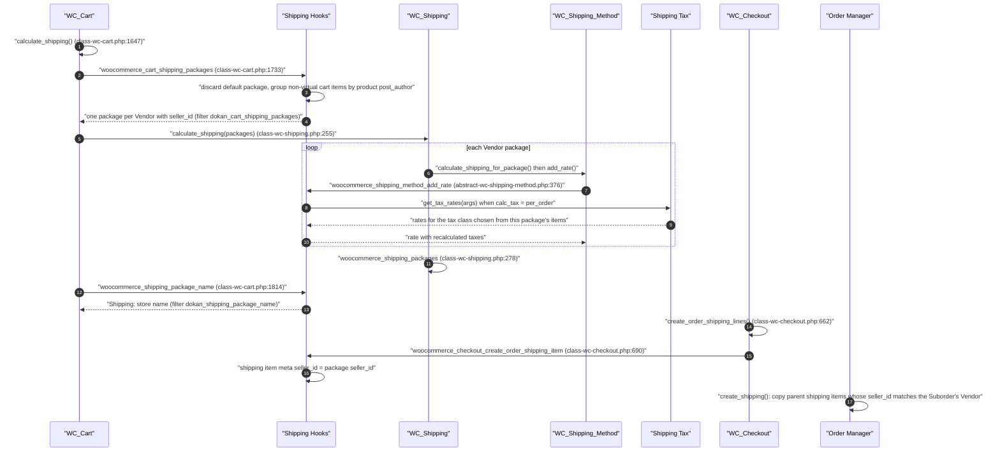

# WooCommerce Integration: Catalog, Refunds, Shipping, Coupons, Taxes and Payments (Dokan Lite)

This document catalogs the places where Dokan Lite plugs into WooCommerce for products, refunds, shipping, coupons, taxes, payments and the Withdraw ledger. For each touchpoint it names the exact WooCommerce hook, the place in WooCommerce 11.2.1 where that hook is fired, and the Lite callback that consumes it. The goal is to show how a Vendor's share of a WooCommerce sale is tracked from cart to Balance.

Related documents, which this one links to instead of repeating:

- [Orders, Commission, Fees and Vendor Balance](./orders-commission-fees.md) covers Suborder creation, Commission formulas, the `dokan_orders` and `dokan_vendor_balance` table columns, and fee recipients in depth.
- [Products](./products.md) covers the product editors, product statuses and the product REST controllers.
- [Withdraw and Reverse Withdrawal](./withdraw-and-reverse-withdrawal.md) covers Withdraw requests, methods and the Reverse withdrawal module.
- [REST API and permissions](./rest-api-and-permissions.md) covers REST controller registration and permission callbacks.

Terminology follows `CONTEXT.md`. An **Order** is the customer-facing WooCommerce order. A **Suborder** is the per-Vendor order split off a multi-vendor Order. A **Vendor order** is the Suborder, or the Order itself when it is single-vendor. **Commission** is the admin's share, **Earning** is the Vendor's share, and **Balance** is the Vendor ledger. The legacy word "seller" appears only when quoting code identifiers such as `seller_id`.

> Read [ADR-0004](../0004-vendor-order-is-authoritative-parent-is-mirror.md) first. Stock reduction, Commission, Balance and refund accounting happen only on the Vendor order. Parent Orders do not reduce stock, and a refund created directly on a parent Order is outside vendor accounting. This is deliberate, and the behavior described below follows from it.

---

## 1. Purpose & ownership

| Concern | Owner | Lite code |
|---|---|---|
| Product objects, product data store, `wc_product_meta_lookup` table, product REST API | [WooCommerce] | Lite builds products through `WC_Product` setters and reads the lookup table for sorting |
| Vendor ownership of products (`post_author`), store info on product REST responses, product query scoping for Ability Context | [Lite] | `Product\Manager`, `REST\Manager::prepare_product_response`, `Abilities\ProductAbilityScope` |
| Refund objects, `wc_create_refund()`, gateway refund calls, restocking | [WooCommerce] | Lite only reacts to the hooks |
| Refund accounting on the Vendor order (Balance credit, `dokan_orders` reconciliation) when Dokan Pro is not active | [Lite] | `Order\RefundHandler`, `Commission\OrderRefundCommission`, `Order\VendorBalanceUpdateHandler` |
| Refund accounting when Dokan Pro is active, and mirroring a Suborder refund onto its parent Order | consumed by Dokan Pro | `RefundHandler::handle_refund` returns early when `dokan()->is_pro_exists()` |
| Shipping zones, methods, rates and packages | [WooCommerce] | Lite only reshapes packages and adjusts rate taxes |
| One shipping package per Vendor (Lite without Pro) and per-Vendor shipping tax class | [Lite] | `Shipping\Hooks`, `Shipping\Tax` |
| Vendor-specific shipping methods | consumed by Dokan Pro | Lite registers no `WC_Shipping_Method` |
| Coupon objects, discount calculation, coupon validation | [WooCommerce] | Lite adds a multi-Vendor validity rule and per-line-item discount tracking |
| Splitting a coupon's discount between admin and Vendor | [Lite] | `Vendor\Coupon`, `Commission\CouponInfo` |
| Creating Vendor-owned coupons | consumed by Dokan Pro | Lite has no coupon REST controller or coupon editor |
| Tax rates and tax calculation | [WooCommerce] | Lite copies tax lines into Suborders and decides the tax Fee recipient |
| Payment gateways and payment capture | [WooCommerce] or [Third-party: gateway plugins] | Lite registers no `WC_Payment_Gateway` |
| Mapping a payment to Vendors (via the order split) and gateway-fee deduction | [Lite] | `Order\Manager::create_sub_order`, `Fees` |
| Balance ledger and Withdraw | [Lite] | `dokan_vendor_balance`, `Withdraw\Hooks` |

**Related ADRs:** [ADR-0004](../0004-vendor-order-is-authoritative-parent-is-mirror.md) (Vendor order is authoritative), [ADR-0010](../0010-product-ownership-is-post-author.md) (Product Ownership is `post_author`), [ADR-0012](../0012-commission-terms-are-frozen-onto-the-order-at-first-calculation.md) (Commission terms frozen at first calculation), [ADR-0013](../0013-marketplace-money-lives-in-custom-tables-not-post-types.md) (Balance ledger in custom tables), [ADR-0014](../0014-reverse-withdrawal-is-a-separate-receivable-ledger.md) (Reverse withdrawal paid through checkout), [ADR-0006](../0006-ownership-enforced-in-abilities-layer.md) and [ADR-0007](../0007-staff-actions-gated-by-dokan-capabilities.md) (Ownership on product routes).

---

## 2. Entry points & bootstrap

| What | Where |
|---|---|
| `Shipping\Hooks`, `Commission\RecalculateCommissions`, `Order\RefundHandler` and `Abilities\ProductAbilityScope` are shared `common-service` services | `lite:includes/DependencyManagement/Providers/CommonServiceProvider.php:13-32` |
| `VendorBalanceUpdateHandler` and the Commission calculators (`OrderCommission`, `OrderRefundCommission`, and others) are `commission-service` services, registered non-shared | `lite:includes/DependencyManagement/Providers/CommissionServiceProvider.php:19-36` |
| `Hookable` services (`RefundHandler`, `VendorBalanceUpdateHandler`, `ProductAbilityScope`) get `register_hooks()` called during bootstrap | `lite:dokan-class.php:276-279` |
| `Shipping\Hooks` attaches its WooCommerce filters in its constructor | `lite:includes/Shipping/Hooks.php:22` |
| `Vendor\Hooks` constructs `Vendor\Coupon` ("vendor coupon distribution") | `lite:includes/Vendor/Hooks.php:22` |
| `Order\Controller::init_classes` constructs `Order\Hooks` (stock, coupon validity, status cascade) and `Order\OrderCache` | `lite:includes/Order/Controller.php:35-38` |
| `fees` container alias resolves to `WeDevs\Dokan\Fees` | `lite:includes/DependencyManagement/Providers/ServiceProvider.php:39` |
| `woocommerce_is_purchasable` filter that stops a Vendor buying their own product is attached at file load | `lite:includes/wc-functions.php:1071` (callback `dokan_vendor_own_product_purchase_restriction` at `lite:includes/wc-functions.php:1049`) |

`Commission\RecalculateCommissions` is registered as a service, but its constructor (`lite:includes/Commission/RecalculateCommissions.php:16`) executes `return;` as its first statement ("Currently we will skip this."). None of the WooCommerce hooks written below that line (`woocommerce_new_order_item`, `woocommerce_before_delete_order_item`, `woocommerce_after_order_object_save`, `wp_ajax_woocommerce_calc_line_taxes`) are attached at this revision.

---

## 3. Key classes

| Class | File | Responsibility |
|---|---|---|
| `WeDevs\Dokan\Product\Manager` | `lite:includes/Product/Manager.php` | Builds and saves products through `WC_Product_Factory::get_classname_from_product_type()` and `WC_Product` setters (`create()` at `:75`); sets shipping class through the product data store (`save_product_shipping_data()` at `:504`). |
| `WeDevs\Dokan\REST\ProductControllerV3` | `lite:includes/REST/ProductControllerV3.php:19` | Extends `WC_REST_Products_Controller`; the React product editor's REST API under `dokan/v3`. |
| `WeDevs\Dokan\REST\Manager` | `lite:includes/REST/Manager.php:10` | Adds a `store` object to every WooCommerce product REST response (`prepare_product_response()` at `:85`). |
| `WeDevs\Dokan\Abilities\ProductAbilityScope` | `lite:includes/Abilities/ProductAbilityScope.php:38` | Scopes WooCommerce product permissions and product queries during an Ability Context; re-authors ability-created products to the Vendor. |
| `WeDevs\Dokan\Rewrites` | `lite:includes/Rewrites.php:10` | Store-page catalog ordering joins `wc_product_meta_lookup` (`get_catalog_ordering_args()` at `:391`). |
| `WeDevs\Dokan\Order\RefundHandler` | `lite:includes/Order/RefundHandler.php:10` | Handles `woocommerce_order_refunded` when Dokan Pro is not active and writes the Balance credit. |
| `WeDevs\Dokan\Commission\OrderRefundCommission` | `lite:includes/Commission/OrderRefundCommission.php:20` | Splits a `WC_Order_Refund` into Vendor and admin portions (line items, tax, shipping, gateway fee). |
| `WeDevs\Dokan\Order\VendorBalanceUpdateHandler` | `lite:includes/Order/VendorBalanceUpdateHandler.php:17` | Reconciles `dokan_orders` and the order's ledger debit on every `woocommerce_update_order`. |
| `WeDevs\Dokan\Analytics\Reports\OrderType` | `lite:includes/Analytics/Reports/OrderType.php:14` | Classifies an order or refund (`get_type()` at `:57`), including `DOKAN_PARENT_ORDER_REFUND`. |
| `WeDevs\Dokan\Order\Hooks` | `lite:includes/Order/Hooks.php:25` | Coupon validity rule, parent-order stock guard, status cascade and the dashboard "refunded" status path. |
| `WeDevs\Dokan\Shipping\Hooks` | `lite:includes/Shipping/Hooks.php:15` | Per-Vendor package split, package label, `seller_id` shipping item meta, shipping tax recalculation. |
| `WeDevs\Dokan\Shipping\Tax` | `lite:includes/Shipping/Tax.php:7` | Extends `WC_Tax`; picks the shipping tax class from one Vendor package's items. |
| `WeDevs\Dokan\Vendor\Coupon` | `lite:includes/Vendor/Coupon.php:14` | Captures each coupon's discount per cart item and per order item into `_dokan_coupon_info`, and keeps Suborders' coupons in step with the parent. |
| `WeDevs\Dokan\Commission\CouponInfo` | `lite:includes/Commission/CouponInfo.php:5` | Splits a line item's coupon discount into an admin part and a Vendor part. |
| `WeDevs\Dokan\Order\Manager` | `lite:includes/Order/Manager.php:20` | Suborder creation, which copies payment method, shipping lines, tax lines and coupon lines (`create_sub_order()` at `:582`). |
| `WeDevs\Dokan\Fees` | `lite:includes/Fees.php:9` | PayPal gateway fee deduction, shipping/tax/shipping-tax Fee recipients. |
| `WeDevs\Dokan\Withdraw\Hooks` | `lite:includes/Withdraw/Hooks.php:5` | Writes the Withdraw credit row to the Balance ledger (`update_vendor_balance()` at `:110`). |

---

## 4. Execution flow

### 4.1 Products and the WooCommerce product data store

**Product CRUD.** Dokan does not keep its own product table. `Product\Manager::create()` resolves the class with `WC_Product_Factory::get_classname_from_product_type()` (falling back to `WC_Product_Simple`), calls `WC_Product` setters such as `set_name()`, `set_tax_status()` and `set_tax_class()`, and persists through `$product->save()` (`lite:includes/Product/Manager.php:397`). Saving goes through WooCommerce's `WC_Product_Data_Store_CPT`, which fires `woocommerce_new_product` (`wc:includes/data-stores/class-wc-product-data-store-cpt.php:263`) or `woocommerce_update_product` (`wc:includes/data-stores/class-wc-product-data-store-cpt.php:398`) and maintains the `wc_product_meta_lookup` row itself. `Product\Manager::save_product_shipping_data()` resolves a shipping class slug through `$product->get_data_store()->get_shipping_class_id_by_slug()`, so shipping classes stay WooCommerce terms.

**Ownership.** A product's Vendor is its `post_author`. WooCommerce sets `post_author` to the current user when it inserts the post. The [Products](./products.md#9-woocommerce-touchpoints) document describes where Lite corrects the author afterwards. `ProductAbilityScope::assign_vendor_as_product_author` is one such correction: on `woocommerce_new_product` (priority 99) during an Ability Context, it updates `post_author` to the resolved Vendor when it differs.

**Lookup table.** Lite reads `wc_product_meta_lookup` but never writes it. On a Vendor's store page, `Rewrites::get_catalog_ordering_args` adds a `posts_clauses` callback that left-joins `{$wpdb->wc_product_meta_lookup}` and orders by `min_price`, `max_price`, `total_sales` or `average_rating`/`rating_count`, depending on the requested sort (`Rewrites::order_by_price_asc_post_clauses`, `order_by_price_desc_post_clauses`, `order_by_popularity_post_clauses`, `order_by_rating_post_clauses`). Vendor analytics also read the table for stock counts (`Analytics\Reports\Stock\Stats\WcDataStore`).

**Product REST.** Lite touches WooCommerce's product REST API in three ways:

1. `ProductControllerV3` extends `WC_REST_Products_Controller` and inherits its schema, object preparation and batch handling under `dokan/v3/products`. It overrides `save_downloadable_files()` (`lite:includes/REST/ProductControllerV3.php:537`, parent at `wc:includes/rest-api/Controllers/Version2/class-wc-rest-products-v2-controller.php:1573`) so that a file whose URL is unchanged keeps its stored download id; ids are matched per URL in order, so two files sharing a URL each keep their own id. Keeping the id keeps existing customers' download permissions valid. The legacy form save `dokan_process_product_meta()` applies the same rule and keys a new file by `md5( url )` (`lite:includes/wc-functions.php:338-357`).
2. `REST\Manager::prepare_product_response` is attached to `woocommerce_rest_prepare_product_object` unconditionally (`lite:includes/REST/Manager.php:29`). WooCommerce fires that filter for every product it prepares (`wc:includes/rest-api/Controllers/Version2/class-wc-rest-products-v2-controller.php:314`). As a result, WooCommerce's own `/wc/v3/products` responses gain a `store` object (`id`, `name`, `shop_name`, `url`, `address`, `avatar`, `banner`) built from the product author's Vendor record.
3. `ProductAbilityScope` filters `woocommerce_rest_check_permissions` (`wc:includes/wc-rest-functions.php:249`), `woocommerce_product_data_store_cpt_get_products_query` (`wc:includes/data-stores/class-wc-product-data-store-cpt.php:2531`) and `woocommerce_rest_product_object_query` (fired as `woocommerce_rest_{$this->post_type}_object_query` at `wc:includes/rest-api/Controllers/Version3/class-wc-rest-crud-controller.php:355`). These filters change nothing outside an Ability Context. Inside one, published products are readable by anyone, unpublished products are readable only by a holder of `manage_woocommerce` or by their owner when the owner also has the Dokan product read capability (`OwnershipGate::has_read_capability()`), and product list queries are forced to a Vendor author or to `publish` status while a product-query ability runs.

### 4.2 Refunds

#### 4.2.1 What WooCommerce does inside `wc_create_refund()`

Both the WooCommerce admin "Refund" button (`wc:includes/class-wc-ajax.php:2904`) and the WooCommerce refunds REST controller (`wc:includes/rest-api/Controllers/Version2/class-wc-rest-order-refunds-v2-controller.php:292`) call `wc_create_refund()` (`wc:includes/wc-order-functions.php:559`). The order of operations inside it matters for Dokan:

| Step | WooCommerce line | Effect relevant to Dokan |
|---|---|---|
| 1 | `woocommerce_create_refund` at `:674` | Fired before the refund is saved. Lite does not consume it. |
| 2 | `$refund->save()` at `:676` | The `WC_Order_Refund` row exists from here on. |
| 3 | `wc_refund_payment()` at `:678` | Only when `refund_payment` is true. The gateway is called for the order the refund belongs to. |
| 4 | `wc_restock_refunded_items()` at `:690` | Only when restocking was requested. |
| 5 | `woocommerce_order_partially_refunded` at `:724` or `woocommerce_order_fully_refunded` at `:726` | Lite does not consume either. |
| 6 | `$order->update_status( $parent_status )` at `:740` | Only for a full refund; `$parent_status` defaults to `refunded` and is filterable through `woocommerce_order_fully_refunded_status`. `WC_Order::update_status()` saves the order, which fires `woocommerce_update_order` and then `woocommerce_order_status_changed` (`wc:includes/class-wc-order.php:478`). WooCommerce strips the `wc-` prefix before building the transition, so the hook receives `refunded`. |
| 7 | `$order->save()` at `:749` | Fires `woocommerce_update_order` (`wc:includes/data-stores/class-wc-order-data-store-cpt.php:244`, or `wc:src/Internal/DataStores/Orders/OrdersTableDataStore.php:3137` with HPOS). On a full refund this is the second time it fires. |
| 8 | `woocommerce_refund_created` at `:751` | Lite does not consume it. |
| 9 | `woocommerce_order_refunded` at `:752` | Lite's `RefundHandler::handle_refund` and `OrderCache::reset_order_cache` run here. |

Because step 7 precedes step 9, Dokan's order-save reconciliation always runs before its refund handler.

#### 4.2.2 Lite refund path (Dokan Pro not active)

```mermaid
sequenceDiagram
    autonumber
    actor Actor as "Store Admin or REST client"
    participant WC as "wc_create_refund()"
    participant GW as "Payment gateway"
    participant OH as "Order Hooks"
    participant VB as "VendorBalanceUpdateHandler"
    participant RH as "RefundHandler"
    participant RC as "OrderRefundCommission"
    participant DB as "dokan_orders / dokan_vendor_balance"

    Actor->>WC: refund a Vendor order (Suborder or single-vendor Order)
    WC->>WC: "woocommerce_create_refund (674), refund save (676)"
    opt refund_payment = true
        WC->>GW: "wc_refund_payment() (678)"
    end
    opt full refund
        WC->>OH: "woocommerce_order_status_changed (update_status at 740)"
        OH->>DB: "dokan_orders.order_status and ledger row status = wc-refunded"
    end
    WC->>VB: "woocommerce_update_order (order save at 749)"
    VB->>DB: "priority 80: dokan_orders.net_amount = refund-adjusted Earning, order_total = total - refunded"
    VB->>DB: "priority 99: ledger debit compared with full Earning (unchanged by a refund)"
    WC->>RH: "woocommerce_order_refunded(order_id, refund_id) (752)"
    alt "Dokan Pro active"
        RH-->>RH: return (Pro owns refund accounting)
    else "refund is on a parent Order with Suborders"
        RH-->>RH: return (outside the model, ADR-0004)
    else "Vendor order"
        RH->>RC: "dokan_vendor_earning_in_refund -> get_vendor_total_refund()"
        RC-->>RH: "prorated Earning + Vendor tax/shipping - returned gateway fee"
        RH->>RH: "dokan_refund_adjust_vendor_balance"
        RH->>DB: "INSERT ledger row trn_type = dokan_refund, credit = amount, status = approved"
        RH->>RH: "dokan_refund_adjust_dokan_orders (no Lite listener)"
    end
```

Step by step:

1. **Classification.** `RefundHandler::handle_refund` (`lite:includes/Order/RefundHandler.php:37`) returns immediately when Dokan Pro is active. It then loads both objects and returns unless they are a `WC_Order_Refund` and a `WC_Order`. It returns again when `OrderType::get_type()` reports `DOKAN_PARENT_ORDER_REFUND`, which is the case for a refund whose parent order has Suborder IDs (`lite:includes/Analytics/Reports/OrderType.php:78-85`).
2. **Vendor portion.** The filter `dokan_vendor_earning_in_refund` is answered by `RefundHandler::get_vendor_earning_in_refund`, which returns `OrderRefundCommission::get_vendor_total_refund()`. That total is:
   - the prorated line-item Earning, computed by `OrderCommission::calculate_for_refund()` (`lite:includes/Commission/OrderCommission.php:153`), which looks up each refund item's `_refunded_item_id` and asks that line item's Commission calculator for the refunded share;
   - plus refunded product tax, if the tax Fee recipient is the Vendor, and refunded shipping tax, if the shipping-tax Fee recipient is the Vendor (`OrderRefundCommission::get_tax_refund_for`, reading the refund's `tax` items);
   - plus refunded shipping, if the shipping Fee recipient is the Vendor (`OrderRefundCommission::get_shipping_refund_for`, reading the refund's `shipping` items);
   - minus any gateway fee returned to the Vendor. This defaults to 0 through the `dokan_refund_gateway_fee` filter, because most gateways keep their fee on refund. A gateway integration may supply the amount; it receives the Vendor's prorated share of `dokan_gateway_fee` as a convenience argument.
   `OrderRefundCommission` returns 0 for every portion when the refunded order has `has_sub_order` set.
3. **Balance credit.** `RefundHandler::insert_into_balance_table` runs on `dokan_refund_adjust_vendor_balance`. It resolves the Vendor with `dokan_get_seller_id_by_order()` (logging and returning when none is found), passes the amount through `dokan_vendor_refund_amount_before_insert`, and checks `dokan_refund_should_insert_into_vendor_balance` (default: amount greater than 0). Lite's own callback on that filter, `RefundHandler::exclude_cod_payment`, returns false for cash-on-delivery orders when the "exclude COD payment" Withdraw setting is on; that decision is itself filterable through `dokan_order_refund_should_exclude_from_vendor_balance`. The inserted row has `trn_type = dokan_refund`, `trn_id` = the Vendor order ID, `credit` = the amount, `debit = 0` and `status = approved`.
4. **`dokan_orders` row.** `RefundHandler` fires `dokan_refund_adjust_dokan_orders`, but Lite attaches no listener to it: the registration of `RefundHandler::update_order_amounts` is commented out (`lite:includes/Order/RefundHandler.php:22-23`). The `dokan_orders` row has already been reconciled in step 7 of 4.2.1 by `VendorBalanceUpdateHandler::update_dokan_order_table`, which stores the refund-adjusted Earning as `net_amount` and `get_total() - get_total_refunded()` as `order_total`.

**Why the ledger stays consistent.** `VendorBalanceUpdateHandler::handle_order_edit` calculates the Earning with `set_should_adjust_refund( false )` (and adds the Vendor-borne gateway fee back through `get_vendor_gateway_fee()`), so the order's `dokan_orders` ledger debit is not reduced by refunds, and each refund is a separate credit row. The Balance query in `Vendor::get_balance()` (`lite:includes/Vendor/Vendor.php:873`) sums `debit` only for ledger rows whose `status` is in `dokan_withdraw_get_active_order_status()`, and sums `credit` for all rows. `dokan_withdraw_get_active_order_status()` (`lite:includes/Withdraw/functions.php:355`) always adds `wc-refunded` to the configured statuses. When a full refund moves the order to `wc-refunded`, its debit therefore keeps counting, and the refund credit offsets it. Without that hard-coded status, a fully refunded order would lose its debit and also subtract its credit, removing the Earning twice.

Note on column names: the ledger stores Earnings in `debit` and Refunds and Withdraws in `credit`, so Balance is `SUM(debit) - SUM(credit)`. See [Orders, Commission, Fees and Vendor Balance](./orders-commission-fees.md#6-data-storage) for the full table definition.

#### 4.2.3 Vendor dashboard status change to "refunded"

Lite contains a second refund-accounting callback that does not involve a `WC_Order_Refund`. `Order\Hooks::manage_refunded_for_order` is attached to `woocommerce_order_status_changed` at priority 15. As written, it continues only when all of these hold:

- the request is a POST with a valid `dokan_change_status` nonce and `$_POST['post_type'] === 'shop_order'`;
- the order is not an excluded COD order;
- the `$new_status` argument equals `wc-refunded` (with the prefix).

When it continues, and no approved `dokan_refund` ledger row exists for the order yet, it inserts a credit equal to the full stored Earning (`dokan()->commission->get_earning_by_order()`) and sets the order's `dokan_orders.order_total` and `net_amount` to 0. The existing-row check means it never adds a second credit after a refund has already been credited.

WooCommerce passes the status to `woocommerce_order_status_changed` without the `wc-` prefix (`WC_Abstract_Order::set_status()` calls `OrderUtil::remove_status_prefix()`), and the Lite order-status form does not post a `post_type` field. Whether any Lite surface meets all three conditions could not be confirmed (see Known gaps), so the `RefundHandler` path in 4.2.2 is the refund accounting path that WooCommerce refunds reach.

#### 4.2.4 Parent Orders and Dokan Pro

In Lite, a refund created on a Suborder is not copied to the parent Order, and a refund created on a parent Order is ignored by vendor accounting (`RefundHandler`, `OrderRefundCommission` and `VendorBalanceUpdateHandler` all skip orders with Suborders). This matches ADR-0004 and the `CONTEXT.md` definition of Refund. Mirroring a Suborder refund up to the parent Order, and charging the gateway once at the parent level, is a seam consumed by Dokan Pro. When Dokan Pro is active, `RefundHandler::handle_refund` steps aside entirely, while `insert_into_balance_table` and `exclude_cod_payment` remain attached to their Dokan hooks for any caller that fires them.

A full refund on a parent Order still cascades the `refunded` status to its Suborders through `Order\Hooks::on_order_status_change`, subject to the `dokan_sub_order_status_update_whitelist` transitions (by default, `wc-processing` and `wc-completed` may move to `wc-refunded`). That cascade changes statuses only; it creates no refunds and no ledger credits on the Suborders.

### 4.3 Shipping

#### 4.3.1 Per-Vendor package split (Dokan Pro not active)

`Shipping\Hooks::__construct` attaches three filters only when `! dokan()->is_pro_exists()` (`lite:includes/Shipping/Hooks.php:23-28`). When Dokan Pro is active, the package split is consumed by Dokan Pro instead.



Details:

- **Split.** `Shipping\Hooks::split_shipping_packages` ignores the incoming package array and rebuilds it from `WC()->cart->get_cart()`. It skips items whose product `is_virtual()`, groups the rest by the product's `post_author`, and for each Vendor builds a package with `contents`, `contents_cost` (sum of `line_total`), `applied_coupons`, `user.ID`, `seller_id` and a `destination` taken from the customer's shipping address. The result passes through `dokan_cart_shipping_packages`. A cart with only virtual items produces no packages.
- **Label.** `Shipping\Hooks::change_shipping_pack_name` returns "Shipping: {store name}" for packages that carry a `seller_id`, through `dokan_shipping_package_name`. WooCommerce passes four arguments to `woocommerce_shipping_package_name`; Lite registers the callback with three and does not use the total package count.
- **Order item meta.** `Shipping\Hooks::add_shipping_pack_meta` writes `seller_id` on each `WC_Order_Item_Shipping` at checkout. The block checkout uses the same method: the Store API's order controller calls `WC_Checkout::create_order_shipping_lines()` (`wc:src/StoreApi/Utilities/OrderController.php:851`), so the hook fires for both checkouts.
- **Suborders.** When the Order is split, `Order\Manager::create_shipping` reads `seller_id` from each parent shipping item, keeps the items that match the Suborder's Vendor, lets `dokan_shipping_methods` adjust the list, clones them into the Suborder and sets the Suborder's shipping total. Where no shipping item matches, it logs and adds none.
- **Fee recipient.** Whether the shipping charge counts toward the Vendor's Earning or the admin's share is decided per order by `Fees::get_shipping_fee_recipient()` (option `shipping_fee_recipient`, filter `dokan_shipping_fee_recipient`, stored on the order as `shipping_fee_recipient` meta). See [Orders, Commission, Fees and Vendor Balance](./orders-commission-fees.md#44-fees).

Lite registers no shipping method (there is no `woocommerce_shipping_methods` filter in Lite). Customers are offered the store's WooCommerce shipping zones and methods for each Vendor package. Vendor-specific shipping methods are consumed by Dokan Pro.

#### 4.3.2 Shipping tax per Vendor package (always active)

`Shipping\Hooks::add_shipping_method_rate` is attached in both Lite-only and Lite-with-Pro installs. For a taxable method whose `calc_tax` argument is `per_order` and whose cost is greater than 0, it asks `Shipping\Tax::get_tax_rates()` for rates and replaces the rate's taxes with `Shipping\Tax::calc_shipping_tax()`. `Shipping\Tax` chooses the tax class from the shipping-taxable items in that one package: the standard class wins if present; otherwise a single class is used directly; otherwise the first class found in the store's configured tax-class order. WooCommerce's default per-order behavior looks at the whole cart, so this keeps each Vendor's shipping tax tied to that Vendor's products.

### 4.4 Coupons

#### 4.4.1 Validation

`Order\Hooks::ensure_coupon_is_valid` runs on `woocommerce_coupon_is_valid` (`wc:includes/class-wc-discounts.php:1260`). It collects the Vendor of every product in the `WC_Discounts` items through `dokan_get_vendor_by_product()`. If the coupon is a `fixed_cart` coupon and the items span more than one Vendor, it throws an `Exception` with "This coupon is invalid for multiple vendors.", which WooCommerce turns into a coupon error. Otherwise it returns the value passed through `dokan_coupon_is_valid`. Percentage and fixed-product coupons are allowed across Vendors because their discount can be attributed to individual line items.

#### 4.4.2 Per-line-item discount tracking

WooCommerce does not expose per-line-item coupon amounts through a dedicated hook. `Vendor\Coupon::intercept_wc_coupon` works around this on `woocommerce_coupon_get_apply_quantity` (fired at `wc:includes/class-wc-discounts.php:384`, `:448`, `:451` and `:537`), at priority 15:

1. It removes itself from the filter to avoid recursion.
2. It clones the `WC_Discounts` object and re-applies the coupon to the clone. Whether the clone validates the coupon is controlled by `dokan_coupon_should_validate`.
3. It fires `dokan_wc_coupon_applied`. Lite's own listener, `Vendor\Coupon::save_item_coupon_discount`, reads `WC_Discounts::get_discounts()` from the clone and stores, for that coupon code, the discount, per-quantity amount, quantity and four coupon meta values (`admin_coupons_enabled_for_vendor`, `coupon_commissions_type`, `admin_shared_coupon_type`, `admin_shared_coupon_amount`):
   - on the cart item, under the `_dokan_coupon_info` key, when the discount target is a `WC_Cart`;
   - on the order item, as `_dokan_coupon_info` order item meta, when the target is a `WC_Order`. It then fires `dokan_after_coupon_info_data_updated_on_order_item_meta`, and if the order has Suborders it applies the coupon to each Suborder that does not already have it.
4. It re-attaches itself and returns the original apply quantity unchanged.

The data then follows the order through WooCommerce:

| WooCommerce hook | Fired at | Lite callback | Effect |
|---|---|---|---|
| `woocommerce_checkout_create_order_line_item` | `wc:includes/class-wc-checkout.php:611` | `Vendor\Coupon::add_coupon_info_to_order_item` | Copies the cart item's `_dokan_coupon_info` to the new order item, capping the summed discount at product price times quantity. |
| `woocommerce_removed_coupon` | `wc:includes/class-wc-cart.php:2257` | `Vendor\Coupon::remove_coupon_info_from_cart_item` | Removes that code from every cart item's `_dokan_coupon_info`. |
| `woocommerce_before_delete_order_item` | `wc:includes/wc-order-item-functions.php:84`, `wc:includes/data-stores/abstract-wc-order-item-type-data-store.php:140` | `Vendor\Coupon::remove_coupon_info_from_order_item` | When a coupon item is deleted from an order, removes the code from the items' `_dokan_coupon_info`; removes the coupon from Suborders when the order is a parent, or from the matching parent items when the order is a Suborder. |

When the Order is split, `Order\Manager::create_coupons` sums `_dokan_coupon_info.discount` per code across the Suborder's line items (only for codes present on the parent) and adds one `WC_Order_Item_Coupon` per code with that discount, plus `coupon_info` and `coupon_data` item meta.

#### 4.4.3 Who bears the discount

`OrderLineItemCommission` reads `_dokan_coupon_info` from each line item and passes it to `Commission\CouponInfo`. `CouponInfo::get_coupon_amount` splits each coupon's discount by `coupon_commissions_type`:

| `coupon_commissions_type` | Vendor discount | Admin discount |
|---|---|---|
| `default`, `from_vendor`, missing or unknown | full discount | 0 |
| `from_admin` | 0 | full discount |
| `shared_coupon` with `admin_shared_coupon_type = percentage` | discount minus admin part | discount × `admin_shared_coupon_amount` / 100 |
| `shared_coupon` with any other type | discount minus admin part | `min( discount, admin_shared_coupon_amount )` |

Lite reads these coupon meta keys but does not write them anywhere, and Lite provides no editor or REST endpoint for Vendor-owned coupons. Without anything writing them, every coupon is borne by the Vendor. Setting them is consumed by Dokan Pro.

### 4.5 Taxes

Lite does not calculate product taxes. WooCommerce calculates them on the Order, and Lite moves and attributes them:

- **Suborder tax lines.** `Order\Manager::create_line_items` copies each line item's tax class, subtotal tax, total tax and tax array from the parent item. `Order\Manager::create_taxes` then adds one tax item per parent tax rate, with `tax_total` = the sum of the Suborder line items' total tax and `shipping_tax_total` = the sum of the Suborder shipping items' taxes, using `WC_Tax::get_rate_code()` for the rate code. `WC_Order::calculate_totals()` runs afterwards in `create_sub_order`.
- **Shipping tax per Vendor package.** See 4.3.2.
- **Fee recipients.** `Fees::get_tax_fee_recipient()` and `Fees::get_shipping_tax_fee_recipient()` decide whether product tax and shipping tax belong to the Vendor or the admin, per order, using options `tax_fee_recipient` and `shipping_tax_fee_recipient` (filters `dokan_tax_fee_recipient`, `dokan_shipping_tax_fee_recipient`). The decision is stored on the order (`tax_fee_recipient`, `shipping_tax_fee_recipient` meta) so later changes to the option do not rewrite old orders. Refund calculations reuse the same recipients (4.2.2).
- **Refunded shipping tax.** `Fees::get_total_shipping_tax_refunded()` sums `WC_Order::get_tax_refunded_for_item()` across the order's shipping items; `OrderCommission` uses it when computing a refund-adjusted Earning.

### 4.6 Payments and how they map to Vendors

Lite registers no WooCommerce payment gateway: there is no `woocommerce_payment_gateways` filter and no `WC_Payment_Gateway` subclass in Lite. The customer pays the whole Order once, through whatever WooCommerce or third-party gateway the store enables, and the money goes to the store owner's gateway account. Lite then attributes the money to Vendors through the order split and the ledger:

1. **Split.** On `woocommerce_checkout_update_order_meta` (`wc:includes/class-wc-checkout.php:514`) and `woocommerce_store_api_checkout_order_processed` (`wc:src/StoreApi/Routes/V1/Checkout.php:695`), `Order\Hooks::split_vendor_orders` calls `Order\Manager::maybe_split_orders()`. A single-vendor Order gets `_dokan_vendor_id` meta. A multi-vendor Order gets `has_sub_order` and one Suborder per Vendor.
2. **Payment method on Suborders.** `Order\Manager::create_sub_order` copies the parent's payment method and payment method title to each Suborder (`lite:includes/Order/Manager.php:620-621`). Suborders record which gateway was used, but no separate charge is made for them.
3. **Earning row.** `dokan_sync_insert_order()` (`lite:includes/Order/functions.php:217`) writes the Vendor order's `dokan_orders` row and its ledger debit. See [Orders, Commission, Fees and Vendor Balance](./orders-commission-fees.md#41-checkout-to-suborders-to-commission-to-balance).
4. **Gateway fee.** `Fees::calculate_gateway_fee` runs on `woocommerce_order_status_changed` (priority 100), `woocommerce_thankyou_ppec_paypal` and `woocommerce_paypal_payments_order_captured` ([Third-party: WooCommerce PayPal Payments]). `Fees::get_processing_fee` recognises only the `paypal`, `ppec_paypal` and `ppcp-gateway` payment methods (reading `PayPal Transaction Fee`, `PPEC_FEE_META_NAME_NEW` or the PayPal Payments fee breakdown meta); other gateways can supply a fee through `dokan_get_processing_fee`. The fee is prorated to each Vendor order by order total, deducted from `dokan_orders.net_amount` and from the ledger debit, and stored as `dokan_gateway_fee` order meta.
5. **Order status gates the Balance.** `Order\Hooks::on_order_status_change` copies the new status to the order's ledger row, unless the order is an excluded COD order (filter `dokan_order_should_exclude_from_vendor_balance`). Only rows whose status is in the Withdraw "order status" setting (plus `wc-refunded`) count toward Balance (4.2.2).
6. **Manual gateways and auto-completion.** `Order\Hooks::on_sub_order_change` auto-completes paid, digital-only Suborders except for gateways in `dokan_excluded_payment_gateways_on_order_status_update` (default `bacs`, `cheque`, `cod`), and completes the parent Order when all Suborders are completed.

Lite reads the WooCommerce gateway registry in one other place: `Dashboard\Templates\Settings::get_payment_methods` calls `WC()->payment_gateways->payment_gateways()` to borrow a gateway's description for a Withdraw method's label. The Reverse withdrawal module's own gateway list contains only `cod` by default (`ReverseWithdrawal\SettingsHelper::get_reverse_withrawal_payment_gateways`, filter `dokan_reverse_withdrawal_payment_gateways`).

### 4.7 Withdraw interplay with WooCommerce

The Withdraw module does not move money through WooCommerce. Its links to WooCommerce are indirect:

- **Balance comes from WooCommerce order statuses.** `Vendor::get_balance()` counts ledger debits only for statuses returned by `dokan_withdraw_get_active_order_status()` (option `withdraw_order_status`, default `wc-completed`, always plus `wc-refunded`, filter `dokan_withdraw_active_status`) and only up to the Withdraw threshold date (`dokan_get_withdraw_threshold()`).
- **COD exclusion.** With the `exclude_cod_payment` Withdraw option on, COD orders' ledger statuses are not updated on status changes and their refunds are not credited (4.2.2, 4.6). The Reverse withdrawal module covers the admin's Commission on such orders.
- **Withdraw approval.** `Withdraw\Hooks::update_vendor_balance` on `dokan_withdraw_request_approved` inserts a ledger row with `trn_type = dokan_withdraw` and `credit` = the amount, after checking in integer cents that the Balance covers it.
- **Withdraw methods.** Lite registers `paypal` and `bank` (`dokan_withdraw_register_methods()` at `lite:includes/Withdraw/functions.php:12`). A Withdraw is paid out through one of these Withdraw methods outside WooCommerce; they are not WooCommerce gateways.
- **Reverse withdrawal checkout.** When Reverse withdrawal is enabled, Vendors pay their debt through a normal WooCommerce cart and order. `ReverseWithdrawal\Cart` filters `woocommerce_add_to_cart_validation` (`wc:includes/class-wc-form-handler.php:1088`) and `woocommerce_before_calculate_totals` (`wc:includes/class-wc-cart.php:1604`), and `ReverseWithdrawal\Order` listens to `woocommerce_checkout_create_order_line_item`, `woocommerce_payment_complete` (`wc:includes/class-wc-order.php:186`) and `woocommerce_order_status_changed`. See [Withdraw and Reverse Withdrawal](./withdraw-and-reverse-withdrawal.md).

### 4.8 Stock

`Order\Hooks::prevent_stock_reduction_for_parent_order` returns false on `woocommerce_can_reduce_order_stock` (`wc:includes/wc-stock-functions.php:178`) for orders with `has_sub_order`, so only Suborders reduce stock. `Order\Hooks::sync_parent_order_item_stock` on `woocommerce_reduce_order_item_stock` (`wc:includes/wc-stock-functions.php:233`) copies a Suborder item's `_reduced_stock` to the parent item named by `_dokan_parent_order_item_id`, for display. Both follow ADR-0004.

---

## 5. Hooks

### 5.1 WooCommerce hooks Dokan Lite consumes (within this scope)

| Hook | Type | Fired by WooCommerce at | Lite callback (priority) | Purpose |
|---|---|---|---|---|
| `woocommerce_new_product` | action | `wc:includes/data-stores/class-wc-product-data-store-cpt.php:263` | `ProductAbilityScope::assign_vendor_as_product_author` (99); also `Product\Hooks::update_category_data_for_new_and_update_product` (10), `ProductCache::clear_seller_product_caches` (20) | Vendor authorship in Ability Context; category data and cache |
| `woocommerce_update_product` | action | `wc:includes/data-stores/class-wc-product-data-store-cpt.php:398` | `Product\Hooks::update_category_data_for_new_and_update_product` (10), `ProductCache::clear_seller_product_caches` (20) | Category data and cache |
| `woocommerce_product_data_store_cpt_get_products_query` | filter | `wc:includes/data-stores/class-wc-product-data-store-cpt.php:2531` | `ProductAbilityScope::scope_products_query` (99) | Ability product-list scoping |
| `woocommerce_rest_product_object_query` | filter | `wc:includes/rest-api/Controllers/Version3/class-wc-rest-crud-controller.php:355` (dynamic name) | `ProductAbilityScope::scope_rest_products_query` (99); `Analytics\VendorDashboardManager::product_query_args` | Scoping product REST lists |
| `woocommerce_rest_check_permissions` | filter | `wc:includes/wc-rest-functions.php:249` | `ProductAbilityScope::scope_product_permissions` (99) | Product read/write permission in Ability Context |
| `woocommerce_rest_prepare_product_object` | filter | `wc:includes/rest-api/Controllers/Version2/class-wc-rest-products-v2-controller.php:314` (dynamic name) | `REST\Manager::prepare_product_response` (10); `REST\ProductController::add_min_max_price_to_variable_product` | Adds `store` data; variable price range |
| `woocommerce_order_refunded` | action | `wc:includes/wc-order-functions.php:752` | `RefundHandler::handle_refund` (10); `OrderCache::reset_order_cache` (10) | Lite refund accounting; cache reset |
| `woocommerce_update_order` | action | `wc:includes/data-stores/class-wc-order-data-store-cpt.php:244`, `wc:src/Internal/DataStores/Orders/OrdersTableDataStore.php:3137` | `VendorBalanceUpdateHandler::update_dokan_order_table` (80), `::handle_order_edit` (99) | `dokan_orders` and ledger debit reconciliation, including after refunds |
| `woocommerce_order_status_changed` | action | `wc:includes/class-wc-order.php:478` | `Order\Hooks::on_order_status_change` (10), `::manage_refunded_for_order` (15), `::on_sub_order_change` (99); `Fees::calculate_gateway_fee` (100) | Status cascade and ledger status; dashboard refund path; auto-complete; gateway fee |
| `woocommerce_cart_shipping_packages` | filter | `wc:includes/class-wc-cart.php:1733` | `Shipping\Hooks::split_shipping_packages` (10, Lite only) | One package per Vendor |
| `woocommerce_shipping_package_name` | filter | `wc:includes/class-wc-cart.php:1814` | `Shipping\Hooks::change_shipping_pack_name` (10, Lite only) | "Shipping: {store}" label |
| `woocommerce_checkout_create_order_shipping_item` | action | `wc:includes/class-wc-checkout.php:690` | `Shipping\Hooks::add_shipping_pack_meta` (10, Lite only) | `seller_id` shipping item meta |
| `woocommerce_shipping_method_add_rate` | filter | `wc:includes/abstracts/abstract-wc-shipping-method.php:376` | `Shipping\Hooks::add_shipping_method_rate` (10, always) | Per-Vendor-package shipping tax |
| `woocommerce_coupon_is_valid` | filter | `wc:includes/class-wc-discounts.php:1260` | `Order\Hooks::ensure_coupon_is_valid` (10) | Rejects `fixed_cart` coupons across Vendors |
| `woocommerce_coupon_get_apply_quantity` | filter | `wc:includes/class-wc-discounts.php:384`, `:448`, `:451`, `:537` | `Vendor\Coupon::intercept_wc_coupon` (15) | Captures per-item discount |
| `woocommerce_checkout_create_order_line_item` | action | `wc:includes/class-wc-checkout.php:611` | `Vendor\Coupon::add_coupon_info_to_order_item` (10); `ReverseWithdrawal\Order::store_line_item_metas` | Copies `_dokan_coupon_info` to order items |
| `woocommerce_removed_coupon` | action | `wc:includes/class-wc-cart.php:2257` | `Vendor\Coupon::remove_coupon_info_from_cart_item` | Clears cart coupon info |
| `woocommerce_before_delete_order_item` | action | `wc:includes/wc-order-item-functions.php:84`, `wc:includes/data-stores/abstract-wc-order-item-type-data-store.php:140` | `Vendor\Coupon::remove_coupon_info_from_order_item` | Clears order coupon info, syncs parent and Suborders |
| `woocommerce_can_reduce_order_stock` | filter | `wc:includes/wc-stock-functions.php:178` | `Order\Hooks::prevent_stock_reduction_for_parent_order` | Parent Orders do not reduce stock |
| `woocommerce_reduce_order_item_stock` | action | `wc:includes/wc-stock-functions.php:233` | `Order\Hooks::sync_parent_order_item_stock` | Display-only `_reduced_stock` copy |
| `woocommerce_checkout_update_order_meta` | action | `wc:includes/class-wc-checkout.php:514` | `Order\Hooks::split_vendor_orders` (10); `dokan_sync_insert_order` (20) | Split and Earning rows |
| `woocommerce_store_api_checkout_order_processed` | action | `wc:src/StoreApi/Routes/V1/Checkout.php:695`, `wc:src/StoreApi/Routes/V1/CheckoutOrder.php:160` | same as above | Block checkout equivalent |
| `woocommerce_paypal_payments_order_captured` | action | [Third-party: WooCommerce PayPal Payments] (not in WooCommerce core) | `Fees::calculate_gateway_fee` (99) | PayPal fee deduction |
| `woocommerce_thankyou_ppec_paypal` | action | dynamic `woocommerce_thankyou_{payment_method}` at `wc:templates/checkout/thankyou.php:96`, for payment method `ppec_paypal` (legacy PayPal Express Checkout plugin) | `Fees::calculate_gateway_fee` | PayPal fee deduction |
| `woocommerce_is_purchasable` | filter | `wc:includes/abstracts/abstract-wc-product.php:1785` | `dokan_vendor_own_product_purchase_restriction` | Vendors cannot buy their own products |
| `woocommerce_add_to_cart_validation` | filter | `wc:includes/class-wc-form-handler.php:1088` | `ReverseWithdrawal\Cart::prevent_purchasing_multiple_products` | Reverse withdrawal cart isolation |
| `woocommerce_payment_complete` | action | `wc:includes/class-wc-order.php:186` | `ReverseWithdrawal\Order::process_payment` | Reverse withdrawal payment |

WooCommerce refund hooks that Lite does **not** consume: `woocommerce_create_refund`, `woocommerce_refund_created`, `woocommerce_order_partially_refunded`, `woocommerce_order_fully_refunded`. Lite also does not consume `woocommerce_payment_gateways`, `woocommerce_shipping_methods` or `woocommerce_shipping_packages`.

### 5.2 Hooks Dokan Lite fires (within this scope)

| Hook | Type | Fired in | Arguments | Purpose |
|---|---|---|---|---|
| `dokan_vendor_earning_in_refund` | filter | `RefundHandler::handle_refund` | `$refund_order`, `$order` | Vendor's portion of a refund (Lite answers with `OrderRefundCommission`) |
| `dokan_refund_adjust_vendor_balance` | action | `RefundHandler::handle_refund` | `$vendor_refund`, `$refund_order`, `$order`, `$vendor_refund` | Write the Balance credit (Lite listener: `insert_into_balance_table`) |
| `dokan_refund_adjust_dokan_orders` | action | `RefundHandler::handle_refund` | `$vendor_refund`, `$refund_order`, `$order` | Seam for adjusting `dokan_orders`; no Lite listener |
| `dokan_vendor_refund_amount_before_insert` | filter | `RefundHandler::insert_into_balance_table` | `$amount`, `$order`, `$refund_order` | Adjust the credited amount |
| `dokan_refund_should_insert_into_vendor_balance` | filter | `RefundHandler::insert_into_balance_table` | `$should`, `$refund_order`, `$order` | Skip the credit (Lite uses it for COD exclusion) |
| `dokan_order_refund_should_exclude_from_vendor_balance` | filter | `RefundHandler::exclude_cod_payment` | `$exclude`, `$order`, `$order_id`, `$status`, `$option`, `$refund_order` | Override COD exclusion for refunds |
| `dokan_refund_after_dokan_orders_updated` | action | `RefundHandler::update_order_amounts` (not attached in Lite) | `$vendor_refund`, `$refund_order`, `$order` | Lite clears earning caches on it |
| `dokan_refund_gateway_fee` | filter | `OrderRefundCommission::get_gateway_fee_refund_for` | `0.0`, `$prorated_fee`, `$refund`, `$order`, `$recipient` | Gateway fee returned on refund |
| `dokan_order_should_exclude_from_vendor_balance` | filter | `Order\Hooks::on_order_status_change` | `$exclude`, `$order`, `$order_id`, `$new_status`, `$option` | Skip ledger status update |
| `dokan_sub_order_status_update_whitelist` | filter | `Order\Hooks::is_status_change_allowed` | `$whitelist` | Allowed Suborder status cascades |
| `dokan_excluded_payment_gateways_on_order_status_update` | filter | `Order\Hooks::on_sub_order_change` | `[ 'bacs', 'cheque', 'cod' ]` | Gateways excluded from digital auto-complete |
| `dokan_cart_shipping_packages` | filter | `Shipping\Hooks::split_shipping_packages` | `$packages` | Adjust per-Vendor packages |
| `dokan_shipping_package_name` | filter | `Shipping\Hooks::change_shipping_pack_name` | `$label`, `$i`, `$package`, `$vendor` | Package label |
| `dokan_shipping_methods` | filter | `Order\Manager::create_shipping` | `$methods`, `$suborder_id`, `$parent_order` | Shipping items for a Suborder |
| `dokan_coupon_is_valid` | filter | `Order\Hooks::ensure_coupon_is_valid` | `$valid`, `$coupon`, `$discounts` | Extra coupon rules |
| `dokan_coupon_should_validate` | filter | `Vendor\Coupon::intercept_wc_coupon` | `true`, `$coupon`, `$item`, `$discounts` | Validate when re-applying on the clone |
| `dokan_wc_coupon_applied` | action | `Vendor\Coupon::intercept_wc_coupon` | `$coupon`, `$discounts`, `$item`, `$apply_quantity`, `$this` | Per-item discount available |
| `dokan_after_coupon_info_data_updated_on_order_item_meta` | action | `Vendor\Coupon::save_coupon_data_to_order_item` | `$order_item`, `$coupon_info` | After `_dokan_coupon_info` is saved on an order item |
| `dokan_get_processing_fee` | filter | `Fees::get_processing_fee` | `$fee`, `$order` | Gateway fee for an order |
| `dokan_get_processing_gateway_fee` | filter | `Fees::calculate_gateway_fee` | `$fee`, `$vendor_order`, `$order` | Prorated fee per Vendor order |
| `dokan_orders_vendor_net_amount` | filter | `Fees::calculate_gateway_fee` | `$net`, `$earning`, `$fee`, `$vendor_order`, `$order` | Earning after gateway fee |
| `dokan_shipping_fee_recipient`, `dokan_tax_fee_recipient`, `dokan_shipping_tax_fee_recipient` | filter | `Fees` | `$recipient`, `$order_id` | Fee recipients |
| `dokan_withdraw_active_status` | filter | `dokan_withdraw_get_active_order_status()` | `$statuses` | Statuses that count toward Balance |
| `dokan_vendor_payment_withdraw_methods` | filter | `Dashboard\Templates\Settings::get_payment_methods` | `$methods`, `$gateways` | Withdraw methods shown with WooCommerce gateway descriptions |

---

## 6. Data storage

Lite adds no custom table for this scope beyond the ones documented in [Orders, Commission, Fees and Vendor Balance](./orders-commission-fees.md#6-data-storage). The rows and keys written by the flows above are:

| Store | Key or column | Written by | Meaning |
|---|---|---|---|
| `{prefix}dokan_vendor_balance` | row with `trn_type = dokan_refund` | `RefundHandler::insert_into_balance_table`, `Order\Hooks::manage_refunded_for_order` | Refund credit against a Vendor order (`trn_id` = order ID, `credit` = amount, `status = approved`) |
| `{prefix}dokan_vendor_balance` | `debit` and `status` on the `dokan_orders` row | `VendorBalanceUpdateHandler::handle_order_edit`, `Fees::calculate_gateway_fee`, `Order\Hooks::on_order_status_change` | Pre-refund Earning and the WooCommerce status that gates it. `Fees::calculate_gateway_fee` writes the Earning net of the gateway fee; `handle_order_edit` writes `get_vendor_earning() + get_vendor_gateway_fee()` |
| `{prefix}dokan_vendor_balance` | row with `trn_type = dokan_withdraw` | `Withdraw\Hooks::update_vendor_balance` | Withdraw credit |
| `{prefix}dokan_orders` | `net_amount`, `order_total`, `order_status` | `VendorBalanceUpdateHandler::update_dokan_order_table`, `Fees::calculate_gateway_fee`, `Order\Hooks` | Refund-adjusted Earning and total per Vendor order |
| `{prefix}wc_product_meta_lookup` | read only | [WooCommerce] | Store-page sorting and stock analytics |
| Order item meta (shipping item) | `seller_id` | `Shipping\Hooks::add_shipping_pack_meta` | Vendor that owns the shipping line |
| Order item meta (line item) | `_dokan_coupon_info` | `Vendor\Coupon` | Map of coupon code to `discount`, `coupon_code`, `per_qty_amount`, `quantity`, `admin_coupons_enabled_for_vendor`, `coupon_commissions_type`, `admin_shared_coupon_type`, `admin_shared_coupon_amount` |
| Cart item data | `_dokan_coupon_info` | `Vendor\Coupon::save_coupon_data_to_cart_item` | Same structure, in the cart session |
| Order item meta (line item) | `_dokan_parent_order_item_id` | `Order\Manager::create_line_items` | Parent item a Suborder item was copied from |
| Order item meta (coupon item) | `coupon_info`, `coupon_data` | `Order\Manager::create_coupons` | Coupon snapshot on Suborders |
| Order meta | `has_sub_order`, `_dokan_vendor_id` | `Order\Manager::maybe_split_orders` | Parent flag; single-vendor Vendor ID |
| Order meta | `dokan_gateway_fee` | `Fees::calculate_gateway_fee` | Prorated gateway fee for a Vendor order |
| Order meta (read) | `dokan_gateway_fee_paid_by`, `dokan_admin_gateway_fee` | read by `OrderRefundCommission` | Who bore the gateway fee; admin's separate portion (written by gateway integrations, not by Lite) |
| Order meta | `shipping_fee_recipient`, `tax_fee_recipient`, `shipping_tax_fee_recipient` | `Fees` | Fee recipients frozen per order |
| Coupon meta (read) | `admin_coupons_enabled_for_vendor`, `coupon_commissions_type`, `admin_shared_coupon_type`, `admin_shared_coupon_amount` | not written by Lite | Admin/Vendor discount split inputs |
| Option | `dokan_withdraw[withdraw_order_status]`, `dokan_withdraw[exclude_cod_payment]` | admin settings | Balance-eligible statuses; COD exclusion |
| Option | `dokan_selling[shipping_fee_recipient]`, `[tax_fee_recipient]`, `[shipping_tax_fee_recipient]` | admin settings | Default Fee recipients |
| Transient (Dokan cache group `dokan_vendor_balance_update_handler`) | `dokan_vendor_earning_without_refund_{order_id}` | `VendorBalanceUpdateHandler::update_balance` | Five-minute record of the last debit written, to avoid repeated updates |

---

## 7. REST/AJAX endpoints

Lite adds no REST or AJAX endpoint of its own for refunds, shipping, coupons, taxes or payments. Refunds are created through WooCommerce's own surfaces: the admin AJAX action `woocommerce_refund_line_items` (`WC_AJAX::refund_line_items` at `wc:includes/class-wc-ajax.php:2848`, which calls `wc_create_refund()` at `:2904`) and the WooCommerce order refunds REST controller. Lite's order REST controller only lists an order's existing refunds in its responses (`REST\OrderController`).

The product endpoints that touch WooCommerce product CRUD are listed below. Full detail is in [Products](./products.md#7-rest--ajax-endpoints) and [REST API and permissions](./rest-api-and-permissions.md).

| Route | Methods | Permission callback |
|---|---|---|
| `dokan/v1/products` | GET, POST | `ProductController::get_product_permissions_check` (`dokan_view_product_menu` or `manage_options`), `::create_product_permissions_check` (`dokan_add_product` or `manage_options`) |
| `dokan/v1/products/{id}` | GET, PUT/PATCH, DELETE | `get_single_product_permissions_check`, `update_product_permissions_check` (`dokan_edit_product` or `manage_options`), `delete_product_permissions_check` |
| `dokan/v2/products` | inherits from v1 | `ProductControllerV2` extends `ProductController` |
| `dokan/v3/products` | POST | `ProductControllerV3::create_item_permissions_check` |
| `dokan/v3/products/{id}` | PUT/PATCH | `ProductControllerV3::check_permission` |
| `dokan/v3/products/batch` | PUT/PATCH | `ProductControllerV3::batch_items_permissions_check` |
| `dokan/v3/products/init/fields`, `dokan/v3/products/{id}/fields` | GET | `ProductControllerV3::check_permission` |
| WooCommerce `wc/v3/products` | all | WooCommerce's own checks; Lite adds `store` data to responses and, in Ability Context only, scopes permissions and lists |

The vendor dashboard order-status AJAX action `dokan_change_status` (`Ajax::change_order_status`) can set an order to `refunded`. It is described under 8.

---

## 8. Permissions & capabilities

- **Refunds.** Lite performs no capability check of its own when reacting to `woocommerce_order_refunded`. Who may call `wc_create_refund()` is decided by WooCommerce: the admin AJAX handler `WC_AJAX::refund_line_items` checks the `order-item` nonce and the `edit_shop_orders` capability (`wc:includes/class-wc-ajax.php:2851-2855`), and the refunds REST controller uses its own `create_item_permissions_check`. Lite's refund handler is a server-side listener and acts only on the refund object it receives.
- **Vendor status change.** `Ajax::change_order_status` checks the `dokan_change_status` AJAX nonce, the `dokan_manage_order` capability, the `order_status_change` selling option, and that the order belongs to the current Vendor (`dokan_is_seller_has_order()`). `Order\Hooks::manage_refunded_for_order` independently verifies the `dokan_change_status` nonce before writing any ledger row.
- **Products.** Dokan REST product routes check Dokan product capabilities (`dokan_view_product_menu`, `dokan_add_product`, `dokan_edit_product`) or `manage_options`, plus product Ownership via `dokan_is_product_author()` where applicable. In Ability Context, `ProductAbilityScope` enforces Ownership on WooCommerce's own product REST checks and defers write checks to `OwnershipGate::can_write()`. See [ADR-0006](../0006-ownership-enforced-in-abilities-layer.md) and [ADR-0007](../0007-staff-actions-gated-by-dokan-capabilities.md).
- **Coupons.** Coupon validation runs for every customer applying a coupon; it does not depend on capabilities.
- **Purchasing.** `dokan_vendor_own_product_purchase_restriction` makes a Vendor's own products non-purchasable for that Vendor (filterable through the same-named filter).
- **Sanitization.** Product setters receive sanitized values (for example `wp_filter_post_kses()` for name and description, `wc_clean()` for the shipping class slug). Ledger writes use `$wpdb->insert`/`$wpdb->update` with explicit format arrays, and reads use `$wpdb->prepare()`.

---

## 9. WooCommerce touchpoints

This whole document is a WooCommerce touchpoint catalog. In summary:

| Area | WooCommerce API used by Lite |
|---|---|
| Products | `WC_Product_Factory::get_classname_from_product_type()`, `WC_Product` setters and `save()`, product data store `get_shipping_class_id_by_slug()`, `WC_Product_Download`, `WC_REST_Products_Controller` (subclassed), `$wpdb->wc_product_meta_lookup` (read) |
| Refunds | `WC_Order_Refund::get_items()`, `get_total()`, `get_reason()`; `WC_Order::get_total_refunded()`, `get_total_refunded_for_item()`, `get_total_shipping_refunded()`, `get_total_tax_refunded()`, `get_tax_refunded_for_item()`; `_refunded_item_id` refund item meta |
| Shipping | `WC_Cart::get_cart()`, `get_applied_coupons()`, `WC_Customer` shipping address getters, `WC_Shipping_Rate::get_taxes()`/`set_taxes()`, `WC_Tax` (subclassed), `WC_Order_Item_Shipping` |
| Coupons | `WC_Discounts` (cloned and re-applied), `WC_Coupon::is_type()`, `get_meta()`, `WC_Order::apply_coupon()`, `remove_coupon()`, `WC_Order_Item_Coupon` |
| Taxes | `WC_Order::get_taxes()`, `WC_Tax::get_rate_code()`, line-item tax getters and setters, `WC_Order::calculate_totals()` |
| Payments | `WC_Order::get_payment_method()`, `set_payment_method()`, `is_paid()`, `WC()->payment_gateways->payment_gateways()` (descriptions only) |
| Stock | `woocommerce_can_reduce_order_stock`, `_reduced_stock` order item meta |

---

## 10. Dependencies

**Internal (Lite).** `Order\Manager` (split, Suborders), `Commission\OrderCommission` and `OrderLineItemCommission` (Earning and refund proration), `Fees` (Fee recipients, gateway fee), `Analytics\Reports\OrderType` (refund classification), `Vendor\Vendor::get_balance()` (Balance query), `Withdraw` helpers (`dokan_withdraw_get_active_order_status()`), `Cache` (earning caches and transients), `Abilities\Support\RequestContext` and `OwnershipGate` (Ability Context).

**External.**

- [WooCommerce] 11.2.1: product, order, refund, cart, shipping, coupon and tax APIs; both the classic checkout and the Store API checkout.
- [Third-party: WooCommerce PayPal Payments]: `woocommerce_paypal_payments_order_captured` action and `PayPalGateway::FEES_META_KEY` order meta, used only when that plugin is active (`class_exists` check in `Fees::get_processing_fee`).
- [Third-party: WooCommerce PayPal Express Checkout] (legacy): `PPEC_FEE_META_NAME_NEW` constant, used only if defined.
- Dokan Pro (optional): when active, it takes over refund accounting and the shipping package split (Lite steps aside via `dokan()->is_pro_exists()` checks).

---

## 11. Extension points

- **Change a refund's Vendor portion:** filter `dokan_vendor_earning_in_refund`, or adjust the final amount with `dokan_vendor_refund_amount_before_insert`. Skip the credit with `dokan_refund_should_insert_into_vendor_balance`.
- **Return a gateway fee on refund:** a gateway integration that refunds its processing fee hooks `dokan_refund_gateway_fee` and returns the amount for the given recipient (`seller` or `admin`); the prorated share is passed as the second argument.
- **Adjust `dokan_orders` on refund:** listen to `dokan_refund_adjust_dokan_orders` (Lite attaches nothing to it). Fire `dokan_refund_after_dokan_orders_updated` afterwards to let Lite clear earning caches.
- **COD handling:** override the exclusion with `dokan_order_should_exclude_from_vendor_balance` (status changes) and `dokan_order_refund_should_exclude_from_vendor_balance` (refunds).
- **Shipping packages:** reshape per-Vendor packages with `dokan_cart_shipping_packages`, relabel them with `dokan_shipping_package_name`, and change which shipping items a Suborder receives with `dokan_shipping_methods`. Any code that builds packages must keep a `seller_id` on each package, because `Shipping\Hooks::add_shipping_pack_meta` copies it to the shipping item and `Order\Manager::create_shipping` routes on it.
- **Coupons:** add rules with `dokan_coupon_is_valid`; react to per-item discounts with `dokan_wc_coupon_applied` and `dokan_after_coupon_info_data_updated_on_order_item_meta`; control the admin/Vendor discount split by writing the coupon meta keys `coupon_commissions_type`, `admin_shared_coupon_type` and `admin_shared_coupon_amount`.
- **Gateway fees:** report a fee for any gateway with `dokan_get_processing_fee`, prorate it differently with `dokan_get_processing_gateway_fee`, and change the resulting Earning with `dokan_orders_vendor_net_amount`.
- **Fee recipients:** `dokan_shipping_fee_recipient`, `dokan_tax_fee_recipient`, `dokan_shipping_tax_fee_recipient`.
- **Balance-eligible statuses:** `dokan_withdraw_active_status` (keep `wc-refunded` in the list, for the reason given in 4.2.2).
- **Suborder status cascade:** `dokan_sub_order_status_update_whitelist`.
- **Products:** see [Products](./products.md#11-extension-points). `REST\Manager::prepare_product_response` runs at priority 10 on `woocommerce_rest_prepare_product_object`, so a later priority can modify or remove the `store` object.

**Related ADRs:** [refunds](../decisions-index.md#refunds) [0048](../0048-in-dokan-lite-the-store-admin-issues-refunds-through-woocommerce-and-they-take-effect-immediately.md), [0046](../0046-a-refund-reverses-commission-and-vendor-earning-pro-rata-to-the-refunded-share-of-each-line-item.md), [0049](../0049-only-the-itemised-part-of-a-refund-is-charged-to-the-vendor.md), [0050](../0050-refunded-shipping-and-tax-go-back-from-whichever-party-received-them-and-the-gateway-fee-stays-where-it-was.md), [0047](../0047-each-refund-is-booked-as-a-separate-dokan-refund-credit-on-the-vendor-balance.md), [0051](../0051-refunds-of-excluded-cash-on-delivery-orders-never-touch-the-vendor-balance.md), [0052](../0052-stock-is-restored-only-when-the-refund-asks-for-it-on-the-order-the-refund-is-created-on.md); [shipping](../decisions-index.md#shipping) [0093](../0093-the-cart-is-split-into-one-shipping-package-per-vendor-and-virtual-items-get-no-package.md), [0091](../0091-in-dokan-lite-every-vendor-package-is-charged-the-stores-own-woocommerce-shipping-rates-separately.md), [0090](../0090-each-shipping-line-belongs-to-one-vendor-and-a-suborder-receives-only-its-own-vendors-shipping-lines.md), [0092](../0092-per-order-shipping-tax-uses-the-tax-class-of-the-vendors-own-package-items.md); catalog mode [0081](../0081-catalog-mode-hides-add-to-cart-only-when-the-admin-allows-it-and-the-vendor-turns-it-on-for-the-store-or-the-product.md), [0080](../0080-catalog-mode-can-hide-the-product-price-only-together-with-the-add-to-cart-button.md); coupons [0088](../0088-a-fixed-cart-coupon-can-be-used-only-when-every-product-in-the-cart-comes-from-one-vendor.md); fees [0031](../0031-a-paypal-processing-fee-is-prorated-across-vendor-orders-and-deducted-from-the-vendor-earning.md), [0033](../0033-product-tax-goes-to-the-tax-fee-recipient-and-excludes-shipping-tax.md).

---

## Known gaps

- Mirroring a Suborder refund onto its parent Order, and refund accounting when Dokan Pro is active, are not implemented in Lite. Both are seams consumed by Dokan Pro and were not traced here (public-repo rule).
- `Commission\RecalculateCommissions` returns at the top of its constructor, so the WooCommerce order-item and order-save hooks written below that line are inactive. Whether they are intended to be re-enabled is not stated in source beyond the "Currently we will skip this." comment.
- Lite reads the coupon meta keys `admin_coupons_enabled_for_vendor`, `coupon_commissions_type`, `admin_shared_coupon_type` and `admin_shared_coupon_amount`, but nothing in Lite writes them. Where they are written is outside this repository.
- `Order\Hooks::manage_refunded_for_order` requires `$_POST['post_type'] === 'shop_order'`, a valid `dokan_change_status` nonce, and a `$new_status` of `wc-refunded` with the prefix. The Lite legacy order-status form (`templates/orders/details.php`) posts the nonce but no `post_type` field, and WooCommerce fires `woocommerce_order_status_changed` with an unprefixed status. The front-end script that submits the form was not reviewed, so whether any Lite or third-party surface reaches this callback's ledger write could not be determined.
- `RefundHandler::insert_into_balance_table` sets `perticulars` to "Refunded by Dokan" only when the refund has a reason, and to the empty reason otherwise. The intent of this condition is not documented in source.
- `VendorBalanceUpdateHandler` callbacks accept `WC_Abstract_Order`. Whether WooCommerce fires `woocommerce_update_order` for `WC_Order_Refund` objects under HPOS, and what the handler does with them, was not traced.
- `woocommerce_shipping_package_name` passes four arguments; Lite registers the callback with three. This has no effect on Lite's label, but a fourth-argument consumer of `dokan_shipping_package_name` would not receive the total package count.
- The `woocommerce_thankyou_ppec_paypal` action fires only for orders paid with the legacy PayPal Express Checkout plugin (payment method `ppec_paypal`); that plugin is not part of this install and its fee meta handling was not examined.
- The behavior of third-party payment gateways that split payments directly to Vendors (and write `dokan_gateway_fee_paid_by` or `dokan_admin_gateway_fee`) is outside Lite and was not examined.

_Verified against Lite @e1ce7fc81 / Pro @65975a952 / WooCommerce 11.2.1 — 2026-10-22._
