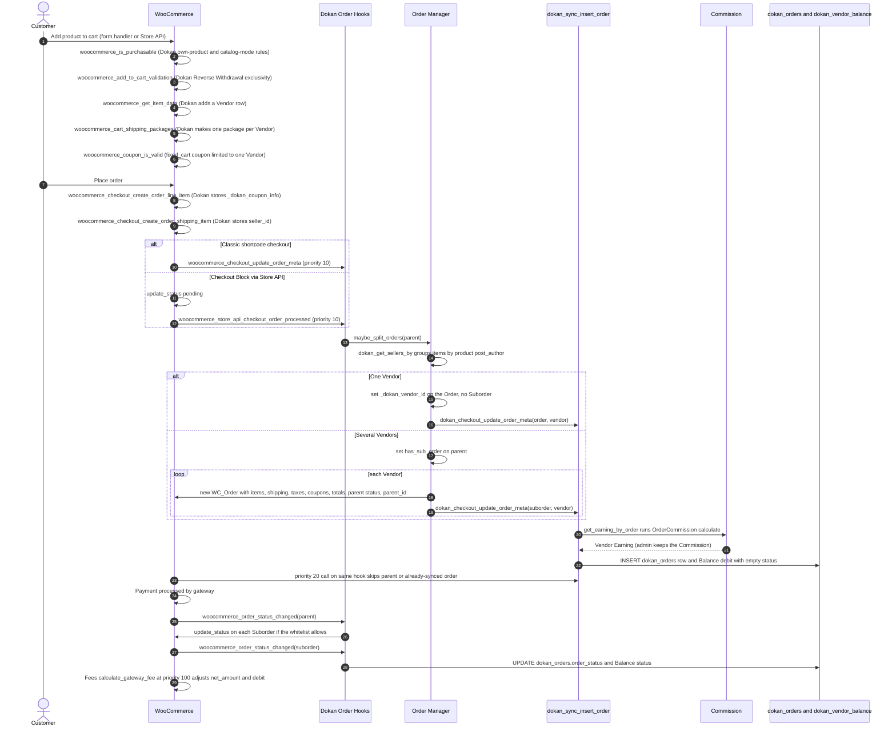
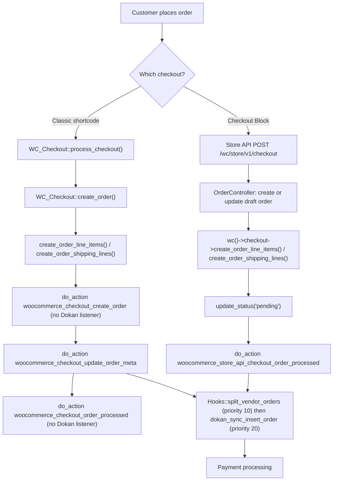
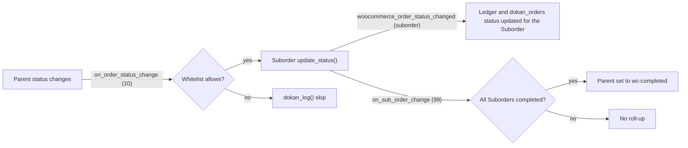

# WooCommerce Integration: Cart, Checkout, Orders (Dokan Lite)

This document maps every WooCommerce seam that Dokan Lite uses to turn a WooCommerce cart into Vendor orders. It covers the cart (Vendor attribution, shipping packages per Vendor, coupon rules, purchasability rules), both checkout implementations (the classic `[woocommerce_checkout]` shortcode and the Checkout Block, which runs on the Store API), order creation and the Suborder split, status sync between a parent Order and its Suborders, HPOS and posts-storage compatibility, order emails, and the My Account area.

It is the WooCommerce-facing companion to [orders-commission-fees.md](./orders-commission-fees.md). That document explains the Commission calculator, fee recipients, the `dokan_orders` table and the `dokan_vendor_balance` ledger in depth, so this document links to it rather than repeating those internals.

Terminology follows `CONTEXT.md`. An **Order** is the customer-facing WooCommerce order. A **Suborder** is the per-Vendor order split off a multi-vendor Order. A **Vendor order** is the order a Vendor processes: the Suborder, or the Order itself when it is single-vendor. **Commission** is the admin's share, **Earning** is the Vendor's share, and **Balance** is the Vendor's ledger. The legacy word "seller" survives only in code identifiers such as `seller_id` and `dokan_get_seller_id_by_order()`.

> Read [ADR-0004](../0004-vendor-order-is-authoritative-parent-is-mirror.md) first. The Vendor order is the authoritative record and the parent Order is a mirror. That is why the parent does not reduce stock, why status changes move from parent to Suborders while completion rolls up, and why a single-vendor Order has no Suborder at all.

---

## 1. Purpose & ownership

| Concern | Owner | Where |
|---|---|---|
| Cart, checkout, order objects, statuses, stock, emails, Store API | [WooCommerce] | Dokan only reacts to WooCommerce hooks and calls WooCommerce APIs |
| Declaring HPOS and Cart/Checkout Blocks compatibility | [Lite] | `WeDevs_Dokan::declare_woocommerce_feature_compatibility` |
| Showing the Vendor name on cart items (classic cart and Store API `item_data`) | [Lite] | `dokan_product_seller_info()` |
| Purchasability rules (a Vendor cannot buy their own product; catalog mode) | [Lite] | `dokan_vendor_own_product_purchase_restriction()`, `CatalogMode\Hooks` |
| Cart exclusivity for the Reverse Withdrawal payment product | [Lite] | `ReverseWithdrawal\Cart` |
| One shipping package per Vendor | [Lite] when Dokan Pro is not active; when Pro is active, Pro takes over this split (consumed by Dokan Pro) | `Shipping\Hooks` |
| Per-line-item coupon attribution, coupon validity across Vendors | [Lite] | `Vendor\Coupon`, `Order\Hooks::ensure_coupon_is_valid` |
| Suborder split at checkout (classic and Block) and in WP-admin | [Lite] | `Order\Hooks::split_vendor_orders`, `Order\Manager::maybe_split_orders` |
| Parent and Suborder status sync, completion roll-up, parent stock guard | [Lite] | `Order\Hooks` |
| `dokan_orders` row and initial Balance entry per Vendor order | [Lite] | `dokan_sync_insert_order()` (detailed in the companion document) |
| Vendor order emails, suppression of duplicate customer and admin emails for Suborders | [Lite] | `Emails\Manager`, `Emails\VendorNewOrder`, `Emails\VendorCompletedOrder`, `Order\EmailHooks` |
| My Account: parent-only order list, Suborder table on order details, Vendor dashboard button, become-a-Vendor section | [Lite] | `includes/wc-template.php`, `Frontend\MyAccount\BecomeAVendor` |
| HPOS and posts-storage abstraction | [Lite] wrapper over [WooCommerce] | `WeDevs\Dokan\Utilities\OrderUtil` wraps `Automattic\WooCommerce\Utilities\OrderUtil` |
| Gateway-fee capture from PayPal plugins | [Lite] listener, hooks fired by [Third-party: PayPal plugins] | `Fees::calculate_gateway_fee` |

Dokan Lite does **not** enforce a "one Vendor per cart" rule and does not alter `sold_individually` behaviour for marketplace products. A search of `includes/` finds `sold_individually` only as a product field that Vendors can edit and as a flag forced onto the Reverse Withdrawal base product (`ReverseWithdrawal\Helper`, `ReverseWithdrawal\InstallerHelper`). A cart can therefore hold products from any number of Vendors, and the split happens after the Order is created.

**Related ADRs:** [ADR-0004](../0004-vendor-order-is-authoritative-parent-is-mirror.md) (Vendor order is authoritative), [ADR-0011](../0011-suborders-are-created-synchronously-at-checkout.md) (Suborders created synchronously at checkout), [ADR-0012](../0012-commission-terms-are-frozen-onto-the-order-at-first-calculation.md) (Commission terms frozen at first calculation), [ADR-0017](../0017-orders-are-storage-agnostic-through-woocommerce-crud.md) (storage-agnostic orders and HPOS).

---

## 2. Entry points & bootstrap

| What | Where |
|---|---|
| Compatibility declaration hooked on `before_woocommerce_init` | `lite:dokan-class.php:76` |
| `declare_woocommerce_feature_compatibility()` declares `custom_order_tables` and `cart_checkout_blocks` as compatible via `FeaturesUtil::declare_compatibility()` | `lite:dokan-class.php:237-242` |
| WooCommerce fires `before_woocommerce_init` | `wc:includes/class-woocommerce.php:998` |
| Plugin initialisation hooked on `woocommerce_loaded` (`WeDevs_Dokan::init_plugin`) | `lite:dokan-class.php:77`; WooCommerce fires it at `wc:includes/class-woocommerce.php:301` |
| Order hook classes created by the `order_controller` service | `lite:includes/Order/Controller.php:34` (`Controller::init_classes`): always `Hooks`, `MiscHooks`, `EmailHooks`, `OrderCache`, `Frontend\Hooks`, `OrderEventListener`; `Admin\Permissions` and `Admin\Hooks` only when `is_admin()`; `Ajax` only during AJAX |
| Checkout split and sync hooks registered | `lite:includes/Order/Hooks.php:40-46` |
| Shipping package split registered (only when Dokan Pro is absent) | `lite:includes/Shipping/Hooks.php:22-30` (shared service in `CommonServiceProvider`) |
| Vendor coupon hooks registered | `lite:includes/Vendor/Coupon.php:18-24`, instantiated from `WeDevs\Dokan\Vendor\Hooks` |
| Reverse Withdrawal cart hooks | `lite:includes/ReverseWithdrawal/Cart.php:21-34`, instantiated from `lite:includes/ReverseWithdrawal/ReverseWithdrawal.php:68`; returns early when the feature is disabled |
| Procedural cart, template and My Account hooks (loaded with the plugin) | `lite:includes/wc-template.php:29`, `:107`, `:133`, `:311`, `:341`; `lite:includes/wc-functions.php:1071` |
| Dokan email classes added to WooCommerce | `lite:includes/Emails/Manager.php:17-19` |

---

## 3. Key classes

| Class / function | File | Responsibility |
|---|---|---|
| `WeDevs_Dokan::declare_woocommerce_feature_compatibility` | `lite:dokan-class.php:237` | Declares HPOS (`custom_order_tables`) and `cart_checkout_blocks` compatibility. |
| `WeDevs\Dokan\Order\Hooks` | `lite:includes/Order/Hooks.php:25` | Checkout split trigger for both checkouts, parent to Suborder status cascade (`on_order_status_change`, `:95`), completion roll-up (`on_sub_order_change`, `:391`), coupon guard (`ensure_coupon_is_valid`, `:465`), parent stock guard (`prevent_stock_reduction_for_parent_order`, `:505`), parent item stock mirror (`sync_parent_order_item_stock`, `:525`). |
| `WeDevs\Dokan\Order\Manager` | `lite:includes/Order/Manager.php:20` | `maybe_split_orders` (`:896`), `create_sub_order` (`:582`), `get_child_orders` (`:463`), `all` (`:31`, a `wc_get_orders()` wrapper), `get_customer_orders` (`:413`). |
| `dokan_get_sellers_by()` | `lite:includes/Order/functions.php:522` | Groups an Order's line items by Vendor using the product's `post_author`, filterable per item. |
| `dokan_sync_insert_order()` | `lite:includes/Order/functions.php:217` | Writes the `dokan_orders` row and the initial Balance debit for one Vendor order. |
| `dokan_get_seller_id_by_order()` | `lite:includes/Order/functions.php:296` | Resolves an order's Vendor; returns `0` for a parent Order that has Suborders. |
| `WeDevs\Dokan\Shipping\Hooks` | `lite:includes/Shipping/Hooks.php:15` | Splits cart shipping into one package per Vendor, tags shipping items with `seller_id`, renames packages. |
| `WeDevs\Dokan\Vendor\Coupon` | `lite:includes/Vendor/Coupon.php:14` | Records per-line-item coupon discounts (`_dokan_coupon_info`) in the cart and on order items so each Suborder can carry its own share. |
| `WeDevs\Dokan\ReverseWithdrawal\Cart` | `lite:includes/ReverseWithdrawal/Cart.php:15` | Keeps the Reverse Withdrawal payment product alone in the cart and sets its price. |
| `WeDevs\Dokan\CatalogMode\Hooks` | `lite:includes/CatalogMode/Hooks.php:14` | Makes products non-purchasable and hides prices when catalog mode applies. |
| `WeDevs\Dokan\Utilities\OrderUtil` | `lite:includes/Utilities/OrderUtil.php:9` | Static HPOS helpers: `is_hpos_enabled()`, `get_post_or_order_id()`, `is_order()`, `get_order_admin_screen()`, admin URLs. |
| `WeDevs\Dokan\Order\EmailHooks` | `lite:includes/Order/EmailHooks.php:19` | Stops duplicate customer emails for Suborders, adds the Vendor to cancelled-order and customer-note emails. |
| `WeDevs\Dokan\Emails\VendorNewOrder` | `lite:includes/Emails/VendorNewOrder.php:19` | `WC_Email` subclass sent to the Vendor of a Vendor order; disables WooCommerce's admin `new_order` email for Suborders. |
| `WeDevs\Dokan\Emails\VendorCompletedOrder` | `lite:includes/Emails/VendorCompletedOrder.php:20` | `WC_Email` subclass sent to the Vendor when a Vendor order completes. |
| `WeDevs\Dokan\Order\Admin\Hooks` / `Admin\Permissions` | `lite:includes/Order/Admin/Hooks.php:22`, `lite:includes/Order/Admin/Permissions.php:17` | Registers either the HPOS list-table hooks or the posts-screen hooks for the admin order list. |
| `WeDevs\Dokan\Fees` | `lite:includes/Fees.php:9` | Gateway-fee adjustment after status change (`calculate_gateway_fee`, `:57`). |

---

## 4. Execution flow

### 4.1 End to end: add to cart, checkout, Suborders, Commission, Balance

Step notes, with citations:

- Purchasability: `dokan_vendor_own_product_purchase_restriction()` returns `false` when the current user is the product's author, then applies `dokan_vendor_own_product_purchase_restriction` (`lite:includes/wc-functions.php:1049-1071`). `CatalogMode\Hooks::hide_add_to_cart_button` runs at priority 20 when catalog mode is enabled by the admin. WooCommerce applies `woocommerce_is_purchasable` in `WC_Product::is_purchasable()`; the Store API cart checks `is_purchasable()` at `wc:src/StoreApi/Utilities/CartController.php:270` and `:691`.
- Grouping by Vendor uses the product's `post_author`, filterable through `dokan_get_sellers_by` (`dokan_get_sellers_by()`).
- On both checkouts, line items and shipping items are created by the same `WC_Checkout` methods, so the line-item and shipping-item hooks fire in both paths (section 4.3).
- The split runs at priority 10 and `dokan_sync_insert_order` runs again at priority 20 on the same WooCommerce hook (`lite:includes/Order/Hooks.php:41-46`). The priority 20 call returns early because the parent has `has_sub_order` or because the Vendor order already has a `dokan_orders` row (`Manager::is_order_already_synced`).
- Commission is computed lazily, inside `dokan_sync_insert_order()` through `Commission::get_earning_by_order()` (`lite:includes/Commission.php:204`). See [orders-commission-fees.md section 4.3](./orders-commission-fees.md) for the calculator and section 4.1 there for the ledger row and why its `status` starts empty.

### 4.2 Suborder creation details

`Manager::maybe_split_orders()` (`lite:includes/Order/Manager.php:896`):

1. Accepts an ID or a `WC_Order`. Returns if the order already has `_dokan_vendor_id` greater than zero (it was already handled as a single-vendor Order).
2. If `$force_create` is true, or the parent already has `has_sub_order`, it deletes all existing child orders with `$child_order->delete( true )` before splitting again.
3. Groups items with `dokan_get_sellers_by()`. No Vendor found: returns.
4. One Vendor: fires `dokan_create_parent_order`, stores `_dokan_vendor_id` on the Order, fires `dokan_checkout_update_order_meta( $order_id, $seller_id )`.
5. Several Vendors: sets `has_sub_order = true` on the parent and calls `create_sub_order()` per Vendor.

`Manager::create_sub_order()` (`lite:includes/Order/Manager.php:582`) builds a `new WC_Order()`, sets `created_via = 'dokan'`, copies the cart hash, customer, currency, tax mode, IP, user agent, customer note, payment method and title, all billing and shipping address fields, and `_dokan_vendor_id`. It then copies the Vendor's line items (with all item meta plus `_dokan_parent_order_item_id`), the shipping items whose `seller_id` item meta matches the Vendor (filters `dokan_shipping_method` (deprecated) and `dokan_shipping_methods`), one tax item per parent tax rate, and coupon items rebuilt from the per-item `_dokan_coupon_info` amounts. It fires `dokan_create_sub_order_before_calculate_totals`, calls `calculate_totals()`, copies the parent's status, sets `parent_id`, saves, calls `wc_update_total_sales_counts()`, and fires `dokan_checkout_update_order_meta( $suborder_id, $seller_id )`. Any `Throwable` is logged and returned as a `WP_Error` with code `dokan-suborder-error`. When Dokan Pro is active, `create_coupons()` removes one Pro-registered filter on `woocommerce_order_get_items` before copying coupons (consumed by Dokan Pro).

**Re-entry is designed for.** Both checkouts can run the split hook more than once for the same parent Order:

- Classic checkout resumes the session's `order_awaiting_payment` order when it is `pending` or `failed` and the cart hash is unchanged (`wc:includes/class-wc-checkout.php:413-425`), and the same `WC_Checkout::create_order()` then fires `woocommerce_checkout_update_order_meta` again (`wc:includes/class-wc-checkout.php:514`).
- The Store API reuses a draft order that is `checkout-draft`, or that still needs payment with an unchanged cart hash (`wc:src/StoreApi/Utilities/DraftOrderTrait.php:53-69`), and the pay-for-order route `/checkout/{id}` (`wc:src/StoreApi/Routes/V1/CheckoutOrder.php:53`) also fires `woocommerce_store_api_checkout_order_processed` (`wc:src/StoreApi/Routes/V1/CheckoutOrder.php:160`).

In those cases `maybe_split_orders()` sees `has_sub_order`, deletes the previous Suborders and creates new ones, so Suborder IDs change between attempts. A single-vendor Order returns at step 1 and is not touched again.

### 4.3 Classic checkout versus Block checkout (Store API)

Dokan Lite declares `cart_checkout_blocks` compatibility (`lite:dokan-class.php:240`). Its Block checkout support is entirely server-side: there is no Lite JavaScript integration with the Checkout Block (no `IntegrationInterface`, `ExtendSchema` or `registerCheckoutFilters` usage was found in `includes/` or `src/`).

| WooCommerce hook Dokan Lite consumes | Classic shortcode | Checkout Block / Store API | Evidence |
|---|---|---|---|
| `woocommerce_checkout_update_order_meta` | Fires | **Does not fire** | Only `wc:includes/class-wc-checkout.php:514` |
| `woocommerce_store_api_checkout_order_processed` | Does not fire | Fires before payment. On `POST /checkout` it fires right after `update_status('pending')`; on the pay-for-order route `POST /checkout/{id}` it fires for the existing order without that status reset | `wc:src/StoreApi/Routes/V1/Checkout.php:675`, `:695`; `wc:src/StoreApi/Routes/V1/CheckoutOrder.php:160` |
| `woocommerce_checkout_create_order_line_item` | Fires | Fires (Store API calls `wc()->checkout->create_order_line_items()`) | `wc:includes/class-wc-checkout.php:611`; `wc:src/StoreApi/Utilities/OrderController.php:845` |
| `woocommerce_checkout_create_order_shipping_item` | Fires | Fires (Store API calls `wc()->checkout->create_order_shipping_lines()`) | `wc:includes/class-wc-checkout.php:690`; `wc:src/StoreApi/Utilities/OrderController.php:851` |
| `woocommerce_cart_shipping_packages`, `woocommerce_shipping_package_name` | Fires | Fires (cart-level) | `wc:includes/class-wc-cart.php:1732-1733`, `:1813-1814` |
| `woocommerce_coupon_is_valid` | Fires | Fires (`WC_Discounts`) | `wc:includes/class-wc-discounts.php:1260` |
| `woocommerce_coupon_get_apply_quantity` | Fires | Fires (`WC_Discounts`) | `wc:includes/class-wc-discounts.php:384`, `:448`, `:451`, `:537` |
| `woocommerce_add_to_cart_validation` | Fires | Fires (deprecated path kept by Store API) | `wc:includes/class-wc-form-handler.php:1088`; `wc:src/StoreApi/Utilities/CartController.php:334-342` |
| `woocommerce_get_item_data` | Fires | Fires (Store API cart item `item_data`) | `wc:includes/wc-template-functions.php:4591`; `wc:src/StoreApi/Schemas/V1/CartItemSchema.php:174` |
| `woocommerce_thankyou_{gateway}` (Dokan listens to `woocommerce_thankyou_ppec_paypal`) | Fires from `checkout/thankyou.php` | Fires from the Order Confirmation block | `wc:templates/checkout/thankyou.php:96`; `wc:src/Blocks/BlockTypes/OrderConfirmation/AdditionalInformation.php:32` |
| `woocommerce_order_details_after_order_table` | Fires from `order/order-details.php` | Fires from the Order Confirmation Totals block | `wc:templates/order/order-details.php:140`; `wc:src/Blocks/BlockTypes/OrderConfirmation/Totals.php:53` |

What Dokan does for Blocks:

1. It registers the split and the sync on `woocommerce_store_api_checkout_order_processed` in addition to the classic hook (`lite:includes/Order/Hooks.php:42`, `:46`). On a new Block checkout (`POST /checkout`) the hook fires before payment and the parent was just set to `pending`, so Suborders are created as `pending` and then follow the parent through the status cascade (section 4.4).
2. `dokan_product_seller_info()` adds a `Vendor` row with `'type' => 'vendor'` to `woocommerce_get_item_data`, and the code comment says the `type` key exists so the row can be identified in REST output (`lite:includes/wc-template.php:13-27`). The Store API passes this filter's output to the cart item `item_data` field.
3. The Order Confirmation block re-fires `woocommerce_order_details_after_order_table`, so the Suborder table from `dokan_order_show_suborders()` also appears on the Block thank-you page.

Classic-only hooks with no Dokan Lite listener: `woocommerce_checkout_create_order` (`wc:includes/class-wc-checkout.php:487`) and `woocommerce_checkout_order_processed` (`wc:includes/class-wc-checkout.php:1441`). Dokan Lite does not depend on them.

### 4.4 Status sync between parent Order and Suborders (ADR-0004)

WooCommerce fires `woocommerce_order_status_{to}`, then `woocommerce_order_status_{from}_to_{to}`, then `woocommerce_order_status_changed` from `WC_Order::status_transition()` (`wc:includes/class-wc-order.php:457`, `:477`, `:478`). `woocommerce_order_status_changed` fires only when a previous status exists.

| Priority on `woocommerce_order_status_changed` | Listener | Effect |
|---|---|---|
| 10 | `Order\Hooks::on_order_status_change` | In WP-admin, splits an Order that has no parent and no `has_sub_order` (lazy split for admin-created Orders, with the listener removed during the split to avoid recursion). Updates `dokan_orders.order_status`. Pushes the new status down to every child order when `is_status_change_allowed()` permits, otherwise logs the skip. Unless the COD exclusion applies (filter `dokan_order_should_exclude_from_vendor_balance`), updates the Balance row status. |
| 15 | `Order\Hooks::manage_refunded_for_order` | Only for a Vendor-dashboard status change to refunded (nonce `dokan_change_status`); see the companion document section 4.5. |
| 99 | `Order\Hooks::on_sub_order_change` | Only for child orders. Auto-completes `processing` Suborders that do not need processing, provided the Suborder whose status just changed is paid and its payment method is not in `dokan_excluded_payment_gateways_on_order_status_update` (default `bacs`, `cheque`, `cod`). When every Suborder is `completed`, sets the parent to `wc-completed`. |
| 100 | `Fees::calculate_gateway_fee` | Prorates the gateway processing fee over the Vendor orders and lowers `net_amount` and the Balance debit once per Vendor order (`dokan_gateway_fee` order meta guards repeats). |

The default downward-sync whitelist (`lite:includes/Order/Hooks.php:205-213`), filterable through `dokan_sub_order_status_update_whitelist`:

| Suborder current status | Allowed new statuses pushed from the parent |
|---|---|
| `wc-pending` | any |
| `wc-on-hold` | `wc-pending`, `wc-on-hold`, `wc-processing`, `wc-completed`, `wc-failed` |
| `wc-processing` | `wc-completed`, `wc-failed`, `wc-cancelled`, `wc-refunded` |
| `wc-completed` | `wc-refunded` |
| `wc-failed` | `wc-pending`, `wc-on-hold`, `wc-processing`, `wc-failed`, `wc-cancelled` |
| `wc-cancelled`, `wc-refunded` | none |

A status that is not a key of the whitelist (for example a custom status) is always allowed.

Stock follows ADR-0004 as well. `woocommerce_can_reduce_order_stock` returns `false` for any order with `has_sub_order` (`lite:includes/Order/Hooks.php:505`; WooCommerce applies it at `wc:includes/wc-stock-functions.php:178`). When a Suborder item's stock is reduced, `woocommerce_reduce_order_item_stock` (`wc:includes/wc-stock-functions.php:233`) lets Dokan copy the item's `_reduced_stock` onto the parent item named by `_dokan_parent_order_item_id`, for display only.

### 4.5 HPOS versus posts storage

- Dokan Lite declares HPOS compatibility (`lite:dokan-class.php:239`).
- `OrderUtil::is_hpos_enabled()` returns `Automattic\WooCommerce\Utilities\OrderUtil::custom_orders_table_usage_is_enabled()` (`lite:includes/Utilities/OrderUtil.php:20-25`). Other helpers delegate to `init_theorder_object()`, `get_post_or_order_id()`, `is_order()`, `is_custom_order_tables_in_sync()` and `orders_cache_usage_is_enabled()`.
- All order reads in `Order\Manager` go through `wc_get_orders()`. Under posts storage, `Manager::all()` moves its `meta_query` into a temporary `woocommerce_order_data_store_cpt_get_orders_query` filter (fired at `wc:includes/data-stores/class-wc-order-data-store-cpt.php:1055`) and removes it right after the query (`lite:includes/Order/Manager.php:34-59`). `get_child_orders()` queries `type = shop_order`, `parent = <id>`, `limit = -1` through `dokan_get_child_orders_args`.
- Suborders are created with `new WC_Order()` and saved through the active data store, so both storages receive them.
- Admin list-table hooks branch on storage (`lite:includes/Order/Admin/Hooks.php:30-57`). With HPOS: `manage_woocommerce_page_wc-orders_custom_column`, `manage_woocommerce_page_wc-orders_columns`, `woocommerce_order_list_table_restrict_manage_orders` (fired at `wc:src/Internal/Admin/Orders/ListTable.php:813`), `woocommerce_order_list_table_prepare_items_query_args` (`wc:src/Internal/Admin/Orders/ListTable.php:424`), and `woocommerce_trash_order` / `woocommerce_untrash_order` / `woocommerce_delete_order`. With posts: `manage_shop_order_posts_custom_column`, `manage_edit-shop_order_columns`, `restrict_manage_posts`, `request`, `wp_trash_post`, `untrash_post`, `delete_post`.
- `Admin\Permissions` scopes the admin order list to the current Vendor with `woocommerce_order_list_table_prepare_items_query_args` under HPOS and `posts_clauses` under posts storage (`lite:includes/Order/Admin/Permissions.php:26-30`).
- `OrderEventListener` listens to `woocommerce_trash_order` and `woocommerce_untrash_order` regardless of storage. WooCommerce fires `woocommerce_trash_order` from both data stores (`wc:includes/data-stores/abstract-wc-order-data-store-cpt.php:336`, `wc:src/Internal/DataStores/Orders/OrdersTableDataStore.php:2695`), but in this WooCommerce version `woocommerce_untrash_order` is fired only by the HPOS store (`wc:src/Internal/DataStores/Orders/OrdersTableDataStore.php:2916`). Under posts storage the admin path relies on `untrash_post` instead.

### 4.6 Order emails

`Emails\Manager::load_dokan_emails` adds `Dokan_Email_New_Order` (`VendorNewOrder`) and `Dokan_Email_Completed_Order` (`VendorCompletedOrder`), among other Dokan emails, through `woocommerce_email_classes` (fired at `wc:includes/class-wc-emails.php:339`). `register_email_actions` appends Dokan's actions, including `woocommerce_order_status_completed_notification`, to `woocommerce_email_actions` (`wc:includes/class-wc-emails.php:98-99`).

WooCommerce attaches a dispatcher to every email action. When the `woocommerce_defer_transactional_emails` filter is false, it attaches `send_transactional_email`, which fires `{action}_notification` in the same request (`wc:includes/class-wc-emails.php:145-147`, `:220`). When it is true, it attaches `queue_transactional_email` (`:140-143`), which pushes the call onto the deferred queue, and the `_notification` action later fires from `send_queued_transactional_email` (`:193`). The filter defaults to the `deferred_transactional_emails` feature flag (`wc:includes/class-wc-emails.php:130`), which is `enabled_by_default => false` (`wc:src/Internal/Features/FeaturesController.php:469-477`).

| Email behaviour | Mechanism |
|---|---|
| Vendor new-order email | `VendorNewOrder::trigger` (`lite:includes/Emails/VendorNewOrder.php:82`) listens on `woocommerce_order_status_{pending,failed,cancelled}_to_{processing,completed,on-hold}_notification`. It returns for a parent with `has_sub_order` (the same transition fires again for each Suborder through the cascade) and sends to the Vendor of the Vendor order. |
| Vendor completed-order email | `VendorCompletedOrder::trigger` (`lite:includes/Emails/VendorCompletedOrder.php:75`) on `woocommerce_order_status_completed_notification`. |
| No admin new-order email for Suborders | Both Vendor email classes filter `woocommerce_email_enabled_new_order` (fired as `woocommerce_email_enabled_{id}` at `wc:includes/emails/class-wc-email.php:853`) and return `false` when the order has a parent. |
| No duplicate customer emails | `EmailHooks::prevent_sending_multiple_email` (`lite:includes/Order/EmailHooks.php:46`) runs on several status actions; once a customer `_notification` has fired once in the request, it unhooks the matching WooCommerce customer email (`WC_Email_Customer_On_Hold_Order`, `WC_Email_Customer_Processing_Order`, `WC_Email_Customer_Completed_Order`). As a second guard, `EmailHooks::exclude_child_customer_receipt` (`:164`) on `phpmailer_init` replaces the mailer with `FakeMailer` when a customer receipt's body names a child order. |
| Vendor copied on cancelled-order email | `EmailHooks::send_email_for_order_cancellation` on `woocommerce_email_recipient_cancelled_order` (fired at `wc:includes/emails/class-wc-email.php:644`). It adds the Vendor's address and skips parents (Vendor `0`) or deleted users. |
| Vendor as Reply-To on customer-note email | `EmailHooks::add_reply_to_vendor_email_on_wc_customer_note_mail` on `woocommerce_email_headers` (`wc:includes/emails/class-wc-email.php:744`). |
| Vendor copied on low and out-of-stock emails | `dokan_wc_email_recipient_add_seller_no_stock` on `woocommerce_email_recipient_low_stock` and `woocommerce_email_recipient_no_stock` (`lite:includes/functions.php:2237-2238`; fired at `wc:includes/class-wc-emails.php:1053`, `:1140`). |

### 4.7 My Account

| Behaviour | Hook and code |
|---|---|
| Orders list shows only parent Orders and single-vendor Orders | `dokan_get_customer_main_order()` sets `post_parent = 0` on `woocommerce_my_account_my_orders_query` (`lite:includes/wc-template.php:127-133`). WooCommerce applies the filter in `woocommerce_account_orders()` (`wc:includes/wc-template-functions.php:3868-3869`) and in the legacy `wc:templates/myaccount/my-orders.php:24`. HPOS maps `post_parent` to `parent_order_id` (`wc:src/Internal/DataStores/Orders/OrdersTableQuery.php:272`); the posts store passes unmapped keys through to `WP_Query` (`wc:includes/data-stores/class-wc-data-store-wp.php:321-324`). |
| Dokan's own "My Orders" page | Shortcode `[dokan-my-orders]` renders `templates/my-orders.php`, which calls `Manager::get_customer_orders()`. That method itself applies the WooCommerce filter name `woocommerce_my_account_my_orders_query` before calling `Manager::all()` (`lite:includes/Order/Manager.php:424`), so the parent-only rule applies there too. |
| Suborder table on a parent's order details (My Account view-order and thank-you page) | `dokan_order_show_suborders()` on `woocommerce_order_details_after_order_table` renders `templates/sub-orders.php` (`lite:includes/wc-template.php:88-107`). |
| Vendor name on order line items | `dokan_attach_vendor_name()` on `woocommerce_order_item_meta_start` (`lite:includes/wc-template.php:324-341`; fired at `wc:templates/order/order-details-item.php:46` and in email item templates). |
| "Go to Vendor Dashboard" button | `dokan_set_go_to_vendor_dashboard_btn()` on `woocommerce_account_dashboard` (`lite:includes/wc-template.php:299-311`; fired at `wc:templates/myaccount/dashboard.php:65`). |
| Become-a-Vendor section and migration endpoint | `BecomeAVendor::render_become_a_vendor_section` on `woocommerce_after_my_account` (`wc:templates/myaccount/dashboard.php:79`) and `load_customer_to_vendor_update_template` on `woocommerce_account_account-migration_endpoint` (fired dynamically at `wc:includes/wc-template-functions.php:3828-3829`), registered at `lite:includes/Frontend/MyAccount/BecomeAVendor.php:34-36`. |

---

## 5. Hooks fired / hooks consumed

### 5.1 Hooks Dokan Lite fires in this area

| Hook | Type | Fired in | Purpose |
|---|---|---|---|
| `dokan_checkout_update_order_meta` | action | `Manager::maybe_split_orders`, `Manager::create_sub_order` | One call per Vendor order (`$order_id, $seller_id`). Lite itself listens with `dokan_sync_insert_order` (`lite:includes/Order/Hooks.php:49`). |
| `dokan_create_parent_order` | action | `Manager::maybe_split_orders` | Single-vendor Order identified (`$parent_order, $seller_id`). |
| `dokan_create_sub_order_before_calculate_totals` | action | `Manager::create_sub_order` | Adjust a Suborder before totals (`$order, $parent_order, $seller_products`). |
| `dokan_after_create_line_items` | action | `Manager::create_line_items` | After Suborder items are added. |
| `dokan_shipping_method` (deprecated 3.7.19), `dokan_shipping_methods` | filter | `Manager::create_shipping` | Choose shipping items copied into a Suborder. |
| `dokan_get_sellers_by` | filter | `dokan_get_sellers_by()` | Override the Vendor for a line item. |
| `dokan_get_child_orders_args` | filter | `Manager::get_child_orders` | Change the child-order query. |
| `dokan_get_vendor_orders_args`, `dokan_get_vendor_orders`, `dokan_get_vendor_orders_count` | filter | `Manager::all` | Change Vendor order queries and results. |
| `dokan_sub_order_status_update_whitelist` | filter | `Hooks::is_status_change_allowed` | Downward status sync rules. |
| `dokan_order_should_exclude_from_vendor_balance` | filter | `Hooks::on_order_status_change` | COD exclusion from Balance status updates. |
| `dokan_excluded_payment_gateways_on_order_status_update` | filter | `Hooks::on_sub_order_change` | Gateways excluded from digital-only auto-complete. |
| `dokan_coupon_is_valid` | filter | `Hooks::ensure_coupon_is_valid` | Final coupon validity. |
| `dokan_coupon_should_validate` | filter | `Coupon::intercept_wc_coupon` | Whether the cloned discount re-validates the coupon. |
| `dokan_wc_coupon_applied` | action | `Coupon::intercept_wc_coupon` | Per-item discount captured; Lite listens with `Coupon::save_item_coupon_discount`. |
| `dokan_after_coupon_info_data_updated_on_order_item_meta` | action | `Coupon::save_coupon_data_to_order_item` | After `_dokan_coupon_info` is written to an order item. |
| `dokan_cart_shipping_packages`, `dokan_shipping_package_name` | filter | `Shipping\Hooks` | Change the per-Vendor packages and their labels. |
| `dokan_vendor_own_product_purchase_restriction` | filter | `dokan_vendor_own_product_purchase_restriction()` | Allow or block a Vendor buying their own product. |
| `dokan_catalog_mode_hide_add_to_cart_button` | filter | `CatalogMode\Hooks::hide_add_to_cart_button` | Return `'no'` to bypass catalog mode. |
| `dokan_email_classes`, `dokan_email_actions` | filter | `Emails\Manager` | Add or remove Dokan emails and email actions. |
| `dokan_set_go_to_vendor_dashboard_btn_text` | filter | `dokan_set_go_to_vendor_dashboard_btn()` | Button label. |
| `woocommerce_my_account_my_orders_query` | filter (WooCommerce name, fired by Dokan) | `Manager::get_customer_orders` | Dokan re-applies WooCommerce's filter for its own customer order list. |

### 5.2 WooCommerce hooks Dokan Lite consumes

| Hook | Type | Dokan listener (priority) | Where WooCommerce fires it |
|---|---|---|---|
| `before_woocommerce_init` | action | `WeDevs_Dokan::declare_woocommerce_feature_compatibility` | `wc:includes/class-woocommerce.php:998` |
| `woocommerce_loaded` | action | `WeDevs_Dokan::init_plugin` | `wc:includes/class-woocommerce.php:301` |
| `woocommerce_is_purchasable` | filter | `dokan_vendor_own_product_purchase_restriction` (10), `CatalogMode\Hooks::hide_add_to_cart_button` (20), Reverse Withdrawal hooks | `wc:includes/abstracts/abstract-wc-product.php:1785` (`WC_Product::is_purchasable()`) |
| `woocommerce_add_to_cart_validation` | filter | `ReverseWithdrawal\Cart::prevent_purchasing_multiple_products` (10) | `wc:includes/class-wc-form-handler.php:1088`, `:1120`, `:1170`; `wc:includes/class-wc-cart-session.php:688`; `wc:src/StoreApi/Utilities/CartController.php:334` |
| `woocommerce_before_calculate_totals` | action | `ReverseWithdrawal\Cart::woocommerce_custom_price_to_cart_item` (99) | `wc:includes/class-wc-cart.php:1604` (`WC_Cart::calculate_totals()`) |
| `woocommerce_get_item_data` | filter | `dokan_product_seller_info` (10); `ReverseWithdrawal\Cart::remove_seller_name_from_cart_item` (9) | `wc:includes/wc-template-functions.php:4591`; `wc:src/StoreApi/Schemas/V1/CartItemSchema.php:174` |
| `woocommerce_cart_shipping_packages` | filter | `Shipping\Hooks::split_shipping_packages` (Pro absent) | `wc:includes/class-wc-cart.php:1732-1733` |
| `woocommerce_shipping_package_name` | filter | `Shipping\Hooks::change_shipping_pack_name` (Pro absent) | `wc:includes/class-wc-cart.php:1813-1814` |
| `woocommerce_shipping_method_add_rate` | filter | `Shipping\Hooks::add_shipping_method_rate` | `wc:includes/abstracts/abstract-wc-shipping-method.php:376` |
| `woocommerce_coupon_is_valid` | filter | `Order\Hooks::ensure_coupon_is_valid` (10) | `wc:includes/class-wc-discounts.php:1260` |
| `woocommerce_coupon_get_apply_quantity` | filter | `Vendor\Coupon::intercept_wc_coupon` (15) | `wc:includes/class-wc-discounts.php:384`, `:448`, `:451`, `:537` |
| `woocommerce_removed_coupon` | action | `Vendor\Coupon::remove_coupon_info_from_cart_item` | `wc:includes/class-wc-cart.php:2257` |
| `woocommerce_checkout_create_order_line_item` | action | `Vendor\Coupon::add_coupon_info_to_order_item` (10); `ReverseWithdrawal\Order::store_line_item_metas` (10) | `wc:includes/class-wc-checkout.php:611` (both checkouts) |
| `woocommerce_checkout_create_order_shipping_item` | action | `Shipping\Hooks::add_shipping_pack_meta` (Pro absent) | `wc:includes/class-wc-checkout.php:690` (both checkouts) |
| `woocommerce_checkout_update_order_meta` | action | `Order\Hooks::split_vendor_orders` (10), `dokan_sync_insert_order` (20) | `wc:includes/class-wc-checkout.php:514` (classic only) |
| `woocommerce_store_api_checkout_order_processed` | action | `Order\Hooks::split_vendor_orders` (10), `dokan_sync_insert_order` (20) | `wc:src/StoreApi/Routes/V1/Checkout.php:695`; `wc:src/StoreApi/Routes/V1/CheckoutOrder.php:160` (Store API only) |
| `woocommerce_process_shop_order_meta` | action | `dokan_sync_insert_order` (60, admin only) | `wc:includes/admin/class-wc-admin-meta-boxes.php:262`; `wc:src/Internal/Admin/Orders/Edit.php:318` |
| `woocommerce_order_status_changed` | action | `Order\Hooks::on_order_status_change` (10), `manage_refunded_for_order` (15), `on_sub_order_change` (99); `OrderCache::reset_order_cache` (10); `ReverseWithdrawal` listeners (10); `Fees::calculate_gateway_fee` (100) | `wc:includes/class-wc-order.php:478` |
| `woocommerce_payment_complete` | action | `ReverseWithdrawal\Order::process_payment` | `wc:includes/class-wc-order.php:186` |
| `woocommerce_can_reduce_order_stock` | filter | `Order\Hooks::prevent_stock_reduction_for_parent_order` | `wc:includes/wc-stock-functions.php:178` |
| `woocommerce_reduce_order_item_stock` | action | `Order\Hooks::sync_parent_order_item_stock` | `wc:includes/wc-stock-functions.php:233` |
| `woocommerce_new_order`, `woocommerce_update_order` | action | `OrderCache` (cache reset); `VendorBalanceUpdateHandler::update_dokan_order_table` (80) and `handle_order_edit` (99) on update | `wc:includes/data-stores/class-wc-order-data-store-cpt.php:117`, `:244`; `wc:src/Internal/DataStores/Orders/OrdersTableDataStore.php:3029`, `:3137` |
| `woocommerce_order_refunded` | action | `OrderCache::reset_order_cache`; `RefundHandler::handle_refund` (returns early when Pro is active) | `wc:includes/wc-order-functions.php:752` |
| `woocommerce_new_order_item`, `woocommerce_before_delete_order_item`, `woocommerce_after_order_object_save` | action | `Commission\RecalculateCommissions` (marks and recalculates edited orders); `Vendor\Coupon::remove_coupon_info_from_order_item` | `wc:includes/data-stores/abstract-wc-order-item-type-data-store.php:93`, `:140`; `wc:includes/abstracts/abstract-wc-order.php:302` (dynamic `woocommerce_after_{object_type}_object_save`) |
| `woocommerce_trash_order`, `woocommerce_untrash_order`, `woocommerce_delete_order` | action | `OrderEventListener`; `Admin\Hooks` (HPOS only) | Trash: `wc:includes/data-stores/abstract-wc-order-data-store-cpt.php:336`, `wc:src/Internal/DataStores/Orders/OrdersTableDataStore.php:2695`. Untrash: `wc:src/Internal/DataStores/Orders/OrdersTableDataStore.php:2916`. Delete: `wc:includes/data-stores/abstract-wc-order-data-store-cpt.php:310`, `wc:src/Internal/DataStores/Orders/OrdersTableDataStore.php:2670` |
| `woocommerce_order_data_store_cpt_get_orders_query` | filter | Temporary closure in `Manager::all` (posts storage only) | `wc:includes/data-stores/class-wc-order-data-store-cpt.php:1055` |
| `woocommerce_order_list_table_prepare_items_query_args`, `woocommerce_order_list_table_restrict_manage_orders` | filter / action | `Admin\Hooks`, `Admin\Permissions` (HPOS only) | `wc:src/Internal/Admin/Orders/ListTable.php:424`, `:813` |
| `woocommerce_email_classes` | filter | `Emails\Manager::load_dokan_emails` (35) | `wc:includes/class-wc-emails.php:339` |
| `woocommerce_email_actions` | filter | `Emails\Manager::register_email_actions` | `wc:includes/class-wc-emails.php:98-99` |
| `woocommerce_order_status_*_notification` | action | `VendorNewOrder::trigger`, `VendorCompletedOrder::trigger` | `wc:includes/class-wc-emails.php:193` (`send_queued_transactional_email`, deferred) and `:220` (`send_transactional_email`, immediate) |
| `woocommerce_order_status_pending_to_on-hold`, `..._on-hold_to_processing`, `..._pending_to_processing`, `woocommerce_order_status_completed`, `..._failed_to_processing` | action | `EmailHooks::prevent_sending_multiple_email` | `wc:includes/class-wc-order.php:457`, `:477` |
| `woocommerce_email_enabled_new_order` | filter | `VendorNewOrder` / `VendorCompletedOrder::prevent_sub_order_admin_email` | `wc:includes/emails/class-wc-email.php:853` |
| `woocommerce_email_recipient_cancelled_order` | filter | `EmailHooks::send_email_for_order_cancellation` | `wc:includes/emails/class-wc-email.php:644` |
| `woocommerce_email_headers` | filter | `EmailHooks::add_reply_to_vendor_email_on_wc_customer_note_mail` | `wc:includes/emails/class-wc-email.php:744` |
| `woocommerce_email_recipient_low_stock`, `woocommerce_email_recipient_no_stock` | filter | `dokan_wc_email_recipient_add_seller_no_stock` | `wc:includes/class-wc-emails.php:1053`, `:1140` |
| `woocommerce_my_account_my_orders_query` | filter | `dokan_get_customer_main_order` | `wc:includes/wc-template-functions.php:3868-3869`; `wc:templates/myaccount/my-orders.php:24` |
| `woocommerce_order_details_after_order_table` | action | `dokan_order_show_suborders` | `wc:templates/order/order-details.php:140`; `wc:src/Blocks/BlockTypes/OrderConfirmation/Totals.php:53` |
| `woocommerce_order_item_meta_start` | action | `dokan_attach_vendor_name` | `wc:templates/order/order-details-item.php:46`; `wc:templates/emails/email-order-items.php:109`, `:192` |
| `woocommerce_account_dashboard`, `woocommerce_after_my_account` | action | `dokan_set_go_to_vendor_dashboard_btn`, `BecomeAVendor::render_become_a_vendor_section` | `wc:templates/myaccount/dashboard.php:65`, `:79` |
| `woocommerce_account_account-migration_endpoint` | action | `BecomeAVendor::load_customer_to_vendor_update_template` | `wc:includes/wc-template-functions.php:3829` |
| `woocommerce_order_item_get__dokan_commission_meta` | filter | `Order\Hooks::get_dokan_commission_meta` (back-compat rename of `dokan_commission_meta`) | `wc:includes/abstracts/abstract-wc-data.php:438` (`WC_Data::get_meta()` applies `woocommerce_{object_type}_get_{key}`, prefix from `:938-939`) |

### 5.3 Third-party hooks Dokan Lite consumes

| Hook | Dokan listener | Owner |
|---|---|---|
| `woocommerce_thankyou_ppec_paypal` | `Fees::calculate_gateway_fee` | Fired by WooCommerce as `woocommerce_thankyou_{gateway}` (`wc:templates/checkout/thankyou.php:96`), for the gateway ID `ppec_paypal` belonging to [Third-party: PayPal Express Checkout] |
| `woocommerce_paypal_payments_order_captured` | `Fees::calculate_gateway_fee` (99) | [Third-party: WooCommerce PayPal Payments] |

---

## 6. Data storage

This section lists only the data written at WooCommerce touchpoints. The `dokan_orders` and `dokan_vendor_balance` table schemas are in [orders-commission-fees.md section 6](./orders-commission-fees.md).

| Key | Kind | Written by | Meaning |
|---|---|---|---|
| `has_sub_order` | order meta (parent) | `Manager::maybe_split_orders` | The Order was split into Suborders. Read by the stock guard, email triggers, Commission and sync. |
| `_dokan_vendor_id` | order meta | `Manager::maybe_split_orders` (single-vendor Order), `Manager::create_sub_order` (Suborder) | Vendor of a Vendor order. Its presence also stops a second split. |
| `created_via = dokan` | order property | `Manager::create_sub_order` | Marks Suborders created by Dokan. |
| `parent_id` | order property | `Manager::create_sub_order` | Links a Suborder to its parent Order (`post_parent` under posts storage, `parent_order_id` under HPOS). |
| `_dokan_parent_order_item_id` | order item meta (Suborder item) | `Manager::create_line_items` | The parent item this Suborder item was copied from. |
| `_reduced_stock` | order item meta (parent item) | `Hooks::sync_parent_order_item_stock` | Mirror of the Suborder item's reduced quantity, for display. |
| `seller_id` | shipping item meta | `Shipping\Hooks::add_shipping_pack_meta` | Vendor owning a shipping line; used to copy shipping into the right Suborder. |
| `_dokan_coupon_info` | cart item data and order item meta | `Vendor\Coupon` | Per-coupon discount, per-quantity amount and admin-coupon sharing settings for that item. |
| `coupon_info`, `coupon_data` | coupon item meta (Suborder) | `Manager::create_coupons` | Snapshot of the coupon copied into the Suborder. |
| `dokan_gateway_fee` | order meta (Vendor order) | `Fees::calculate_gateway_fee` | Prorated gateway fee, also used as a run-once guard. |
| `dokan_reverse_withdrawal_balance` | cart item data | Reverse Withdrawal | Custom price applied by `ReverseWithdrawal\Cart::woocommerce_custom_price_to_cart_item`. |
| `order_awaiting_payment`, `store_api_draft_order` | WooCommerce session keys | [WooCommerce] | Drive the order reuse that makes Dokan's split re-run (section 4.2). |
| `dokan_commission_recalculate_order_id:{order_id}` | option | `Commission\RecalculateCommissions` on `woocommerce_new_order_item` and `woocommerce_before_delete_order_item` | Marks an edited order; deleted on `woocommerce_after_order_object_save`, which then fires `dokan_recalculate_order_commission_and_adjust_vendor_balance`. |

No custom post types or transients are introduced for the cart and checkout seams described here.

---

## 7. REST/AJAX endpoints

Dokan Lite registers no cart or checkout endpoint of its own. The Checkout Block uses WooCommerce's Store API routes (`POST /wc/store/v1/checkout` and `POST /wc/store/v1/checkout/{id}`), whose permission and nonce checks are WooCommerce's. Dokan participates only through the WooCommerce hooks above.

Two order-related REST seams touch WooCommerce's order REST layer:

- `MiscHooks::add_vendor_info_in_rest_order` filters `woocommerce_rest_prepare_shop_order_object` (fired as `woocommerce_rest_prepare_{post_type}_object` at `wc:includes/rest-api/Controllers/Version2/class-wc-rest-orders-v2-controller.php:551`).
- `REST\OrderController` hooks `woocommerce_new_order_data` (applied only by the posts store, `wc:includes/data-stores/abstract-wc-order-data-store-cpt.php:95`; it is not applied in `OrdersTableDataStore.php`), `woocommerce_rest_pre_insert_shop_order_object` (`wc:includes/rest-api/Controllers/Version2/class-wc-rest-orders-v2-controller.php:789`) and `woocommerce_rest_insert_shop_order_object` (`wc:includes/rest-api/Controllers/Version3/class-wc-rest-crud-controller.php:221`, `:268`). Dokan's Vendor order REST routes and their permission callbacks are documented in [orders-commission-fees.md section 7](./orders-commission-fees.md).

---

## 8. Permissions & capabilities

- **Purchasing.** A logged-in Vendor cannot purchase their own product (`dokan_vendor_own_product_purchase_restriction()` checks `dokan_is_product_author()`). Catalog mode can make products non-purchasable.
- **Checkout.** Customer authentication, nonces and order ownership are WooCommerce's; Dokan adds no capability check to the checkout hooks. The split runs in the request that placed the Order.
- **Admin split and sync.** The lazy split in `on_order_status_change` runs only when `is_admin()` is true, and `dokan_sync_insert_order` on `woocommerce_process_shop_order_meta` is registered only in admin.
- **Vendor-dashboard refunded status.** `manage_refunded_for_order` acts only when the request carries a valid `dokan_change_status` nonce.
- **Admin order list.** `Admin\Permissions` maps meta capabilities (`map_meta_cap`) and restricts list queries to the current Vendor's orders, using the HPOS or posts hook as appropriate.
- **My Account.** WooCommerce's view-order ownership rules apply. Suborders carry the same `customer_id` as the parent, copied in `create_sub_order`.
- **Sanitisation.** Values copied into Suborders come from the parent `WC_Order` getters; meta writes use WooCommerce CRUD methods or `wc_update_order_item_meta()`, and direct SQL in these paths uses `$wpdb->update()`, `$wpdb->insert()` or `$wpdb->prepare()`.

---

## 9. WooCommerce touchpoints

| WooCommerce API or class | Used for |
|---|---|
| `Automattic\WooCommerce\Utilities\FeaturesUtil::declare_compatibility()` | HPOS and Cart/Checkout Blocks declaration |
| `Automattic\WooCommerce\Utilities\OrderUtil` | Storage detection and post-or-order helpers (through Dokan's wrapper) |
| `wc_get_orders()`, `wc_get_order()` | All order reads in `Order\Manager` and the hooks |
| `WC_Order`, `WC_Order_Item_Product`, `WC_Order_Item_Tax`, `WC_Order_Item_Coupon`, `WC_Order_Item_Shipping` | Building Suborders |
| `WC_Order::calculate_totals()`, `update_status()`, `set_status()`, `delete( true )` | Suborder totals, status cascade, recreation on re-split |
| `wc_update_total_sales_counts()` | Total sales for Suborders |
| `wc_update_order_item_meta()` | Parent `_reduced_stock` mirror, coupon info |
| `WC_Discounts::get_discounts()`, `apply_coupon()` | Per-item coupon amounts in `Vendor\Coupon` |
| `WC()->cart`, `WC()->customer` | Shipping package split |
| `WC_Email` | Base class for the Vendor order emails |
| Store API (`Checkout`, `CheckoutOrder`, `CartController`, `CartItemSchema`) | Block checkout and cart; Dokan reaches it only through hooks |

---

## 10. Dependencies

**Internal (Lite):** `Order\Manager`, `Order\Hooks`, `Order\EmailHooks`, `Commission` (`dokan()->commission`), `Fees` (`dokan()->fees`), `Vendor\Coupon`, `Shipping\Hooks`, `ReverseWithdrawal`, `CatalogMode`, `Utilities\OrderUtil`, the `VendorBalance` model, `dokan_get_seller_id_by_order()`, `dokan_get_vendor_by_product()`, `dokan_is_product_author()`.

**External:** WooCommerce 8.5.0 or later per `CLAUDE.md` (verified here against 11.2.1), including the Store API and the HPOS data store. Optional: the PayPal plugins whose hooks `Fees` listens to. Dokan Pro, when active, takes over shipping-package splitting and refund accounting (consumed by Dokan Pro).

---

## 11. Extension points

| Goal | How |
|---|---|
| Assign a line item to a different Vendor | Filter `dokan_get_sellers_by` (`$seller_id, $item`). |
| Add data to every Vendor order after creation | Action `dokan_checkout_update_order_meta` (`$order_id, $seller_id`); it fires for Suborders and for single-vendor Orders, on both checkouts. |
| Change a Suborder before totals | Action `dokan_create_sub_order_before_calculate_totals`. |
| Control which shipping lines go to a Suborder | Filter `dokan_shipping_methods`. |
| Change shipping packages or their labels | Filters `dokan_cart_shipping_packages`, `dokan_shipping_package_name` (when Lite owns the split). |
| Change parent to Suborder status propagation | Filter `dokan_sub_order_status_update_whitelist`. |
| Change digital-only auto-complete | Filter `dokan_excluded_payment_gateways_on_order_status_update`. |
| Change coupon rules | Filter `dokan_coupon_is_valid`; `dokan_coupon_should_validate`. |
| Allow Vendors to buy their own products | Filter `dokan_vendor_own_product_purchase_restriction`. |
| Add or remove Vendor emails | Filters `dokan_email_classes`, `dokan_email_actions`. |
| Customise the Suborder table on order details | Override `templates/sub-orders.php` in the theme. |
| React to a Block checkout specifically | Hook `woocommerce_store_api_checkout_order_processed` at a priority above 20 to see the Order after Dokan has split and synced it. For classic checkout, use `woocommerce_checkout_update_order_meta` above priority 20, or use `dokan_checkout_update_order_meta`, which covers both. |

**Related ADRs:** order status sync [0038](../0038-a-parent-order-status-change-is-copied-to-its-suborders-only-along-an-allowed-transition-list.md), [0037](../0037-a-parent-order-is-completed-automatically-only-when-every-suborder-is-completed.md), [0042](../0042-paid-digital-only-suborders-are-completed-automatically-unless-paid-with-a-manual-gateway.md), [0045](../0045-vendors-change-only-their-own-vendor-order-status-when-allowed-and-cancelled-or-refunded-orders-are-final.md); [coupons](../decisions-index.md#coupons) [0088](../0088-a-fixed-cart-coupon-can-be-used-only-when-every-product-in-the-cart-comes-from-one-vendor.md), [0086](../0086-a-coupon-discount-is-split-across-suborders-exactly-as-woocommerce-allocated-it-to-each-line-item.md), [0085](../0085-a-coupon-added-to-or-removed-from-a-parent-order-is-mirrored-onto-its-suborders.md), [0087](../0087-a-coupon-used-on-a-multi-vendor-order-counts-one-use-for-the-order-and-one-for-each-suborder.md), [0089](../0089-in-dokan-lite-vendors-cannot-create-coupons-and-every-coupon-is-a-store-admin-woocommerce-coupon.md); [shipping](../decisions-index.md#shipping) [0093](../0093-the-cart-is-split-into-one-shipping-package-per-vendor-and-virtual-items-get-no-package.md), [0090](../0090-each-shipping-line-belongs-to-one-vendor-and-a-suborder-receives-only-its-own-vendors-shipping-lines.md).

---

## Known gaps

- **Deferred transactional emails.** `EmailHooks::prevent_sending_multiple_email` depends on `did_action( '..._notification' ) === 1` within the current request. With WooCommerce's `deferred_transactional_emails` feature enabled (off by default), notifications are queued through `queue_transactional_email` and sent later, and whether the duplicate-suppression still behaves the same cannot be determined from source alone.
- **`exclude_child_customer_receipt` under HPOS.** The method reads `$order->post_parent` on a `WC_Order` rather than `get_parent_id()`. Whether that property resolves to the parent ID for HPOS-backed orders is not determinable from the code read here; it was not verified at runtime.
- **Posts-storage untrash.** In WooCommerce 11.2.1, `woocommerce_untrash_order` is fired only by the HPOS data store. `OrderEventListener::after_order_untrash` therefore receives no posts-storage untrash events through that hook; whether the posts-storage `untrash_post` path in `Admin\Hooks` fully covers it outside WP-admin was not traced.
- **REST order vendor assignment under HPOS.** `REST\OrderController::set_order_vendor_id` hooks `woocommerce_new_order_data`, which only the posts store applies. Whether HPOS stores reach an equivalent result through another path was not traced.
- **PayPal hook owners.** Neither PayPal Express Checkout (`ppec_paypal`) nor WooCommerce PayPal Payments is installed in this environment, so the firing sites of `woocommerce_paypal_payments_order_captured` and the `ppec_paypal` gateway could not be cited.
- **Suborder ID churn on retries.** Section 4.2 describes re-splitting on a resumed classic order or a reused Store API draft order from source. The downstream effect on Commission rows and Balance entries for the deleted Suborders (which `delete( true )` removes through WooCommerce) depends on deletion listeners covered in the companion document and was not traced end to end here.
- **Parent status at split time on classic checkout.** A new order's default status comes from `woocommerce_default_order_status`, which defaults to `pending` (`wc:includes/abstracts/abstract-wc-order.php:669`). Other plugins can filter it, so the status copied into Suborders on classic checkout is not guaranteed to be `pending` in every installation.
- **Dokan Pro ADRs.** Dokan Pro's ADRs were checked for context. Per the public-repo rule, their content is not summarised here.

_Verified against Lite @e1ce7fc81 / Pro @65975a952 / WooCommerce 11.2.1 — 2026-10-22._
